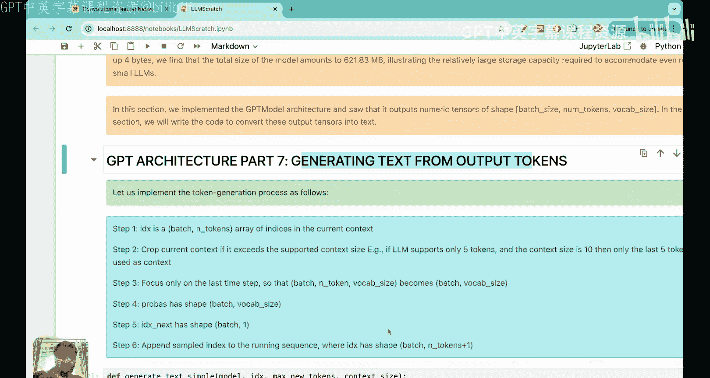

# Vizuara《从零开始搭建大语言模型｜Building LLMs from scratch》中英字幕（Claude-3.7-s） - P22：-24-Coding the 124 million parameter GPT-2 model.zh_en - GPT中英字幕课程资源 - BV1qG8HzUE2D

🎼Yeah。Hello everyone， welcome to this lecture in theBuild Lage languagenage models from Sctch series。

Today， what we are going to do is we are going to construct the entire GPT architecture or put in other words we are going to code the entire GPT model。

We have been building up to this lecture for a pretty long time now。

 so let me just quickly recap what all well be covering in today's lecture and what we have completed previously。

So in the previous set of lectures we started around four to five lectures back in this GPT architecture or LLM architecture lecture series we started out with a dummy GPT model class so when we started around four to five lectures back we did not have an understanding of the building blocks of the LLM architecture or the GPT architecture slowly we worked our way towards it initially we learned about layer normalization we wrote code for it then we wrote a code for the feed forward neural network along with the Jlu activation then we learned about shortcut connections and wrote code for that and in the previous lecture we also wrote the code for the entire transformer block in which the layer normalization the Jlu activation the feed forward neural network and the shortcut connections all come together。

Today what we are going to do is we are going to write code for this final piece of the puzzle。

 which is how point number one， point number2，3，4，5 and6 essentially come together to form the entire GPT architecture。

Throughout this these four to five lectures on the GPT architecture。

 we have this or we should have this visual figure in our mind。So here is what happens。

In the G architecture， we have text which gets tookkenized， we have the dropout layer over here。

 and then。The input embeddings are essentially passed to this blue colored block which is called as the transformer block in the previous lecture we quoted out all of these individual elements which I'm marking in yellow right now in the transformer block and we saw that when you give an input to the transformer how to code out all of these blocks and how to stack them all together so that we get the output。

Today we are also going to learn about these final two steps。

 which is another layer normalization layer and another linear output layer towards the end。

 and we are going to see how do we post process the output from the transformer to get an output from the entire GPT model。

That is the main goal today so if you if you look at the overall picture the mass multiha attention is the key component of the transformer block and the transformer block is the key component of the entire GPT model。

We have coded out the transformer block right that's fine but now we have to code out the entire GP model so we will start from the we start from the bottom we will start from this input Is or rather input text will tokenize it then we will。

Integrate the dropout and then we will integrate the transformer building block and then we will also integrate this final two building blocks so you can think of this lecture as an assembly lecture where different moving pieces of the GP architecture will all come together and ultimately you will have a system in which or ultimately you develop a model which receives an input so the input is in the form of text tokens and the output from the model look something like this right now in the next lecture we are going to see how to decode this output to predict the next world so the main goal of the GP model is to take an input text such as every effort moves you and to predict the next world so we are training the model for the next world prediction task today we are going to take today I'm going to take you all to this stage where we get this final output and in the next lecture we are going to see how to get the next world from this final tensor。

Ill assure you that the final tensor which we will obtain today can be easily used to decode the next world so the main task today is how to go from the transformer output to this final output tensor from the GPT model。

And we are also going to take an hands on example and show you how the operations stack up throughout this entire GPT model。

Okay， so when we started this lecture series， we actually started with this dummy GP model which I'm going to show you right now。

 so we started this lecture series with this dummy GPP model class right over here。

And at that time we had left several aspects blank。

 so we had left the transformer transformer block blank。

 we had also left the layer normalization class blank。

We had coded out some aspects of the forward method， but most of this， these classes were blank。

But that's fine now we are ready to fill up these different aspects so that we can return the output。

So ultimately we are going to see this entire workflow today we are going to have the input IDs which will be converted into token embeddings。

 then we will add positional embeddings， well add the dropout layer will pass the output of the dropout through the transformer block。

Then the output from the transformer block will be passed through another layer normalization layer and then well finally have an output head layer and we'll return the logics don't worry about understanding all of this right now I'm going to sequentially take you through each of these step by step and explain to you what exactly happens in each of these these code lines。

Okay， so what we are essentially going to do is that since we coded this transformer block last time we can replace this with the actual transformer code。

 we have also coded this layer normalization block in one of the previous lectures so we will replace this with the layer normalization code。

Okay， so the goal now we are ready to achieve the goal of today's lecture。

 which is to assemble a fully working origin of the original。124 million parameter origin of GP2。

So we are going to do a pretty awesome thing today we are going to take input。Exs。

And then we are going to pass them through this entire GPPT2 architecture which by the way has 124 million parameters and then we will get the output tensor and all of this well be doing on our local computer Ill be sharing the code with you so you will be able to execute it on your own end。

That' is pretty awesome right you will be probably running a large scale large language model for the first time on your local machine。

 so you at this moment if you followed the previous lectures we are going to assemble several components here。

So people who have followed the previous lectures， this lecture is going to be very enriching for you if you have come to this lecture for the first time Ive designed it so that you can follow it along but please understand that the value which you will derive from this lecture will be significantly higher once you have also gone through the previous lectures。

Okay， I hope all of you have this visual map in mind。

We are going to do all of these steps which are shown in this visual map today and with actual parameters from GT2 we are going to use around 124 million parameters today before I dive into code I want to first show you everything on this whiteboard especially in terms of dimensions so that you get a clear understanding of what is exactly happening when we are going to move to code Ive seen that many students who learn about large language models they are very unclear about how the dimensions work out so what Ive actually done is that I have made this flow map earlier so I'm just zooming out here right now we are going to going to go through all of this in just a moment but this is the flow map which I am going to teach you right now。

And the blocks which you see on the screen they are mostly there to represent the dimensions of the input。

 the dimensions of the output so my goal here is to visually convince you of what exactly is happening in the GP model so that the code becomes significantly easier the code for this GP model is actually pretty simple and straightforward the only difficulty which students face is that many tensors come into the picture many dimensions come into the picture and students get confused as to they cannot visualize what's going on and I have not found too many too much good material out there which take students through every single step in the GP model like this。

Even in the previous lecture we went through the entire code but we did not see this handson example of let's say if you take a specific input sequence how does that input sequence flow through the different blocks of the GPT model and how do we get the output let's dive into every single detail remember the name of this whole playlist is building LLms from scratch we are not going to assume anything I want to teach you the nuts and bolts of how every single line of code works and that's why I have made this effort to construct this visual flowchar okay so let's say the input is every effort moves you right and then we have to make the output prediction which is the prediction of the next world。

And the next word is forward every effort moves you forward。

 so let's go through a sequence of steps of what exactly happens in the GPT model when this input is given I am going to switch color right now to a darker color so that you all will see what I'm writing on the board。

Okay， so ideally inputs come in batches， so what we are going to do is that let's say when we go to code we will see that we have two batches and in each batch there are four tokens。

So the first batch has every effort moves you and the four token IDs corresponding to that and the second batch has token IDs corresponding to the second sentence for the sake of simplicity right now I am just going to analyze the first batch and then the same learnings which I'm going to show you can be applied to the second batch as well。

So I'm going i'm getting rid of one dimension which is the batchge dimension for now for the sake of simplicity so we are going to focus only on these four words every effort moves you and prediction of the next world The first step is that remember that we have a vocabulary right even when GP2 model was constructed we have a vocabulary and the vocabulary size is5。

5，0。I think it is 50257， so 50257 is the vocabulary size for GP2 so the first step is you take every word and you map it to a token ID in the vocabulary every token is mapped to a token ID。

So these are the four tokens for the sake of simplicity think of every one token equal to one world that's not at all what's happening in the GPT2 because GPT2 uses byte pair encoding which is a subwor tokenizer。

 we have a separate lecture for that where you can see that even characters and small subws can be tokens but just for the sake of simplicity I'm going to use one token equal to one world interchangeably in today's lecture。

Okay， so we are looking at this first batch which has four tokens or four worlds that is the first step to convert these tokens into these four token ids awesome the next step is actually to take these token ids and to convert them into token embedding vectors。

So this is a key point here computers can't understand words right and it does not make sense to just have token IDds because we need to capture the meaning between words dog and puppy are close to each other cat and kitten are closer to each other it turns out that representing words in a vectorial format can help preserve the semantic meaning between words so the first step is to convert every input token into the token embedding vector and to decide an embedding size so we are using an embedding size of 768 because that was the embedding size which was used for the smallest GPT2 model when it came out。

So if you see every， which is the first token is now encoded as a 768 dimension vector over here。

Effort， which is the second token is also encoded as a 768 dimensional vector moves。

 which is the third token is encoded as a 760 dimensional vector and U。

 which is the fourth token is also encoded as a 76 dimensional vector one point which I want to mention here is that this encoding we do not know whats the best encoding from the start we are initially going to project these vectors randomly in the 768 dimensional space and then we are also going to learn the token embedding parameters in G models along with everything else the token embedding all the embedding parameters are learned。

So right now let's say I told you about cat and kitten right when we start out the vector for cat and the vector for kitten is initialized in random directions。

 but when the model is trained when the embedding vectors are trained theyll be closer together。

 they will be more alignedied So right now for every for the token every for the token effort for the token moves and for the token U we randomly initialized vectors in the 768 dimensional space That is the first step token embedding The second step is that remember along with the semantic meaning of words what's also important to capture is where the world comes in the particular sentence So comes so every effort moves you and every comes in position one effort comes in position 2 moves comes in position 3 and U comes in position number four So along with representing the words themselves as an embedding vector we also represent every position as an embedding vector so we are considering four positions here right which also becomes the。

Context sizeRemember the context size is the maximum number of words which can be used to predict the next world in our case the context size is equal to4。

 which means only four positions matter so that's why in the positional embedding we are going to look at the embedding vectors for four positions position number one has again a 768 dimensional vector。

Position number two has a 7608 dimensional vector position number three has a 7608 dimensional vector and position number four has a 760 year dimensional vector similar to token embedding we actually do not know the embedding values in each of these。

In each of these positional embedding vectors these embedding values are initiallyized randomly initially we do not know what these embedding values represent these will be trained as the during the training procedure but the important thing to note is the embedding size the embedding size for every vector in the positional embedding is 768 and this is the same size as the token embedding。

And the reason for this is。In the third step what we are going to do is that we are going to add the token embedding for each token along with the positional embedding so if you go to step number three which is seen on the screen right now。

Let me zoom in further for the first word which is every it is in position1。

 so we are going to take the token embedding for every and we are going to add it with the positional embedding for the first position。

And the result is the input embedding for the first token。

So since the token embedding and positional embedding have the same dimensions。

 the input embedding also has the dimension of 768， so this is the input embedding for position。

Then effort so when you come to effort which is the second world it' is in second position so we take the token embedding for the second world and we add it with the second positional embedding for the second position and we get the input embedding for the second token which is effort and here again the embedding size is equal to 768。

You can see over here， which I'm marking right now in purple color， the embedding size for the。

Second。Position or the second the input embedding size for the second token is 768 now we move to the third token which is mo this is in position3 so well take the token and add the positional embedding vector for position3 and that leads to input embedding vector for mous which has an embedding size 768 similarly for the fourth position which is U we take the token embedding and add the positional embedding and we get the input embedding which has the size of 768。

This is step number three， remember this is a very important step token embeddings plus positional embeddings leads to the input embeddings。

 which this formula I have also written over here input embedding equal to token embedding。呃。

Yeah input embedding equal to token embedding plus the positional embedding。Okay。

 so that is the step number three and after these steps are completed we move to step number four step number four introduces dropout so what happens in dropout is that until now we have input embeddings for every world right we have input embeddings for every effort。

Mos。And u and the embedding size is a vector so which means that for every token we have the input embedding of 768 sized vector in dropout what happens is that we randomly turn off some elements of every every input embedding to0 and thats specified by the dropout rate so if the dropout rate is 50% from every embedding randomly 50% of the elements are turned off to0 so let's say if this might be turned off this might be turned off。

So 50% of 768 is around 384 right so around 384 elements of each input embedding are turned off to0 and this is done for every token so here I' am just showing the random elements which are turned off to0 remember this is probabilistic so when I say 50% not exactly half of the embeddings will be turned off to zero on an average 50% of the input embeddings will be turned to0 okay so wise dropout implemented the main reason why dropout is implemented is to prevent overfitting improve generalization and this generally helps a lot the main dropout technique was initially implemented in neural networks to prevent some neurons from being lazy so during training sometimes what happens is that some neurons don't learn anything and they depend on other neurons。

And that leads to problems in generalization so what people do is that they implement dropout layers whereas neurons are turned off randomly so the neurons which you lazy earlier have no choice but to learn something and that improves the generalization performance because every neuron is generally trying to learn something and that is a similar case for here also wherever dropout is implemented the main reason for implementing dropout is to prevent overfitting or to improve generalization performance okay so we have seen four steps up till now lets recap them the first step is token embedding which we saw。

The second step is positional embedding， which we again saw the third step is input embedding。

 which is essentially adding the token embedding plus the positional embedding and the fourth step is implementing dropout。

Now remember up till here the transformer block has not been introduced at all we still we are still outside the transformer block so let's go to this overall structure of this transformer block again to see what all we have seen up till now so if you look at this structure until now let me zoom in further yeah if you look at this structure until now we have seen the four steps which come before here so we tokenize the text into input IDs then we add the to then we have the token embeddings which was the first step then we add the positional embeddings which was the second and third steps we get the input embedding and then we apply the dropout so we have seen these four steps until now we are at this point and after the dropout now we will enter the transformer block in which all of these steps will be performed so let's go to step number five right now where we will be looking at the transformer block。

Okay so when we reach the transformer this these are the input embeddings which we have so these are the input embeddings we drop out one thing which I would like you to see is that the dimensions are being preserved so when we started this at the first step these were the same dimensions right every token had the dimension embedding dimension of 768。

And when we enter the enter the transformer block， every is still a 768 dimensional vector effort is still a 768 dimensional vector moves is still a 768 dimensional vector and U is still a 768 dimensional vector。

The one thing which has not happened is that until now every vector only contains meaning about itself。

 but we do not know let's say when you are looking at every how much information how much attention should we we give to effort moves and you to predict the next world thats very important right along with capturing the semantic meaning which vector embedding does it does not capture the meaning of how every how let's say each word is related to other worlds so let's say when you we look at effort。

And we want to see when we are looking at effort how much attention should we pay to every moves and you when predicting the next world that information is not captured and that will be done through the attention block in the transformer module let's see when we get to that so now we are at this stage where we have the input embeddings we drop out then we apply the first layer in the transformer block which is the layer normalization so this is also called as the layer norm what this layer normalization will do is that it will look at every every token so let's say i'm looking at this token every。

And then it will look at all of these。valuealues here and it will normalize the values so that the mean of these values is equal to0 and the variance of these values is equal to1 and this will be done for every single token so after we do it for the token every we then move to effort。

So we will take the take all of these embedding values and we will normalize them so we will subtract the mean from every value and divide by the square root of variance and this same procedure normalization procedure will be done to mo and to U so after the layer normalization is done when we look at every token and when we look at the values present in the embedding we will see that the mean of those embedding values is equal to0 and the variance of those embedding values is equal to1 for every single token layer normalization is performed to improve the stability during the training procedure。

Okay， after layer normalization is performed， the most important step which is actually the engine of the transformer block。

 which is why LLms work so well is this mass multitered attention。

What is done in this module in this step is that we convert we take the embedding vectors and we convert them into context vectors so if you look at the output of the mass multiard attention the size of the output is same so for the word effort let's say we still have an embedding of 768 dimensions but now this is called as the context vector embedding the reason is called context vector is that along with capturing the semantic meaning of effort which the vector embedding already did this context vector which exists for effort also captures the meaning of how much attention should we give to every how much attention should we give to moves and how much attention should we give to U。

When we are looking at effort so the context vector for every token captures the meaning of how much attention should be given to all the other tokens in the sentence。

 that's why its called attention。This is by far the most important step in the entire GPT model without this part LLM would not perform as well。

 this part really tells us that when we want to predict the next world which are the important words to look at what is the meaning between different worlds。

 how do different worlds attend to each other。So the context vector which I have written here。

 it looks very simple right now but we have devoted five lectures of one hour one and a half hour each to understand this one step which appears in the whole GPT model because here is where the real magic happens here is where we transfer vector embeddings into context vector embeddings so we we contain we capture meaning we capture context。

As to how different tokens or different world are related with each other。

Awesome so until this step here again you can see the dimensionality is mentioned is preserved throughout that's what I like about the GP model so for throughout every step you will see that we still have four tokens and the dimension of each 760 this really makes the GP model scalable it is much easier to add multiple modules together because addition of modules does not change the dimensionality。

Then after multi head attention， we again have a dropout layer。

Wwhich randomly turns off certain certain context vector values to0 so here I have shown the color red where the values of every we look at every token and we randomly switch of certain values to0 it is the same dropout layer which we are seen earlier then we actually have a shortcut connection so wherever shortcut connections are mentioned it means that the output of this the output of this layer the output of。

The dropout layer is added back to the input which we started to the Transer。This input。

 the output is added back and the reason it is done is because it provides another route for the gradient to flow and it prevents the vanishing gradient problem。

Which means that the training proceeds in a much smoother manner。

So after the shortcut connection is applied， that does not change the dimension at all。

 we again apply one more round of layer normalization so again we look at every row the mean is the mean is changed to0 the variance is changed to one so that's how every values is normalized we sub the mean from every value divide by the standard divide by the square root of the variance so that finally when you look at the values together the mean will be zero and their variance will be one this is done for every single token and then after the layer normalization layer we have a feed forward neural network so when you zoom into this network you will see that this is kind of like an expansion contraction network where let's say you have the inputs right so we process every input step by step here if you first look at the first token which is every it's a four dimension it's a 768 dimensional token right。

If you see the input which enters the speed forward neural network is that every token has a dimension or an embedding size of 768。

So， what happens in this neural network is that we look at each token sequentially。

 so let's say we are looking at the first token which is every let me zoom into this neural network a bit。

Yeah， so first we project this input into a higher dimensional space。

 in fact this neural network has one hidden layer and the number of neurons in this hidden layer is four times 768 which is four times the embedding dimension and then we contract back to the original dimension。

So， the output from this neural network is the same dimension as the input but there is this expansion and contraction which is happening and that allows a much richer exploration of parameters that makes our LLM much better at prediction of the next world since it captures the meaning in a much better manner。

So if you look at the output from this neural network the output from this neural network is the same size as the input which entered it。

 we have four tokens and the embedding size is equal to 768 but this expansion contraction which you see over here the arrow which I am showing here is the expansion the arrow which I am showing now。

Is the contraction that is the key because since the middle layer has huge number of neurons it has four times the embedding dimension neurons which is  four times 768 the number of parameters are huge in this feed forward neural letter that allows for a richer exploration space。

After this speed for neural network， we have another dropout layer which randomly switches of certain values to be equal to 0。

 which I have just shown here again by the red。By the red color so in every token random values are set to zero typically one dropout rate is mentioned at the start and that applied everywhere where these dropout layers are implemented Then we have another shortcut connection where we basically add the output。

呃啊。After this dropout to the input when we enter year。 So the this is the input in this。

Second row so this so the input which was there here is added to the output of the dropout layer which we are seeing over here and that's why it's a shortcut connection。

And then the output from the shortcut connection is our transformer block output over a here so right now the transformer block output which Im highlighting is the output after so many steps in the transformer block so if you look at the dimensions of this output you will see that every token is again a 768 dimensional vector over here so the dimensions are exactly the same as the input to the transformer block。

So let me zoom out a bit here and you can now try to appreciate the number of steps which are involved in the transformer so if I zoom out here and if you look at the right side of the screen along with me let me actually move it to the center。

Yeah， so these are all the steps which are involved in the transformer right now。

 whatever you are seeing on the screen。Let me minimize this color。Yeah。Yeah。

 I hope you can see the entire transformer workflow on the screen right now。

We have we start with the layer normalization， so I'll show this with a different color probably。

Yeah， we start with the layer normalization， then we move to the mass multi head attention。

 then we then we have a dropout layer， then we have a shortcut connection over here。

Let me mark this lane。Yeah。Yeah we have a shortcut connection over here then we have another layer normalization layer。

 we have a feed for neural network， we have a dropout layer。

 then we again have a final shortcut layer which actually takes us to the transformer block output。

Now， let us actually go to the。Viual diagram again。

 to see whether we indeed have implemented all the steps which were。

Mentioned in the transformer block。 So I'm zooming in over here right now。

 And if you see there are actually 1，2，3，4，5，6，7，8 different steps， right， we start out with the。

Then let me switch to a different color here yeah。Yeah we start out with the layer norm。

 we go to the multiard attention we go to the dropout we have the shortcut connection that is the first block then we have again the layer normalization the feed forward neural network the dropout and then the last shortcut so there are eight different steps here which are the same eight different steps we implemented in the visual flow map and now there are the final two steps which are remaining so lets look at the last two steps of the GP model in the visual flow map。

So the fifth step was the transformer step which we implemented within the transformer also there were eight different steps。

Now we go to the next block， which is。The next block is another layer of normalization so the transformer block itself has two normalization layers but we have another normalization layer after the transformer block output so here we have the transformer block output and here you can focus on the dimensions again every vector or every token has an embedding size of 768 right again the dimensionality is preserved and then we apply the layer normalization so same thing as what the near layer normalization does is done here also in every token we normalize the embedding values so that the mean of the resultant embedding values is0 and the variance is equal to 1 and this is done for all the four tokens。

So again the layer normalization does not change the dimensions and then the last layer which we have is the output head。

 so the output head is a neural network at the final stage of the GP model。So。

 the input to the output head is this input which has four tokens and each token has a dimension of 768 then what we do is that we pass this through a neural letter whose size is the embedding dimension multiplied by the vocabulary dimension and Ill tell you why just in a moment but if you take this。

Input input tensor and if you pass in through the neural network which has which takes in inputs of 768 dimensions and the output is 50257。

 the resultant output which you get is called as the logicits matrix and this logics matrix actually has four rows because we have four tokens every。

So every effort moves you and the number of columns here is not equal to 768 the number of columns is equal to the vocabulary size because we are passing in passing the input through a neural network whose final output sizes 50257 so for every token we have this logicits which is a 50257 dimensional vector so for every there is a 50257 dimensional vector for effort there is a 50257 dimensional vector similarly for moves and U there are 50257 dimensional vectors。

And the reason here is because we want to predict the next world right based on the input。

 So when every is the input we want to predict what's the next world and that should be effort So we look at the vocabulary and we look at that。

That token or that column which has the highest value and that column should ideally correspond to effort when every is the input。

 Similarlyly when every effort is the input， we will look at the column which has the maximum value and that column corresponds to certain word in the vocabulary and that word should be moves because when every an effort or the input moves is the output Similarlyly when we look at every effort moves as the input。

We will predict the next world and that should be U so we look at that column which is the highest value and that should hopefully be U and finally we look at every effort moves you that is the final prediction task and then when every effort moves you is the input will look at the final output and that should hopefully be the token which corresponds to the next world which is forward every effort moves you forward we will see how to make the next world prediction in the next class but for now I just want you to appreciate that this last step is the only step where the dimensions of the input change the dimensions of the input all along where four which are the number of tokens multiplied by 768 which was the embedding dimension but now the final output size is4 which are the number of tokens multiplied by phi0257。

And based on this final output， we will get the next world prediction。

Now when you look at every effort moves you the context size is four whenever we have a context size we have that many prediction tasks so remember here there are four tos right so we don't only have one prediction task you might think that the only prediction task is every effort moves you is the input and we have to predict the next word no there are four prediction task the first prediction task is every is the input then effort should be the output every effort is the input moves should be the output every effort moves should be the input you should be the output and only the fourth prediction task is every effort moves you what's the output。

So that's why we have this four rows here because there are four prediction tasks。

We will see in the next next class how to predict the next word from this output tensor which we have obtained now one thing to mention is that so here if you see the output tensor value will actually be4 so let me write this down over here。

 the output tensor value will be4 multiplied by。The vocabulary size， which is five。So it's 5，0。读。

5 and 7。 So that is the final tensor value。 Remember one thing which I've considered here is only one batch。

 If you have two batches， this will be the final tensor generated for both those batches。

 So similar similar to every effort moves you If you have another sentence of four words。

 such as I like movies and and you have to predict the next word。 that's the second batch。

 So then the output tensor will also include the batch size。

 So then it will be two multiplied by four by。502，57 why this initial2 because the batch size is equal to 2 so the first dimension is always the batch size the second dimension is the number of tokens which we have or the context size。

And the third dimension is the50，257。Which is the vocabulary size。

 so this is the output tensor dimension format， which we have。

Now let me zoom out here and show you the entire flow map which we have seen it was a pretty long flow map。

 but I hope you all have understood what you are trying to do over here。

 the reason I went through this entire flow map starting from token embedding positional embedding to input embedding to drop out to the transformer block then we went to layer normalization then finally we went to output head the reason I showed you all these things is just so that you understand dimensions and what's going on with dimensions I did not just want to show you the code because when you see the code you cannot visualize the dimensions but now once you have seen this lecture and whenever you let's say you're looking at the layer normalization part of the transformer right you can just visualize what's happening what are the dimensions of the input to a particular block what are the dimensions of the output。

And so that will make your learning process much easier。

So now actually on the whiteboard we have seen how the building blocks stack up for the entire GPT model。

 we started with tokenization input embedding positional we to transformers and then we saw the final layer N and then we also saw the final linear output layer。

Okay， so now once your intuition is clear， once your visual understanding is clear we are pretty much ready to move into code so now let us dive into code and see how these different blocks can be arranged together。

To code the entire GP model alright so let's jump into code right now here's the GP configuration it's the same configuration as GP2 which we are going to use when we are going to look at this entire coding module so here you will see that the vocabulary size is equal to 50 to 57 this was actually the vocabulary size which was implemented when GP to was strain the context length is equal to 10 to4 the vector embedding dimension which we also saw on the whiteboard that is equal to 768 the number of attention heads is equal to 12 the number of transformers which are there which we are going to implement are equal to 12 the drop rate or the dropout rate is equal to 0。

1 and the query key value bias is false。This is for setting or initializing the weight matrices for the queries。

 the keys and the values， we don't need the bias term in that。

For now you can focus on a couple of things the first is the embedding dimension which is going to stay 760 throughout the second is the phi0 to phin vocabulary size these are the same dimensions which we just saw on the white bulb so you might be able to relate to them12 is the number of dropout 12 is the number of transformer blocks so in GT2 when it was trained they had 12 transformer blocks we are also going to use a similar number of transformer blocks then the number of attention heads so every transformer block has a multihd attention module right and that module has a certain number of attention heads we are going to use that equal to 12 dropout rate is 0。

1。I think this much should be enough to understand the entire code now as we are going through this code I want you to just keep this diagram in mind and the dimensions which we just saw in the visual flow map everything will follow from this particular diagram since we are exactly going to code it in a similar manner。

Okay， so we started out this lecture series4 to five lectures back with this dummy GP model class where we had the forward method but the transformer block was not implemented so this was a dummi transformer block the layer normalization was not implemented this was a dummi layer normalization what we did over the last three to four lectures is that we coded the layer normalization class we forward neural network class and also the transformer class so heres the layer normalization class which we had coded。

Given a particular layer now you can think of when whenever you see layer normalization remember we have seen the visual visual flow map now right so you can try to visualize what happens in the layer normalization layer we have seen that already so see this is exactly what happens in a layer normalization layer we look at every token that has 768 dimensions right then what we are doing is that we are going to subtract the mean and divide by the square root of the variance so that the resulting values have a mean of0 and standard deviation or variance of one we also have a scale and a shift here which are trainable parameters。

Then we have the feed forward world block。 And remember where the feed forward world block comes in the transformer architecture。

 its this。It's this feed forward block let me actually change my pen color to it's this feed forward neural network which I've shown you over here the expansion contraction feed forward neural network This is that feed forward block so you'll see that the input is the embedding dimension the layer is four times the embedding dimension size and the output is the embedding dimension once you are able to visualize this you'll be able to easily understand this code The input is the embedding dimension the hidden layer is four times the embedding dimension that is the expansion layer then there is a contraction layer from the four times embedding dimension to the embedding dimension and there is a Jlu activation function we spent a whole lecture on the Jlu activation because it's a bit different than the yellowlu it's smoother on the negative side。

I think I also have a plot for the JO activation over here。

 so let me quickly show you that if I can find it。Yeah so on the right hand side you can see relu it's0 for negative inputs for the Jlu it is not zero and also it is differentiable at x equal to 0 that's why in LLM training generally the Jlu activation is used so we coded the layer normalization class the Jlu class and the feed forward class and then in the last lecture we coded the entire transformer block class itself。

So here we had the so the eight steps in the transformer， if you remember。

 take a look at these eight steps， which we saw。嗯。Let me zoom out here further so these are the eight steps which you saw in the transformer we start with input embeddings add dropout layer normalization then we go to the mass multiered attention then drop out and then the shortcut connections that is the first of these eight steps in that that is the first four of these eight steps in the transformer block then what we do is that then we again have a layer normalization feed for neural network with Jlu then drop out and then another set of shortcut connections these are the last four steps so overall there are these eight steps which are happening in the transformer block architecture and it's the same eight steps which we wrote down when we wrote the code for the transformer block class。

These are the first four steps and it ends with the shortcut。

Connection and these are the last four steps and here again it ends with the shortcut connection The main point which we also recognized when we implemented the transformer block class is that the dimensions are preserved the dimensions of the input to the transformer are the same as the dimensions of the output from the transformable。

Awesome now we have all the knowledge and now we are ready to code the entire GPT architecture so first let's look at the forward method which takes in the input and remember the input looks something like this let me show you how the input actually looks like the input might look something like this where here we are showing two batches and each batch has let's say four token ides。

So the number of rows here in this tensor are equal to the number of batches and the number of columns are the sequence length or the number of tokens which we are considering that's why if you see the number of rows here in the input shape or batch size number of columns are essentially the sequence length or the number of tokens。

Whenever now I am explaining this next whole part you can keep that flow map in mind which I showed you on the whiteboard and think about the flow which we had for every effort moves you。

So first we convert the tokens into tokenidees and then we convert the tokenidees into emdding vectors that's what's done in this token embedding。

So we initialize an embedding layer from the py module and then from this embedding layer we get the embedding token embedding vectors for the input id and then similarly we get the positional embedding vectors for the four positions so see sequence length is equal to4 so we get the positional embedding vectors for the four positions and we add the token embedding to the positional embeddings so whenever you try to make sense of dimensions here always think of one batch at a time when you think of one batch things will be simplified because one batch only as four tokens let's say so when you look at this step the output of this step you can visualize the output。

Exactly from the flow map， which we had seen。 So let me take you to that。Yeah。

 look at the first step over here， which was titled as positional embedding When you look at this code。

 the token embeddings， these are essentially。These are essentially this kind of。

A tensor where for every token you have the 7608 dimensional vector similarly you can think of the same visualization for positional embeddings and when you look at this x equal to token embeddings plus positional embeddings you can you can try to visualize this this part which we saw we added the token embeddings to the positional embeddings right over here。

So for every token we added the token embeddings and the position embeddings to get the input embeddings that' is exactly what I have written in the code over here and then after this part we go to the next steps which were which are the same individual the visual flow so the next step。

Next step was。Addition of the dropout， which was step number four over here。

 Im showing that with a star right now that was the step number  four。 So dropout layer followed by。

The transformer。Followed by the transformer block and then the last two layers were another layer normalization layer。

 which was step number six here。This was the second last layer。

 which was another layer of normalization， and then the final layer was output head。

So after you get the input embeddings， there are four things you apply dropout layer。

 you apply the transformer blocks， you have the another layer of normalization。

 and then you apply the output head， that's it。Now if you see that transformer blocks we are chaining different transformer blocks together based on the number of layers so in the configuration we have seen that the number of layers is equal to 12 right in this configuration we have seen that the number of layers is equal to 12 so we are actually chaining 12 transformer blocks together using n n dot sequential this n n dot sequential is a tensorflow or pythtorarch module which allows us to chain different neural letter blocks together so we have chain 12 transformer blocks so when you see this self dot TRf blocks it just looks like one line of code right but there are actually 12 transformer blocks chain together here and in each transformer block there are eight different steps which are being performed so it's a huge number of operations being performed in this one simple line of code。

That's it actually if you think of the building blocks， if you have understood the transformer block。

 if you have understood the layer normalization class。

 if you have understood the dimensions with respect to the token embeddings positional embeddings。

 that's all what the。Transformer or what the GPT model class is actually doing。

 it takes in the input and then the outputs are the logicits which we saw on the whiteboard。

So the dimensions of the logics， if you remember， let me take you to the whiteboard once more。

 So if you go to the whiteboard and if I zoom into this part of the。

If I zoom into this part of the whiteboard right now。

 you will see that the output of the GP model is this output logics and the shape of these logics is for each batch we have the number of tokens。

In this case， those are four tokens and the number of columns are equal to the vocabulary size and then the first dimension is the number of batches which we have。

Okay， so now what we can actually do is that we can take a simple input batchge and then we can pass in through this entire GP model。

So what we are doing here is that we are taking an input batch which has every which has two batches and each batch has two tokens。

What we are doing is that first we create an instance of the GPT model and pass in the model configuration and then we create this object so we create an instance of model which returns the output so if you print out the input batch you will see this and if you print out the output batch let's look at one batch currently if you look at one batch you will see that there are four tokens and each token has number of columns equal to the vocabulary size which is 50257 this is exactly what we are seen in the output logics right so if you see in one batch there are four tokens four rows and there are 50257 columns this is exactly the same thing which is happening for the second batch also there are four tokens here and there are 50257 columns because the vocabulary sizes 50257。

So as we can see， the output tensor has the shape。Two batches four tokens in each batch and 50，2。

57 columns since we passed in two input text and4 tokens each the last dimension 50257 corresponds to the vocabulary size of the tokenizer in the next class we are going to see how to convert these50257 dimensional output token vectors back to tokens and how to predict the next world but for now you can see that the GP model class which we have constructed is working fine。

And there are a huge number of parameters which we are actually dealing with here。

 This small piece of code over here has more than 100 million parameters。 Can you imagine that。

There are just a huge number of parameters because there are 2 transformer blocks chain together there are eight steps in each transformer block then and remember there is that expansion contraction layer in each transformer block that that layer itself has a huge number of parameters we have parameters for token embedding positional embedding etc。

So totally all of the parameters add up， we can actually print out the number of parameters。

So what we can do is that we can have total parameterss and we can do P dot nul what P do nul will do is that it will actually print out so using the newal method short for number of elements we can collect the total number of parameters in the model is parameter tensors so if you print out the total number of parameters you will see that the number of parameters is equal to 163 million。

Huge number of parameters， right and all of this is running on our local machine。

So you might be thinking earlier we spoke of initializing a 124 million parameter GP model right。

 so then why is the actual number of parameters 163 million why is it so higher？So。

 this actually relates back to a concept which is called weight time that is used in the original GPT2 architecture。

 so which means that the original GPpT2 architecture is reusing the weights from the token embedding layer in its output layer。

So if you go back to the whiteboard right now。Yeah。

 in the schematic which we saw over here there is an output layer right there is an output layer towards the end and there is a token embedding layer over here when GPT model when GPT2 model was constructed the parameters which were used for the token embedding layer were the same parameters which were used in the linear output layer。

And that's why the total number of parameters was less in our case right now we did not reuse the parameters so when we print out the parameters they say 163 million but in GPPT2 architecture they are reusing the weight so we can actually print this out so in our case what we can do is that we can print out the embedding layer shape of the token embedding layer and we can see that the embedding layer shape is phi0257 comma 768 and we can also print out the output layer shape and these both have exactly the same shape so that's why in GPPT2 model they just reus this these parameters。

So what we can actually do is that we can。Let we can remove we can remove the output layer parameter count from the total parameter count and check the number of parameters。

 so when the output layer parameters are removed the total number of parameters comes up to be exactly 124 million parameters。

 which is the same size of the GPT2 model。So weighttying actually reduces the overall memory footprint from 163 million we go to 124 million and it also reduces the computational complexity of the model。

However using separate token embedding and output layers results in better training and model performance thats why in our code which we are writing we are using separate layers in our GPT model implementation and this is true for modern LLMs as well wait time is good for reducing the memory footprint and reducing the computational time and complexity but to get a better model training and performance it is good not to reduceuse the parameters。

We can also print out the space which is taken by our model。

We can compute the memory requirements of the 163 million parameter。

 so the total size of the model it turns out is around 600 meapbytes of space。

So in conclusion by calculating the memory requirements for the 163 million million parameters in our GPT2 model。

And assuming that each parameter is a 32 bit float taking up to four bys。

 that's why we have multiplied by4 over here， we have assumed that each parameter takes around four bytes so we multiplied the total number of parameters by4 to get the total size。

That 620 MB which illustrates the relatively large storage capacity required to accommodate even relatively small elementsMS。

 so GPT2 is relatively small 120 million compared to there are now models which have more than a billion parameters imagine how much space such a model will take on your device it is impossible to run extremely large models on local devices and that is why we need GPU access。

So in this lecture today we implemented the GPT model architecture and saw that it outputs numerical tensors right。

 so you might be curious how do we go from that numerical tensor output into the next world prediction task？

So that we be doing next in the next lecture we are going to generate text from the output tensor which we have obtained today today what I want what I want you to appreciate is just within 10 lines of or even 1520 lines of code we have actually run a very powerful large language model completely on our laptop and we build this model from scratch this model had more than 160 million parameters it took 600 megabytes of space on our machine indicating the size required by these models and I want you to appreciate that once you understood the visual flow map I showed you on the whiteboard it just eight lines of code but to understand these eight lines of codes we need to put in a lot of effort because there is a lot of。

Theory and lot of intuition behind every single line of code over here。

 but once you get that it just these stacking of the token embeddings positional embeddings drop out layer transformer blocks another layer normalization and the output output head that's it and then we directly get the logics。

I hope you are following these lectures I know this lecture is also become a bit long but it is essential to show you the theory as well as the code in today's lecture I could have directly showed you this code which was only this much but then at every step you would not have visualized the dimensions what is exactly happening can we take a specific example and see what is happening for that example and now I have given you a visual understanding imp putitive understanding as well as a coding understanding in the code I have written the description of what what is happening in every layer for example here you will see that the forward method takes a batch of input tokens。

Computer the embeddings applies the positional embeddings passes the sequence through the transformer blockss。

 normalizes the final output and then computes the logicits representing the next tokens unnormalized probabilities。

We will convert these logics。Into tokens and text outputs in the next class。

 but whenever this when you access this code file I have also written a number of such comments and paragraphs here which you can read and try to understand the code for yourself one thing which I will very very highly suggest is that。

Whatever I've written on the whiteboard right when I was I was myself writing the flow map of the transformer on the whiteboard this this flow map。

 I understood that my understanding also became very clear。If I just ran the code。

 my understanding was not that strong， but when I wrote every single step of the code on a whiteboard and when I created a visual flow map。

Wwhich I demonstrated to you in today's lecture such kind of visual flow map which I'm showing right now on the screen it really strengthened my understanding and it made me confident about this subject if you can also write this similar flow map on your notebook around the whiteboard which you are using it will tremendously improve your understanding。

Thanks a lot everyone， I hope you are enjoying from this lectures next lecture will probably be the last lecture in the GPPT architecture series。

Where well generate text from the final output tensor which we have obtained today。

 thanks a lot everyone and I look forward to seeing you in the next lecture。

。