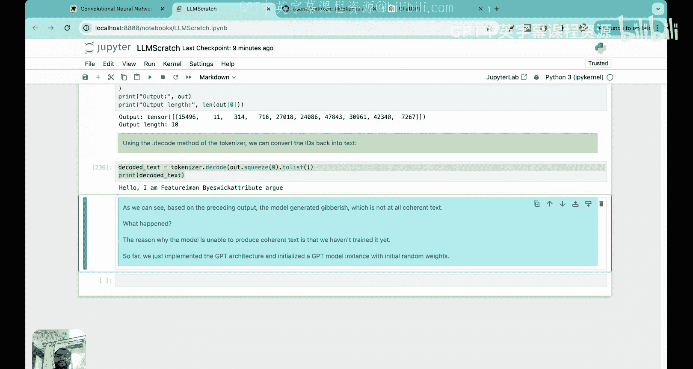

# Vizuara《从零开始搭建大语言模型｜Building LLMs from scratch》中英字幕（Claude-3.7-s） - P23：-25-Coding GPT-2 to predict the next token.zh_en - GPT中英字幕课程资源 - BV1qG8HzUE2D

🎼Yeah。Hello everyone， welcome to this lecture in theBuild Lage language models from Sctch series。

Today is the last lecture in the GPT architecture module， which we have been covering。

And in today's lecture， what we are going to do is that we are going to generate text from the output tensor。

Which we have reached at in the last lecture。So first let me give you a review of how an LLM generates text because this figure right here is what will guide us throughout this entire lecture and then I'll quickly take you through the recap of what all we have completed so far and what is the main objective of today's lecture。

So let's get started， everyone。What a large language model does is essentially the following。

It generates tokens given a certain sequence of input tokens， it generates the output token。

And to generate the output token， the model is given a context size。

 that's the maximum number of tokens which the model looks at before predicting the next token。

So lets say when you are looking at the first iteration， this is the input tokens， hello I am。

 and the model has to predict the next token。And then the next token is actually appended。

To the input tokens。 So in the second iterations， now the inputs are hello， I am a。So the token。

 which has been generated in the previous round， is appended to the input for the next。

Iteration and in the next iteration， the input tokens are hello I amer， and then the output is model。

Great， then in the third iteration we have hello， I am a model which are the input tokens and then the output tokens are ready。

Similarly， we continue doing iterations until there is a specific number of maxs maximum number of new tokens which can be generated。

So lets say we have reached the six iteration and hello I am ready to help so the new tokens which have been generated are model ready to and help and do so five new tokens so if the maximum number of new tokens is 5 then the output from the model is hello I am a model ready to help。

This is the main mechanism through which the next token is generated from a given list of tokens what is very important in this process is also the context size that is the maximum number of previous tokens the LLM is going to look at before predicting the next token in GPT2 architecture the context size was 1024。

So just keep this in mind， keep this iterative procedure in mind where the output from the earlier iteration is appended to the next iteration and the next world is predicted and this keeps on happening until we have reached the maximum number of new tokens this is the exact mechanism which we are going to implement in today's lecture。

First let's recap what all we have learned so far in this series we started out with getting an input such as every effort moves you。

 that is the input sentence， we converted it into tokenitees， we converted it into input embeddings。

So we can not it into token embeddings we added positional embeddings to these token embeddings which led to input embeddings then we added a dropout layer the output from this dropout layer was passed into the transformer block the transformer block which is shown in blue color is where all the magic really happens and the core engine of the transformer block is multi head attention。

Before the multiard attention there is a normalization layer after the multitard attention we have a dropout and a shortcut connection then after the shortcut connection we have another layer of normalization we have a feed forward neural network。

 we have another dropout layer then we have one more shortcut connection over here and then we get the output from the transformer。

After the output is obtained from the transformer， we have one more layer normalization layer。

 and then we have a final neural network which is also called as the output head。

 which gives us this output tensor。All of this has been covered in the previous two lectures where we coded out the entire transformer block and in the last lecture we coded out the entire GPT model。

 so if you have not seen the previous lectures I highly recommend you to do that so that you can follow along in this lecture as well。

So let us see the exact flow which we have implemented so far and what we need to do next so the output or the main goal of today's lecture is that look at this output tensor which we have obtained。

This output tensor looks pretty big right so your question would be how do I go from this output tensor to prediction of the next world which I have shown in this visual representation in today's lecture first we are going to understand that on a whiteboard and then we are going to go to code。

To predict the next word， so at the end of today's lecture we will actually take an input and get words as the next predictions。

Okay so here's the entire pipeline which we saw remember the format in which we have received the input batches here there were two batches and each batch has certain number of tokens so in this case each batch had four tokens we focused on the first batch which has four tokens and thats every effort moves you。

We converted every token ID， there are four token Is here，661，09。3，6，26610。

0 and 345 we converted every token ID into a token embedding。

 so the embedding size was 768 over here。And then what we did was we added positional embedding to these token embeddings since the context size is4 over here。

 we have four positions and there is a 768 dimensional embedding for the positional embedding。

So we add the token embedding to the positional embedding and that gives us the input embedding for every token for every effort moves and you。

 so we have these four input embeddings for these four tokens。

Then what we do is we pass these input embeddings through a dropout layer。

 which randomly turns of certain elements to0， this output which I am highlighting in the yellow color right now that is passed as an input to the transformer。

This is where all the magic happens in the transformer we first start with a normalization layer。

 which make sure that the mean and variance across so mean is0 across every row and the variance is1 across every single row。

Then we apply the multihid attention which converts these embedding vectors into context vectors which carry richer meaning。

 they also carry meaning about how the particular token attends to all the other tokens。

Or how one token relates to all the other tokens in the sentence， this mask multied attention。

Is the key revolution in the LLA architecture， and that's why modern。

GPT architecture such as the GPT4， which we all have been using， perform so brilliantly。

If multiair attention was not there， the LLM outputs would not be so coherent and so meaningful。

After this， we have a dropout layer。Then we have a shortcut connection followed by a layer normalization。

Followed by a feed forward neural network。foollowed by another dropout layer followed by a shortcut connection and then we get the transformer block output remember here the dimensions up till this stage are exactly preserved so we still have four tokens here and every token is still an embedding size of 768 but now the embeddings are much more richer because they also contain context about how one token relates to other tokens。

Then we have， after coming out of the transformer， we have a layer normalization。

And then we have the final output layer， which is this final neural network。

Now after this stage is where today's lecture begins。

 so first I want you to look at the output which we have received。

When we come out of the entire GPT model。So the number of rows are still the same we have four rows every effort is the second row moves is the third row and u is the fourth row。

But the number of columns are now 50257 which is the vocabulary size and why do we have those many number of columns The reason is because every effort moves you these are four tokens right which is also the context size when the context size is equal to4 there are actually four input output prediction tasks which are happening there is not just one input output prediction tasks so you might be thinking how come there are four input output prediction tasks well the first prediction tasks is when every is an input you have to predict towards the output and that should be effort right so you look at these output logics so these are called logics you look at the 50257 output logics for every and then you find that index which has the highest value so let's say this index has the highest value right。

Remember， this index also correspond to probabilities。So this index will give us。

Which word in the entire vocabulary should come after every and then hopefully this token id here or this index corresponds to effort so then if when every is the input effort is the output similarly when every effort is the input we look at the row for effort and we try to look at that index which has the maximum value let's say this is that index。

 this is that token id then we go to our vocabulary and look for the world which corresponds to this token id and that will be mo。

After all， the weights and parameters have been optimized when every effort moves is the input。

 then we look at again， the rock corresponding to moves and we try to look at that token I or that index。

 which gives us the。Maximum value and then we look at the vocabulary and we try to find out what that ID corresponds to and that will be you only after these three prediction tasks are done then we come to the fourth prediction task which is the main prediction task when the input is every effort moves you you have to predict the output right so you look at the for row。

which is the final row and you try to find that ID which gives you the maximum value and then you find the world corresponding to that and that world will hopefully be forward so then the next world which will be predicted by this Lm is every effort moves you forward。

And remember。The size of the output over， since we have only one batch over。

 the number of rows in the output are equal to4 and the number of columns are equal to the vocabulary size。

 which is 50，2，5，7。When the number of batches are equal to2 the output tensor size will be 2 into 24 into 50257 What we have to do is that from this tensor we have to extract that word which comes after every effort moves you so let's see how the first step is to take a look at this output tensor and make sense of it that we have four tokens and the number of columns is equal to vocabulary size awesome As I told you every row corresponds to something specific so the first row corresponds to what token should come after every the second row corresponds to what token should come after every effort the third row corresponds to what token should come after every effort moves you and only the fourth row corresponds to what token should come after every effort moves you。

So， we are going to extract the last vector from this tensor thats step number two。

 so we will look at the vector which is corresponding to U which I am marking right now and we will extract this vector。

After this vector is extracted， this is called as the logic vector we look at the logicits which are present and you will see that these logits don't add up to1。

 which means that the logicits currently don't represent the probabilities。

Then what we do from step number two to step number three is that we are going to apply So Macax。

So we are going to apply softm function here so that we are going to convert these logicits into a set of probabilities。

 So now when you look at the last vector for you， youll see that all of the values add up to one。

 So this gives us probability that the probability of the next token being the first element in the vocabulary is let's say 0。

1% the probability of the。Second token being the。The probability of the next world being the second token is let's say 02 etc。

 so you can do this for all the tokens and then you in the next step which is step number four you identify the index position or token ID of the largest value。

So you find the index which corresponds to the largest probability， so here clearly it looks like 02。

I the probability which seems to be the largest and then I find the index for this particular element and it turns out that in this case lets say the token ID is equal to 57 which means that the highest probability for the next world after every effort moves you is the world or the token with the token ID equal to 57 and then all we do is that we go to we go to our vocabulary and we decode the world which corresponds to the token id of 57 and we hope that it is equal to4 up till now we have not trained the LLM architecture。

So the next word will not be what we expect because the training has not been done at all it will be a random word。

 but after all the training is done which will be the subject of our next module。

 the next word should be what we actually expect。So this is the exact procedure which we are going to follow and remember there is one last step。

After this token ID is obtained， we will have to append this token ID to the previous inputs for the next round。

Why this step number 5 exists is I hope you remember this diagram which we saw at the start of this lecture。

 the step number 5 exists because after you predict the next token。

 after you predict the next generation token， the task does not stop here。

 we have to append this token to the input in the second iteration and then we have to repeat this process until we reach the last iteration which corresponds to the maximum number of new tokens。

Okay so I hope you have understood the process I have just written a section where I explained this process again so that you can revise and reinforce your concepts so in the previous section we have seen that the GPT model out outputs the tensors with this shape batch size number of tokens and the vocabulary size remember this is exactly what we saw。

Overよ。The shape is equal to the batch size multiplied by number of tokens multiplied by the vocabulary size okay。

So。This is the output tensor and now the question is that how do we go from this output tensor to the generated text and as I explained to you in the visual map there will be different steps so first what we will do is that we will get this output tensor and then what we will do is that we willll extract the last row from this output tensor。

After extracting the last row， these are the logicits we'll convert it into a set of probabilities by applying the softm and we will extract that token ID with the highest probability and then we will find the world which or find the token which corresponds to that token ID and then will append that token to the。

Previous inputs， and then we'll do the next round of iterations。

This is exactly what we will be doing。So basically we will take the index of the highest value you will get the token ID will deco it back to text that produces the next token and will append to the previous input so Ive written the same thing here so that you can you know reinforce and master your understanding of these concepts so this step by step process enables the model to generate text sequentially building coherent phrases from the initial input context。

So as I showed to you over here， we are going to over here。

 we are going to repeat this process over multiple iterations right and thats also what I've written over here。

Yeah in practice what we do is that we repeat this process over multiple iterations until we reach a userspecified number of generated tokens so we have to specify how many new tokens you need and only when we reach the reach that many number of new tokens we stop so the figure below illustrates the process of generating one token ID at a time so let's zoom into this figure further so let's say the initial input tokens which are provided as the input to the LLM or hello I am with these token IDs what the LLM will do in iteration number one is that it will predict the next token ID using the procedure we saw before and let's say the token ID is 257 which corresponds to the token。

This token is then appended in the second iteration。

 So now we are we have come to the second iteration。 the inputs are hello， I am U。

 and then we make the output， which is the next。Given given these inputs what is the next token which comes out and then the token world which or the actual token is model and then this token is now appended to the input of the previous iteration now we are at iteration number3 similarly we get an output at iteration number three and this proceed proceeds till the end。

Why do we do only six tokens because there is a provision for max new tokens and that has been set to6 that' is why we only do six iterations remember the number of iterations which we do will be determined by the maximum number of new tokens which have been specified。

So then even the input is hello， I am since the maximum number of new tokens is 6。

 the output will be hello， I am a model ready to help dot。

This this is the output which the GPT has generated that's why generative AI we have generated something like this completely from scratch now。

That was not present as an input or a training data， this is generated as a new text。

And this is the process underneath all of it， so now when you use GPT today or tomorrow or anytime hopefully this lecture series has kind of shined torch to this black box for all the other students who don't know how this next next word prediction task works GPT operates like a black box but not for all of you who have been watching this video series because I am trying to deconstruct how the next word is actually predicted given the input tokens。

Awesome， so。In iteration number one， the model is provided with tokens corresponding to hello I am and then it predicts the next token with ID257 great。

 and then that is again appended to the input and this process is repeated till the model produces the complete sentence hello I am a model ready to help after six iterations why only six iterations because the maximum number of new tokens was set to 6。

Okay so I hope everyone has followed with me until this part and I want you to recap these steps the step number one is to look at the output tensor step number two is to extract the last vector step number three is to convert logicits into probabilities step number four is to identify the index position of the largest value and step number5 is to append token id to the previous inputs and we are going to keep on doing this until maximum number of new tokens has been reached。

This is the exact same thing which we are going to implement in code right now。

 so the next part of this lecture is diving into code， so let's jump into code right now。Okay。

 so here what we are going to do is we are going to generate text from output tokens and we are going to implement the same process what we are seeing in the on the whiteboard okay。

Great， so the first thing what we need is that。We need the inputs。

We need the inputs to be provided and the inputs are usually provided in the format which looks like this。

Yeah this is the input batch so in the input what we will be doing is that let's say this is a batch with two inputs the first batch has four tokens and the second batch has four tokens so the inputs will be provided like this and that's called as the IDX。

So the shape of IDX is batch， which are the number of batches which we have。

And that is the number of rows and the number of columns is equal to n tokens so so that you visualize what the inputs will look like I'll just copy paste the inputs which I showed to you before so I'll just copy paste this over here so that this is a visual reference for you。

So， this is the。This is the input。This is the format of the input batch。

 which is passed into this generate text simple， so we are def a function which is generate text simple and what it will do is that it will take。

Model and what is model model has been defined before model is actually let me go back。 Yeah。

 model is an instance。Of the GPT model class so see this is the GPT model class which we are coded in the last lecture which takes the inputs and then outputs the logic tensor。

So that is the second input to the function which we are going to define today and that function is generate text simple so model sorry model is the first input so we have to pass in an instance of the GPT model class we have to pass in the inputs and remember I told you about the maximum number of new tokens so we have to pass in that as an argument and we also have to pass in the context size because the context size specifies how many words we have to look at before predicting the next world。

Great now lets start the coding the first thing what we have to do is that we have to make sure that the number of tokens which the LLM is looking at at any given point is determined by the context size so let me show you what that actually means。

Here I'm just taking a random example to demonstrate this to you so take a look at this example over here let's say these are the inputs let's say these are the this is the input tensor which is given to the LLM and here you will see that this input tensor actually has two rows which means there are two batches but I want you to look at so two rows because there are two batches but look at the number of tokens so number of tokens here are actually equal to 8 so there are eight tokens here。

Now， what if the context size is equal to 5？So if the context size is equal to 5。

 we cannot look at eight tokens before predicting the next rule， we only can look at five tokens。

So this command， which is it takes in the input and then it only looks at the number of elements specific to the context size。

So， in the code we are going to write this command right now so what this command will do is that it will look at the input if the input token size which is the number of columns is equal to the context size then it is fine。

But if its not it will take the last elements which are equal to the context size so now the context size is equal to5 so it will look at the last five tokens as an input from the first batch and it will look at the last five tokens as an input from the second batchge this is what this IDx colon minus context size colon is going to do it will restrict the input so that we only look at the number of tokens equal to context size so that is the first command which we have written that's IDx underscore scroll CO and D which is condition IDx underscore condition。

Great， now what we are going to do is that we are going to pass this input to the model So the model is the GPT class this is where all the main functions are happening What this model will do is that it will take the input and then it will pass the input through token embeddings positional embeddings dropout layer transformer blocks another normalization layer and the final output layer and it will return this logic ssor and remember that this logic tensor which is received what are the dimensions for it the dimensions are batch comma number of tokens comma the vocabulary size。

This is the dimensions of this logic tensor and then what we have to now do is that we have to extract the last row from this logicit tensor remember what we did on the whiteboard when we looked at the logic tensor。

Wwhich was this tensor that is in step1 in step number two what we have to do is that we have to extract the last vector from this logicit tensor so now what we are going to do in the second step is that let's say the logic tensor looks something like this so if I have two batches this is my first batch。

And this is my second batchge。And then in each batch。

 I have four tokens and then here I am taking a vector embedding dimension equal to 5。

So what we have to do is that from each of these batches we have to take the last we have to take the last row so from the first batch we have to take the last row from the second batch we have to take the last row and the way this will happen is through this command logic colon minus1 and colon so what this first colon is that which means you do nothing to the batch argument but the second is minus1 which means that you look at。

The first batch and then you look at the last you take the last row。

 you look at the second batch and you just take the last row this is what we are going to do so now we are going to apply this function which will just take the last row out of every batch in the logicit stensor。

So logicit colon minus1 colon is going to result in this where we just take the we just take this row。

From the first batch and we take the last row from the second batch and we just stack them together。

So this is the second command here where we only focused on the last time step or the last row。Okay。

 and now when we execute this command， the dimensions become the batch。

 which are the number of rows but and the vocabulary sized。

So one thing which I would like to clarify here is that your。

I mentioned this5 as the embedding dimension rate， but this is actually the vocabulary size。

 the number of columns here are equal to the vocabulary size。And。

What this what this function this is equal to the vocabulary size and what this function does is that it just takes the last row so when we get this final output the number of rows are still equal to the number of batches and the number of columns are equal to the vocabulary size we get rid of the second dimension which was equal to the number of tokens。

Allright， so now we have this， these two。 we have the rows， which correspond to the。

A last row in every batch and the next step is applying softm and converting these logics into a set of probabilities is exactly what we are going to do we are going to apply soft max and dimension equal to minus1。

Wwhich will ensure that for every row which we have extracted softm will be applied along the columns of those rows。

 so when we look at each of the tokens so lets say you when we look at this batch so when you look at each batch when when you sum up the probabilities for each batch they will sum up to one。

So remember the now that the size here is just batch size number of rows and number of columns equal to the vocabulary size。

 so now all of these will be transformed into values such as theses。

And if you add up these values so for the first batch you will just add up these values and that will sum up to one for the second batch you add up these values and that will sum up to one remember the goal is to predict the new token for every batch we have inputted。

So this is the next step and then the final step is we are going to look at that index with the highest probability value。

And this is exactly the step which we had mentioned here also。Yeah。

 so after converting the logicits into probabilities we look at that index which has the highest value so this is exactly what we are doing in this step we look at that index with the highest value。

That token ID and then in the last step we append that token ID IDx next to the initial token IDs which were stored in IDx。

So in this last step， we do the appending part， which has been mentioned over here。

So look at step number five over here， you have to append the token ID generated to the previous inputs for the next round。

And this is what is shown in this storage dotcat which is concatenation and IDx next is the input is the ID which corresponds to the highest probability and that is appended to the current current indices。

And we you see we are in a for loop here， so the number of times we are going to do this appending operation is by the time we reach the maximum number of new tokens。

 these are the number of iterations remember on the whiteboard what we saw。

On the whiteboard we are clearly seen that the number of iterations over here。

 the number of iterations， which are six iterations over here。

 are equal to the number of maximum maximum number of new tokens。

So that is whats been written in the code， we are doing the number of iterations equal to the maximum number of new tokens and then we are going to keep on adding these new tokens to the input tokens。

And that is it， this is how we are going to predict the new tokens corresponding to the next words and that is exactly what is happening in the GPT model。

 this is how you go from all of the complicated GPT model architecture to predicting the next word。

I have just written some text over here in the preceding code the generate text simple function we use a softmax to convert the logicits into probability distribution from which we identify the position with the highest value now you might think that since we are only looking at the index with the highest value and softmax is monotonic why do we need the softmax why can't we just find the index from the logicits that index which gives the highest value softmax is monotonic so that index is going to remain same whether we apply softmax or not？

So in practice， the softm step is redundant， which means it's not really needed to find the position with the highest score。

Because the position with the highest score in the softmax output is the same position。

In the logic Spr。So in other words， we could apply the torch dot ag max here we have applied it to the softm Torage dot Rax we have applied to softm generated output right we could have applied this to the logic stensor directly and get identical results so here I could I just replace this with logics。

And the results would have been the same， so then your question would be then。

 why are we using the softm in the first place。What。The importance of softmax is that。

We wanted to show you the full process of transforming logics to probabilities。

 which can give additional intuition the probabilities give us some intuition of how much percentage contribution does each token have in the next world prediction task。

And this will also help us because in the next module where we will do the GPT training。

 we will introduce additional sampling techniques where we will modify the softmax output such that the model does not always select the most likely token。

And we will introduce some variability and creativity in the generated text。

 this is the important part。The model does not always take the。

Out wouldput with the maximum probability。To make sure that the generated text has some variability some creativity we will explore some other options where the softmax select some other tokens and for that definitely we need to apply the softmax because we need the outputs to be in some format of probabilities so although softmax was not needed in the current code it will be useful later when we look at things such as temperature variability in selecting the outputs etc。

Don't worry about these terminologies right now， I'll cover that in detail when we come to the next module。

Now what we can do is that we have written this whole function right why don't we test it on some sample text so let me take the model input as hello I am this is my model input and the reason I am taking this input is that this is the same input which I have used on the Mi whiteboard over here。

So I take this model input and。Then what I'll first do is that I'll first encode it into token IDs so I first use my encoder to encode this model input and convert it into a tensor so remember the shape of the input should be batch size here I have only one batch and the number of token so it should be a tensor and it should be a tensor of token IDs so I have my encoder which has been defined through tick token so if you have been following these lectures you will know that we have been generating our encoings through tick token which is the tokenizer used for openaiI models it's a byte pair encoder so we are using that to encode this sentence and now Ive generated my input sample now what we will do is that before passing in the model will first put the model in evaluation mode this bypass system layer such as normalization layer dropout layer because we are not training the model layer we are just evaluating so it just makes the model a bit more efficient and then we will just call this generate text sample function。

We will call this generate text sample function and we will put model equal to model we have already defined the model before and let me again take this over here so that you you have full grasp and the GPT model configuration which we are using has been defined over here this is the configuration we are using a vocabulary size of 50257 context length of 1024768 embedding dimension。

12 attention heads 12 transformer blocks and dropout rate of 0。1。

So this is the model which has been defined。Because that's needed to be passed into our function so I'm just writing it over here for your reference。

 I'll code it out， I'll comment it out I will share the code so that you can run it on your own laptop。

Okay so then we'll run this generate text simple function we'll pass in the model we'll pass in the inputs these are my inputs right now。

 remember the inputs is the second argument over here then we have to pass max new tokens and context size so let me pass in that so my max new tokens is 6 and the context size which I' am passing is GP configuration context lens which is 1024 and then Ill just print out the output。

So I have six new tokens right and the input was these tokens 1549611314 and 716。

 so now these are the inputs and if you look at the output tensor you will see that six new tokens have been appended over here。

2，7，0，1，8，2，4，0，8，6，4，7，4，8，8，4，3，3，0，9，6，1，4，2，3，4，8，7，2，6，7。 These are the six new tokens。

 which have been appended。Through because of our generate text simple function。

 so these are the next words which our GPT model has predicted。

And here you can see that the output length is 10 y 10 because 4 where the number of input tokens and max new tokens were 6 so six additional words or tokens have been generated。

Now we can use the decocode method and based on our vocabulary and the byte pair encoder which we have used we can convert these new tokens back into text。

 so it seems that the next text is now some random text and the next text is not as great as what I have written on the whiteboard over here。

On the whiteboard， the next text was hello I am model ready to help。

 but here the next text is something completely random right Now why is this completely random The reason this text is completely random is that because we have not trained the model yet the model has 1 24 million parameters and all of those parameters are completely random right now those are not trained now it's just a matter of training the whole G architecture has been set up completely we have implemented the full G architecture and initialized G model instance。

 but with random weekss we need to train these 124 million parameters and for that we have the whole next module dedicated which are next。

Any 67 number of lectures or even more， but for now if you have reached this stage just be happy and proud that you have run a 124 million GPT2 architecture model completely on your laptop you have taken an input and you have predicted the outputs and this is the first step towards understanding how GPT really works when you go to chat GPT and when you type hello I am let me let's actually do that。

So I'm going to chat GT right now。And let me type。Hello， I am。 and let me say。

 complete this sentence。Im providing no context here and does not make two months too much sense。

 but here you can see that based on the past interactions which I've had with chat GT it results in some output which is at least quite coherent it's much better than the output which we have received over here right but that's fine we have not implemented the trainingee but we have essentially implemented all the nutss the bolts and the building blocks for building out this entire GPT architecture on our own completely from scratch we have not used any library from L chain or anything we have defined this GPT architecture fully from scratch we have learned about all the sub modules involved in the GPT architecture we have coded all these sub modules and ultimately now we have reached the stage we are given an input we can predict an output。

So let us go back to the schematic which we started this lecture with and let' us see whether we have implemented everything which we we actually wanted to implement。

Yeah this is that schematic I was talking about so we have I think had6 to7 lectures in this GP architecture module and in these lectures we have implemented every single thing which has been mentioned in the schematic all the things we have been mentioned all the things have been covered so when you are given an input which is a text such as every effort moves you Now we are we are ready to predict the next words we have reached this stage where we had an input and we have implemented the whole GP architecture to produce the output its just that the training has not been done yet but it is fine will come sequentially to that part in fact。

We have learned this whole thing in this module we first started with a GPT backbone where the code was not implemented but we had a demi GPT class then we implemented layer normalization Jlu activation feed forward network shortcut connection we coded out the entire transformer block after that and in today's lecture we coded out the entire GPT architecture and we also got the final the next words given a set of input tokens so these were a comprehensive set of lectures but if you have reached the end you should be proud of yourself and I just want to。

Right that。You。嗯。You did it。That is what I want to write just to keep you motivated。

To keep on following the next lectures which are coming because if you reach this stage you have already reached much further than 95% of students so it's amazing many other students might just be using GPT but you are one of the few students who have now quoted out a GPT to architecture on your own on your local machine which is predicting the next world which is predicting the next token and I find that incredibly satisfying and motivating in the next set of lectures what we are going to do is that we are going to do the training for the 124 million parameters in the GPT2 model and then the output which is generated will start getting much better and it will be better and better and better so the whole goal of the next set of lectures is to make this set of outputs better but now since the architecture is in place。

Doing the next part。Will be a bit easier。Because we can directly work from the architecture which we have built。

 Thank you so much everyone。 I hope you are enjoying these lectures。

 I say this at the end of every lecture， but I deliberately try to keep a mix of。😊。

Very detailed headboard notes such as this plus the coding because I feel that students to really master large language models you need an understanding of theory in tuition as well as detailed code I'll be sharing the entire code file with you and I encourage you to play with this code ask doubts on YouTube and willll try to clarify as much as possible thanks a lot everyone I look forward to seeing you in the next video。

。