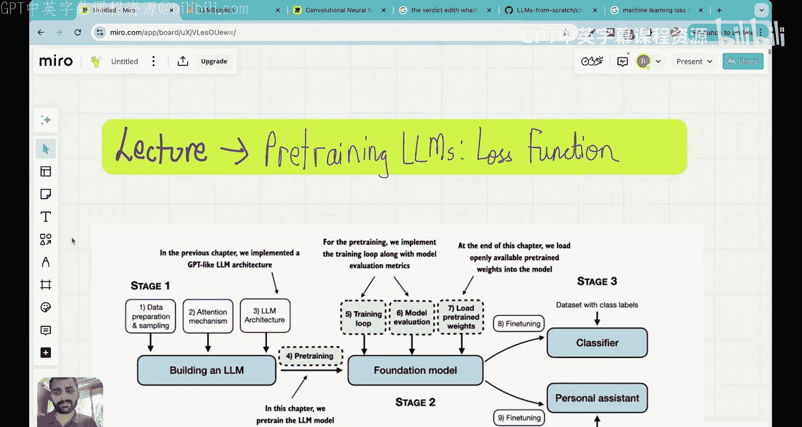
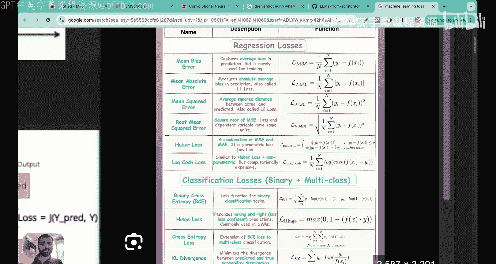
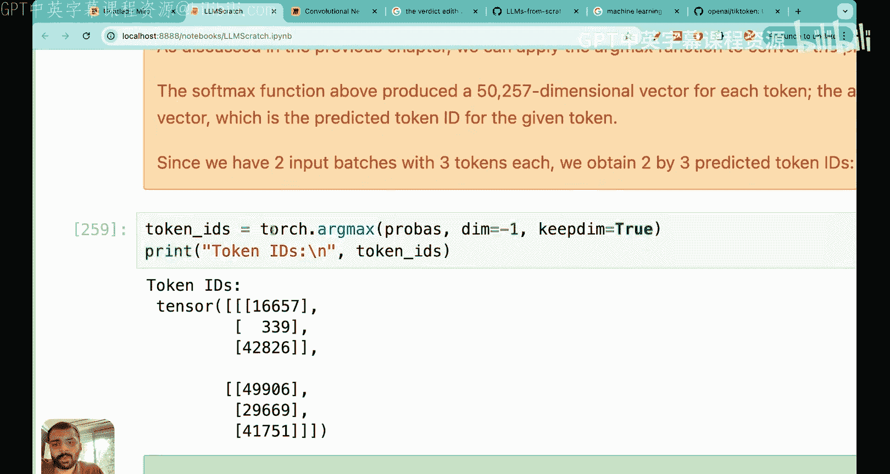
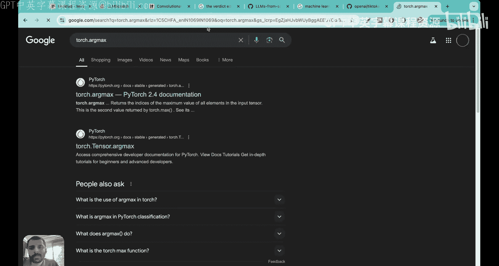
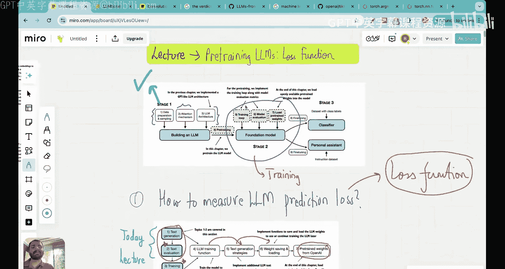

# Vizuara《从零开始搭建大语言模型｜Building LLMs from scratch》中英字幕（Claude-3.7-s） - P24：-26-Measuring the LLM loss function.zh_en - GPT中英字幕课程资源 - BV1qG8HzUE2D

🎼Yeah。Hello everyone， and welcome to this lecture in theBuild La languageage Model from Sctch series。

Today， we are going to look at a very important topic and that is regarding loss functions。

When you look at machine learning and traditional machine learning models such as regression and classification。

 the loss function for these type of models are pretty well defined for regression you generally use the least square type of a loss。

 mean square error for classification you use cross entropy， cross entropy loss， hinge loss， etc。

However， the question is that when we come to large language models。

 how do we define the loss function？How do we measure whether the large language model is doing a good job or whether it' is not performing well？

Let's find out in today's lecture。So up till now in this series， we have covered。

Stage one of building a large language model from scratch in stage1。

 we essentially covered three submodles， data preparation and sampling。

 attention mechanism and LLA architecture in each of these subcompon we we devoted a huge number of lectures and whiteboard notes and also coding so that by the time we have reached this page。

 I hope the building blocks of how to construct a large language models are clear to you。

In particular， till the last lecture， we have seen this GPT or the LLM architecture。

 which we have built from scratch。And up till now we we are at a stage where the GPT architecture which we have built and whose code we have written takes an input。

 it takes an input text and it returns an output。We also saw how this output is converted into the next world prediction task。

So our GP model up till this stage or our large language model we have which we have set out to build。

Is that a level where it takes an input as a text and it can predict next tokens or it can predict next words thats awesome right but now we want to make it better and better and better in particular if you remember where we ended the previous lecture on LLL architecture。

We got this kind of the next so we gave the input as hello I am and the next tokens。

 which we got are something completely random。So now from this lecture onward。

 what we will be doing is that we will be looking at stage  two。

Stage2 of building a large language model just centers around one over。

 and Im just going to write that one over here， and that is called as training。

We need to train our large language model so that the next token， which it predicts makes sense。

The first step of the training procedure is that you need to ask yourself。Okay。

 let's say my large language model。is giving me an output。And I know it does not look good。

 How do I capture this qualitative intuition of not of knowing that it does not look good into a quantitative metric。

And that quantitative metric is generally the loss function。

So if we can define a loss function which quantifies how good or how bad our LLM performance is。

We can aim to minimize the loss so that the LLM can do better and better and better and once we construct a loss function it opens the door for integrating gradient descent based back propagation algorithms which we have already learned in neural networks。

So then we convert the problem of training a large language model into a problem which we have previously solved before。

So， what we are going to do in these set of lectures is we are going to look at this entire pipeline of seven steps which Ive shown earlier here in today's lecture we are going to look at the first two steps here。

 we are going to look at how text is generated。Which we have already seen before。

 but I want to quickly recap it in case some of you have come to this lecture directly。

And then we are also going to look at text evaluation。

 which means we are going to define a loss function in this lecture itself。

And we are going to see how that loss function quantifies the loss between what our LLM has generated and the good output which we actually want。

In the subsequent lectures we will be looking at taking an entire data set。

Feding it into the LLM getting the output and finding the training and the validation losses will then generate the LLM training function that' is the back propag I was talking about and then towards the end of this series on training LLms we also load pretrained weights from open AI all that will come next for now let's just start with this initial two goals for today's lecture and that is text generation using LLMs and X evaluation。

First， I want to quickly recap how can we use the LLM or the GPT2 architecture which we have trained so far to generate text okay？

So the way it works is that we have to specify a GPT configuration。

And this GPT configuration or the LLM configuration contains many parameters first is our vocabulary size。

 this is the length of the number of tokens we have in our vocabulary so we are using the same tokenizer which GPT2 and in fact all open AI models used and that is called a speak token。

So， this is thick token and what it does is that it uses a byte pair encoder and it creates a vocabulary of tokens like this。

 the vocabulary size which GPT 2 had is 5hi0257 and that is the same size which we have when we constructed our large language model。

We have to specify a context length GPPT2 used the context length of 1024 but for the purposes of easy calculation which you can train on your own local machine in less than two to three minutes we are using a context length of 256 keep in mind that you can just use the same code for a longer context length as well but just make sure that you have enough compute power and memory to eraute the code。

Then we have the embedding dimension which is which basically means that the token embeddings need to be projected into higher dimensional space to capture the semantic meaning。

Then we have the number of attention heads， so these are the number of self attention mechanism blocks we have within one transformer。

Why do I say within one transformer because there is not one transformer there are many transformers and the n layer specifies how many transformer blocks we have Dropout rate is can be set to0 Also this is the dropout layer parameter and query key value bias is basically when we initialize the weight mees for the query key and value we don't want the bias term if any of these terms are looking unfamiliar to you right now。

 please revise the previous lectures we have had on。LLM basics。

 attention mechanism and GPT architecture。Awesome， so the G model。

 which we built earlier looks something like this。 What this model does is that it takes in the input tokens。

 It converts them into token embeddings adds positional embeddings to it。

 Then we have a dropout layer。 This output up till layer passes through the transformer block after we come out of the transformer block。

 we have a final normalization layer and then。We return the logics now these logics which are returned consists of the tokens and for each token we have the number of tokens equal to vocabulary size sorry for each token we have the number of columns equal to the vocabulary size Ill come to this part later and I'll explain to you again what we have done in this part of the code。

So that is revised for you。 Okay， great。Now lets start looking at the first section of today's lecture Okay so lets start with the first part of today's lecture remember that to get the loss function we need the input。

From the input， will get the。Predicted values。And we should already know the true values which I am going to call as target values in today's lecture whenever I use the word target remember that it stands for the true values and ultimately the loss function will be determined by the predicted and the target values and how close they are。

So， in the first section， let us look at the inputs and let us look at the targets which are the true values okay。

 so the input to the large language model which we are building comes in a format like this。

The input is a tensor and the number of rows here correspond to the number of batches。

 so I have two batches over here and that's why there are two rows。

So two batches corresponding to the two rows， I'm writing two over here。

The first row corresponds to the first batch the second row corresponds to the second batch now you will see that every row has three tokens here which is usually set by context size and I am just assuming context size equal to3 for this example so for the first batch the input tokens are every effort moves。

For the second batchge the input to concern， I really like Now the thing is based on these inputs。

 our task is to predict the next next world right， And so for targets。

 you must be thinking that the target should only be。

2 token id for the first batch we need a token ID for the second batch we need a token ID。

 but now look at this target tensor over here。It has two rows corresponding to the two batches that is fine。

 but why does the first row have three values and why does the second row have three values？

The reason is because whenever you look at this input like this there are actually three there are actually three prediction tasks which are happening here when every is the input effort should be the output that's why the first target is 3626 which corresponds to effort when every effort is the input which means that 16833 and 3626 are input 6100 is the output which is moves。

And then finally when every effort moves is an input， the output should be u。

 so the correct answer which we want is u over here similarly for I really like there are three prediction tasks when I is the input。

Really is the output when I really is the input like is the output and when I really like is the input chocolate is the output So we want the output to be chocolate in this case。

 but then there are three prediction tasks here and that is why the target tensor consists of two rows first row corresponds to the first batch Second row corresponds to the second batch and then we have three values I hope you have understood why there are three values in the target tensor because that will be very important to keep in mind as we move forward。

Ultimately， we are just concerned about the last word， right。

 which is this 345 that is the tokenidic corresponding to you。Tokenid corresponding to you and 1，1，3。

11。That is the token ID essentially corresponding to chocolate。

 but the first two are also important for the initial prediction tasks in this input。

Okay so these are the true values which we want， so this tensor are the true values true prediction values。

 if our large language model is doing an amazing job for these two inputs the prediction should be the first tensor of the output should look like this。

 the second of the the second row of the output should look like this。But of course。

 initially when the large language model is initialized randomly。

 it won't produce these outputs which we want， we need to train it。Okay。

 so we have looked at the input and we have looked at the target now lets see the outputs which are the predicted values of our LLM。

So， this is the input which we saw over your right 1683336266100。

 then that is the first batch the second batch is 401107 and 588。

So the this input will go to our GP model and what is the GP model。

 the GP model looks something like this， so the input which I told you goes over here。

And then it passes through all of these steps， and then we have an output tensor。

 which is also called as the logic tensor。Okay， so the first step as to what happens in the GP model is that the tokenizer is converts the tokens into token IDds。

Then the tokenides pass through all of these steps and we get the logicit ssor and finally the logicits are converted back into tokenidees which are the next predictions of our large language model this entire sequence is encoded in this figure here which I want to explain thoroughly first we start with a vocabulary and for the sake of simplicity let's assume that the vocabulary just has seven elements remember in the actual example which we are going to consider the vocabulary actually has phi0 to57 elements。

But I'm just illustrating this diagram for the sake of simplicity where there are seven elements in the vocabulary。

 right？😊，And the input text， let's say， is just one batch for now and every effort moves。

 that is the input， right？The first step is to use our vocabulary to map the input text to token IDs so every is token ID number two effort is token ID number one and moves is token ID number4 so first we take these tokens and map them into token IDs21 and4 the second step is that well pass all of these through the GP model。

And the GP model will give a logicit ssor and to the logic tensor we apply the soft max distribution and we will get this output matrix look at this output matrix here Ill just write's dimensions here。

 so this output matrix essentially。It has。Let me use a different color， it has three rows。

 the first row corresponds to every the second row corresponds to effort and the third row corresponds to moves。

Now you will see that the number of columns are equal to 7，1，2，3，4，5，6 and 7。

 and we have some values see every row has some values and there are seven columns corresponding to every row。

Basically the values in each row corresponds to the probability of what the next token will be。

 so let us look at the first row values and I just write them more here for your reference 01。6020。

0500。02 and 0。01， these are the values corresponding to every now what these values means is that when every is the input。

What is the probability for the next token being the output and1，2，3，4，5，6。

7 corresponds to a effort every forward moves you and zoo， so let me write the a。Effforort。Every。

Forward。Mos。U and z this is the vocabulary right now every value we in this row corresponds to the probability of what the next token will be if every is an input so let's analyze this probability if every is an input the probability that the next token is a is just 10% or 0。

1 there is 60% chance of the next token wing effort 20% chance of the next token being every etc so then what we do is that we look at the index with the highest probability which is this 0。

6 over here and so we know that the next token is equal to effort。Now。

 when every effort is the input， we again look at the second row so we again look at the second row and find the index which is the highest probability and that corresponds to moves。

So this is index number four and that corresponds to moves over here。Then we look at the third row。

 so every effort moves when that is the input， what is the output？

And this is the main prediction task because it actually predicts the next token and if you look at the third row。

 you look at the index which has the maximum probability and that is index number 5。

Which is here and we know that index number five corresponds to you so we know that the next。

token is U so remember when I told you that when the input has three tokens like this。

 there are three prediction tasks for the first prediction task the output is index number one。

Because that corresponds to the highest probability and the token which it corresponds to is effort for index number2 or sorry for the prediction task number2 the input is every effort and the output is index 4 which corresponds to moves and for the third prediction task the input is every effort moves and the output is 5 which corresponds to you so when you give this input。

Every effort moves to the。Lge language model。 The output is a sequence of indexes 1，4 and 5。

 What this output means is that one。 So if you look at one over here， it means that when every is an。

Input effort is the output。When every effort is the input moves is the output and when every effort moves is the input。

 U is the output。So， this is what is actually happening within the GP model itself I just gave you a five minute crash course of what we learned in four to five hours in the previous set of videos so if any of this you are finding hard。

I would again， highly encourage you to go through all the previous videos so that you understand this better for now。

 even if you get an intuition of。Whats going on here it is fine and you can follow along till the next part right so here what I want to illustrate to you is that this process which I have shown here we have the input when it goes to a GP model we have the output token IDs and I have told you how we get the output token IDs。

So if you have understood the process， let's say these are the output tokeniditis which we have obtained。

Remember for actually GP2 the vocabulary size is 50257 right so the range of the output tokenide is is 0 to50257 here the vocabulary size was 7 so the range was 0 to 7 so if you look at batch number one。

The output tokens are 16，6，5，7，339 and 42，826。And let's look at the inputs right， every effort moves。

So， every。Ever and moves。What this output essentially conveys is that if every is an input the token corresponding to the token id of 166。

57 is the output when every effort is the input the token corresponding to token id339 is the output and when every effort moves is the input the token corresponding to the token id 42 8 to 6 is the output and what do we want these token ids to be we want these token ids to be as close to the target token ids which we saw look at this target token ids。

The tokenides which we have obtained right now are not the actual tokenides because the training has not yet happened。

So， these are the output token id and we want these output token id to be as close to the target token id as possible that is the whole goal of today's lecture and so we are going to then define the loss function between the outputs and the targets。

So these are the output tokenid is for batch number one and here you can see that these are the three output tokenid for batch number two where the input is。

I really like。So， I。Really like。And for these outputs。

 we have to compare these outputs to these true values for the second batch。

I hope you have you have understood the goal of today's lecture up till now we have understood what are the inputs。

 the shape in which inputs will be given to the model。

 what are the true values which Im also calling as targets and we understood that what are the output。

Output token ids for batch number one and batch number two and to get these output token ids the inputs have to go through a huge transformer block and it has to go through this whole GP architecture then you get the output logics we apply softm and we get this tensor like this this one tensor essentially contains all the information you take a look at this tensor and then you extract the indexes with the highest probability in each row that is essentially our output。

Okay and now what we are going to do next is that we are going to then find the loss between the targets and the output before coming to the next step I want to go to code and really code everything what we have learned so far so that the understanding is clear and so that you also understand what is really going on in the code。

I already explained to you the configuration which we are going to be using right vocabulary size 50257。

 the context length of 256 embedding dimension of 768 number of attention hits 12 number of transformer blocks equal to 12 dropout rate 0。

1 and the query key value bias equal to falses。Awesome now the next thing what we are going to do is that we are going to construct our model what this model is basically its an instance of the GPT model class and this is the GPT model class which we have defined previously to get a visual representation of what this class does is that it takes in the input and then it converts the inputs into this logicit s。

That so all of these steps which have been written here are actually encoded visually in this transformer block or in this GPT model architecture which I have seen the blue color which I am highlighting right now with the orange pen that is the transformer block and it is the heart of the entire GPT architecture。

So， here we are creating an instance of this model so that when we pass our input to this model。

 we get the logic ssor as the output。When notice that we reduce the context length of only 256 tokens here。

 although we know that the GPT2 model uses 10 to4 tokens。

 the reason is because you all will be able to follow and execute the code on your laptop computer and we reduce the computational resource requirements that way。

Okay there are two more functions which I want to define the first is text to token IDs。

 what this will do is that whenever we get any text which is the input we will just convert it into token IDs。

And this uses this tick token tokenizer。To convert the text into token IDs and there is also token IDs to text which is the reverse function。

 so basically when we get any token ID we will convert it back into text。

So if every effort moves you is the text and when you pass it through the tokenizer you will get the token IDs corresponding to this and then you can even decode the token IDs and it will get you back the same text。

Just as a proof that our model is working what Ive done over here is that I have used a generate text simple。

 which is another function we have defined in the previous lecture。

 no need to worry about this right now， but what this function does is that it takes in our model and we predict the maximum number of new tokens the number of input tokens is for every effort moves you and then it generate1 new tokens。

So here you can see the we have printed the output text and this shows that the output text consists of four input tokens and 10 output tokens remember one world is not necessarily equal to one token because we are using the byte pair encoder where we even have subors and characters which can be individual tokens。

So up till now， as we see， the model does not produce good text because it has not been trained yet。

And so what we will be doing is that how to measure what。

What good text is so that is why we have to define the loss function right now lets start with the main implementation in today's lecture and these are the inputs so the first input as as I told you on the whiteboard is every effort moves these are the token ID corresponding to the input text and the second input is I really like。

And the tokenides which are corresponding to the second input texture 40，11，0，7 and 588。Great。

 and the targets are essentially 36266100345 these are the two values for the this for the first batch for the second batch the targets are 1107588 and 11311。

Take a note that the targets are the input shifted by one， so if you take the inputs and shift it。

Or just take the last two values here and add a new value that is the targets This is because there are three input output pairs。

Okay now once we get the inputs what we are going to do is that we have the inputs and we have the targets but we have not yet generated the outputs to generate the outputs。

 what we will do now is that we will pass in the input through this GP model。

 well pass the input through this GP model block and generate the output tokenides in this in this kind of format which Ive shown you。

Okay， so the first step is that remember that when you pass the input through the GPT block。

 it returns this logics。And which are not convertedted into a normalized0 to1 format。

 we have not applied softm， So the first stage step is that to get these logicits and pass them through a softm。

Always keep an eye out for dimensions。 Why is it 2 comma 3 comma 5，0，2，5，7 the reason is because。

Everything can be explained through this diagram。Look when the vocabulary。

 so let me first rub many things here。Just so that。Things become a bit easier to understand。Okay。

 so look when the vocabulary size was equal to7 over here。

 take a look at the form of this logic ssor， So if the vocabulary size was equal to 7 for one batch the logic stensor size was three rows and seven columns。

 right。Now， if there are two batches， the size would have been two， comma 3， comma 7。

That is the general size of this logic ssor， so it's batch size。Bad size。

 the second is the number of tokens。And the third is the vocabulary。Dimenssion so in this case。

 the vocabulary dimension was7， so there are  seven columns in our case， there are 50，2，5。

7 columns so this third dimension will be 50257。So。

 here we see that the logic tensor is converted into a tensor of probabilities who shape is batch size。

 number of tokens and vocabulary size， so that will be 2 comma 3， comma 50257。Great。

 and now what well do， as I mentioned to you， the next step is that we extract from each row the。

Index， which has the maximum value， and that will be done using the arc max function。

And these indexes with the maximum value， that's our output。

From each given batch So what we are now going to do is that we are going to do torch do arg max。

 you can even go to the pitor documentation and see what arg max does Arg max basically returns the indices of the maximum value。

So， we are doing Ta or ta max dimension equal to minus1 which is along the column so what this will do is that it will look at all the values in the columns and give the index of the value which is the give the index which is the maximum value。

And so here we see for the first batch there are this is the first tokens output。

 second tokens output， third tokens output index remember these are token ids。For the second batch。

 this is the first tokens token id output， this is the second output token ID。

 this is the third output token id and these output token id are the ones which we want as close as possible to this target token ids that is the main goal and for this we are going to construct a loss function。

So now actually let's decode these tokens。 remember， we have already written a function which des。

Here we have return function which converts token IDs into text right lets recordcode these tokens in the output and lets see what they mean。

So we have faster input into a GP model and we have got these outputs and let's decode these now。

So if you decode for the first batch， the output， the input is effort moves you and the output is armedmed he Netflix。

 completely random output， which does not make sense。

We want this output to be every effort moves you。Every effort moves you yeah so input so the target is every effort moves you sorry effort moves you correct。

 this is the true value so we want the target to be effort moves you。

 but the actual output which we have got is armed ety Netflix。So， if you look at the first batch。

 you can see that there is a huge difference between the targets and the outputs， right。

 which makes sense because。Well。We have not yet optimized。

 we have not even defined the loss function， we have not tried to minimize the loss function。So。

 ideally now what we will do is that we will define a loss function between the targets and the outputs from both the batches so that the target output and the so that the target。

Text and the output text will be as close as possible to each other。Great。

 now that actually motivates us。To go to our next section in today's lecture。

 which is actually defining the loss between the targets and the output。

So now lets let us see what' is going on here， so we have the inputs and this is the probability tensor which indicates what is the probability of the next token for every input token。

What I have marked in blue over here is the target indices so if we want the actual answer to be that for every it should be effort for every effort it should be moves and for every effort moves it should be you the the correct answer of the indices which we want is14 and5 these are the two values。

So， the token I is here are。3，6，2，6，61，0，0 and 345， but in the sample code which Ive shown over here。

 we just has7 we just has seven vocabulary size， the tokenideidees which are1。

4 and 5 those are the correct ones So now one thing which I would like to mention is that lets say these indexes which are marked with the star right now。

 these are the actual indexes which we want right。But if you see the values corresponding to those。

 those values are not the highest because our ALM is not trained yet。

So what I am going to do now is that I am going to collect the probabilities at these indexices so I'm going to take this index Im going to take this index and I'm going to take this index and I'm going to find the probabilities at these these indexes or these indices rather and I' am going to collect these together so for example for the first batch what I collect can be 0。

140。14 and 0。13 these are the set of probabilities and for the second batch Ill collect another set of three probabilities like this。

This is exactly what we are doing in the actual problem in the actual problem we know that the target indices are these so what I'll do is that I look at my probability stensor and Ill get the probability which is corresponding to these indices I know it will not be maximum because my LLM is not optimized but Ill just write down these probabilities for now so I have these target inices and let me call them i11 i12 i13 for the first batch and i21 i22 and i23 for the second batch。

So what Im so what I'll be doing now is that I'll be。

Looking at batch 1 and I' will be looking at batch 2 and I will find the value corresponding to these indices in the probability ssor。

So in this in the probability tensor which will look something like this for the 50257 vocabulary size also Ill find the probabilities corresponding to i11 i12 and i13 for batch number1 and Ill find the probabilities corresponding to i21 i22 and i23 for batch number2 so for batch number1 I'll aggregate these probabilities together and they look like this p11 p12 p13 for batch 2 I'll aggregate these probabilities and they look like p21 p22 and p23 remember these are the probabilities which are not maximum right now。

The goal of our training is that to get all of these values as close to one as possible。

And why do we want all these values close to1 as possible because then we will make sure that the output indexes which have the maximum probabilities will be closer to i11 i12 i13。

 i21， i22 and I23， which are my targets。So the goal of the LLM performing better now is reduced to this problem that I want these probabilities to be as close to1 as possible。

 I want all these six probabilities to be as close to1 why are there six probabilities because there are two batches each batch has three tokens so there are three prediction tasks so that is why there are three probabilities for the first batch three probabilities for the second batch。

So let me merge these probabilities together and then this will be p11， p1，2， p13。

And this will be P21， p22 and P23。Now， what I want is I want all of this p11， p12 p13， p21。

 p22 and p23， I want all of these to be as close to1 as possible。

How do I enforce this mathematically？First let us see the workflow， so we had the logicit tensor。

 we converted it into probabilities through softm and then we had the target probabilities tensor。

What this target probabilities means is that we have the index indexices corresponding to the target values so we have these indexices i11 I12 i13 I 21 I22 i23。

 these target probabilities are just the merge merge target probabilities， which is P11。

P12 dot dot dot 2 p 23， these are the six probabilities and we want all of these to be as close to one as possible。

To all of you students who have studied classification and the loss。

 this problem would be familiar since we are dealing with probabilities。

 it' is natural that logarithms at cross entropy will come into the picture。

So instead of directly dealing with these numbers， it is much better mathematically and from an optimization perspective to just take the logarithm of these values and it comes out to be this。

And then we take the average of all of these logarithm values and it comes out to be this and then we take the negative of this average so that is 10。

772。So this is the cross entropy loss and this is the loss which we want to minimize as much as possible。

So to explain this in another way， lets say we have taken this target probabilities and we find the mean of so we take that then the log of this so we take log p11 log p12 and the last is log p23。

And then what we do is that we find the mean of this mean。And so then that will be sigma。

 which will be the summation of log n1。Smation of log P11 dot。Log P23 divided by 6。

And then I'll just take the negative of this。And thats for the negative log likelihood。

So then that will be negative of summation of log of P11。Dot dot， dot， up till log of P 2，3。

Divided by 6。 So now see， we want。We want P11 to be close to。1。

 we want P all the probabilities to be close to1， so we essentially want this negative log likelihood to be as less as possible。

 so this cross entropy loss we want to be as low as possible and as close to 0 as possible。so诶。

Why are we taking the。Negative log likelihood。The reason we take the negative log I load is because it just makes more sense。

 if you， if you don't take the negative value， then the。Loss function would look reverse of this。

The loss function would look reverse of this and then we will have to reframe the problem as trying to maximize the loss instead it just makes more intuitivetu sense if the negative。

Looks like this。 And now the whole whole。Instead it makes more physical and intuitive sense if the log likelihood looks like this and now our whole goal is to bring down this loss as low as possible what will happen if this loss is brought down to lets say0 if the loss is brought down to0 which means that the mean which means this value is close to 1 which means that there is a higher chance that p11 p12 p13 up to p23 are equal to1 that is exactly what we want the goal of training is to get these values as close to 1 as possible。

So， that is the main main hope now， so initially let' us say when we start the training procedure our value the x value whose log we are going to take that will not be close to1。

 it will be somewhere maybe or it will be somewhere 0 to1 and somewhere here。

 the goal is to go here slowly。So that the mean of the probabilities will be equal to 1。Okay。

 so this is the negative log likelihood。 And it's also called as the。

It's also called as the cross entropis。And we want to minimize this cross entropis as much as possible that will ensure that the indices at which our tokens。

Indexes at which we predict the next token that matches with the target ines so then the output and the target。

Indices will match closely to each other and then we know that the large language model is actually doing a very good job so this is exactly what we are going to do right now in the code。

 one thing which I would like to mention about the crossenttropy loss is that the crossenttropy loss essentially measuress the difference between two probability distributions so here what we are actually doing is that we are just adding discrete probabilities but in a sense this can also be called as the categorical or I should call it the crossenttropy loss。

So now let us see the sequence of steps which we are going to implement the logicit tensor which is a tensor of probabilities has the shape of 2 into 3 by50257。

 why because it looks something like this every effort moves and then we have 50257。

So this is the first batch and this is the second batch What we are going to do is that we are going to flatten this so that these two first batch and second batch are merged together。

Right， so these are so this is my output tensor right now。 Every effort moves you。

 I really like it's the merging of these two batches and my target So my target is2 by 3。

 Why is it2 by  three Because for the first batch this is the。

Target index of the first input every this is the target index of every effort and this the target index of every effort moves。

107 is the target index of i， so it will be really 588 is the target index of i really and 10。

3101 is the target index of I really like so then chocolate。

Then what we are going to do is we are going to flatten this out， so then this will be 3626610，0。

 34510，7588 and11，311。Now ideally what we need is that we are going to look at every year and we are going to look at the index corresponding to 3626 so let's say if this is the index corresponding to 3626 this will be p11 for effort we are going to look at the index corresponding to 6100 let's say this one so that will be p12 similarly for like which is the last we are going to look at the index corresponding to 11。

311 so let's say this is this so this is p23。So， what we will get is that where we will get p11 p12 p13 p21 p2 to p23 we take the log of them well add take the mean and then do the negative this whole process is encapsulated in this just one line of code to dot n n dot functional cross entropy logicits so this is the logicits flat I am calling this logic flat tensor and the second argument here is the targets flat。

What this。This code will do is that to dot nl dot function cross entropy logicits flat cover target flat First it will convert this logicit tensor into a tensor of probabilities until now the logics is is not does not represent probabilities So it this function will apply softm to the logics and then what it will do is that as I told you before it will find the negative log likelihood So first it will。

Find the probabilities p11 p12 p13 p21 p22 and p23 in this logics flat tensor corresponding to the index indexdices in the targets flat tensor。

 it will take the negative log and then it will find the mean this one line of code is going to do all of these steps for us Thats why Python is so powerful in one line of code will not only convert this logics into a tensor of probabilities through softm but will also get the negative log likelihood。

And that is the final loss function which we are looking for。

 So this one line of code is going to give us the loss between the output and the target and that is why it is a very important piece of code。

To do all of these steps in just one line of code， I think it's pretty amazing。

 but what I want you all to focus on is what we really are doing over here。

What we are essentially doing is that。We have inputs and those inputs are every effort moves and I really like we are passing them through the GPT architecture and then we get this logicits we get this logicit stensor what we are going to do with this logicit ssor is that we will first merge them merge this ssor。

 merge the batches and call it logicits flat then what we will do is that corresponding to every token we are going to look at the indexes which corresponds to the target。

And then we are going to find the probabilities now in an ideal world。

 these probabilities will be close to one。Because that would mean that the output and the in targets will match。

 but since the LLM is not optimized these probabilities which correspond to the target。

Our tensor indialysis will probably be very small and our goal is to bring all of these probabilities close to one as possible。

 so thats why I will take the negative log of these probabilities and take the mean that is the cross entropis。

And through one line of code cross entropy， Torage dot n dot functional dot cross entropy between these two tensors。

 we are going to implement this exact same operation which I just described in words right now。

So you can even check this and let me type it toch dot nn dot。Functional gross andpy。

And you can check。It finds the cross entropy loss between the input logicits and the target this is exactly what we did right now。

Okay， now I am going to implement this same thing in code。

 we are going to find the cross enpys in code。Okay so first what we are going to do is that we are going to find the p1 p2 p3。

 so we are going to find p11 p12 p13 and p21 p22 and p23 that is the first step so remember here in the sequence of steps over here first we find these target probabilities right。

And to find this target probability， what we will do is that we will。

We take the target indexes which are the indexes corresponding to the true values and what we are going to do is that we are going to take the pro so let me see what the pro is so this pro is the output。

This pro is the output proba tensor and what we are going to do is that we are going to find the token probabilities corresponding to the target indices and to do that what we are going to do is that we are going to use this line of code and what this will just do is that it will take the target indices and it will index or it will look at this pro which is the tensor of output probabilities and then it will look for those particular indices so basically what it will be doing is that for0 that's p11 that will be this for1 that will be p12 and for2 that will be p13 similarly when we look at the second batch over here what we are doing over here is that。

That this is one， which means that it's going to look at。

The second batch so one way to understand what's going on here is to look at the probu and try to see the dimensions。

So let me write it here again for reference just so that your understanding is clear so the probu is actually it will look something like this。

First， let me write it for the first。Every。Effort。Moves， right。And then。This is 5，0，2，5，7。

 the number of columns。And then second is I。Really like。And the size of this。

 so this whole thing is the proas tensor， which is the probability tensor and the size of this is so we have two batches。

 we have three tokens and 5，0，2，5，7。So what we are essentially doing here is that。Let me。

Sll down below yeah what we are doing here is that in this line text ID x is equal to0。

 which means that we are first looking at the first batch， so we are looking at。This batch。

And then what we are doing is that we are looking at row0。

Row 1 and row 2 and from row 0 will get the we get the so let us look at the target tenor we will get the index corresponding we will get the value corresponding to 36 to 6 index from row1 we will get the value corresponding to 6100 and from row 2 will get the value corresponding to 345。

Now， similarly here， what we are doing here is that we are looking at so text id x equal to 1。

 which means we are looking at the second batchge， we are looking at the second batch and then。

row 0 row 1 and row 2， so then we will look at the targets tensor again and for row 0 well take the value corresponding to index 110。

7 for row 1 we take the value corresponding to index by 88 and for row 2 will take the value corresponding to index 1。

1，311。So that is essentially p21 p22 and p23 so these three values are the p11 p12 p2 p13 and these three values are p2 p22 and p23 the whole goal is to get these values as close to1 as possible right then what we will do in the second step as I told you over here once we get these p11 p12 p13 p2 p22 p23 we are going to merge these together right so that sorts written here we are going to concatenate these six values together and you can see that they appear like this。

The next step is that we are going to take the log。

Actually after concatenation here we take the log over here and then we print these log values。

 then we will take the mean of these log values and then we are going to do the negative of the log like。

So as I told you， we can also not do the log likelihood and just do positive log likelihood。

But then that would mean maximizing the loss that does not make sense so in deep learning it is conventional to use negative log likelihood so that we minimize the loss right so this is now the negative log likelihood loss value which we ultimately need to minimize。

Now， as I told you there is a much simpler way of doing this using the toch dot n n dot functional cross entropy。

 the first step of this is to flatten the logics and the targets and to use this one line of code so that what I am going to do now I am going to take the logicits which was earlier two comma 3 comma 50。

257 and I am going to flatten it I am going to flatten the these first two dimensions together so that it6 comma 50257 this is exactly what we saw over here look at this it6 comma 50257 batch1 and batch2 are merge together。

Then what I am going to do is that I am going to look at the target tensor and I am going to flatten it so if the target ssor is this two rows and three columns I am going to merge these two rows into six values。

And then I am going to just write one line of code this one line of code will first convert these logics into a soft max。

 and then it will find the values corresponding to the target inices。

 then it will take the log of these the mean and then the negative log likelihood All of this will be done and I will get my categorical cross entropy loss of 10 Remember I want to take this loss as close to0 as possible That is the goal。

So when we train the large language models later， the goal is to bring this categorical cross entropy loss to as low as possible。

Before we end the lecture， I want to show you one last thing there is another major of loss。And。

That' is like cross entropy itself but a minor modification， and that well as perplexity。

So perity actually measures how well the probability distribution predicted by the model matches the actual distribution of words in the data and so in that sense it is more interpretable。

And its more interpretable way of understanding model uncertainty in predicting the next token。

And I'll show you why in a minute， remember that lower perplexity score also means better predictions。

So the formula for perplexity is just you find the exponent of the loss。

And surprisingly this simple modification leads to a lot more intuition。

 so if the exponent of the loss in our case is 48725 it means that the model is roughly as uncertain as if it has to choose the next token randomly from about 48725 tokens in the vocabulary so the number of tokens in the vocabulary is 50257 I think now what this means is that if the input is。

Every。Effort。Moves， right Every effort moves is the input Currently our LLm is at a stage that to predict the next token that。

As as if we have to choose between 48，725 tokens that is pretty pretty bad right it means that there is a lot of uncertainty in predicting the next token if the perplexity score was equal to 2 that is pretty good which means that we just need to predict between two tokens。

So， that means our LLM is very accurate， but in this case the perplexity score is 48748725 which means that448。

000 tokens are kind of equally likely to become the next token。

 which means that our model is not good at all。You can see how it is more interpretpreable than getting a categorical cross entropios of equal to 10 when I get a categorical cross entropyos of 10 I don't really know how it relates to my vocabulary size also。

😊，But if you get a entropy or a perplexity score of 48725。

 you can kind of relate it to your vocabulary size and make interpretpreable predictions like these that the 48000 token 48。

000 tokens in our vocabulary of 50，000 are equally likely to be the next token and that is pretty bad because our LLM is not yet trained。

So， this brings us to the end of today's lecture where basically what we did is we took we we first started with the inputs。

Then we started with the true values which were known as the targets and then what we did was we found the output values this was kind of a revision we got the logicit tensor。

 we converted it into a tensor of probabilities and then we got these output tokens。

So then we try to find the loss between the targets and the output using the。Cross en pillars。

And we ultimately saw that using one single line of code tor dot n n dot functional dot cross entropy。

 we can find the loss between the logicit stensor and the target ssor。

As the lecture concluded we even looked at another way of measuring loss which was called as perplexity which is much more intuitive and the way perplexity is calculated it just era to loss which is exponent of loss。

And I also mentioned the perplexity concept over here， in our case， the loss was 10。

79 and the perplexity value was 48725。And this is usually more interpretable。

Awesome in the next lecture， what we are going to do is that we are going to take an actual data set from a book。

Which is called the verdict。 And first well tokenize this data set。

 well divide it into input output input output pairs， and then we are going to get the LLM output。

 and we are going to find the loss function or the loss value for this entire。

Data set until now in this lecture， we just looked at。

In the code we just looked at two sample inputs right we looked at let me we looked at these two inputs in the next lecture we will be scaling this up and look at an entire text data set so next lecture will be a lot of fun and will run the entire architecture on this。

Hands on example。 you can replace this example with any book， which you like Harry Potter book。

 any other book。 So next lecture is going to be a lot of fun。

 I hope you all are liking these lectures。 We have now started a new module， which is on。😊。

The training large language model and we are slowly making a lot of progress on in building the large language models we have already finished stage one。

Now we are on stage2 and rapidly moving towards completion。 Thanks a lot， everyone。

 and I look forward to seeing you in the next lecture。😊。

。