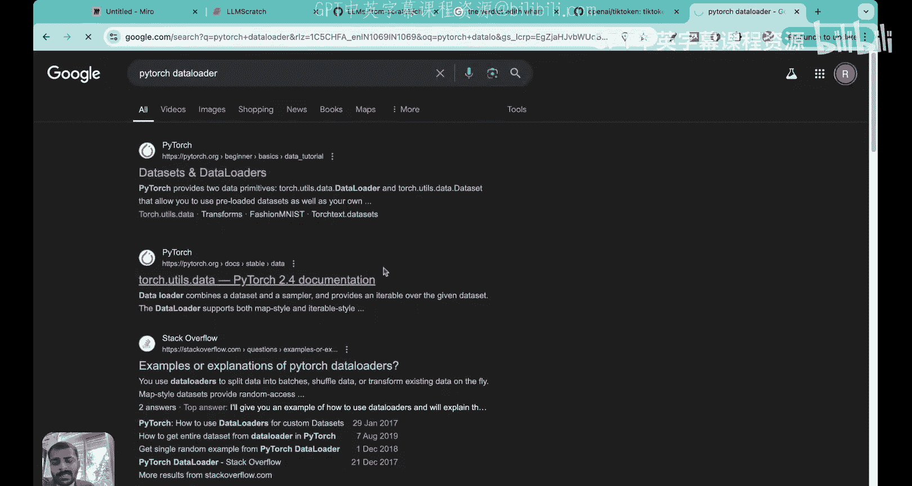
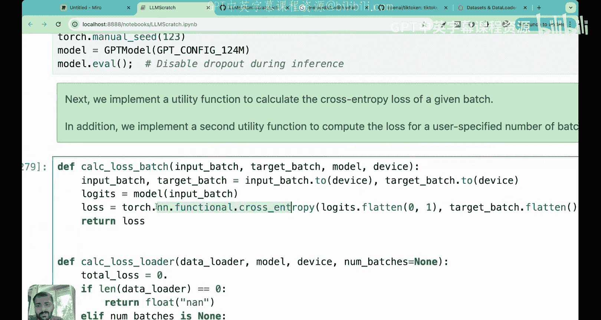
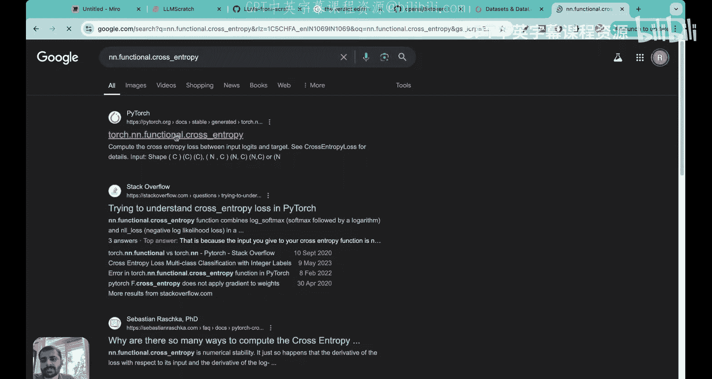
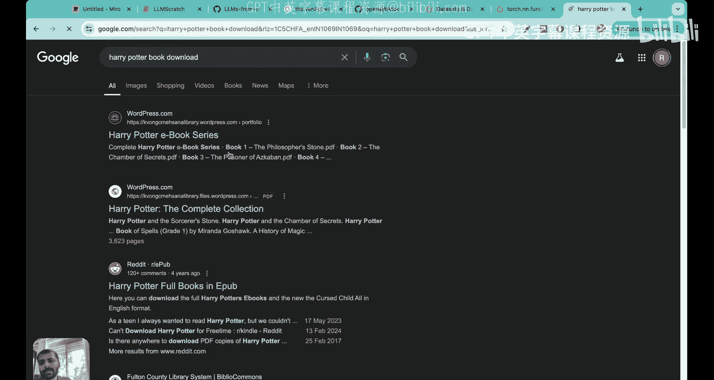
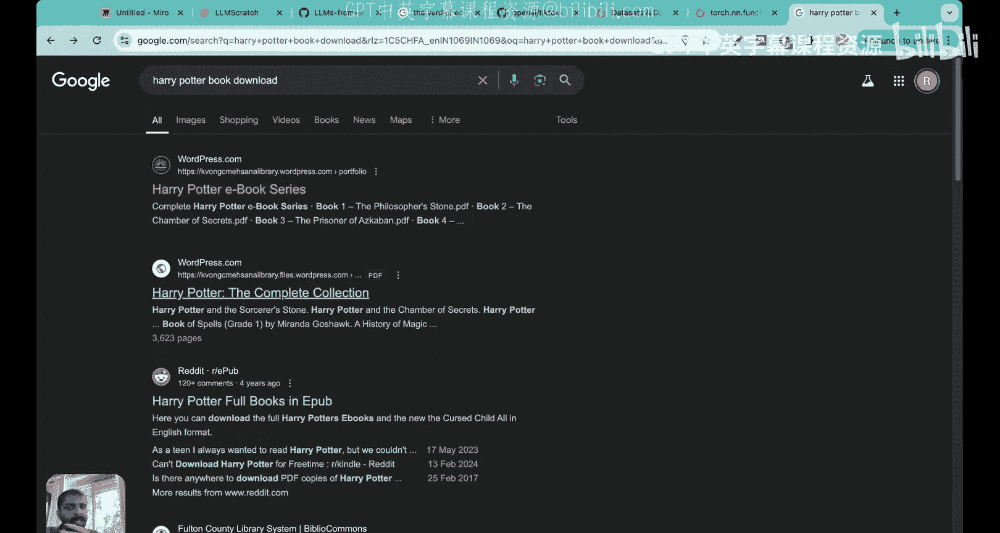
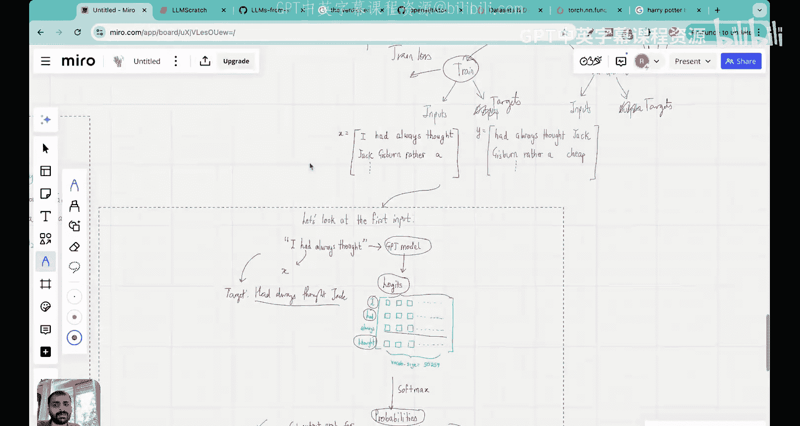

# Vizuara《从零开始搭建大语言模型｜Building LLMs from scratch》中英字幕（Claude-3.7-s） - P25：-27-Evaluating LLM performance on real dataset _ Hands on project _ Book data.zh - GPT中英字幕课程资源 - BV1qG8HzUE2D

🎼Yeah。Hello everyone， and welcome to this lecture in theBuild Large languageage models from Sctch series。

Let me recap the stage of。Building the LLM in which we are at currently in terms of a diagram。Okay。

 so we are in stage number two right now based on the schematic which is mentioned in front of you and in the stage number two we are essentially learning how to build this foundational model。

Or rather， we are going to learn how to train or pretrain a large language model in this stage in the previous stage in the all the previous set of lectures we have looked at data preparation。

 attention mechanism and LLL architecture， in fact， in this stage， we even looked at。

How to calculate the loss。In terms of a large language model。

 we looked at how to define the cross entropy loss based on the input and targets of a large language model。

And that was the previous lecture which we had now we will be looking at a much larger data set in fact。

 this is going to be a very interesting hands on lecture in which we are going to collect data from a storybook。

And we are going to make predictions using the large language model。

 which we have built in the first stage。And then we are going to measure the loss of our large language model。

Based on the actual data which we need。So in the previous lecture what we did is we looked at some simple examples。

 we looked at just two inputs， the first input which we looked at was every effort moves and the second input was I really like we looked at these two inputs。

And we predicted outputs from our large language model。

 and then we calculated the loss between those outputs and the target values which we need。

Now what we are going to do is we are going to look at an actual data set and on that data we are going to find the training loss and we are going to find the validation loss。

So if you zoom into stage2 of building an LLM further in the previous lecture we have looked at text generation and text evaluation。

 so we saw the cross entropy loss in the previous lecture and how to calculate it for just two simple input text today we are going to calculate the training and validation losses on the entire data set。

We will also split the data into a training set and validation set。

 so let us get started it will be a completely handson lecture and after this lecture actually you will be equipped to take any storybook of your choice or for that matter any data set。

And。Train the large language model， not really train it because we are not training the parameters in this lecture。

Do a forward pass of the large language model， get the outputs。And then。

Get the loss based on the true values which you need and you will get this loss for any dataset which you use you will just have to follow the same code which I will provide you at the end of this lecture we have not yet started doing the training procedure but once you get this loss for the data in the next lecture we are going to look at the LLM training function where we will also dive deep into back propag。

So， at the end of today's lecture you will have a very cool result which is applicable to a wide range of data sets。

 so lets get started the data set which I am going to consider is called the world。

It's a book written by author name Ed Wharton and this book was published in 1906。

 I think here's how the book looks like。And the book is publicly available to download。

 I'll share the link， you can download the book from this link。And it' is not a very long book。

 it's a pretty short book in fact， but we are using this just because I want to demonstrate an example which runs very fast on my laptop and it will run very fast on your laptop also。

In fact， if you take a look at this data and if you count the number of characters。

 you will see that the number of characters in this data is 20，000 characters。What we do。

On the data first is that we will first convert this data into tokens。

So we' will use a tokenization scheme for that， which is called aste pair byte pair encoding。

So by pair encoding is the tokenization scheme which we are going to use and what this will do is that in by pair encoding one word is not one token its a sub world。

Based tokenization scheme where even characters can be tokens， just pairs of letters such as P and H。

 this can be one token， just P can be one token， etc。

So if you use byte pair encoding you will find that this data set has 5000 tokens don't worry I am going to show all of this in the code。

 but just if you search speak token。You will see that this is the byte pair encoder which we are using and it is the same encoder which openaiI actually used and using this encoder we can encode our data data set into tokens。

Great， so this is the data set which I am considering and remember you can use any data set which you want on publicly available books。

Now the next step what we are going to do is that we are going to divide the data into training and validation remember this is the same thing what we do for all machine learning problems because the training loss is not the one which really matters what matters is how our large language model is doing on text which it has not seen before。

So we'll do a simple thing over here。 Let's say this is the entire data set。 We are going to use a。

Train test ratio of 090 and we are just going to do a simple split the training data will be the first 90% of the input and the validation data will be the latter half。

So the remaining 10%， right？And thats how we are going to split the training and the validation set so if you imagine the entire data to be like this what I am going to do is that I am going to reserve with the first 90% so this is 90% and this is 10% so I'm going to reserve this for training purposes。

And I'm going to reserve the 10% for validation or testing purpose。Now。

 what I'm going to do after this is pretty interesting。

Usually in other machine learning problems getting the inputs and the outputs is pretty easy right you just have images of cats and dogs and the output is whether it's a cat or whether it's a dog so its pretty simple you have inputs which are images and you have outputs which are the labels you don't have to do anything special to create these input output pairs but it is not as simple in the case of a large language model because large language models are autoregressive models。

We don't label anything beforehand， but from the text itself， we construct the inputs and the output。

And so we need to understand the process through which we construct these input output pairs。

So in the code we are going to use the data loader to chunk the training and the validation data into input and output data sets or input and output pairs and let me show you how I am going to do that if you understand this part it will be much easier for you to visualize what comes next right so the first thing which we have to decide is what is the context size which I am going to use。

In other words， what is the maximum number of tokens the LLM can see before it predicts the next token so I am going to show you how to construct the input output data pairs on this data set using a context size of 4 so that is the first thing which I need to decide context size equal to 4。

Okay， great， so now let me look at this data set and heres how I create the input output pairs my first input is this I had always thought。

And since the context size is4 I am looking at four tokens at a time and although whenever it is not one token I am just assuming it here for the sake of demonstration so this is my first input and I'm going to label it let me use the same color here and I'm going to label this as x1 right this is my first input now what is the first output the first output is just this input shifted by one so then it will be this。

Had always thought Jack。This is why。Let me write this down over here。Ultimately。

 the input will be a tensor x， and I'm currently I'm just writing the first row of this。

 so this will be I had。Allways。Tod。That's my first input。

And let me also collect the output tensor over here。With a different color， of course。

 and this will be had。All is。Thought。Jack， a。Now， let us focus on this first input output pair for just a moment。

The first thing to notice is that of course the output is just the input shifted to the right by one。

 but another thing to notice is that this one input output pair essentially has four prediction tasks what are the four prediction tasks the first is that when I is the input。

Haad is the output。So the index corresponds that way when I had is the input， always is the output。

When I had always is the input， so when these three are the input。

 thought is the output and when I had always thought is the input。Then Jack is the output， right？

So essentially， when x is given an input， when we pass it through an LLM。

 it will produce these four tokens as the output。And then the output produced by LLM will be compared to this。

 which is the actual output which we want。For this input。

 let me repeat that again if this is an input I had always thought the actual output which we want is had always thought Jack。

But you will see that when you pass these four tokens through the large language model。

 it is not trained currently right， so it will predict some random words over here。

And then we have to find the loss between those random tokens and what we want that is how you get the loss between the first input pair and the second first input and the first output。

RightNow let's move ahead a bit and let us see how to construct the second。Second input。

 so I'm going to rub this output pair right now。Okay， so we have the first input。

 Now we have an option of how we are going to actually construct the second input and let me show you。

How we are going to do that Okay so the first option is that you just move it to the right so then x1 is I had always thought right x2 will be had always thought Jack。

Now， this movement， which we are going to do， is also called as pride。

And that is the second parameter which you have to decide along with the context size。

So if you puts right equal to one like I have done in this case。

 the second input will have will be x2 and that has lot of overlap with the first input right had always thought is overlapping。

So you can also do this。 But usually what's done in models such as GP is that the stride， which。

We are going to define that right now is fixed to be equal to the context size。

And that is equal to 4 so we are going to use a stride of 4 what this will do is that when x1 if x1 is this input we are going to have1。

2，3 and 4 so then x2 will start from here， so then x2 will be jack giizbon rather u。This will be x2。

 You see what stride equal to4 does it it makes sure that we don't have any overlap。

 but it will make sure that we also don't skip any token as the input When you look at x3。

 this will be the。This will be x3， which will be the third input。When you look at x4。This will be x4。

 which is the fourth input， right？This is how the inputs are created and you don't skip anything。

But also you make sure there are no overlaps between input。 So now if you look at the input tensor。

 the first is I had always thought right the second will be jack Gipon rather a jack。Gizbon。Rather。

Oh， that is the second input， which is x2。 The third input would be cheap genius dash dash， though。

 So the third will be cheap。Genius， dash， dash， dough。So。

 that is how this entire input tensor matrix will be created sorry this input tensor will be created like this will spread through the entire data set and well collect these pairs so then the first row will be x1 the second row will be x2 the third row will be x3 and well keep on accumulating these rows until we reach the end。

And however the output is created once the inputs are created the output is just the input shifted by1 so for the first input I had always thought the output was had always thought jack。

Right now Jack Gisbon， rather if this is the input， the output would be。Gizbon。Gizbon。

 rather a cheap。So this will be y2， the first row will be y1 and similarly well construct all the other output output pairs。

till we reach the end of the dataset So that is how input output pairs are created in the case of a large language model。

 So if you have a data like this what's very important is this x and this y so the x is the input and the y is the target which is the actual value So let me write this here X is the input and y is the target Now the loss will be between the LLM output which we have not seen yet but well also get LLM output So this input will be passed into。

This input will be passed into our LLM model。And then we will get the output from the LLM right and that will also be a tensor with the same format as this target tensor and then what we are going to do is that we are going to then find the loss between the we are going to find the loss between the LLM output and the target and this is the loss which we are going to find in today's lecture and this is the loss which we eventually want to minimize okay。

I hope you have understood this this part and I deliberately wanted to show you visually because students are generally quite unclear regarding how input output pairs are created in the context of large language models now here I showed you the input input target pairs I should call them here I showed you the input target pairs for the training data right。

These are the input and let me call them targets because outputs will be what I refer to as the LLM predictions。

So， I created the input and the target pairs for the training data。

 similarly we have the input and the target pairs for the validation data and that will give us the validation loss。

The input and target pairs will give us the train loss for the training data。

And the similar tensors will give us the validation loss for the validation data。

Now let me explain to you the rest of the process and then we I take you through code but first I want you to understand how exactly is the loss function calculated so that the code becomes so much more easier to understand now let's say you create the input and target pairs like this which is the first step first you look at the first row of the input and the first row of the target。

And then lets see how do we get the loss So lets say lets look at the first input so Im going to look at the first input now。

 which is I had always thought。Wwhichch is the first rowover here And remember that based on the input。

 we have to get the LLM model output right， What is our model predicting。

 we need to know that because I have the actual output corresponding to this input。

 So if the input is this I know that the output is had always thought Jack that is my output。

 so let me even write that here the output or rather the target I should call it the target value for this input is had。

Had always。P the jack。Right that is the target output which I need but of course my LLM is not going to give me this at the first first shot because we have not trained it yet so I need to first know what my LLM is predicting and for that we are going to go through the entire not right now but I am just going to show you the schematic of what we are going to put the input through so the input which we have that will go through this entire GPT architecture or the entire LLM architecture which we have trained in stage number one。

So in the previous lectures we have actually built this entire architecture from scratch and you can see that there are so many different modules in this architecture and let me quickly explain to you what we are actually doing so we take in the input imagine those four tokens I had always thought we tokenize them using the thick token or the byte pair encoder then we convert them into token embeddings which are vector representations in higher dimensional spaces we add positional embeddings to it。

We add the dropout layer at this stage our input passes through the transformer block。

 So the blue block which I' have shown over here this is the transformer block and this is the main engine of the GP architecture the main thing which happens in the transformer block is that the input embedding vectors are transformed into something which is called as context vectors。

Now， what are context vectors and how do they differ from input embedding vectors。

 context vectors are more richer so if you look at one over lets say if you look at effort here。

If you look at the input embedding vector for effort， it just encode semantic meaning about effort；

 it does not contain any information about how effort relates to the other tokens。

But the context vector is much richer because the context vector for effort not only contains semantic meaning about effort。

 but it also contains information about。When effort when we are looking at effort。

 how much information should we pay to every move and you？

So in other words it pays attention the context vector includes attention which is given to the other tokens when we look at a particular token and that's what gives all the power to the large language model so this multiha attention is the main driver behind the transformer block so if you look at the whole GP architecture the transformer block is the engine of the GPT architecture and within the transformer block the multiha attention is what allows us to convert these input embedding vectors into context vectors which encodes information about how tokens relate to other tokens that's how the LLMs capture meaning and thats how they do so well so GPT does so well because it has this multiha attention mechanism。

So you can see that the transformer has a number of building buffs we have the layer normalization multiair attention dropout shortcut connection feed forward neural network etcter。

 and then finally when the input，Comes out of out of the GP model architecture we get something which is called as the logicits we get something which is called as the logic ssor and it's very important to understand what the logic ssor is and whats the dimensions of this logic stens so let's say the input is I had always thought and when we pass it through the GP model which is when it passes through the entire architecture which I just showed you we get this logic ssor now I had always thought those are the tokens and when you look at the logic ssor corresponding to every token there are these logics there is a logic vector whose dimensions are equal to the vocabulary size so if you look at I the logics for I are 50257 because that's our vocabulary size if you look at had the logics for had are 50257 because that's the vocabulary if you look at always the logicits for always are 50257 because that's the vocabulary size and similarly for thought。

Now， when the logic ssor come out of the GPT architecture， they are not normalized。

 so if we look at the logics for I they don't add up to1。

 so the next step is to convert this logic ssor into a probability stensor。

And that makes sure that when you look at every token the logics or the probabilities add up to1。

 so now you can see that every logic essentially has a meaning because it adds up to one。

The way to predict the output now is that you look at I and you look at that logic which has the highest value okay and let's say it corresponds to index number 50 in this vocabulary of 50。

2，57 or maybe 5000。And then you look at the token corresponding to that index and maybe it's something random like a C H Now you look at had and you look at the logic。

 which has the highest value you get the index corresponding to this maybe it is 31。

101 and then you find the token corresponding to this index maybe it's something completely random similarly for always you get the index which has the highest probability and you get the outputs like a A M oh let's say a Oc and then you look at thought and you find the index corresponding to the highest probability and let's say this is 61。

161，11 and then you get the。Outputs， so these are the output tokens now which our LLM is predicting and these are the output tokens which we need to make sure that they need to be as close to our target as possible。

Okay， I hope you have understood the workflow which we are trying to follow here。

 we first have a logic ssor we convert it into a softmax ssor which is a probability ssor and I just give you the intuition that based on this ssor how do you make the output for this input right。

So what is done now is that after this point。Let's say we have this probability sor right Then what we actually do is that we look at the targets。

 This is the actual value which we want and we look at the index which each token in the target corresponds to so had has index 23 in the vocabulary always has index 3。

8 to1 in our vocabulary thought has index 1，1，2，2，3 in our vocabulary Jack has index 15 in the vocabulary I'm assigning these random values for now just for demonstration purposes now let me show you one thing here so first let me rub these。

Rub these colors Okay， now what is done next is that based on these based on these indices。

 let's say we look at I and we look at index number 23。

 let's say this is index number 23 and we take its value that will be P1 then we look at head。

And then we that so the target for head is always and it's index is 38 to 1。

 let's say we look at that index and find the probability corresponding to that index that's p2。

 Then we look at the third row and find index number 1，1，2，2。

3 and find the probability corresponding to that that's p3 and then we。

Find the index number 15 in the last row， and then we find the probability corresponding to that。

 so then that will be P4。Ideally， if in an ideal world， if the LLM is traineded perfectly。

 these probabilities will be close to one。And if these probabilities are close to one。

 it means that our LLM is also predicting these values， right？As the output。

 but when the LLM is not trained at all these probabilities will not be close to one at all。

 they might be very low， which means that our LLM does not think that this target needs to be the output because it has not been trained。

So， the whole goal is that to make sure that these probabilities get as close to1 as possible and that is why we employ the categorical or I should call it the cross entropy loss so I first take the logarithm of all these values I add up these log values then I take the mean and then I take the negative this is also called as the negative log likelihood。

This is called as the negative log likelihood and the whole goal of training the LLM is to make sure that this this negative log likelihood which I am calling NLL and if you plot nnl of x as a function of x so it is negative of logarith right so it will look something like it will look something like this。

Since it is a negative it it will look something like this and our whole goal is to make sure that the loss comes down and it comes down to zero as much as possible。

So now today what we are going to do is that today we are not going to train the LLM we are just going to see the starting point of this loss which will be very high value。

 but then in the subsequent lecture we are going to train the large language model so that this loss comes as down as possible。

So this is the workflow which I showed you for one input right I had always thought。

 and then how do we get the loss？Now remember that we don't just have one input we have all these inputs which are stacked together in a batch。

 so remember that this data loader processes inputs in a batch so each batch has an accumulation of inputs right based on the size of the batch so now let me show you how multiple inputs in a batch are processed。

So lets say we have a batch which has two inputs together。

 so let's say this is a batch whose batch size is equal to2。

 which means that there are two inputs together in a batch at a time。

Right so this is one batch and this has two inputs I had always thought jack Gipen rather also so this is x1 and this is x2 and this is y1 and these are this is y2 these are the target output so for the first input x1 my output should be had always thought jack which you also saw in the previous example where just one input was there。

And my second input is Jack Gisbon rather the output should be giizbon rather cheap。

 That's what I want。 These are the targets right now similar to the similar to what we saw for one input。

 the steps are pretty similar for the case of batches as well I'm trying to see a color which would work the best here yeah So what well do is that will first take the input and we'll pass it through the entire GP architecture In this case what we'll get is that we'll get two logic ssors。

 The first logic sss for the first batch first input the second logic ss is for the second input So if you look at the size of the stensor now we have two batches here and in each batchge there are four rows and in each row there are 50 to57 columns in the previous case where there are just one input the size was just four into 50 to 57 but now we have two such batches right two such input so this is input number one and yours input number two right。

So in the code， what we will do is that when we get this logicit ssor we will flatten this out。

 we will flatten the badge dimension out， which means we will merge both of these together。

Well merge both of these together so that now the mild cumulative logicit tensor looks something like this。

 This is my first input this is my second input all merge together The size of this now will be eight rows multiplied by50 to 57 that will be the size of this okay and the next steps are pretty similar add we apply softm we convert this into a tensor of probabilities and then we look at the target we look at the target tokens and we stack these target tokens also so for the first input these four are the target outputs for the first for the second input these four are the target outputs and we get the token ids corresponding to these target outputs we stack them together and then we find for each row we find the value corresponding to these token ids。

And then these values are noted down as p11， p12 p13， p14， this for input 1， p21， p22， p23。

 p24 that is for input number 2， and then similarly we get the cross enpis。So。

 this is the loss for the first input， this is the loss for the second input and then we add add it together and ultimately it will also look something like this。

And the whole goal is that in this case， also we want to minimize this loss and bring it as close to zero as possible。

So now I hope you see that even for a batch of two inputs the process of getting the loss is pretty similar as what the process was for just one input right and I want you to keep this visual workflow in mind so that when we come to the code you will really understand what is happening over here so in the code there is going to come a time when。

We are going to apply the data loader to the training and validation set and the training data set is going to look like this after it passes the data loader。

 And I want you to analyze this right I told you that the input is processed into batches right So here you can see that。

Let's look at first the each row for now right each row corresponds to one batch so this is x and this is y so what this2 comma 256 means is that the so let's look at our case right now let's look at the case which we took for the batch。

We looked at x1 we looked at x and y right this is the first batch and the size here was2 comma 4 because there two there were two inputs and each input had four tokens and here also it was two comma 4 because there are two outputs and four tokens similarly what I want you to note over here is that when you look at this training data loader it' is exactly similar to the example which we saw so let's look at the first row over here。

Let's look at the first row here。 it has two inputs。

 but it has 256 tokens because that is the context size we are going to use when we go to code So thats x the first input and it has two。

It has2 input pursuits x1， comma x2。And that's exactly what we saw right why there is two here because there is x1。

So if you zoom this in further， let me show you how it looks like。 It will be I。I had always。

 this will be 256 now。Not for like what I had shown you because the context size is 256。

 this will be x1 and then x2 will be another input batchge。

This will be x1 x2 and then similarly we have y1 y2 which are shifted by 1 I already told you right how to construct the y1 and y2 they are the inputs just shifted by 1 so these are y1 and y2 and they will also have the size of 256。

This is just the first batchge， the first throw is just the first batchge。

Where each batch had two inputs of 256 tokens each similarly here we can see that there are nine batches so there are nine training set batches each batch has two samples and each sample has 256 tokens each so I don't want you to be scared when you see this in the code similarly in the validation we just have one batch because only 10% is used each batch has two samples and each sample has 256 tokens each。

Okay， I hope you have understood this visual workflow which I have constructed over here。

 I could have directly taken you through the code but then it would have been very difficult to understand the different steps in the code。

 right？Now Im going to take you through the code and we are going to see how to calculate the loss for this verdictic short story step by step。

 but please keep this intuition of this workflow in mind then everything will be very clear for you。

Okay， so now we are at the code before we get started I want to clarify that we are actually using a relatively small data and that is because we want to run the code in a few minutes on our laptop computer。

 I could have used a larger data but it would have taken a huge amount of time。

Just to give you a sense of how much time it takes to run big data sets。

 Lama 7 billion the that model required 18432，0 GPu hours。

Ms train or 2 trillion tokens and training this LLM would cost about $700。

000 thats why I cannot show it to you on the full scale data set。

 but I am showing it to you on a smaller data set and the whole logic is completely scalable for larger data as well。

Okay， so here is the code， the first thing what we are doing is that we are getting this data link from here and I'll share this link with you in the YouTube description and I am importing this data over here。

So here you can see that I am reading the data set and I am storing the all the information。

 all the text in this variable called text data。And let's check whether the text is loaded fine by printing out the first100 words。

 so here I' am printing the first100 characters。And here you can see that the first 1 hundred0 characters have been printed and they look very closely matching with what was actually there in my text I had always thought Jack Gipen rather a cheap genius and here also I had always thought Jack Epen rather a cheap genius。

 awesome。Let's bring the last 100 characters it for me。

 the shroud strand alone and let's see whether that also matches。

Okay I think this also matches the whole data that is not being displayed over here。

 but now we are pretty sure that the data has been loaded fine let's move to the next step in the next step what I want to show is that we can print out the total number of characters in this data and it's 20479 that's fine but remember I told about the byte pair encoder what we are going to do is that we are going to use the byte per encoder tokenizer to encode this flex data and we have already defined the tokenizer in the previous lecture but I am going to do it once more here so that。

Yeah， so that。Everything is from scratch so what we are actually going to do is that we are going to import tickk token and we are going to define this tokenizer from the tickk token library。

 so let me write it down here。Okay。Yeah， so we are importing this Tiktoken library。

which is the same library open AI uses for their tokenization and we are going to get the encoding from P token。

 which is a byte pair encoder， character and subbol level encoder basically and we are going to encode the entire text data using this encoder。

And we are going to print out the number of tokens， right， so the number of tokens are 51，4，5。

So with 5145 tokens， the text is very short for training and LLM。

 but again its for educational purposes。呃。Okay the next step is that we are going to divide the data set into training and validation data and we are going to use the data loader exactly what I told you over here right so we have loaded the data now and we have to divide divide it into training and validation。

Okay lets do that before that what I'm going to show you is that remember I told you what our data loader does our data loader we have to specify this context size and we have to specify this stride our data loader loops over this entire data set and created this input output pairs that's what I've implemented in the code right now so here you can see that max length is the context size and stride is the how many steps we want to leave before creating the next input。

So first so we create two tensors input and the target so these are the x and y tensors which I showed and then we loop over the entire we loop over the entire data we create the input chunk we create the target chunk which is based on the context length and we append it to the tensor so the first row here will be the first input chunk the first row in the target will be the first target chunk then we move over in the second loop then we fill the second row of the input and the target similarly we loop over the entire data and fill the input tensor and the target tensor。

That's what this GPT data set origin1 creates and then we use the create data loader function。

 It takes the input output data sets which which have been created in the GP data v1 class and then we create this data loader instance so data loader is already provided by Pytor so let me show you this I also add the link to this so data sets and data loaders right they are very useful for processing data also in batches remember we want to use batches over here So using a data loader like this just makes。

Processing the batches is much more convenient， so we we create an instance of this data loader and we feed in the data set which we created the input output data set which I mentioned earlier your input and targets。

And then here we specify the batchge size， we specify shuffle。

These arguments are not useful in the current context right now。

 but Ill also explain them to you later when we are going to train the LLM， see the output， etc。

But remember that for now the only important aspect here is that we are going to create an instance of this data loader feed in this data set and define the batchge size if you want to do parallel processing you can also set the number of workers etc okay so now an instance of the data loader is created and let me actually take some time to explain the shuffle and the drop last。

So what this shuffle essentially does is that it shuffles the dataset order when batches are created that is sometimes useful for a generalization。

 what this drop last actually does is that if the last batch size is very small and some very small data is left at the last batch and it is not equal to the full batch size then it just drops that last batch so here we are setting the drop last equal to true。

And see the thing which I want to mention here is that max length equal to 256。

 which means that the context size which we are going to use is 256。

And we will also see that later we are going to use a context size of 256 earlier and that set by the GP。

The GPPT configuration which we are going to provide， so Ill also mention it over here。Okay。

 so for now I hope you have understood the GPT data origin1 class and this create data loader function which basically creates the input and the output data pairs。

And then it also specifies the batch size。One more thing I want to mention before we create the training and the validation dataset is that this is the configuration which we are going to use so look at the context length that's 256 which means that we are going to look at 256 tokens at one time whenever I showed you this example here I showed four tokens I showed the context length of4 because that is easier to demonstrate so when you try to understand the code always try to think of four as being replaced with 256 rest all the workflow remains exactly the same。

Okay， the next thing what we are going to do is that we are going to split the data set。

 so we are going to use a train test split of 90% the first 90% of the data is a training data。

 the remaining 10% is the validation data。And here is the main part where magic happens。

 so we are going to create a data loader based on the training data what this does is that it it splits the training data into the input and the target tensor pairs。

 which we are seen over。And we are also going to create a validation data loader which splits the validation data into input and the target pairs because we also need the validation loss。

So here you see the train data loader is an object。

 so we create we we create the train data loader based on this create data loader origin one function and。

We specify that batch size equal to2 maximum length is G config context length， So that's 256。

 That's the context size stride equal to the context size。 Remember。

 I mentioned to you that generally when these LLL architectures are run the stride and the context size are。

Mached because we make sure that no word is lost， but at the same time there is no overlap app between consecutive inputs。

Awesome right and then drop last equal to true shuffle equal to true and we are not doing parallel processing。

 so I am putting number of workers equal to0 Similarlyly we construct the validation loader。

With a bad size of2 max length which is the context length of 1024 and the stride sorry context length of 256 and the stride of 256 when GPT2 smallest version was strain they actually use a context length of 1024 and you can even do that but it just takes a long time all you need to do is just replace this with 1024。

And just run the same code which I'll be providing to you。

But please be patient when you run the code on your end。

 it might take some time we can do some sanity check。

So ideally the number of tokens which we want in our training data set should not be less than our context length right because then we don't have enough tokens to predict the next world so here I have just written that if this is the case if our number of training tokens is less than our context length then print an error similarly if the number of validation tokens is less than the context length print an error。

It does not print an error， which means we are good to go。

One more thing I want to mention here is that we are using a batch size of2 in large language models in training GPT level models。

 they usually use a pretty large batch size， but we use a relatively small batch size to reduce the computational resource demand and because the data set is also very small to begin with。

To give you a context， Lama 27 billion was sped with a batch size of 1024 here we are using batch size of2 because I want to run it very quickly on my laptop。

One more check we can do to make sure that the data is loaded correctly is that remember both in the training and the validation there are now x and y pairs input and target pairs。

So the training has input and targets and the validation is input and targets lets actually print out the shape of these input and targets so the training loader has this if you print out the x and the y shape in the training loader it will look like this。

And if you print out the x and y shape in the validation loader it will look like this So if you look at the train loader。

 let us look at the first row this is the x and what I am highlighting now is the y what this represents is that the input。

So in one batch so this is one batch so first row corresponds to the first batch the first column of the first row is the input。

 the second column of the first row is the output if you look at the first batch。

Input you will see that there are two samples each sample has 256 tokens Similarlyly if you look at the first batch output you will see that there are two samples and 256 tokens this is the target which we want and this is the input which is there similarly since 256 tokens are exhausted in the input and we have to loop over the entire data set there are it turns out that there are nine such batches which are created。

In the training data and there is one batch which is created in the validation data similar to the training data in the validation data you'll see that the batch has two samples each sample has 256 tokens and I also printed the length of the training loader here and you can even print the length of the。

Validation loader and you will get that the length of the training loader is equal to 9 because there are nine batches Each batch has two samples and the length of the validation loader is equal to one and there is just one batch with two samples I hope now this part is clear to you to make sure you understand this part that is why I actually went through this entire whiteboard demonstration to show you that towards the end we are going to get something like this。

In the in the code and remember I spent some time to explain these sizes and these dimensions。

 I hope you are following along and if I directly went through the code and when you reach this part it would have been impossible for you to understand this that so it was very important for me to go through this entire whiteboard demonstration so that you understand the dimensions of what's really going on。

So up till now what we have created is that we have created the we have the input and the targets and we have badged them into the input and the。

Target data， but we have still not got the output predictions right。

 we have still not got the GP model predictions。So that's what we are going to do next。

One more thing before going next is that we can print out the training tokens and validation tokens。

呃。Just for the sake of sanity so this make sure that the data is now loaded correctly now we can actually go to the next part which is getting the LLM model outputs so in one of the previous lectures we have defined this GP model class what this GP model class does is that it essentially implements every single thing what I've shown in this figure it takes the inputs。

It takes the inputs。And then it returns a logicit stensor remember the logic stensor as it is returned does not encode probabilities。

 We need to convert it to a probability stensor using the softm so the GP model class which we have constructed returns the logicit stensor and we have several lectures on this for now you can just keep in mind that okay first the inputs are converted into token embeddings we add the positional embeddings then we add a dropout layer then we pass the output of the dropout layer to through this transformer block this transformer block which I have highlighted right now that has the multihird attention mechanism which is the main engine behind the LLMs power after coming out of the transformer we have another layer normalization layer followed by output neural network which uses this logicit stensor。

Then we create an instance of this GP model class and we call it model and we are using the same GP model config 124 million parameters which I had defined overhe we are to specify the vocabulary size context length embedding dimension number of attention heads number of transformer blocks drop out rate and whether the query key value bias is set to false in this lecture I am not going to explain all of these parameters because that was the subject of previous lectures if you don't understand what those parameters mean。

 I encourage you to check out the previous lectures in a lot of detail we have around six lectures on that and six lectures explaining how we constructed this GP model class for now just remember that we have got the output logics and we have constructed an instance of this GP model class so when you pass an instance when you pass an input to this model it will give you the logicits。

Now we are actually ready to implement the loss because we have the we have the targets over here。

 we have the targets over here and we also have the GP model output and now we are actually going to implement the exact same steps over here remember first we take the softm then we index with the probabilities then we index these tokens based on the target tokens and then we get the crossenttropy loss right using the negative log likelihood and we did the same thing for this batch over here so now I want you to keep this in mind when we had a batch remember what we did first when we had a batch we first flatten the logicits right this is exactly what we are going to do when we calculate the loss so there is a function called calculate loss batch which takes the input batch and the target batch right。

What this means is that it is exactly like what I've shown over here。

 this is the input batch x and this is the target batch y if just that instead of four tokens there will be 256。

Then what we are going to do in the code is that we are going to pass the input batch through the model the GP model and get the logic ssor。

 so until now in the code we are at this stage where we have got the logic stensor。

 then we are going to flatten the logicits。0 comma 1。

 so see we are going to flatten the logic0 comma 1。

And we get this Now remember up till now we have not implemented softmax we have not indexed this probability ssor with the target index indices and we have not got the negative log likelihoodlude it turns out that we just one line of code N dot functional dot cross entropy we can do all of these three steps So when you do the N dot functional dot cross entropy on the flatters logic tensor and the flattered target batch so remember the flated target batch is this is this ssor over here this is the flattered target batch。

So what the NN dot functional dot cross entropy does is that。

It first applies softm to the logicits pencil， because that is the first argument。

 It first applies softm to this first argument， which is also shown in this white bowl。

 and then it takes the。Values corresponding to the indices in the second argument。

 so then it takes the values in this corresponding to the indices in this argument。

So it it then gets this p11 p12 etc cetera this matrix and then it also gets the negative log likelihoodlude it calculates the negative log likelihood so in one line of code we actually get the loss and this is an awesome function which is a very powerful function in pytorch you can take a look at this Ill also share the link to this。

This torch by torch function with you Asome so this is how we calculate the loss between an input batch and a target batch but now remember that we have to calculate the loss for all of the batches right and that's why we are defining a function called calculate loss loader which calculate the loss from all of the batches together the main function in this the main part in this is that you get the input and target batch for the entire data loader。

 which means that so here we just looked at one input and one output batch right one target batch but you will see here there are many input and target batches so row row one of input and row1 of target is the first batch row two is the second batch there are multiple batches and you have to aggregate the loss for all of those right so similarly you get the input and target batch and then you loop over So when you are looking at one batch you just run this earlier function and then you just aggregate the losses together So when you run the loss for one。

batch you will get the loss then you add it with the loss for the second batch and similarly you get the total loss and then ultimately you just divide the total loss with the number of batches which will give you a mean loss per batch。

The different parts of the code which are added before ensure that if the length of the data loader is0 it we return that the loss is not a number because length of data loader is 0 does not make sense。

 both our training and the validation data loaders currently training data loader is of length9 because there are nine batches validation data loader is of length1 because there is one batch if the length of the data loader is itself zero which means that there are no batches and there is nothing to compute。

Similarly， when we call this calllics loader function and if we don't specify the number of batches so if by default it's none we set the number of batches equal to the length of the data loader so for the training data loader that will be equal to9 for the validation data loader that will be equal to1 now if someone specifies the number of batches here which are more than the number of batches in the data loader we set the actual number of batches to be minimum of those two。

Right so the number of batches equal to minimum of number of batches set here and remember that in the data loader also there is a provision to set the number of batches so the ultimate batch size which is used for computation will be minimum of those two that's it and then we take the one input and one target at a time we find the loss according to this callic loss batch function which implements the functional cross n ort functional do cross entropy loss and then we actually add all of the losses together from every input target batch and then we just divide by the number of batches and this is how we get the average。

Ccross entropy loss per batch this the output of this function is the loss of our large language model on this book。

 the Veric data set， which we considered in today's lecture。

Now lets actually run let's actually call this function on the data which we have and let's see the output which we get。

 right？Okay， so what I'm going to do now is that。I'm going to call this calls loader and I'm going to input the train loader。

 the model and the device。And here you see Tor dot device if To dot QI is available else it will run on CPU so my code is running on my CPU right now and I am calling this callic loss loader function for both the train loss and for the validation loss so when I call it for the train loss I I input the train loader here when I call it for the validation loss I input the validation loader。

And the model is essentially the instance which we have already created here this is the model an instance of the GPT model class and that is the second argument。

 the third argument is the device。So呃。If if you want to run on CPU it can even run on CPU like I am showing right now。

 so Ied I've commented these lines right now uncommenting these lines will allow the code to run on Apple Silon chips if available which is approximately 2 x faster than on Apple CPU so right now my code is running on Apple CPU you can also run it on Quda if Quda is available or if you have GPU access you can even run it on GP so right now what I am going to do is that I am just going to click on this run and Im going to show you live how much time it is taking for me to run this。

I just want to show you that。Here what we have essentially done is that we have loaded this entire data set。

 we have converted this into input output pairs， we have passed the data into the GPT architecture block。

 so we have passed the data into this LLM architecture block which looks like this。

And then we have got the LLM outputs and then we have compared the loss with the targets and with these outputs and then we have collected an aggregate metric of this loss so here you can see I've got the training loss and I've got the validation loss and I got it live in less than 30 seconds I would say。

Now you can take this code and you can do whatever you want。

 you can increase the context size to 1024 all you need to do is go here and change the context size to 1024 to mimic conditions more closely to GPT2 you can even go to internet and search。

Harry Potter。

Book download。You can download the Harry Potter book There is any book series here just make sure the just make sure about the copyright origins。

 Similarlyly you can go ahead and download any data which you want and just train the large language or just run this code on the dataset which you are considering it will be truly awesome for you to use your own data and get this training and validation loss because once you have obtained the training and validation loss that really opens up the door for us to back propagate so in the next lecture what we are going to do is that we are actually going to define an LLM training function which implements the back propagation and which tries to minimize the training and the validation loss so then it will make sure that the outputs。

Being generated are very coherent。And then even if you run this code on another data set。

Even in the next code， when you do the pre training。

 you can do the same pre training on your custom data。

So the code which we have developed today is pretty generalizable and。

I hope you you understood what we are trying to demonstrate today。

 we are trying to demonstrate through real hands on example how we can actually take a data from the internet and we can divide it into input target pairs we can run the data through a large language model which we ourselves have developed if you have not been through the previous lectures this this model have not taken it from anywhere we have developed it live。

We have developed it from scratch without any single library like L chain or any other library。

 we have coded this from the basic building blocks and that has been used to produce this output that is even more satisfying。

Okay student so that brings me to the end of this lecture。

 I deliberately wanted you to wanted to give you a feel of the whiteboard teaching so that you understand the intuition theory and also the coding which is my main goal in every lecture which I conduct。

In the next lecture we are going to look at LLMP training I'll be sharing this code file with you if you can run it before the next lecture it's awesome if not it's fine I'll try to make the next lecture so that it's self contained Thank you so much everyone and I look forward to seeing you in the next lecture。

。

