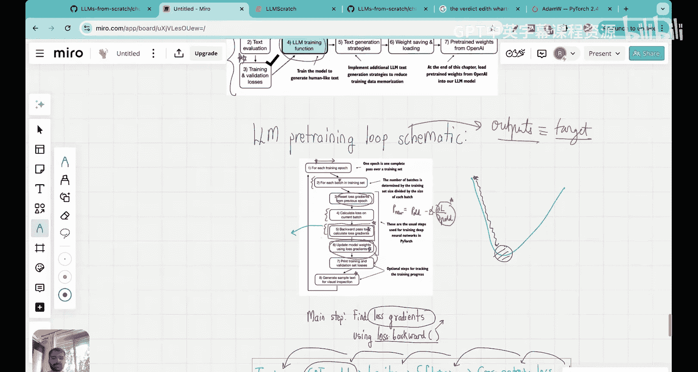

# Vizuara《从零开始搭建大语言模型｜Building LLMs from scratch》中英字幕（Claude-3.7-s） - P26：-28-Coding the entire LLM Pre-training Loop.zh_en - GPT中英字幕课程资源 - BV1qG8HzUE2D

🎼Yeah。Hello， everyone。Welcome to this lecture in theBuild La language models from Sctch series。Today。

 what we are going to do is we are going to train our large language model。Until this point， in the。

LLM。Pretrain stage， what we have actually done is that we have found out or rather we have understood the method which is used to calculate the training and the validation losses for a large language model and we covered that extensively in the last lecture where we saw that let's say if you have an LLM model and if you feed an input to the model you get an output how can you compare the output with the target value and how can you get the loss function。

Now that we have calculated the loss function in the previous lecture。

 the door is open for us to implement back propagation and to try to minimize this loss as much as possible。

Before we start learning about the LLM training function in today's lecture。

 let me quickly recap how we calculate the loss between the。LLM output and the target values。

 so in last lecture and as is the case with today's lecture。

 the data set which we are going to use is the book which is called the verdict。

Its a book which is written in 1906 and you can download this data set completely it's an open source data set and。

Its not too big I think it has around 5000 or 5500 tokens so it has around 20000 characters and it has 5000 tokens thats the data we are going to use the first step we do is that divide this data into training and validation we use a training ratio of 0。

9 which means that we use the initial 90% of this data as training and we use the remaining 10% of the data as the validation data。

Great now once we have the training data there is we first need to divide the training data itself into input and target pairs remember we have not even come to the LLM output for now since LLMs are autoregressive models we don't have labels so there is a special way in which the training data and the validation data itself needs to be divided into input and targets within the data itself。

And we do that using something which is called as the data loader。

So what the data loader does is that it looks at a data and it creates this input and target pairs so let me give you an example of how these input and target pairs actually look like so heres when the batch of input and target pairs so this is one batch and here you can see that the input consists of two samples and the output consists of and the target consists of two samples this is from our data itself。

And in each sample here you can see that there are four tokens but actually when we code the number of tokens is pretty big I think it's around 256 that is the context size or how many tokens you are going to see before predicting the next token right so this is the first sample of the input and here you can see this is the first sample of the output。

Now， the output or I should call this the target rather I shouldn't call it the output because the target is the true value。

 the actual value which we want our LLM to approximate。

So if you look at the first row of the input and the first row of the target you will see that the target is just the first row shifted to the right by1 and similarly for the second row of the input and the second row of the target that's how the input target pairs are constructed so we go we first take this data set and what we do is that based on the context size let's say the context size is4 so the first input is these four tokens that is x1 here I'm assuming one token is equal to one word but that's not the case because we use a byte pair encoder so I'm just showing this for illustration purposes here so this is the first input that x1 the first four tokens then the next four tokens thats the second input x2 and here there is one more important variable which is calledpri so if you see between the input on and input2 there is no overlap right。

Because the stride is equal to4 so the stride is usually equal to the context size so x1 x2 and similarly we go through the entire data like this and we get the input and similarly corresponding with each input we shift the input to the right and we get the target so throughout this entire lecture when we are going to refer to input and target pairs we keep this visual in mind so this is a batch each batch has your two samples so here's the input batch and here's one output batch similarlyly sorry input one input batch and one target batch similarly there will be huge number of input and target batches once we split all of the data into input and target pairs right so that is the first step and if you want to understand the details about how this input and target pairs are created we have done that in a lot of detail in the previous lecture so I'm not going to cover that right now。

So these are the input and the target pairs right that is the first step then we need to get the LLM output so what we do is that we take the input value so we take the first batch take the second batch take the third batch etc and pass all of these batches into this LLM architecture which we have built this is a pretty big architecture where we first do the tokenization then do the embedding then add the positional embedding add the dropout layer and the output from this dropout layer passes through the transformer block so this blue color this blue color block here。

Which I'm highlighting right now。 that is the transformer block here where all the magic happens。

 The transformer has multiple layers， such as normalization， multi attention， dropout。

 shortcut connection， feed forward network， drop out another shortcut connection， etc ceter。

 Then we come out of the transformer block。 There is another normalization layer followed by。😊。

Output head or output neural letter and then we get this output tensor。

 which is called as the logicit tensor。So the shape of the logic ssor is pretty interesting to note over here。

 let's say we are looking at the first batch right now and the first batch has two samples right this is the first sample I had always thought which I mentioned here and this is the second sample this is how the logic stensor looks like each of the in each sample every token let's say I has the number of columns which is equal to the vocabulary size that is phi0257。

So the size of this logicit ssor is  two into4 into50257 in this case because there are two batches。

 four tokens in each batch and 50257 columns， then we flatten this logicit stensor。

 which means we merge。The first sample in this batch and the second sample in this batch。

 and we create this unified tensor， which is eight rows and 50257 columns。Now。

 when we get the logic ssor as the LLM output every entry in the logic ssor does not correspond to probabilities all the entries corresponding corresponding to one token do not even add up to one。

 so we need to implement the softmax and convert this into vector of probabilities So what this means is that when you look at the first row I each value here corresponds to how much probability is there for that token to be the next token so if the input is I every value here corresponds to what is the probability for that token to be after I so if the LLM is trained the token index which has the maximum probability should correspond to head because when I is the input had is the output Similarlyly when you look at the second row I had is the input if the LLM is trained the token which has the maximum probability should correspond to always because when I had is the input always is the output Similarlyly when I had always thought is the input。

the token I the token here which corresponds or the index rather which corresponds to the maximum probability should correspond to the next world。

 which is I had always。Thought， or I had always thought Jack， so。

Let's see Yeah I had always thought Jack so here the token id which corresponds to the maximum value in this case this index should correspond to the token for jack when the LLM is actually trained Now initially when we get this tensor of probabilities the LLM is not trained right so what we will do is that we know the target we know the target values right we know the target which we want and we know the token indexes of this target so for example for i is the input head is the output and that has a certain token index right so let's say if I is the input and had is the output I want this token index to have the maximum value of the proba。

When I had is the input always is the output so lets say I want the token index so what we do here is that we just collect these list of targets and their token token IDs and we find the probabilities in each row corresponding to these token IDs。

Now， the whole aim of this。Exercise of training LLM is to make sure that these probabilities are as close to one as possible because then we will make sure that the LLM outputs are matching the target values。

 which means that the next token which are LLM is predicting is similar to the target values target value tokens but initially when the LLM is not trained these probabilities will be not close to one at all。

 so we employ the cross entropy loss and we find this negative log likelihood。And the whole aim。

When we train the LLM today is to make sure that this loss function decreases and it becomes close as close to zero as possible。

Where the loss function is minimized。So today what we are going to do is that all the parameters in the GPT architecture here all of the parameters will take a look at them shortly。

 we are going to optimize them so that when the input inputs are fed into this model and when we take the loss function in the way I have outlined today the loss function is minimized。

I went through this in a fast manner because we had a one hour lecture previously detailing this entire process。

Okay， now I hope you have solidified your understanding of how the loss function is calculated now that we have the loss function we are ready to do the LLM pre training。

So here what it means is that we are going to try to minimize the loss function as much as possible。

 so we want the output the LLM outputs to be as close as possible to the。

targetar to the target valuetens And for that we will be doing back prop。

 So here's the pre training loop schematic if you have worked with neural networks before。

 if you have done machine learning or deep learning it is extremely simple to understand because。

Once we have written down the entire loss function all we need to do is just do the backward pass and I'll explain to you what this means so what we are going to do is that we are going to do multiple epochs so let's start understanding this step by step we are going to do multiple epochs one epoch is going through the entire training set once now in each epoch we have multiple batches rate because the training set is divided into batches as I showed you we are going to look at one batch in one loop and then in that batch what we are going to do is we are going to find the loss function。

In the same way which I have described to you right now。

And we even wrote a code for this in the last lecture。

 I'm going to find the cross entropy loss function for the entire batch and then I am going to do this step which is the backward path to calculate the loss gradients in this entire schematic this is the most important step。

The backward pass allows us to calculate the gradients of the loss and what the gradients of the loss will enable us to do is to update the model weights and parameters。

 so let's say one particular parameter has a value of P old in one iteration in the in the next iteration its value will be something like this。

Its value will change sorry， this should be the other way around。So。

 they should be P new the new value is equal to the old value minus the step size into the loss gradient。

 so the loss gradient once we get these loss gradient they will enable us to value all the parameters in our GPT architecture。

And if your question is what are these parameters I am going to come to that in just a moment and then after we update the parameters we are going to print the training and validation losses we are going to see what the LLM output is there just for visual inspection and then we are going to go to the next next batch when we go to the next batch we are going to reset the loss gradient from the previous batch to zero and then do the same process all over again for all the batches。

And well do this until we finish one training epoch。

 and then we will do this entire procedure for multiple training epochs。

Just so that the training proceeds as many time as possible and the parameter values are updated as much as possible。

 this is the main algorithm for pretrain the large language model and it looks pretty simplified right now but what we have done so far in all of the lectures we have conducted is that。

Unless we had a way to calculate the loss function， getting to this step。

 getting the backward password have been impossible and to get this loss function right now to get this loss function we first needed to understand how this logic sensorsors are obtained how the LLM output is obtained to get to how the LLM output is obtained we need to understand this entire GPT architecture itself to understand this GPT architecture we need to understand tokenization positional embedding multiair attention dropout layer field for our networks etc。

So without doing all of this， it could have been impossible to calculate the loss function。

 which I explained to you today in five minutes。So these five minutes have required a hard hour cough。

20 to 25 lectures which have been covered previously。So。

 this is the training loop schematic in in short we are we are finding the loss we are doing the backward path to get the loss gradient in every iteration and we are updating the parameters based on these loss gradient values。

And our hope is that as we do the updating let's say the loss function landscape is this it will not be this at all because it is a huge multidimensional landscape if this is the loss function landscape and if we start from somewhere here our goal is to make the optimization so that at the end we reach this minima where the loss function is minimized。

Great， so in this entire code， the main step is finding the loss gradients and we are going to do that in Python through this method called loss dot backward I'm going to show you how elegant this pretraining code is in just one line Python essentially computes or tensorflow Pytharch essentially computes the entire backward pass in just one line of command that's pretty awesome。

 but you need to understand why it is so awesome The reason it's so cool is because the sheer scale of the number of parameters we are dealing with So what we are essentially doing is that we have the inputs we pass them through the GP model we get the logics we apply softmax then we get the crossenttropy loss between the output and the target this whole operation is differentiable which means that this gives us once the loss is obtained。

 we can do the back propagation and find the partial derivative of the loss with respect to all the parameters which come in in the model and mostly the parameters come in this step。

😊，In fact， I think all of the parameters come in this step in the G model itself so the back propagation needs us to understand what makes the GP model differentiable So if you look at the GP model you will see that this is the workflow and differentiability is ensuresured and maintained at every single step of this workflow So if you have the loss function over here you can backpropoate it and find the partial derivative of the loss with respect to all of the parameters which come within this within all of these layers and if you add all of these parameters together the number of parameters will be around 161 million parameters I'm going to show show you how it comes to 161 million but through this one line of code through loss dot backwards we are essentially finding the gradient of the loss with respect to all of these parameter values and then updating all of these parameter values isnn't that pretty awesome the sheer scale of these operations would have been impossible to do 50 years back when compute resources were not available but now I can do this。

Backward pass optimization on my laptop and I did this training in six minutes which I think even on your laptop you can do it in five to six minutes we optimized 161 million parameters in this much amount of time and I'll show you how we can do that first let me draw your attention to what makes the number of parameters to be this high so if you have followed the GP model the GP model consists of the embedding parameters the token embeddings positional embeddings it consists of the transformer block parameters and it also consists of the final layer。

Before we get the logics， so the embedding parameters have the token embeddings whose size is equal to the vocabulary size multiplied by the embedding dimension。

And the positional embedding which is defined by the context size multiplied by the embedding dimension if you add the these two parameters this is 38。

4 million these parameters are not known to us we are even optimizing for the token and positional embedding parameters。

Now if you look at the multi head attention we have the query key value trainnable weights so there are three mets here and each each meize has dimension of 768 which is the input embedding and the outputbedding embedding which are generally same in this multi head attention and multiplied by three because we have query key and value three metes so this is 1。

77 million parameters and then there is also an output head。

Whose number of parameters are equal to 0。59 million the total number of parameters in the multi head attention block that itself is equal to 2。

36 million so。2。36 million parameters here and then we have a feed forward neural network in the transformer block and the feed forward neural network is like this expansion contraction type of a setting where we have the input sl to the embedding dimension that is projected into a hidden layer whose dimensions are four times the embedding dimension and then we compress it back to the。

Original dimension， so the number of parameters here are 768 which is the embedding dimension then 4 into 768 which are the number of parameters here。

 So these are the parameters in this expansion layer and these are the number of parameters in the contraction layer both are the same and they add up to 4。

72 million Now if you add up the parameters in the multiier attention the feed forward neural network and the output head it comes out to be 2。

36 plus 4。72 million these are the number of parameters in one transformer block and we have 12 transformer blocks so the total number of parameters which are coming from the transformer block itself is 85。

2 million parameters。And then there is a final layer， which is a softm。

Wwhich gets us the logicit ssor and the number of parameters here are the embedding dimension multiplied by the vocabulary size and that is 38。

4 million parameters so if you add up this number of parameters together the embedding has 38。

4 million transformer has 85。2 million and then the final layer is 38。

4 million so the total number of parameters if you add up our 162 million。GPT2 on the other hand。

 the smallest model is 124 million right so the reason between this discrepancy is that they use something called weight time。

So in the output projection layer， they recycle the same number of parameters in the embedding layer。

So， hence we。We reduce those many number of parameters and thats why the number of parameters in GPT2 smallest models comes out to be 124 million in any ways I want to illustrate here the scale of this operation and I want you to understand how the number of parameters comes to be of the order of 100 million so when we do back propag what we are doing is that for each of these parameters we first get this gradient and that is obtained in this step you see backward past to calculate gradients and once we get the gradients we are going to update all of the model weights。

So the way to update the model weights so this is just a simple gradient descent which I have shown in the actual code well use a origin which is called Adamom which is a bit more complex but at the underlying core the operation is similar we get the gradient which is the partial derivative loss with respect to the weights and then we update all the parameter values based on this gradient in the backward bus。

Awesome， right， So this is how the parameters are going to be updated in each。

In each iteration and we hope that as the parameters are updated。

 the loss function value goes on decreasing like I've shown over here and it reaches some sort of minima。

That is what the goal is so lets see whether this goal is satisfied now what Im going to do is I am going to take you through code and we are going to implement the pretrain loop for the large language model。

So the loop looks like this I want to draw your attention to something like so I want to draw your attention first to the most important part so what we are going to do is that remember I mentioned that we have a loader data loader for the training and the validation set correct so first what we are going to do is that we are going to look at the training loader first and we are going to divide it into the input batch and the target batch this is similar to what I explained to you right now over here。

See when I say input batch and target batch always keep this this in mind so the data set is divided into input batch and target batches。

 so there are multiple batches like this and at one time I am processing one search batch。

So at one time I look at one input and one target batch and I will find the loss between the input and the target batch。

 how do I find the loss using this same workflow using the categorical cross entropy towards the end？

I find the loss。That is this step and then this this step right here is the most important step in this whole code we are doing loss or backward what the loss or backward does is that it calculates the backward pass which means that it will calculate the gradient of the loss with respect to all of the parameters all of the 160 million parameters this one step is going to find the gradient of the loss。

Then we are going to do optimizer dot step。 What this optimizer dot step does is that it essentially looks at。

It essentially looks at this update rule and it will update the parameter values based on the gradient values which are obtained。

So this is the update model weight part。And what I'm doing is that I'm just。

Mentioning how many tokens the model has seen and I'll show you where this number comes into the picture but let's say we are looking at the input and target batch and the contact context size is 256 so we are looking at 256 tokens in one sample 256 in the second sample so we are looking at5 and2 tokens in one batch in the one input batch at a time so the token scene will just return the number of tokens。

Wwhichch we are seeing at a particular time and you see we are doing so it will get added up as the as we loop through different number of batches so this loop is for going through each batch in the training data and this loop is for the number of epochs so after we go through all of the batches we we do the same thing again。

So the number of epochs is specified by N underscore epochs， right？

Now what we are doing is that this step is actually an evaluation step so you can even get rid of this but it is important for us to see the validation loss so in this step what we are doing is that we are going to define a function called evaluate model and we are going to get the training loss and the validation loss and we are going to print these out as the training proceeds so let me show you what the evaluate model function looks like the evaluate model function is actually pretty simple we calculate the loss。

The Cal cost loader is we calculate the loss for the training loader and we calculate the loss for the validation loader for the entire dataset set and we have defined these functions before see in the previous lecture we use the same two functions call cost loader for the training and the validation and it returns the training and the validation lots for the entire dataset set at that particular。

呃。And when that particular batch is being processed。

 so what we will do is that after the first batch is processed we will run this part。

 which means that after the first batch is processed we will evaluate the model and we will get the training and the validation loss correct but we are going to show it we are going to show it only。

Only at a particular evaluation frequency so what I am showing is that here I am set I will set the evaluation iteration and the evaluation frequency to be equal to 5 which means that after every five batches are processed only then I will show the training and the evaluation loss so remember what is happening here when one batch is processed global step will be1 when the second batch is processed global step will be 2 now if the evaluation frequency is 5 this will be 0 only when global step is equal to 5 right。

That is when the remainder will be0 and only add that step only add that when I reach batch number5 I am going to calculate the training and the validation loss and I'm going to print it out that's it when I come to batch number 10 I'll do the same Ill calculate the training and validation loss Ill print it out and Ill do this for every single epoC so in this step what I'm doing is when I reach at a particular batch number when the LLM has processed that particular batch I will print out the training and validation loss that's all we are doing up till now and then just for the sake of visualization and understanding after when batch is processed so after。

呃。When the batches process what I am going to do is that I am also going to print out a sample text or here I should say that after each epoch is processed sorry not after each batches process we first make sure we go through all of the batches for one epoch so after each epoch is processed what I'm going to print is okay heres what the next tokens my LLM is generating right now。

So this generate and print sample is another function which we have defined over here and what this will do is that it will print out the next 50 tokens which our large language model is predicting。

 We have already seen this generate text simple function before what this function does is that it takes the model at its current stage So if we are at epoch number 5 the parameters are optimize maybe they are not very correctly optimize but we are at certain stage and we want to see what the output the LLM is predicting for the input right so this function is essentially going to generate the tokens for us and it will generate 50 new tokens for us to visualize and we can see right whether the output is correct or not whether the output of the LLM is making sense or not so this will be a lot of fun we are going to print this out at every single epoch。

So， the main step in this code is this lost or backward what we are doing after this point is just printing the training and the validation loss after every five batches and we are going to print the text sample after each epo。

And we are returning the training losses validation losses and we are also tracking the token scene see we are tracking this token scene。

 which is the number of tokens the input batch is using that will give us a sense of how many tokens the。

So it returns the elements how many tokens have been consumed until that particular point in the model and will also plot the number of tokens in the output so remember once one epoch will go through the entire dataset once right and if you look at our data again the data which we are considering I think it has around 5000 tokens so if we go through if the number of epochs are 10 so which means that if we go through the entire data set 10 times it actually means that the number of token seen should be 5000 multiplied by 10 so it should be of the order of magnitude of 50000 just keep this in mind。

So yeah this is the code and it is pretty simple it just I think around 15 to 20 lines of code and the reason its made so simple in Python is because of this lost or backward method it is pretty awesome and it does the gradient updates sorry it calculates the loss gradients and then we just do the optimizer at outstep we have not yet defined the optimizer but we will be doing it shortly。

Okay， now what we are going to do is that I am just going to explain the evaluate model function and the generate and print sample so that it is more clear for you so the evaluate model function calculates the cost or the training and the validation set。

And we ensure that the model is in evaluation mode。With gradient tracking and dropout disabled。

 remember that when the model when we are evaluating the model when we are printing the training and validation loss。

 we dont need to keep track of the gradient updates and we can even disable the dropout because we are just calculating the loss we are just doing the forward pass。

And then they generate and print sample right what we are doing here is that it is a convenience function that we use to track whether the model improves during training because we will be able to see what text is being generated。

The generate and print sample function takes a text snippet which is called star context as an input and convertverses it into token IDs。

 feeds it to the LLM to generate a text sample at that particular point in the training。

And we are going to print the text sample after every epoch right now lets see all of this in action by training a GP model instance for 10 epos using an Adam W optimizer now two things I would like to clarify when I say we are training a GP model instance the model which we are defining is an instance of the GP model class which we have already defined before So this is the GP model class what this class does is that it essentially performs all the operations which we saw in the。

AGPT model architecture schematic yeah all of these operations。

 so it will it will create or it will give us the LLM output at the end。Okay， so that's what。

That's what this GPPT model class is actually doing。Great， now what we are。

 what I also want to show you is the model configuration which we are using for this particular code。

 So this is the model configuration。 We are using vocabulary size of 5，0，2，5，7。

 a context length of 256。 Remember， G to smallest model originally used a context size of 10，2，4。

 but Im showing 256 here because I want the code to run on your machine in small amount of time and using small amount of resources。

 You can change it to 1，0 to4， and the code will not change significantly。😊。

The vector embedding dimension which we are using is 768 because the inputs will be projected into that much dimension space。

 the number of attention heads is2， the number of transformers we are using is 12 and the dropout rate is 0。

1 and the key query value query key value bias term biases false because when we initialize the weight mates for query key values we don't need the vier。

So this is the GP configuration which I am using and I thought it is important for you to know that when we create an instance of the GP model class using this configuration right so we create an instance of the GP model class and。

The second thing I want to mention is the optimizer so we are using this optimizer called Adam W AdamMW is a variation of AD which uses weight decay if you are not familiar with a or aW that is totally fine just know for right now that for all modern machine learning algorithms for classification regression Adam has now become the good to optimizer of choice for all of these algorithms because it works very well it avoids local minima and it leads to faster convergence as well。

Adam W is another version of a where we specify the learning rate and we specify the weight decay now these are the parameters which you can play around with these are generally called hyperparmeter because we need to tune them。

There are some other variables which we are going to define before we run the pre training code。

 we define the number of epochs to be equal to 10 so here I told you right we are going to go through the entire data set equal。

Based on what we set in the number of epos， so if we set the number of epochs equal to 10。

 we are going to repeat this entire process 10 times which means we are going to print。

The generated sample after every one epoch for 10 times。Okay。

 now one more thing is that evaluation frequency and evaluation iteration is5。

 which means that after every five batches I am going to print the training and the validation loss and the initial text which I have given is every effort moves you。

Because the generate and the print sample requires us to give an initial text。

 then it will print out what the LLM is predicting for this initial text。Awesome。

 so what I've done here is that Ive also recorded the start time at which I start turning this code and the end time because remember the number of parameters which we are using here are huge there of the order of more than 100 million parameters and I just want to record the time it takes so I am running my code on a MacBook Air right now I think it takes similar time on i5 or I7 computers as well as MacBook。

Even the smallest or the earliest MacBook model should run this code in in a short amount of time So now here you can see that Ive already run the training process before looking at the output the first thing which I want to show you is training completed in 6。

6 minutes and I continue to be amazed by this because I ran a。LLL architecture code on my laptop。

 which had this code was optimizing 160 million parameters and it was doing it 10 times or 10 epos and the compute power which my laptop had made it so that in 6。

6 minutes this entire code was run。And that's pretty awesome you can run it on your own machine and then when you see this youll feel a lot of satisfaction because to get to this point we needed to understand so many things we needed to understand。

😊，About the LLM data， how the data is preprocessed the data preprocessing pipeline。

 then the LLM architecture itself， multiierered attention， dropout layers。

 mass multiierard attention， causal attention， then we needed to understand how to define the loss function after all of this effort we have reached this stage where we are able to train our own LLM from scratch。

So let' us look at the training and validation losses which which are been printed after every five batches so here you can see that the training loss if if I see towards the end the training loss started from 9。

781 and you will see that the training losses decreased to 0。39 word awesome。

So as we can see the training loss improves drastically which means it has started with 9。

558 and it has reduced to a very small value that is actually awesome right in our case actually the training loss started from 9。

78 to1 and it reduced to 0391 so let me change it。The training law started from。9 point。

Sa181 and it it reduced to 0。391 when I run it earlier， these where the values I obtained。

 but for now the values are even better awesome lets look at the validation loss the validation loss as you see started from 9。

933 and it did not decrease that much。It stagated at around 6。4， 6。36。

2 this is a classic sign of overfitting we'll come to that in a bit。

But let us look at what the LLM has predicted and does it make sense so the remember we are printing the generated text after every epoch。

So， after the first epoch the next， so we are printing out 50 tokens and so the LLM is printing out commaaa it has not understood anything。

After the second epoch， the LL M is printing you comma and and and and and still not understanding anything After the third depo it printed and I had been after the fourth epoch it printed。

 you know the I had the donkey and I had the。Then lets see after epoch number 7。

 it printed every effort moves you know was one of the picture for nothing I told Mrus now you see that it started to use some of the words from our text。

And after epoch number 9， you see every effort moves you。

 Que mark is quite insensible to the irony She wanted him vindicated and by me。 Now， youre if you。

 if you。Go to the training data set and search irony you will see yes quite insensible to the irony she wantedd by me so here you see the LLM is predicting something which does make sense but it is directly recycling text from the data。

Another classic sign of overfitting。So the final text which you obtain at the end of 100po every effort moves that was our input you know was one of the XMC laid down across the Se and s of an exquisitely appointedlynchon table。

 I had run over from Monte Carlo and misses G， this is the output which has been printed。

And you will see that the language skills of the LLM have improved during this training first it started with comma comma comma comma comma and then you will see that this is the output which it is predicting now so the language skills have improved a lot in the beginning the model is only able to append comms。

At the end of the training it can generate grammatically correct text like was one of the exams etc cetera。

 that itself is a huge win for us because it is a positive sign the LLM is not generating something completely random。

It had so many options to generate completely random things， right？But due to our training process。

 it is at least generating words which make sense。Okay so similar to the training set loss the validation loss starts high and decreases during the training however it never becomes as small as the training loss and it stagnnate at 6。

372 after the 10 depoch what we can do is that we can even create a plot which shows the training and the validation loss so youll see that the training loss continuously goes on decreasing as shown by the blue line the validation loss on the other hand you will see that the validation loss decreases and then remain stagnant so here you see we are also tracking the number of tokens and as I told you each epoch is going through the data set once the data set is around 5000 tokens so when we do 10 epochs we should roughly see 10000 tokens which is what we are seeing right now。

So as the number of token seen increases you will see that the training loss decreases a lot but the validation loss stagnnateates so both of the training and validation loss improve after the first epoch。

 however the losses start to diverge past the second epoy over year after the second depoch the losses have started to diverge。

This divergence and the fact that the validation loss is much larger than the training loss indicate that the model is actually overfitting to the training data。

And we can confirm that the model memorizes the training data because quite insensible to the irony。

 remember I showed you this after the epoch number  nine quite insensible to the irony and this is exactly taken from this dataset so it is memorizing it basically so it is memorizing what is already present in the dataset and memorization is a classic sign of overfitting so this memorization is expected since we are working with a very very small training dataset and training the model for multiple epochs。

Okay， and。Usually it's common to train the model on a much， much larger data set for only one epoch。

 So what other。If actually in the real life practice。

 what's done is that the data which is used is huge。 we are using a data which is quite small。

 This data only has 5000 tokens and 20000 characters usually people train such a model which we have developed this large language model on extremely large number of data which consists of millions of tokens and at that time the model does not overfit too much because the data itself has so much variability our in our case the model is overfitting on the data because the data itself is small so it it gets away by memorizing pieces of data I actually encourage you to。

Very various or change various parameters here such as learning rate weight decay you can change the number of epochs you can even change the training and the validation loss percentage change the maximum number of tokens although this might not lead to too many changes if you want to see changes in the code I encourage you to change these hyperparameters like learning learning rate weight decay number of epos etc and convince yourself that our model might be overfitting but at least we have tried to reduce the loss function as much as possible and we have set up this loop where the loss can be minimized and our large language model is learning that's pretty awesome and we have reached this stage completely from scratch we have not used any libraries such as L chain etc。

Okay so this is where we are at right now and what we will do in next lecture is that we will make sure that the model does not overfi too much and these are called as decoding strategies so we will make sure that the randomness is controlled so that in the models prediction we will make sure that the model is predicting new worlds and not just memorizing the text and their income strategies such as。

Temperature scaling， etca， and I'll explain all of those to you in the next lecture。

 which will also be a very interesting lecture like this one。

Okay so that brings us to the end of today's lecture。

 I think today's lecture was a very very important lecture for us in this course because we actually trained a large language model we got its loss to minimize as much as possible we reached into some errors towards the end overfitting but that is good I would say because now we are at a stage where we can reduce overfitting and improve the performance of the model。

And it took us several lectures to reach this stage。

 but I hope you are following along anywhere you liking these lectures because I don't think anywhere else these lectures are covered in this much depth and in this much detail。

 my aim is to always show you these explanations on a whiteboard and then also take you to the code so that along with the whiteboard explanations you can also do the coding on your own。

So thank you so much everyone， I look forward to seeing you in the next lecture where we will be covering decoding strategies to make sure that the LLM output is more coherent and more robust thanks so much and I'll see you in the next lecture。

。

