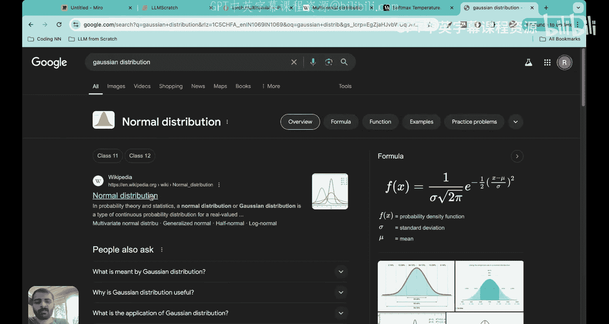
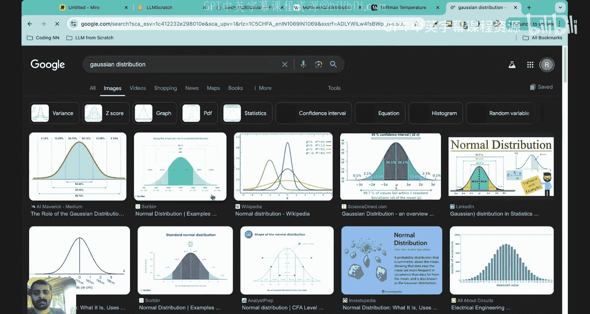
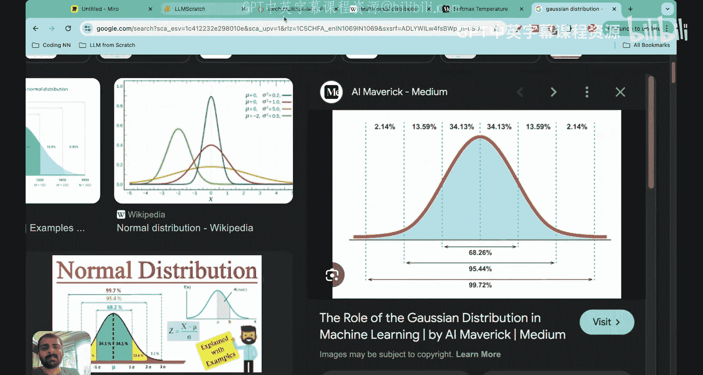
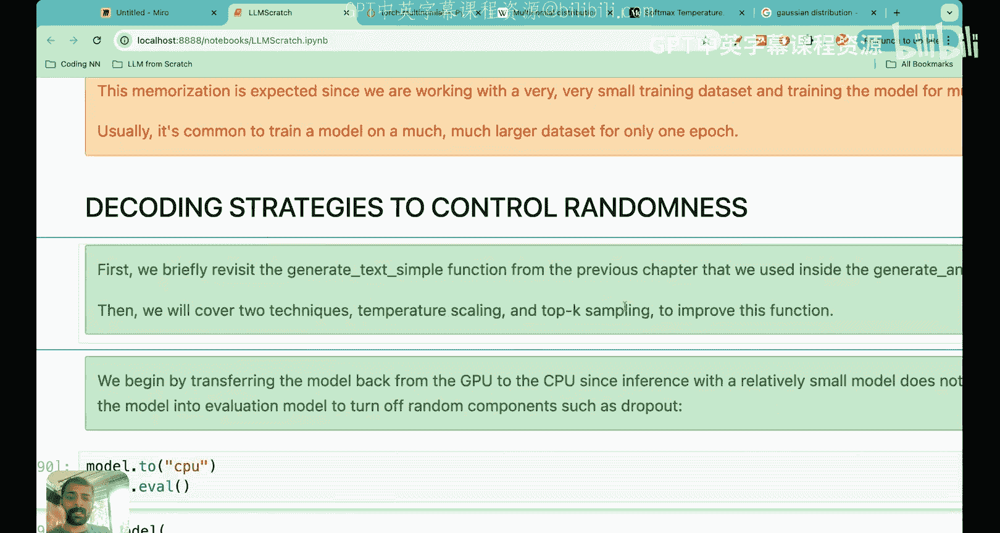

# Vizuara《从零开始搭建大语言模型｜Building LLMs from scratch》中英字幕（Claude-3.7-s） - P27：-29-Temperature Scaling in Large Language Models (LLMs).zh_en - GPT中英字幕课程资源 - BV1qG8HzUE2D

🎼Yeah。Hello everyone， and welcome to this lecture in theBuild Lage languageage Models from Sctch series。

Today， we are going to learn about a very important concept and that concept is called temperature scaling。

We will understand what temperature scaling is and why it is used in large language models。

First let me recap what all we have done in the previous lecture in the previous lecture we actually trained a large language model completely from scratch。

So here is the training process which we had defined and we ran the large language model for 100pos and we saw the next words which were predicted so every effort moves was the input token which we had or the input sentence which we had given to the large language model and then we recorded the output tokens and then here you can see I printed out the output tokens you know was one of the XcMC laid down across dash dash dash so there were 50 output tokens。

And as you can see the output tokens don't really make too much of sense right now and that's what we are aiming to do in today's lecture our whole goal in today's lecture is how to make sure that the randomness in the output tokens is reduced。

How to make sure that the output tokens eventually start making sense。

 we will learn techniques to do this in today's lecture and one such technique is called as the technique of temperature scaling。

This is the technique which we are going to learn about today。

 so let's get started with today's lecture。Okay， so until now what we have seen is that the generated token is selected corresponding to the largest probability score among all the tokens in the vocabulary What do I mean with mean by this So this is the process which we are following until now every effort moves thats my input which is fed to the GP architecture and then I get a logic ssor which is ultimately passed through the softm and then I get a tensor of probabilities like this what we are doing until now to predict the next token is we are looking at that index。

Or that token ID， which has the maximum probability。

 and then we decode that token ID which gives us the next token。So for example。

 when every is the input。The token ID corresponding to this second index where probability is 0。6。

 which is the highest。That is the output and that token id is one and so the next token is effort Similarlyly when every effort moves is the input we look at this third row。

 we try we try to find that entry which has the highest value that entry is 0。

34 the index number is 5 or the token id is 5 and then we see that for token id5 the token which corresponds to that is U So when every effort moves is the input u should be the output。

Right， so until now what we have seen is that the generated token is selected corresponding to the largest probability score among all the tokens in the vocabulary。

What this leads to is that this leads to a lot of randomness and diversity in the generated text。

So since all of these are probability scores， why are we choosing the next token in a deterministic manner like this。

 what if we use。What if we choose the next token in a probabilistic manner。

 what if we sample the next token from a probability distribution。

 this is exactly what is explored in the concept of temperature scaling。

There are actually two techniques which really help to control the randomness and the two techniques are used together with each other first is temperature scaling and the second is top k sampling this top k sampling technique we are going to look at in the next lecture today we are going to focus on temperature scaling so the main main idea behind temperature scaling is that first what we do is that instead of taking the maximum。

Probability and just looking at the index which corresponds to the maximum probability we replace this arg max with a probability distribution so for example here instead of just choosing this token with a maximum probability we will look at this probability scores and then based on this will sample from a probability distribution and that probability distribution turns out to be the multinomial probability distribution so the next token is then sampled according to the probability score。

We don't just blindly or we don't just choose the token I with the highest probability value we sample the next token according to the probability score this distinction in terminology is very important we are sampling the next token so it' is not clear to us what the next token is going to be because we are sampling it so what does sampling mean to give you an example let's look at the Gaussian distribution right and if I ask you to sample values from a Gaussian distribution I cannot tell you right now what the value will be because I am sampling it from this distribution what I can tell you is that most of my samples will probably be close to the mean point like here very few will probably be at the tail end of the Gaussian distribution。

This is what sampling from a distribution means in this case we are sampling from this distribution which is multinomial distribution and if you go to Wikipedia。

You will see that the multinoial distribution essentially is for a number of different mutually exclusive outcomes so when we have K possible mutually exclusive outcomes with corresponding probabilities think of this as the next token here also we have the outcomes equal to the vocabulary size right K possible outcomes because anything can be the next token and all of them have a probability associated with them right and let's say we conduct thousand or n independent trials to predict the next token then we will have a probability distribution that is essentially called as the multinomial probability distribution and I am going to explain that to you in just a moment so that it is going to be clear to you right now just know that we are going to sample the next token from this distribution which is called as multinomial distribution。

Before coming to temperature， let us actually go to code to understand until this point what we are going to do okay。

 so the whole topic of today's lecture is decoding strategies to control randomness。

Let us first briefly revisit the generate text simple function which we have been using up till now and then we will cover techniques such as temperature scaling and top k sampling。

And here first what I'm doing is I'm switching the model to the CPU and I'm running it in the evaluation mode so here you can see that this is the GP model which we are going to use we have the embedding layers then the transformer block then after coming out of the transformer block we have。

Let's see when I come out of the transformer block here。

I have another normalization layer and then I have output header This is my architecture A now I just want to show you currently we have this generate text simple it takes in the input token or the input sentence which we have it passes it through the architecture which I just showed you and then it predicts the next 25 tokens using the maximum probability so we are not currently doing the sampling as I mentioned and so here you can see when every effort moves you is the input this is the output this are the 25 tokens and the randomness here is pretty high right so previously inside the generate text simple function we always sample the token with the highest probability as the next token using parridge dot amax right this is called as greedy decoding。

Now， to generate text with more variety， what we are going to do is that we are going to replace the ag max with a function that samples from a probability distribution。

That is the main thing which we are going to do and to illustrate this probabilistic sampling with a concrete example。

 let us actually first take a very small vocabulary size and let us demonstrate here what is going on So lets say my vocabulary size only consists of the tokens which are closer every effort forward inches smooth pizza towards and you。

So these are the eight。These are the nine tokens in my vocabulary and each has a token ID from 0 to 8 I also maintain an inverse vocabulary dictionary which gives me the token ID and then it decodes it back to the token。

Awesome， now， let's say the input to this input to my large language model。 And remember。

 the model is this。 Let's say the input to this model is。Every effort moves you。

What this input will do when pass through the model is that we will get the output logic tensor。

And the output logic sensor will have。The number of columns， which is equal to the vocabulary size。

 So the number of columns here in the output logicit ssor will be 9 right Now。

 what we do here is that we then pass this through soft max so that this is converted into probabilities right And so when you pass this into a soft max。

 you can print out the probabilities and you will see that the probabilities look like this。

 Now all of these add up to one。 So earlier what we used to do is that we just。

Looked at these probabilities and we said that the next token id is going to be that token id with the maximum probability so lets see and that maximum probability is 0。

5721 and this is column number012 and 3 this column number3 so the next token id is equal to 3 which we have printed and then using the inverse vocabulary will print the next token and that is forward so then the next token will be every effort moves you and then forward will be my predicted token。

Here is where we are going to make the change to implement a probabilistic sampling process we can now replace the arg max with the multinomial function in pytor so here you can see we are replacing the arg max with a multinomial function here。

And this multinomial function is applied to this proas， which is the probabilities。

which is the tensor of probabilities， this is where the multitennomial function is applied and then what we can do is that we can get the next token ID based on what we sample from this probability distribution and then we predict the token corresponding to the next token ID。

Here you can see that this is just equal to4 right so what really happened is is the same as the previous one there is no change so you might be thinking why did we do this multinomial？

So what happens is that the multinomial function samples the next token proportional to its probability score this is the important thing here。

 so lets say currently we did only one trial here right in that one trial what the multinomial function did is that it looked at all these probabilities and then it will sample from this so there is a high chance that it will choose forward and that is why it chose forward world well really see the difference when we do more number of trials so see in this definition there is an independent trials which need to be performed right that is what we are going to do right now。

So， the multinomial function samples the next token proportional to its probability score in other words for is still like still the most likely token。

 so we are not changing the most likely token it still remains the most likely token but we will also select other token sometimes。

So， forward is still the most likely token and will be selected by the multinomial most of the time。

 but not all the time。So to illustrate this， we will repeat this process this sampling thousand times。

So to simple the multinomial function is very intuitive。

 so when you do thousand trials in each trial it will try to choose that。Token。

 which has the highest probability。 So now it' is a bit of a random process right it is not deterministic Sometimes the multinomial function might even choose。

Pizza， although it will be very， very rare。Sometimes it might choose。

 but most of the times it will choose。For our world only so lets try to do this now。

 So what we are doing is that we are running the same procedure now we are applying the multinomial function to this pro sensors。

 and then we are going to。Take the。Sample which is we are going to take the token id which is sampled in that particular iteration and then we are going to print out that What we are also doing is that in these thousand iterations I am going to print out how many times each token is chosen so that is this frequency we are print print out how many times every single token is chosen when you are doing this thousand iterations so here are the results so when you do this number of iterations these many times you will see that we will see that the word forward is sampled most number of times it sample 582 times out of the thousand but other tokens such as closer inches and toward so closer inches and toward they are also sampled some of the times so in fact closer is sampled 73 times inches is sampled two times and towards this sample 343 times。

This means that。Since we replace the R max function with the multinomial function。

 the LLM would sometimes generate text such as every effort moves you toward every effort moves you inches and every effort moves you closer instead of every time generating every effort moves you forward。

So， now。Integration of this multinoial function has made sure that we are not sampling the same token each time。

 Sometime we are also giving more。We are giving more chance for other tokens to be the next token and thats what improves the creativity of the large language model。

 it leads to more exploration， it leads to more creativity and sometimes it can also lead to better outputs instead of just sampling a deterministic prediction every single time。

So， you might be thinking that okay， this looks fine。

 but why is this method called as temperature scaling where it does temperature come into the picture and why is it called temperature？

So， basically you see this logicit tensor over here right before we apply the softm there is a logicits tensor what what what is meant by temperature is that temperature is basically just a fancy term for dividing the logicits tensor by a number which is greater than 0。

So， the only thing which is done when we introduce temperature is that we have this thing called scale logicits and all the logic values which we have are divided by another number which is called as the temperature value。

So， what this does is that so see when you divide by the temperature value you get the scale logic then you apply softm and then you get the tensor of probabilities every the rest of the process stays the same but what this introduction of this temperature does is that it changes the distribution of bit it changes the distribution of probabilities。

So， for example， let's see what this dividing by this temperature does through code。

So we can further control the distribution and selection process via are a concept called temperature scaling where temperature scaling is just a fancy description for dividing the logicits by a number greater than 0。

Now we will see two things we will see temperatures greater than one。

 what happens when temperature is greater than1 and we will see what happens when temperature is smaller than one okay。

So here what Im doing is that I am scaling the logics with dividing my temperature and then Ill apply the soft max exactly like。

What we had done earlier year and then even before applying the multinomial distribution。

Then we will get the scale well get the scale probabilities as applying softm with temperature first I just want to show you without even going to the multinomial function what happens when you scale the logic with temperature and what happens as the result when you apply softm so look at this plot first I want you to see the plot with temperature equal to 1 which are the blue so when you see the blue you will see that the probability for forward is around 0。

5 probability for closure is around 0。1 and probability for towards around 。

3 this is exactly what we saw in this case right。So probability for forward is 0。5 probability。

For towards。 so probability for towards is 0。35 and probability for there is one more。

Probability for closure， so probability forclo is 0。06 right so the blue。

 the blue line there is when we are not changing anything when temperature is equal to1 now lets see what happens when temperature is small so when you actually。

When you take these value when you take these logicits and you divide each of them by 0。

1 and then you take the soft max， then you will get probabilities which look something like this in the orange you will see there is a sharper probabilityba forward now and almost all the other probabilities have been shifted to 0。

And we can test this out a bit in the code right now。

 So what I'm going to do is that I'm going to say that。Next los。Next。都跟。

Loggis is equal to next token logicits。Or let's say next token logicits2 is equal to next token logicits divided by 0。

1。Right。Okay， so now I have a next to on logics2 where every logic is divided by 0。

1 and here what I will do is that I will print out。I'll print out the probabilities。

 which correspond to the。When you apply the soft Mac。

 so now I'll just do this and print out the probabilities。

So here you see what happened when we divided by 0。1 and then you applied the softmax。

 almost all the probabilities， all other probabilities are brought down to 0 but there is a sharper probability very high probability now for forward this is in contrast to these probabilities right where even here this value had a significant amount which was toward I think that was toward yeah this value also had a significant amount that was forclo but now all these values are turned to0 the only value which matters the most is forward so that is the first conclusion when temperature value is very low then there is a peak in the probability distribution which means that it becomes sharper for specific values but let me try this that let me divide by 5。

Or as shown in the graph， yeah， temperature equal to 5 and here you will see the。

Probability becomes a bit flatter， which means that there is kind of high values for all the tokens。

 So let's see what is happening here when the when I divide by 5。

 So next token logic 3 I'm dividing the next token logics by 5。

 And then what I'll do is that I'll print out the。Probabilities for next token Loits 3。

And let me print it out in a separate cell actually， so that it might be cleaner。

 So I have a separate cell where I will print out。Where I'll print out the probabilities。4。

This tensor， where I've divided the logic by 5。 And then I run it。

 So now you see this is my probability tensor。 And you can see that it has just become a bit flattened and a bit more uniform。

 Now， for every token， we have certain values。 of course， the value for forward is still the highest。

 but there are other values such as toward， which has now become very close to forward。

 even the probability value for closer has become very similar to forward now。

 So if the temperature value is very high， it means that the probability distribution kind of flattens out a bit。

And then every token kind of has uniform probability as being the next token can you think about what this would mean for generating the next world or generating the next token。

This means that there is a lot of variability now in our output token which is also sometimes called creativity but in some cases the creativity can be too high because now you will see that there is certain output for Pa also which means that every effort moves you P our LLM is also predicting this as an output so ideally we don't want the temperature value too high and we don't want the temperature value too low also if the temperature value is too low then there is only one token which is predicted。

We need to place emphasis on other tokens also， which might be making sense。So， as we saw。

 applying very small temperatures such as 01 will result in sharp distributions。

s that later when we apply the multinomial function it will select the most likely token which is forward world now please keep in mind that after this we are going to apply multinomial so multinomial sampling is going to happen after the softm so if the probability distribution looks something like in the orange the multinomial will always sample this because the probability remember multinomial samples according to the probabilities right so if the probability is 0。

991 it will always sample this。So， that's why I wonder。temperatureemp values are small such as 0。

1 it results in sharper distributions and the multinomial function then select the most likely token here forward almost 100% of the time and then we approach the behavior of the a max function so when the temperature values are low it is almost like going back to the earlier approach where we selected the token ID with the highest probability score。

Now， if you look at the higher temperature， if temperature value is equal to 5。

 this actually results in a more uniform distribution where other tokens are also selected more often such as what is shown in the green color here。

This can add more variety to the generated texts， but also it leads to nonsensical text so for example pisa is now 4% probability so we will get every effort moves you pi about 4% of the time if you use temperature equal to5 that is not good so ideally there needs to be a good balance in the temperature which we use。

There is a very nice graph which actually shows why this has the name temperature so here you see if the temperature becomes high as is shown on the right side we saw that the distribution becomes more uniform right every token has some probability whereas for low temperature we have something on the right something on the left here where we have sharper distributions only one token makes sense。

So low temperature can be corresponding to low entropy whereas when you do increase the temperature things generally be become more unstable things become more chaotic become more creative。

 thats why every token has certain probability here of being the next token so that's why it call as temperature because increasing the temperature makes makes。

Make sure that all tokens have certain value， which makes it a bit。呃。Unstable， I would say。

 or rather I would call it a bit more creative a bit more randomized it's almost like the temper entropy has increased so that's why conceptually its called as temperature。

Because increase in temperature leads to a more flattened， diffused distribution。

 whereas lowering the temperature means lower entropy， so only one token value would make more sense。

Now here is a graphic which actually shows what happens as you increase the temperature to very very high eluive temperature becomes very high almost every next token will have equal probability if the temperature becomes very low we have other distributions as we have seen before。

Awesome， so this brings us to the end of the lecture where we covered about temperature scaling and how temperature scaling can be actually used to predict the next token。

In a probabilistic sense， so instead of just choosing the next token according to the maximum value。

 we will use a multi multinomial probability distribution to sample the next token that is the key word。

So first you take the logic， so the procedure is like this first you take the logics。

Then you scale it， you scale the logics with the temperature。

And then what you do is then you apply the soft Mac。

And then you get a tensor of probabilities and then you sample using the multinomial distribution。

This is the sequential workflow for application of temperature and we later saw that the reason it is called temperature is because as the temperature becomes high it's like the entropy increases every next token has some probability of being the next token whereas if the temperature is very low the entropy is very low it is like everything is concentrated to one single token and we have a sharper probability distribution。

So small token means that the LLM output does not have any creativity it will always give the same thing as an output but large token means that it is a flat distribution more variety but also it has scope for more nonsense。

 so you need to be careful when choosing the temperature value。In the next lecture。

 we will study another technique for。Rucing the。Rranandomization for while decoding the tokens or reducing the。

嗯。Reducing the randomization when predicting the next token。

And that strategy is called as top key sampling。So。

 usually top case sampling is used along with temperature scaling and so we also see how top scale sampling integrates with what we learn today which is temperature scaling。

Thanks a lot to everyone this was a short lecture but I hope you understood the concept of temperature scaling thanks a lot and I'll see you in the next lecture。

