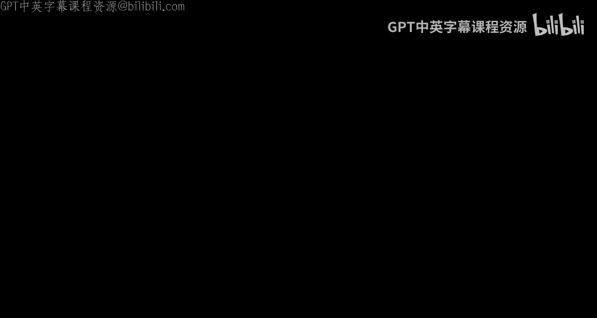
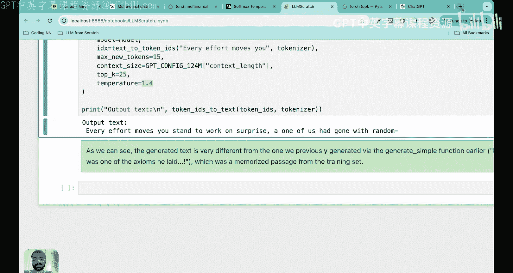
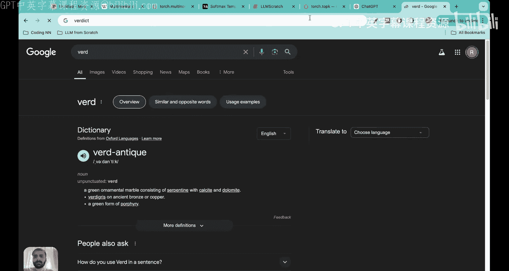
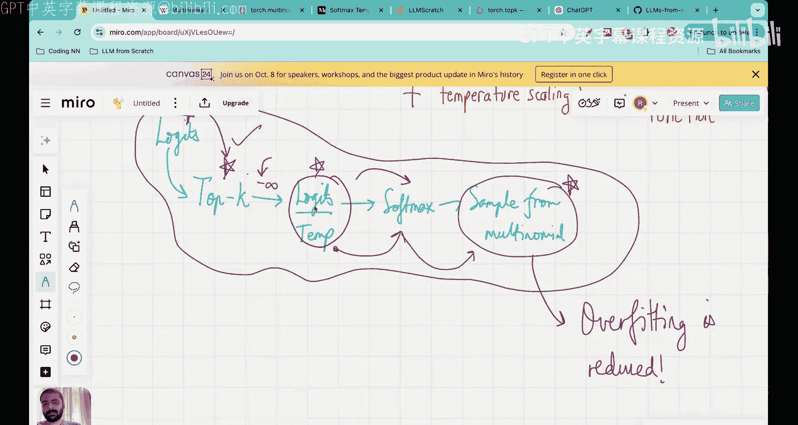

# Vizuara《从零开始搭建大语言模型｜Building LLMs from scratch》中英字幕（Claude-3.7-s） - P28：-30-Top-k sampling in Large Language Models.zh_en - GPT中英字幕课程资源 - BV1qG8HzUE2D

🎼Yeah。Hello everyone and welcome to this lecture in theBuild Large languageage Models from Sctch series。

Today， we continue our discussions regarding strategies for LLM decoding to reduce randomness。

In the previous lecture， we learned about this technique， which is called as temperature scaling。

 and in today's lecture， we are going to learn about another technique。

Which is a decoding strategy for LLMs and that is called as top case sampling。

TopK sampling is used along with temperature scaling。

 so if you have not been through the previous lecture I would highly recommend you to watch the previous lecture if you are coming to this lecture for the first time no problem Ive designed it in such a way that it self content and you will understand everything what is going on。

What are LLM decoding strategies and why did we even start learning about them？

The reason we require LLM decoding strategies is that if you。

If you generate the next token using the first strategy which we had and that first strategy was basically something very simple。

 what the first strategy was is that the generated token is just selected corresponding to the largest probability score among all the tokens in the vocabulary。

So， we。We have the input tokens and then to predict the next token。

 we look at the indices which correspond to the maximum probability score and we say that those will be the next token。

This leads to a lot of issues because let's say if every effort moves is the input。

 and let's say using that knife decoding strategy we。Print out the next 25 tokens。

 you will see that the next 25 tokens look something like this， they are very random。

And it is difficult to get tokens， which actually makes sense。

 and the reason is because we are giving too much importance to that token。

 which has the maximum probability， wouldn't it make sense to instead of choosing a token in a deterministic manner。

 wouldn't it make more sense to sample the token from a probability distribution。

And that's where temperature scaling comes into the picture what we do is that we have this logicit stensor。

 right？Whenever we get output from the GPT architecture we have a logicit tensor we apply softmax and convert it into a tensor of probabilities right and then instead of choosing the max index corresponding to the maximum value what we now do is that we sample from the we sample using the multinomial distribution what the multinomial distribution does is that let's say if you have the tensor of probabilities instead of choosing the token with the maximum proba we choose or we sample the next token in a probabilistic manner。

And the way the multinomial distribution does it is that。

It samples the next token proportional to its probability score。

 so here we can see that among this probability tensor 05721 is the maximum value。

So in our knife strategy the token corresponding to this will be the next token always in a very deterministic manner right but what happens in a multinomial distribution is that still this will be given the largest probability but it will now be sampled from a probability distribution which means that other tokens might also be selected as the next token compared to their probability values。

So if you sample thousand times using this multinomial distribution。

 the token corresponding to the maximum probability will come of course more a number of times 582 times but there are other tokens which also come into the picture now that was not possible with the deterministic prediction and this actually enables to have more creativity in the LLM output。

It helps us to control the randomness of it by sampling from a probability distribution then we introduce the concept of temperature where we just divide the logicits with this value called as temperature and then we take the soft max the temperature has the effect that if the temperature is actually increased then all the tokens have kind of uniform probability of being the next token whereas if the temperature is very low then that means that we have a sharper distribution where only one token will be selectively favored。

So when we divide the logics by the temperature。Here you can see an animation which shows that as the temperature goes from low to high。

 the different tokens have different probabilities of being sampled。

 the distribution changes from being a sharper distribution at lower temperature to a uniform distribution。

So this was the case with introducing temperature， but there was an issue which we saw even when we introduce temperature。

 let's say if the temperature value is equal to5， then you can see that when every effort moves is the when every effort moves is the。

Every effort moves you is the input， then there is also the probability of token such as pizza being the next token。

So if the temperature value is equal to 5， there is about 4% chance that the next token will be visa。

 so that is not very good， right？And that is the issue with just using temperature scaling if we just use temperature scaling all the tokens are all the tokens remain in the picture to become the next possible token all the tokens have a kind of probability or a chance to become the next token even completely random tokens and we don't want that we want to restrict that opportunity of being the next token to only a few number of tokens that is the best way to introduce you to the concept of top case sampling we want to restrict the opportunity of being the next token to only a few tokens which makes sense。

So what we are going to do is that in the concept of top case sampling is essentially pretty simple。

We restrict the sample tokens to the top k most likely tokens and we will exclude all the other tokens let me illustrate to you what this means let's say we have the logicit ssor which looks something like this。

 right。Now， before applying softftmax， what we are going to do is that we are only going to look at the top k logicits and if k is equal to 3。

 we will only look at the top three logicits， which is this 4。516。7516。28。And。

We will ensure that when we apply softms， all these other logics are effectively not in the picture at all。

 they are not considered。And what is the best way to do this。

 the best way to do this is to essentially replace all of these values which are not in the top three with negative infinity。

When we replace these all other values with negative infinity。

 when we take soft max we will ensure that all of these will effectively be zero。

 so then they will not contribute to being the next token at all and only the top three values which we had will survive。

What this essentially does is that it removes all the other tokens which we which are which does not make sense at all right every effort moves you Psa is no。

I should not have the opportunity to become the next token at al right so why should we even consider Ps so the token ID corresponding to pis will be replaced with infinity when we take soft max that will be reduced to 0。

Now let us see this in action in code， so I'm going to take you to Python code now。Just before that。

 I've written a few。Conceptual understanding sentences here， so let me go through that。

In the previous section， we implemented a probabilistic sampling approach coupled with temperature scaling as I just described to you。

 and we saw that higher temperature values result in more uniformly distributed next token probabilities which result in more diverse outputs。

Okay， this method allows for exploring less likely but potentially more interesting and creative paths。

But one downside of this approach is that sometimes it leads to grammatically incorrect or completely nonsensical output。

 such as every effort moves you pizza。Does not make any sense at all。In this section。

 we introduce another concept which is called as top case sampling。

And later we will see how to combine it with probabilistic sampling and temperature scaling for now。

 let me just introduce to you the concept through a simple demonstration。

So let's say we have this next token logicits， which is a tensor that looks something like this。呃。

Yeah， so this is the next token logics。 It looks like this。 and let me again bring it over here。

So the next token logic Spsor looks something like this。And as I mentioned。

 the first step to do in the top k sampling is to select how many tokens you want as the top so here I am selecting the top K tokens to be equal to I want three tokens。

 right。Then what you do is that。Then Pytorarch has this function called tor dot top k what it does is that lets say if you give it a tensor it will look at this tensor and it will return two things。

 it will return the top top three values which have the maximum value and it will return the indices corresponding to them。

So you apply this function to dot top k to this next token logicit ssor and then the top logics are returned and the position at which these top logics occur is also returned。

 so youll see that the top logicits are 6。75， which is this 6。28 which is this and 4。

51 which is this and they occur in position number 37 and 0。Awesome。

 so here you will see that this is the torage dot top K。

Implementation in Pytorch I'll be sharing the link to this when I in the YouTube information section。

Okay， now what we are going to do next is that。We have identified the top logics and we have identified the positions as I mentioned now we are going to replace all the other values which don't belong in top3 with negative infinity。

So the way to do this is that we use the Torage dot ver function。

And then the condition which we are using is that all those logicits， which are less than。4。51。

 they will be replaced with minus infinity， and then we print the new logicit stensor and you will see that except for the top three values。

4。51。6。75 and 6。28， all the others have been replaced with negative infinity。

And then you do the softm and then you will see that all the other values don't have any probabilityba score associated with them and only the top three tokens with the maximum probabilities have survived and they add up to one This is how we make sure that。

Only the top tokens have an opportunity to be the next token。

And here is where the temperature and the multinomial distribution which we discussed in the previous lecture comes into the picture。

 what we are going to do is that before we apply soft Mac， let's say we have this infinity mask。

 what we are going to do here is that at this moment we are going to take the logics and we are going to divide it by temperature like what we did earlier。

And then what we are going to do is that then we are going to sample from the multinomial distribution。

Exactly what we had learnt in the previous lecture， sample from multinomial。

So what this will do is that it will make sure that let's say only these these tokens have survived right。

 4。51，6。 and by 6。28。We divide by temperature for sure we will divide by temperature and then we will apply the soft max so lets say the probability distribution is now something like this。

So， and then we will sample from multinomial so what we will do is that we will say that every time this token is not selected。

 we know it has the highest probability， but it will be sampled based on how high the probability is。

From the multinoial distribution， so many times this token will also be sampled。

 many times this token will also be sampled， but the most number of times this token will be sampled because it has the probability of 0。

57。This is how we are going to integrate the top case sampling with。The temperature scaling。

 So to give you a sense of the。Entire procedure， you first have the logic trendsor。

 which is which is received from the LLM output architecture， then you。

Perform top K sampling on this， which means that you only return those logicits。

 which have the maximum values， only those scale logicits。

 and then you replace all the others with negative infinity。

 Then you divide the logics by the temperature。Then you take the softm。And then you sample from。

Then the new sample from the multinomial distribution。

This is the entire workflow of the decoding strategy， which we are going to follow。

 This will ensure that。Temperature is integrated， which means that we also have some amount of creativity in the process and will ensure that random tokens not are not given an opportunity to become the next token using top K and using the multinomial distribution we make sure that the next token selection is not a deterministic process but it's a probabilistic process。

So let us see this in action in code now we are going to write a function which predicts the next token which will merge the temperature scaling and top k sampling。

As I'm going through the code for this part， please keep in mind this schematic。

 which I've shown over your loits， then top K loits divide by temperature。

Then softm and then sample from multinomial。Remember when you apply top K。

 all the other values which are not in the top K replaced with negative infinity。

Great now what we are going to do is that we can apply the temperature scaling and multinomial function for a probabilistic sampling to select。

The next token among the three。No-zero probability scores so here you see the probability scores have been obtained now we will apply multinoial sampling here as we have seen before so let me take you through the function which I am going to write right now this is the final function which will generate the next tokens for us it will take the model which is an instance of the GP model class we have defined earlier it will take the maximum new tokens which it has to generate and context size so all of this was there in the previous generate function also。

The new things are the temperature value， the top K value and the end of sample ID。

 I'll explain to you what this means。First what we will do is that we have the logicit stensor。

 which is generated from the GPT output， then we will apply top K。So if the top k。

 let's say set to three， we look at the logic tensor and only retain those values where。The loits。

Where only retain the top k values in the logicit tensor and will replace all the other values with negative infinity。

That's what is being done in this part of the code then as I mentioned， so after top K is applied。

 then we will scale you temperature。So in the next step what we are going to do is that if temperature is greater than0。

 we are going to scale the logicits with temperature then we are going to take the softm and then we are going to do the next token ID using the multinomial probability distribution so exactly these three steps you scale with the temperature you take the softm and then you sample from multinomial this is how you select the next token ID and what you predict the next token ID to be。

Now， if temperature is not specified， so if the user does not specify the temperature。

 we will just do the sampling as before we will just get the token。With the maximum。

Probability and we will say that we'll get the token ID with the maximum probability and we will say that this corresponds to the next token in my sequence。

But mostly when GPT architectures are developed and built the temperature value is specified。

 I'll come to that in a moment。There is one more loop here。

 which is basically if end of sequence token， so this EOS is actually end of sequence。

If end of sequence， token is encountered。Then we can stop early。However。

 if end of sequence is end of sequence ID is not specified。

 then we can just keep on generating the next toolken。

And then what we do is that we append the new generated token ID to the current ID until we reach this maximum number of new tokens which are to be generated。

So here you can see the flow， we have the logic tensor， we apply the top case sampling。

 then we scale the logicits with the temperature and then we sample the next token from a multinomial probability distribution if temperature is not specified then we just use the argm which was done previously then we choose the next token as that one which has the maximum probability score。

And then we just keep on appending the next token Id until。

The maximum number of new tokens limit is reached。This is exactly what is happening in the generate function which we have defined right now to generate the new token and now what I am going to do is that I am going to generate 25 new tokens and let's compare the performance with what we had earlier so earlier when the knife decoding strategy was used of just using the maximum probability you'll see that the next tokens where was one of the XMC laid down across the srs and s lower of an exquisitely appointed these words were not making too much sense so let's say the decoding has improved using this new generate function。

So I' am going to use this new generate function now， which has been defined over here。

And we are going to pass in the GP model and then we have to pass in the input token  IDs。

 which is now every effort moves you maximum number of new tokens I'm setting to be 15。

 the top k tokens I'm setting to be 25。So I'm just going to look at the 25 tokens so remember the vocabulary size is 500257 and I'm going to look at the 25 tokens which have the highest probabilities in those 50257。

And the temperature value you have set to 1。4 this is a good trade off because if the temperature value is too low we have sharper probability distributions if it is too high then we will get a nonsensical output so when 。

4 seems to be like a good tradeoff you can even experiment with this further so when I run this I can see that the next output which the next tokens which are generated our every effort moves you stand to work on surprise one of us had gone with random。

It is very different from the one we had previously generated。 So although here also。

 we can see that。The next token does not make too much sense。

 but at least the overfitting problem is solved。 What was happening earlier is that we were making a deterministic prediction right So when the next tokens were selected。

 it was overfitting which means that the next tokens were just just being taken from the text which we had so here if you see the next tokens where directly some of the next tokens were directly taken from the text which is a classic sign of overfitting the decoding strategies which you have implemented or probabilistic in nature which really makes sense to avoid overfitting since the sampling is probabilistic the G model will not memorize the passage when predicting the next words and that's very important for us you will have noticed that when you interact with chat GPT it always gives you new output right doesn't really memorize what you have written and that is because of this decoding strategies such as top k sampling and temperature scaling they really help to avoid overfitting and that's one of the main purposes why we also learn about decoding。

Regees。So youll see that these new words moves used stand to work on Sur were not present in the original text and we can check that actually。

So this is the original text and let's control F to see whether this these words are actually present in the original text。

Mos you stand to work， so let me control if moves you its not there right。

 let me search stand to work。 It's not there， which means that the next tokens which haveve been generated are completely new。

 Now it is a true generative AI model because it is not just memorizing what was there in the original text。

 It is actually generating new tokens。 It is generating some new sentences。Awesome。

 so that's the reason why we learned about decoding strategies in these models。

 you have now learned about two recording strategies。

 first you learn about temperature scaling and that was very important to help us。

intuitively get either sharper distributions or uniform distributions and it also helps to prevent overfitting since we use multinomial probability distribution to sample then we use top k sampling because it addresses the issue in temperature scaling where random words also or random tokens have the opportunity of being the next token in top k sampling we restrict the sample tokens to the top K most likely tokens and we prevent other tokens from even getting an opportunity to become the next token and that improves the meaning in the generated next tokens it prevents us from getting nonsensical or random output。

As we conclude this lecture， please keep this workflow in mind where you first。

You first obtain the logic tensor from the GPT model， then you apply the top case sampling。

Then what you do is after top k sampling those tokens which are not in the top k will be replaced with negative infinity。

 then you do temperature scaling so you divide the logicits with the temperature value then you apply soft max and then finally use sample from the multinomial to predict the next token this will make sure that。

Overfitting。Overfitting is reduced or overfitting is minimized。Thanks everyone。

 this brings us to the end of today's lecture where we learn about the second coding strategy。

In the next lecture， we'll look at some interesting examples where we will start to load three trained weights from Open AI itself and we learn we'll look at some other three training strategies。

And after these set of lectures are over， we will go to fine tuning and look at applications。

Thank you so much everyone。 I hope you are liking this series of lectures。

 I have a combination of whiteboard approach as well as taking you through code。

Im sure that there are no other YouTube videos right now which explain about large language models in such a detailed fashion。

 so if you have reached this stage， I congratulate you for making this way this much。

Headway into the course， if you are watching this for the first time I encourage you to look at all the previous videos which have been uploaded in the course to develop your understanding Thanks everyone and I look forward to seeing you in the next lecture。

。