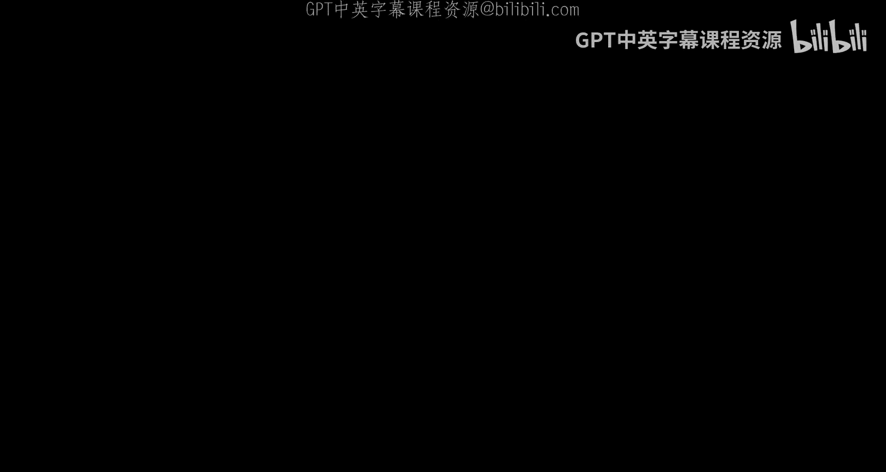
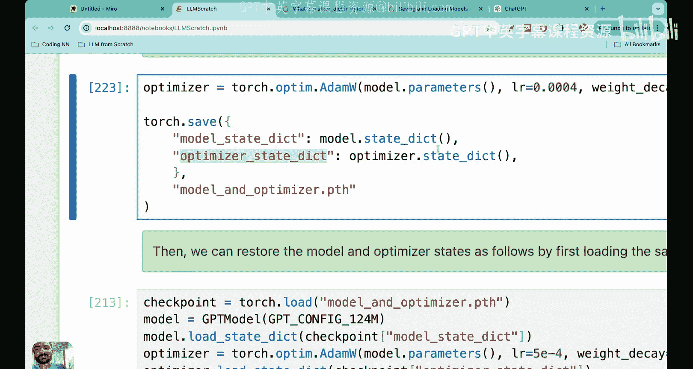
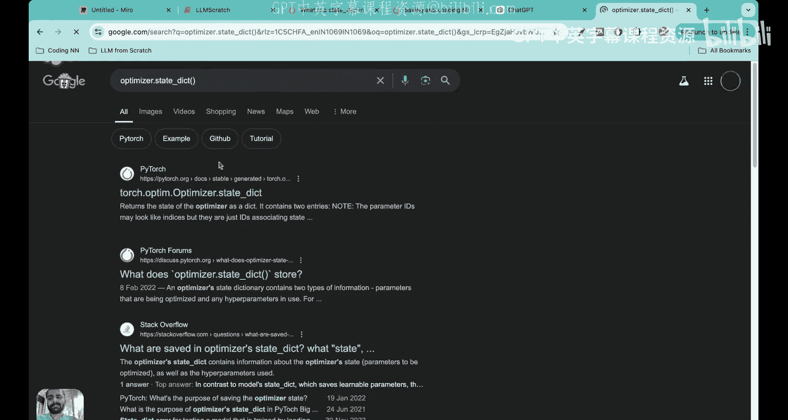
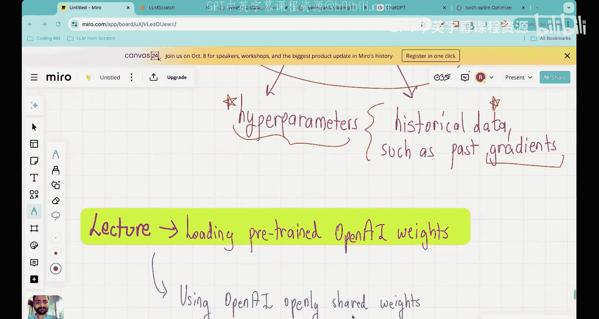

# Vizuara《从零开始搭建大语言模型｜Building LLMs from scratch》中英字幕（Claude-3.7-s） - P29：-31-Saving and loading LLM model weights using PyTorch.zh_en - GPT中英字幕课程资源 - BV1qG8HzUE2D

🎼Yeah。Hello everyone， and welcome to this lecture in theBuild Lage languageage models from Sctch series。

Today。It is going to be a short lecture in which we are going to be learning about loading and saving Pythtorarch model weights This is going to be very important especially when dealing with huge models such as the large language model which we have built so far this will help us to save memory it will help us to save time so I have dedicated this special lecture to teach you how to do this loading and saving in Python。

Before getting started， let's quickly recap whatever we have done until now。

So initially in this series on pretraining large language models。

 we looked at evaluating the loss function for an LLM。

 we saw how the cross entropy loss comes into the picture here and we can define the loss between the target。

Text which we want and the LLM predicted output。We also ran the pre training loop。

 So this was an awesome lecture in which we actually ran an LLM for。

1nypos and then we generated new text from the input text which was given to the LLm here we saw that there was an issue of overfitting so the large language model was just memorizing the text on which it was traineded on and in the prediction it was just using that memorized text。

To avoid overfitting we looked at text generation strategies we looked at temperature scaling and we looked at top case sampling and we saw how those both can be integrated together to generate text switches。

Not overfitting， although the text does not overfit or although the LLM does not overfi。

The text which generated is still not making too much meaningful sense and that' is because the data set on which we are training is not huge。

So eventually in the next lecture we are going to load threetrained weights from Open airI into the model。

Instead of training our own model， so Open air has spent millions of dollars pretraining weights and they have made it open source for GPT2 so in the next lecture we are going to actually use the pretrained weights from Open air and we are going to integrate that into the GPT architecture which we have built so far。

But in today's lecture I want to build the foundation for weight saving and loading because this will be very useful for pretraining when we use the pretrain weights for openaiI so you can think of today's lecture as a toolbox which I am equipping you with so that you can understand the next lecture on pretrained weights from openaiI lets get started so there are two main functions which are very important first is storage do save and second is basically model do load state dictionary I'll explain to you what each of this actually means let's say we have a GP model。

And we want to save the parameters of the model。What does this mean so essentially we have defined this GP model class。

 right？We have defined this in code before and when this class is defined this kind of GPT model is constructed。

 there are a huge number of parameters here in fact the parameters are more than 100 million parameters。

So instead of running a new instance of this model each time。

 I would like to save these 100 million parameters somewhere。

And the pieytorch command to save these parameters is storage dot save and model dot state so storage dot save and then you pass in two arguments。

 the first is the model state dictionary and the second is the file name where you want to store the model parameters。

 so model dot stage dictionary is a dictionary mapping each layer to its parameters and its by default available to any piytorch model。

And this is the file name， which is model dot p。Here I have opened a state dictionary and here you can see that in Pythage the learnable parameters of any tor dot NN dot module are contained in model dot parameters and the state dictionary is simply a Python dictionary object that maps each layer to its parameter tensor。

So now you can think of different layers here， right？

What this state or dictionary will do is that it will just take each layer and construct a dictionary mapping it to its parameters of the layer。

And then using Toraage。 save， we can save all of these parameter dictionary in the file called model。

pt。The second command is model。 load state dictionary now lets say that you save the parameters and you send it to someone else who is your collaborator on this project。

 what they can do on their end is that they can use this file model。pt and they can use storageage。

 load。And they can do model do load state dictionary。

 so what it will do is that when they are starting this model from scratch。

 their model will be loaded with these parameters which are contained in the model dot P file。

So I even。Showed that here do dot n n dot module dot loads state dictionary。

 so it loads the model parameter dictionary using state diict which we have already defined before。

 so state di is basically this。Awesome， so these are the two commands and let's see them in action in code right now。

Okay， so we have constructed an instance of this GPT model class and I showed this GPT model class to you over here。

 this is the class which we have defined in the code before。

So I have created an the instance of this class right now and it's 124 million the configuration is 124 million parameters and then see I'm using the torage do save command here and this is the model state dictionary and I am saving this parameter dictionary in a file call model do p。

So as I've written here， the dot P extension is a convention for Piyattorarch phase。

We could technically use any file extension that does not matter and then what we can do is that let's say I am a collaborator working with someone else and I send this model or p to that person they can。

Create an instance of the GPT model class and they can already load this model with the parameters which are presented in model。

tptth for that they can do something like Toch。 load。And they can do model。

 load state dictionary and then they can put the model in new evaluation mode and they can see that all of the parameters have been loaded in the model。

 the parameters which were present in the model do p that really saves a lot of time for this new person who has received this even for you if you suddenly log out of Python or Google Collab or Jupyter notebook instead of retraining the model again if you are frequently saving the parameters it will really save you a lot of time and also memory when you run the code the next time。

Now let's say that on one I've trained the code up till a certain point and I want to train it tomorrow again。

呃。Loading the model parameters is one thing， but what about the optimizer because。

In cases of optimizers like Adam， the optimizer also maintains a history of the gradient and it also maintains a history of the squared gradient values right shouldn't I be saving these values also because that is needed by the optimizer。

If I just save the model parameters， the optimizer essentially loses the gradient values and the squared gradient valueslu which it has calculated until the training process right so usually it is also recommended to save。

The optimizer state and similar to the parameters which we have saved the optimizers can also be saved using something like optimizer state dictionary and I'm going to show that to you just in a minute what this dictionary stores is that it stores the hyperparameters but it also optimizer hyperparameters but it also stores the historical data used by that hyper used by that optimizer such as the past gradient valuesus the square of the gradient valuess which are needed for the a optimizer so let's see how we can go ahead and save the optimizer state so Ive written here that adaptive optimizers such as Adam W which we have used to train the LLM。

Store additional parameters for each model weight。 This optimizer uses historical data to adjust learning rates for each model。

 such as the gradient history of the gradients， history of the square of the gradients。Now。

Without storing these history the optimizer resets and that is not very good because then we have essentially not utilized the training which has happened so far and then the model may not converge properly right so using Torage。

t save actually we can save both the model and the optimizer state dictionary also。

So here is the optimizer which we have defined earlier and now here you see earlier we had use storage dot save and only saved the model parameters right now we can use storage dot save and save the model state dictionary and we can also save the optimizer state dictionary using optimizer as dot state di so you can see this in Pytorch。

This is optimizer broad state dictionary and it returns the state of the optimizer。

 it also really maintains a history of the gradients。

 the gradient square and the parameters such as learning rate weight decay， etc。So。

 the atom optimizer is initialized with these parameters。

 so when you save the optimizer state dictionary it of course saves these parameters。

 but it also saves the history。And you save these two dictionaries in this file which is called as model and optimizeimr。

 pth so when you give this code to someone else you can now pass them the model as well as the optimizer state so that they can directly use the model as well as the current state of the optimizer to keep on running the model on their end even for you let's say if you close the session of training today and then you want to resume the training you have to save the parameters as well as the optimizers in this file model and optimizer。

 p。Now what we can actually do is that we can test this so this file is saved so you can do tors dot load this particular file and then load the contents in an object called checkpoint What we can now do is that we can create an instance of the model GP model class and first we can load the。

Model parameters so we use this checkpoint and then we see this dictionary model do state dictionary and load the model parameters here right then what we do is that we define the optimizer and then we also load the optimizer dictionary so we look at the checkpoint object and we load the optimizer state dictionary which we load the optimizer parameters as well as the history of the gradient and the square of square gradient。

And then you put the model in train mode， so this model or train will not do the training。

 but we just put the model in train mode right now to do the training we need to do the forward pass。

 the backward pass gradient descent， etc which we have done earlier。

But I showed you this saving of the model and saving of the optimizer states just because it's very useful practice。

 especially for dealing with large language models。

 otherwise it can be really frustrating to start everything from scratch again to lose the model parameters to lose the optimizer states and I've seen many researchers make this mistake of not for knowing exactly how to load the model parameters。

 the optimizer parameters and the optimizer state once you learn now to do it it is actually pretty simple I'll also be sharing these priortor linkss with you in the。

Radio description， I hope you have understood this lecture in which we covered about。

Essentially loading and saving model weight in Pyth。

Now we have all the ammunition necessary to attack the Le lecture which is loading pretrained weights from Open AI。

 this will be an awesome lecture in which we will use the weights which are given by OpenaiI for GPT2 and then we will use our own GPT architecture which we have built in this series so far and we will do the next prediction task。

Thank you so much everyone， I hope you learned from this lecture。

 Stay tuned and I look forward to seeing you in the next lecture。

。

