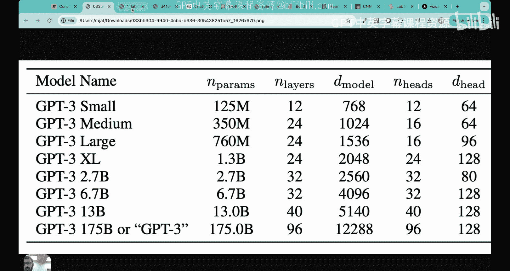
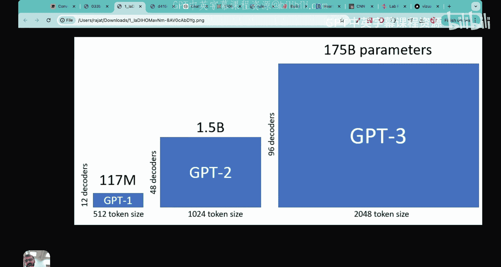
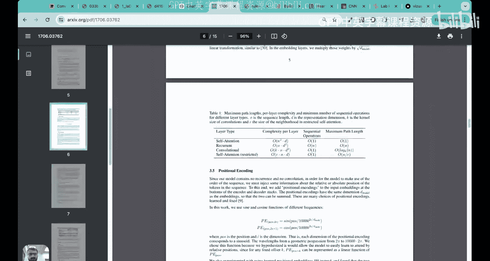
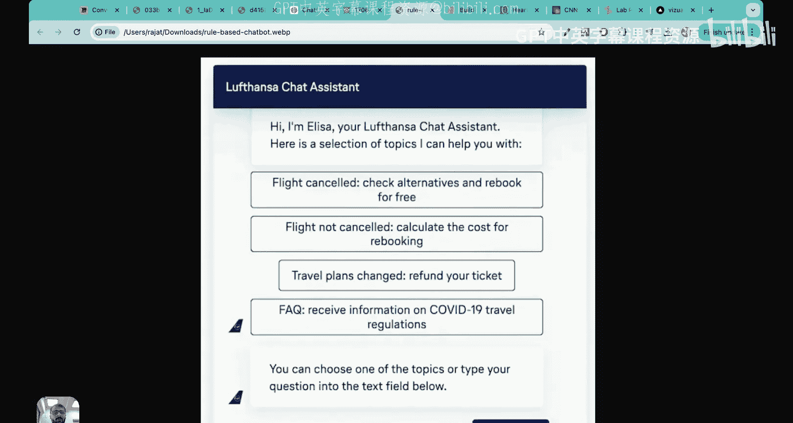
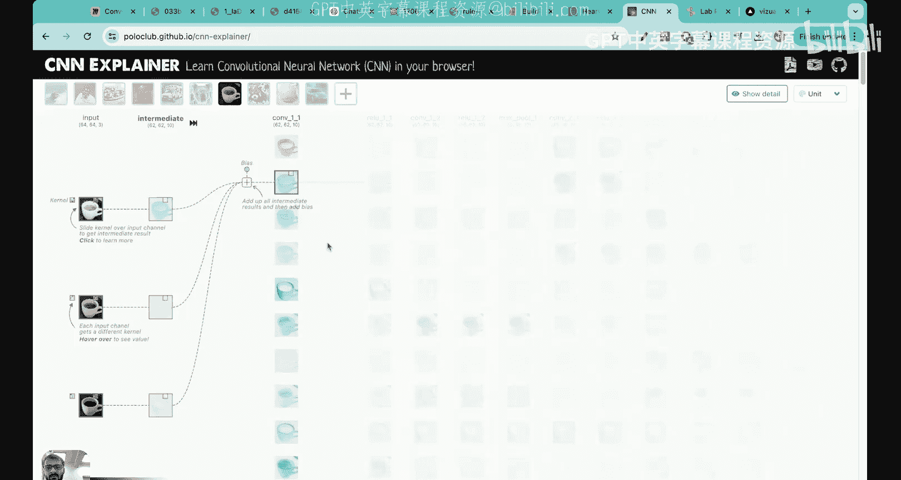
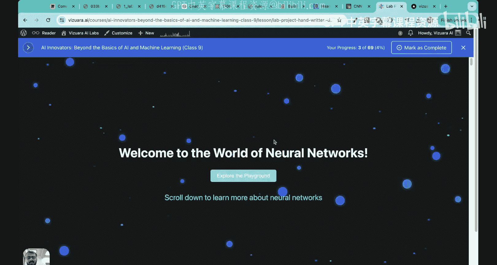
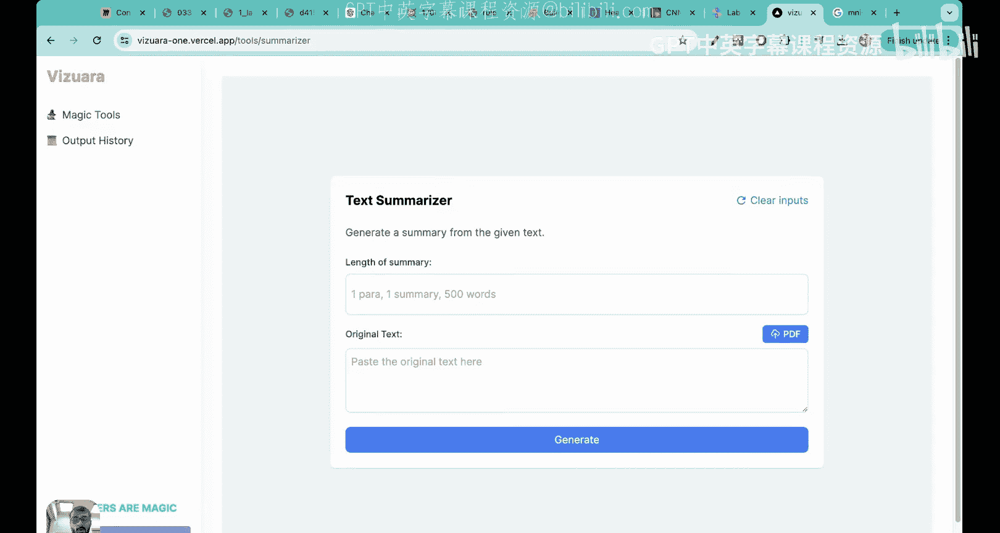
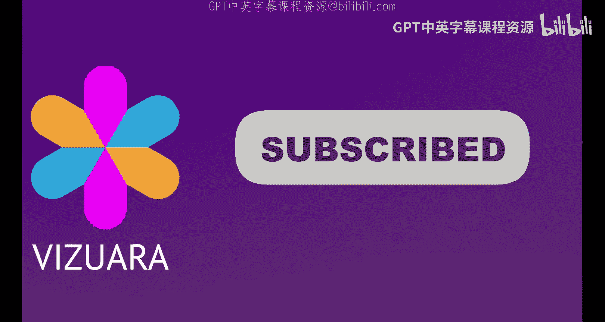

# Vizuara《从零开始搭建大语言模型｜Building LLMs from scratch》中英字幕（Claude-3.7-s） - P2：-02-Lecture 2_ Large Language Models (LLM) Basics.zh_en - GPT中英字幕课程资源 - BV1qG8HzUE2D

🎼Yeah。Hello everyone， welcome to the second lecture in the Building La language models from Sctch series。

The previous lecture was an introduction to the entire series。

And in that lecture I described about what we are planning to cover in this playlist。

And I mentioned about our end goal of learning the nuts and bolts of building a large language model。

In this series， we are not just going to look at applications。

 we are going to understand how things really work from a very， very fundamental level。

So let's get started， my name is Dr。 Raj Duneker and I graduated with a PhD from Massachusetts Institute of Technology in 2022 since two years I have been in India working on our region to make AI accessible to all。

This playlist is a part of that division。So let's get started with today's lecture。

Today we are going to cover six major aspects first we are going to learn about what exactly is a large language model。

Secondly， we are going to learn about what does large mean in the large language model， the minelogy。

Third， we are going to see whats the difference between modern and large language models and earlier NLP models。

Fourth， we are going to see what's the secret sauce behind thellms， what really makes them so good。

Fifth we are going to see the difference between these terminologies which you might have heard LLM generative AI deep learning。

 machine learning artificial intelligence， it is getting so confusing right the number of terminologies just keep increasing day by day how do we know which terminology means what。

And then in the last section， Im going to discuss about the applications of LLMs and what all cool stuff we can build with LLMs。

So with this， we will get started with the part1 or section1 of today's lecture。

 which is explaining what is a large language model in the first place。Now。

 unless you have been living under a rock。It might you would have definitely heard of LLM's open AI generative AI。

 so you might have heard about the term large language model。

 but you might not be knowing what it exactly is， you might have even used Cha GPT without knowing what an LLM is。

At its simplest form， an LLM is just a neural network which is designed to understand。Generate。

And respond to human like text。There are two key things here and LLM is a neural network which is designed to understand。

 generate and respond to human like text let me explain the two parts separately first neural network so I'm assuming people who are coming to the series know a bit about neural networks if you don't it's totally fine I'll explain all those basics as well。

But a neural network essentially looks like this we have input data which feeds into a layer of neurons。

And bunch of these layers are stacked together， and we have the output layer。

The reason it's called a neural network it because these neurons represent the circuitry in our brain or they do so in a very symbolic sense。

 that's why this name deep neural network comes。And deep neural networks are shown to have a huge number of applications in image detection。

 text generation。Sell driving cars。Then let's say if you want to detect whether patient has brain tumor or not。

 they have a huge number of applications。 So LLms are essentially just neural networks which are designed for a very。

A generic type of text related applications such as understanding。

 generating and responding to human like text， what does it mean to understand generate and respond to human like text so the simplest way to demonstrate what does that mean is taking you to chat GT。

I' am sure all of you who are seeing this lecture have used chat GPT here you can see on the dropdown Im using GT 4。

 you might be on GPT 40 or GPT 40 mini so you can ask basically any question to chat GTC。

Here there are some questions。And or here there are some prompt so I'll click on this prompt and click on plan a relaxing day and you see。

 can you help me to plan a relaxing day that focuses on activities for rejuvenation to start。

 can you ask me what my favorite forms of relaxation are and you see the chat Jupyter is sports like a human absolutely to help craft the perfect day of relaxation could you share your favorite forms of relaxation for instance。

 do you prefer spending time outdoors engaging in activities like reading or yoga or perhaps trying creative pursuits like painting or cooking while right here reading a book。

Let's see our chat GputT response and then chat GPT says great Read can be a central part of a rejuvenating day Here is a plan focused around your enjoyment and then it tells me to do morning meditation for 30 minutes healthy breakfast for 45 minutes reading time for two hours nature walk for one hour。

So you can see its almost like I'm talking with a human。

 so that is the second part of the LLM definition large language models understand generate and respond to human like text and they also respond like humans。

So Cha GPT， the demonstration which I just showed you is an LLM。

 but what many people don't know about or they don't think about LLMs is that at the core of LLM。

 they are just neural networks which are designed to do these tasks。

So if anyone asks you what an LLM is， tell them that there are deep neural networks trained on massive amount of data which help。

To do specific tasks such as understanding， generating and respond to human like text and in many cases they also respond like humans this is getting better and better as I am making this lecture and LLms are in fact。

Sounding more and more like humans and that has led to huge problems。

Maybe we'll create a separate lecture series of that。So， that is the first。

Section which we dealt with today， which is what is a large language model。그리고。

The second question you might be thinking is why is it called a large language model？

Why not just a language model？After all， it is just a model dealing with language right。

 why do we specifically have this one more large term here？And the reason is because。

Until LLMs came into the picture， model sizes were not very big and when I mean model size。

 I mean the number of parameters in the model。But LLMs。

 if you if you know about the number of parameters which they deal with， you'll be shocked。

LLMs typically have billions of parameters， billion1 billion。

 its a huge number of parameters and now there are even some L level LLMs which are trillions of parameters。

We can't even think of those numbers， but it's huge number of parameters。

 so let me show you a visual layer so this is a table which shows the number of parameters in GPT as you know we are at GPT4 right now。

So GPT3， which was the earlier origin of GP， you can see GPT3 small had 125 million parameters GPT3 medium had 350 million GPT3 large at 760 million and if you see GPT313 B at 13 million GPT3175 b had 175 billion parameters。

So usually the second term here is the number of parameters in the model。

 so here it's 175b which is 175 billion parameters and GPT4 has even more number of parameters。

That's why they are called large language models。

So here is another graph which shows the comparison between GPT1， GPT2 and GPT3。

 so as you go from GPT 1 to 22 3， the LLMs also become better and better and better。

But their number of parameters also increase tremendously if you see from GPT 1 to GP2 there is a factor of 100。

 so the parameters increase from 100 million to almost 1 billion so actually there is a factor of 10 year but from GP2 to GP3 there is a factor of 100。

So GPT2 had only 1。5 billion parameters， but GPT3 had 175 billion parameters。

You see there are some other terminologies also like GPT1 had 12 decoders GPT2 had 48 and GPT3 at 96 if you don't know what this means it is totally fine。

 we are going to cover that in this series。Token size take a look at token size GPT 1 has a token size of 512 GPP2 has 1024 GPP 3 has 2048。

It's fine if you don't know what it means， just you can see everything is generally increasing。

Now here is a graph which shows the model size。In artificial intelligence type of models over the period of years。

 so this graph is plotted from 1950 to 2022 and it was published in nature。

So it is a reliable graph on the y axis there are a number of parameters。

 so if you see in 1950 number of parameters was around just 10 to00。

In the log scale so this y axis is in log scale so 1950 to 1960 models barely at 1010。

000 parameters then in 1980 to 2000 models started having around 100，000 parameters。

 but its only in 2020 that we have reached 100 million1 billion anyone even almost close to 1 trillion number of parameters now。

And you can see the orange symbol here， so mostly these parameters are for LLMs which is for language tasks。

 I'm just zooming in here to show you that the orange symbols here have the largest number of parameters。

哎好。This has convinced you why these models are called large number of models。

 We are living in an age where the number of parameters are unprecedented。 They are huge number。

 That's why it's called as large language models。 I am sure by the time this video is released isn。

Maybe one year after that， you would have reached the parameter size of 1 trillion。

Now the reason that is the first part of the terminology large。

 then why are they called language models and that is pretty clear if you remember the example which I showed you over here。

 these models only deal with language， they do not deal with other modalities like image or video let's say they only deal with language LLMs only deal with language。

So these models do a wide range of natural language processing tasks。

 so anything related to language such as question answering， translation。

 sentiment analysis and so many more tasks which all of you definitely might have explored with Cha GT。

That's why they are called language models because they generally do a wide range of tasks related to language。

So this is the meaning behind the terminology large and language models。

That covers the second aspect of today's lecture and now we come to the third aspect which is why have LLMs become so popular。

 didn't we have the field of natural language processing before also and that's true natural language processing as a field has been existing much before LLMs。

NLP models have been existing much before LLm but。LLP models。

 if you look at the models which came before LLMs they were designed for very specific tasks。

 so for example there is one particular NLP model which might be designed for a language translation there might be one specific NLP model which might be for sentiment analysis let's say。

LLMs on the other hand， can do a wide range of NLP tasks。

 so it turns out that if you train a GPT for text completion。

That same architecture works well for language translation also。And it's pretty generic that way。

That's one difference between LLMs and earlier NLP models earlier NLP models were are designed for specific tasks。

 modern LLMs can do a wide range of NLP tasks。The second difference is based on an application。

 so earlier LLL models could not。E LLM models or earlier language models I should say could not write an email from custom instructions。

 it was very difficult for them to do that Now if you think of modern LLM such as chat GPD and this task is almost trivial for chat GD so if I go to chat GPD right now and I say。

Draph tell meant for me。To send to a colleague or to send to a friend of mine。To book movie the kids。

 let's say。And I'll just zoom in here and see chat GPT not only starts drafting the email。

 but it also has inserted emojis and everything here。It's a trivial task for Cha GPT。

 but you might be surprised to know that this prevail task was very hard to do for earlier NLP models。

And that is the big difference between LLM sources earlier NLP models， they are broad。

 they can do a wide range of generic tasks and second is their applications are endless much more than the earlier models and that's why we are even having this playlist in the first place。

So that is point number three point number four is what you all must be thinking about that LLMs are so good they can do these amazing tasks they can almost behave like humans right but what makes LLM so good what is the secret sauce。

Typically there has to be a secret sauce， right which makes LLM so much better than NLP whats that magic bullet here。

And usually people say that there is no secret sauce to things things just gradually improve over a period of time。

 but in this case there is a specific secret sauce and that is the transformer architecture。

So you see here I've added the logo of secret sauce and for LLMs。

 the secret sauce is transformer architecture。Don't worry if you know what it， what it means。

 what is transformer。 For all you know， you might be thinking of the Transers movie in which there are these cars which you get converted into mechanical robots。

 So that might be our first thought when you hear about transformers， right？ Of course。

 people who know about this know exactly what I'm talking about here， but for people who don't know。

 this， this is the only transformer， if this is the only transformer。 you know。

 this playlist is perfect for you。Because you will understand what what does transformer really mean and what it actually means is its summarized by this one schematic over here。

This is what a transformer architecture looks like。

And you might be confused by all of these terminologies， what is input embedding。

 what's multi attentionten head or whats speed for here。

 what does add and norm mean whats output embedding there are so many things which look confusing and it's fine but we are going to learn about this secret sauce in a lot of detail in this playlist。

There is one paper which was introduced in 20170 which really changed the game that paper is what I'm showing you on the screen right now it's called attentiontention is all you need。

It was published by eight authors。From Google Bra and this introduced the architecture of transformers。

 so the schematic which I showed you on the whiteboard is this schematic which they had in the paper。

Can you guess how many citations this paper has today？It has more than 100。

000 citations in just a matter of five years。So people say that research is boring and research does not have any external reward。

In this case， it does， if you are one of the few authors on this paper， you have 100。

000 citations in five years and you completely revolutionize the field of artificial intelligence。

So this is that paper and it's a 15 page paper but if you try to read it it' is very dense to understand this paper really takes a lot of time and it really takes a lot of effort there are some YouTube videos to explain this but I don't think any of them do justice to really explaining everything from scratch。

Every single page of this paper can be three to four videos， so if you think about it。

 these 15 pages contain huge amount of information。

And well be devoting lectures to different sections here such as positional encoding what is this dot product attention。

 what is this attention formula， what is key query value， what is multi head attention。

 we will be figuring all of that out。

So don't worry at this stage if you don't know what a transformer means。

 even if you have just this image mind of a transformer。

It's awesome you have come to the perfect place。Okay， so， as I said， do not worry。

 we will learn all about this secret sauce， which is the transformers in the subsequent lectures。

That covers the fourth point of today's lecture and now we come to the fifth point which is all about terminologies right so there are so many world people are throwing around randomly these days right it feels you just getting confusing more and more confusing so people talk about LLM people talk about GenI they talk about deep learning。

They talk about machine learning and artificial intelligence is one more term What are the similarities what are the differences between all of these terms So if you look at this particular graph here or figure it kind of sums up everything perfectly start from the outermost sphere or the broadest domain that is artificial intelligence that is the biggest umbrella under this big umbrella comes a smaller umbrella which is machine learning under this machine learning comes yet another smaller umbr umbrella which is called deep learning and within that。

The smallest umbrella， that is the large language models。

 And this is what we are going to make a playlist on， or this is。

The playlist which you are watching right now。So what is the differences between these So first the protestest am artificial intelligence and this。

Ptects all the other umbrellas。So any machine which is remotely behaving like humans or it has some sort of intelligence that comes under the bucket of AI that's the biggest bucket。

 so you might be thinking what's the difference between AI and ML right？So look at this example。

 this is Lufthanza flight chat assistant。And so it says hi I'm Elissa。

 I'm your Lufthanza chat assistant， Here is a selection of topics I can help you with。

You can choose one of the topics so then you say hi Eliza then Eliza says hello。

 then you can click on any one of these you see it's a rule based chatboard。

 you click some options and then Eliza is already programmed to answer so I say that flight consent check alternatives and rebook so if I click on this Eliza is already programmed to answer。

This is an example of AI because it covers intelligence right。

 Lufthana chat assistant can be thought of to be intelligent。But this is a rule based intelligence。

It's not learning based on your responses so let's say you respond and your friend response Eliza this chat assistant will behave the same way。

 its not learning based on what you are giving it or your specific nature as a user so thats why this is not an example of machine learning it's an example of AI but it is not an example of ML。

And that's why AI comes under the broadest or the biggest umbrella within that comes ML If you look at ML this is basically machines which learn they adapt based on how the user is interacting with them。

So you might be thinking okay， thats fine then what is the difference between ML and DL。

 Y is Dl a subset of ML？The difference is that deep learning usually only involves neural networks。

 but machine learning involves neural networks plus other fields and one such field is decision trees。

Lets say if you are to predict heart disease， so if you have data from 303 patients and if you are collecting things like age。

 gender， chest pain， cholesterol level， ECG， etc， you want to predict whether the person has heart disease or not。

 and you build a decision tree like this。Now a decision tool like this does not have neural networks at all。

 this is completely detached from neural networks， so this is not an example of deep learning。

 but it is an example of machine learning。A deep learning example would be something which involves a neural network。

 so for example here we are this is an image detection and here is a convolutional neural network so we have a coffee cup here and we are detecting based on these filters。

So there are filtering layers in this convolutional neural network and at the end of this filtering layers we are detecting what this input is whether it is a liveboard whether its a P so with maximum probability we are saying its an espresso so a neural network is being used for this task that is an example of deep learning。

Another example is let's say if you want to predict handwritten digit classification right。

 so if you train a neural network like this if you start training so here you can see the neural network has been trained and the problem here is handwritten digit classification so I have given it a bunch of digits which actually look like this MNISP data。

It looks like this Ive given this neural network a bunch of digits to learn from and the task of this neural network is whenever I give it or whenever I write a new digit。

 it should identify whether what digit is it。Now if you see this particular example。

 this is actually an example of neural network so here you can see the neural network architecture。

 we have the input layer， we have the hidden layer， two hidden layers。

 and then we also have the output layer over here。This is an example of deep learning。

So now if you click on test and if I select this lets say I select this and click on predict you see the neural network is correctly predicting it so it is understanding the digits let's say I click on this and predict it is correctly predicting 7。

This is an example of deep learning。That's why deep learning is a subset of machine learning。

Machine learning involves these kind of neural network architectures。

 plus it involves things which are not neural networks like decision trees。Now within deep learning。

Is LLms。Why， because deep learning， as we saw involves images also。

But large like this involved images， even this project involved images。

But large language models do not involve images， they only deal with text。

 and that's why they are a further subset of deep learning。This is the difference between AI， MLl。

DL and LLM。So then you might be thinking what is geneative AI generative AI you can think of as a mixture of large language models plus deep learning。

Why because generativeware also deals with other modalities like image， sound， video， etc。

 it deals with all of those modalities。So it is definitely you can think of it as a mixture of large language models plus deep learning。

 so if someone asks you what is generative A basically we are using deep neural networks to create new content such as text。

Images various forms of media， whereas in LLM you only delute text。

 so generative AI can be thought of as a mixture of NLM and deep learning。

I know these terms are confusing， but I hope these examples help you understand what is the similarities and differences between these terms。

As a summary， you can think of as AI to be the broadest umbrella within that comes ML。

 within that comes DL and within that comes LLMs。And AI is artificial intelligence。

 MLL is machine learning， DL is deep learning and LLM is La language models。

 and if you mix LLM plus deep learning then we have generative AI because in the field of generative AI we don't just deal with text。

 but we deal with other modalities of media like image like audio， like video， etc。

So LLMs just represent a specific application of deep learning techniques which leverage their ability to process and generate humanlike text which we have already seen they basically deal with text。

So this is the similarities and differences between AI， ML， Dl， LLM， and generative AI。

I hope you have understood this part and you like these visuals if you are in doubts until this part please write it in the YouTube comments and we will answer as quickly as possible and now we come to the last part of this lecture which is applications of LLLs。

And as I speak the applications go on increasing， but overall they can be divided into five main categories LLMs as number one。

 they can be used to create new content， of course， so if I write here。对。😊，呃。我。About。So a lot system。

In the format of a detective story。Maybe this content does not exist anywhere right now but。

You can create this content using LLMs so here you can see there is a poem about solar system in a detective story format in the quiet sprawl of the Milky Way a detective room the stars by night and day。

 his name was Orion。In cosmic affairs where mysteries burst the case on his desk dance quite bizarre Yeah I won't read the full poem but here you can see you have created new content you can even write books with LLMs generate media articles with LLM and people are already doing these things。

Then you can use LLMs as chatbots。So you can actually interact with them as virtual assistant so you see at the start the example which I showed you it's like I'm chatting with this LLM right it asks me what's your favorite form of relaxation I say reading a book I can continue conversations with it and not just for me big companys airlines then hotel reservation desks they need chatbots right let's say you call a customer care representative in five years it's highly likely that all of those people are AI AI chatbots and how are they built they are built through the knowledge of LLMs In fact through this lecture or through this playlist further we will be building our own LLM so you will be fully equipped to develop your own chatbot in any field which you which you like。

So chatbots is one of the huge and major applications right now of large language models， banks。

 movie restaurant movies restaurants， all of them need chatbots when you are booking shows when you are dealing with the bank you want to know how to open an account all of these are going to be automated and are already being automated through LS that's one of the biggest applications and through this playlist you will learn the skills to develop your own chatbot。

Then the third application is machine translation， which means that we can of course translate the text to any language right So then I I say basically that。

Translate this poem to French。And here you can see that JGP is working on this translation and immediately translates it to fridge we don't even need Google Trans now I'm sure this translation is accurate because it it' is amazing at this translation tasks so you can very quickly translate the LLMs。

Output into any language and it does have some support for regional languages not a very broad support。

 but it does support few regional languages in fact a lot of research is being done to improve the LLM outputs for regional language。

For regional languages， so that' is point number three point number four which we saw already is new text generation such as writing poems。

 writing books， writing media articles， news articles。

 it can basically create new text for you which did not exist before in literature。

And finally LLMs can also be used for sentiment analysis。

 you can give a big bunch of paragraph and ask the LLM to identify whether what is the sentiment here。

 this might be useful for hate speech detection let's say on social media like Twitter。

 Instagram etc。So all of these five applications are the pillars of LLMs and what they can do there are several more applications which I'm probably missing right now。

 but these five are the major ones。To illustrate these applications let me just take you through a portal which we have recently created for school teachers so here you can see we have created this portal by learning about LLMs ourselves so here it's the YouTube generator MCQ generator text summarizer text rewriter worksheet generator we can do so many awesome things let me go to the lesson plan right now and say that I want to create a lesson plan under the topic of gravity and I want to align it to the CBSC curriculum of India and let me click on generate。

So you will see that the LLM is working on it a bit。And it does take some time。

 but now you can see the lesson plan is created for gra， where we have the objective。

 we have the assessment key points， the opening， the introduction to new material guided practice。

 independent practice， etc。This would saves so much time for other teachers。And it's amazing。

 This was not possible five years back， but now with the LLMs， we can do all of these applications。

 we can do so many other cool things such as。Tex MCCQ generator。

 let's say you are a teacher and you want to generate the questions on let's say World War2。And。

You want one hard， one medium and one easy question。

 you click on generate and you wait for the response of that LL。

You see immediately within five seconds we have got question and answers for World War2。

 we have three questions we have their correct answer and the explanation we build this LLL forms or rather we build this LLM application from scratch and once you go through this playlist we will have several lectures towards the end which will show you how you can also build such type of applications。

But here I want to illustrate the point that if you have knowledge about LLMs the sky is the limit you can build wonderful applications like this and what many students do wrong is that they get so fascinated by these applications that they just download the code they run the code they make some changes and they write on their resume that they know about LLM that's not the right way the right way。

Is to understand the foundations， make your basics clear， understand the nuts and bolts of LLms。

 which is the purpose of this playlist。So this is。This is section 6。

 which is the application of LLMs。And now we have completed the six sections which we have planned for today's lecture。

At the end， I want to leave you with just one sentence and that is the sky is the limit when it comes to LLM applications。

Please remember that the applications which I just showed you right now are just the tip of the iceberg you can do so many things right now if you learn about LLMs that's what's so exciting about the time which we live in currently。

The sky is the limit for research applications for industrial applications。

 but what we think is that students who really contribute and make an impact are the ones know the details of how to write the transformer code。

 how key query value works， what exactly is positional encoding。Until you understand these concepts。

It becomes difficult， your knowledge will be superficial。

 and thats the whole purpose of this playlist。Please comment in the YouTube comment section if you liked the style of this content description if you liked this whiteboard approach I'm basically trying to write everything here and give a visual flavor and visual intuition for how things are working in subsequent sections will definitely dive a bit deeper into coding the next lesson as I' mentioned every stages of building LLLs will have a couple of lectures about these basics and then well be diving into coding。

So make sure you're understanding， make sure you make notes and ask questions in the comments。

