# Vizuara《从零开始搭建大语言模型｜Building LLMs from scratch》中英字幕（Claude-3.7-s） - P30：-32-Loading pre-trained weights from OpenAI GPT-2.zh_en - GPT中英字幕课程资源 - BV1qG8HzUE2D

🎼Yeah。Hello everyone， and welcome to this lecture in theBuild Lage language Model from Sctch series。

Today， I am very excited for this lecture because we are going to look at how to load pre trained open AI weights into the GPT model which we have constructed。

So that the next generation is coherent。This lecture will serve as a climination of all the hard work which we have put in the previous lecture。

Previous lectures because we are going to use the exact GPT architecture which we have built ourselves using this schematic which I am showing you right now and the GPT model class which we have defined in this lecture series and we are going to integrate this model class with the GPT2 open AI weights which they have publicly released。

So let's get started with today's lecture first let me cover what all we have completed so far until now what we saw in this sp training series is that we first saw how to define the losses for a large language model。

How the cross entropy loss comes into the picture to find。The loss between the LLm。

Predicted output and the target sentence， then we looked at the LLM pre training loop itself and we generated output text using our pre training loop。

The text feature generated from our loop was not not very coherent so let me just show you the text feature was generated using our training so this was the training loop which we had and here you see that the input was every effort moves you and the output was not very coherent it was not making too much sense。

And that is understandable because we just we have just trained this on one small book which was a very small data set and we had run it for tinyny box later what we saw was we integrated decoding strategies to reduce overfitting。

The first strategy we looked at was temperature scaling and then the second strategy which we looked at was top case sampling。

Introduction of these two strategies definitely reduce overfitting a bit。

 but even then the next sentence which was generated as you can see over here did not really make too much sense。

And now we have come to today's lecture where we are going to load the pretrained weights from Open AI in the hope that with the pretrained weights from Open AI。

 the next tokens which are generated or the next token or the next sentences which are generated。

 they start making a lot more sense。We are going to spend a lot of time in today's lecture in understanding first of all how to download these weights from Open air。

 second of all how to integrate these weights with our code which we have written already。

So let's dive right into today's lecture first I would like to thank open AI for releasing。

These weights for GPT2， the training itself might have taken around millions of dollars because the training has been done on a huge amount of data and these GPT2 weights are now publicly available even on platforms such as Cagle。

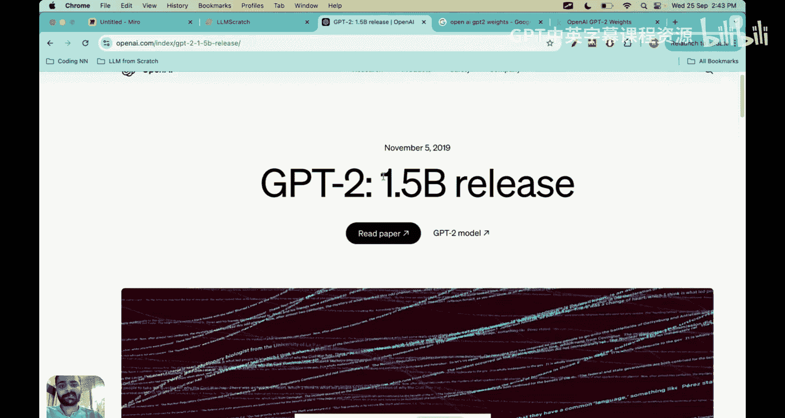

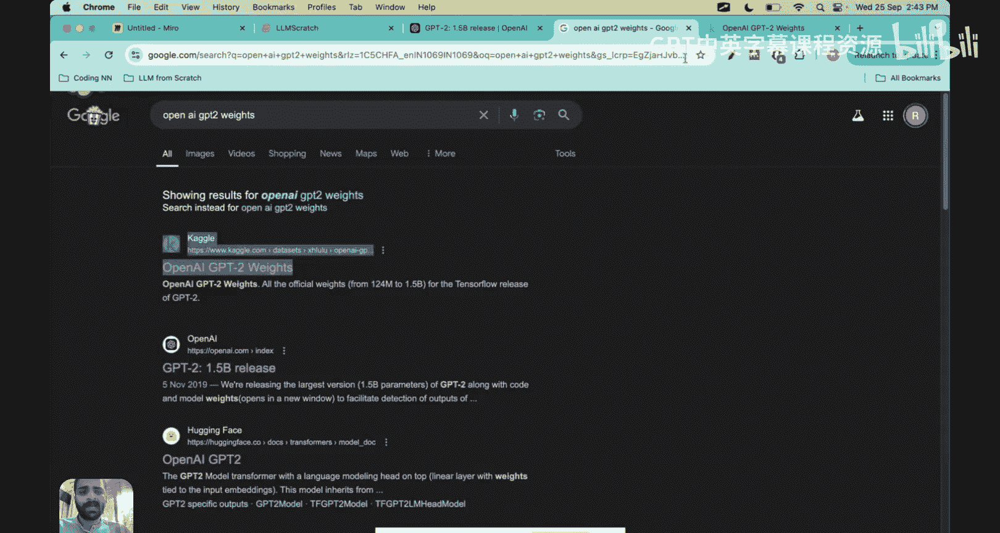

So without access to this weights today's lecture would not have been possible and I would just like to take this opportunity to thank all of the LLM companies who are in the open source domain especially and who are publicly making available all the weights which are used by these models。

Okay， so I'm going to take you to directly to code right now and let me start explaining to you the different steps in the code。

So previously for educational purposes， we trained a small GPT2 model right which used a very limited data set。

 it was just a book。This approach allowed us to focus on the fundamentals。

 but we did not get coherent text as the our prediction what we are going to do is that Open air fortunately shared their weights publicly so we are going to load these weights into our GPT model class and we are going to use this model class itself for the next next generation。

One thing to note before we get started is that Open Air originally saved the GPT2 weights via Tensorflowlow whereas all of the coding which we have done so far in this lecture series is using Piytorch so we will have to install Tensorflowlow and one more library which we are going to install is called TQDM to track the download progress。

So here you can see that in this line of code I'm installing Tensorflow and I am also installing the TQDM library。

 the Tensorflow version should be greater than or equal to 2。

15 and the TQDM library version should be greater than or equal to 4。

66 so you can install both of these two libraries and then import them so here Ive printed the Tensor F version and the TQDM version on my system。

Once you install this these two libraries， can you can pause the video for the time being and then you can continue with the rest of this video。

Now comes the very important step of downloading the。

GP2 weights and their parameters This is a step which still might be complex to so many students and engineers so I want to explain this in a lot of detail first of all when you go to platforms like Agle you will find files to download so these are the seven files which contain all of the information basically and you will see that the file size is about 500 megabys but after you download this there is a number of three processing steps which need to be done before the weights can be integrated with our GP architecture and Im going to explain those steps to you right now so let me take you through to the VS code interface where we are going to。

Look at this GPT underscoresp download3 function。And or this file， this code file。

 which will help us download。These seven files and not just download。

 we are going to extract the parameters from these seven files and then we are going to store them in a very specific format。

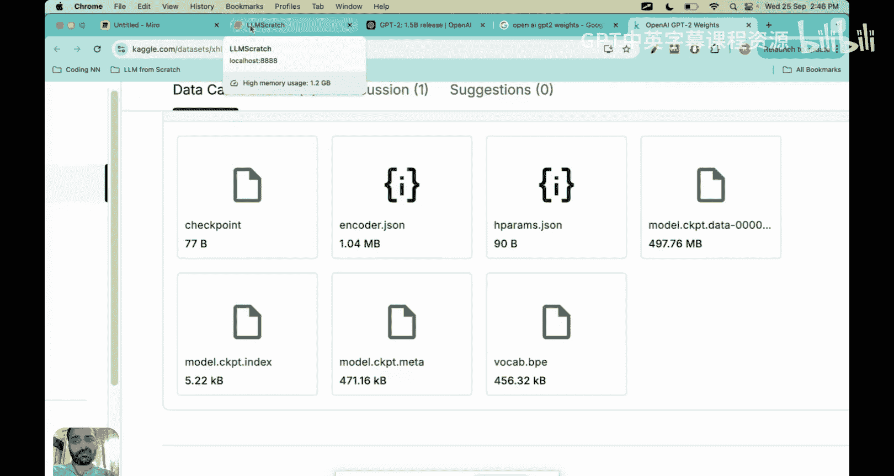

Alright， so here you can see the GPT_ download 3。 py file and first of all you will see that when you open this file it has three functions。

 it has the download and load GPT2 function which is the main function which we are going to look at then this function utilizes to helper functions the first is called download file and the second is load GPT to Par from the TF checkpoint。

So as the file names itself suggests what this main function is going to do is that it' is going to do two things first it is going to download the seven files these seven files which I just showed you on Kagle also it is going to download those files and it is going to save them on my local computer thats what it is going to do as the step number one and then in the second step what we are going to do is that we are going to take the downloaded file and then we are going to call this load GP to parameterss from。

Tf checkpoint and what this function is going to do is that this function is going to store the parameters in the dictionary called as parameters and this dictionary has a very specific format which we are going to see just in a moment。

So just downloading the data from Kaggle is not enough。

 you need to understand the rest of the code and the format in which this Pars dictionary is returned。

So lets start understanding this code sequentially before that I just want to take a moment and explain these downloaded files so once you run this code you will see that you will get these files which are downloaded on your local machine without even running this code you can even go to Kagggle and download these seven files。

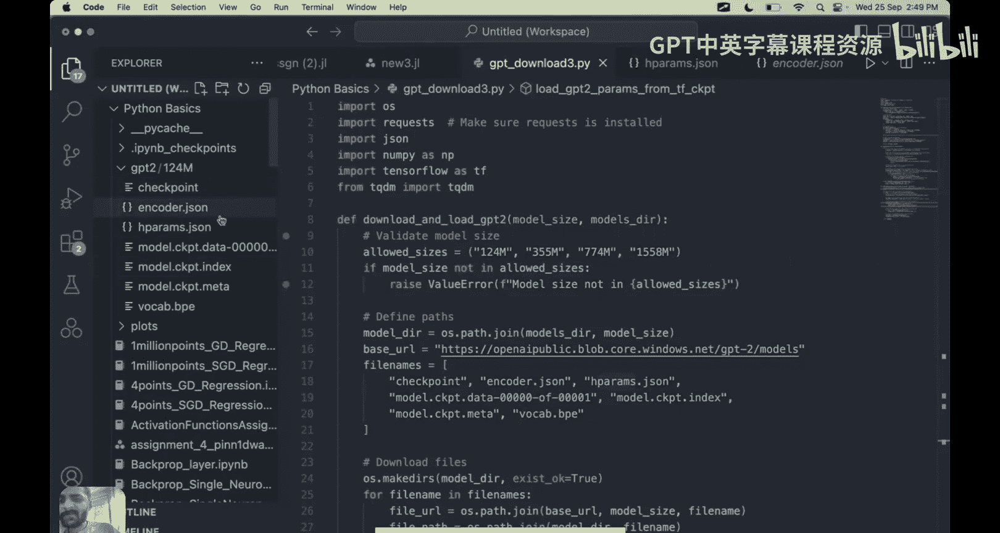

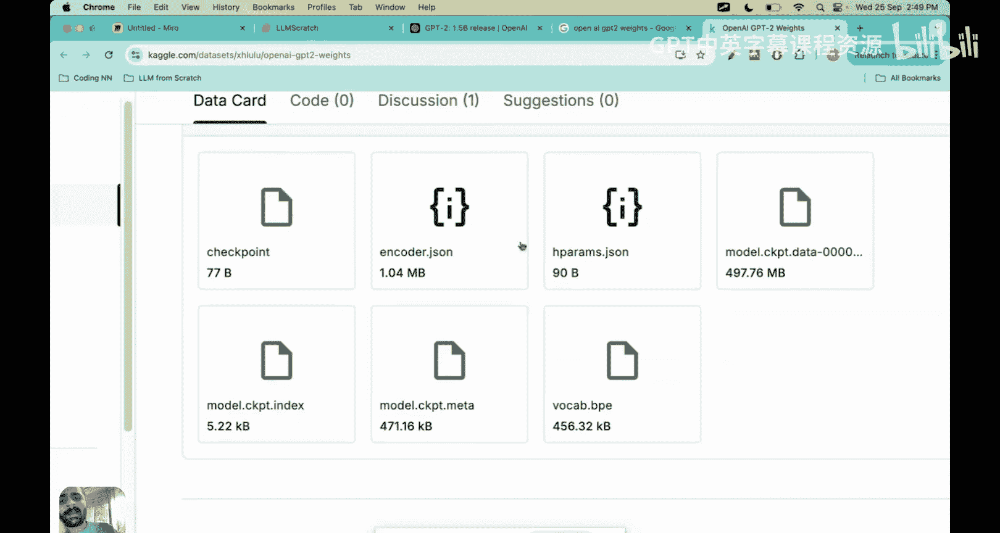

Now， if a student has not been through this LLM lecture series which we have developed。

 they will not understand these files and they might seem a bit complicated these files。But for us。

 for those students who have followed this lecture series。

 I want to show you that now these files are very easy to understand。

So I want to explain each of these files sequentially， the first thing is checkpoint。

 so if you go to this file name checkpoint， you will see this thing called model checkpoint path。

What this essentially means is that this is the path where all the current。

Parameterters the weights of the GPT2 model are stored so you will see that model do cpt we have three files name model dockpt the most important file is model dockpt do data this is where all the weights of the GPT2 model are stored so this checkpoint is just going to indicate the path at which the model weights are stored。

The second file is encoder dot Json。 So let me come to the top of this file。

 This file as a whole looks complex， but it's actually a vocabulary。 It's a vocabulary of。Ks。

And token IDs so we have tokens here and corresponding to every token there is a token ID that is the vocabulary which we are using and if you remember the vocabulary size it iss 50257 so it starts from 0 and then the end of text is 50256 so there are 50257 tokens in our vocabulary。

Then the second file is vab。bpe remember if you have followed this lecture series we learned about the byte pair encoder。

 it is a subbo tokenization scheme and the way this encoder works is that it looks for pairs of tokens which are occurring the most frequently。

And then it merges this pair and that becomes a token in itself。

 that's why it's called subur tokenizer。So this vocab dot B P gives a list of the。

Tokens which have been merged with the highest probability at the top so all the tokens which have been merged have been mentioned in this list and the tokens which have which come with the maximum probability there at the top of this list so you might be thinking what is this G dot rate this G dot is a special convention which basically indicate that one token has ended and a new token has begin so you can think of it as a space and which marks the beginning of a new token so it is a special convention used by openaiI to indicate the end of one token and the start of a new token。

Then the third file which I want to show you is hpars do Json this is the file which essentially contains all the settings of our model the vocabulary size which we are using is 50257 the context length which we have is 1024 the embedding dimension is 768 what is the embedding dimension essentially all the token ids which you see over here。

If you see any any token， every token has a token ID right and every token ID will be converted converted into a 768 dimensional vector space。

These vectors are not trained and our training will involve parameters corresponding to these as well。

Then N heads。 So N head is basically the number of。Attention hits。Present in each transformer block。

 and n layer is essentially the number of。Number of transformer blocks itself。Now， remember。

 these are the。These parameters， the setting values， which I'm showing you。

 they are for the smallest。GP T 2 model， when open air made the G2 weights public。

 they actually made。The weights of their larger models is also public。

 so 124 million355 million774 million and 1558 million the weights of all of these models will remain public。

 but for the sake of simplicity we are going to look at 124 million model right now which had 12 transformer blocks as you increase in the complexity of the GPT2 model the number of transformer blocks also increase。

Remember that the same code which I'm going to show you today can be run for these larger architectures as well。

Okay， so I hope you have understood the meanings of all of these files now let us start going through this download and load GPT2 code step by step and understand every single sentence。

So the first thing is that we mention the URL so well make a call to this API and will'll download these files。

 download these several files which are present on my local computer right now so the download file function will be called for this and I' am not going to go through this in detail because this is just downloading the file onto the local machine the real interest which I have is showing you what happens after the file is downloaded so after the file is downloaded first we have this Tf checkpoint path which is the latest checkpoint directory where all the model parameters are stored so what this function will do is that Tf do train so Tensorflowtrain do latest checkpoint model directory so it will go to our directory and it will look for this checkpoint and it will look for this model checkpoint path which is model dockpt so it will know where the model parameters are stored。

Awesome， the next thing is that settings we are going to maintain another dictionary which is called as settings and what this settings dictionary is that it will exactly contain the same thing what is present in the hpar do JO so it will contain the vocabulary size it will contain the context length。

 the embedding dimension， the number of attention heads and the number of transformer blocks。

So let me go back to the code again。Right so this is the settings dictionary and then in this last line of the code this is where all the magic is essentially happening and you really need to go into depth to understand what happens in this one line of code so here what we are doing is that we are looking at the model path which is given by this Tf CKP checkpoint en circler checkpoint path and we are going to take the parameters from that path and we are going to use the settings dictionary and then will return a parameterss dictionary and the code which does that is this load GPT to parameters from Tf checkpoint so from the Tf checkpoint parameters we are going to load。

The parameters into special dictionary called as parents。

Before explaining to you what is happening in this code I first want to show you what the Paras dictionary looks like alright。

 so here is how the Paras dictionary actually looks like。

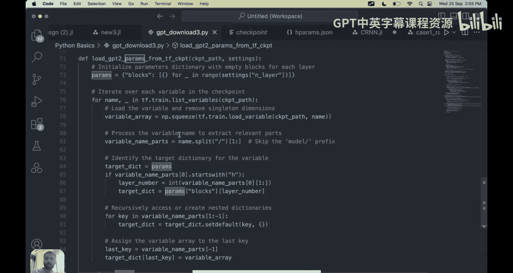

The dictionary will have five keys which I am going to show to you right now what are these five keys and what do they exactly mean The first key which this dictionary is going to have is WTE The second key is WP The third key is blocks。

 the fourth key is the final normalization scale and the fifth key is final normalization shift。

To really understand these five keys and why do we need these five keys。

 you need to understand the GPT architecture。And we have spent a lot of time on this。

 I just want to summarize it quickly so that you can relate to these keys so whenever a token comes in whenever a sentence comes in rather we have to first convert the input token id into token embeddings。

So this will require weights this will require parameters which need to be trained then we will need to add positional embeddings these are also parameters which need to be trained the result of token embeddings plus positional embeddings is input embeddings and these pass on the transformer block so already you understood the purposes of the first two keys this is for the token embeddings parameters the WpeE is for the positional embedding parameters。

Now， after we get the input embedding， we move have the dropout layer dropout layer has no trainable weights。

 so we don't have any keys corresponding to that， then we move into this transformer block。

The transformable block has several places where trainable weights exist。

 The first place is the multi attention layer We have queries。

 keys and the values weight matrices over here right and these metrices consists of parameters which we don't know so this is one scope for trainable parameters the second scope for trainable parameters is this field forward neural network remember this field forward neural network has an input so there is an input which comes in then it passes through hidden layer the number of dimensions in the hidden layer four times the input and then we have a final output layer which projects it back to the same size So this first layer。

So this first layer of the neural network。is the fully connected layer so I am going to name it as Fc and the second is the output projection layer so I am going to call it as PRROG both of these layers will have trainable weights so that is the second scope for trainnable weights。

Now， if you look at the layer normalization one and layer normalization2。

 let me highlight them with a different color layer normalization。

Let me choose purple color so if you look at layer normalization 2 and if you look at layer normalization1 normally layer normalization does not have any weights because we just subtract the mean and divide by the square root of variance right but the way we have defined layer normalization is that after we do the scaling after we subtract the mean and divide by the square root of variance we also multiply with a trainable parameter called scale and we add a trainable parameter called shift。

It turns out that these two parameters actually make a big difference。 So that's why we have。

layeryer normalization2 and layer normalization one also which come into the trainable weight parameters category。

And then we have the final output layer， the final normalization layer。

 which is another trainable weight matrix category wherever wherever we have parameters to train those are keys corresponding to this parameter dictionary So you already saw token embeddings and position embeddings blocks corresponds to all the。

Trainable weights and parameters in this transformer block in this blue color transformer block。

And then G and B correspond to the trainable weight parameters in this final layer norm。

 which is indicated as  four right now。So token embeddings right。

 I hope you remember what what are token embeddings。We have a vocabulary size of5，0，2，5，7， right？

And corresponding to every token， we have a vector whose dimension is 768。So。

 the size of this is 50257 rows and 768 columns these are token embeddings now positional embeddings are governed by the context size in GPT 2 the smallest model which you are considering the context size is 1024。

Because maximum we can look at 1024 positions and then make the next token prediction the 1025 position does not matter to us so we only need for we only need embeddings。

Corresponding to position number one， position number two， up position number 10，2，4。

And these embeddings， each of these embeddings also has a dimension of 768。

Because we need to add the token embeddings to the positional embeddings。

 the vector dimension of both of these need to be exactly the same and thats there because its 768 in both of these cases。

Now， so this WTE key will have all these values corresponding to the token embedding matrix。

 the WP key will have all the values corresponding to the positional embeddings matrix Now lets come to the blocks when you come to the blocks there are several things which are happening in the blocks so let me just rub this part of it。

So that things are a little more clearer over here， great。First。

 we are going to look at the mass multitered attention。This has the query， this has the key。

 and this is the value。In GPT2 when they release the weight they fuse this into one single big matrix so we need all the weights corresponding to this large matrix so that later we can split it to query key value trainnable matrix。

So the way it is done in this blocks dictionary is that there will be a dictionary called or there will be a dictionary called parameter within that there will be a keys blocks this will link to another dictionary which has the keys transformer。

This will link to another dictionary which is the keys h n why h n because there are 11 such 12 such transformer blocks remember GPT2 has 12 transformer blocks so whatever I am showed you right now that will be replicated 12 times right so there are 12 transformer blocks the first one inch at0 then there will be a key called8 Ttn y because we are looking at the attention mechanism right and then。

And this attention mechanism also has the output projection。 So we need to。

Specify in the attention mechanism what we are looking for in the attention mechanism currently we are looking for C T TN。

 What is C T TN it is the fused matrix of query key n value and within this  fued matrix we are looking at the weights。

 So within this  fused matrix we are looking at the weights。

 So you see that's how we access the weight matrix of the。

Attention layer so we look at the blocks key within that transformers。

 so let me show it to you now we look at the blocks key within that we look at the transformers within that we look at hn then attention then C attention which is the fused query key value and then we look at the weights。

Similarly， we do all this for the biases of the quez key query and value。

 this is only for one transformer block H node。We are going to repeat this for H1 H2 up till H 11 since there are 12L such transformer blocks。

 so this is how you access the weights in the attention layers of the transformer blocks you this is how you access the weights and biases of the attention layer in the transformer block。

And when I say attention layer， I mean the query key and the value weight mid crisis。

And the biases corresponding to each of these right so that is the first component which we looked at the second component is this feed forward neural network now here if you look closely there are two layers there is a fully connected layer and there is a projection layer so we will have weights and biases corresponding to this first layer as well as the second layer。

And that is clearly mentioned here if you look at the fully connect feed forward neural network you have the transformer keys within that you have the H node which is the first transformer block within that there is a key called MLP multi layerer perceptron because we are looking at that expansion contraction neural network currently we are accessing the fully connected layer and the weights of that layer fully connected layer the biases of that layer。

 so what I am highlighting right now corresponds to the first。

The fully connected layer and its weights and biases。

 similarly to access the weights and biases of the projection layer。

 we just have the keySC underscore PRROJ and we access the weights and the biases。So。

 this is how we access the weights and the biases of the feed forward neural network within the transformer block and then usually at the end of the transformer it is not shown here but we actually have this output projection headed。

This output。This output projection。And there are weights associated with that also。

 so to access the C projection in the or to access the output projection layer。

We just do transformers， then we go to Hn the first block。

 then we go to A TTN Cpro which is the output projection layer and we get the weights and similarly we do this for H1 h2 up to h 11 so the 2l transformer blocks so this is how you get the weights and the biases of the attention layers。

Of the feed forward neural network and the output projection layer in the transformer block。

 but remember the transformer block has two additional things it has the layer norm 1 and layer norm 2。

And both of these have trainable scale and shift parameters right so we need to access those so the last thing which we are going to access in the transformer block keys so these block keys is that we are going to access transformer slash h slash layer normalization1 then the scaling which is denoted by G and the shifting which is denoted by B this is the scale parameter and b is the shift parameter。

Similarly， with respect to layer normalization2， we will get the scale parameter denoted by G and we will get the shift parameter denoted by B。

Remember that all of these are subdictionaries within the blocks dictionary and within this subdictionaries ultimately we access the parameters。

So if you look at the blocks。Block keys within the block keys we are actually getting four thingses we are getting the attention layer weights query key value weights。

 we are getting the feed forward neural network weights。

 we are getting the output projection layer weights and we are getting the layer normalization weights so essentially with this we get all the trainable parameters within the transformer block itself。

Awesome， but our task is not yet over because when we come outside of the transformer block there is this final layer normalization right and actually let me mark it with a different color there is this final layer normalization and similar to the layer normalizations earlier it will have the scale and the shift now remember。

That there are entirely different keys for the final normalization layer scale and that is the key name G and for the final normalization shift there is an entirely new key which is called B so the Paras is the dictionary and then when you do Paras B。

Paraams B， you will get the final norm shift parameters and if you do。Pms of。

G you will get the final norm scale parameters but to access let's say the attention head what you will need to do is that I am just showing a part of the code which lies ahead but I think it is important to get the attention head you will do Paras blocks so you will access the block keys then you will specify that block number 1212 etc then you will go to the ATTN keys。

What we mentioned over here？AT TTN keys， then we will go to the C ATTN keys and then we will go to the W key this is how we will access the weights of the query key and the value mates in the attention block attention layers。

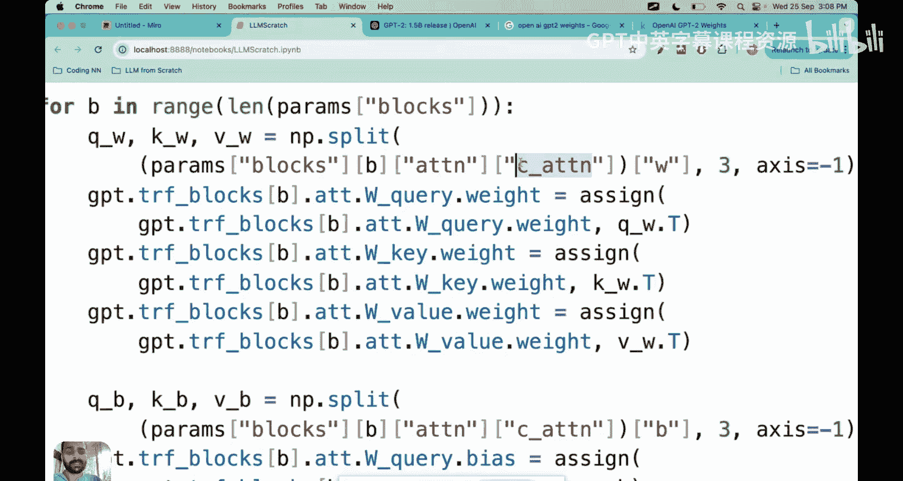

So that's why we need all of these five keys， which are returned by the parameter dictionary。

 So the whole goal of。This GP load GPT to parameterss from the tensorflow checkpoint is to get the parameter values from this checkpoint and then convert the parameter values into this parameterss dictionary so here you see we define the Paras dictionary which is empty currently and we first only define the block keys and then we fill the block keys with every attention layer the feed for neural network the output projection head all of these are already present in the model checkpoint but we just need to put them in the appropriate values I am not going to explain this part of the code but because the main learning lies in you understanding these five keys。

So， this is how the block keys is filled up and similarly all the other keys WT E WP E G and B。

 they are already present in this model checkpoint path。

 so we just augment the Paras dictionary with all of those keys。

So when you finally execute the load GPT to Paras from Tf checkpoint， which is mentioned over here。

 the Pars dictionary will have those five keys which I mentioned to you on the whiteboard。

 this is what is happening in this piece of code。And then when you finish this function。

 you return two things， you return the settings dictionary。

 which consists of the vocabulary size context length embedding dimension number of attention it is a number of transformer blocks。

 and you also return the Paras， which is the Paras dictionary consisting of the five keys which I just showed to you on the whiteboard。

I could have just skipped this part but then I really wanted to show you the nuts and bolts of how the downloading is done if you want to do research in large language models it is very likely that you will need to download the pre-trained weights to do some testing or some training and for that you really need to understand the format in which GPT to releases these weights if you don't understand the format and if you don't understand how to convert this format into this parameter dictionary it will be difficult to do novel research。

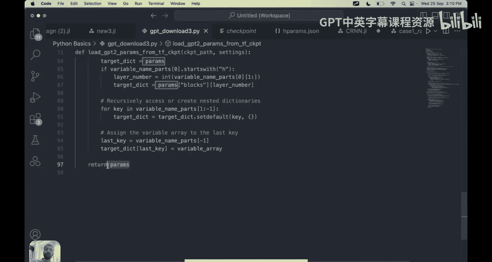

So I hope you have understood this part。Now， let me move back to the go to the。Jupiter notebook。

 and until now we have reached this stage where。Right up to here where we will now what we will be doing is that from this GPT download 3 do Py this Python file will import the download and GP to function it is this function the download and GP to function and then what we are going to do is that we are just going to run this function we have to pass two things we have to pass the model size because remember that the model size can be 355 million774 million and 1558 million also and I encourage you to experiment with this after today's lecture is over so we put in this model size and we specify the directory so I have specified the directory to be GP2 so here you can see in the folder name GP2 all of my files have been stored。

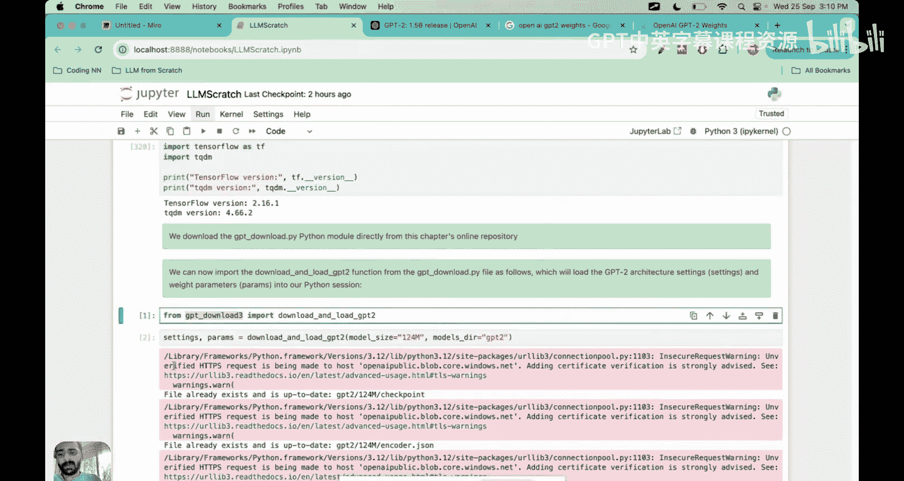

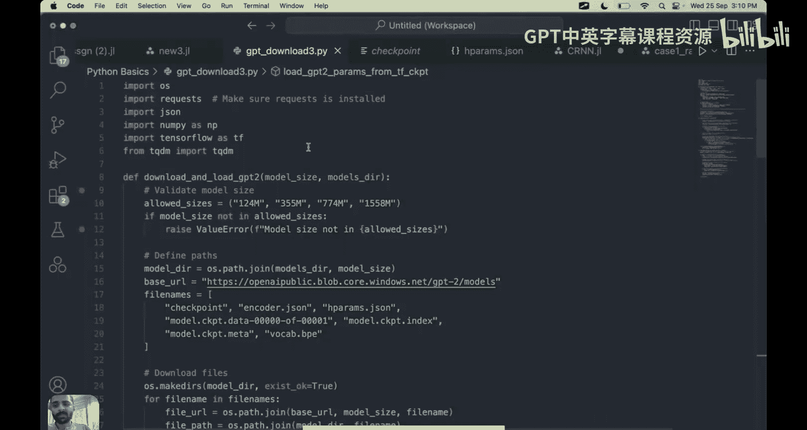

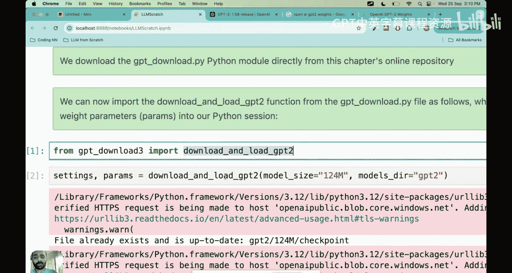

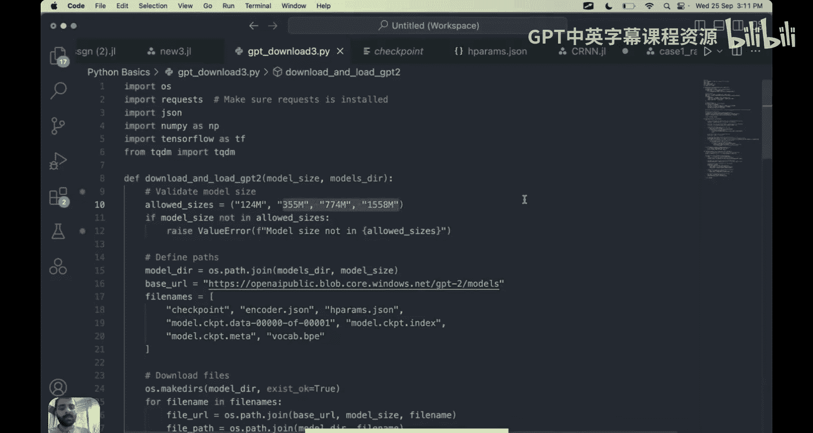

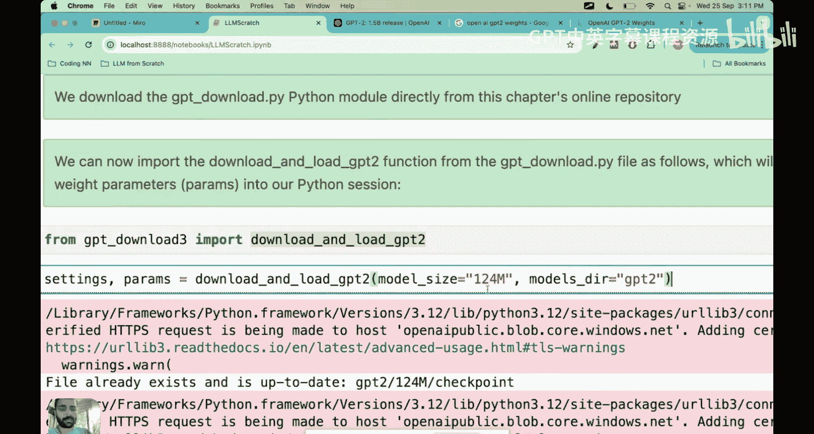

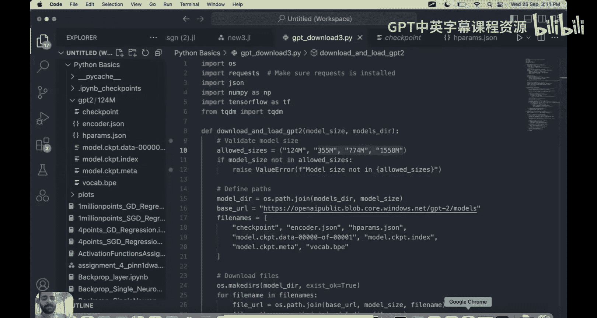

And then what you can do is that you can run this piece of code so then settings dictionary as we saw。

 will get the settings dictionary and well get the Paras dictionary when you run this piece of code。

Now when you run this as I told you this total size of all of this is around 500 mebyte initiallynitially when I ran this code it took a very long time on my laptop because my laptop kept crashing it was not in a good internet area and then I move to another place where the internet connectivity was a bit strong so here you can see I was getting speeds of52 to5 MB per second and then this entire loading took around5 to10 minutes so I encourage you to sit in a place with a good internet connectivity and don't restart your session or close your laptop during this time because once this is loaded the rest of the code proceeds in a very smooth manner this is the most time consuming part of the code until this point。

Now let's say this code is executed after it's executed since we have loaded this TqDM library well see the progress which is happening so here you can see that I've reached 1 hundred0 percent in all of the different steps so after this code has been completed you can inspect things you can inspect the settings dictionary and you can inspect the parameter dictionary keys so if you print out the settings dictionary you will see that it has keys like Nvoab Nx N embed Nhead and N layer now as I mentioned this this is exactly the same as。

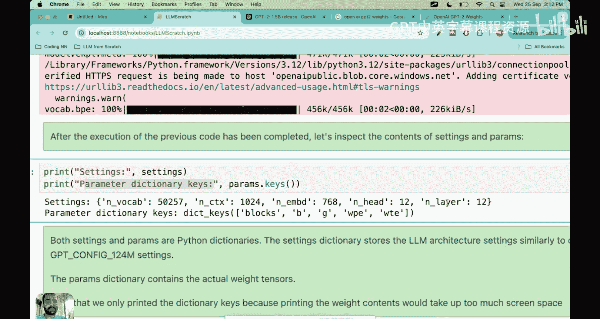

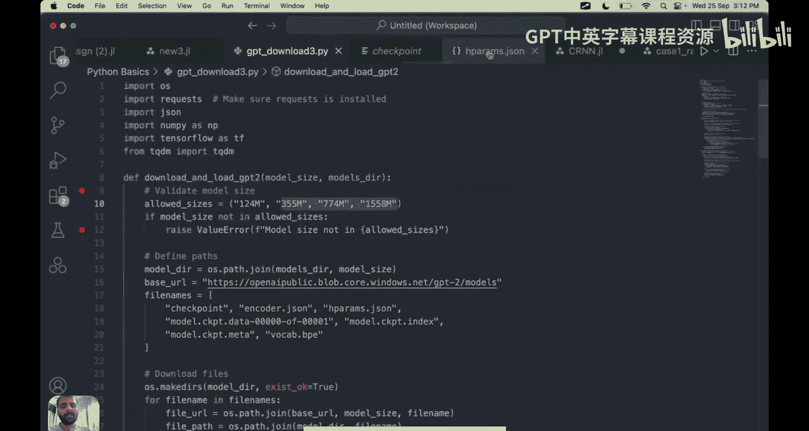

The H Para dot JSsonN file here is just been converted into a dictionary now and if you print the parameter dictionary case you will see blocks B GWP and WTE we learned about this exactly on the whiteboard where we saw that the parameter dictionary will have these five keys。

 WT WP blocks G and B。Awesome， so I hope you have understood until this part where we have actually loaded。

The G2 architecture right now， we have loaded all of the parameters。

Into our laptop and the parameters seem to be loaded correctly。

What we can also do is that we could have printed the。Prameter weight contents。

 but that would take a lot of screen space and we only printed the parameter dictionary keys。

 not its values。But we can go a step ahead and look at the Para dictionary and print out the Wpe。

 which is the key corresponding to the token embedding vector and we saw that the dimension should be  p02570768 columns let us just see if the dimensions make sense so if you。

If you access the Par dictionary with the keyWTE， you will get this tensor whose shape is 50，2。

57 and 768。At least the dimension seemed to be making sense great。

So these values which you see on the screen right now they are optimized values。

 which means that for every token the token embedding weight dimension encodes some semantic meaning again we should be thankful to Open air for releasing the weights publicly because they would have spent about a million dollars or even more for this pretraining。

Awesome， so as I told you， we could have also downloaded the 355 million774 million or 1。

5 billion parameter， which is this release which GP2 had made and you can feel free to experiment with that but we have loaded the 124 million parameter Now before moving forward one change which we need to do is until now when we use the GPP configuration in this lecture series we use the GP we use this thing called GP config 124 million and the configuration was almost exactly same as what's actually used in GP2 except that we used a context size of 256 whereas the actual context size is 1024 so we need to change that So what we are going to do is that we are going to say that the new configuration is the same as our own configuration but we update the context length to be 10 to4 and the second thing which we are going to update is the query key value bias So when we trained the attention mechanism and when we run our own LLM before。

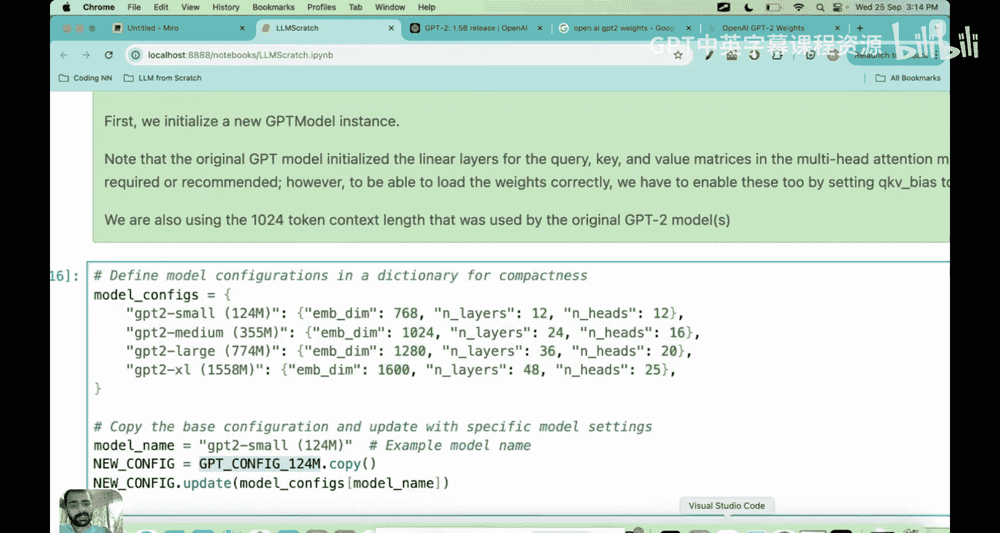

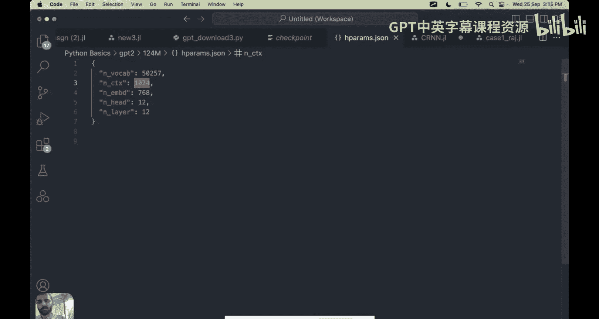

We have put this query key value bias to false， but in GPT 2 this was actually put to true。

 so we are also going to put this to true。Here I have added a small note that bias vectors are not commonly used in LLMs anymore because they don't improve the modeling performance and they are not that necessary。

 however， since we are working with pretrained weights we need to match the settings for consistency and that is why what we are going to do is we are going to enable the query key value bias to be equal to true and we are going to use the context length to be 1024。

So， then we create an instance of the GPT model class with this new configuration。

 I just want to show you the GPT model class which we have so that it is on the screen。

In case you you are coming to this lecture for the first time。

 we have developed a GPT model class which looks something like this yeah。

 this is our GPT model class。And now the main goal。

 which we have is how are we going to integrate the weights which we have downloaded with the GP model class which we have defined So let's learn about that a bit So there is a specific way in which we are going to do this integration So look at the GP model class what we are doing currently is that we are just initializing the token embedding matrices。

 the positional embedding mates the transformer blocks weights。

 we are initializing them to random values but now our main goal is that the weights which we have downloaded from GP2 and which are currently stored in this parameterss dictionary which we have returned we need to somehow make sure that these weights are integrated with our GP model class and instead of these random initializations using N do N do emdding we actually make the initializations。

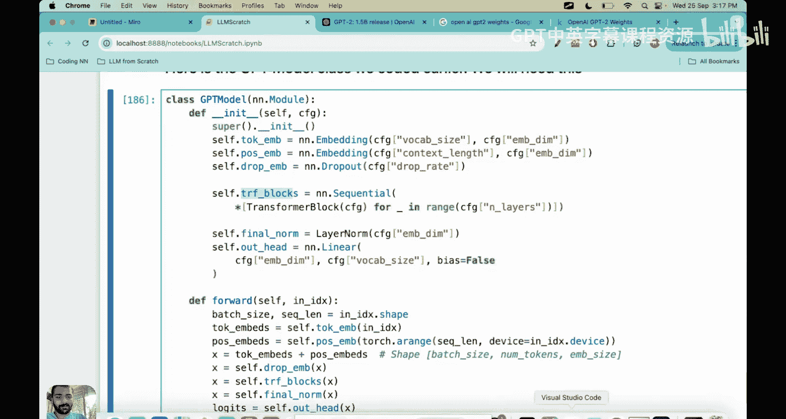

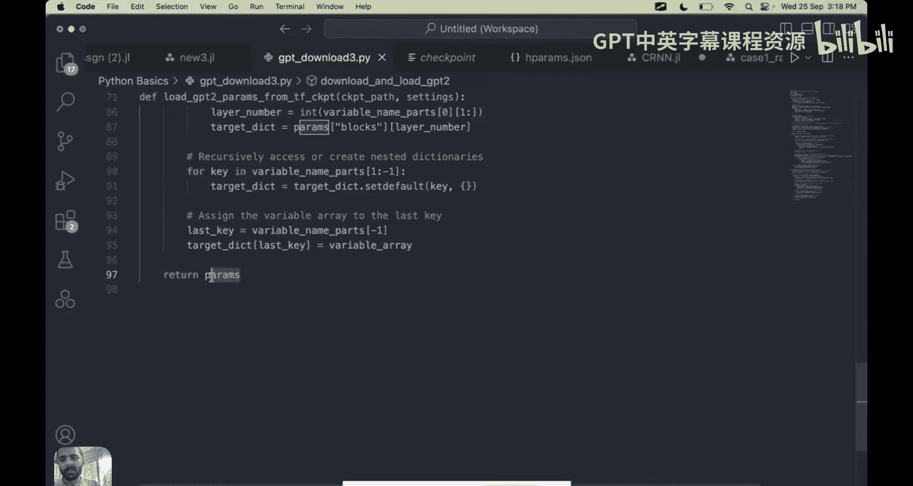

From the downloaded GP to parameters。 So for that， we first need to。

Look at the transformer block and I want to show you a couple of things in this。

Tranformer block So I will just control f here and searched for the transformer block yeah so here is the transformer block Okay what we are going to do in the code is that here you can see that there is a object called attention So that is instance of the multiered attention class what we are going to do is that we are going to take this object and we are going to make sure that when you define this A TT object the query key and the value matrices are assigned to the query key and the value matrices which are obtained from the parameter dictionary。

From this dictionary over here this the attention layers from this dictionary。

 similarly when we look at the feed forward neural network FF object。

 we are going to make sure that this feed forward neural network receives values from this feed forward neural network creates dictionary。

 which we have in the parameters dictionary。So let me again take you back to the current code。

 It's a bit down below， but let me scroll down below so that。

You understand what's really going on Awesome， so now what we are going to do， as I said。

 is that we are going to link our GPPT model class with the downloaded weights from Open air GPT2 So the way we are going to do this is that first let's take a look at the attention block right let's take a look at the attention block and let's take a look at the queries。

 the keys and the values。So what we are doing here is that first let's access the queries keys and the values downloaded from openaiI GPT2 and the way to access it as we have already seen is that you go to the Para dictionary。

 you go to the block keys then you go to the transformer sub keys the Hn the ATt and the C ATtN and the W this is exactly how we are accessing these weights but remember these weights are a fusion of queries keys and the values so we are going to split these along the columns and then we will get the queries weight matrix the keys weight matrix and the values weight matrix as I told you before we are going to get the ATt object remember I showed you in the transformer block class the ATt object and then in that object I am going to assign the queries the key and the value weight equal to the Q underscore W the K underscore W and the we underscore W which has been obtained from open AI GP2 that's it it's as simple as that this right here is the assignment step。

And the and the assign is the function which we have defined here what this assign does is that it takes left and right。

And it will first check whether these two values the shape is matching。And if the shape is matching。

 we just return the right values， which means the left is just assign the value equal to the right and then we return it。

If the sh does not match it will give us an error and that means that we are not loading the GPT2 weights correctly and not assigning them correctly。

So， this is the part that transfer where the attention block query key and the value weight matrics are updated similarly in this part the bias。

Is updated， so it is the same as the earlier part， but then w is replaced with B to update the bias termss。

Now， if you look at the transformer block， there are other things also there is this output projection layer which is accessible to through transformer dash H not dash At and dash cpro dashw So what we are going to do is that again we are going to access this output projection layer weights and we are going to assign these weights downloaded from open air to the At do output projection weight So we are going to look at the At object again and then we are going to assign output projection weights equal to what we have downloaded and this is the same for weights as well as biases right then we are going to look at the feed forward neural network what Im highlighting on the screen right now is for the first layer which is the fully connected layer as I've shown over here the feed forward neural network has two layers the fully connected layer and the projection layer So in the fully connected layer what we are doing here is that。

We are accessing the weights and the biases of the fully connected layer from the GPT2 downloaded values and then we are assigning these weight and biases to the FF object which we saw in the transformer block。

 so that way the neural letter， the fully connected layer weights and biases are equal to the GPT2 downloaded weights and biases。

Now， this same thing is done for the second layer， which is the projection or the output layer of the multi layerer per seron or the feed forward neural network。

And then finally we come to the last puzzle or the last building block of the transformers rather and that is the layer normalization so there are two layer normalization the layer normalization 1 and layer normalization2 and both have scale as well as shift。

Right so this is what is happening here， what I am highlighting right now we are accessing the shift and the scale parameters from the GPT2 downloaded and then we are assigning those parameters to our GPT model class and what I am highlighting on the screen right now is this similar process done for the second normalization layer which comes after the attention mechanism in the transformer block。

Okay now when we come out of the transformable block you see there is another normalization layer right the final normalization layer and it just accessible through G and the B keys so what we are doing is that we are accessing the ParaG and the ParaB and then we are assigning our GPT model class scale and shift values to whatever is downloaded from GPT2。

Now you must be thinking that， okay， there is if I look at the architecture closely。

 there is this final layer， there is this linear output layer。

And careful readers might remember that this linear output layer also is a neural network。

And where do we get the dimensions， where do we get the weights of these。

 we did not download this from GPT， right？So the way GP 2 was designed is that it uses this concept of weighttying。

 which means that。The token embedding weights are used for constructing this output header。So。

 the same token embedding weights are used for this output head layer。

 so we don't have to define any new weights for this layer we recycle the same weight what is used in the token embedding weight time is not used these days too much but it was used in the GPPT2 architecture and so we are also using the concept of weight time。

That actually brings the total parameters from 162 million to 124 million if you don't do weightty the number of parameters will be 164 million。

Awesome right So what we have done here is that until now this this piece of code over here load weights into GP this code what it does is that it takes two values。

 the first it takes the instance of the GPP model class and the second it takes the Paras dictionary so it takes this dictionary which essentially contains this dictionary which essentially contains all the weights of GP2 and then it just assigns all of these weights into the GP model that's what this load weights into GP is doing and now if you see above we have already created an instance of the GPP model class and if you scroll even above we have already got the。

We have already got the Paras dictionary awesome right so now we just took all this function and that is exactly what we are doing here we are calling this function load weights into GPT what this function does is that it takes the parameterss values and then it which are downloaded from GPT2 and then it loads into our GPT model instance which means that our own GPT model which we have constructed from scratch is now fully ready it is fully functional to be tested。

So now let us go ahead and do the most exciting thing in this lecture。

 which you all have been waiting for， let us test。Our model which we used our own architecture with the GP2 pretrain weights and lets see what the output is great。

 so now lets go ahead and test our model。So here you can see that here is the generate function which basically generates new tokens and we are passing the model which we have defined and that this model now has the weights which have been downloaded from GPT2 the input token id are every effort moves you and the maximum number of new tokens is 25 I have defined the temperature not too high 1。

5 and the top k 50 which means that 50 tokens will have the chance or the opportunity to be in the among the maximum new tokens。

Or to be in the generated token。So before we see the output for this。

 let me show you our performance。Without using GPT2 weights and area you can see that if we do not use GPT2 weights。

 we are getting something like this which did not make any sense at all。

And now what we are going to do is that we are going to run this right now。

 so I am going to run this live and just to show you that once you load the weights the running actually this code does not take too much time because we have already we already have pretrained weights so here you can see with the star symbol that it is running right now。

And now it generated。 So every effort moves you toward finding an ideal。

New way to practice something， what makes us want to be on top of that。This is incredible right。

 this output sentence is much more coherent than what we had obtained earlier。

So right now in this lecture we have built our own GPT from scratch and it seems to be working that's incredible。

All the other students which have not been through this course or who have not seen these lectures would be just using chat GP but now we have built our own GP from scratch isnn't that incredible it took us a long time to get here and the code length is also。

嗯。The code length is also pretty large so you can scroll above and see how long the code has become。

 but it's all worth it because we have learned how to build GT from scratch Now what you can do is you can go ahead and do your own research So for example。

 if you want to change the temperature value to 10 I know that this is not good but I want to see the effect of a higher temperature value we cannot do this using chat G right but now since we have built our own GPT we can explore it so many things So here you see I've increase the temperature value to 10 and let's see the output text which is coming right now ideally it should be a bit random because increasing the temperature increases the entropy Now see the output every effort moves you towards finding an ideal new set piece but only at times or for hours I was working on my first game called G。

So， as expected， increasing the temperature has given me random outputs。

But you see now this opens the door to so much more creativity。

 hyperparameter tuning even you can do research such as small language models。

 what if you want to change the architecture？You can now easily go ahead and change the architecture right all you need to do is that you need to go to this GP model once you have understood the code once you have seen the previous lectures you need to go to the GP model which we have defined so heres the GP model right over here and then you can add or subtract a few layers what if you we don't need 2 transformer blocks what if you want to test with a smaller language model all of these experiments now remain open to you。

So this lecture series is also the pathway for you to become a large language model researcher or a machine learning researcher because now you have something which works on your local computer and runs in a fast manner。

 you can do iterations you can test so if you want to test the effect of top K if you want to test the effect of maximum new tokens if you want to vary the number of attention head is the number of transformer blocks the optimizer size you can even vary the optimizer step size so for example we have used Adam right with the learning rate of 5 into 10s to minus-4 weight decay of 0。

1 you can even change this and check the output all of this is now accessible to you so that's why I believe that we have achieved a significant milestone completing this lecture。

If you have come to this lecture for the first time without watching the other videos in this lecture series。

It's amazing， but now please go back and try to watch all the other videos to master your concepts to become a very powerful LLM engineer。

Who is creating new norms， who is really doing cutting edge research。

 you need to know the nuts and bolts of how the modeling process works。

And I hope that through this whiteboard approach。And through this coding approach you are getting exposed to those nuts and bolts I have not seen any other content out there like this currently that's why it's very hard for researchers to even download or load publicly available weights。

So I'm trying my level best to teach you every single thing by not making short videos。

 but by making longer format videos like this one。And now we are confident that we have loaded the widths correctly why because the model is producing coherent text。

 so again let me switch the temperature to 01 and let me。Run this again。

 so now I'm running this and as you see earlier when the temperature was。

 I think it was not 01 and it was 1。4。We need to run this again for 1。4， but if you see for 0。

1 again， the model is quite good。But even I'll do for 1。4。

Because we started with that condition earlier。So we are confident that the model weights are。

Loed correctly because the model can produce coherent text at least the words make sense a tiny mistake in this process would cause the model to fail Now in the next chapters what we are going to see is that now that we have mastered pretraining we are going to look at fine tuning so the LLM subject does not end at pretraining after getting this model let's say if you want to build a text classifier lets say if you want to build an educational quiz app which is a very specific application how can you use the pretrained weight how can you fine tuned these weight so that it is specific to the application which you are building。

We are going to learn about this in the next lecture so all the next lectures are going to be very interesting since they are going to be application oriented and for all of those we are going to use this GPT model which we ourselves have built not relying on any other GPT model and that gives us a lot of confidence as a large language model or a machine learning engineer。

So thanks everyone for this lecture this was a bit of a long lecture and also a dense lecture but I hope you understood everything which I was trying to teach please try to reach out or comment if you have any doubts or any questions and I'll be happy to discuss this further and I'll also be happy to see what all research you have worked on by using this code file which I'll share with you thanks a lot everyone and I look forward to seeing you in the next lecture。

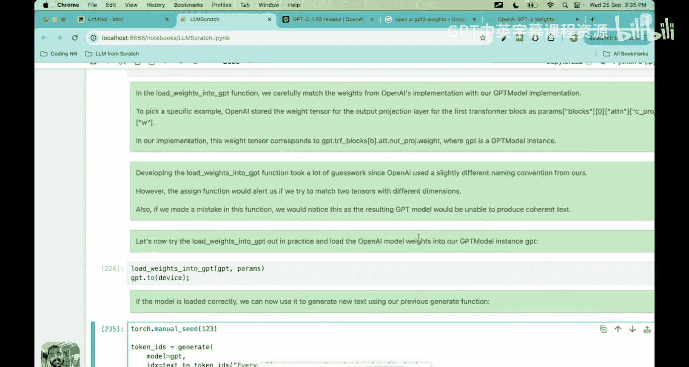

。

