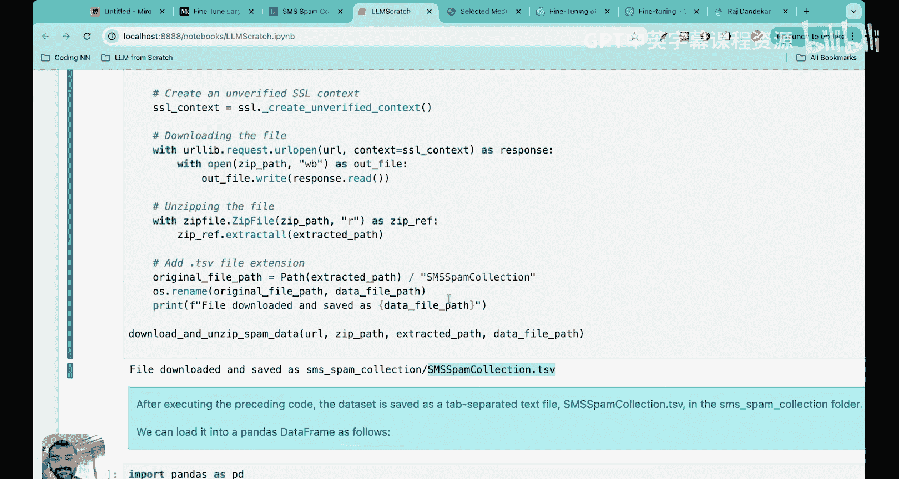
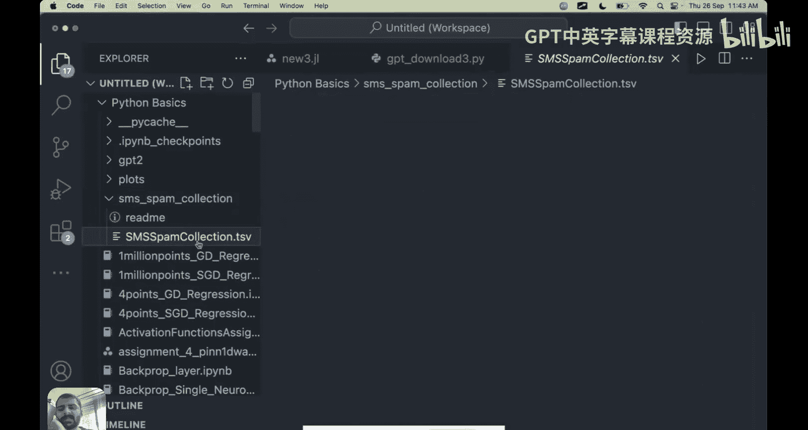
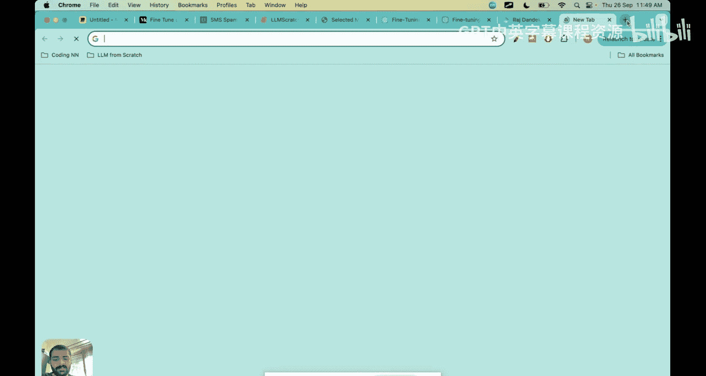
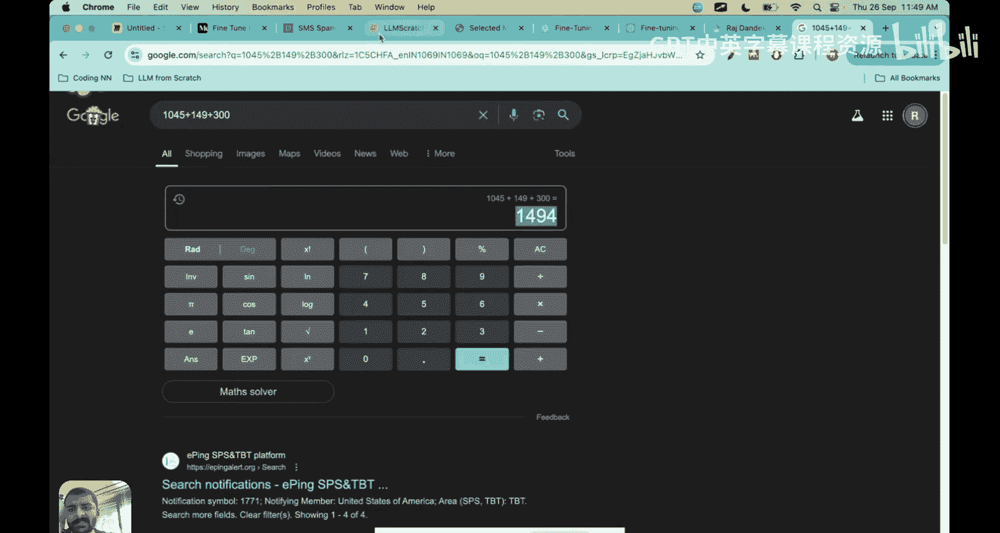
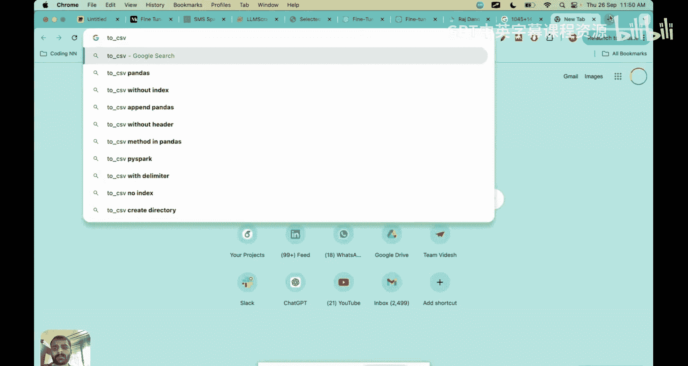
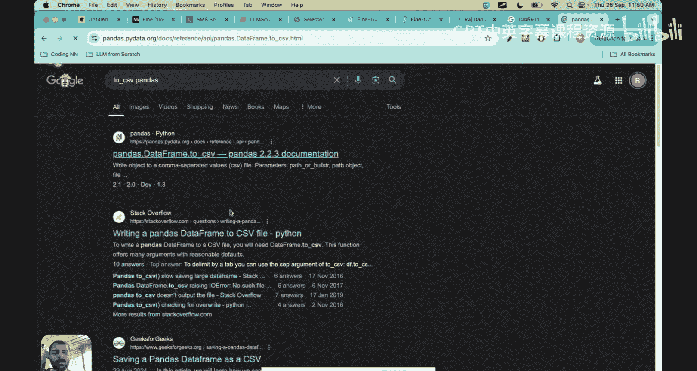
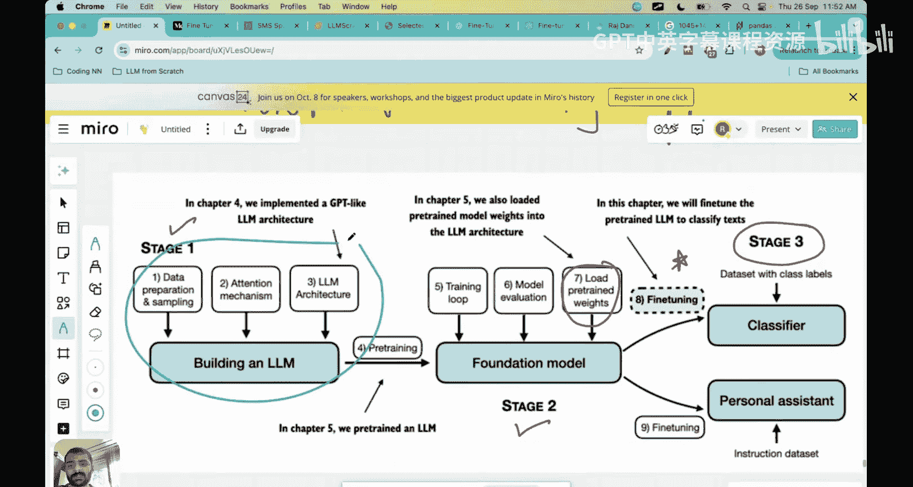

# Vizuara《从零开始搭建大语言模型｜Building LLMs from scratch》中英字幕（Claude-3.7-s） - P31：-33-Introduction to LLM Finetuning _ Python Coding with hands-on-example.zh_en - GPT中英字幕课程资源 - BV1qG8HzUE2D

🎼Yeah。Hello everyone， and welcome to this lecture in theBuild Lage languageage models from Sctch Series。

Today， what we are going to do is that we are going to have an introductory lecture on large language model fine tuning。

If you have followed this series so far， we have conducted around 30 to 32 lectures and within these lectures we have finished the stage1。

 which is understanding the LLA architecture， the attention mechanism， data preparation and sampling。

 and we have also finished stage number two， which is pretraining the large language model。

 model evaluation and loading pretrain weights。Now that stage one and stage two are finished。

We are now ready to move to the last stage of building a large language model from scratch。

 and that is the stage of fine tuning。With pre training we saw that we are getting good results and when we given an input text we are getting output which makes a lot of sense and it' is pretty awesome so it's like we have built our own GPT from scratch。

And here is the architecture which we use to construct our large language model。

We spent a huge amount of time and a number of lectures to understand this architecture。

Awesome so now we are ready to begin with this next stage which is the stage of fine tuning so first you might be thinking that okay we already pretrain the large language model and it seems to already work pretty well right so then does that mean we are finished building our LLm no。

Let me explain to you why do we need fine tuning？So let's say if you have pretrained the model that's fine。

 but what if you have a specific task so that specific task can be constructing a chatbot based on your own data as a company or let's say you're an educational company who wants to make an educational app using your data。

Let's say if you want to make a chatbot as an airline using your data。Essentially。

 if you want to make a specific application。The pretrain model is not enough because it's pre trained on general data available from all over the Internet you need to train the model again。

On additional data。This is called as fine tuning。So the formal definition of fine tuning is adapting a pretrain model to a specific task。

By training the model again on fine tune on additional data。

 there are some things which are very important here some terminologies the first terminology is this specific task。

So fine tuning is needed when you have certain specific tasks which need to be performed。

 such as if you are a company and if you want to develop a model， put it into production。

 you cannot just use a pretrained model as I mentioned it's trained on a generic data right it will not give answers which you expect based on your individual private data。

So， there is a specific task if you need to do a specific task you need to fine tune the pretrain model and the second thing is training the model again that means that until now the certain weights and biases of the model have been optimized during the pretraining but now you are going to feed the model with additional data so naturally usually to train the model again the parameters the weights the biases are going to change and that is usually done in the process of fine tune。

So， there are some in fact a lot of articles written about fine tuning so here is the schematic you have a large language model which is pretrained then you train it further on custom dataset and that leads to a fine tuned large language model。

Okay， so the formal definition of LllM fine tuning is that fine tuning LLM involves。

The additional training of a pre existing model。which has previously acquired patterns and features from an extensive data using a smaller domain specific data set so see we are training a pre-existing model again so that's why it is called additional training why are we training this model again because we have a newer smaller domain specific data so we need to train the model again so that it adapts its parameters it adapt it adapts its weights and it is biases。

Okay。So， fine tuning is necessary to。To be done after pre training is done。 Okay。

 so open AI even provides this。ADescription about fine tuning where it gives you instructions about how you can do fine tuning using open AI modelss。

So to give you a practical example of fine tuning this is the website which I had made in the final year of my PhD it talks about my publications。

 my talks， my media etc， so let's say if you also have a website or if you have a blog post site like this and if you want to make a chatbot which does not answer like how chat GPT answers but if you want the chatbot to answer like how you speak right you want the chatbot to answer based on your data how you generally write articles how how you word the different paragraphs on your website。

You have a specific tone and you want that tone to come in your chatbot， how will you do this？

With three training， it's not possible because in the pre trend model。

Might be your data is not even there in the pretraining。

 so then you need to fine tune you will need to give additional data such as whatever is present on my website。

 my blogs， my publications， my talks so that the model can understand and learn what is your tone of speaking how do you generally construct sentences and then it will adapt。

So the resulting chatbo， which will be developed will now be。

Speaking in your tone or my tone rather in this example that is called a fine tuning。

 So the specific application which I am looking for is constructing a chatbot which speaks in my tone for this specific application I have this additional data which is my website。

 my publications， my talks and my media which I'll feed to the model and Ill ask the model to be trained again or rather I'll train the model again。

Based on this additional data this process of training the model again is called less fine tuning so now the fine tune model will behave exactly like how I want it will speak in my tone it will use grammatical sentences like I do that's a practical example of fine tuning Another example is let's say you have your research publications like how I'm describing right here and you want to make a chatbot which basically answers people's queries about your publications so then you can feed specific data based on your publications that's another example of fine tuning In fact the reason I thought of this example was I saw a blog。

In fact， I saw a question asked on the open AI question forum where the person was saying that they are a beginner at learning fine tuning and their purpose is to create the model which could use the tone of their voice from their blog。

 exactly like what we had discussed and they are asking a number of questions about how exactly to go about this。

 how to make sure that the accuracy obtained is very good。

 how to prevent hallucinations which are wrong answers etc。

So and then there are a number of answers which is given by the Open air community to help this person find you on their mind。

Great， so this is the general introduction of fine tuning now within fine tuning itself there are two broad categories of fine tuning。

And let me mark the mirror for you the first category is called as instruction find tuning and this is much more common and much more broader the second category is called as classification find tuning。

What is the difference between the two so in instruction fine tuning what we do is that we train the language model on a set of tasks using specific instructions。

So here I' have given two examples of instruction。Instruction based point tuning。

 So let's say the instructions are。Is the following text spam answer with a yes or no This is an example of instruction based fine tuning because we are asking the LLM that you will be given text like this and your task is to look at the text and answer whether it's spam so classify or say whether it's yes or no that's why this is an example of instruction fine tuning we are adding instructions here which are in blue color that' is very important or the instruction could be your given sentence and translate it into German appropriately that is another example of instruction fine tuning so the LLM takes the input sentence in the first case it gives the output as yes or no in the second case it translates the English sentence into German。

The reason these are examples of instruction fine tuning is that we are giving the specific instruction and the LLM is behaving based on that instruction。

The second example is classification for interning this is not as common but readers or listeners rather who have learned about machine learning and classification examples such as brain tumor classification image classification between cats and dogs this is pretty similar but now you just use a large language model instead of let's say a convolutional neural network for example or any other neural network to make the classification so your no instruction is given to the LLM just the input is given without instructions。

And the LLM has to classify whether the email is spam or not spam here also we saw a spam not spam example。

 right， but your instructions were given that the LLM has to answer with a yes or no。

But your instruction is not given just two categories will be there spam and not spam and we train the LLM to make the output based on these two categories。

So the LLM receives a text and then it predicts whether its a spam or no spam although the result is same in this case and in this case the way the prompt itself is constructed or way the LLM is constructed is different thats where this what I am highlighting right now this is an example of instruction fine tuning and this example where the model input is given without instructions that is an example of classification based fine tuning。

Where we just classify into categories using large language models when I saw this。

 it was pretty surprising to me because I did not know that LLMs could be used for classification tasks。

In fact， classification fine tuning is also used for sentiment classification such as angry， sad。

 happy， etc， if you have given piece of text and if you want to classify it into either of these five buckets you can use classification fine tuning。

But instruction fine tuning is a much more common fine tuning， it can handle broader set of tasks。

And usually it can even handle or it rather needs larger data sets because you want it to handle a broader set of tasks right so a greater amount of computational power is also usually needed for instruction- based point unit why is greater amount of computational power needed because you have given instructions to the model and it has to search for the entire corpus based on the instructions which you have given right and the action which you perform is not specific so for example here the action is pretty specific spam or no spam the action here which it has to perform can be something complex as translation using the same instruction based model you can do other other things also so one instruction based model can actually handle a broader set of tasks such as translation summarization etc。

But in classification fine tuning， the only action which is performed is classifying in which category the text belongs。

So that's why the classification fine tuning can handle a narrow set of prompts。

So when you think of fine tuning people usually only talk about instruction based fine tuning but I find that classification fine tuning is also equally important。

 so the example which we are going to start in today's lecture is actually based on the concept of classification fine tuning。

Okay， so now in instruction based fine tuning， what usually people also talk about is methods to make the fine tuning more efficient。

 So within instruction based fine tuning， there are actually two other。

metethodds which are called as Lauraura and Q laura so basically these come under the category of parameter efficient fine tuning so it is a form of instruction fine tuning which is more efficient than full fine tuning essentially what is done in parameter efficient fine tuning is that we only update a subset of parameters and freeze the rest of the parameters at a time so this reduces the number of trainable parameters making memory requirements for instruction fine tuning more manageable。

So， Laura is。Basically an improved fine tuning method where instead of fine tuning all the weights that constitute the weight metrics two smaller mates that approximate these larger matrix are fine tuned right now we are not going into details of Laurara we cover that in a subsequent lecture as it is a pretty broad topic but I just want to introduce the concept to you today and the second is Q Lauraura which is basically quantized Lauraura。

And this is a more memory efficient iteration of Lra and Q Lauraura takes Laurara a step further by quantizing the weights of the Laurara adapters to lower precision。

So right now， just keep in mind that Lauraura and Q Lauraura are forms of more efficient fine tuning which reduce the memory requirement。

 which is traditionally needed in instruction based fine tuning。Awesome。

 so I hope you have understood the differences between。呃。

Instruction fine tuning and classification fine tuning right and now what we are going to do in today's lecture is we are going to start working on a handson problem which is a fine tuning classification problem。

So， we are going to look at the second category now and we are going to take a real data set。

We are going to look at emails， a youth set of emails， which are spam as well as no spam。

 and we are going to train a large language model to classify whether it's spam or no spam。

We won't be doing all of this in today's lecture because this this involves a lot of steps first we have to download the data。

 preprocess the data， create data loaders， this is in the stage one of data preparation。

This data set will be all the emails， which will be classified into spam and No spam。

Then in stage number two we will have to initialize the LLM model， load pretrained weights。

 then modify the model for fine tuning， implement evaluation utilities。

 and then in the final stage we are going to fine tune the model。

 evaluate the fine tune model and use model or new data。

I could have covered all of this in one lecture but then I would have to rush through it instead I'm going to split this into five to six lectures so that you understand the entire fine tuning process sequentially this is the philosophy which we follow in all of the lectures in this series I take you through every single step in a lot of detail first on a whiteboard and then through code。

Today， what we are going to do is we are going to do two things。 We are going to。First。

 download the data and the second thing what we are going to do is we are going to preprocess the data。

And in the next lecture we will create data loaders initialize the model and then later we' will also load the pretrained weights for now lets just focus on step number one and step number yeah actually just step number one in this lecture which is download and preproces the data in the next lecture we will look at step2 which is creating data loaders。

So let me take you through code right now。Right so in this section of the this section of the code I have titled as fine tuning for a classification。

 the first step as I mentioned is downloading the dataset this is just the code for downloading and unziing the data let me take you through the place where the dataset exists so this is the UC Ivine machine learning repository it is quite famous because it has a large number of data sets within this repository there is also an SMS spam collection data This is the data which we will be using it contains a huge list of emails both spam as well as non spam。

So if you scroll down here， you will see that you will see information about what exactly is present in this data set。

First， you will see that 425 SMS spam messages were manually extracted。

This is a UK forum in which cell phone users make public claims about SMS spam messages。

 so 425 spam messages and they also have 322 more spam messages which are publicly available at some other website。

 so overall there are 747 spam messages。Now let' us look at the nose spam， So in nose spam。

 they have a large number of messages， as you can imagine it' it's easier to source。

leggitimate no spam messages， the way they collected no spam messages is at the Department of Computer Science at the National University of Singapore。

So naturally， if it's emails originating in the university between students。

They are likely to be not spam。So we have much larger no spam messages compared to spam messages。

 so the data set is a bit。Not balanced and the nose spam messages are also called ham messages I'm not sure why this terminology exists but no spam messages are called ham and the spam messages are just called spam messages So this is the data set you can even download the data from here or you can just run the code which I will be providing to you which downloads and unzips the data once you run this piece of code the data set will be downloaded onto your local machine and。

It will be downloaded in this collection SMS spam collection dot Tsv So here you can see on my VS code there is this folder called SMS spam collection and this is the dot Tsv file which I'm showing on the screen to you right now so here you can see that the messages can either be ham which is no spam or spam so hamm means not a spam and spam is of course spam so as expected spam is free entry and winner basically as things like this So here we can see that these emails are indeed making sense and this classification is making sense So this is the entire data set which you can download either through code or you can download it from the UCR Y repository which I just showed you once the data set is download it what you can do is that you can use spams and you can convert it into a data frame so that reading the data becomes much more easier so you can print out the data frame and it looks something like this so the label is either ham or spam。

So here we can see that there are total 55，7，2 rows。So 5572 emails。

 but now we can print the value counts for the label in this data frame。

So the label is a column name and we can print out the number of hamm entries which are 4825 which are no spam and the number of spam entries is much lesser。

 which is 747。Now。What we can do here is that we need to make the data set balance， right。

 There are number of ways to make the data set balance， but we will。

Take a simple approach here since this is not a classification machine learning class。

 this is a class on large language models so we are going to take a simple approach and we are just going to randomly take 747 entries from No spam so that the number of no spam and the number of spam emails match each other both should be 747。

So， as has been written here for simplicity and because we prefer a small data set for educational purposes。

 we subs sampleample the data so that it contains 747 instances from each class。

So this is the function which creates a balanced data set what this function is going to do is that。

It it is going to randomly sample ham instances so that we can match the number of spam instances that is equal to 747 it is done by this line of code。

And then we combine the ham subset with the spam。 So the total now。

 the new data frame is balanced here。And if you print out the balance Df value counts。

 you will see that the number of ham， which is no spam emails are 747 and the number of spam emails are 747。

So after executing the previous code to balance the data set。

 we can see that we now have an equal amount of spam and no spam messages grid。

 this is exactly what we wanted。Now we can go a step further and we can take a look at the labels instead of having ham and spam。

 we can assign ham to be equal to0 and spam to be equal to 1。

So these are the label encodings of each of our emails。

So one note which Ive written here is that this process is similar to converting text into tokenides。

 remember in。When we pretrained the large language model， we had a big vocabulary。

 the GPT vocabulary， which had more than 50，000 words， in fact it 50，2。

57 tokens and every token had a token  ID。This is a much simpler mapping we have only two tokens kind of and their map to0 and1。

Now as we usually do in machine learning tasks well take the data set and split it into three parts。

 we will take this 747 data and well split it 70% will be used for training。

 10% will will use for validation and 20% will use for testing。

As I mentioned here these ratios are generally common in machine learning to train adjust just and evaluate models so here you can see I've written a random split function what this function is doing is that it just takes the train end which is the fraction of the training data which is train f it' going to be 0。

7 Val f is going to be 0。2 so we first construct the training data frame which is 70% of the main data frame the validation data frame is the remaining is 20% and the test data frame is the remaining 10% is the remaining 20% sorry the validation data frame is the 10% the test data frame is the remaining 20% of the full data frame。

And then when this function is called out， it will actually return the training data frame。

 the validation data frame and the testing data frame， so it will return three data frames to us。

So we now we can actually test this function so we have this balance data frame and we pass it into this function called random split and once it is passed into this function we also specify the train fraction which is 0。

7 and we specify the validation fraction which is 0。1。And then we construct the train data frame。

 the validation data frame and the test data frame。So let us check。Whether the length makes sense。

 So I'm just going to type in new code here， which is length of。Train Df。 Let's see。

 what is the length。It's 10，4，5。Yeah， so length of trend Df is 10。

45 because the total number of spam and not spa is 74，7 plus 74，7， which is 1494。

Then let me also print out length of。Validation Tf。And let me also print out length of。Test dear。

 And let me print out。All of these actually so that we can see whether all of them indeed add up to 14。

9，4。Okay， so。Right， so now Im printing this。呃。Okay。

 so here you see that the length of train Df is 1045 validation Df is 149 and test Df is 300。

 so let's add them here 10，4510，45 plus 149 plus 300。

And lets see so its 1494 and this is 747 plus 747 so that makes sense this is kind of a check that the training validation and testing data frames have been created correctly I like to do these checks once in a while to just make sure that we are on the right track in the code。

Now， what you can do is that we also convert this data frames into CSv files because we need to reuse them later。

 So we are just going to use the。2 CSV function。 So you can search this two CSV。

Pands what this does is that it can take your data frame and it can convert it into a CSV file I will also add the link to this in the information description。

So you can apply this function to the training data frame。

 validation data frame and also to the testing data frame and then you can get the train dot CSsv validation dot csv and the test dot CSsv files。

So until now we have reached a stage where we have finished the first step which I mentioned over here and that first step was to download and preprocess the data。

 we downloaded the data， we balance the dataset which was a part of preprocessing so that the number of spam and not spam are the same。

which is 747 and then we divided the data set into training 70% validation 20% and testing 10%。

And now in the next lecture what we are going to see is that we are going to first create data loaders so that we can also do batch processing and it generally much better when you work with large language models to use data loaders and then we are going to see how can we load the pretrain rates。

 how can we modify the model etc， you might be thinking right how can a classification task be done using large language models。

So what happens towards the end is that we usually fit another neural network at the end of this and that will have a softm output so that the。

So that will be the classification。Output so there is a augmentation which we need to do here so that the output is either spam or no spam which is 0 or 1 so we will take the architecture of the same architecture we worked on earlier but we augment it will augment the end part of it the architecture so that it is suitable for classification。

So this brings us to the end of the lecture thanks a lot everyone I hope you are liking this approach of whiteboard notes plus coding we have covered a huge number of lectures in this series before but if you are landing onto this video series for the first time it's fine I usually try to make every lecture self-con but if you want to revise any of your concepts or want to learn these concepts from scratch please go through the previous lectures in this series also thanks a lot everyone and I look forward to seeing you in the next lecture。

。