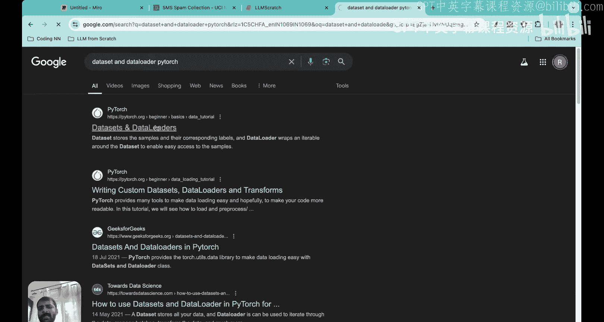
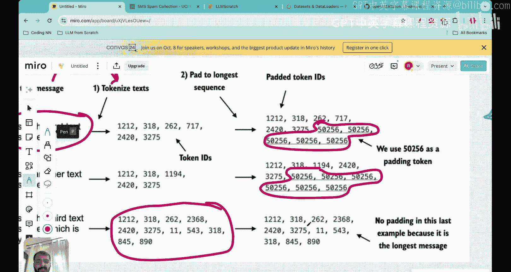
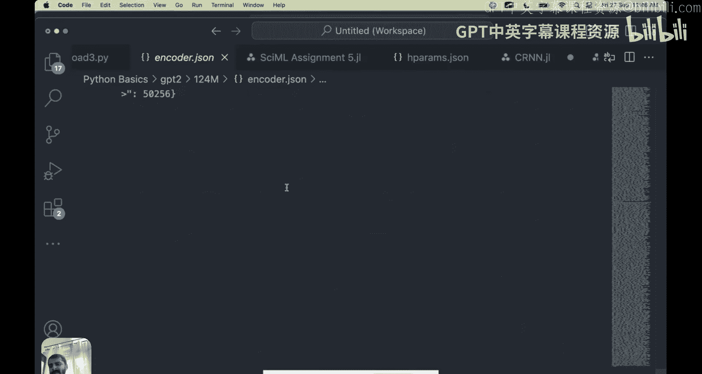
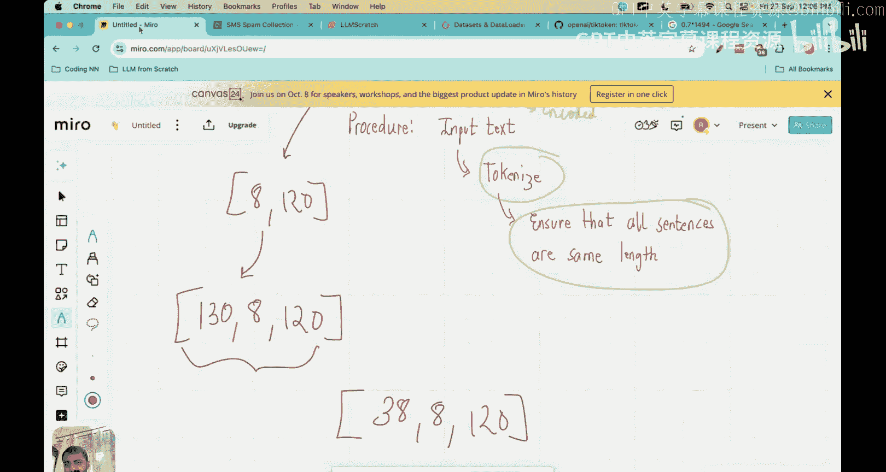

# Vizuara《从零开始搭建大语言模型｜Building LLMs from scratch》中英字幕（Claude-3.7-s） - P32：-34-Dataloaders in LLM Classification Finetuning _ Python Coding _ Hands on LLM - GPT中英字幕课程资源 - BV1qG8HzUE2D

🎼Yeah。Hello everyone， welcome to this lecture in theBuild Lage languageage models from Sctch series。

In the last lecture， we started learning about fine tuning， about large language models， fine tuning。

And we saw that fine tuning essentially is adapting a pretrain model。

To a specific task by training the model on additional data。

And then we saw that there are essentially two types of fine tuning。

 the first type is instruction fine tuning and the second type is classification fine tuning。

We went a step further in the previous lecture and we started working on a hands on project。

Which was based on classification fine en tuing。The problem which we considered was that of email classification and the whole goal in this problem was for us to use a large language model for a specific task and that task was to look at emails。

And to classify them into either of the two categories， either spam or not a spam。

Right so in the last lecture what we did was we looked at the first two steps which I've mentioned in stage1 over a year。

 we downloaded the email dataset and we preprocessed the dataset。

 so let me quickly revise what all we implemented in the previous lecture so here's the email dataset which we collected from the UC Irvine machine learning repository it had a data of around 747 spam emails and more than 3000 not spam emails。

Not spam is also called ham over here， so it's basically a classification between ham and spam。

What we did then in the code was that we downloaded this data set so here you can see that we had a function for downloading and unziing the data set and we took a look at the form of the data set so we saw that every。

Every point or every entry in the data was essentially a text and then there was a label ham which means no spam and spam right and then we saw that there were 482。

5。Entries for no spam and there were only 747 entries for a spam。

What we did next was that we balance the data set we randomly sampled 747 entries from nose spam so that the entries of both spam as well as nose spam is equal to 747。

Then what we did was instead of having spam and ham as labels， we encoded them。

 so ham was encoded to 0 and spam is encoded to1。Finally。

 we took the entire data set and we split it into training testing and validation。

 we used 70% of the data for training， 10% of the data for validation and the remaining 20% of the data for testing。

And we converted our data frames into CSV files so at this stage where we are in right now we have the CSV files for the training data。

 the validation data and the testing data。Eventually。

 what we need to do is that we need to use a large language model architecture。

 something like what I've defined over here。What will feed into this architecture is the。Input text。

And what we will aim to get out of this is whether it's a spam。So， whether it's a spam or。

It's not a spam。However， to reach this model stage there is still one more step which needs to be done and that is the main purpose of today's lecture in today's lecture we are going to learn about creating data loaders。

So， if you remember。We have learned about data loaders earlier when we looked at LLM preprocesing and we saw that input target pairs in a large language model needed to be fed through data loader。

 It just better to manage the data。 and at that time we had utilized the data set and。

Data set and data loader in Pyettorch so if you type data set and data loaders in Pytorarch you will see that Pyettorarch provides to。

ut。 data loader to。ut。 datata。 data set that allows us to use our own data set。

To essentially we can get easy access to samples， we can easily run batches on our data。

We can even do parallel processing， so it is highly recommended to use data sets and data loaders I will explain to you what these mean exactly。

And that is the main purpose of today's lecture essentially you can think of today's lecture as okay we have got the data set。

 how do we bucket them into input target pairs so that we manage the data quite effectively， right？

Okay， so let's see ultimately we at the end of the lecture。

 we want to get to a stage like this where。Let's say an email is given。

we want to convert this email into tokens and we want every single image to be converted into the same number of tokens so that one so this is one full batch。

 you can see that this batch consists of eight emails。And all the emails have a length of 120 tokens。

This will be my input。And corresponding to each input email， there is either0 or 1。

 so heres my input tensor over here， and this is my target tensor over here。

The reason I am creating data loaders and the reason we are using these data and data loaders is ultimately we want to take our data and convert it into input target batches like this。

 so this is just one batch we have multiple batches since we have 747 samples so this is a batch of only eight samples。

So， this is where we want to reach at the end of the lecture。

 but at the start of the lecture we are at this point where we have text。

And here I have provided a snippet of what each email looks like and we have labels as 0 or 1。

 this is where we are right now， but here if you see we want every text email to be of the same token length right。

 however if you look at。The email length， the email length is not the same when email might be longer or an email might be shorter。

 how do we make sure that all the email or all the text messages rather are of the same length？

So the first problem is that in our data set， the text messages are of varying length。

But we want to create a batch like this right and when we are dealing with batches every every rower should have the same number of columns。

 so we need to somehow make sure that every text message has the same length。

And there are two options to do this First， what we do is that you check all the emails and then you find that email which has the shortest length。

 so let's say。Let's say there are five emails right now。And whose length I've given to be。

Representative by these sizes there are five emails the first option is that you just look at the shortest length which is this and you trunet all other emails to this。

And you get rid of the remaining part in all these other images。

So then the size of all the emails will be the same or the text messages and then we can group them in a batchge。

Can you think of what the disadvantage would be of this particular approach？

The disadvantage would be that well use all of this information， which is present。

Otherwise in the longer text， so if the data set consists of emails which are much longer than this shorter shortest email then we will lose all of that data so this is not a recommended approach。

So what can we do as an alternative approach Well， the alternative approach is as follows what if。

We use the longest。 So what if we use the first， let me rub this so that。

All of us are on the same page。 Okay， so Ive read this now。 So what if we use the longest。Email。

 let's say this is the longest email。 and then for all the other emails。

 we paired them with certain tokens。We pair them， which means we add additional tokens till they reach。

The longest email meal。So this is what we are actually going to do because this will make sure that we don't lose out on any information。

So your question would be what are we going to pair them with。

 we are going to pair them with a token which is called as the end of text token。

I'll talk about this in a moment， but first let me illustrate what does it mean by we are going to pair all the messages。

To match the length of the longest message。 So the way this looks like is that let's say we have a first text message we tokenize it first right and the way to tokenize。

Any given sentence is basically we are going to use the byte pair encoder so if you have followed the previous lectures there is this library called P token and P token is a tokenizer library which Open AI uses what this P token does is that you give it any sentence it converts it into a bunch of token ID。

Now it's a byte pair encoder， which means every world is not equal to one token。

 let's say if you have given the word hello world。This will not just be two tokens simply or three tokens because of the space bar byte pair encoder is a subward tokenizer。

 so it's a bit more complex than that and。Based on this tokenizer。

 every sentence will be converted into a bunch of tokens。

 So the first step is that we are going to take input messages and we are going to tokenize them using the byte pair encoder。

Tokenizer， which is the one which also G models use So every text is going to be converted into token ids like this。

 Now， of course some text would be longer Some would be shorter so the number of token ids won't match What we are then going to do is that let's say I have only three。

Text messages in the data set this looks to be the longest rate。

 So what I'll do is that for the other ones I am going to pad this with a token called token name50256。

Until。The length of all the tokenides is the same。Now what is this 50256 let me show you what this 50256 is So yours what Im showing you on the screen right now is the vocabulary which is used by GP2 What is meant by vocabulary is that there are tokens and every token has an associated token ID right so now if you scroll down to the end of this you will see that the vocabulary size which GP2 uses is essentially。

50，2，57 so it starts with 0 the token ID and if you look at the last entry in this vocabulary is this end of text and the token ID corresponding to this end of text is phi0256 this signifies that we have reached the end of a document and or end of a sentence and then we are starting the next sentence so typically this end of text token is used by while training GPpT to distinguish between separate document sources。

And what this vocabulary means is that essentially if you're given any text， right， it's first。

The text is essentially converted into a bunch of tokens and then those tokens are assigned token IDs based on this vocabulary or based on this dictionary。

So it's kind of the you can think of it like a dictionary Oxford dictionary。

 right you have words and you have their meanings similarly here you have words and there is a token idea associated with each word。

So remember this 50256 that is essentially the end of text what we are going to do here is that all the text messages which have a lesser number of token IDs we are going to append them with this end of text as the padding token 50256。

Ideally we can use any token as the padding token， but the thing is the end of text just is makes symbolic sense right because it signifies that there are no additional letters over here so when the model will encounter end of text it will not get confused by any random world。

So that that's why we have used 50256。Okay so overall the workflow which we are going to follow is going to look like this。

 we have the we have the input text which is the CSv files in the code right now。

 we have the train validation and test input text we are going to use a tokenizer and we are going to convert this input text into a bunch of token IDds then what we are going to do is that we are going to look for that sentence or that email in our data which is the longest email and then we are going to make sure that all the text messages have that same length。

By padding them with this end of text token of 50256 now let me take you through code and show you how this is exactly implemented。

Okay， so。Yeah。So as we have seen earlier we first need to implement a Pythtor data set which specifies exactly how the data is loaded and processed before we can instantiate the data loader so there are two things here there is a data set and data loader data set specifies the how the data is supposed to be loaded what are the input and target pairs and data loader essentially then we can instantiate the data loader but first the data set needs to be defined so that is why initially what we are going to do is we are going to define the spam data set class。

What this class is going to do is that first of all it is going to identify the longest sequence in the training data set why do we need the longest sequence because we are going to make sure that all the sequences are of the same length as the longest sequence。

Second， what it does is that it takes every text message and then it converts it into token IDs and finally the most important thing it does is that it ensures that all the other sequences are padded with a padding token to match the length of the longest sequence。

 essentially this spam dataset set class is going to perform all of the three steps which we described over here。

So lets get right into it and start understanding the class when you create an instance of the spam data class you will need to specify something so first you have to specify the CSv file so imagine that we have given the training data CSV file right and second you have to specify what is the tokenizer which you are using we are going to use this Tik token library a byte pair encoder tokenizer to convert the。

To convert essentially the sentence into a bunch of tokens and then those tokens will be converted into token ideass。

Right， then we have to specify the max length。 So this max length is basically。

 if you look at the output batch， which we saw， the max length will be the maximum length of。

The email in the entire data set so we are going to look at that email which is the longest length。

 but here what we have given is that we have even given a provision for the user to externally define the maximum length that is also possible。

Now the pad token ID is 50256 this means that all the emails which have a length shorter than the maximum length。

 we are going to pad them with 50256。So， the first step as we have seen on the whiteboard over here first step is this tokenization right so what we are going to do is that we are going to take the tokenizer and this will be the bike pair encoder tokenizer。

We are going to。Take the TXt， which is the text file。

And then what we are going to do is that we are going to take every single sentence and then we are going to convert that sentence into a bunch of tokenidees。

 so tokenizer dot encode takes sentences converts it into tokens and then using the vocabulary converts those tokens into tokenidees。

So this data is PDd。3 CSV， so lets say we have passed the CSV file first we will store the data of the CSV file into this data object and then what we will do is that we look at every single email or text message in this data and convert it into a bunch of token IDs to get a sense of the visual representation of this take a look here。

So， at this first step， what we are doing is that we are taking every single text message and converting it into a bunch of token IDs。

 right？Now if the user has not specified a maximum length here。

 what we will first do is we will find the maximum length of the text message in the entire dataset and that will be found through this longest encoded length token longest encoded length function and if you scroll down below you will see the longest encoded length what it does is that it just finds the length of all of the text messages and then it returns the maximum length。

Among all the text messages。So now max length variable contains the longest email length， right？

This is if the user does not specify the max length， if the user has specified the max length。

 then the max length will be equal to whatever the user has specified， awesome。Now。

 if there are some sequences in the data which are longer than the maximum length。

 this might happen if the user has specified the max length and there are some sequences which are longer than the maximum length。

 we have to trunet those text messages so that。Their length equals the maximum length if the maximum length is selected from the data itself。

 this problem will not arise。Right， now this is the next part， which is the most important。

 What we do is that。For all the。Ex messages。 We are going to。Apppend the token ids。

 this pad token id which is 50，256 we are going to append it and how many such token ids we are going to append we are going to append how many our token ids which are needed to get that text message to the maximum length。

So that is essentially shown in this step we are going to append the token  IDs。

 append the 50257 token  ID0 to all the text messages so that all of them have the same size and what is that size that size is max length。

Great， and then finally this function is the most important what this function will do is that it will create two such tensors it will create a tensor name encoded and it will create a tensor name label。

The tensor name encoded basically will will make sure that every text message has。

Has this kind of encoding in terms of tokenide is like this， what I've shown on the screen right now。

 so let me just rename this a bit so this matrix which you are seeing on the screen right now。

And let me market this， this matrix here， that is the encoding matrix or the encoded。

Let me check the name here， the name is encoded， so this is the encoded matrix or tensor I should call it and this matrix which or this tensor which I am highlighting right now that is the label。

So what this dataset will do is that the main function it will is the get item function and when you call get item it will convert the data set into two tensors。

 the encoded tensor and the labels tensor， the encoded will make sure that every sentence in the dataset is converted into a bunch of tokenides and all of the sentences of equal length so that they can be batched together and then the label tensor will just have zeros or ones。

Right， so this is essentially what we are doing in the spam dataset class。Okay。

 now I have just written here what the spam dataset class does。

 the spam dataset class loads the data from the CSV files which we have created earlier tokenizes the text using the GPT2 tokenizer from tick token and then allows us to pad or trunet the sequences to uniform length。

Defined by either the longest sequence or predefined maximum length if the user defines their own maximum length。

What we can now do is we can create an instance of the spam dataset class using the trained dot CSsv file which we obtained in the previous lecture。

And here you can see I do not set the maximum length so the maximum length is computed from the dataset itself and when you print the maximum length you can see that it's 120 that makes sense since the longest sequence in our dataset contains no more than 120 tokens。

 it seems like a common length for text messages。So one sentence is around 15 to 20 tokenslexia。

 so six sentences。Then that is the maximum length。So it is worth noting that the model can handle sequences of up to 1024 tokens because the context length of GPT2。

 which we have defined as the model here is 1024， right？

So you can pass max length max up to a maximum value of 102 for over year when you call this function。

Now， what we are going to do is that we are also going to pad the validation and test data sets to match the length of the longest training sequence。

It is important to note that any validation and test samples exceeding the length of the longest traininging examples are crncated。

 so now what we are going to do is that when we create an instance of the spam dataset class for the validation and the test dataset set we pass in the maximum length and that maximum length will be equal to 120。

Wwhich is the maximum length in the training data set。

 so we will encounter this loop where maximum length has been defined so there might be some sequences in the trade testing and validation set which are larger than the maximum length so we will need to trunet those sequences that is what Ive written over here。

However。One thing to note is that you can even set the maximum length equal to none year there is no such requirement that the maximum length which you set here has to be equal to the maximum length in the training dataset set。

You can try out by setting this to as well。Okay， now so here you can see that you can create instances of the validation dataset and the testing dataset as well。

 and then you can print out the maximum length but right now if you print out the maximum length it will just be equal to 120 because we have passed in that so if you print out the maximum length you can see that its 120 because we passed in this parameter as a user defined and this was already 120。

All right， now the data set has been defined right now the data set will serve as an input to the data loader so remember there are two things here first。

We have to implement a data set and the data set will then be served as an input to the data loader。

So now what we are going to do next is that we are going to use the data set as the input and then we will instantiate data loaders。

 right？Okay， so in when we create or when we pass the data set as an input to the data loader。

 remember that we can set the batch size and we can also set the number of workers that is for parallel processing so here what we are doing is that we are setting the batch size equal to 8 and we are setting the number of workers equal to0。

Setting number of workers equal to 0 is just for the sake of simplicity。

 we don't hold any parallel processing here。Drop last equal to true means that if the last batch has a smaller data。

 we just drop it。Great， so now here you can see train loader。

If you create an instance of the data loader and then you pass in the train data set as the input。

 you similarly you can create the validation loader and the test loader as well。

So now this test loader， validation loader and trail loader when you run this part。

 they will be initialized and then you can use these loaders to essentially create。

Entire data sets in this format or I'm showing to you on the screen right now。 So， for example。

 when you run the training data loader and you can extract batches from it now。

 you can extract the first batch and then it will give you the。Incod and the labels。

 you can extract the second batch， you can extract the eighth batch in a very easy manner。So。

 after you run this， what we can now do is that we can run a test to make sure that the data loaders are working and indeed returning batches of the expected size。

So here what I'm doing is that I'm iterating through the training data loader right till the end and then then I'm going to print the input badge dimension and the label badge dimension。

So if you iterate through the training loader till the end and you will see that the input badge dimension has the size of 8 by 120。

 can you think what this means？And the label batch dimensions has perched out size 8。

 Can you try to think what this means you can pause the video here for a moment。

So this input batch dimension means that since the batch size was 8 every input batch has eight rows and 120 columns because the maximum token ID length was 120 so this is exactly what I've shown you over here right on the screen what you are seeing right now。

On the screen， what you are seeing is if you look at。Yeah， if you look at this first tensor。

 this right here， what I'm showing with the arrow right now， that that is the input badge。

And if you look at this input batch you will see that it has eight rows and it has 120 columns。

 so that is why the size here is 8 by 120。Okay， similarly， you can look at the labels。

Label stensor and here you can see that it just has eight rows over here and it can either have zeros or ones。

So that's why the size here is8。And this what I'm showing here is just one batchge。

 Remember that there are 7，47。Examples corresponding to spam and 747 examples corresponding to no spam。

So， if you add these both together you will get that the total number of data which we have is 1494 right out of that the training data is 70% right so we will have batches corresponding to that so 70% of 1494 let us see。

So，07 into。1，4，9，4。That's 1，0，4，5， and I think we have printed this above。呃。Yeah 1045。

 so the training data set overall has 10，4，5 samples。Right， so the training data set overall has。

Training data set overall has 10，4，5。Samples in the training dataset set。 and now。

If each batch has eight such samples， the batch size is 8 right。

 which means each batch will have eight samples， if each batch has eight samples。

 eight samples in each batch how many batches do you think will be in the training data set？

So then the number of batches will be。Number of batches will be 1，0，4，5 divided by 8。

 which is approximately 130 batches。And we can actually test this what I've done at the end of this code is that。

Ive printed the length of the training loader which will give me the number of training batches and here we can see that we have 130 training batches and that exactly fits our intuition which we have written on the whiteboard Similarlyly what you can do is that you can print out the length of the validation loader the length of the test loader as well and you will see that there are 19 validation batches and 38 test batches remember that we have 20% of the data test and 10% of the data as validation that's why the number of test batches are exactly2 times that of the number of validation batches。

And why does the length of the training loader give you the number of batches because if you print out one batch that has8 samples right。

 so actually the training loader this is just one batch so the training loader dimensions will be。

So when the batch of the training loader has the dimension of88 rows and 120 column， right？

And there are 130 such batches， so if you print out the dimension of the entire training loader。

 it will be 130 by 8 by 120， it will be three dimensional tensor。Similarly， for the testing loader。

 the dimensions would be。38。38，8120 and for the validation， the dimensions should be 198120。

 the dimensions of the validation loader。Right， so now until this part this concludes the data preparation steps。

 which means that now we have got these data loaders。

 we have got the training loader validation loader and test loader through these data loaders。

 we can easily extract the batches the input batch and the。Label batch。

 which we need at any time and that just better。 So now we have created input and target pairs。

 remember when we train the LLm the target pair was also a token id representation。

It was just shifted from the input to the right by1。

 so the difference here is that the target per year are0 and onces they are not token ids。Awesome。

 so until now we have looked at。This entire first column is now over in the previous lecture we saw downloading the data and preprocessing the data in today's lecture we saw how to create data loaders for the training data。

 the validation dataset and the testing dataset。In the next lectures we are going to start looking at the stage2。

 which is we are going to initialize the LLM model， we are going to load the pretrained weights。

 we are going to modify the model for fine tuning and then finally in the subsequent lectures we will evaluate the fine tune model。

So we have done the hard of data preprocessing data cleaning and using data sets and data loaders。

 which is usually so important before we directly jump to the model training itself。

So I hope you all are liking these lectures， I usually try to maintain an approach of whiteboard plus codingD since my aim is to train ML engineers who are not just good at using Cha GPT。

 but I want every one of you who are following these lectures who have a very strong fundamental and theoretical understanding。

 because that's what's lacking in today's engineers。

Thanks a lot to everyone and I look forward to seeing you in the next lecture。

。