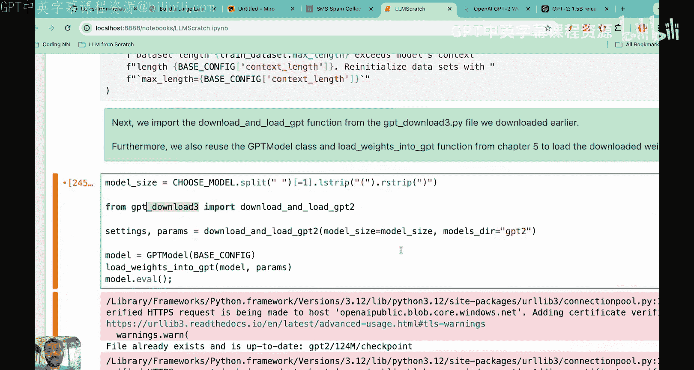
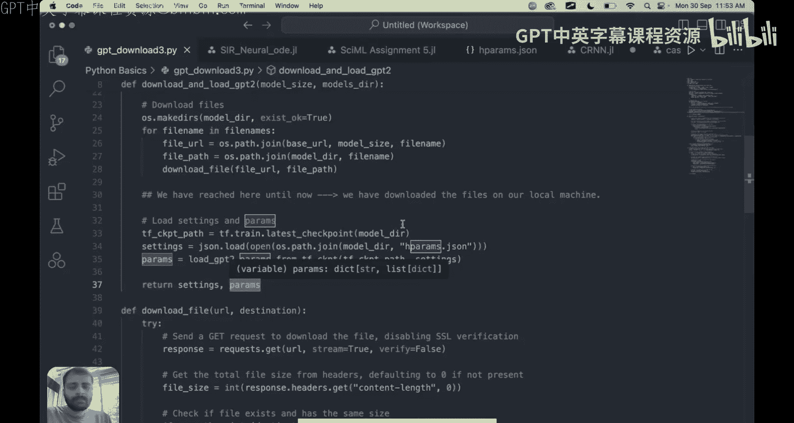
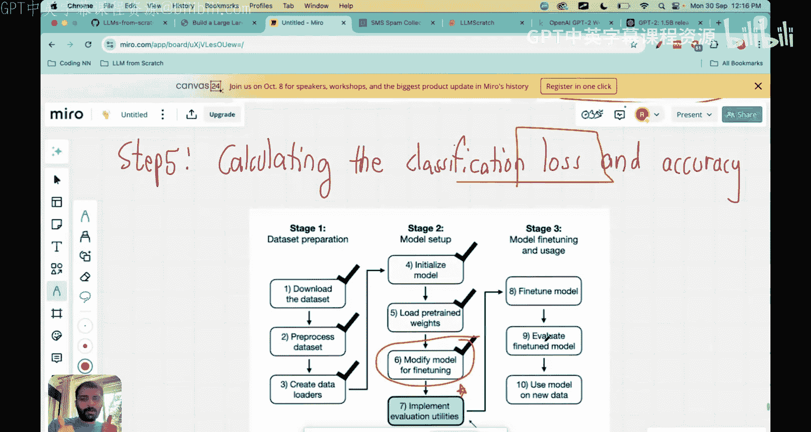

# Vizuara《从零开始搭建大语言模型｜Building LLMs from scratch》中英字幕（Claude-3.7-s） - P33：-35-Coding the model architecture for LLM classification fine-tuning.zh_en - GPT中英字幕课程资源 - BV1qG8HzUE2D

🎼Yeah。Hello everyone， and welcome to this lecture in theBuild Lar languageage models from Sctch series。

Today， we are going to continue with the classification fine tuning example。

 which we have been seeing for the past two lectures。

The main goal of today's lecture is to perform model initialization with three trained weights。

 and then we will also do some changes in the GPT or the LLL architecture so that it can perform classification tasks。

Let me give you a quick recap of what all we have been doing in this hands on LLM classification project。

Basically， we started out with this problem where we have been given。Certain text as data。

 and we want to use a large language model to classify whether it's a spam or whether it's a not a spam。

And this comes under the category of fine tuning。We already have built a pre traineded LLM model in this lecture series。

However， we have not fine tuned it further。Fine tuning is extremely essential for adapting a pretrain model to a specific task。

 so there are two types instruction fine tuning and classification fine tuning we are started with instruction fine tuning and are looking at this hands on email classification example。

So here are the steps which we are going to follow when we make this classification up till now we have covered these three steps which have been marked in blue。

 so we downloaded the data， we preproces the data and we created data loaders let me quickly show you these three steps and what all we have implemented so far。

So this is the data set which you can see in the UC Irvine machinech learning repository。

 it is called SMS spam collection and when you download this data set you will see that it looks something like this so you have labels as hem which is not a spam and spam。

And the data set when you download it you will see that the no spam there are 4825 and spam there are only 747。

 so the first step we did was to balance this data set so that both the spam as well as no spam have 747 data counts。

So that is data pre processing then what we did is we created data loaders so that we can feed in the input and get。

Feding the input in batches so the main name of data loaders was also to convert the data set into a set of input and target pairs so let me show you how these input and target pairs actually look like。

In the last lecture， we converted the data set into these two tensors， so this first tensor here。

Is the input ssor and this second tensor here is the target stensor you will see that here every batch has eight input samples so this I am showing one batch over here and it has eight text samples so each row here corresponds to one such sample and every column here corresponds to the number of tokens so we have broken down these sentences into tokens and use the byte pair encoder to convert these into token ids we have made sure that all of these sentences are converted into equal number of token ids。

And wherever the sentences are short， we have padded them with the。Token 50，25，6 token ID。

 which corresponds to the end of text So here you can see this is the input ssor。

 it has eight rows and it has 120 tokens。We get this number 120 based on the longest text message in the data。

And then if you look at the output tensor it just zeros or ones。

 so0 memes0 stands for no spam and1 stands for spam so whenever you have you have the data set right now。

And when we want to train on the data set， the optimizer。

 which will define later will process each batch So in each batch it will process this8。Text samples。

 and it also has these outputs to work with So using data loaders has made our job very easy in terms of data management。

So you see， we have covered these three steps so far， downloading the data。

 preprocessing the data set by making sure that the nose spam and spam categories are balanced and then finally we also created the。

Training data loader， the testing data loader and validation data loader。

We have used 70% of the data for training， 10% of the data for validation and 20% of the data for testing and you will also see that in the code over here so you can see here 0。

7 is the training data 01 is the validation data and 0。2 is the fraction of the testing data。Right。

 and we have this spam data set class， which is then fed as an input to our data loaders。

So this is the training data loader validation data loader and the testing data loader the output of this data loaders are in the batched format which I showed you in this visual representation if you want a more detailed description of how we did the data downloading and how we perform the data preprocessing I would highly encourage you to go through the previous two lectures。

Now we have come to stage 2 where our goal will be to first initialize the large language model which we are going to use then we are going to load three trained weights from GPT2 and then we will modify the model architecture a bit for fine tuning。

And then finally we will implement evaluation utilities in today's lecture we will do step number four step number five and step number six。

So it will be a comprehensive lecture。And let's get started。

Now we have these data loaders training testing and validation。

 so now we come to the GPT architecture， so here you see in this lecture series so far we have constructed this architecture which is which I've zoomed in on the screen right now。

Don't focus on these two images on the right just look at this gray colored architecture。

 this is the LLM architecture which we have focused up till now。

What we are going to do first is that we are going to first load the pre trained GPT to weights into this architecture。

And if you have not seen the previous lectures， let me just give you that recap Open Air has basically made the GP2 GPT2 weights free。

 freely available to the public， and they have made weights available for multiple parameters。

 107 million，124 million，774 million etc。Open I even had a public announcement for GP2 and that they release these weights What we are going to do is that instead of pre training ourselves。

 which would involve a huge amount of cost and computational resources。

 we are just going to load the pretrain g to weights into this GP model and we have done this before when we。

Then we trained our large language model。So let's get into code right now to see how this part is done and then we will move to step number two。

Okay， so I'm going to take you to code right now most of this lecture。

 which we are going to do today will involve。Going through the code。

 so I'll explain each part of the code to you step by step。Okay。

 so now our first task is to prepare the model which we will use for classification fine tuning to identify spam messages and what we are going to do is that we are going to use the same architecture which we have used and then load the pretrained weights。

Later well do a slight modification at this final layer。

 but for now let's just see how to load the pretrained weights so you can see that G when you download the weights from GP2 you have model small model medium large and the extra large we are going to choose the GP small with GP too small which is 124 million parameters right so we have a base configuration which means that the vocabulary size is 50257 the context length is 1024 the dropout rate is 0 and the query key value bias term is set to true these are the same values which were used when GP2 was trained and since we are recycling those weights we are using the same weights the pretrained G2 weights we are retaining this configuration。

We are going to upload this base configuration with the model which we are going to choose and here you see we are choosing from this model confi dictionary we are choosing this choose model equal to GPT small so we have updated this base configuration with our model configuration is GPT too small in this last code what we are doing is that if our training data set has some text messages whose maximum length is greater than the context length which is 1024。

What we are going to do is that we are going to set the maximum length equal to the context length。

 In short， we are going to remove all of the。Tokens which have higher length than the context length。

This is because our LLM can only process tokens with a maximum length equal to the context length and that is equal to 1024 in this particular case。

Awesome， now that we have the configuration ready。 what we are going to do is that we are going to。😊。

We are going to download the GPT2 parameters and there is a specific way to download the GPT2 parameters and for that I going Im going to take you through the code file right now。

So let me take you through VS code。

Yeah， so as I mentioned， there is a specific way to download the GPT parameters。

And we have written this code called download and load G2 What this code does is that it basically downloads the weights and the entire model details which have been prescribed by open air when they made the GP2 weights public so we are going to download all these files and then we are going to convert。

Or we are going to return two things， we are going to return settings and we are going to return parameterss。

What settings is basically is just these configurations， the vocabulary size。

 the context length the embedding dimension number of attention heads and number of transformer layers。

What this Paras is basically is that the Paras is a dictionary and this dictionary has been constructed in a very specific format。

 so here is how the Paras dictionary looks like。When the Paras dictionary is returned we get five we get a dictionary with five keys。

 we get token embeddings， we get positional embeddings。

 we get all the parameters which are present in this transformer block which are marking in blue right now then we get the final normalization layer scale and shift parameters there is a separate lecture where we actually explain all of these parameters and how these keys are imported from GPT2 but for now all you need to know is that when you run this function。

When you run this function， load。Download and load GT2。

 it will give you the settings dictionary which is a list of the GPT2 configuration and it will give you the Paras dictionary which consists of all the parameters organized in a specific format you get the token embeddings positional embeddings the transformer layer parameters and the output final normalization layer parameters as well essentially the Paras dictionary contains all the parameters you will need。

Now let's go back to code again。Right so what we are going to do is that from this file called GT download 3 we are going to import download and load GPT2 that is the function which I just showed you right now and when you run this function you have to pass in two arguments the first is the model size and the model size we are going to get from this choose model and that is going to be 124 million that is the model size and then you have to pass in the directory where you want to store the parameters so the directory I'm passing it as GP2。

When you run this code， you will get two dictionary settings and the parameterss settings will contain the configuration file Paras will essentially contain all the different。

Prameterters of G 2， then what we do is that we initialize the instance of the GP model class which we have defined earlier。

And then we call this function load weights into GPT What this function does is that it takes the Paras dictionary and then it loads all the weights from Paras into our model so let me show you what this load dictionary does it takes this model。

It takes this model which we have created and at all the different places of this model where there are crable parameters such as multi head attention clear normalization feed forward neural network。

 token embedding positional embedding whatever I have marked with an arrow right now has crable parameters right so this load。

This load weights into GPT function what this does is that it takes the GPT2 parameters and it loads all of those parameters into this model basically you can think of our model being fully equipped with the best parameters which have directly directly been loaded from GPT2。

In one of the previous lectures which is called pre training we have explained this entire code what is this function load weights into GPT the GPT model class etcter for now just you can just follow along by understanding that we are loading the。

Parameterters of GP2 into our model so that our model is already pretrained。

And if you have already loaded this before this should run very fast because the file already exists。

 If you are running this for the first time， please keep in mind that the total parameter file size which is provided by GP2 if you see the seven files if you add it a bit comes to be around 500 mebytes so it may take time depending on the internet speed once this is downloaded you will see that your model is now updated with all the weights from GP2 you can even test whether the model is loaded correctly so you can pass in the input text every effort moves you and then you have the output function generate text simple which we have defined earlier what this function does is that it takes in the input text it passes the input text through our model and then it generates an output so it generate 15 new tokens。

So here you can see that every effort moves you is the input and then the 15 new tokens are for dot the first step is to understand the importance of your work or summary right which means that the pretrain parameters are working because this is reasonable this text makes sense it is proper English。

Now， until now we are at a point where the GPT model parameters are loaded into our architecture。

Now we come to the next stage where we have to start fine tuning the model right。

 but before we start fine tuning the model as a spam classifier lets see if our model can already classify spam messages by prompting it with instructions so note that until now the model just predicts next tokens we have not yet trained it to predict whether spam or no spam。

But lets see if our model has inherently learned these capabilities so what I am going to do is that instead of providing text such as every effort moves you in the text prompt itself I am going to say is the following text spam answer with a yes or no and then I am going to give the text you are a winner you are specifically selected you have been specifically selected to receive 1000 cash or $2000 reward note that we have not given the model any data set about our spam or no spam so far we are just checking whether based on the GPT2 training itself can it answer this。

So when you pass it through the generate text simple function， let's see the answer。So。

 this is the question and the answer which GPT2 generates is that the following text spam answer with yes or no。

 you are a winner。So it clearly fails， the model struggles with following instructions。

And this is because the model has only undergonene pre training right it lacks any fine tuning so without any classification fine tuning as we saw the model is not being able to perform correctly and that is expected。

So now let us go to step number。Let us go to step number two。

 so step number one was loading3ta and GP to weights into the model and that we are finished right now and now we are moving to step number two step number two is modifying the architecture by adding a classification head so let me explain this to you in detail actually。

So you might be thinking that our model has been trained to predict the next token right。

 how are we doing classification？So here is the part where this magic happens。

 so if you remember the output layer， so let's look at this linear output layer。

In the text classification or in the text generation task for which this LLM is typically trained on this output layer looks like this where you have input which is 768 of the embedding dimension size and the output is equal to 50257 because that is the vocabulary size so when you have every。

Effort。Moose。U， if this is the input， the output for every for every row。

 the output will have 50 to5，7 columns。Because that is equal to vocabulary size so there will be 50257 entries for every50257 entries for effort 50257 entries for moves and 50257 entries for you so if you want to predict the next token after every effort moves you you look at the final row and then you choose that token ID with the maximum probability that gives you the next token this is how you predict the next tokens but now we don't need the next token prediction rate now our job is to simply classify whether its a yes or no。

So， what we are going to now do is that we are going to do the same thing。

 but the output dimension will change every effort moves you。

This is my input right now for every token we want two outputs。Either it's a yes or it's a no。

 so two outputs for every， two outputs for effort， two outputs for moves and two outputs for you。

So to get the final answer we are going to look at the final row which is U since it contains all of the previous information and then we are going to see the yes value and then we are going to see the no value these values will be indicative of probabilities so then we are going to based on which is higher we will classify whether its spam or no spam so instead of having this final neural network output layer sizes 5hi0257 we are going to replace replace the original linear output layer with a layer that maps from 768 hidden units into only two units and what are these two units corresponding to the two units are corresponding to simply spam versus no spam。

This is the only change which we are going to do in the LLM architecture。

When I saw this for the first time I was pretty amazed by it because I had never seen a classification head。

 so this can be thought of as the classification head right now。😊。

So let me just write the name this can be thought of as a classification head。

I was pretty amazed by this because I had only done classification using neural networks and decision trees before I never thought you can add this classification head on top of a GPT architecture and use that itself as the classifier。

It might be overkill it because even a decision tree or a neural network might work。

 but this is just a fun application to consider that LLMs can actually be used to perform classification tasks。

Whether LLMs perform better than neural networks or decision trees。

 that's a question of open research and that needs to be figured out still。Okay。

 so this is the classification head now which is added on top of the GPT model architecture and that is used to classify whether the answer is yes or no。

Okay， one more thing which I would like to mention before we dive into the code is that we can actually select which layers we want to find tune So of course。

 when you add this classification head， this was not present in the original GPP to architecture So these parameters we will need to find tune but we have an option to choose among all of these parameters GP2 has already given me many parameters so how much do I need to find tune。

So， that is a call which you need to make right so one thing which I have mentioned here is that since we already start with a pretrain model as we have loaded the GPT to weights it is really not necessary for us to fine tune all the layers。

This is because the lower layers such as the token embedding layer， the positional embedding layer。

 the layer normalization layer etc these lower layers really capture the basic language structures and semantics which are applicable across a wide range of tasks and dataset set this is very important the lower layers if you see the lower layers have token embedding which captures capture the semantic meaning it has the positional embedding and then we have some amount of multihaard attention etc where token embeddings are converted into context vectors or input embeddings are converted into context vectors which contain information about how much attention when token pays to all other tokens and GPT2 has been trained on huge amounts of text。

So it already contains some information about meaning etc So if you give an email let's say there is already some intuition baked in about whether this email is kind of a spam or what kind of information is it representing that information is already captured in this lower layer somehow because GPP2 is a very smart and intelligent model it does capture this information so we are a choice as to which layers we want to fine tune so the choice which we are making here is that we are only going to fine tune in the last layers so we are definitely going to fine tune this classification head we will definitely fine tune the final linear normalization layer which is the scale and the shift parameters and we are going to fine tune the final transformer block。

So remember the GPT2 architecture had 12 transformer blocks like this， right？

Instead of fine tuning all of the 12 transformer blocks we are only going to fine tune the final transformer block。

 we are going to assume that all the other transformer blocks inherently contain some information about what the text in the data represents。

So， this is a good mix between achieving good accuracy as well as reducing the computational cost remember if you are to fine tune and everything again then what is the purpose of loading pretrained weights right the reason we loaded pretrained weights from GPT2 is because it could hopefully capture some semantic meaning as to what the text represents。

So what we are going to do is that we are only going to fine tune three things。

 we are going to fine tune on the final output head which is this classification head over a year because of course that was not present in GPT2 then we are going to fine tune the final transformer block the 12th transformer block and we are going to fine tune the final layer normalization module that is what we are going to do these three things we are going to fine tune rest all the other parameters we are going to freeze which means we are not going to train the remaining parameters。

Okay。And one more thing which I wanted to explain before we go to the code is that lets see you're right so every token will produce output to tokens right so let's say every effort moves you is my sentence So what is the output whether its spam or not spam which of these four tokens should I look at should I look at the first token the second token third token or four token because all of them will have this yes no values which token should I look at。

So here there is a nice schematic to mention that why should we always extract the last output token。

 we should always extract the last output token because。

The last token is the only one which with an attention score to all the other tokens if you look at the second token let's say it will only contain the attention with respect to first token if you look at the third token it will only contain attention with respect to previous two tokens whereas the last token has all the information it contains attention with respect to all the previous tokens so if you want to predict whether it's a spam or not a spam you want to predict from that row which contains maximum amount of information present in the sentence so that is equal to the last token right here so we are going to extract the last token output row and we are going to use that to predict whether the email is spam or whether the email is not a spam。

So， this is exactly all of this is what I am going to show you in the code right now so lets go to code the first thing which we are going to do is add a classification head at the top which is what I showed you over here in the figure we are going to replace this original output head with the classification head。

So in this section we modify the pretrain large language model to prepare it for classification fine tuning to do this we replace the original output layer which maps the hidden representation to a vocabulary size of 50257 with a smaller output layer that maps only two classes0 and1。

 so look at this we want this kind of an output layer which only has two outputs either 0 or 1 so two neurons at the end。

So one thing which I would like to mention is mention is that we could technically use a single output node since we are dealing with a binary classification task right however this is not a generic approach if we use a single outputer that is not generic if we have more number of classes so here what we what we are doing is that we are doing a more general approach。

What we are going to say when we code the model architecture is that we are going to say that the final number of output nodes should be equal to the number of classes。

 so we are not hard coding the output nodes but we are getting the number of classes and we are setting the final number of output nodes equal to that so for example if we have three classes such as technology scores or medicine our same code is going to work for this modification because then the final number of output nodes will be equal to three that just a small detail which I wanted to mention。

So before we construct the model architecture， we can print the original model architecture。

 so we print out the original model architecture and you can see that there are 12 transformer blocks。

Here you see so the number of transformer block goes from 0 to 11。

 that' is why there are 12 transformer blocks and there is an output projection layer at the end。

Awesome， so this is the output header so here you see this has input dimension of 768 and output feature dimension of 50257 this is the one which we plan to change to2 instead of50257 we just want two as the output features。

So as discussed earlier， the GPT model consists of embedding layers to embedding and positional embedding followed by 12 identical transformer block。

Followed by a final layer normalization and the output layer output head。So。

 what we are going to do is that we are going to replace the output head with a new output layer as we have illustrated in this figure over here。

 we want to replace this original output head with this new output head， right。

To do that to get the model ready for a classification fine tuning we first freeze the model。

 which means that we are going to first make all the layers non trainable。

 so the way to freeze the entire model is that we just do for all the parameters in model dot parameters we say that requires gra is equal to true equal to false which means that we are not going to update this parameter at all which means that we are going to freeze all the model parameters。

Then， we are going to。We are going to tell this model which are the parameters which we are going to find tune so as I mentioned there are three sets of parameters which we are going to find tune there is the final output head there is the final transformer block and there is a final layer neuro module so first lets modify the final output head architecture so we are going to say that model do output head。

Is now the size is input features are the embedding dimension。

 though input feature remains the same that's equal to 768 the output features now is equal to the number of classes。

 So if a number of classes equal to 2 the output features will be two which is in this case spam versus no spam If a number of classes is three the output features will be equal to3 so that's when simple change which you make this indicates to pyr that these parameters need to be updated these parameters need to change。

Okay。So this new model model do output head output layer has its requires grad attribute set to2 by default。

 which means that it is the only layer in the model that will be updated during training so here we have freezed all the parameters but when we change the model output head structure the new model output head output layer has requires grad attribute set to2 by default which means we are going to update those parameters。

So additionally as I mentioned， we are going to update two more sets of parameters。

 we are going to look at the last transformer block。

 the 12th transformer block and we are going to modify its parameters as well and we are going to look at the final layer normalization。

W which connects the output of the transformer block to the final output head these we are going to make as trainable so I mentioned this to you over here right the final transformer block and the final layer normalization those we are going to make trainable so here you see what I'm doing。

Im saying that you look at the transformer blocks and this minus1 indicates that you look at the last transformer block。

 you look at the parameters in the last transformer block and then you set all of those parameters to be equal to trainable by setting require gra equal to true and then you look at the model final normalization parameters which will be shift and scale and those you change to parameters dot required grad equal to true now you see there is a lot of scope for experimentation here you can even switch this off and try to see the results you can make the parameters of last two transformer blocks to be trainable you can switch this off you can see the results you can maybe make this as false and check the reasons so whatever code which I'm showing to you right now there is a lot of room for exploration over here。

Awesome， so now you can see that we have added a new output layer and mark certain layers as trainable or non trainable。

Great， so let us just take one sample input So the sample input corresponds through do you have time so this has four token idds and what we are going to do is that we are going to pass the inputs through our model now and let's see the output So as expected do has two tokens U has two tokens have has two tokens and time has two tokens corresponding to spam or no spam and as I mentioned we are going to look at the last we are going to look at the last row and we will extract only the last row to predict whether spam or no spam and the reason we saw was that the last row the last token is the only one with an attention score to all other tokens so it contains maximum information。

Until now we have not done the training， the models， the parameters in this output head。嗯。

The parameters in this output head and the parameters in the final transformer block final layer normalization are still random。

 They have not been trained on our。Spam and no spam data set， but。

That's fine Currently I just want to show you the output。

And the output will be random for now but I just want to show you the dimensions So when the input is do you have time you will see that for four tokens for each of the token there are two outputs here and we are going to look at the two outputs of the last token and we are going to see whether for spam the value is higher or no spam its higher and then we are going to choose the one with the higher value and make our prediction like that。

Okay。So remember that we are interested in fine tuning this model so that it returns a class label that indicates whether the model input is spam or not a spam to achieve this we don't need to fine tune all the four output rows as I mentioned we don't need to fine tune all these four output rows but we can focus on a single output token we will focus on the last tro corresponding to the last output token since it contains all the information so to extract the last output token we are simply going to use this command outputs colon minus1 and colon which will extract the last output row from this tensor。

So the reason why minus1 is comes in the middle here is that look at the tensor dimension。

 the number of rows is。In the second second position right。

 so thats why the second position we have to specify 1 since we are looking at the last two。

And when you specify this， you will see that out of these four， the last output is extracted。

 which is minus 3。58983 and 3。9902。So until now what we have done is that we have just modified the model architecture right we have not trained we have not trained the model on our data set。

And to train the model on our data set what we need to do is that we need to define the loss。

 we need to define the loss function and then we need to implement back propagation that is when the model will be trained。

So what we will be doing in the next section is that we'll be detailing the process of transforming the last token into class label predictions and then well calculate the model accuracy and then well calculate the loss function once we have the loss function based on our underlying training data which has been collected from this machine learning UCRine repository once we have the loss function then we are ready to do back propag and then we are ready to find tune the parameters so then we will do the training and testing after that in the subsequent lectures。

So next lecture will focus on calculating the classification loss and accuracy。

Thank you so much everyone this brings us to the end of the lecture we are now quite close to performing this handson project and taking it to completion because until now what we have done is that we have reached these steps we have reached step number here where we now the model is ready to be fine tuned now in the next step we have to just implement the loss and accuracy evaluation utilities and then we will fine tune the model test the fine tune model on new data as well so there are a lot of fun lectures coming up and at the end of this set of lectures you will have build your own classification fine tuning completely from scratch。

Thank you so much everyone， I hope you learned a lot and I look forward to seeing you in the next lecture。

。