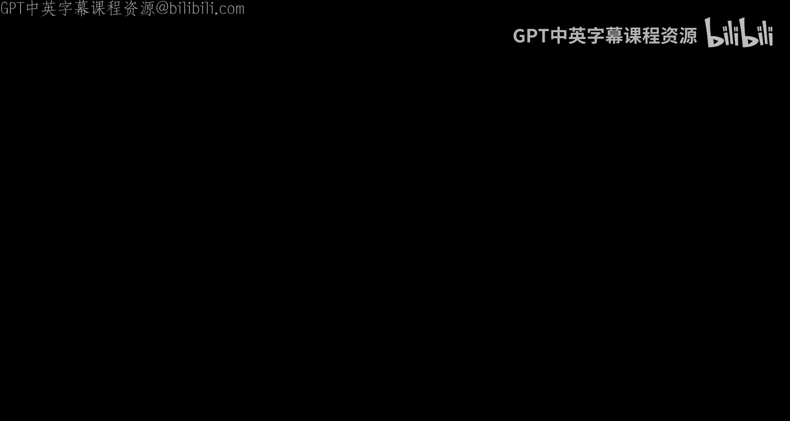
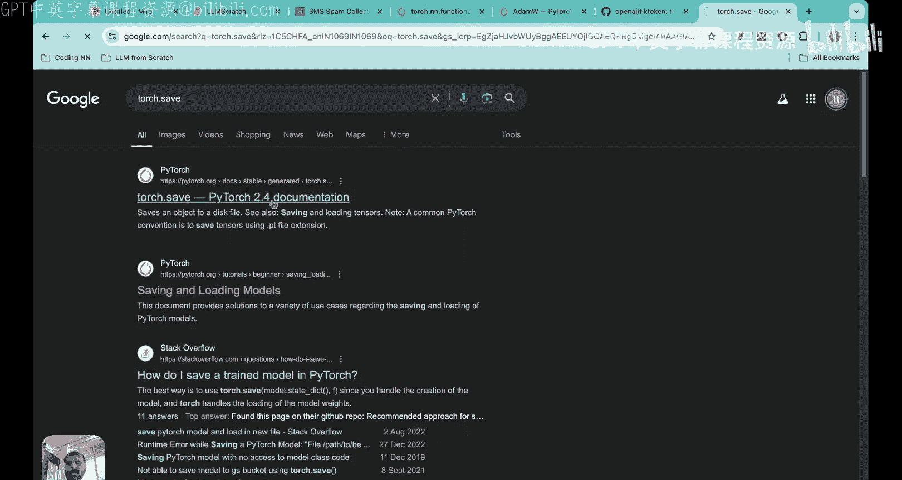
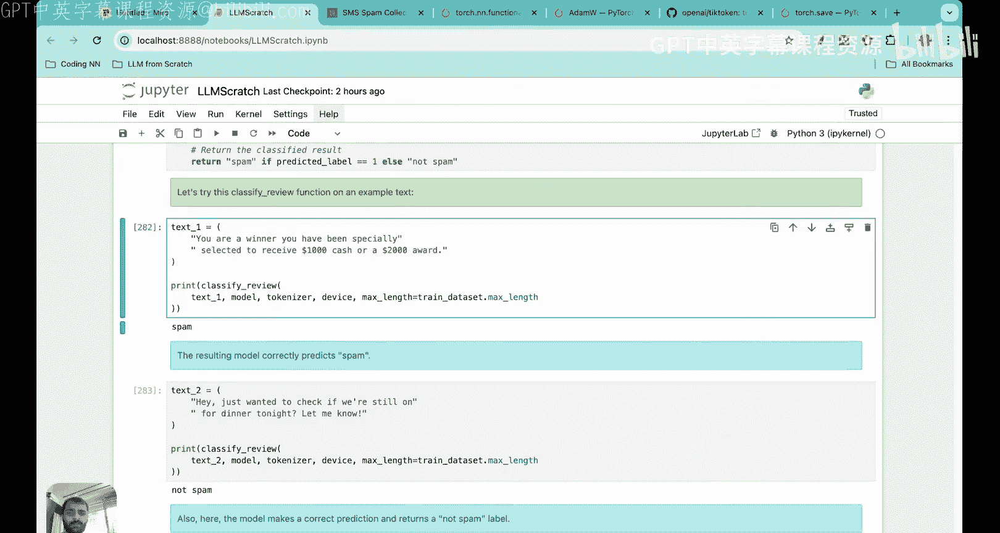

# Vizuara《从零开始搭建大语言模型｜Building LLMs from scratch》中英字幕（Claude-3.7-s） - P34：-36-Coding a fine-tuned LLM spam classification model _ From Scratch.zh_en - GPT中英字幕课程资源 - BV1qG8HzUE2D

🎼Yeah。Hello everyone， and welcome to this lecture in theBuild Lage language models from Sctch Series。

Today， we are going to continue with the fine tuning based classification project。

 which we have been working on for the past three lectures。

Today we are going to look at calculating the classification loss and the accuracy and we will also implement the training loop today。

 the testing loop and essentially complete will complete the entire fine tuning project。

So let's get started with today's lecture。First time want to recap what all we have covered so far in this classification based fine tuning hands on project。

Initially we downloaded the data set， then we pre processed the data set and created data loaders to give you a sense of what the data set actually was let me scroll up a bit in the code to show you the data set and how it looked like so essentially the data set was a spam no spam email classification so you can。

Even check this from the UCL machine learning repository。

 We downloaded the SMS spam collection data set from here， which consists of text messages。

 which are either spam or not spam upon downloading this data we saw that it was imbalanced so there were around 40800 no spam messages and only 747 spam messages So then we balanced the data set so that in the no spam category and in the spam category both there there are 747 messages that is the first data preprocessing step we did after that we implemented data loaders When we implemented data loaders the。

Entire data set was batched into the input， and。The target。So。

 basically imagine the data set that is being split into training testing and validation。

 70% for training， 20% for testing and 10% for validation if you look at the 70% training data right now due to the data loaders that data will be split into input and target。

So in the input we have defined batches each containing eight samples。

 so there are around 130 such batches of the training data。And the number of columns is equal to 120。

 which are the number of token 90s corresponding to each text message。

To make sure that all the text messages have similar number or exact same token IDs。

 we have padded the smaller text messages with this token 50256。

 which is the token ID corresponding to the end of text token。So。

 this is the input tensor and here what I am showing is the target tensor。

 this just has zeros and ones， so0 means no spam and1 means spa。So。

 when you implement the data loader for the training data it looks something like this and it has 130 batches when you implement data loader for the validation and the testing data。

The data is batched into similar batches， so we have 130 training batches。

 19 validation batches and 38 test batches。So that's what we implemented in this first three steps。

 which was downloading the。Downloading the data set。

 preprosing the data and creating data loaders in the next steps what we did was we took our model architecture and the model architecture looked something like this initially。

What we did was we looked at the final output layer and initially that output layer looked like this neural network which took in the input equal to the size of the embedding dimension that 768 and the output was  phi0257 which was the vocabulary size since we are doing a classification task what we did is we replace this neural network with this kind of classification head as the output where the number of inputs to the neural network is 768 but the number of outputs is equal to 2 spam or no spam。

By the end of the last lecture， what we saw is that if we pass in any input to this modified architecture。

 so let's say if we pass in an input such as。Let me show you。

 let's say we pass in an input such as do you have time and we pass this input to this modified architecture。

 the output will look something like this do。要。Have。😊，Time and then for each of these token。

 there will be two outputs。Corresponding to spam or no spam。

Then what we saw is that instead of looking at all of these four outputs。

 we only look at the output corresponding to the last token which is time in this case because this last token contains information of all the other tokens through its attention weights。

So we have reached until this stage where we pass in this input。

And we get an output which is a tensor of one by4 by2 since this is one batch so batch size。

 So each batch has only one sample， So it's one，4 because there are four tokens every。

Do is the first token U is the second token。 have is the third token time is the fourth token and two。

 because every token， as I showed you， has two outputs corresponding to。

Has two outputs corresponding to spam or no spam。Then what we saw is that we are going to look at the last output token and the last output token will give us two values。

So， this will be value number one and this will be value number two we have reached up till this stage now in today's lecture what we are going to see is that okay。

 once you get the final two outputs from the last token what will you do with these outputs？So。

 we will first implement two metrics， well get the accuracy， well get the loss function。

 then we will implement a backward pass so that we can train our architecture to minimize the loss function。

 we will modify all the parameters so that the loss is minimized and then we will do the testing on some new data which the model has not seen。

Awesome， so let's get started。The first thing which we need to do， as Ive mentioned in the code also。

Is that we need to first discuss how we can convert the model outputs into class label predictions so lets say if you have the input text messages you won the lottery until now we have seen that we can extract the outputs corresponding to the last row right and let's say the output look like this based on this output how can we say that whether it is a spam or not a spam。

What we can do in practice is that we can apply a softm function on this so that these two outputs are converted into a set of probabilities so then the first value will be 0。

99 the second will be 0。01。Then we look at the index which has the highest probability value so since 099 is the highest is a higher probability than 0。

01 which means index number 0 is more likely to be the answer and index number0 is no spams thats why this text message will be classified as no spam Similarlyly if you have second text messages do you have time。

If the output corresponding to the last row are these two tokens。

 we again apply softm and then we will have a tensor of probability， 0。01 and 099。

Then index number one is higher and so the output which our model will predict will be one and that will be spam so these are the steps we will implement in the code you will see later that there is actually no need to even implement softm since we are only seeing the index of the value which is higher so for example even if you look at these values the index this index is higher so index0 is higher so it will be no spam if you look at these two the index1 will be higher so it will be spam。

So let's go to code right now and discuss how we can convert the model outputs into class label predictions。

Okay， so until now we， let's say have a last token output， which looks something like this minus 3。

5983 and 3。9902。As we discussed first， we will apply the soft Mac so that will convert this into a set of probabilities So let's say we apply softm to these outputs and let me actually print。

Let me actually print the softmax values over here。

 so you will see that when you apply softmax to these two， the output tensor has2 values， 0。

0005 and 0。999。And since 0。9995 is higher， what we then do is that we actually look at the arcm。

 which means we look at the index which has a higher value and that will be index number one so our class label prediction will be number one。

So in this case， the code returns1， meaning that the model predicts that the input text is spanm。

As I mentioned， using the softm is optional because the largest outputs directly correspond to the highest probability scores so we can just take a look at these output and find the R max。

So that is what we are going to do lets say we look at the final token and we look at its outputs we are going to take the R max which will give me the index with the higher value that will be index number one so my class label will just be that label dot item and so we will get it the output as well。

So now this is my classification accuracy， which measures the percentage of correct predictions which are seen across a data set。

So， if let's say the correct answer is class label 1 and if I get a class label 1 it is awesome then my it will be good so we will actually compare our model prediction and the correct label prediction and then that will give me my accuracy。

So， to determine the classification accuracy， we apply the arc max based prediction code to all examples in the data and then what we are going to do is that we are going to actually compare it with the actual value in the dataset。

And then we are going to find the accuracy so to illustrate this what we are going to do is that lets say our batch look something like this which I told you before let me rub this right now。

 So let's say our batch looks something like this So what I'm going to do is that lets say。

If this is my first input right， I will pass in through my model and I will get those two logics。

 then I will apply the Arc max function and then predict whether it's spam or no spam。

 let's say it's predicted spam。So so similar to these output labels， Ill have another labels。

 which are the predicted labels。So， these output labels are also called as the target labels。

 which are my true values and here I have my predicted labels。

And then I just compare these two and that will get the accuracy scores。

So this is exactly what we are going to do in the code right now。

 so here you can see we are going to define this calculate accuracy given a loader so let's say if you are given a training data loader what we are going to first do is that if number of batches is not specified we are just going to use the length of the data loader as the number of batches or the batch size so here you can see。

Each batch consists of eight training examples。 and so the number of。

Btches are equal to 130 like this for the training data sample so the number of batches will be 130 if we have not specified it if we have specified the number of batches here then the number of batches will be minimum of what we have specified here lets say thats 50 and 130 so then it will consider the number of batches to be equal to 50 and only compute the accuracy for those many number of batches。

So， let's say what will happen in this code is that we look at each batch in this data loader。

 so let's say we are looking at the first batch even the first batch you can see has eight samples right so when we are looking at each batch so lets say we are going to look at each batch in the data loader。

And each batch has eight samples， so I am going to pass in all the samples of a batch and I am going to find the logics which are the two output values。

 the logics of the last output token similar to this。But now imagine that one batches eight samples。

 so I'll have eight such tensors。And then what I'll be doing is that I'll actually be finding the arg max。

 which are the values for that entire batch。And then what I'll be doing is that I will compare the predicted labels with the target labels。

 which is my actual answer。And if it's。If it' is a correct prediction， which means if they are equal。

 I'll update the correct predictions I'll increase the number of correct predictions by one number。

And as I'm going through the examples I also whenever I make a prediction Ill increase the number of examples by one。

 so if I am going through the first example here and if I make a prediction。

 so if I am going through the first example here and if I make a prediction here the number of examples。

The number of examples will increase by one。Number of examples increases by1。

So when I make the second prediction， it will again increase by 1。

 so I am just keeping a track of the number of examples and correct predictions。

So towards the end to find the accuracy score I will just take the correct predictions and divide by the number of examples so if the number of examples is 000 and if the correct predictions are 600 my accuracy will be 600 divided by 000。

We are doing a very simple thing here。 We are just calculating the。

Prediction from our model and we are comparing it with the actual values and then we are adding up how many predictions we got correct that is the simplest way to find the accuracy。

right so this is the code c calculate accuracy loader now what we are going to do is that we are going to use this function calculate accuracy loader and I am just going to specify the number of batches equal to 10 for the sake of simplicity our training data loader actually has 130 batches but I am specifying your number of batches equal to 10 so that you can just see whether we are able to calculate the training the validation and the testing accuracy on our entire data set。

Of course， nothing is optimized here。 So our values will not be。Very good。

 but I just ought to show you that this code indeed runs so you have this function calculate accuracy loader and first you pass in the training loader。

So that will have data such as this from the training data set thats 70% of our data。

 then you pass in the validation loader that's 10% of your data and then you pass in the test loader that's 20% of your data in each case we specify the number of batches equal to 10 right。

And then we print out the training accuracy validation accuracy and test accuracy the model has not been optimized we have not yet implemented back propag so these accuracy metrics won't be good but lets just see what they are so when you print out the training accuracy the validation accuracy and the test accuracy you get that the training accuracy is 46% validation accuracy is 45% and test accuracy is 48%。

It's pretty bad it's even worse than a coin toss， I could have just done a coin toss and randomly predict cred valuess and I would have been right 50% of the time。

So， to improve the prediction acuracies we need to fine tune the model right so remember what how do we fine tune or how do we optimize the model parameters the way to optimize the model parameters is that we now we can do two things now we can we have the target which is the true values。

And we have the predicted values， right？Now what we will need to do is that based on the true values and the predicted values we will need to define a loss function。

And once the loss function is defined， then what we will do is that will simply take the partial derivative of the loss function with respect to all my trainval weight。

Will calculate the gradient with respect to the trainable waves and then。Well just update。

 so wait new。Is equal to weight old minus the partial derivative of loss with respect to that weight So well use a variation of this simple gradient descent called Adam or Adam W and so then we will just continue updating these parameters until the loss function is minimize so currently so let's say the loss function looks like this it of course won't be as simple as this but I am taking a simplified example initially we start out with this where the loss is not that low and then we。

Move down this loss function and hopefully we reach this global minima where the loss is minimized。

And once loss is minimized， then we will make sure that the accuracy is also higher automatically。

 so then comes the question of how do you define the loss function and what loss function to use。

If you have studied neural networks and machine learning before， we know that if we have。

If we have targets， which are PI。Or let's say if the targets are Y I。And if my predictions are P。

 then the loss function which is used in this case is the categorical cross entropy loss and is defined by negative of sigma。

 which is adding over all the class labels。And minus Y I into log of P。

Let me illustrate with a simple example here， let us say if we have a text data whose true value is that it is not a spam which means that its1 hot encoding is 1 and 0。

 so lets say this is not a spam but our predicted values our predicted values after our predicted values here are 0。

8 and 0。2。Then the cross entropy loss is negative of we will need to sum all the classes Y I into log of PI Y I is the true value。

Why I is the true value。And P is the predicted value， right？So。

 let us multiply so we will multiply 1 which is the true value multiplied by log of 08。

 so1 will be multiplied by log of 0。8 and 0 will be multiplied by log of 0。

2 and we will take the negative sign of this。So，0 multiplied by log 0。

2 is 0 and then one multiplied by log 00 if you take the negative that' is 0。

232231 why is this a good measure of loss because if our predicted value was 1 and 0？

Whi is exactly equal to true this second will anyway be 0。

 but the first but the first entry will be 1 into log 1。Which will be equal to0。So。

 if the predicted value equals to the true value， then our loss will be 0。

 which is exactly what we want So this negative y log pi is a very good。

Loss function to be to calculate the loss in the case of this categorical predictions in classification tasks。

So to give you just a brief。Viual flavor log negative log of x looks something like this。

 so this is x and this is negative of log of x。And we want x to be as close to1 as possible。

 which is this probability of the correct class， so eventually we will start out from some high loss and our goal is to make the loss as close to 0 as possible。

Another advantage of the cross entropy loss is that it is differentiable。

 so it's very useful for us in the case of back propagation， right？Okay。

 so let's actually define the cross entropy loss now， along with this。Calculation of accuracy loader。

 what we are also going to do is that we are going to define a loss function。

 which is the cross enpis。Why can't we use just classification accuracy and take the inverse of that accuracy maybe to get the loss。

 it is because classification accuracy is not a differentiable function。

 so we will use the cross entropy loss as a proxy to maximize the accuracy this is the same as the cross entropy loss which we use to pre in the large language model。

So okay so what we are going to do now is that let us say we get an input batch and a target batch。

 always when an input and target batch is given your visual mind should take you to this figure where we have an input batch and we have a target batch。

So what what has to be done here is that once you get the input batch you pass in through the model and then you only look at the logicits of the last output token because that contains the most information and then you find the categorical crossinpys between this logicit Spsr。

 which is the output of the last token and the target batch。So。

 the logic tensor output can be something like 08 and 0。

2 and the target output is 10 so when you calculate the cross enpys you will get some value of the loss function。

So Ill just show you here torch。nn。 functionalal cross entropy。

 this is the pi torch functionality which we are using over here to find the cross entropy loss。

Awesome， and this is differentiable， so it will be very useful for us when we do the back propag。

Okay， so we will use this calculate loss batch function to compute the loss for a single batch。

 and we can also use it to calculate the loss for a multiple set of batches So for to calculate the。

Ls for multiple batches we have to use similar code lines as we used over here。

 so if number of batches is not specified then we take the number of batches to be equal to the length of the data loader if number of batches is specified then it is equal to the minimum of the number of batches specified and what is the length of the data loader very similar to the accuracy classification code which we saw。

Then what we are going to do is that we are going to take one input batch， one target batch。

 calculate the loss between all the samples of the input batch and the target batch using this caic loss batch which will implement the categorical cross entropy。

 we are going to add the loss every time we get a loss we are going to add the loss and then that is in the total loss。

Awesome and then what we are ultimately going to do is that we will divide the total loss with the number of batches so that will kind of give us an average loss per batch and this is the loss which we will eventually try to minimize using back propag that is the whole workflow which we are going to follow。

So now what we can do is that we can implement this loss function on our data set again we have not implemented back propag so the loss will be very high but I just want to show you the initial values of the training loss the validation loss and the test loss so here again I'm setting the number of batches equal to5 because actually the train data load has 130 batches I think so that will take a long time to calculate any anyway we have not done the training here so I just want to illustrate that the loss can be found on five batches like this。

So you implement the Cal loss loader function and you pass in train loader then validation loader and the test loader and then you also pass in the number of batches so then you can print out the training loss you can print out the validation loss and you can print out the test loss and you can see these are the values which are pretty high its again if you in the accuracy we saw that the accuracy is very bad and that is reflected in the loss values as well now we will implement a training function to fine tune in the model which means that you will adjust the parameters to minimize the training loss and then you will also print out the validation loss and you will print out the test loss。

So let's start looking at that part of the code right now。

 So until now we have finished a number of steps here， we have finished。

Let's see we have finished downloading the data set， preprocessing the data。Create data loaders。

 initialize model， load pretrain weights， modify model for fine tuning。

 implement evaluation utilities， which is the loss and the accuracy basically。

And now we are at this stage where we will actually find tune on the model。

 which means that we will define the training loop and we will implement back propagation。

So this is the training loop which we are going to define first we will have the epochs。

 which means one epoch is going through the entire data set once right so let's say if you。

If you are running in one particular reportpo， the second loop is that you have to go within each batch。

 so each batch has eight samples， at least that is how we define the training data loader to be。So。

 then we will look at each particular sample and then we will calculate the loss on the current batch and we will implement a backward pass to calculate the loss gradients and then we will update the model weight using the loss gradient so here what we are doing is that w new is equal to w old minus。

Al four times the。Partialial derivative this exactly what we written over we wrote over here also。

And then once the weights are updated we print the training and the validation loss and then we keep on doing the same thing for multiple number of epos so that the parameters are getting updated so the simplest way to think about this is that the most important step is this backward pass once we do the backward pass we get the loss gradient that is why we needed the loss function to be differentiable。

Once we get the loss gradient with respect to the parameters， we can actually update the parameters。

And once we do this enough number of times， the parameters will get updated and hopefully will reach a value of the loss where the loss function is minimized。

This is the exact same training function， which we had implemented to。

Pretrain the LLM and heres what I what I want to show you is that when we find tune the model on supervised data which means data sets such as the spam No spam label I showed you we need to again train the model so there is training process involved in pretrain and there is training process involved in fine tuning thats why it's called pretrain actually because it is before this second training process which needs to be implemented。

So， lets see how the training process is implemented in code right now。

 so this section I have named as fine tuning the model on supervised data。

So until now we have actually not trained the model on the data set at all。

 which means that thats where the parameters are not optimized。

So in this section we' will define and use the training function to fine tune the pretrained LLM and improve its spam classification accuracy。

A note here is that if you followed these lectures you will see that the training function is very close to the train model simple function which we use for pretrain earlier。

 the only distinction is that we are tracking the number of examples here。

 the number of text samples instead of tracking the number of tokens which we are calculated earlier。

So in the code what we are going to do is that there are seven steps the first step is that we have to set the model to training mode。

So here you see we set the model to training mode。 That's the first step。

 The second step is reset the loss gradients from previous batch。

 So when we look at each every batch we have to reset the loss gradients again So let's say we are looking at one batch right now we reset the loss gradients from the previous batch iteration Then the third step is calculating the loss gradients and updating model weight these are the most important step So then what you do is you find the loss in that batch and then you calculate the loss gradients through backward propagation then you do optimizer do step This is where the optimizationr comes into the picture in on the whiteboard I showed you simple vanillaular gradient descent over。

 but in practice we'll use a a more complicated optimization algorithm which keeps track of the previous gradient which keeps track of the previous gradient square etc so that the optimization is done in a。

Innova better a reminder。And so that the model does not get stuck in local minima。

Then the next step is that we are keeping track of the number of examples。

 so we just keep track of the number of examples which we are seeing so input batch dot shape0 is that let's say each batch has eight samples when you look at the first shape。

First value of the batch ship， it will give us the number of samples in the batch。 So， for example。

 if the batch has8。8 samples and the number of tokens is 120。

 so then we will get8 here input badge dot shape0， which will give us the number of samples over here。

So then we keep track of the number of example seens。

 so you can just think of this example scene as when you look at one text message that's one example scene。

 when you look at second text message you increment the number of example seen by one。

Whenever you go through a full batch， you increase the global step by one， right？Awesome。

 now here we have that if global step。Percentage of evaluation frequency equal to 0。

 so we have to specify an evaluation frequency now if the training batch has 130 if the training data loader has 130 batches in training。

And if the evaluation frequency is 50。😊，It means that for after 50 batches are processed。

After 50 batches are processed。For each epo， after 50 v batches are processed in each epo， we print。

And what are we going to print， we are going to print the training loss and we are going to print the validation loss。

So， this evaluation frequency just specifies how after how many batches are completed we print the training and the validation loss so here later we are going to set the evaluation frequency to 50 which means that after 50 batches are processed in each epoC we are going to print so in every epoC we are going to print on an average of two times because 130 divided by 50 is around 2。

6 so we are going to print2 times in every epoC。Okay， awesome。

 so now to print the training loss and the validation loss。

 we are going to calculate the evaluate model。So evaluate model gives you an option to specify the evaluation iteration。

 which means that the number of batches you want to use for evaluation sometimes if you want to show quick evaluation on a sample data set you don't want to use all the batches so here you can just set the number of evaluation iterations to be5 or 10 since the number of batches is 130 this will really save us time when you print out the train loss and the validation loss。

So， this actual evaluation step is optional， but when we do the training you will see that the train loss and validation loss are printed after every 50 batches due to this evaluation step。

Then what we are going to do is that after every epoch we are going to calculate the training accuracy and validation accuracy and we are going to print it out so after every epoch what we are going to do is that we are going to print the training and the validation accuracy and after every 50 batches we are going to print the training loss and the validation loss。

So let us do the training process now for me this training process took around 8。

8 minutes and I have a MacBook Air 2020 it does not have very high end configurations but its a good laptop if you have an I5 or I7 laptop or a MacBook this training should take only 7 to 10 minutes for you。

So here you can see that this is the main code where we write about the training so we are going to use a w optimizer let me show you a bit about this storage dot opt dot a w it is a modification of the a optimizer。

With weightade decayy。So it' is very good to avoid local minima this algorithm convergeence in a smooth manner and it also leads to faster convergence you can try various things here you can try a you can try to change the learning rate to 8 decayK so this is why this kind of code opens the door for research if you just use chatd GPT you will never get to change all of these things which are happening under the hood but once I share this code with you you can try playing around with various parameters and try seeing the effect on the loss function on the accuracy etc。

So， this is the optimizer which we have defined right now and then what we are going to do is that we are going to call this train classifier simple。

So I'm calling this train classifier simple function， and I have to， I have to pass the model。

 So the model， which I'm passing in is the。GPT model class which we have created with the modified architecture。

 so the modified architecture is this where the architecture has a classification head on top of it。

Well let me show you， yeah， this is the modified architecture。

 which has this classification head on top of it。This is the model which we are passing in。

And then we pass the train loader， the validation loader。

 the optimizer which is the ADMW number of Epos evaluation frequency so this evaluation frequency as I mentioned here is after 50 batches we print the train loss and validation loss and evaluation iteration is basically when you print this train loss and validation loss how many batches you want to evaluate。

So I'm just doing five batches here so that the calculations would be quick if you do evaluation iteration equal to 50 batches or 100 batches。

 it will just take more time to do the evaluation。Of course。

 this is not the best way to evaluate evaluate because we are only evaluating on5 later in I have a code where we actually evaluate on the entire data set for now this gives us a good sense at every iteration how the training loss and validation loss is progressing。

Awesome， so after I run this code you can see that I have already run it and its 8。83 minutes。

 so if you look at the training loss the training loss goes down to 0。

083 and the validation loss goes down to 0。074。Training accuracy improves to around 100% and validation accuracy is 97。

5%。You can even print the training loss and validation loss and along with it。

 you can also print the example scene。Because then you can see the more examples the model sees the more text messages。

 you can see that the training loss goes down as indicated by the blue line。

And the validation loss also goes down as indicated by the orange line this is actually perfect training because training loss is very low validation loss is also very low that is awesome that indicates that there is not too much overfitting here。

So， as we can see based on the sharp downward slope the model is learning well from the training data and there is little to no indication of overfitting that is there is no noticeable gap between the training and the validation set losses。

That is exactly what we wanted if the validation loss is much higher than training loss。

 let's say the validation loss is somewhere here that is a sign of overfitting。

Now using the same plot we can also plot the classification acuracies so as the loss is decreasing the training and the validation loss you can also see that the training accuracy shown by the blue line is increasing and then it reaches1 the validation accuracy also increases and it reaches around 0。

97 in plateaus。One thing to note is that it is important to note that we have set evaluation iteration to be equal to 5 as I mentioned over here we have said the evaluation iteration to be equal to 5 so that is not so the values which we are seeing here of the accuracy are not representative of the accuracy on the entire data set since we only evaluate on five batches so this means that our training and valuation performance were based on only five batches for efficiency during training。

To calculate the performance metrics for the training validation and entire testing set for the full data set。

We can also do that so all we need to do is that then we have to run the calculation accuracy loader and then we have to pass in the train loader。

 we have to pass in the model and we have to pass in the device either it is a CPU or a GP。

So what this calculation accuracy loader will do as we have already defined earlier。

This calacy calculate this calculateic accuracy loader will take in our model and then it will do the prediction it will compare it with the actual value then will print out the accuracy and it will do this for all the batches in the training set so it is not only five batches。

😊，So this。This accuracy major for the training testing and validation data set is a much better representative than these plots because these plots are only for evaluation iteration which are set to be equal to 5。

So， let's print out these。Train accuracy， validation accuracy and test accuracy on the entire data set。

 so when you print out these you will see that the training accuracy is 97%。

The validation accuracy is also 907% and the test accuracy is 95%。So。

 the training and the test set performances are almost identical a slight discrepancy between the training and the test set accuracy。

 so the test set accuracy is slightly less right compared to the training it suggests that there is small amount of overfitting although there is small only 2% difference is there but it still indicates that slight amount of overfitting is there on the training data。

Typically the validation set accuracy is somewhat higher than the test set accuracy because the model development often involves fine tuning parameters on the validation set。

This situation is common， but the gap could potentially be minimized by adjusting the model settings such as increasing the dropout rate or the weight decay parameter in the optimizer configuration As I mentioned before once I share this notebook with you you will have a lot of scope to experiment so you can experiment with dropout rate in the model architecture you can even experiment with learning rate parameter weight decay parameter in the optimizer。

You can also experiment with things like unfrreezing certain parameters。

 So if if you remember from our previous lecture， the only parameters which are being。

Trained here is of course the output classification head and along with that we are also training the last transformer block the 12th transformer block and the final normalization layer you can do some changes here so you can make sure that the last three transformer blocks are trained etc。

You can make sure that maybe this is false and that leads to better answers who knows？So。

 this kind of experimentation is open and I will be very happy if you experiment with various options that will even improve your understanding further and try to see if you can increase the test accuracy further to match that of the training accuracy。

Awesome， so until now what we have done is that we have。😊，嗯。

Let's see what all we have done We have fine tuned on the supervised data and we have even plotted the training and the validation loss Now the last step is remaining which is using model on new data so whatever is shown in the tick mark here downloading the data preprocessing the data creating data loaders initializing the model load pretrain weights modify model for fine tuning implement loss and accuracy functions then actually doing the backward pass and finetning the model and training and validating the model these nine steps we have done now what we have to do is that we have to use the model on new data which the model has not seen before so that is the real test whether our model our large language model how its performance is as a spam classifier。

So let' us go to the last section of this project right now and lets see whether our model is actually performing well on data which it has not seen。

So， after fine tuning and evaluating the model in the previous sections we are now in the final stage of this chapter where we will use the model to classify spam messages right so final lets use the fine tuneune GPPT based spam spam classification model we will need to define a function first we will need to define a function called a Class review which will take in any text and it will predict whether it is a spam or not。

And what this function will do is that it will do a number of things first it will。

And let me actually write this down in description。 So let's say a text is given such as。You。

Let's say text is given such as U1l or three， right？If a text is given。

 the first thing which we will do is that we will convert this text into token IDs。

Well convert this text into token ID is actually there is a nice representation of the data preprocess which we had looked at before I'm just。

I will just take you to that part so that you can see how this year So if a new text is given we will first convert the text into token id is something like this and that is the first thing which we have written in the code we first use tokenizer or end code So this is the tick token。

This is the tick token tokenizer which we are going to use it is a byte pair encoder it takes in any sentence and converts it into a bunch of tokens right then we will we will look at the supported context length and that is equal to 1024 in this case because the。

So model or positional embedding weight shape that is a shape of the embedding weight matrix and。

To give you an idea of what the shape size is it has the number of rows equal to the context length and it has number of columns equal to the embedding dimension。

So the number of rows will give us the context length and that's why we are using the embedding shape 0 to find the context length。

So， the reason we find this context length is that we are going to compare it with the maximum length。

 so what we did here is that we have we have found the maximum token length token id length from the training set。

 which means which is the text message which is the longest。And we have got that length。

 let's say that length is equal to 120。So if that length is equal to if that length is actually higher then the context length。

 then we have to trunet everything down to the context length。

 So sequences which are way higher than the maximum length。

 we have to find the minimum of the maximum length and the supported context length。

 So if the maximum length is actually higher than 10，24， then we are going to take the。

Context length and truncet all the sequences to be equal to the context length in the cases where this does not happen。

 our maximum length will be used。 and then all the input text will will have those many tokenitees。

 So let's say the。Maximum length is 120 and you have received a text message such as you have 1 lot three。

Let' us say you have received this text message and when you convert it into token areas you you have seen that the length is only 50。

So what you will do is that you have to extend this to 120 by adding some end of text tokens。So。

 you add 70 end of text tokens here which are this 50256 and you make sure that the length of the text is equal to the maximum length。

 this is very important because when you batch it every sentence needs to have the same number of token ids。

So you have to pad this you have to pad every input sequence to match the maximum length so the maximum length ideally is the length which we have got from a training data set so what's the maximum email length in the training dataset but if it is higher than the context length the maximum length will be set equal to the context length so whenever you give in a new test input it first converted into token ires and then its padded with this end of text token which is 50256 so that the length is equal to the。

呃。Lth is equal to the maximum length， then we convert it into a tensor to add the batch dimension。

And then we perform the model inference， so we first calculate the prediction so we get the logicit ssor。

 which is the logicits of the last output token and then we apply tor dot agm。

 So we have seen this implementation。Let me recap your understanding we have seen this implementation in this part of the code right where we take the a max and this gives us the prediction whether it's spam or not a spam。

And then that is our final answer。 So this model， this model here is our trained model。

 which we are using now for inference， for inference on any new text message。

So the main magic happens in this line where our input tensor is passed through this model。

 and then we predict the label。But before that， we have to make sure that the token ids are equal to the maximum length。

Now now let us actually take two sentences and let us pass them through our classify review function and let's see whether our model predicts them as spam or no spam so the first sentence I'm taking is you are a winner you have been specially selected to receive $1000 cash or $2000 reward clearly it looks like a spam right and this is from a testing set my model has not seen it in the training data and I' am going to pass it through the classify review function and let me print out the output and our model is clearly recognizing the output to be that this is a spam。

Then lets take a second sentence。 Hey just wanted to check if we are still on for dinner tonight。

 let me know I'll again pass it through the model and I'll check whether it's spam or no spam This looks like a very legitimate message right and it's clearly not a spam and a model makes a correct prediction that its not a spam。

So this seems that our model is doing an amazing job。

 it is actually recognizing spam as spam and not a spam as not a spam。

When I share this code with you， I actually encourage you to play around with several different text messages and check how the large language based model is doing。

But this is an awesome example which we have finished I never thought an LLM could be used for classification task but this kind of an architecture when I saw attaching a classification head on top of the GPT architecture it really blew my mind it's awesome and it really works we have brought down the loss we have increased the accuracy and we have tested this model on new text samples and it seems to be performing well。

This is pretty awesome right and through this I hope you also understood the concept of fine tuning remember we have used pretrained weights from GP2 but we needed to do the training procedure once more。

So， that is one disadvantage you might say a fine tuning that you need to spend more time on doing additional training on specific data what is the specific data which we are using here it is the spam collection。

But this additional tuning also gives us an advantage that now our model is specifically working very well to this dataset and it can act as a spam classifier。

We can even go ahead and save the model in case we want to reuse the model later and please keep this trick in mind because if you do not save the model you will need to train it again so just Toage dot save it is an awesome functionality implemented by our Python channels and share the link to this also Toage dot save allows you to save the model parameter so that you can just use them later。

And then you can load the same model parameters using torage dot load and you specify the path where you save the model parameters and then you can directly use the loaded parameters to do inference or to do further fine tuning etc that will save a lot of time and effort for you。

This brings us to the end of this lecture where we have successfully implemented LLM spam classifier project。

And。This project showed you how to。Combine fine tuning with pretraining on a very specific dataset。

 I hope you understood why it is called pretraining and fine tuning and why we need fine tuning If we did not do fine tuning our model having a very bad prediction。

 So if you see above we had a special section where we had displayed the model prediction yeah so if we did not fine tune and if you give something in the prompt itself like is the following text spam answer with a yes or no the model could not answer correctly That's why you need to fine tune you need to change the GP model architecture so that the model starts answering better and its accuracy is improved this same thing what you learned right now。

 this same code can be applied to a wide range of classification tasks with different range of different datasets and I encourage you to explore with different datasets that will not only improve your understanding but it will make you much more confident as an LLM engineer now I have taught you the nuts and bolts of how to do fine tuning So you should not be scared of when people say the word fine tuning。

It is just changing the model parameters， training it again on specific data so that it performs well on that data set。

In the next set of lectures we are going to look at instruction fine tuning so until now we have looked at classification fine tuning right which is just one one category of fine tuning but another major category instruction fine tuning so we'll actually be building our own chatbot which can answer specific which can answer or reply to specific instructions we'll cover that in the subsequent set of lectures thanks everyone I hope you are enjoying this whiteboard approach plus this coding approach as you are following please keep a track of the notes please make your own notes and run your own code ask questions discuss with each other so that your understanding is improved maybe change the data instead of spam collection maybe use a hard disease data and run the same code who knows you develop an awesome model。

This opens a lot of research opportunities not only with respect to LLL architecture。

 changing and testing various LLL architecture， but also with respect to applying this architecture on various classification projects Thanks so much everyone I look forward to seeing you in the next lecture。

。