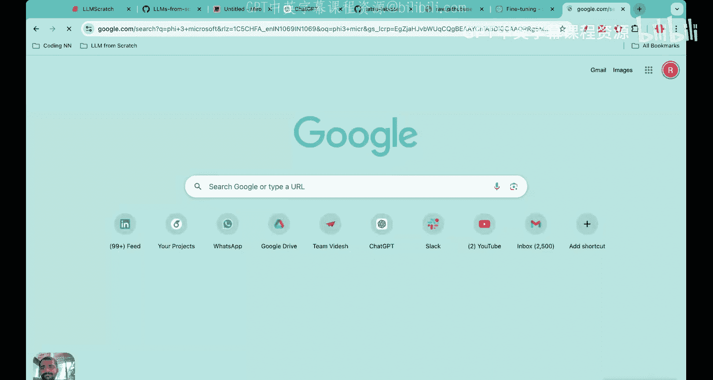
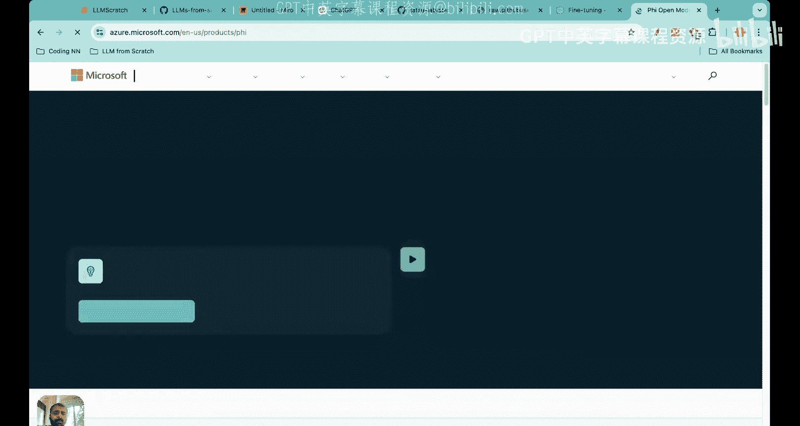
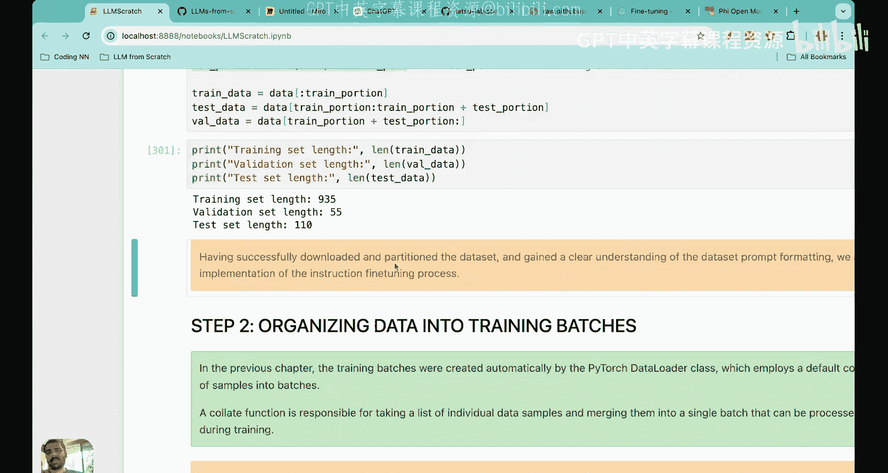
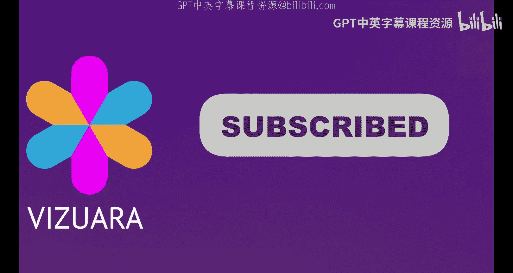

# Vizuara《从零开始搭建大语言模型｜Building LLMs from scratch》中英字幕（Claude-3.7-s） - P35：-37-Introduction to LLM Instruction Fine-tuning _ Loading Dataset _ Alpaca Promp - GPT中英字幕课程资源 - BV1qG8HzUE2D

🎼Yeah。Hello everyone， and welcome to this lecture in theBuild Lage language Models from Sctch series。

Today， we are going to look at a topic which is called as instruction fine tuning。

In the previous set of lectures we have covered this much so far in building a large language model initially in the first set of lectures we saw how to repair data。

We learned everything about the attention mechanism and we learned about the LLM architecture this was the stage one。

The stage2 was the pre training process where we learned about the pre training loop model evaluation。

 and then we learned how to load pretrained ws given by openaiI GPT2 to construct our foundation model and this foundation model is also called as pretrain model。

And then we started looking at fine tuning so until this point in our lecture series we have looked at one type of fine tuning which is called as classification based fine tuning in which we were given a set of emails and then the task was to fine tune our pretrain model so that it can classify any new email as whether its a spam or not a spam and we completed this handson project fully from scratch。

And now what we are going to do is that we are going to start looking at another category of fine tuning。

 which is much more common and that is called as instruction based fine tuning。

Instruction based fine tuning in these series of lectures， which will be five to six lectures。

 will build our own personal assistant from scratch。

So we have already we already have a pretrain model。

 but the pretrain model needs to be improved and it needs to be fine tuned further so that it can serve as our own personal assistant。

So let's get started with this chapter in which we will fine tune the pre traineded LLM to follow instructions。

First we need to understand why do we need fine tuning right so the main reason why we need fine tuning is that pretrained large large language models like the one which we trained in this series so far are quite good at text completions but they really struggle with following instructions so what are these instructions let's say if you use the pretrained LLM and if you ask it to fix the grammar in the text it will not be able to do this if you ask the LLM convert the text from an active voice to a passive voice it will not be able to do this。

So similar instructions are difficult to follow for a threetrain large language model without fine tuning without fine tuning an LLM can generate new tokens。

 it can generate new sentences fully， but it cannot follow instructions。

And we want our large language model to follow instructions if we want to build a personal assistant right if we tell the personal assistant that hey。

 look at my sentence， correct the grammar or hey， look at my sentence。

 remove all the does and the U in the sentence or hey。

 look at the sentence and make it very short to make it concise and make the tone very professional it won't be able to understand these instructions without fine tuning and thats why we have to learn about fine tuning。

I went to Chad GPT and I asked Chad GPT give two examples of fine tuning in real life and heres what Chad GPT came up with。

So imagine， first of all， you are an ecommerce commercece company who wants to build a customer support chatbot。

So suppose an ecommerce-commerce company like Amazon wants to or Walmart， let's say。

 wants to develop or deploy a customer support chatbot that helps users with order status。

 returns and product recommendations so they want to build an Ab chatbot where users can go and ask the chatbot some questions such as what's the refund policy or if I want to return and order what's the policy with respect to that。

Now， if the company starts with only a pretrain model。

 it will be very difficult for the model to understand specific customer queries。

 which is based on the company's policies， which is based on the company's products。

 policies and services。So the model won't be able to answer the questions which are given by the user since it is not instruction fine tuned yet。

And as a result， we need to fine tune the model to understand specific customer queries about the company's own products。

 policies and services。So the reason this is necessary is that the base language model。

 which is only pre trained， may not have knowledge specific to the company's policies or products。

 because many times this information is private。 Inion fine tuning allows the company to provide domain specific instruction。

 such as。If a user asks about return policy， provide steps to initiate a return。

 or if a user asks about the refund policy， provide these these instructions。

 you can train or fine tune the LLM further so that can it can respond to queries such as these。So。

 this ensures that the chat bot not only understands general language but also responds with company specific information improving accuracy and relevance that' is why it is called instruction fine tuning we have to train the LLM by saying that if you are asked these instructions here is the answer which you provide。

The second example is that of personalized healthcare。

So a virtual assistant in a healthcare setting is designed to help patients schedule appointments。

 remind them to take me medications， etc Now if you just take the pretrain model it may have general healthcare knowledge。

But it does not have knowledge about the specific health care provider practices， treatment plans。

 etc cea。 So the base language model may have general healthcare knowledge。

 but fine tuning it with the specific instructions related to the health care provider practices。

 treatment plans and patient needs is crucial。So fine tuning ensures that the assistant understands medical terminology。

 follows specific healthcare guidelines and personalizes the responses based on the patient history。

For example， when a patient asks about diabetes management。

 so how should I or weekly what should be my plan with respect to managing diabetes。

 the assistant can be fine tuned to provide personalized advice based on specific medical guidelines。

So， these are some practical examples we show why fine tuning is necessary。

 fine tuning is necessary for two main things， first of all。

 to train the element to follow instructions and second to train on domain specific data with respect to the company or with respect to anyone who wants to deploy a large language model。

Now let us look at some of the instructions on which we can fine tune the large language model。

 so one such instruction can be converted 45 kilometers to me and then the answer is 45 kilometers is 45000 me the second instruction can be provided a synonym for bright。

And then the desired response can be a synonym for bright is radiant。

The third instruction can be edited the following sentence to remove all passive voice。

 The song was composed by the artist， and the desired response is the artist composed the song。

So now we have removed all the passive voice and convert converted it into active voice right so these are the type of data sets on which we have to train the large language model so that it can understand how to follow instructions。

And this is what is called fine tuning so training on such a dataset which I just showed where the input output pairs are explicitly provided such as in this case where we provide the instruction。

 the input and the output and tell the LLM that hey。

 I know you are pretrained but you can do better with respect to instructions here is a training dataset which will help you get better at following instructions。

Now this approach has also another terminology which is called a supervised instruction fine tuning the reason it is called supervised is that we are providing it a pair or a big set of instructions and the responses which we expect。

All right， now let's get started with the hands on project which we are going to implement。So。

 as I mentioned， our main goal is that we want to construct a personal assistant。

 so we won't be doing all of that in this lecture， but we will be covering a part of it。

Here is the sequential workflow which we are going to follow to build our personal assistant。

 first we load the training data set which consists of such instructions and responses。

 it won't be just three， but there will be more than100 instruction response pairs。

Then we will batch the data set， create data loaders， then we will load the pretrain LLM。

 and then we will fine tune the LLM， inspect the loss， extract responses。

 do the evaluation and then score the output or score how well we are doing。

In today's lecture we are going to see the first step which is data set download and formatting this is a bit different than what we have seen so far so this will be a very interesting lecture allright so lets get started。

So， we are looking at the first step which is preparing a data set for instruction fine tuning right so first let us go to code and let me show you how to download the data itself。

Okay， so here we are in the code where we are started to look at instruction find tuning in this section we download and format the instruction data for instruction fine tuning a pretrain LLM so we already have a pretrain LLM in this section we are going to download and format the instruction dataset。

TheThe data set consists of 1100 in1100 instruction response pairs。

 Let me just show you the data set which we are going to use。

 So here's the data set which we are going to use。 As you can see， if you scroll down below。

 this is a huge data set， which consists of 1100。Pairs of instruction and responses。

 And let's see how some examples are defined over here。 So let's take any example。So let's take this。

So you see there are， if you think of it as dictionary， there are these keys。

 so there is an instruction for each。For each instruction response pair。

 we have an instruction an input and an output。 So instruction is added the following sentence for a grammar。

 The input is he goes to the park every day。 and the output is he goes So the input is he go to the park every day。

 and the output is he goes to the park every day。 So remember three things we have to give the instruction。

 We have to give the input and we have to give the output。 That is done for all the questions。

 So here C instruction。 What are the first 10 square numbers。 In this case。

 there is no need to give an input because there is a fixed answer。 and then the output is 1，4，9。

16 up 200。Then instruction is translated the following sentence into French。

 The input is where is the nearest restaurant and the output is it is translated into French。

 So as you scroll down， you will see that there are instruction input output pairs。

 there are 1100 of them and some of them have inputs。

As you can see some of them have inputs but some of them don't have an input at all。

 so for example if the instruction is convert 10 feet2 meters there is one answer to this right we don't need to specify an input separately so there is just the instruction and there is just the output。

So， this is the dataset which we are going to load in the first step and we are going to use the function called download and load file。

 so what this function does is that it goes to this URL which I just shared with you and it downloads the data from this URL so you can run this function and it even prints out the number of entries in this function so we can see that the number of entries is 1100。

That indicates that we have indeed downloaded the data set correctly。Now let's go to the next step。

The data list which we loaded from the JSON file contains 1100 entries of the instruction data set。

 let us print one of these so let us print the 50th entry so data is my final data set and I am going to access the 50th entry so this says that identify the correct spelling of the following word occasion and the correct spelling is occasion lets check if this is present in this data set so I am going to control left。

Occasion and see it's present。This is the 50th entry。Great。

 let us print another entry which is 999 so here you can see that instruction what is the antonym of complicated there is no input over here。

The output is the interim of complicated simple。Antonym is opposite。Awesome。

 so we have just tested that the data is loaded correctly and we are able to access specific instances or specific index of the data to see what is the instruction input and the output remember three things instruction input and the output。

Next thing which we have to do is that we cannot leave the instruction input and output in this format because researchers have discovered that are found out through experimentation that there is a specific way in which the prompt needs to be given to the LLM during the training process and that specific way is documented in terms of formats。

 so for example there is a specific format through which you have to give these instructions as mentioned by Stanford Alpaca there is one more different format which was used by Phi3 so P3 Microsoft。

So for Phi3 open models there was a different format which was used for fine tuning。

 but the most common one which I have seen is the Stanford Alpaca based format in which what these people do is that they also have similar JSO file where they have a list of 52000 input output pairs and they have constructed a very specific prompt out of these input output pairs so you can see that as we showed you they have an instruction they have an input and they have an output for every input response pair but then they converted it into a prompt like this。

So the prompt which they give to fine tune the Alpaca model is that below is an instruction that describes a task。

Paired with an input that provides further context write a response that appropriately completes the request。

 This is the prompt which they train the LLM with Below is an instruction that describes a task paired with an input that provides further context write a response that appropriately completes the request。

 and then they provide the instruction， the input and the response。

So instruction is provided through this instruction， which is over here。Input is the。

Input which is access through the input field and then the response is accessed through this output field。

 So this instruction input and output is converted into a prompt like this。

 which is then provided to the La language model。And this is exactly what we are going to do in the code right now before that。

 I just want to show you these two types of formatting。

So if so currently we have this instruction input and output right。

 there are two ways to actually format this data set and convert it into a prompt。

 the first is the Alpaca prompt style。And the second is the53 prom style。

 so as I showed you the Alpaca prom style is that you convert you have the prompt which is as follows below is an instruction that describes a task。

Write a response that appropriately completes the request。Then in the instruction， you add this。

You add this instruction。Then in the input， you add the input and in the response you add the output。

So， that is the alpaa prom， so this instruction input and output which was there that is converted into this type of a pro that below is an instruction here is the instruction here is the input occasional and the response is the correct spelling which is occasional with 1 s。

Now53， which was developed by Microsoft， its another fine tuning style where the prompt is user and assistant。

In the user you directly give the instruction which is identify the correct spelling of the following word occasion and then in the assistant you directly give the output so here you see the difference between Phi and the alpaca is that in the P prompting the user what the user has is instruction plus the input。

So。So， instruction。So instruction plus。The input is actually fused over here。

Whereas in the Alpaca promptm the instruction and the input is separated。

 we can use either of these in fact， when I share the code file with you。

 I will encourage you to try the 53 prompt style as well。

But since the Alpaca prom style is more common， we are going to use this and we are going to convert the instruction input and output which we have into prompts such as what is mentioned in the Alpaca pro style。

Okay， so let us convert our instructions into Alpaca format。

 We are going to define a function which is called format input It's going to take an entry so you can think of as one entry as this thing which has key value pairs the key has instruction input output and corresponding values right So when this function。

Returns an entry， you first construct the instruction text which is below is an instruction that describes a task。

 write the response that appropriately completes the request and then in the instruction you take the dictionary which is entry and then you find the value corresponding to the instruction key so in this case the value will be identify the correct spelling of the following world。

So then the prompt will be below is an instruction and then this is identify the correct。

Identify the correct spelling of the following word that is the instruction text then you have to specify the input text which is input and then you specify that particular input in this case the input is occasion now see what we are doing here if the input is not present then you just written blank so in cases like these where the input is not present the input will be left blank and this is mentioned in the Alpaca repository also if the input is not present then we just have below is an instruction instruction and the response。

Right so this is my format input function which takes the entry dictionary and then it gives me the instruction text and it gives me the input text and it combines them together so when you run the format input it will give you this output if the input is present and it will give you this output if the input is absent currently we have not added the response but I will show you where we can add it。

Okay so this is the format input function now let us test it on a data set so we will take the data index by 50 and we have already seen what that is before I identify the correct spelling of the following world and we will pass this input to the format input so now the format input takes in this data and give the model input。

The model input is basically until this point below is an instruction and then input is the occasion and then we have to add the response to this right so then here we say that the response will be the output。

So the dictionary indexed。Dictionary， and then we look at the value corresponding to the output key。

So， then we have the instruction and the input and then we append this desired response to the model input and so the desired response is the correct spelling is occasion。

So， when you print the model input plus the desired response you will get the model input as the prompt and then you will get the response itself now this full thing is later fed as an input to the large language model so that it trains on this entire prompt。

So currently we saw an example of a data which has the input right。

 what if we have an example of a data which does not have the input so data index by 999。

You see here the instruction is what is the opposite of complicated there is no input over so lets see how our code deals with that so when you input the data index by 999 into the format input function it gives us the model input and this will be below as an instruction and then we just have the instruction there is no input。

And then you have to give the desired response， which is a response and then the output here。

 So the output in this case was an antonym of complicated simple right， so then that will be。

The desired response and then the model input will be combined with the desired response and then we will get this entire answer So this entire output is a mix of the prompt and the response and then this whole thing is fed to the large language model when we do the fine tuning later。

For now I just want to show you that the data set was first formatted through the alpaca style format and converted into a specific prompt and response output like this。

 you can of course change this when I share this code file with you there is no need to stick with this particular prompt。

 but for the sake of simplicity and to follow the convention we are doing this in this video because。

If you see this Stanford Alpaca repository， there are about 29000 stars and。Around 4000 forks。

 which means that it's a pretty popular repository and many people use this this kind of a configuration。

 this this kind of a configuration when they do fine tuning。

Great so up now what we have done is that we have converted our instructions into Alpaca format now the next thing is we split our data set into training testing and validation right so we have the data now which I have showed over here this has 1100 pairs we will split them into training testing and validation so we are going to use 85% for training 10% for testing and the remaining 5% for validation。

So we will just index or we will just get the train data。

 the test data and the validation data from our main data based on this these fractions。

So the initial 85% is the train data， then the 10 percent is the test data and the remaining 5 percent is the validation data。

You can even print out the training data set length。

 the validation data set length and the testing data set length。

 so you will see that the training data is 9935 pairs。

 the validation data is 55 pairs and the testing data is 110 pairs。

Even on the whiteboard I have seen that or I've written rather that the next step is partitioning the data into training testing and validation training is 85% testing is 10% Val is 5%。

 Of course you can feel free to play around with this parameters when I share the code with you There are many things in this code which are not set in stone which means they are not fixed and we can continue changing so many things we can change these these fractions we can change this format we can use the Microsoft。

53 format which I showed you and all of this is open for exploration right now this field is so new that right now is the time to really start exploring get into research that way you will also develop lot of confidence as a machine learning and an LLM engineer。

So today we are going to end this lecture until this part where we saw the data set download and formatting in the next step。

 what we are going to see is that we are going to batch the data set Now this is a。

topic which will need some amount of detailing because it' is not very straightforward。

 we have to make sure that the input length is the same for all of the instructions then we have to convert the instructions into token IDs we have to pair them with tokens。

There are some specific things which we need to do。

 which well look at in the next step which is organizing data into training batches and Ive also started writing the code for the next lecture。

In four to five lectures we'll build our own personal assistant chatbot so then you will have built your own chat GPPT completely from scratch and that will set you apart from all the students who are just consumers of Cha GPT you will now build your own personalized assistant。

And then you will have the confidence that whenever you approach any company。

 you can build a custom chatbot for that company as well by following the same procedure。

Thank you so much everyone， I hope you are enjoying these lectures where it's a mix of whiteboard approach as well as coding approach。

Please try to follow along right notes if you are coming to this lecture for the first time I encourage you to watch all the previous lectures which have happened so far so that you can strengthen your understanding anyways I make the lecture so that it is as self contained as possible。

Thanks everyone， and I look forward to seeing you in the next lecture。

