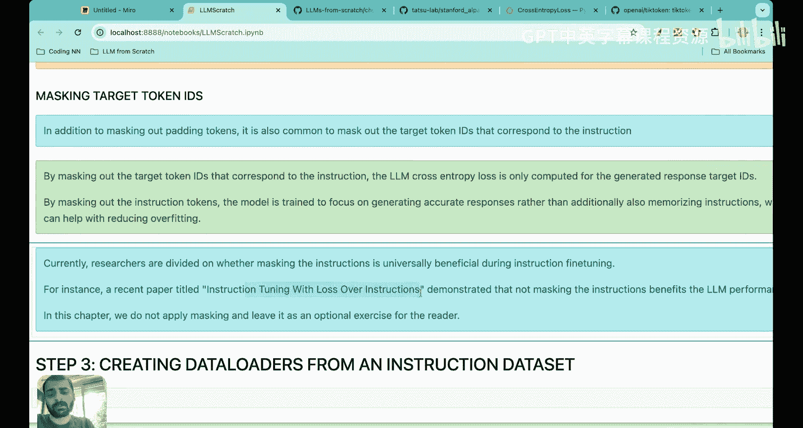
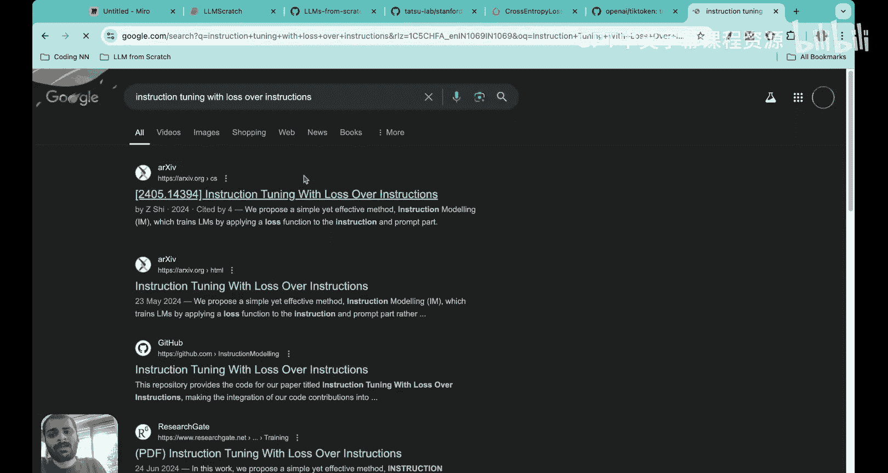
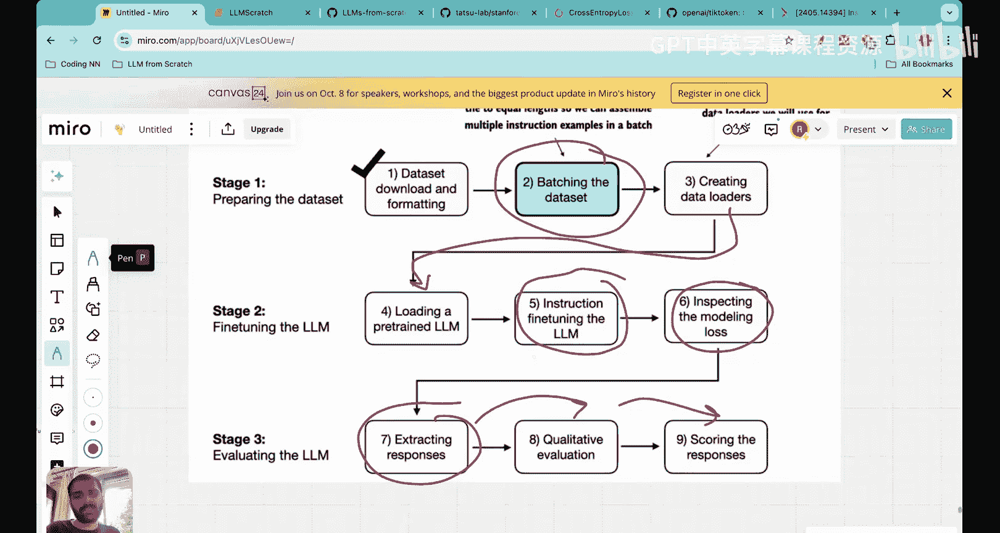

# Vizuara《从零开始搭建大语言模型｜Building LLMs from scratch》中英字幕（Claude-3.7-s） - P36：-38-Data Batching in LLM instruction fine-tuning _ Hands on project _ Live Pytho - GPT中英字幕课程资源 - BV1qG8HzUE2D

🎼Yeah。Hello everyone and welcome to this lecture in theBuild Lage languageage models from Sctch series。

Today we are going to continue with the instruction find tuning hands on example which we started in the previous lecture。

 and today we are going to look at organizing data into training batches。

Lets first quickly recap what we saw in the previous lecture in the previous lecture we started looking at instruction fine tune。

 so we saw that pretrained LLMs are good at text completion。

 but they really struggle with following specific instructions。

Those instructions can be fix the grammar in the text or convert this text into passive voice。

So pretrained LLMs struggle with these and that's why we need to do the process of instruction fine tuning。

In the process of instruction fine tuning， we need to provide the LLM with a data and the dataset consists of a list of instructions and the desired responses which we want。

So here is the data set which we will actually use。

 this is a data which consists of 1100 instruction and output pairs。

 so you can see a sample instruction output pairs such as translate the following sentence into French that is the instruction the input is where is the nearest restaurant and the output is the French translation。

Similarly here， the instruction is rewrite the following sentence so that it is an active voice。

The input is the cake was baked by Sarah， and the output is Sarah baked the cake。

In some instruction output pairs there is no input， so for example。

 convert the active sentence to passive and then the sentence is given in the instruction itself。

So that does not have an input and we have the output directly。

Then what is the capital of Indonesia that does not have an input。

 but directly we have the output the capital of Indonesia is Jakarta。

So these are the instruction and the response pairs。

 which we give as the data to pretrain a large language model。

So first thing which we did in yesterday's lecture is that we downloaded the data set。

And then we formatted the dataset set What does it mean formatting。

 we converted the data set into a format which is called as Alpaca prom style。So。

 remember when I showed you that when we looked at the data it had these three keys or these three values instruction input and output。

 it turns out that there is a specific way this needs to be converted into a prompt before we feed it to the large language model for fine tuny。

And that prompt is called as the Alpaca prompt style。

 so Stanford maintains this Stanford Alpaca repository where they give you instructions on when you have the instructional response pairs such as what we have here。

 how can you convert them into a prompt？So here is the specific formatting for the Alpaca style prompt where you when you have an instruction input and response。

 the prompt needs to be constructed like this below is an instruction that describes a task paired with an input that provides further context write a response that appropriately completes the request。

 and then you mention the instruction and give the instruction which you had in your dataset。

 then you mention the input， give the input which you have in the data and then you collect the response and show the output which you had in the dataset。

So， what we did in the previous lecture actually was that we we used this Alpaa prom style。

 we took our data set and we converted this data into an Alpaa prom style。

And then we partition the data set into training， testing and validation we use 85% for training。

 10% for testing and the remaining 5% for validation。

So let me show you the code which we used in the previous lecture。In this part of the code。

 what we did is we prepared the data set。So we made an API called to this URL。

 we downloaded the dataset and here you can see there are 1100 entries。

 we printed the 50th example in this data， we printed the 999th example of this data and we saw that they matched what we actually have in the dataset。

This confirm that the data set was loaded correctly。

 then we wrote a function called format input to convert the instructions into the Alpaca prompt format。

 this format input function takes the entry and the entry is essentially the instruction input output pairs like these and then it converts it into the Alpaca prompt。

So here we have the instruction plus the input and then we append the response as an output。

So then here you can see that whenever you have an entry such as this。

When you pass it into the model when you pass it into the format input you have the first line then you have the instruction and then the input and then you have to append this model input to the desired response and then you have the entire prompt like this so then this is the Alpaca style prompt which has this first first sentence then it has the instruction it has the input and it has the response the large language model will be trained with these prompts which are then constructed for all of the instruction input output pairs which we have in the data set all 1100 pairs。

Right so now okay one last thing is this splitting the data set into training testing and validation so here you can see that we have used 85% for training 10% for testing and the remaining 5% for validation you can print out the training set length which is 935 out of the 1100 pairs the validation set is 55 and the test set is 110 out of the 1100 pairs。

Awesome， now what we are going to do in today's lecture is we are going to come to step number two and step number two is batching the data set。

This is a bit more complicated than what we have seen before and that's why I am dedicating this entire lecture to this there are a number of finer and subtle things which you need to understand in this lecture and that will really help you to understand the details of the fine tuning process so please pay close attention to whatever I am showing on the whiteboard and then I'll show you the entire process through code。

What does it mean batching the data set， Well， it means that let's say we have。

One data which is like this， so I I have taken a screenshot here and then I'll bring it to my whiteboard。

 Okay， so we have one data like this， which is the instruction input output。

And we have actually let me use the prompt itself because the data will be converted into a prompt right。

 So let's say for the first data I have a prompt like this。Right。And for the second data。

 I have a prompt like this。For the third data， lets say I have a prompt like this now when we have data batches。

 we need to convert this， we need to convert all of the data set into a batch。

 so lets say I am having a batch which has three data samples， so let's say this is my batch。

And this is the data sample number one。This is the data sample number two。

And here is the data sample number 3。Right what I want to do now is that I want to have I want to convert the first data into a numerical representation so that it forms the first row。

 the second data needs to be converted into a numerical representation so that it forms the second row and the third data needs to be converted into a numerical representation so that it forms the third row this whole lecture is about how we are going to construct this numerical representation so that the size of the first row is the same as the size of the second row and it is the same as the size of the third row and when I say size I mean the number of columns。

Which I am highlighting right now， how will we make sure that these prompt which are different for different instruction output pairs right their length may also be different。

 so for example the prompt which is constructed for this pair will be very different than the prompt which is for this the length also will be different so how do I batch it into these kind of numerical representations。

And we are going to follow a sequential workflow for this and I first I'm going to explain to you the entire workflow on the whiteboard and then I will take you through code earlier I was thinking Ill show you on the whiteboard take you through code。

 show you on the whiteboard take you through code and cycle this multiple times。

 but I found that for this lecture in particular it' is much better if you first have a visual understanding of the entire flow。

 have it as a mind map。And then you can follow the code as I'm going through it okay。

 so first we have the data and we will format it using the prompt template using the Alpaca prompt template and then the formatted data looks something like this。

 right？The first step to convert the data into a numerical representation as I mentioned earlier here is to tokenize the data so we are going to use a tokenizer and that tokenizer is going to be the byte pair encoder which is used by openaiI what this tokenizer does is that it takes a sentence and converts it into a bunch of token IDs。

Right so that is the first step for every so lets say if this is the prompt below is an instruction that describes a task write a response that appropriately completes the request。

 lets say there is an instruction there is an input and there is a response I am going to take this prompt and I am going to convert this entire prompt into token IDs。

That is going to be my first step， right， So I have written it in a lot of detail over here。

 So let's save this is the let's say if this is the。Data set which you have。

 then you convert it into the Alpaca pro style and then it starts looking like this and then it then you convert it into a bunch of token IDs using the T token library。

Using the Tik token library， right？And this you do for the first。Instruction input output data。

 then you do the same for the second， you convert it into the Alpaca format and then you convert it into a bunch of tokenidees。

And you do the same process for all of these。Instruction input output data which you have in your data set。

 that is the first step。But you see the problem here the number of token IDs which are present。

 lets say the number of token IDs which are present over here will be different than the number of token IDs which are present over here because of course the length of the prompt might differ。

你。😊，So， if you look at this this first prompt it looks longer than the second prompt。

 so the number of tokenides in the first prompt are greater than the number of tokenides in the second prompt。

But as you but as I told you over here we need the numerical representation of all the samples in one batch so lets say sample one and sample2 in one batch。

 we need the number of columns which is the numerical representation or the number of tokenides we need the number of token ids for each sample to be same so I am just mentioning it over here we need the number of token ids。

For each sample to be same。So how do we make sure that the number of tokenids of all samples are the same and that brings us to the next step So until now we saw the tokenization。

 the next step is that we are going to adjust the length of every。A set of token id。

 and we are going to pair them with token so that the length of all。

nuummer representations is exactly the same。 The way we are going to do this is as has been shown over here。

 So let's say if we have the first batch and the tokenide is for the first input are 0，12，3。

4 the tokenide is for the second input in this batch are 5 and6 the tokenide is for the third input is 7。

8 and 9 This is one batch Now take a look at the length of the tokenide is0 the length of the tokenide is 5 here its 2 and here it 3 so it is not the same right So what we'll do is that in each batch willll find that sequence which has the longest number of longest length。

So。This clearly has the longest length， so we keep it as it is。

 but the remaining ones we pair them with these tokens so that their length becomes equal to the。

Longest length， so for example， the input 2 has only two tokens 5 and6。

 so we pair three additional tokens，50256。Similarly the third input has three tokenids78 and 9。

 we pair it with two additional tokenids now if you see because of this padding procedure which is done the length of all of these three is equal is the same and there are five tokenids in all the numerical representation that is exactly what I want。

Now you may be thinking what is the 50256 that is the end of text token so GPT2 if you look at GPT2 it as a vocabulary size of 50257。

So 50257 is the vocabulary size， so that means the first token has a token idea of0 and the last token has a token idea of 50。

2，56。And this last token， which has the token idea of 50256， corresponds to the end of text token。

So it conveys that one particular text sample has ended and it is the start of a new text sample。

 so we are just appending it with the end of text because it does not mean anything if we use any other token ID it might be associated with a token so that might confuse the training so that is why we append it with it with this end of text token ID which is 50256。

Now， one thing which we are going to do here is that let's say this is the first batch and when you look at the second batch we are going to implement the exact same procedure we are going to find that token with the largest token length and we are going to upend this50256 to all the remaining。

Token sequences so that the length of all becomes the same so each batch we are going to process sequentially and differently in each batch we are first going to find that representation which is the largest number of tokens and to all the other representations we are going to append 50256。

So thatre the length of。So that the length of the convertted or the token ID number for all of the inputs is equal is the same and then it starts looking like a batch so here you see this definitely looks like a batch because their number of columns are the same and then I can process all of these together in a batch。

Right so that is the step number three we adjust to the same length with padding tokens so we add the end of text tokens to pair the data samples so that in a batch all of the samples have the same length that is the same number of token ids right？

The next step what we are going to do is that we are going to create target tokenides which means that let me show you what it actually means so lets say if you have an input right and that is this prompt over here let's say this is the prompt and that has been converted into a bunch of tokenides which looks something like this。

We need some output right which is the true target which we want to approximateroimate similar to what we did for large language model training。

 the target is constructed by shifting the input to the right by one so lets say the input is01，2。

34 right the target will be you forget the first。Entry here and you take the remaining entries and then you add a padding token 50256 so that the length of the target and the length of the input is equal to are similar to each other or are exactly same rather。

Here is the second input so if the input is 56，50256，5025650256。

 the way we construct the target is that we get rid of this first index。

 we take all of the remaining in the input and then we pair it with an extra token which is 50256。

Do keep this in mind this is the most important step in the fine tuning process and sometimes this is also a step which is very hard to grasp。

So think about what is exactly happening in this so lets say if we have a prompt and I am going to focus on this prompt further now so that I can explain to you why we construct the target like this when I learned about this for the first time。

I really did not understand what is actually happening。 So if we have a。

If we have a prompt like this， right？What we are essentially doing in the when we construct the target pair is that let's say。

Why is the target pair shifted to the right by one because we are still doing the next prediction task so if my lets actually let me take the screenshot of this also so that I can explain to you what is going on。

So if I take a screenshot of this。And I'll paste this over here。What this input target sequence？

Means is that if you have the input as0。The output should be equal to 1 if the input is 0 and 1 the target is equal to 2 if the input is01 and 2。

 the target is equal to 3 if the input is 0，1，2 3。0123， the target is equal to 4。

And if the input is0，1，2，3，4， then we are at the end of the sentence you can think about what we are really training the model over here we are training the model that if below is the input then below is is the output if below is is the input below is and is the output similarly as this happens sequentially we will train the model that if below is an instruction task which describes write a response that appropriately completes the request if this much is the input then this this should be the output then。

We train the model that if this much is the input， this should be the output。

I agree that there is some redundant training which is happening here because all the training which we really need to do is tell that if this much is the input instruction and the input this is the response which needs to be constructed and the way we are going about this is through this next world prediction task or next token prediction task thats why we shift that's why the target is the input which is shifted to the right by1 please keep this in mind this is a bit not easy to understand and it is not intuitive as well。

When I first learned about instruction fine tuning I thought that the input should be input should be this much and the target should be the response right。

 but the input is this full thing， the input is this full thing and the target is this full representation just shifted to the right by one。

So within the input itself， we have the input and the output actually。

That is exactly how LLMs work we are using the next word predict or the next token prediction task。

 so what this does is that as we are predicting the next token in the sequence of training we reach a stage with this much is the input。

The output will be the response so through learning how to predict the next token。

 the LLM learns to follow the instructions。So there is a lot of similarity between instruction fine tuning and the pretraining process itself in the pretraining we did exactly the same thing we are the target shifted by one and it' is non intuitive that in instruction fine tuning this same thing can work but it does work because as the LLM learns to predict the next token it learns to take the instruction the input and predict the response。

Okay so I hope you have understood this part about how to create the target token ids so the way to create the target token  ids is that we shift the input by one and we add an additional padding token to indicate that it is the end of the sentence so whenever we shift the input to the right by one we add this extra padding token right。

So， that is how the target token IDs are created for training and the last step is that will replace in the target token IDs this 50256 which is there wherever it is coming we will replace it with minus 100。

And there is a specific way to do this so if you look at this last part which is replace the padding tokens with placeholders so let's say this is my first target tensor right or let's look at the second target tensor let's look at 50256 there are 450256 values right I leave this first one because that indicates the end of text and Ill replace all of the remaining with the value of minus 100。

Similarly， if you look at target 3， it has 350256 values。

 I leave the first one because it symbolizes end of text and I will replace all of the remaining 50256 with my and。

Similarly， if you look at target1 now this 50256 represents end of text so I won I won't replace this it remains like this。

 so that is something to keep in mind we don't replace all the 50256 toconides with minus100 we only replace the we leave out the first one and replace all of the rest with minus 100。

So you might be thinking what is the significance of minus 100 and I will explain to this in a lot of detail when we come to code。

 but for now just know that it comes from this cross enpyos Igno index。

So ignore index so by default the Igno index for piytorch is equal to minus 100 so when we mention minus100 here it kind of makes sure that when we calculate the loss function all of these token id which do not matter at all we have randomly added them to the target rate they are not included in the loss function this makes the training much more efficient and does not unnecessarily include tokens which are not important。

This first 50256 needed to be retain because it indicates the end of end of a particular。

End of a particular text， so that is very important。

But the remaining 50256 tokenids are not needed and we can just replace them with a value of minus0 awesome。

So now we have understood this whole procedure so let me repeat the whole procedure once so data batching is actually done in five steps and we are going to see all of these five steps in code shortly the first step is to of course format the data using the prom template then convert the prom template into token ids now all of these token ids won't have equal length so the next step after this is to append。

The data samples with the padding tokens of 50256 so that in each batch the length of every data sample is the same and that is equal to the sample which has the maximum number of token ids。

Then what we do is that we create target token IDs which will be needed because we need to know what the right answer is and the right answer is just the input shifted to the right by one this is a bit counterintutu but it does work because the LLM learns to predict the next token and in that process it learns that here is the instruction here is the input and I have to predict the output。

And then finally the last thing is we replace all the tokens except for the first 50256 with a value of minus-00。

 and the reason we do this is that we need to exclude these tokens from the training loss and ptorch cross entropy loss implementation has the I index of minus-00。

And that is why we are going to use this minus center we see this in a lot of detail when we come to code right so I hope you have all understood this process。

This is very important for you to have as a roadmap because now we are going to go to code and everything in the code will be much more clearer and easy to understand once you remember this roadmap which I've introduced over here。

So let us jump directly right into code right now。So。

 as I mentioned before until now we have converted the data set into training testing and validation batches right the training is 85% of the data testing is 10% of the data and the remaining 5% is for validation the next step is to organize the data into training batches as we saw on the whiteboard first what we are going to do is that。

We are going to code an instruction data class what this class does is that it takes in the data in this format。

And it converts it first of all into this Alpaca style format that is the first step over here if you recall the first step is format data using Ch template。

So， we are going to use the。Format input function， which I explained to you at the start of this lecture。

 this format input function over here， which takes in the instruction input output pair like this and converts。

That pair into this first sentence instruction and the input。

 and then we need to append the response or the output。So here if you look at the code。

 this instruction class data， when we create an instance of this class。

 it first creates an object cell do data and assigns the data which is something like this you can think of the dataset like this and then what we do is that for each entry in the data it first applies this format input function to the entry and then appends the response so the full text in the Alpaca format is created and then what we do is that as I mentioned in the next step over here we are going to tokenize the formatted data。

So， we。We first define a empty list and then we start appending the tokenides to this empty list。

 so let's say if you have a prompt which looks like this。

 each of the tokens here are converted into tokenidees and then appended to a list so for every prompt corresponding to each input output pair now we have a list of tokenidees which is mentioned in the step1 over here see here。

What we are doing is that every prompt we are converting it into tokenes and for that the tokenizer which we are going to use is we also need to pass this to the instruction data class but it' is going to be the tick token library I'll share the link to this in the chat we have had a separate lecture on byte pair encoder in this lecture series so if you want to understand about this library in detail I highly encourage you to watch that lecture。

Right， so now what does the instruction class instruction data class essentially return where it returns for every for every data which is in this format。

 it converts it into the Alpaca style prompt and then it returns a bunch of。

Tokenite is for every entry。Awesome。So let's go to the next part now。Before coming to the next part。

 I just want to show you the end of text token and its corresponding token ID as we have seen on the whiteboard and it's indeed 50256。

So that's why we are using this 50256 token ID because it conveys the end of text。

Okay now as I mentioned what we are going to do here is that we are going to define a custom collate function what this custom collate function does is that the name may sound complex but it actually does a very simple thing it takes the inputs in each dataset set that is the first thing it takes the input in each batch it finds that input with the maximum length and then it upends the 50256 or pairs the 50256 token id to all other inputs that is the only thing which it is doing。

So this custom colate draft one， it takes the batch so you can think of the batch as coming in this format like this。

And then it has， you have to give the padding token ID， which is 50256 and the device which is CPU。

So， this function implements four steps first it finds the longest sequence in the batch。

 and then it pairs the other sequences so that the length is equal to the longest sequence。

 that's it。And then it converts the list of inputs into a tensor and transfers to a target device。

 which is the CPU， so this entire thing is converted into a tensor what I have marked with this orange color over here。

That's the function of the custom collate draft， so let's see how it does it。

The first thing this function does is that it will find the longest sequence in the batch and it will add it by one so let's say if you have these three。

It if you have these three the longest sequence length is 5 and then it will add it by 1 so then it will be 6 there is a reason why you add it by 1 and I will come to that later but after you add it by one what you do is that for every item in the batch you first add a token 90 so even for the first one。

Even for the first item you add this 50256 token， that is the first thing which you do and then you pad the 50256 again so that the length is equal to the maximum length。

And then what you do is you remove。You remove the extra pad token。 So you essentially。

 what we are doing is that let's say if you have。I actually remove this in the code what we are trying to do is that we add first of 50256 token added to all of these so even to the first one we add this 50256 token and to the other ones we add the 50256 token then this will be added1。

2， three， three more times so total it will be added four times and here we will added it a total of three times right。

But then you might think， why are we adding an extra 50256 token because here we don't need to add 50256 here also we need to add three times here also we need to add it two times so then we get rid of that extra token later。

The reason we do this extra addition is that it later helps us to create the target token because if you already add an extra token creating the target。

Creating the target is just simple because then you just use this much to create the target。

As we saw before the target is just the input， you remove the first element and then you add 50256。

So earlier adding the 50256 token to all of the inputs in this part of the code。

 it is important because it easily helps us to create the target。

ID to create the targets for every inputs。So essentially what we do is we add an extra 502。

56 and then get rid of it later and then we pad everything all the other inputs with 50256 so that the length is equal to the maximum token id0 length or the that input which has the maximum length so essentially。

When you reach this part of the code， every item in the batch， so all of these three items。

Essentially we have the same length That's what is happening in the code and ultimately we convert this into a tensor and the tensor is the input tensor。

 which is returned by this function custom co draft one Now let's see a practical application of this if you have。

These three inputs like this if inputs 1 has the size of five input 2 as the size of two and input 3 has the size of three the batch。

 you create a batch with these three inputs， and then you pass these。

You pass this batch into the custom Col draft one now let's see the output。

As you can see the first input remains unchanged it has5 tokenines because those are the maximum length in the second inputs we paired 502563 times so that the length becomes same as the first input sequence and in the third input we pair 502562 times so that the length becomes the same as the first two so now you can see we have an input stensor in which every row has the length has five columns awesome。

So as we can see here。All inputs have been padded to the length of the longest input list inputs 1。

 which contains five tokenaries awesome。So until now we have reached this stage where we have padded the inputs with the token IDs and now we have to implement the next part of this process。

 the next part is essentially creating target token IDs for training。

So until now we have just implemented our first custom collate function to create batches from a list of inputs。

However， as you have learned in previous lessons， we also need to create batches with the target tokenidees。

 right， because we need to know what the real answer is。

The target token ids are crucial because they represent what we want the model to generate and based on the target token ids itself we will get the loss functional symmetry。

So， as I explained to you thoroughly on the whiteboard。

 the way to get the target token ID is just to shift the input。

To the right by one and then add an additional padding token towards the end。

And that's exactly what we are going to do in the code。 So if you see in the code until this part。

It remains the same we have the inputs and they are padded by the 50256 token and now if you see the target token it is just shifted to the right by one so here you see one colon which means that you forget the first entry and you take the remaining entries。

And here you don't even need to add the 50256 token we because we have already added added an extra 50256 token and this is why we add that extra 50256 token as I showed you earlier because here you see。

Actually， in the first input you don't need to add the 50256 token， but if you add it。

 it makes it very easy to create the target。It makes it very easy to create the。

The target tensor why because you just ignore the first element and take everything from the second element so here you ignore the first element which is 0 and take everything from the second element so the target will be 12。

3，4，50，256 in the second the target will be 650，25650256，50，2，56 and  one more 50，256。

So it's the input which are shifted to the right by one。

So that is how you create the target tensor and then you just return the input tensor and the target tensor。

So the simplest way to think about this code is that until now we have made sure that the inputs are of the same length due to the padding which we have done and the targets is the inputs which are shifted to the right by1 this is the very important process and as I mentioned to you this is the non intuitive step because。

The true value is just the input which is shifted to the right by1 and that is what is non intuitivetuitive you might think that the response needs to be given in the true value right why is the instruction and input also given in the true value。

But it is given because in the next world prediction task。

 the LLM automatically learns that when you have the instruction and the input。

 you have to predict the response。This was a bit harder for me to explain。

 but I hope you have got this idea in the code if it is difficult to understand just try imagining it through the visual representation which I showed to you on the whiteboard you can even try going back as you are learning this lecture to see the whiteboard explanation before you try to understand the code。

So there are actually only two things which are happening in this custom colate draft2 it takes it truncets the last token for the inputs so that everything is of the same length and it shifts the input to the right by to get the target tensor and we can check this now let's say we have these three inputs as before we create a batch of these three inputs and then we call the custom collate draft2 function on this batch and we will print the inputs and the targets so let's see as we learn before the inputs is just the first row remains the same the second row has three50256 tokens padded the third rows 250256 tokens padded and let's look at the target if you look at the first row of the targets。

It is the first row of the inputs。 you shift to the right by one so you take the remaining four and then you have 50256 token Similarlyly。

 if you look at the second row of the target， it's basically the second row of the input。

 you shift to the right by1 which means you take only the remaining four values and then you add an extra 50 to56 Similarlyly if you take the third row of the targets。

 it's essentially the third input， but you shift to the right by one so you ignore the first and you take all the four and then you append an extra 50256 token  id towards the end。

 That's how you get the inputs and the target tensor So the first tensor represents the inputs。

And the second tensor represents the target。Awesome。Now， after this step is implemented。

 we come to the next step which is essentially creating or replacing the padding tokens with placeholders。

 which means that except for the first 50256 well replace all the remaining with minus0。

So in the next step we assign a minus 100 placeholder to all the padding tokens。

 this special value allows us to exclude these padding tokens from contributing to the training loss calculation as we saw on the whiteboard。

嗯。Okay， so in the following code， okay one more thing to mention is that as I told you on the whiteboard when we replace this 5025hi tokens with minus 100 we retain 1 50256 token and the reason we retain one end of text token is because it allows the LLM to learn when to generate an end of text token in the response to instructions。

which we use we use as an indicator that the generated response is now complete。

 so you need150256 token  ID0 to say that or to represent that this is indeed the end of text。

So now what we have to do is that we have to take this custom call it draft2 and then we have to modify it further。

 so most of the function is the same which now I am calling custom Col function which takes in my batch my padding token  ID0 and my Igno index。

 so that is minus00。So what this does now is that until now here the steps are the same you get the inputs and the target sensoror。

 but now what you do is that you take the target sensor only and all the indices except for the first 50256 you replace it with the I index so you first create a mask and that mask has all the indices which has the padding token id then you ignore the first index which has the padding token id that is the first 50256 value and then you replace all the remaining ones with I index which is minus0。

Okay， so this now creates my input， this now creates my input stensor and this creates my target stensor。

And these are both returned by this function， which is custom collate function。Okay， until now。

 if you note through the whiteboard， what we have implemented is that we have implemented this part of the code where you can see in the figure that。

Here， so except for the first 50256， we replace all of the remaining 50256 with the value of minus100。

And now we are going to see why we replace the remaining 50256 token IDds with minus 00。

So to see why we replace the remaining tokenids with minus0。

 we are going to see some implementations using Pytorch。

 but before that let us actually see whether our custom collate function is really working。

So to test that you take three inputs， you have the inputs 1 as 0，1，2，3，4。

 you have the inputs 2 as 5 comma 6， and you have the inputs 3 as 7，8 and 9。

 you create a batch with these three inputs similar to the batch we have created before and then you create the inputs and targets based on the custom Col function Now if you see the input and target tensor which we had obtained before the input and target tentensor which we obtained now is actually exactly the same except that in the target stensor。

Except for the first 5，0，2，5，6， all the remaining 5，0，2，5，6 values have been replaced with minus-00。

 This is the only change which has been done。 There is no changes to the input ssor。

 The only change happens in the target ssor， where except for the first 50，2，5，6。

 all the remaining have been replaced with minus-00。And now you can appreciate this。Code。

 which is the custom collate function where in this 15 to 20 lines of code。

 what we are essentially doing is that we we are implementing all of the steps which we have learnt on the whiteboard。

We are implementing all of the steps over here。So， essentially， we are implementing the。

We are implementing the padding， we are implementing creating target token IDs。

 we are also implementing replacing the padding tokens with the placeholder value of minus 100 and that is also called Igno index。

So up till now it is working right but now you might be thinking that the modified colate function works as expected altering the target list by inserting the tokenoid of minus00 but what is the logic behind this adjustment why do we replace with minus 00 so let us take a small demonstration and I'm going to show you the categorical or the cross entropy loss calculation right and the cross entropy loss calculation is based on a logicit ssor and the target ssor I' am not going into details of this logicits and targets because I've just taken two sample examples but for now you can think of it that the true answer is0 comma1 and the logicits predicted are minus minus1 and1 for the first training example and for the second training example the logics predicted are minus0。

5 and 1。5 so this is my predicted value and these are the top targets to calculate the loss between the prediction and the target we use the cross entropy loss。

So I'll share the link to the pyarch crossenttropy loss which calculates this loss between the prediction and the target and if you print out the loss you will get it to be 1。

1269 that is good then what we do is that we add one more additional token ID in the prediction so in the logics2 now we have three training examples with three predictions and we have three true answers so then we are using the categorical or the crossenttropy function to calculate the loss between the prediction and between the actual value and here if you print out the loss youll see that the loss is 0。

7936 it differs from the previous loss because we added one more example。Now。

 what I want to show you is that let us say instead of the targets 2 being 0，1 and 1。

 what if the target 3 is 0，1 and minus 100？So， the logics 2 will remain the same。

 so the logicits which are my predictions will remain the same。

 but now the targets are 01 and minus 100。Now， I want to show you an interesting thing。

 even if you add a minus100 year and if you have a third example， when you calculate this new loss。

 you will see that the loss for this。Is the same as the first loss which you have obtained。

So it is almost like adding the third training example made no difference at all。

 so the loss here is 1。1269 and if you saw the loss in the first logicits 1 and targets 1 that was also 1。

1269 so essentially there was no effect of this third prediction and the reason there was no effect of this third prediction is that the targets had minus-00 that is the effect of Igno index equal to minus-00。

So in other words， the cross entropy loss function ignored the third entry in the target 3 vector。

 the token id corresponding to minus 100。So you can try reading replacing the minus0 with another token and then the loss will not be the same It's only for minus0 So whats special about minus0 that its ignored by the crossenttropy loss Well the default setting of the crossenttropy function in pytor is crossenttropy ignore index equal to minus0 and you can see this over here also if you look at crossenttropy loss formulation you'll see that the I index is equal to minus0 over here thats the default setting of the pytch cross entropy loss This means that pytarch ignores all the targets which are labeled with minus00 So now if my target tensor has minus0 over here it will ignore all of those predictions corresponding to these indexdices which are minus0 in the targets and that is good for us because these anyways don't represent anything meaningful that's why they won't contribute to our loss function。

So in this chapter， we actually take advantage of this ignore index to ignore the additional end of text padding tokens that we。

That we used to pad。So we we take advantage of this ignore index to ignore the additional end of text tokens that we use to pad the training examples to have the same lengthhenage batch。

However， as I mentioned， we kept 150256 token ID so this I will reiterate it again because sometimes students forget this week we we retain this this first 50256。

 we retain the first 50256。In all of the targets， so even if you see in the even if you replace the other 50 to56 with minus and。

 you retain the first one。And you return the first one because it helps the LLM to learn to generate end of text tokens and that is an indicator that the response is complete。

So， this is the entire process and this is the entire workflow for implementing the batching in the training dataset there are very few videos which explain this batching process in detail but as I say so many times the devil lies in the details so if you directly go to the model training right now I could have shown you that directly without explaining this lecture but there is so much information to learn near this padding tokens this minus 00。

Then creating target token IDs which are just shifted to the right hand side by one all of this information would have been lost if I directly jumped to the fine tuning process。

So in the instruction fine tuning creating these batches is very important to learn because as I explained to you there is a specific five step process to do this first you have to convert the data to the AlpaA pro template then you have to tokenize the formatted data into token IDD then you have to append padding tokens to all the tokenized input sequences you know in each batch remember you are doing this separately for each batch。

So that in each batch the length of all input sequences should be the same。

 then we create the target token  ids which is just the input token  id0 tensor shifted to the right by 1 and then we replace the padding tokens with 50256 with minus 00 except for the first 50256 which indicates the end of text。

Okay， one last thing which I want to cover is that sometimes some researchers also mask the target token ids So if this is my。

This is my prom and that's tokenized into this。right as input ides in target we we shift to the right by one right so as I told you here we shift to the right by one so the target tensor is now the input shifted to the right which means only this part。

Is。The target text， but now as I mentioned to you before。

 why should I learn all these other things in the target， all I should learn is the response right。

So what if I mask the entire other thing in the target with the tokens minus0？So。

 only the response matters to me I want my LLM to learn the instruction input and then produce this response why should I keep the instruction and the input as I mentioned here in the target text。

Isn't that doing unnecessary computations so why don't we replace the tokenide is in the target text with minus 0 so that they are ignored in the loss function calculation？

And in fact， this part is actually。Still not yet finalized so let me explain this part a bit better in addition to masking out padding tokens。

 it is common to mask out the target tokenidees that correspond to the instructions as I mentioned over here。

 this is called masking the target tokenidees。By mask out the target token ids that correspond to the instruction。

 the LLM cross entropy loss is only calculated for the generated response target IDs， right？

And by mask out the instruction tokens， the model is trained to focus on generating accurate responses rather than memorizing instructions and that helps with overfitting or reducing overfitting so if this instruction is not even present in the target the LLM won't memorize this as the output so it will reduce overfitting。

Now there is still there are some researchers who are trying this。

 but its not yet confirmed which approach works the best。

So as is mentioned here currently researchers are divided on whether masking the instructions is universally beneficial during instruction fine tuning for instance a recent paper titled instruction tuning it lossover instructions demonstrated that not masking the instruction benefits the LLM performance so let me actually display this paper so that you can see this paper。

So this paper is instruction tuning with loss over instructions。

 This paper demonstrated that fine tuning。

With masking is actually not good， so this paper demonstrated that not masking actually benefits the LLM performance。

So it is not yet final which is the best method and it and it's a subject for open research which all of you are listening to this lecture can also actively contribute by testing out masking and no masking as I mentioned it' is very easy to mask you just replace the token 9s of the target text with minus100 as is seen over here on the whiteboard。

Okay， so in this implementation in this series， we are not going to apply the masking and we will leave it as an optional exercise for you。

 but the more optional exercises like these which you perform the more confident you will be of the subject and the stronger LLM engineer or machine learning engineer you will become。

So at many places I am introducing these open areas of research to you so you can even do this research and publish an impactful paper if you thoroughly investigate the effect of masking target toonids in instruction fine tuning。

Awesome， right？So， this brings us to the end of the lecture where we covered batchching the data and it sounds simple batchching the data you might think whats so complicated in this。

 but it took me the full lecture to explain this second part itself which is batching the data。

And the reason is because this batching itself involved five detailed steps which I needed to explain to you in a lot of detail along with the code。

 so I hope you I hope you are liking this style of whiteboard plus code and I am trying my best to explain this to you in as simple manner as possible。

In the next lectures we will create data loaders， then you will load the pretrened LLM。

 then you will instruction fine tune the LLM， inspect the loss accuracy， generate the responses。

 and even do an evaluation and score the responses。

We will ultimately even package this into a chat GPT pro style so you'll get the feeling that you have built your own chat GPT。

Thanks a lot everyone， I am making this nuts and bolts approach of learning large language models deliberately because I feel that's the strongest way to build machine learning engineers rather than just doing applications without understanding the basics foundations are the most important。

Thanks a lot everyone， and I look forward to seeing you in the next lecture。

。

