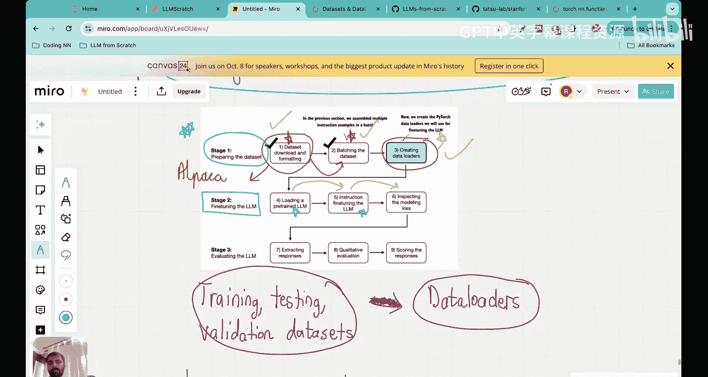

# Vizuara《从零开始搭建大语言模型｜Building LLMs from scratch》中英字幕（Claude-3.7-s） - P37：-39-Dataloaders in Instruction Fine-tuning.zh_en - GPT中英字幕课程资源 - BV1qG8HzUE2D

🎼Yeah。Hello everyone and welcome to this lecture in theBuild larger language models from Sctch series。

We are looking at instruction fine tuning and we have finished step number one。

 which is data download and formatting and in the last lecture we have finished step number two which is batching the data。

In this lecture， we are going to look at creating data loaders。

So you can think of data loaders as an efficient way to just。

Collect the different batches whenever we need to do so。Using data loaders。

 the process of training a large language model becomes very easy because then you can access batches in a sequential manner and in a much more efficient manner。

So here's the Pytorarch data sets and data loaders documentation Ill be sharing the link to this and as you can read here data loader wraps an iterable around the data。

 which means that the batches which we have created can be accessed in an iterative manner using the data loader and a by iterative I just mean in a sequential manner and essentially it makes it very easy to access the different data samples。

So the reason we use data sets and data loaders is more for efficiency of access to the data itself。

 and that makes a very big difference when training a huge model such as LLMs with more than 100 million parameters。

So let me quickly recap whatever we have done so far。

 so the first step was data set download and formatting。

Here's is the instruction fine tuning dataset set， so we have 1100 pairs of instructions。

 inputs and outputs， so an instruction could be something like edit the following sentence for grammar the input can be he go to the park every day and the correct output is he goes to the park every day。

The instruction can be converted 45 kilometers to meters and here it does not have any input because there is one fixed answer and the output is 45 kilometers is 45。

000 meters。So， what we are essentially doing is that we are telling the large language model that hey we look we know that you are pretrained but you are not very good at following instructions here is a training data which I have that will teach you how to follow instructions and how to respond effectively。

So， we are providing this training data as an additional specific data and then we will train the large language model again so that it gets better at responding to instructions。

So， that is the first step which we implemented and that was data set download and formatting what is meant by formatting well there is this template which is called as Alpaca format。

And what this template essentially does is that when we are going to do instruction fine tuning。So。

 let me go to。Stanford， Alpaca。Gub。Right so this is the Github repository and basically they have a data set of 52000 instruction response pairs such as what I showed you here and they have a specific way to convert these into prompts so when we are going to train the large language model we need inputs and outputs right so there is a specific prompt to which we are going to use and that prompt itself will serve as input output input target pairs So if the instruction is something like let's say convert 45 kilometers to meters and output is 45 kilometers is 45000 me the prompt which we are going to give the LLM is that below is an instruction that describes a task paired with an input that provides further context write response that appropriately completes the request and then in the instruction we provide the instruction which was convert 45 kilometers to meters then we have the input the input in this case does not exist because there is only one answer and then we。

I have the response。Now this is the prompt virtually provided to the LLM and then you will train the LLM。

With the next world prediction tasks which means that this is an autoregressive model within this prompt itself there are input and target pairs so when below is the input below is is the output when below is is the input below is and is the output when below is an instruction is the input below is an instruction that there will be the output so similarly when we train the LLM on this entire prompt we will surely reach a stage when it reads when it reads the instruction and the input it learns how to provide the response。

So that's what' is meant by formatting every input。

 every input instruction and response is format into this Alpaca style format。

And thats done in the data downloading and formatting stage then what we do is that we batch the data set this was not as easy as simply creating batches but there were multiple steps involved in data batching itself and these steps are divided into five substeps or these steps can be bucketed into five。

5 main components， the first as I mentioned is format data using the prom template and we use the Alpaca template there is also the53 template which is used by Microsoft and you can try that when I am going to share this code file with you so that is the first step the second step which we are going to do is we are going to tokenize the formatted data which means that。

Here is the formatted data right， which is in the AlpaA pro style we are going to convert this entire data into token IDs。

So let's say one batch has four instruction input output pairs or two instruction output input output pairs。

 the first data will look something like this when tokenized the second data will look something like this when tokenized now naturally the length of the token sear and the length of the token herer won't be the same and that's a problem since we are dealing with batches so the next step is that so after tokenizing the next step is that we are going to in one batch we need to adjust so that all of the data samples have the same token ID。

So consider this batch for example where there are three inputs when the first input is tokenized it has five token id when the second input is tokenized it has 2 and when the third input is tokenized it has 3 and that is not good we need to make sure that all of these have the same number of token ids so the way we do it is that we take that input which is the maximum number of token IDs in this case it is the first input which is five token IDs and then we take the remaining two inputs and we pair them with the end of text token which is 50256。

And we pair them so that their length becomes equal to the maximum token id length which is equal to 5 since the first1 as 5 token ids and once you do this padding you make sure that in every batch all the inputs of every batch have the same number of token id so all of these three have the same token id if you look at the second batch all of these have the same token id。

That is the third step in the fourth step we have to create the target pairs so we have inputs and targets right and targets are just the input pairs which are shifted to the right by one so if you have an input which looks like this the way to create the target pairs is just you get rid of the first element and have the remaining so input shifted to the right by one and then you add an end of text token to convey that this is the end of the instruction output pair。

So that's what I mentioned earlier by the next token prediction task right when below is an input below is the output。

 when below is the input below is and is the output。

This input target pair creation is probably the most important step in fine tuning and it's also not very intuitive because you are not saying that the response is the output you are saying that the whole thing itself is your data and within that you input and target pairs it turns that it turns out that with this next token prediction task the LLM learns to segregate or recognize that up tiller I have the instruction with the input and then this is the response which I have to predict so the next word or the next token prediction task。

Is what's done in fine tuning as well similar to pre training in fine tuning we are also doing the next token prediction。

And this is how we create the input and target pairs。

 And the last step here is that we replace the padding tokens with minus00。 So all the 5，02，5。

6 here is replaced with minus0。 And the reason it' replaced with。Let me show this to you。

Right over here yeah so here you see all the 50256 tokens are replaced with minus 00 the reason they are replaced with minus 00 is that in part to arch when you use the categorical cross entropy loss this minus 00 is the ignore index which means that when we use these input and target pairs to calculate the loss。

The token tokens associated with these ids will not be counted for getting the loss function and that makes sense because all of these are useless end of text tokens which we have just padd over here。

 they should not be used for the loss calculation we retain 150256 token in every input because that conveys the end of text but all the remaining 502 56 we replace them with minus10 so that they don't influence the loss and you can check this so you can search。

By a torch。Ccross entropy and if you see this function。

 you will see that the ignore index is equal to minus 100。

And thats why all the target pairs which have minus 100 in the token  ID。

 they will not be utilized for the loss function calculation。

The reason I went through all this summary again is that it's very important for you to understand how batches are created。

And once you understand how batches are created， it's pretty straightforward to create data loaders。

 which is what well understand in today's lecture。Great。

 so now let's get started with today's lecture where what we do is that we have the training testing and validation data sets right and we have also batched the data。

 which means that we have created multiple batches we are going to pass these data sets as inputs to data loaders and we are going to create the training the testing and the validation data loaders So I'm going to take you to code right now so here let me first show you the code to create the batches itself So this custom collate function This is the final function What this does is exactly what I had outlined on the whiteboard right it first convert the。

Tokens into token ids。 Then it does the padding so that in every batch。

 the length of the number of tokens is the same。 and then it replaces the。

50256 with a token id of minus 100 and it creates the input stensor and the target stensor。

So these are the inputs and the target batches which have been created。

So we have to also specify the batch length because in one batch there might be eight different instruction response pairs or there might be 10 or there might be 50 we have to specify whats the batch size and based on the batch size inputs and targets will be created for every instruction response pair so let's say if we have this instruction input output input tensor and target sensorsor will be created if we have this instruction input output the input and the targets will be created if the batch size is equal to three all of these will be in one batch。

Awesome so we have the inputs and the target ssor which has been created for the different batches but we have not yet created the data loaders right so thats what we have thats what we have to do right now so now the main goal of this lecture is to create data loaders for an instruction data center。

One small thing， which I would like to mention before we start this lecture is about the device。

 So if you see this， this piece of code over here， we have the。

We have the input ssor and we have the target ssor for a particular let's say for a particular instruction input and output and we have this code which lets which lets us transfer these tensors to the target device which we have we already have integrated this in our code。

Now we will see why we have done that and what is the use of that。

So the custom collate function includes code to move the input and target tensors to a specific device。

 that is the piece of code which I just showed you right now that device can be CPU or Qa for GPUs or it can be MP also for a Mac with Apple silicon chips。

So the advantage of this is that in the previous chapters or in the previous lectures。

 we moved the data onto the target device for pretrain itself， for example。

 we use the GPU memory when device equal to Qa and we did this in the training loop。

Now we have this as a part of the custom collate function itself。

 so we have this device transfer in the custom Collate function which is not part of the training loop and that gives us significant advantage having this code as part of the custom collate function offers the advantage of performing the device transfer process as a background process outside the training loop and that prevents it from blocking the GPU during model training so let's say if we have if we are doing model training we need to use the GPU right and we don't need to block the GPU during that time because that is the most important part。

So this， this process we are doing。Kind of in the background。

 we have not included this transfer process during the pretrain itself。

So this process takes place in the background and that makes sure that when we do the training and when we are using the GPU。

 the GP is not blocked。So I hope you have understood this and then we have to specify the device itself so your device equal to torch dot device if you have GPU available you can specify Qa else it will utilize your CPU Im using a MacBook 2020 and Im utilizing the CPU which is the lowest configuration and whatever I am showing to you in this in this set of lectures I'm deliberately showing it on a low configuration device without any GPU so that you can also replicate it on your device but if you do have。

If you do have a laptop with an Apple silicon chip。

 you can uncomend this piece of code because if the silicon chip is available you can just use storage do device MPps that will run the code in a much faster manner for now I am just going to use device equal to CPU。

And then what we do is that if you look at the custom collate function we have to pass in the different arguments right and one of the argument is device and one such is allowed maximum length now I want to define another function which defines these arguments by default。

And I don't have to pass in them separately。And I'll do that using the partial command。

So we will be using the partial function from Pytorch function tools standard library。

 from Python's functional tool standard library to create a new version of the function with the device argument prefil so we will already fill the device argument with CPU in this case the device will be CPU if you have a GP the device will be GP。

And then I'll say the allowed maximum length， which is the context length is going to be 1，0，24。

What is the context length here Well we are doing the input Parat pairs right so the entire prompt to which we are going to look at let's see so if the prompt looks something like this。

 this entire thing will have。The context length， which means that at one time what's the maximum number of tokens which I'm going to look at。

Great， and then what we are doing is that now we are ready to set up the data loader。

So you see we have the instruction data class which we defined in the previous lecture let me take you to that class right now so that you can understand what this instruction data class is doing so see this is the instruction data class what this class does is is that it takes the it takes the data it converts it into。

It converts it into tokenitees so then what we are doing is that we are creating an instance of this instruction data class。

Yeah here UC see we are creating an instance of this data class， which is the training data set。

 so the instruction data set also takes the training data and converts it into token IDs。

Then we have to pass the training data into the data loader itself and we have to use the collate function。

 this is where most of the magic actually happens。We have used a customized collate function here。

 which means that whatever I told you in this part。

 the process which we create the process through which we create batches that has been implemented in the customized collate function。

 you have a batch， you have multiple。Pros in that batch you first format them using the alpaca style format。

 you make sure that in one batch the length of the token 9s is the same then you pair with 50256 tokens and then except for 150256 you replace everything with minus100 that's what's happening in this conate function。

And then the reason we are calling it training loader is that the data set is the training data set。

 Remember that we are using。10% we are using 80% of the data as raining， let me actually check that。

How much percentage of the data we are using for。Training。

Yeah we are using 85% of the data for training， 10% for testing and 5% for validation so of this entire data of this entire data set 85% is used for training。

So the train data set consists of this training data。

 but it is converted into token IDs and then using the collate function we collect it into batches so here the batch size is equal to 8 so when the batch will have eight prompts。

And each alpaa prompt has the instruction input output pairs and remember that in each batch the number of tokenidees or the length of each input。

 the number of tokenidees in each input is the same。

That is the train loader and then similarly we create the validation loader and we create the test loader to create the train loader。

 the validation loader and the test loader we use this data loader function and I have already mentioned to you about the data loader it helps us access the data in a very easy manner。

So the simplest way to think about the train loader。

 the validation loader and data loader is that it creates batches。

 So now if you actually run this piece of code and if you print out the。Train loader。

 And if you print out the shape， let's see。 So the train loader looks something like this。

 If you look at。The first entry year， that is the first batch。

 and the first batch has 8 samples because the batch size is equal to 8。 And why are there two。

 There are two such things here。 The first is the input stensor。

 and the second is the target stensor。 So what's happening in this 8 by 61 and 8 by 61 is that。

Let's say， you have。Prompt number one， which looks something like this prompt number two。

 Similarlyly， there are eight prompts。And all of them have the same length， which is equal to 61。

 So this is my inputs。Input stensor and similarly there is a target stensor。

The target tensor will just be the input shifted to the right by one right and then there will be eight such target tensors here。

 so this will be 8 by 61 and this will be 8 by 61。This is exactly the first row so the first row the input ssor is 8 by 6 and the target ssor is 8 by 61 that is the first batch now lets look at the second batch Why is the second entry or 76 and in the first it was only 61 the reason its 76 is that when we look at the second batch。

When we look at the second batch， the the eight samples might have varying lens， right？So。

 we have to look at that sample which is the maximum lengthth rate and in the second batch it will be 76 so then all the other samples will be appended so that their length is also equal to 76。

So that's why every batch has different number of tokenide is in the first batch of 61 because the input with the maximum tokenide length would have been 61 in the second it 76 so it might change because we are calculating the maximum length for each batch separately。

So this is the training loader so now I hope you understand how to access the data in the training loader if you want to access the first input target pair in the training loader。

 you just look at the first row if you want to access the second you just look at the second row so that's where data loaders are used because it's much easier to access the inputs and target pairs if you want to access the second batch and if you want to access the second prompt of the second batch you just look at the second row of the second batch and you will at the input and the target pairs for the second batch。

Similarly， you can print out the inputs and targets for the validation loaders as well。

 the batch size will be equal to8， but the number number of。

batchtches will be small because the validation data is 5% and the test data is 10%。

 the training data is 85%， that's why we have so many batches over here。

But each batch has a batch size equal to 8， which means that the number of samples in each batch will be equal to8。

Okay， so this is how we have created the training loader。

 we have created the validation loader and we have created the test loader as well and we have printed the training loader and I hope you have understood the shape of the training loader because once you understand the dimensions over here you will really understand what we have done in the train train loader and the validation loader。

So in the preceding output you can see that the first input and target batch have dimensions of 8 by 61。

 as you can see over here， 8 by 61 input and target batch have dimensions 8 by 61。

 where 8 represents the batch size and 61 is the number of tokens in each training example or number of token IDs。

The second input and target batch have a different number of tokens for instance 76 and that is because in our custom collate function the data loader is looking at each batch separately and then it creates the token length separately for each batch based on the input with the maximum number of tokens in that batch。

This brings us to the end of today's lecture where we looked at data loaders and especially we looked at this third step which is。

Creating data loaders。So one thing which I would like to emphasize over here is that when you think of fine tuning。

A lot of time should be spent on batching the data set and creating the data loaders itself because once you do that correctly the rest of the parts essentially is step number four。

 step number five and step number six can actually proceed in a much more simplified and an easy manner if you understand how the data loaders have been created so we have spent a lot of time on step number one step number two and step number three and that is because as with all machine learning projects the real skill of an LLM engineer or a machine learning engineer is how you preproces the data how you clean the data and then you feed it to the model。

That's why it's very very important to spend a lot of time on the data preparation step itself so at the end of this lecture we have actually finished stage one of the instruction find tuning which is preparing the data itself。

And now we are ready to move to stage 2。Wwhich we will be covering in the next video so thanks a lot everyone I hope you enjoyed this lecture where you understood how to create data loaders for an instruction data set in the next lecture we will be diving further into loading the pretrained LLM and actually fine tuning the LLM and lets see the performance。

Thanks a lot everyone and I look forward to seeing you in the next lecture。

。