# Vizuara《从零开始搭建大语言模型｜Building LLMs from scratch》中英字幕（Claude-3.7-s） - P38：-40-Instruction fine-tuning_ Loading pre-trained LLM weights.zh_en - GPT中英字幕课程资源 - BV1qG8HzUE2D

Hello everyone and welcome to this lecture in theBuild Lage Lanage Model from Sctch series。Today。

 we are going to look at step number four in the instruction fine tuning hands on project which we have started。

 and that step is loading a pre traineded large language model。Until now。

 we have looked at three steps， the first one involved data download and formatting。

 the second involves batching the data set and the third involved creating data loaders。

So here's the data set which we have been looking at， which consists of 1100 entries of instructions。

 inputs， and outputs。They are in various fields from English to geography to general knowledge， etc。

 and essentially through this data， our aim is to teach the LLM to be able to correctly follow instructions。

And that's what fine tuning refers to。In pre training， if we just used pre trained LLM。

 it does not follow instructions very well， so thats why we need to train it with a specific data set。

Now before we come to loading a pret LLM， we first needed to spend a lot of time on downloading this dataset。

 then converting it into a format called the AlPAca Pro style。

 then batching the data which is creating different batches and ultimately creating data loaders now that we are ready with the data loaders。

 we can go ahead and load a pret LLM。What does it mean loading a pret and LLM well what we are going to do here is that this is the LLM architecture which we have constructed in this lecture series and there are several places where there are trainable weights so for example in multi headard attention there are the query key value weight meosis then in feed forward neural network there are the neurons and their weights in layer normalization one and2 there are the scale and the shift parameters which have parameters or weights associated with it then there is the token embedding layer and the positional embedding layer。

There are trainable weights associated with these two layers as well。

 if you add up all of these trainable weights， then we have more than1 million or more than 100 million trainable such parameters。

In the pre training process， these parameters are trained on a huge amount of data， so for example。

 GPT2 GPT2 if you search about GPT2 weights release。

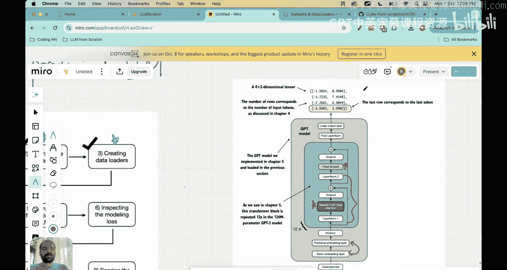

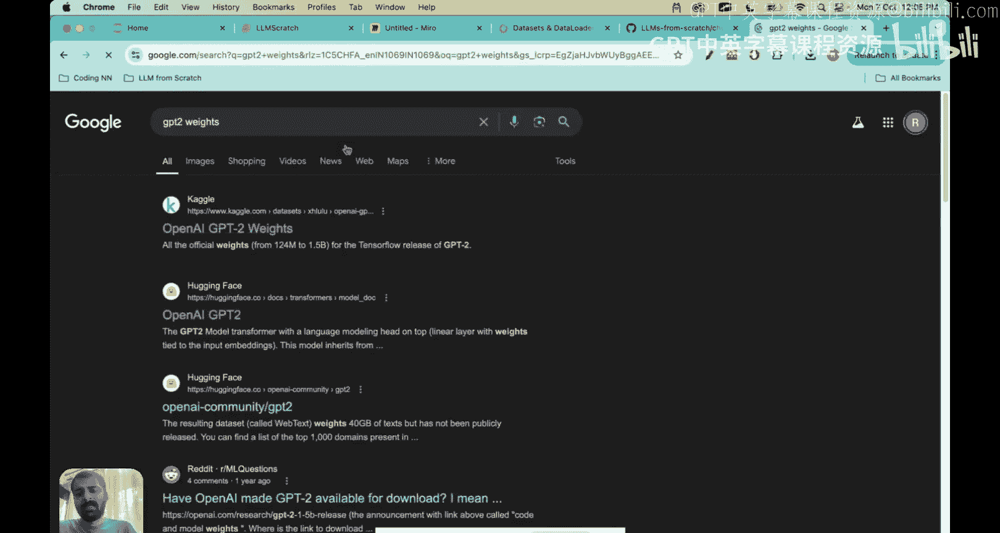

GP 2 weights release open AI actually pretrain G2 on a huge amount of data and not just that when they pretrain the LLM and optimized the。

Trainable weights optimized all of these weights which I just described over here。

 they released those weights publicly， which means that as users we can have access to those weights and we can utilize those weights。

Now when Open Air released their weights they released it for four different models。

 so if you see the open airI GPT2 weights， they released it for actually multiple models 124 million。

151558 million， 345 million，774 million etc。So you have different folders corresponding to the parameter size and then based on each folder。

 you can download these weights on your local PC。Why are we downloading these weights in the first place before find tuning the reason we are downloading these weights and reusing them is that。

When the when we reuse these weights it means that a lot of information is already captured correctly so for example when we do token embedding we want to project the words or tokens into a higher dimensional vector space right and we want to project them so that the semantic meaning is captured to train a huge neural network again from scratch here would take very a very long time for us and computational resources instead we will directly use the pretrained GPT2 weights so that will help us in fact in all of these parameters。

Reusing the GP2 weights actually helps us because the model now starts from a much more knowledgeable state instead of our random initialization。

 So the main goal of reusing the pretrained weights is that the model。Starts。From。

A knowledgeable state。Instead of。Instead of a random initialization。

So we are going to load these pretrain weights and then we are going to train on the specific data which we have curated so we are going to load the pretrain weights and then use these training data loaders testing data loaders and validation data loaders so the weights and parameters which will load from GPT2 of course they will change during the process because we will do one more training procedure on the specific data but at least we won't start from a random state of all these parameters will start from a knowledgeable state and so the computational time it will take to fine tune or to train on a specific data will be much lower so that will be much more efficient that's why the fine tuning process always happens after the pretraining process in the pretraining we always take the model to a knowledgeable state and then we train it again on a specific dataset so that it can further improve its weights and its parameters。

So now let us go into code and let us load the pretrained LLm。

 which means that let us use the weights。Whi we get from GPT2 one thing which I would like to mention here is that when we develop the spam versus No spam email classifier and when we use the GPT2 weights we use the weights from a model which is 117 million parameter but now we have to use the model which is much higher because because I saw that a smaller parameter which is 124 million parameter model does not perform very well in the instruction fine tuning task that's why we have to use a larger model so as I've indicated on the whiteboard we will load GPT2 with 355 million model 355 million which are the number of model parameters。

Okay awesome so instead of using the smallest 124 million parameter model as before we load the medium size model with 355 million parameters right and that takes approximately 1。

42 gigabytes of space so please make sure that as I am showing you the code below you have this much amount of space on your local machine。

I'm not using any fancy GPU or any high processing speed computer。

 Im simply using a MacBook Air 2020。So these these are the model configurations for which GP2s weights are publicly released and we are going to use the GP medium。

 which is the 355 million parameter model， it has the context size of 1024， it has 24。

Tranformer blocks and within each transformer block there are 16 attention heads so in choose model we have chosen GT to medium 355 million parameters and in the base configuration we have vocabulary size 50257 context length of 1024 right and dropout rate we are using0 and the query key value bias we are setting this to be equal to true and that is because when we initialize the query key and the value weight merices we are also going to initialize the bias terms。

50257 is essentially the vocabulary size on which GPT2 was traineded on。

Then what we are going to do is that we are going to run this download and load GT2 function。

 and I'm just going to show you this function briefly what this download and load GT2 function actually does is that it it accesses this URL and it downloads these seven files onto the local machine so you can even access these files on Kaaggle if you click on this 355。

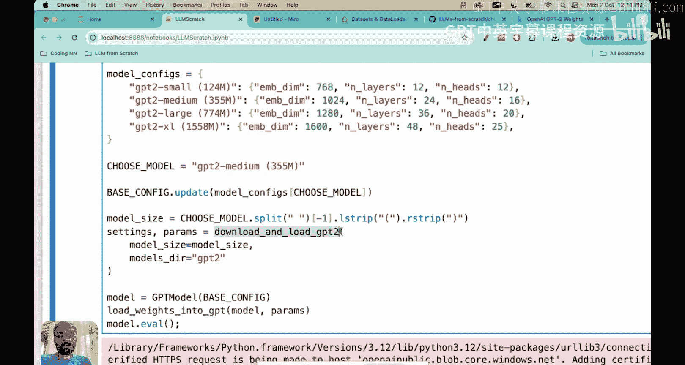

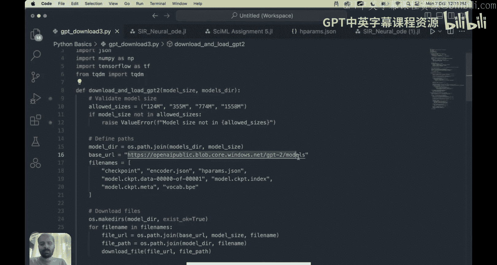

If you click on the 355 million and click on the seven files you can get these seven files and you can download it to your local PC。

 however just downloading these files is not enough you need to do some preprocessing steps on this file so that so check this function which is load GPT to parameters from the Tensorflow checkpoint what this does is that after downloading the parameters from the seven files it actually converts it into a specific dictionary。

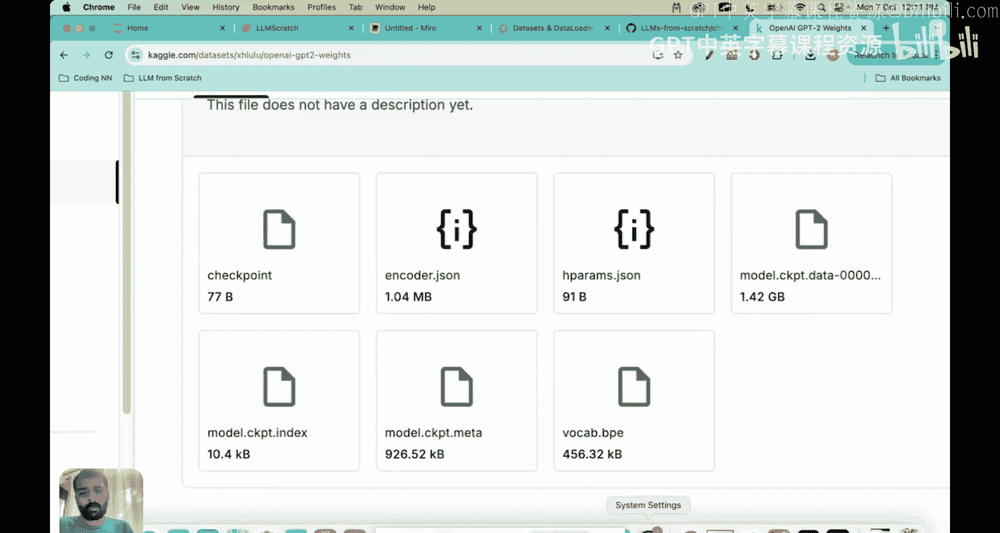

And through this dictionary， you can handle or access these parameters in a much more easier manner。

 We have covered the details of this in a previous lecture。

 which is titled pretraining using GT2 weights and that's a one hour lecture in which this code has been explained in a lot of detail for now all you need to know is that when you run this code it first of all downloads these seven files it creates a folder called 355 million and it downloads the seven files and then it also has this the thing which it returns mostly is that this parameterss dictionary the Paras dictionary essentially consists of the transformer blocks。

 the token embeddings， the positional embeddings the final normalization layer parameters which are very accessible If you just download these seven files it becomes difficult for us to integrate these parameters with the code which we have written earlier That's why it's very essential for you to。

Run this load GPT to Paras from Tf checkpoint so that the Paras dictionary is created successfully。

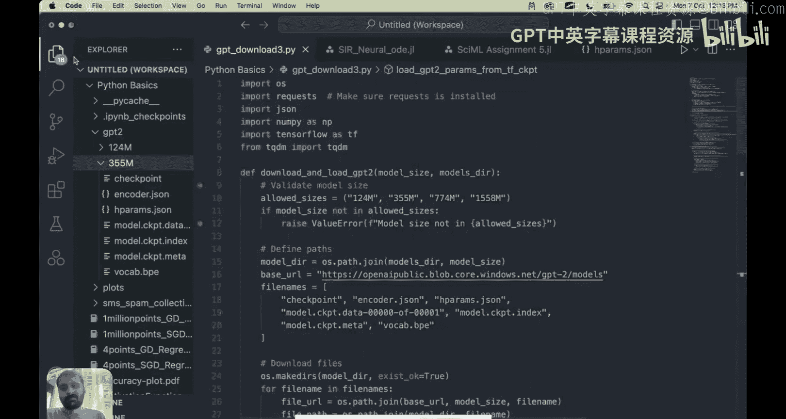

If you don't understand this code right now it is fine。

 all you will have to do is just execute this line of code which is settings comma Ar equal to download and GPT2 what this will essentially do is that first of all from GPT download 3 we have to import this function so this file which I showed you over here is called GPT download 3 do Py from this file we are importing this function and the results of that function we are storing in something called settings comma Ar so when you run up till here。

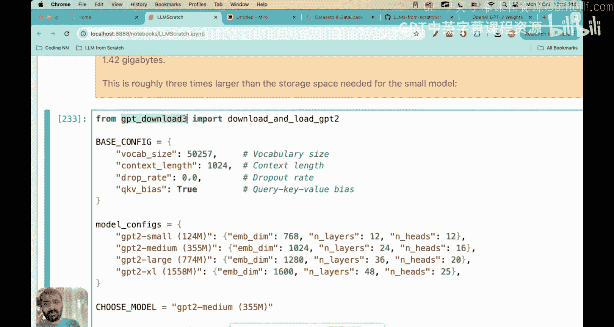

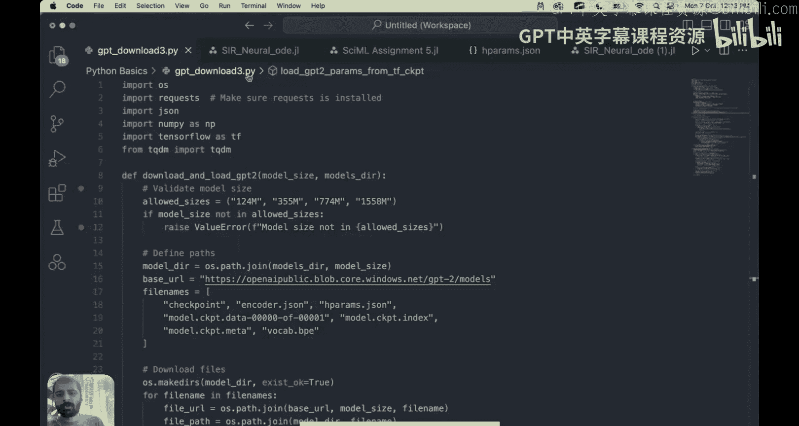

The 1。42 gigyte model which has been shown over here so see this is the 1。

42 gigys that will be downloaded so for me this took a long time to download because the internet connection was not very strong and the file kept pausing a lot in the middle。

So please make sure that you are sitting in an area which has strong internet connection and you have memory on your device if you have 1。

4 or 1。5 gigytes in a strong internet area， I think this download should happen in a much quicker manner。

And then what we are going to do is that after we download these weights we are going to load weights into GPT what this function does is that we have constructed this GT architecture rate at all of the places where there are trainable parameters this function appropriately maps the downloaded parameters in the Paras dictionary into our model so remember I mentioned that this function essentially returns this dictionary called as Paras in which the weights and parameters have been arranged in a specific format when you run this function load weights into GPT the parameters from that parameterss dictionary downloaded into our model。

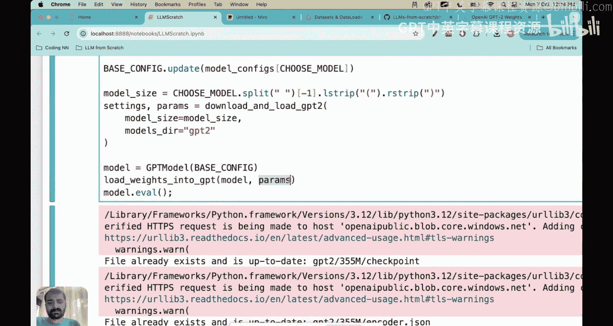

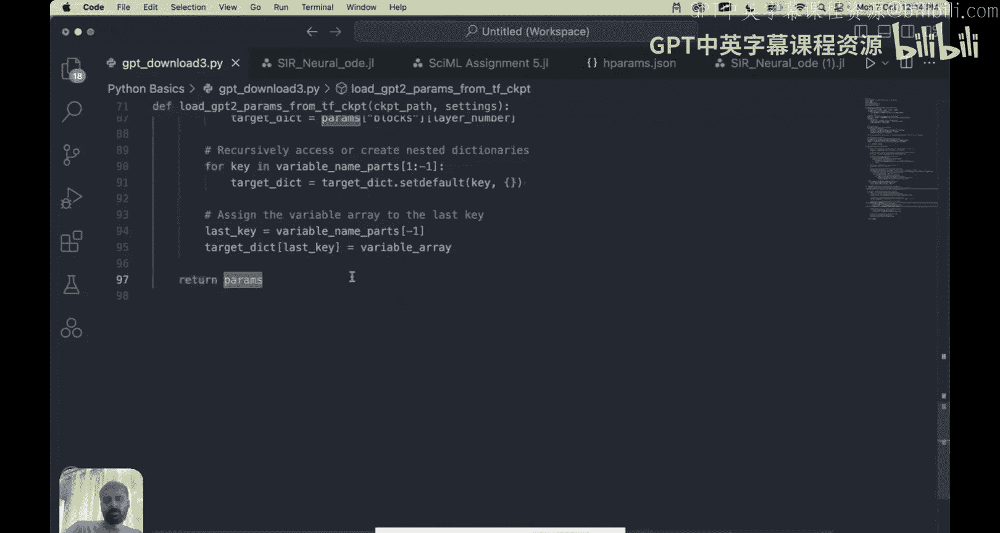

And you can actually control F。Control F load。Ld。Wes into GP and you'll see that we have defined this function before load weights into GPT what this function essentially it does is that the Paras dictionary it maps the values extracted from the Paras dictionary into the GP architecture which we have constructed before so you can think of this whole code code block as one assignment step we are assigning the downloader parameters to our model we have had a separate lecture to explain this fully so I'm not covering this in detail right now let me take you to the current code which we are on so then you have to run after you run the settings from parameters then you have to run load weights into GP which loads the downloaded weights from the 355 million model into。

Your GPT architecture， and then you set the model into evaluation mode。

So if your laptop does not have a strong configuration with respect to memory or processing speed。

 you can even choose the model here to be GPT too small。

 which has 124 million parameters and that should take you one third of the time or half of the time it takes you to load the weights of this GPT2 medium model。

If on the other hand your laptop has a very high processing speed and if you have GPU access。

 I recommend you can use GPT too large or even GPT to Excel if you have GPU access。

 because then the results which you will get will be much better than what we will obtain with smaller models。

Okay， when you run or when you run this file， you will see that you look at outputs such as these I have already downloaded the GPT2 parameters。

 so I am getting file already exists。Now what we can do is that before diving into fine tuning the model which will come through in the subsequent section。

 what we can do is that we can actually check the pretrained LLM's performance on one of the validation tasks by comparing its output to the expected response we have not even trained or fine tuned our LLM on the dataset yet on this dataset but I just want to check the performance of this LLM by taking some very specific example so what I'm going to do now is that I'm going to take this example from our data and the example is that below is an instruction that describes a task write a response that appropriately completes the request。

And the instruction is that convert the active sentence to passive and the sentence is the chef cooks the meal every day。

And you can see that I've taken the sentence from the validation data。

 it is the first sentence from the validation data。

 so actually let me check it out over here so if I put chef。Yeah。

 this is the instruction input and output， so the instruction is convert the active sentence to passive。

 the chef cooks the meal every day。And the correct output。I think of convert word。

Yeah I think this is the one let me check it again yeah the instruction is convert the active sentence to passive the chef cooks the meal every day it is this sentence exactly and the correct output is the meal is cooked by the chef every day so if if the LLM is fine tuned correctly the output which it should give should somewhat be of a passive tense so if the active tense is the chef cooks the meal every day the passive tense should be the meal is cooked by the chef every day。

We have not trained a LLM on this data at all， so we are not expecting to get a correct answer。

 but I just want to see how wrong we are or how far off we are from the correct answer。

So you can use the generate function which you have defined previously what this function does is that you have to pass in the maximum number of new tokens to generate and then based on the model and based on the trained weights。

 remember we are just using the weights downloaded from GPT to medium based this based on these weights the next tokens so the new tokens will be generate new tokens will be generated and here we have to specify the maximum number of new tokens which I'm mentioning to be 35。

And the context length is， of course， 1024， which is the context length of the medium configuration。

Thats it actually and then you have to pass in the input text so I am passing in the input text over here and then the model which is the model with the pretrained waves and then the generated text we have to convert it back from token  IDs into text。

So let us print this out right now and let us see the response。

So the response here so one thing to mention is that when you use the generated text it returns the combined input as well as output this behavior is convenient in the previous chapters because pretrained LLms are primarily designed to complete the text right so we can predict the input and we can predict the output so it will just look like an input output where where the input is completed but now we actually just need to focus on the model generated response right every time we print the generated text we don't need the input text we don't need the instruction we just need the response right so now what I'm doing is that when you print out the response we need to subtract the length of the input instruction from the start of the generated text。

So we have to just print out the response here， so we mentioned that you subtract the input。

 you subtract the instruction and just print the response text。

 so here is the response which our model gives。The response which is given by the model is the chef cooks the meal every day。

 so it has just recycled the first sentence。In the response itself it is included as an instruction and in the instruction it is retaining the same instruction convert the active sentence to passive if the chef cooks the。

 which means that the model has not at all followed my instruction。In fact。

 the pretrain model is not yet capable of currently correctly following the given instruction。

 it creates a response section that is good。But it simply repeats the original input sentence。

 it simply repeats the original input sentence and it also repeats a part of the instruction just as it is。

But it fails to convert the active sentence to passive voice That is the main thing which I want to convey to you that without fine tuning the model itself just using the pretrained weights it is not doing a good job at all In fact it fails to convert the active sentence to the passive it is recycling the same text which you provided as an instruction and it's creating this hashtag hashtag hashtag instruction in the response itself that is also not good。

So now what we will do in the next section is that we are going to implement the fine tuning process to improve the model's ability to comprehend and appropriately respond to such requests。

 so the reason fine tuning exists in the first place is because without fine tuning even if we load the weights from parameter which is。

355 million or even if you load from 774 million you will see that even for 774 million GP to GPT2 model。

 the response is not coherent without fine tuning and thats why in the next section we are going to look at fine tuning the LLM on instruction data。

 which means that we will actually model or will actually modify the weights and parameters of this GPT model so that it can try to understand this instruction input output paths from this specific data set。

Okay everyone this brings us to the end of the lecture where we looked at loading a pretrained LLM I initially plan to cover the fine tuning in this lecture itself but I thought it will be good to cover it in the next lecture otherwise the duration of the lecture would have been pretty long I hope you are liking these lectures we are now very close to actually finishing the entire fine tuning and then extracting the responses evaluating the responses and the code file which I'm going to share with you can be used to perform a wide range of instruction fine tuning tasks so thanks a lot everyone in the next lecture I'll explain the fine tuning the model process and I look forward to seeing you in the next lecture。

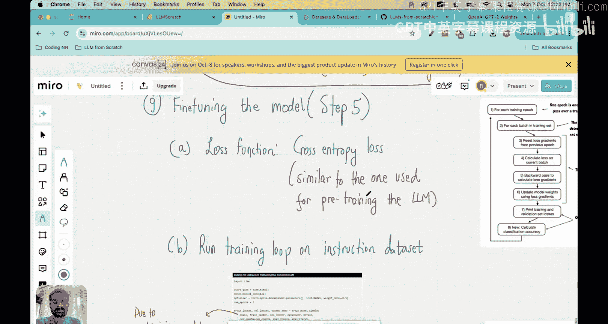

。