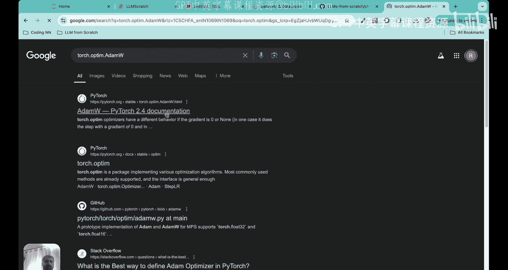
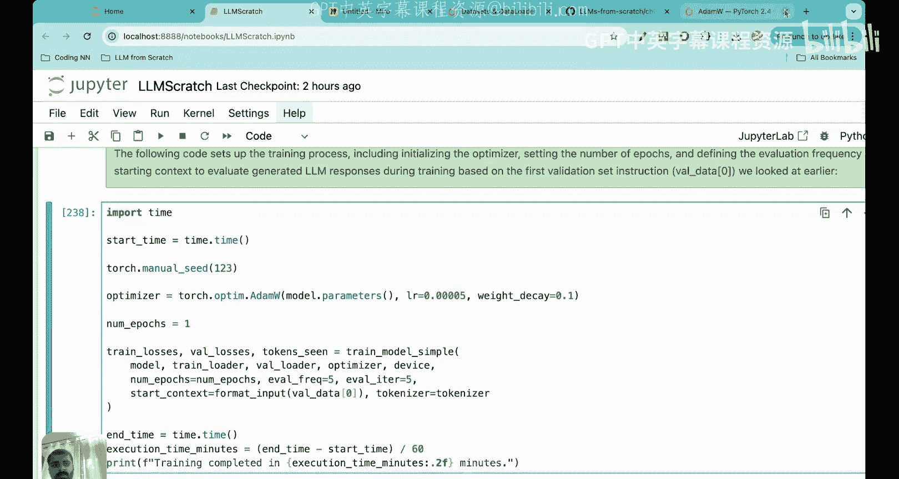
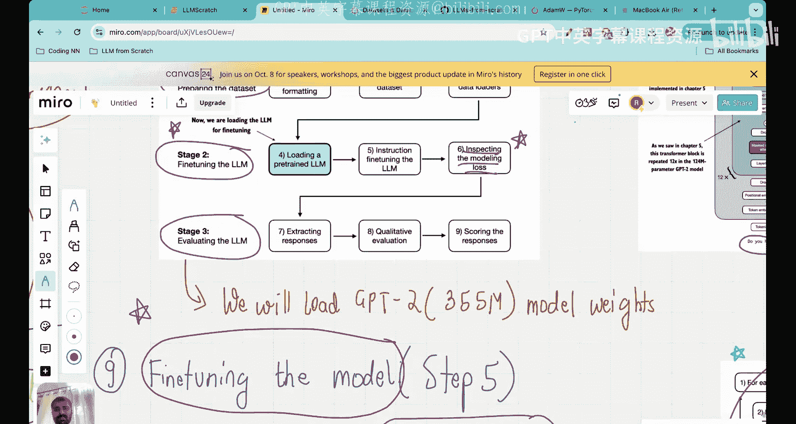

# Vizuara《从零开始搭建大语言模型｜Building LLMs from scratch》中英字幕（Claude-3.7-s） - P39：-41-LLM fine-tuning training loop _ Coded from scratch.zh_en - GPT中英字幕课程资源 - BV1qG8HzUE2D

🎼Yeah。Hello everyone and welcome to this lecture in theBuild Lage language models from Sctch series。

Today， we are actually going to fine tune the model which we have been developing for the past four to five lectures。

We have been looking at an example where we do have a pre traineded LLM。

 but the LLM is not really good enough to understand or follow instructions。

So we want to employ instruction fine tuning。And to do this we have been following these three stages the stage one is preparing the data set。

 we have implemented this stage where we downloaded the data and formatted it using the Alpaca prompt format。

 then we divided the data into multiple batches and then we created the training。

Testing and the validation data loaders。That was the stage one on preparing the data set。In stage 2。

 which is fine tuning the LLM， what we have done in the previous lecture is that we have the LLM architecture which looks something like this。

And we have loaded this L architecture with pretrain weights from GPT model。

 so we have used the pre pretrained weights from GPT2 355 million parameter model。

And we have kept our architecture ready now with these pretrain weights。

And now the stage is set for us to fine tune the LLM what this means is that we already have pretrained website。

 but we have not yet trained this LLM on data set on the instruction data set。

This is the instruction data set， which。We have been using in this hands on example and which we will fine tune the LLM1。

 so this is a data set which consists of 1100 instruction input output pairs。

And our hope is that when we train the weights of the LLM again。

Using this instruction data set it will get much， much better at responding to instructions。

 so let me show you in code where we ended the previous lecture in the previous lecture we just had the pretrained LLM without any fine tuning and we asked the LLM the question that。

Use this particular input and instruction， so the instruction was convert the active sentence to passive and the sentence was the chef cooks the meal every day。

The output which the LLM gave was the chef cooks the meal every day and instruction convert the active sentence to passive Basically it just regenerated the same thing what we had given as input it did not it was not able to convert the text into into from active to passive at all。

So， as you can see， the response section was created。

 but the LLM simply repeats the original input sentence and part of the instruction and it fails to really convert the active sentence to the passive sentence or to passive voice as requested。

This is the stage which we are in right now， and we want to really improve the LLM performance。

When it receives an instruction， So what will be doing is that if you look at this architecture。

 there are number of。Areas where there are rainable parameters right token embedding has rainable weights positional embedding has rainnable weights layer normalization has the scale and shift parameters which are trainable the multi head attention has the query key and value weight meta rise which are trainable again layer normalization has rainable scale and shift the feed forward neural network has rainable weights the final layer normalization and the final output layer also has drainable weights。

We will train this architecture again on this particular data set。

 which I just showed you this instruction data so that the weights are optimized and the LLM can answer the instructions pretty well。

So then your question would be why did we pretrain the LLM if we are training the LLM again on this specific data set well the reason we pretrain the LLM is because now the model essentially starts from a knowledgeable state。

So due to pre training， the model starts from a knowledgeable state instead of a random state。

If we just started from a random state then it would have been extremely difficult for the model to learn everything based on this limited data at least through pretraining the model is able to understand so many things such as the semantic meaning of words when it is given a text it knows what to respond it cannot follow instructions thats fine but at least it can know the semantic meaning between different words it knows it knows a lot about the language itself。

Due to pre training and that helps us to set a foundational knowledge base before we fine tune on the specific data so fine tuning as a process always comes after the pre training stage。

So let us go ahead and begin the fine tuning process now before we do the fine tuning we need two things we first of all need to understand the training loop。

 which is this loop and the second we need to understand the loss function。

One thing I would like to mention here is that the training loop and the loss function is exactly the same as the training loop and the loss function which we had looked at when we pretrain the model。

So just to revise heres the training loop， what we do is that we go through each batch in the data。

 we calculate the loss gradients， we reset the loss gradients in a new epod in a new epoch then we calculate the loss on a current batch and then do the backward pass in the backward pass we essentially calculate the gradient of the loss the partial derivative or the gradient of the loss with respect to all of the parameters and remember that here we have 355 million parameters。

We will calculate the partial gradient of the loss with respect to all of these and in the update step we will use and we will use a gradient descent based optimizer which looks something like this so this is the simplest form of gradient descent w new is equal to w old minus alpha times the partial derivative of loss with respect to w。

And well do this many times and we hope that the parameters eventually get to a stage where the loss function is minimized。

So if the loss function landscape looks something like this。

 initially we start somewhere here and then we later go down to the bottom of this valley and hope that the loss function is minimized。

 right？Now if this is the training loop then we will need to know what the loss function is and the loss function is essentially obtained from the input and target pairs so remember when we created this data loader every data loader essentially has input and target pairs。

So。Let me write this down over here， so let's say we looked at we are looking at batch number one。

Batch number one is eight sample， sample one sample two。

 so each batch has eight samples because we have set the batch size to be eight and in each sample we have the input。

And we have the target。And since it' is the next token prediction task。

 the target is just the input which is shifted to the right by1 and we add the end of text token。

 you can think of the target as the true value which we have。True value and then to get the loss。

 we need a predicted value， right？So I'm going to write here predicted value。

And the predicted value is obtained from the generate function。

 so remember in the last lecture we discussed about the generate function where given an input we generate the next token 90s so essentially what happens is that when an input took text or a。

Yeah a sequence of input tokens passes through this GPT architecture。

 which I have shown to you right now， so let's say the input instruction is con to passive it will pass through this GPPT architecture and then when it comes out of the GPPT architecture we have something called as the logicit stensor。

That is then converted into a tensor of probabilities。

And through this tensor of probabilities we get the predicted output of the LLM that is not the true value but that is the predicted value and then based on the true value and the predicted value we then compute the loss function。

So based on the true value and the predicted value。

 both of these values will be needed to then calculate the loss function。

And this loss function is the categorical cross enpis。Or rather， it is the cross enpis。

The simplest way to think about cross entropy loss is that it is negative of the logarithm。

 so essentially since probabilities are involved we want the probabilities to be as close to1 as possible so that the loss function decreases and becomes as close to 0。

I am not going into the details of this because we have already covered this in a lot of detail when we learned about LLMP training。

 but I am just giving you a qualitative flavor for you to understand what is the loss which we are trying to minimize over here so this is the loss function which is the crossenttropy loss once the loss function is defined then all we need to do is learn the training loop on the instruction data set。

So the data set is already divided into input and target pairs。

And we have spent the last three to four lectures dividing the data set into input target pairs and constructing these data loaders。

 all of that hard work will come into use right now。

So now I'm going to take you to the code and we are going to find tune this model together。

Great so we have already done the hard work when we implemented the data set processing including the batching and creating the data loaders now we can reuse the loss calculation and training functions which we have implemented in3 training。

So， as I told you here are some functions which I have collected here and will will be reusing these functions the first function is the calculation of the loss on a batch of data so here you can see is the cross entropy loss which I have mentioned over here。

The crossenttropy loss and then when we want to calculate the loss over the entire data loader。

 we just take a summation of all of the summation of losses calculated in individual batches and then to normalize the total loss we just divide by the number of batches that sorts happening in the calculation of loss in a loader so the same function can be used and if you want to calculate it for the training data loader we pass the training loader if you want to calculate the loss for the testing or validation we pass the test loader or validation loader respectively。

Then the training loop which I have described over here。This traininging loop。

Or I should mark this entire thing this entire training room。

Training loop we have we have written a code for this before when we looked at three training and this essentially the most important part of this code is the backward pass where the gradients of the loss are calculated and then we do this optimizer step so you implemented a simple vanilla gradient decentcentrate the actual optimizer which is used is Adam with weight decay so you can either use Adam or you can use Adam with weight decay which is a W。

That is the optimizer we'll be using and then the remaining of the code is just about printing the loss which we obtain at different iterations and then visualizing the testing loss visualizing the validation loss and visualizing the training loss together so as you can see here we are going to print the training loss and the validation loss。

Yeah， so initially before we even begin the training。

 let us first calculate the training and the validation loss。

Initially the training has not yet happened on this data set。On this data set。

 I have not yet run the training loop， I just want to see the loss at the initial moment so here if you see。

This is equivalent to being at this early point where the training has not yet started so the loss will naturally be very high I just want to see the training and the validation loss so the training loss is 3。

82 and the validation loss is 3。76 so this is pretty high and we are to bring both of these losses together。

Now the model is prepared and the data loaders are prepared， we can now proceed to train the model。

So now the code which we are implementing below it sets up the training process including initializing the optimizer setting the number of epos and defining the evaluation frequency so here you can see we define the optimizer which is storage dot optim dot addw so let me just。

走。

Dot optim dot Adamw。So this is the aom with weight decay optimizer which we are going to use if you don't know AdamM works it's fine but its the most widely used optimizer I would say in machine learning algorithms these days。

 it keeps a track of the gradients of the loss function。

 it keeps a track of the gradient square also and it is just very useful to prevent local minima。

And to accelerate the calls。That's why the Adamm or the a W optimizer is predominantly used。

 we are using a learning rate of 0。00005 and the weight decay of 0。1。

 Now please note that these are hyperparmeters， which means that you can change them and you might obtain better results。

 These are just some parameters which we have used right now and they lead to reasonably good results。

 I encourage all of you who are watching this video and will later receive access to this code file to change these hyperparameters as much as possible so that you see the results for yourself and you see how the results are improving or not improving。

 you learn a lot through this process。So this is the train model simple。

 we define the train model simple code over here， we need to pass in the model。

 we need to pass in the model， we need to pass in the train loader the validation loader。

 the optimizer which is the aW the device which is CPU in my case I'll come to this device in a lot of detail very soon then you have to specify the number of epochs so I have defined the number of epoch equal to1 we have to specify evaluation frequency so here you see when we start printing out after every five batches and'm printing out the results you can change this based on after how many iterations you want to print out the results all of this is mentioned in this part of the code where evaluation frequency another parameters is evaluation iterations which also shows essentially evaluation iterations is after how many iterations you are caliculating the loss on the evaluation dataset。

An evaluation frequency mentions after how much frequency you want to display that loss。

So here we are setting both to be equal to 5， which means that after five batches are processed。

 the evaluation loss will be calculated and it will be printed also。

Then you have to give a start context， so as I've mentioned over here。

We have to give a starting context to evaluate the generated responses during training based on the first validation set。

So the first validation which we are giving is format input and that is validation data。

 So that is the first validation data which we are going to give as the start context and that is because if you see the。

Example which we have taken over here， the example which we have checked is validation data0 and that is convert the active sentence to passive the chef cooks the meal every day now for this same example we want to check what the fine tune Llm responds so that is why we have used this as the start context。

So the number of tokens which will be printed or the output will be starting from this particular instruction。

All right， so。Now， one thing which I would like to mention over here is that。

The time it took for me to run this code and the configuration of the laptop， which Im using。

So first thing to notice that I am using number of epoiclequil to1 because if I use number of epox equalql to2 it crashes my laptop and it takes a huge amount of time for the training process thats number one number two I'm not using a GPU over here which I highly recommend you to do Im using a simple CPU so my configuration here is MacBook Air 2020。

So if I type my book error 2020 configuration。Yeah。

 this is the this is the configuration which I'm using right now Im I just have8 Gb of Ram。

I think I have I have 8 Gb of RAm over here and I am not using a GPU I'm running it on a CPU so this is a pretty basic configuration。

 but I want to run it on a basic configuration to show you the results even without using fancy GPUs。

So if you have access to GPU， I would highly recommend you to connect to a Google Collab GPU instance or rent out an AWS EC2 or a GPU instance from Amazon。

 I'll make a tutorial on it pretty soon。But here you see I am using number of epoch Sql to one on my CPU MacBook Air and when I run this you will see that just for one epoop it took two hours for me to run this code。

Now if I would have changed this to2， it would have taken four to five hours plus it was crashing my system。

 so I am not on a very optimal system here， but if you have a laptop with minimal configurations I will return this code so that it will run on your end as well。

So now you can monitor the training and validation losses you will see that the training loss goes on decreasing I am doing only one epoC and there are 115 batches here so it runs for all of those batches for one epoC and then you can see that the training losses decreased and the validation losses also decreased sufficiently。

Now， let us see the response。 So I am also printing out the。AResse based on the start context。

 so now the instruction was that instruction was converted the active to passive the chef cooks the meal every day and here's the response the meal is prepared every day by the chef end of text。

Isn't that awesome， this is almost close to the correct passive tense the correct passive answer is the meal is prepared or the meal is cooked every day by the chef and here instead the meal is prepared every day by the chef。

So it is almost exactly correct whereas earlier if you if you saw the earlier output without fine tuning the LLM so without fine tuning the LLM it could not convert the active into passive we just recycle the same text which we are given in the instruction but right now when we fine tune the large language model on this custom data set so this was the data set with 1100 instruction input output pairs when we fine tune the large language model on this we can see that the response is passive in the passive tense which is awesome which is exactly what we wanted and then the LLM continues with the rest of the generation but essentially here I've demonstrated that using fine tuning。

And just by training on one epoch。Just by training 401 epo on a machine which has no GPU。

 you can still obtain good results in two hours you are able to generate active active tensets。

 the chef cooks the meal every day to passive tents the meal is prepared every day by the chef。

So I I have checked this for two epochs on a system with a better configuration and just with two epochs you can get it to the correct response that the meal is cooked by the chef every day instead of prepared。

So just by increasing the number of epos from one to two， you actually get to the correct answers。

So as we can see based on the output about the model trains well as we can see from as we can tell based on the decreasing training loss and the validation loss values and based on the response text we can see that the model almost correctly follows the instruction to convert the input input sentence from active to passive awesome we have an evaluation section later in which we will learn how to evaluate the responses of our LLL we cannot just qualitatively say that this is good this looks good etc。

 there is a whole separate field of LLM evaluation and that is the subject of active research right now if you have quantitative mathematical answers it's very easy to say。

You scored this much but what if the answer is qualitative like the response which we just got right now how do we evaluate LLms in that case we look at that in one of the next lectures but for now lets just go ahead and plot the losses so here you can see Ive plotted the training loss and haveve plotted the validation loss for one epoch。

And you can see that the model's performance on both the training loss and the validation training and validation set improve substantially over the course of the training。

There is a rapid decrease in losses during the initial phase。

 which indicates that the model is quickly learning meaningful patterns and representations from the data。

Then as training proceeds to the second epoch the losses continue to decrease but at a much slower rate suggesting that the model is fine tuning its learned representations and then it is converging to a stable solution that's how you should evaluate this plot already we can see that the validation loss is still a bit higher and the training loss has the potential to go down further but due to memory and compute require compute limitations I was not able to increase the number of epochs。

But I highly encourage you to do so if you do have the compute power， if you do not。

 and even if you reach this stage， it's awesome because now you have implemented fine tuning on your own local machine。

So while the loss plot indicates that the model is training effectively。

 the most crucial aspect is its performance in terms of respect in terms of response。

 quality and correctness。So although the loss function looks good as I mentioned earlier we need a way to evaluate the responses of this model。

 we need a way to say whether the responses make sense how well the responses look qualitatively do they really answer the question which has been posed and that is why there is a separate lecture which we will devote to evaluating the large language models in this case。

So today was a very important lecture because we successfully fine tuned the instruction。

lararge language model and we demonstrated that without using this fine tuning data the model cannot follow instructions。

 but when you use the fine tuning dataset it really learns to follow instructions very well and I will demonstrate this further in the next lectures as well but one of the outputs so if the if the input is something like this rewrite the sentence using a sile sile means using similar kind of meaning so the car is very fast the correct response is the car is as fast as lightning and the model our model predicts the car is as fast as a bullet A right it really learns how to。

How to answer based on the instruction which has been given sometimes it does make mistakes because we are training for only one epoch but we can clearly see that if you train it for more epochs it will get better and better and better and it is learning the instructions。

So thanks a lot everyone， this brings us to the end of today's lecture where we learned about。

LLM fine tuning which is probably the most important step in instruction fine tuning so now if you look at this flowchar let me rub all of this and show you till where we have reached in this flowchar in this flow chart we have reached this stage where we even inspected the modeling loss so we have finished stage one which is preparing the data set we have finished stage two fine tuning the LLM in the next lecture we will move to stage3 which is evaluating the LLM。

So thanks a lot everyone， I hope you are liking these lectures which are a mix of whiteboard plus coding approach。

I look forward to seeing you in the next lecture。

。

