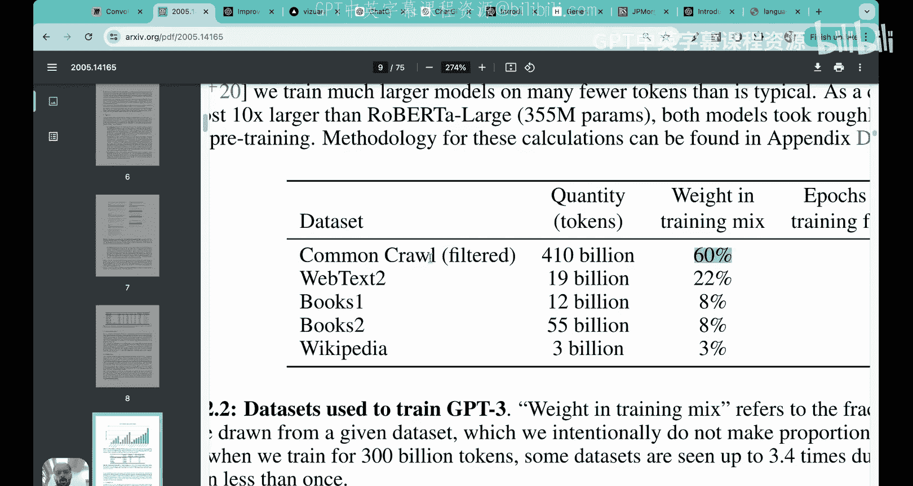
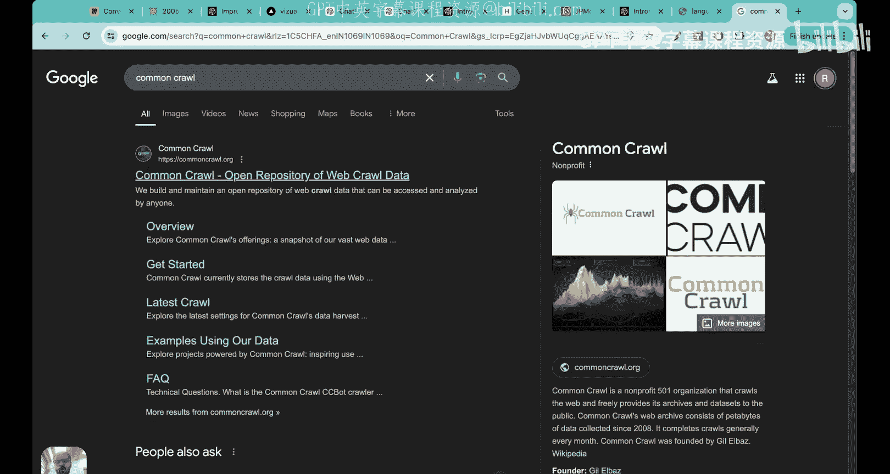
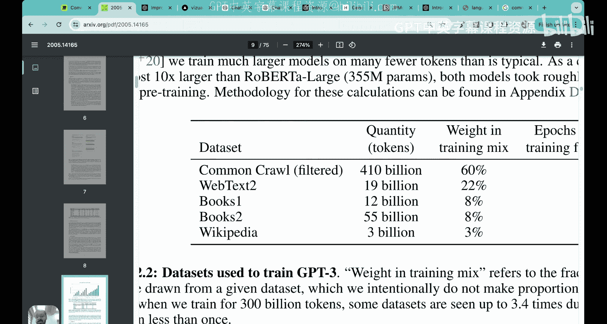
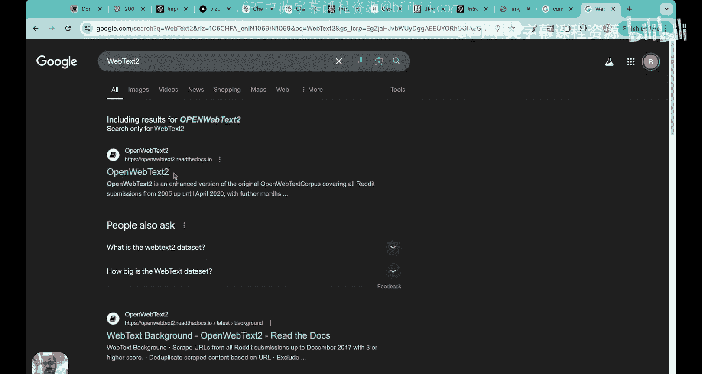
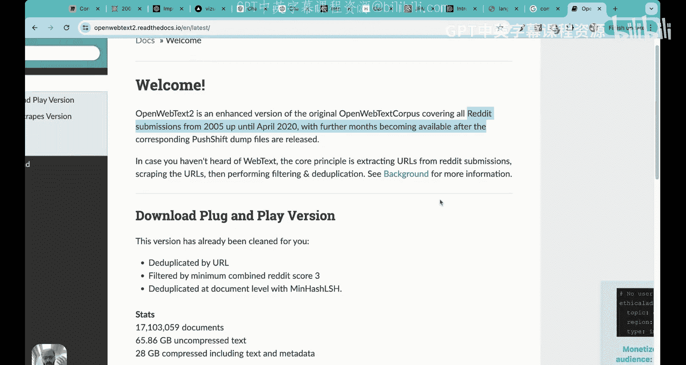
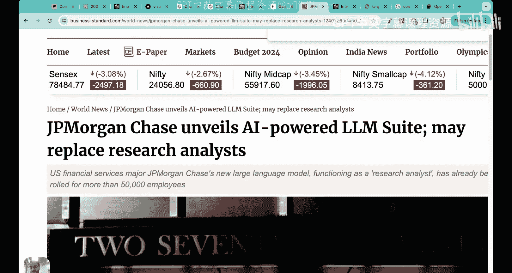
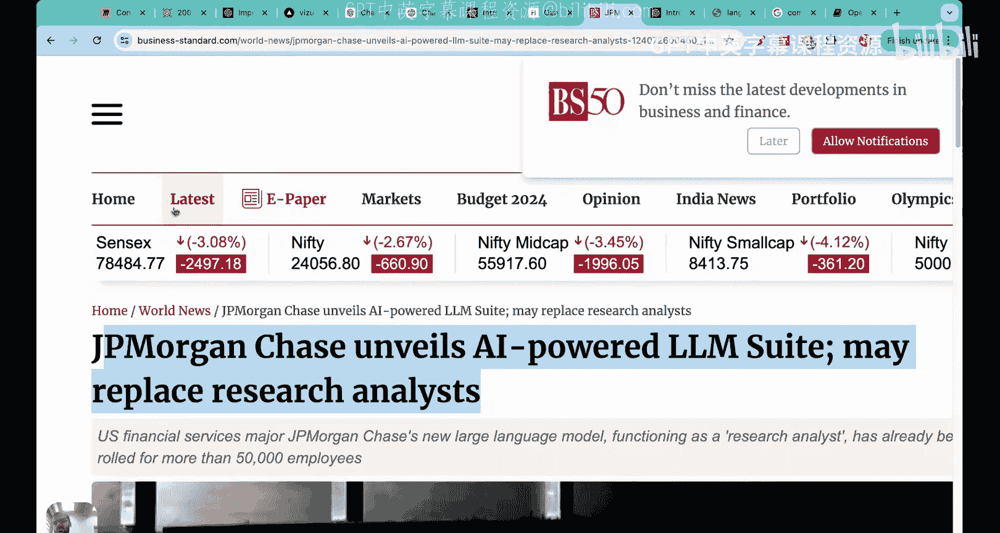
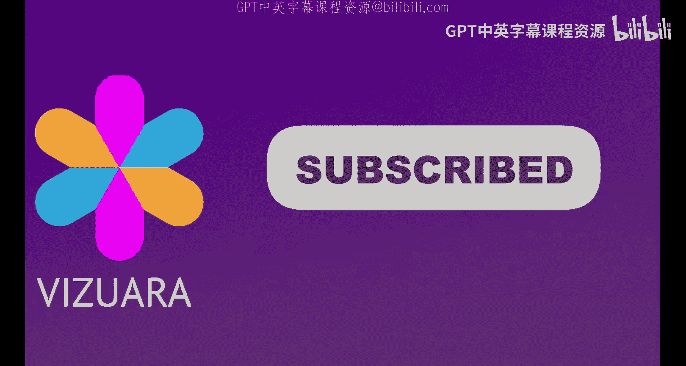

# Vizuara《从零开始搭建大语言模型｜Building LLMs from scratch》中英字幕（Claude-3.7-s） - P3：-03-Lecture 3_ Pretraining LLMs vs Finetuning LLMs.zh_en - GPT中英字幕课程资源 - BV1qG8HzUE2D

🎼，Hello everyone， welcome to the third lecture in the building La language models。

 LLM from Scratch series。Today we are going to cover the topic which is titled stages of Building Large Laage models。

In this lecture I'm going to call large language models as LLMs henceforth。

 so whenever I use the term LLM， you can think of the terminology as large language models。

So let's get started with today's lecture in the previous lectures we have covered a couple of important things in the last lecture we looked at the basics of large language models where the terminology LLM is actually derived from then LLM sources earlier NLP models。

We also saw that whats the secret sauce behind large language models， what really makes LLM so good？

Then we looked at the difference between terminologies， what is LLM， what is Gen AI deep learning。

 machine learning artificial intelligence， what are the similarities and differences between all of these terms。

And then finally， we also took a look at some applications of large language models。

If you have not gone through the previous lecture， I would highly encourage you to quickly go through that lecture before watching the current one since the flow of the lectures has been organized in a very specific manner if you are watching this lecture as the first one in this series welcome to this series。

So now in the stages of building LLMs， there are basically two stages which we are going to look at。

 creating an LLM involves the first stage which is called as pre training and second stage which is called as fine tuning。

In this series we are going to build our own LLM from scratch right so we are going to be looking at both of these stages for this you need to first understand what exactly is pretrain and you also have to understand what exactly is fine unit so let us initially look at pre training first。

Basically three training just means training on a large and diverse data set。

What does this mean so we have all interacted with chat GPT right let me show you an interaction right now。

Let me open my。Cha GT prompt and let me interact with it。Okay， so let me ask。

Y itself quiz me on ancient civilizations， Can you test my knowledge on ancient civilizations right I'm interacting with this large language model here。

Now pretraining basically answers the question how can this LLM interact so effectively with me。

 how is it able to answer all of my questions， how is it able to understand what I am speaking as a human and how is it able to respond so accurately and so correctly。

And the way LLMs do that is because they are traineded on a huge and diverse set of data。

So G3 which was the precursor or which came before GP4 which is right now the latest ILM by openaiI G3 had 175 billion parameters and it was trained on a huge amount or a huge corpus of data so let me just show you that data this is the original paper on GP3 which I'm showing on the screen right now I'm sure it has a huge number of citations but I just want to show you the places from where they got their data so look at the amount of data which was used for now you can think of one token as equal to one word。

There is a bit of detailing here but that is not the scope of today's lecture。

 so for the purposes of this lecture just think of one token to be equal to one word approximately。

So when GPT3 was trained。They took 60% of data from common crawl common crawl is basically let me show you what common crawl is so if you type common crawl on Google you will be taken through this which is basically a huge and open repository of all the data on the internet so they took 410 billion words from this data set imagine this let's say one word is or let's say one sentences 10 words this means 41 billion sentences were taken from the common crawl。

20 billion words or around one to2 billion sentences were taken from web text 2 so if you search web text 2 here you will see。

This is a corpus of a huge amount of data， which consists of。Rdit submissions， let's say， then。

Block post， stack overflow articles， scores， all of this data was incorporated as the data set。

Not just that they also show you the data which they got from books。

 so from a large number of books they got around 12 billion plus 55 billion which is 67 billion worlds from books and from Wikipedia。

GPT3 got 3 billion as training data from Wikipedia。So overall。

 GPT3 was trained on 300 billion tokens or approximately 300 billion worlds。

And you can think of it as well kids are growing up， their parents teach them about stuff， right。

 and they remember that stuff。The reason LLMs like what I showed you here perform here right now perform so well is because they are trained on a huge amount of data。

So initially， when large language models were actually trained on this data。呃。

They were trained for the task， which is called as word completion， which means。

You are given a set of words， let's say you are given this sentence。The lion。Is in the。Dash。

So this next word is not known and Cha GPT then predicts or LLms then predict this word as let's say For。

LLMs were trained on this type of a task initially with such a huge amount of data。

What really surprised people was that？Even if you train the LLM for this simple task。

 it turns out that it can do a wide range of other tasks as well。So for example。

 when Open AirI released a paper in 2018。Related to pre training which we are which is what we are discussing right now。

 here is what they have written so I am showing you this blog post from OpenaiI and they have written this sentence。

 please look at this sentence carefully we also noticed that we can use the underlying language model to begin to perform tasks without even training on them。

For example， performance on tasks like picking the right answer to a multiple choice question steadily increases as the underlying language model improves。

This means that even though you just train the LLM for predicting the next world like how I mentioned to you before。

 it turned out that the LLM can also do variety of other things such as translation。

 such as answering multiple choice question， such as summarizing a text then sentiment detection etc。

In fact， it can do all of these analysis， sentiment analysis， linguistic。

 acceptability question answering。And we did not specifically train the LLM on any of these tasks still just。

Even if it is trained for predicting the next word it could do all of this tasks so well and that's why LLMs have become so much popular than natural language processing because in NLP let's say you want to make a language translator you need to train it separately。

 let's say you want to make a quiz answer chatbot you need to train it separately。

 let's say you want to make a。An AI which detects emotion from the text。

 you have to train a separate NLP model。But with pre training LLMs。

 you get one model which can do all of these tasks on its own without ever being trained for these tasks。

So when I'm interacting with GPT right now and when let's say I'm answering asking the question。

Gedrate4 MC CQs for me。In the topic of Egyptian civilization。

It will generate those MCCQs for me right and it was specifically not really trained for generating these questions。

 but the pre training was so good and it was done for such a huge amount of data that it is good enough to perform other tasks as well。

For example， here is a app or a dashboard which we ourselves have created at our company if you want to generate let's say CPU questions and you can give certain things like I want one hard question。

 one medium question， one easy question and the total number of questions I want is three and the grade level is5 and the topic I want let's say is photosynthesis。

Maybe I can put grade level to seventh and then I click on generate。You will see that this is an LLM。

 which generates this MCQ question which is one hard， one medium， and one easy。

So we are making an API call to GP4 for this， which was not specifically trained for this MCCQ generation。

 but it does a wonderful job of this， so that's essentially what pretrain is pretrain means training and LLM on a huge amount of data so that it can do a wide range of tasks that's it。

So then you must be thinking that what's this second thing called fine tuning？

Because you can get all of your work done just on GPT4 rate， which is probably only pre traineded。

So why why is the second stage which is fine tuning， why is that really needed？

The reason fine tuning is important is because。Let's say you are a manager of an airline company or you are the CEO of an airline company。

And you want to develop a chatbot so that users can interact with the chatbot and the chatbot responds。

 let's say user can ask some question like， hey， whats the price for the Lufthanza airline， which。

Lves at 6 PM。 Now， the response which you want is very specific to your company。

The response which you want is not generic response which is collected from all the places on the internet。

So if you just use the pretrain model。And if you use that model to build the chatbo。

 it has been trained on a huge amount of data， not just your company data。

 maybe the pretrain model does not even have access to your company data。

 so the answer which will come is pretty generic， it will not be specific to your company。

 it will not be specific to your application。Secondly， as I showed you before。

 we can use Ch GP2 to generate multiple choice question。

 but let's say if you are a very big educational company and if you want to develop really very high quality questions。

Maybe you should not just rely on the pre trade model and you should fine tune the model so that it is better for your specific application。

So the main preposor of fine tuning are it is basically a refinement on the pretrain on a much narrower data set。

 so lets say you are a bank GPP Morgan and if you have collected huge amount of data which is not publicly available。

What you can do， you can take the pretrain model and then you can give your own data set。

And then train the model again on your data so that when it answers， it answers。

In such a way which is specific to your company。So fine tuning is needed if you want to build an application which is specific to a particular task or a particular domain。

 if you are a general user if you are a student who just wants to let's say use chat GPPT to get questions to get information about certain things。

 then you can just use GPT for you will not need。Fine tuning too much。 But if you are a big company。

 let's say。 and if you are wanting。To deploy LLM applications in the real world on your data set。

 you will need find viewing。Let me give you some examples of this which are mentioned on OpenA's website also。

 so OpenA actually mentioned so many things on their blog posts and their website。

 which not many people know about。So let's say let's look at this company called SK Telecom and it wanted to build a chatbot to improve customer service interactions for telecom related conversations in Korean。

Now， if it just use the GP 4， its not suited for this particular requirement right GP4 maybe is not trained on telecom conversation。

In Korean so the training data did not involve this probably so what this escape telecom will do is that it will fine tune GP for by using its own training data so that it gets a fine tune model which is specific for its purpose as you can see for escape telecom this resulted in significant improvement in performance。

35% increase in conversion summarization quality and 33% increase in intent recognition accuracy that just one example。

The second example， which you can see is the an example called Hrawi。

 so Hrawi is basically an AI legal tool for attorneys。So now imagine that if you have open AI。

 if you just use GP4 without fine tuning， what if GP4 is not trained on legal cases。

 what if the data is not does not cover the legal cases which happened in。Countries。

 so then that's not a good tool for attorneys right Ats ideally or lawyers want an AI tool which is trained on legal case history。

So as you have seen here why foundational models， so free trend models are also called foundational models。

While foundational models were strong at reasoning。

 they lacked the extensive knowledge of legal case history and other knowledge required for legal work。

So the training data set lack the knowledge of legal case history and thats why if you were to build such an AI tool which can assist lawyers and attorneys。

 you have to include the specific legal case history data and thats why you will have to fine tune the LLM further。

Remember one key terminology which I use here， the pretrain data or the pretrain model is also called as the foundational model and the fine tuning happens after that。

So heres Hravi basically Havi。aii you can go to this link right now so this is a trusted legal AI platform and if you are thinking how different is it from GP4 now you have your answer this is a fine tuned model which is specifically fine tuned on datas which include legal case history。

And as you can see Harvey works with the world's best legal teams， it works really well。

Here is another article which says JP Morgan chase Uns AI powered LLM suite may replace research analysis Now you might be thinking if G4 is already there。

 why did JP Morgan unvele its own AI powered LLM and the reason is because it's fine tuned with their own data。

 It's fine tuned。For their employees specifically， maybe the JP Morgans data is not available publicly to anyone。

 so only they have the data and they have trained the LLM which is fine tuned so that the answers are specific for their company。

Okay， so this is so I showed you examples in the telecommunication sector， which is this S telecom。

 I showed you examples in the legal sector， which is the example of Hary and then I also showed you examples in the economics or banking sector essentially you will see that when you go to a production level or when you think of startups or industries you will definitely need to fine tuning。

Dly using GPT4 is good for students because it satisfies their purposes。

 but fine tuning is needed as you build more advanced applications。

So these are the two stages of building an LLM the first stage is pretraining as I mentioned and the second stage is fine codingning I hope you have understood up till this point if something is unclear please put it in the comment section of this particular video。

Now， just so that this concept is explained to you in a better manner。

 I've created this three training plus fine tuning schematic。

So that you can go through this schematic step by step to get a visual representation。

So lets start with the first block the first block is the data on which the models are trained on whether you do pretrain and later whether you do fine tunening you cannot get anywhere without data so the data is either internet text books。

 media research articles。We saw this data over here， right？

You need a huge amount of data and you need to train the large language model on this data set this data can include billions or even trillions of words。

Now， one more point which I want to raise here is the computational cost for training the LLM right。

 so you are training this LLM on a huge amount of data。

 which is also the second step of the schematic。Now to train this you need computational power。

 you need computational units， and its not possible for normal students or even for normal people who don't have access to powerful GPUs to do this。

Just to give you a sense of the cost， the total pre training cost for GPT3 is $4。6 million。

This is a huge amount 4。6 million dollars。 think about it。For pre training of GPT3。

 it cost this much。So the first two steps in the schematic。

 which is collecting this huge amount of data and then training the LLM requires a lot of computational power。

 requires a lot of computational energy and of course a lot of money。

So when you train a pretrained LLM like this it's also called as foundational model and it is this also is awesome it has huge amount of capabilities like I'm interacting with GPT4 right now it's a foundational model it's a pretrain model。

 it still has huge amount of capabilities。And then the third step in this is fight tuning。

And fine tuning is also so the third step as I mentioned is fine tuned LLM and after fine tuning you can get specific applications like you can build your own personal assistant。

 you can build a language translation bo， you can build a summarization assistant。

 you can build your own classification bo。So if you are a company or an industry or a startup who is looking for these specific applications using your own data。

 you will find tune in the pret LLM on the label dataset。That is the three steps。

 so the first step is data， second step is training the foundational model and the third step is fine tuning on the specific task。

Now there is also one thing between unlabeled data and labelbeled data。For this three training。

 we usually don't label the data set。It's an unsupervised learning task and it's also called auto regression because if you are considering a sentence and predicting the next word。

 the part of the sentence is used for training and the next word is used for forecasting or testing and then for the next set of training the earlier forecasted word is used as training it's fine if you don't understand this terminology right now。

 but just remember that pretraining is done on unlabeled text data。

 whereas fine tuning is mostly done on labelbeled text data。

Let's say if you are doing a classification task right or if you want a specific LLM task which classifies emails as spam or no spam。

 you will need to provide labels for which emails were spam which were not spam etc。

 so generally for fine tuning we will have a labeled data set。Let's say how we。

 you're considering the case of Hwi， which is offer legal data， we had these case studies。

Legal case studies right you will need to provide those case studies and mention that for these questions these were the answers in this particular case study etc。

 so in a sense that becomes label data。So please keep this three training plus fine tuning schematic in mind what many students do is that they do not understand the difference between three training and fine tuning and they also don't understand why is it called three training in the first place shouldn't it just be training。

Ideally it should just be called less training but it is called pretrain because there is also this fine tuning component so it just a terminology theme so if you understand this then you will get a better clarity of when you interact with GPT you are essentially interacting with a pretrain or a foundational model。

Okay， so I hope you have understood this schematic and I hope you have understood the difference between pre training and fine tuning。

Now I want to just show you the steps which are needed for building in LL which basically summarizes what all we have covered in today's lecture。

 so the first step is to train on a large corpus of text data。Wwhich is also called raw text。

 remember some of these terminologists keep on appearing everywhere。

 They actually mean something very simple， but they just sound a bit fancy。

 So raw text is just basically training on a large corpus of text data。

 a more formal definition of raw text is a regular text without any labeling information So raw text means text which does not come with redefined labels。

So first you train on such kind of a raw text and you need a huge amount of raw text。

The second task is the first training stage of NLLM and this is called as pretraining as we already saw this task involves creation of an initially pretrained LLM which is also called as the base or a foundational model GPT4 for example。

 what we saw in the paper this paper over here I will also be sharing the link to this paper in the information section this paper is a pretrain model。

And it is actually capable of text completion， but it also turns out it's capable of many other things like。

As we saw over earlier sentiment analysis question answering， etc cea。

 so pre training also gives the LLM a lot of other powers。So。

 that is step number two step number three after obtaining the three trend LLM the LLM is further trend on label data and this is fine tuning so let me just mention over here this is called as fine tuning and we saw a number of applications of this in different。

Areas we saw applications in the legal area， then we saw applications in the comm telecommunication sector。

 this S telecom， Hary， we also saw an application related to JP Morgan J。

So fine tuning is essential as and when you go into production and if you want a really powerful model train specifically on your data set。

Even within fine tuning there are usually two categories。

 the first category is called instruction fine tuning and second is called fine tuning for classification tasks So let's say you are an education company and if you want to。

if you want to or let's say if you're a company like。

A text translation company which converts English into French。

So here you might need to give some sort of an instruction like this is the English language and you convert it into the French language。

 so you might need to give instruction answer pairs as label dataset So the label data means showing that okay these are all the English language these are all the French language use this to further fine tune what you already know so that's called as instruction fine tuning even for airline customer support let's say someone is asking a question and then the customer support response you might have a label data which consists of usually for this instruction these are the responses let's say。

And then you give this label data for find tu the second type of find tuning is for classification even here you need a label data。

 let's say you want to build an AI agent which classifies emails into spam and no spam you need to give a label data set。

Wwhich consists of the text and the associated labels， maybe you will give 10，000 emails and maybe 5。

000 are spam， 5000 are not spam as the training data to this LLM。

 and then you will find tune it further。So remember pretrain usually does not need label data and pretrain is so pretrain does not need any without any labeling information that is also fine。

 but for fine tuning you typically need a label data set。Okay。

 so this actually brings us to the end of today's lecture where we covered about the two stages of building an LLM in particular pre training and fine tuning。

In pretrain we saw that you have to train on a big corpus of diverse data and you need a lot of computational power pretraining is not possible unless you have first of all access to GPU and access to this kind of money4。

6 million for pretraining GPD3。And then the third step， so after data， after pretrain。

 those are the first two steps， final step is fine tuning。

 which is usually done on a label data set and using tune fine tuned LLM you can do specific tasks such as classification。

 summarization， translation and building your own chatbot。

So nowadays you must have seen companies are building their own LLM specific chatbos。

 all of these companies will do some kind of fine tuning they never use just foundational models you will see that big companies never only use foundational model they will have to go that next step of fine tuning and that is much more expensive rather than using the foundational model。

I hope you are understanding these lectures and I'm keeping it a bit visual so that there is some sort of visually visual stimulation as you learn and I'm also writing these notes on a whiteboard so that if you see someone doing this hands on in front of you。

 you will also remain motivated for these lectures。

 I encourage you to also write down some key points in a notebook or in a mirror whiteboard like I'm doing right now。

In the next lecture we are going to start looking at basic introduction to transformers and we'll also have a brief look at the attention is all you need paper we will have maybe two to three more lectures on this initial modules and then we'll dive into coding。

So thank you everyone， and I look forward to seeing you in the next lecture。

