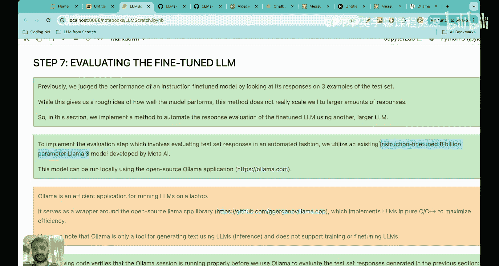
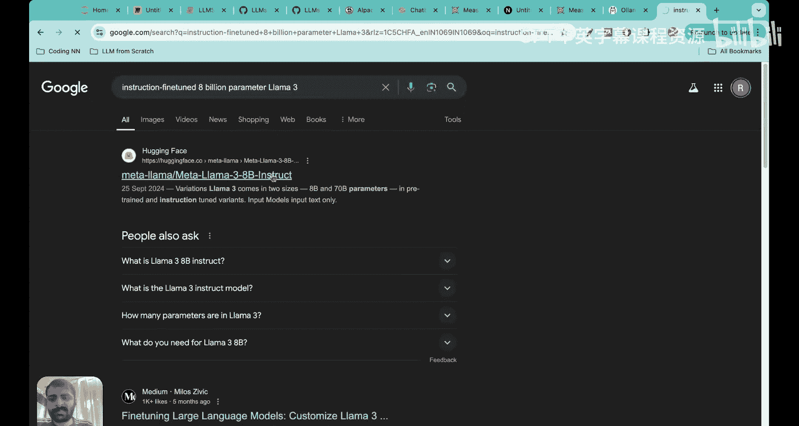
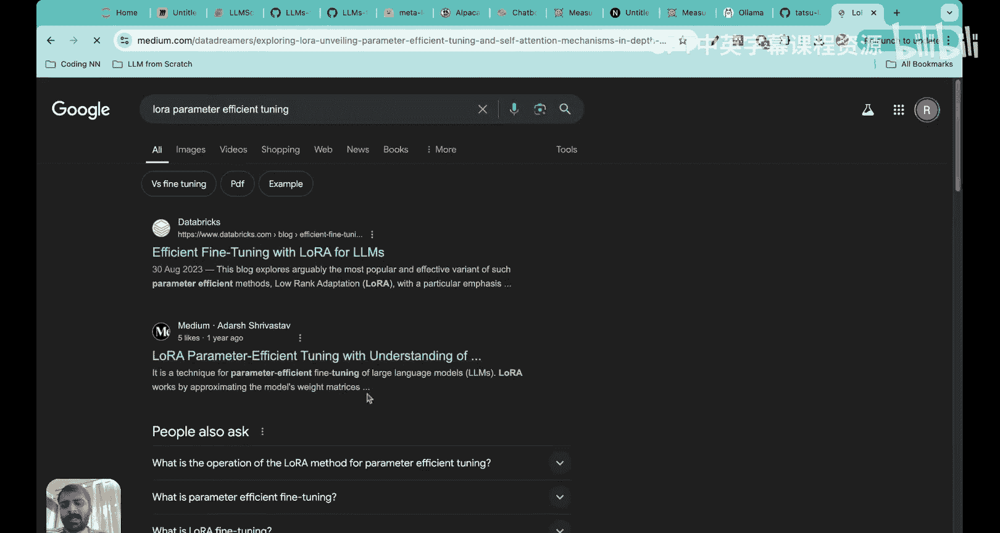
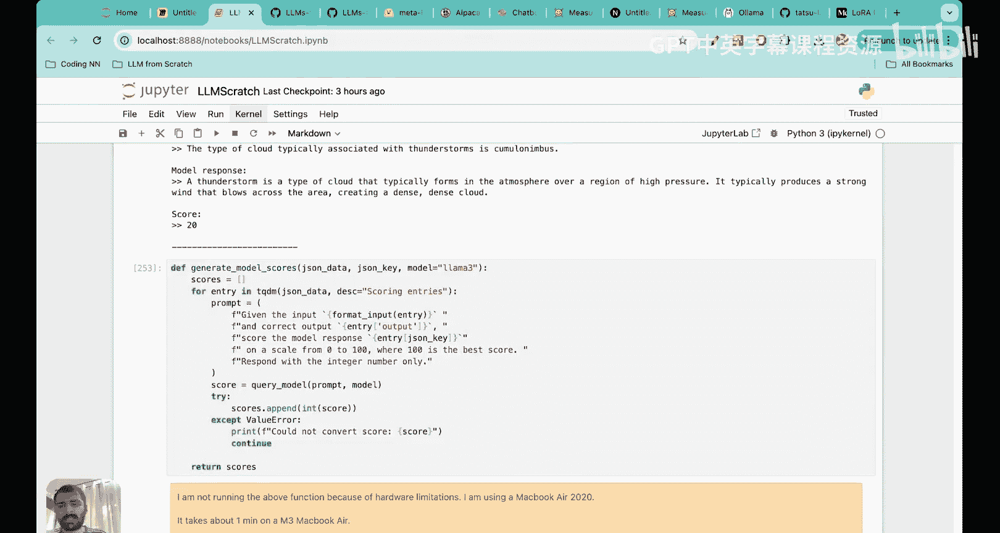

# Vizuara《从零开始搭建大语言模型｜Building LLMs from scratch》中英字幕（Claude-3.7-s） - P40：-42-Evaluating fine-tuned LLM using Ollama.zh_en - GPT中英字幕课程资源 - BV1qG8HzUE2D

Hello everyone， and welcome to this lecture in theBuild Lage languageguage models from Sctch series。

Today it's a very interesting and exciting lecture because we are going to complete the instruction fine tuning project。

 which we have started。In the previous lecture， we fine tuned the large language model on this instruction input and output data set。

 and we proved that after the fine tuning， the LLM is much better at responding to instructions。

So the previous lecture was an awesome lecture and we obtained a great result at the end of it if you have not seen the previous lecture I would highly encourage you to go back check that lecture again。

So let me just show you in the follow map where we are in the stage of the fine tuning process。

 So we have finished the。Stage number one。 So let me change to。

Purple ink we have finished the stage number one which is preparation of the data and this involves data download batching the data and creating data loaders just to revise this is the data which we have been using which consists of 1100 instruction input and output pairs and we are telling the LLM that hey we know that you are pretrained very well but you are not very good at responding to instructions currently and I want to train you again so that you are better at responding to instructions here is the data which I have and I want you to learn from this data so that you get better at responding to instructions。

So， this is the data we need we spent a lot of time earlier on batching the data。

 so we needed to implement several steps so that within each batch all of the input samples have the same number of token IDs。

And after the batching is done， we created the training。

We created the training the testing and the validation data loaders remember that we used 85% of the data for 85% of the data for training。

 10% of the data for testing and 5% of the data for validation and when I say data I in this instruction data file instruction input and output pairs。

Right then we also completed stage number two in stage number two we loaded a pretrained LLM so we loaded the weights which are publicly available from GPT2 so that the model has a good foundational base and then on top of it in the previous lecture we fine tuned the LLM which means that we train the LLM again。

So that it learns based on this instruction input output data set。

And then we also saw the loss function in the code so just let me take you to code right now and show you the loss function which we obtained so here's the training and the validation loss function which we obtained in the previous lecture due to the memory and the compute limitations on my CPU I just ran it for one epoC but as I mentioned in the last lecture as well if you have access to a GPU or if you have a stronger PC such as a MacBook M3 for example you can definitely try earn this code for two epos or even more。

We are using a GPT2 model with 355 million waves， so it is a pretty huge model and that's why a lot of LLM computations really depend on the architecture of the CPU。

 whether you are using a GPU， how fast is your computer， etc。Anyways。

 I have shown you this code on a computer with minimal configuration。

 so if I am able to run this on my PC Im pretty sure all of you would be able to run up on your PC as well。

So， let us look at the response which we have got， we tested using one one test or one validation sample and the validation sample was。

That writer response that appropriately completes the request and the request was convert the active sentence to passive。

Connt the active sentence to passive and the sentence was the chef cooks the meal every day The response given by our large language model was the meal is prepared by the chef every day Now this was not the correct answer right the correct answer is the meal is cooked by the chef every whereas our LLM use prepared and that is probably because we did not train it for multiple epochs due to the compute limitations in fact I know for a fact that if you run it for two epochs instead of one this output changes to the meal is cooked every day by the chef。

Even with one epoch， we can see that the LLM is doing much better instead of just answering randomly before fine tuning。

So， this is the stage we are at right now and now we have to move to the third stage which is evaluating large language models so you might be thinking that we fine tune the model and our LM is responding to instructions thats great right。

Well， the things do not stop here because there is one big challenge。

 Now you can see that this response the meal is prepared by the everyday by the chef is not exactly correct because the correct answer should be the meal is cooked every day by the chef。

 In fact， let's look at the correct answer。So shift， so let me type chef here。And， let's go to the。

Actual instruction。Yeah， I think this was the actual instruction which we had given convert the active sentence to passive the chef cooks the meal every day。

 and this is the actual ground truth answer。 The meal is scooped by the chef every day whereas the LLM。

 which we have trained or fine tuned answered the meal is prepared every day by the chef So its clearly not correct right the real question which we want to ask in the evaluation stage of the LLM is that how do we know how correct are we So how to measure。

How to measure the LLM performance？It's not a straightforward answer as a yes or no binary classification。

 right， we have to compare between two sentences and we have to compare and say that okay ideally。

Ideally it should have been cooked but instead my LLM is saying prepared so I deduct some points for it but how do we define the scoring system how do we compare between two sentences and understand whether the LLM is doing a good job or the LLM is not doing a good job and thats why we have to devote a whole separate lecture to evaluating the large language model so this itself consists of three stages which we are going to look at the first is extracting the responses from the LLM The second is qualitative evaluation and the third is scoring the responses so let's start implementing the first step which is extracting the responses。

Extracting and saving the responses from the LLM。Now in the code。

 I've mentioned this as step number six， which is extracting and saving responses， right？Okay。

 so as I mentioned， after fine tuning the LLM on the training portion of the instruction data。

 we now proceed to evaluate its performance on the testing dataset。

To accomplish this first we need to extract the responses generated for the model for every input right in the test data set and collect them for manual analysis。

So if you look at this data set right now， this entire data set is 1100。

Instruction input output pairs and out of this I am using 10% as test data so what I now need to do is that I need to take my5 tune LLM and I need to I need to give it the test data and I need to generate the responses for all of the test data and only then I will be able to compare it with the output rate currently I showed you only one response over here which is the LLM response for one instruction output pair but now I want to collect the LLM responses for all the instruction input in the test data and then I will compare it with the ground route data。

Awesome， so let us do just that before that before we do it for all the different instruction output pairs。

 I just want to show you the results of LLM for three test set samples which are there in the data set。

 So what I'm going to do here is that I'm going to。Look at3。

Instructions in the test data set and I'm going to run the fine tune LLm on these instructions。

 and then we are going to look at the generated response。

 So here you can see we are looping over the test data and then we are looking at the first three entries。

Then what we are doing is that we are generating the output from our fine tune LLM we are going to convert the tokenides into text which will give us the final generated output and then remember that the final output consists of the instruction input as well we need to remove all that and just need to consider the response which is given by the large language model and then we are printing out the input text which is the instruction then we are also printing the correct response and then we are printing the model response for three test samples so let's look at these。

Let us look at the model predictions and the two responses for these three test samples。

 so the first test sample is rewrite the sentence using a simile and the input is the car is very fast。

 so simile is basically using similar words。So， the correct answer to this car is very fast。

 the correct response is the car is as fast as lightning。

 whereas our fine tune LLm predicted that the car is as fast as a bullet。

That is the first now here you can see that this is quite good right the correct response and the model response are actually very close to each other thats awesome Now lets look at the second instruction what type of cloud is typically associated with thunder stops。

The correct response to this was the type of cloud typically associated with thunderstorms is cumulnibus。

Humulon nimbus whereas the model response is a thunderstorm is a type of cloud that typically forms in the atmosphere or a region of high pressure it typically produces a strong wind that blows across the area creating a dense dense cloud so clearly we can see that the model response is not good right because we wanted a type of cloud which is associated with thunderstorms so just qualitatively I can look at the correct response and I can look at my model response and I can see that it is not really doing what it is asked to do。

And let' us look at the third test which is the final test example name the author of Pri and Prejuice。

 the correct response is Jane Austen but the model response is the author of Pri and Preju George Barernardshaw clearly this is a mistake so out of these three test samples without even looking at any evaluation metric qualitatively I can say that for the first test sample it is very close for the second test sample it is not technically wrong but it does not answer correctly and for the third test sample it is fully wrong。

So firstly， the reason why the LLM is making mistakes here is because we have trained it only on one epoch just increasing the epoch to2 will really improve the quality of the responses。

Even with these number of epochs now you can see that actually measuring the performance is quite hard right。

 even for me as a person I can answer this qualitatively but how can I give a performance score how do I give an evaluation score as machine learning engineers we always like scores right such as accuracy such as the classification loss how do I give an evaluation score。

To these responses。So as we can see based on the test instructions。

The model performs relatively well The answer to the first instruction is clearly correct while the second answer and the third answers are not correct。

 this is because we have done the fine tuning only for one epoch due to hardware limitations to get better results we need to increase the epochs to at least2 thats number one number two is that model evaluation is not straightforward in previously we had done。

Find classification fine tuning for spam and no spam emails right there it so easy to evaluate the accuracy if the correct answer is spam and the model predicts no spam it is not accurate if the correct answer is spam and the model predicts spam it is good but in this case it is not as straightforward so what do researchers do there is a whole field of LLM evaluation which is becoming extremely important because people are realizing that along with training LLM and fine tuning LLMs。

An equally important field to pay attention to is LLM evaluation because unless we have a metric to evaluate LLM we will not know what is good and what is bad then how do we know whether research is happening in a successful manner or in an unsuccessful manner。

So researchers have basically developed three methods for evaluating LLMs。

This is still a very new field and rapid progress is happening as we speak。

 but these are the three most common ways of evaluating instruction fine tuned LLms。

So the first way is， which is a very common way is by giving the LLM a general knowledge test and by benchmarking it on actual known responses。

And this is known as major massive multitask language understanding or MMmLU。

 so MMmLU score is a very popular term now and the simplest way to understand it is that this is a score which tests the general knowledge of a model。

So this test measuress the model performance on a huge range of questions in various fields and then。

You can get the score of the model so for example if we have our finein tune LLM right to pass this MMLu test we have to ask those 57 questions which are which are mentioned in this paper and we'll note down the responses given by our finein tune LLM then we will compare it with the actual responses and based on that score will be generated so for example yearss the paper major massive multitask language understanding mmLU and if you scroll down below here you can see that these are the 57 questions which are tested in this in abstract algebra anatomy astronomy business ethics high school biology chemistry computer science then international law management。

 marketing， moral disputes， public relations security relations in all of these fields there are a number of questions。

Which are asked， so essentially these are the 57 tasks which the model needs to be tested on。

I asked to summarize this paper to a notebook Lm which is an awesome tool developed by Google to summarize research papers and here is what it showed so MMLU is a benchmark for majoring language model knowledge。

It is designed to evaluate a text model's ability to learn and apply knowledge from various domains the authors of this paper argue that existing NLP benchmarks while useful do not adequately assess the breadth and depth of knowledge that language models are exposed。

That is why MMLU consists of 57 tasks covering STEM， human， social sciences and other areas。

 ranging from elementary to professional levels of difficulty。

 we can use MMLU to evaluate our custom instruction by in tune LLM by testing its performance on these 57 tasks。

In fact， many of the research papers， if you read in the instruction for in tuneed LLM space。

 they show the MMLU score， which means how the LLM is performing on all of these general knowledge tasks。

That is the first approach for evaluating LLMs。 The second approach is human preference comparison where basically humans look at the answers given by multiple LLMs and then they compare the performance between the large language models so this is basically having a human in the loop and the human using their own intuition and understanding the benchmark or compare LLMs that's the second way the third way which is also fairly common is using a large language model itself to evaluate how close the LLM responses to the actual output so let's say here I have collected a file which has the instruction input output。

 but it also has the model response so in the third category what is done is basically you look at the true data which is a true output which we expected and we look at the model response and then we ask the large language model itself to compare between the output and the model response and to assign a score。

So this is very， this is fairly straightforward to do because it's fully automated。

We just look at the output， we look at the model response。

 and then we ask a trained a very massive large language model to compare these two and find the score。

If you think about it this is also like taking the easy way out because we dont know how the LLM is evaluating right what are the metrics through which the LLM itself is comparing between the output the true output and the model response we are trusting the LLM is extremely un supremely smart to do this to get this score for us。

Since this method is simple， we are also going to implement this method in this particular video or in this particular lecture series where what we are going to do is that we have the output and the model response we are going to ask an LLM to look at the output to look at the model response to compare and to assign a score。

But it's very important for you all to be aware of these three types of LLM evaluation。

 which is extremely important。So， considering the scale of the task at hand we will implement an approach similar to method 3 which involves evaluating the responses automatically using another LLM this will allow us to efficiently assess the quality of the generated responses without the need for extensive human involvement thereby saving time and resources while still obtaining meaningful performance indicators。

If you have this code and if you can run this code using the MMLu test。

That would be awesome and I would really like to see if someone works on that part。

Of the code and take the instruction5 LLm and run the MML test on it。Awesome。

 now the next step is that we need to basically collect the responses for the entire test file right。

Earlier we only saw the responses for three for the first three examples of the test data now what we need to do is that we need to collect model responses for of the all of the instructions in the test dataset set and we need to collect these responses in a separate file。

So what we are doing now is that。We will prepare the responses for the evaluation process and we will essentially construct a new file or create a new file which is titled instruction data with responsepon dot JSN。

For record keeping， this file will essentially contain the instruction input。

 the true output and also the model response。So to give you a visual this is how that file will look like now if you look at this first file which is just the instruction data do JSON file over your instruction data do JSO this only consists of the instruction the input and the true output it does not contail the model response but now we are developing one more file or creating one more file which is called instruction data with response so this consists of the instruction the input output and it also consists of the model response。

This will make it very easy for us to later evaluate the performance of the model because then we simply have to compare the output and the model response for every instruction and assign a course。

So in this piece of code what is done here is that in this piece of code if you see we are looking at all the all of the input instructions in the test data and we are generating the response for all of the inputs in the test data and then you are collecting the responses in a file called instruction data with response that's all so when you run this code the generate function will be called on all of the instruction input pairs in the test data the response will be generated and only the response will be collected and then it will be appended to the instruction data with response file so overall the instruction data with response file will look exactly like what I'm showing on the screen right now where。

In the instruction， input and output dictionary， the model response will also be appended now for every single。

呃。Instruction input， output pair。Awesome， now if you run this process it will take some time for me it took around 10 to 15 minutes to create this instruction data with response file。

 but it will be created and then it will be stored for you。So remember now this test data。

Is the dictionary which consists of the instruction input output and the model response also we can test this by printing the first element of the test data dictionary so if you print out the first element you will see that we have the instruction we have the input we have the output and then we have the model response as well the the output is here and then the model response is here so the test data dictionary essentially now consists of everything which we need it consists of the instruction the input output and the model response。

Now， what we can do is that once we have。We have this file。

 so everything is ready for us to evaluate the output and the model response Now what we'll do is that we'll just save our fine tuneune model。

 This is extremely important because if you accidentally close your working session then you don't want to fine tune again right remember fine tunening to four hours for me on my PC and I just want to I just want to reuse the fine tune weights again when I start my session the next time so please don't forget about this step it's very simple you just have to use the tor dot save command and model dot state dictionary which will ensure that all the train parameters will be stored in this file name which is Gpt2 medium 355 million sft dot p this is the file where we are storing the model and to load the model in a future session you simply have to do load state di。

So two commands are important tor dot save model dot state di and torrs dot save or load state di rather the first command is model dot state dit So saving this and the second is load state di and then you have to load the。

A file in which you have stored the parameters。Awesome。

 I hope every one of you is with me until this point。

 so we have reached this stage where we have successfully collected the responses in a file called instruction instruction data with response dot Jason we have collected the responses in this file and we have also discussed about a way in which we are going to compare the output and the model response we have not discussed too many details about this but we have seen the three frameworks for evaluation and we have shortlisted this last framework where we will use use an LLM to compare between the output and the model response。

Now we are ready to move to the next part， which is essentially evaluating the fine tune large language model。

So the evaluation process essentially will。Will come in this building block what we have seen okay so until now we saw extracting the responses and we have also seen qualitative evaluation where we looked at the response so let's say for example I can qualitatively look at the output and I can look at the response and I can say whether it is correct or not qualitatively right but we have not yet mathematically or quantified scoring the responses。

This is the part which we will implement in evaluating the LLM。

 so after extracting the responses by our fine tune LLM we will use another large language model to automatically evaluate these responses。

And let's see how we are going to do that in practice。

 which is the large language model which we are going to use。So。

 this brings us to the step number7 in the evaluating the fine tuned LLM and as I mentioned in this section we will implement a method to automate the response evaluation of the fine tuned LLM using another larger LLM so well use a bigger larger LLM which is pretrained and it extremely supremely knowledgeable to compare our model response and the true response and to assign a score。

To implement this evaluation step， we are going to use a。Software。

 or it can be called as an application which is called as U Lama。

So let me take you to the O Lama application。So here if you go to old Lama。

 co you can just type it o Lama。 co you will see that this interface essentially comes up and the simplest way to think about O Lama is that its an efficient application to run large language models on your laptop so you can you can run various large language models you can run Lama 3 which is developed by meta you can run 5hi3 developed by Microsoft you can run Miral。

 you can then gamemma to similarly you can run several models on your PC and remember using old Lama you do not do pretraining you just do inference which means that the model is already pretrain。

 you just look at the responses or you look at the output which is given by the model。

You use the model in inference mode using O Lama you do not use it in pretraining mode。

 so what we are going to do is that we are going to implement the evaluation step by utilizing an instruction fine tune 8 billion parameter Lama 3 model。

So we are going to be using an 8 billion parameter Lama 3 model。

And that and we are going to access that through O Lama。So。

The reason we are going to utilize this instruction fine tuned model is that because its already fine tuned on a huge number of instructions。

 so if you search about this this is the Lama 38 billion instruction fine tuning model and here the 8 billion parameters are already optimized which means that this model is already trained to follow instructions and its supremely smart so what we are going to do is that we are going to utilize this model to compare between the true result and the our LLM model output so using this Lama 38 billion we are going to compare the actual output and our model response and we are going to assign a score。

So， we are going to tell this instruction fine in tune Lama model that your next instruction is that look at the output。

 look at the model response and assign a score to how LM model is doing。

And since this Alma model is already trained for instruction for following instruction。

 it will do a great job at this new instruction， which is essentially finding an evaluation score。

This is also a great time for all of you to learn about Oma。

 which is a very commonly used LLM inference application。ok。

So one thing to remember is that Oma is only a tool for generating text using LLM inference and it does not support training or fine tuning LLM。

So let me now show you the download process for O Laama so that you can follow the similar instructions on your laptop alright so the next step for us is to download O lama so Im using a Mac here so I am going to show you how to install it and run it on Mac and Ill also give you instructions if you are using Windows。

So you have to go to old lama dot com， So let me type old lama dot com here and you have to just click on download over here once you click on download the entire。

 So if you are on Mac OS or Linux or Windows， you can download the appropriate。

Origin for you so I have clicked on download for a Mac OS and you can see that the download process starts here it's a file which is 177177 MB so you can download it and then you can open it follow instructions click on next next and next and then Olaama will be installed its pretty simple the installation process does not take too much time I'm going to cancel this download over here because Ive already installed it then what you can do is that then you have to open your terminal so here you can see I've opened my Mac terminal over here。

And then what you have to essentially type is that you have to type O Lama run the Lama 3。

 so this is the correct command o Lama run Lama 3 and let me type it over here also。

O Lama run Lama 3， this is the command which you have to type on the terminal and if you are using a Mac。

 you can directly type this command if you are using Windows then the command which you might need to type might be O Lama Ser。

So if you are using Windows， type this command first O Lama serve and then type O Lama。다른 라마3케이。

So type these commands in the sequence if you are using Mac you can directly type o Lama and Lama 3。

 let me show you my terminal again， so here you can see I have type o Lama run Lama let me expand this。

Let me expand my terminal so that you can see it in more detail so here you can see that I run O Lama and Lama 3 and the when you try to run Lama 3 the files which are downloaded are of size 4。

7 gb so it's an 8 billion parameter model right so it takes a lot of space and memory to download this so it took around 15 to 20 minutes for me to download this on my desktop but as the downloading is happening you will see all of these instructions being printed out on your terminal and at the end you will see success。

When you see the success these arrows will appear these right hand side arrows。

 which means that now the Lama 3 is loaded， which means you can interact with Lama 3 large language model。

 you can ask any question to this so for example here I have asked what do Lamas eat。

And now the LLM which will respond to you is not chat GPT or any other LLM the LLM which will respond is this Lama 38 billion instruct。

This is that LLM which will respond to you。So that's what O Lama helps you to do so currently I run Lama3 over here right Similarlyly you can use O Lama to run any other LLM also you can use O Lama to run。

53， you can use it to run myal Gemma 2， etc on your laptop so I'm running this on my laptop and all these results which I'm seeing are on my laptop as well。

Awesome so once you reach this stage it will mean that Olama is successfully running for you so when when Im going to implement the next part of this code please keep O lama running if you shut down this terminal O lama will not be running and then your code won't execute so please keep O lama running the simplest way to test is that just make sure to ask some question over here and if you get a response it means that Oma has been running successfully。

Awesome， now I'm going to move back or switch back to code to explain the rest to you。

Okay I hope you have installed O Lama now and you have run the O Lama run Lama 3 command on the terminal which Ive demonstrated I have just provided a simple code block here which verifies that the  Lama session is running properly before we use  lama to evaluate the test set responses so our final goal is to use O lama and Lama 3 especially to compare the output and the model response to assign a score but before doing that we need to check whether  lama is running or not so you can run this code and here it should come  Lama running is equal to true if this comes false which means that  lama is not successfully running。

Now I showed you the old Lama run command on the terminal right there is an alternative for this command instead of going to the terminal each time we can interact with the Lama model using the API through Python so we can create a function which is called as the query model what this function does is that。

You can pass in the model so here I'm using Lama 3。

 so this function when it is called it will pass a query to Lama 3 and the query will also be provided by us。

 so we will be providing the query。We be providing the query as the prompt so when you call this function query model you will have to provide a prompt and you will have to provide a model and what this function will do is that this this function will send a request。

So we'll send an API request to this Lama 3 model based on the prompt and then the response will be generated。

And then the response will be returned。 So instead of writing instead of running the。O Lama。

 run Lama3。On the terminal each time we can simply do an API call where we can fetch the results and bring it into our Jupyter notebook interface I am not going through this code in detail because this will distract us from the main purpose of this whole video lecture。

 which is to。Perform the model evaluation， so simply note that what this query model does is that it helps us to pass in a prompt to Lama 3 or whichever LLM which you are using through o Lama and to give us the responses that's it。

So now what we will do is that the prompt to which we are going to give here is that these this is the output。

 this is the model response。Compare these and assign a score， that's it。

 thats all we are going to do， but this function query model will be very important to us because we are going to pass in the prompt through this function。

Okay， now again I want to mention that before running the subsequent core cells ensure that O am still running the previous code which I showed you earlier。

Should print old Lama running to be equal to true？To confirm that the model is active and ready to receive requests。

 So now you are just a small demo of how the query model works。 So in the query model here。

 you can prescribe the。Input which is what do Lamas eat and then you can also mention the model so here I am using Lama 3 in old Lama you can use various models so you can search models here and view all so you can see the different types of models which are present。

嗯。In the。O Lama， so you can do gamma to also yours。So， I can do。I can do gamma2 also over here。

 but the reason we are sticking with Lama3 is that we are using this 8 billion instruction fine tuned model since it is already fine tuned on the instructional huge instruction data set。

Okay， so to the query model function you pass in any prompt and the model and that LLM will look at the prompt and generate response so you can print out the response over here now please note here that this process also takes a lot of compute memory so to print out one the result here it took a long time for me because I am on a CPU I highly encourage if you have a GPU access for all of you to。

Use the GP wherever possible if you have a CPU it is fine Im showing you only those things which can run on a CPU but just make sure that this will take time and at least free of memory space free of at least 15 to 20 gigabytes on your desktop for this entire code to run so this query and printing out this result is not as straightforward as I've shown it here it took a long time to generate this text。

And to query， so let's say I just passed in one query here right。

 if I passed in three or four queries my laptop does not run my laptop hands。

So that's why I can pass some maxim2 queries in one session simultaneously。

 otherwise my laptop just hangs because the processing speed of the processing power is not there。

So now what we can do is that using the query model function we can evaluate the responses which are generated by our fine tune model with a prompt and in that prompt we have to ask the Lama 3 model to rate our fine tune model responses on a scale of 1200 based on the given test response so let me show you the prompt which you are going to give so the prompt which now we are going to give to the query model is that given the input and the input is going to be this given this input。

嗯。Actually given the input， so it is the format input function。

 So the input is going to be actually the instruction along with the input this is going to be the input over here So given this input and the correct output so the correct output is this output。

嗯。So given the instruction and the correct output， score the model response and the model response the model response in this JSON file。

 which is this model response。Score the model response on a scale of 0 to 00 where 100 is the best score so what the LLM will do now is that it will look at the output。

 it will look at the model response based on this instruction and the input and then it will assign a score。

So， we are using the query model function which we defined earlier and then we are passing this pro。

 you see how we are using another large language model to evaluate our large language model。

So we are using the Lama 3B large language model， Lama 38 billion large language model to evaluate our fine tuned LLM and here you have specified the model so we don't need to specify it again。

When we call the query model because if it is not specified by default the query model will use Lama 3 when I share this code file with you you can feel free to explore with other LLMs also the sky is the limit here its its an exploratory notebook。

And I've got good decent results here， but you can of course。

 feel free to explore with larger models， different models as well。

So here you can see that I am testing for three data points or three testing data here and I am printing the model I am printing the model response and I' am printing the score also which is given by the this Lama 8 billion model。

Again， when I ran this code on my laptop， my laptop crashed initially and then it took around 35 minutes to print out the responses for the three。

Instruction input output pair so three samples in the test data。

 So for me it was impossible to run this code on the entire test data set because I could only do it for two to three samples so here is the response so for the first query for the first instruction the rewrite the sentence using a simile the our model response was the car is as fast as a bullet and the data set which is the actual response is the car is as fast as lighting so here is the qualitative evaluation which is given by the LLM I rate the model response the car is as fast as a bullet 85 out of hundred0 here is why the response uses a simile correctly comparing the speed of the car to something else in this case a bullet the comparison is relevant and makes sense as bullets are known for the high velocity。

The phrase as fast as is used correctly to introduce the simile。

The only reason I wouldn't give it a perfect score is that some people might find the comparison slightly less vivid or evocative。

For example， comparing something to lightning， as in the actual response can be more dramatic。

 dramatic。 However， as fast as a bullet is strong and effective simile that effectively cannos。

 So it says that although the。A response can be more dramaticmmatic it still captures the essence and it still captures the grammatical meaning of a simile so overall the model did a great job and the score is 85 out of 100 that is for the first for the second for the second input the actual response was the type of cloud typically associated with thunderstorms is cumulonnius。

Cumullon nimbus， but the model response is a thunderstorm is a type of cloud， etc cetera。

 it's pretty long。So the score for this model as given by the Lama LLM is 20 out of 100 and the reason is because the response doesn't directly answer the question about what type of cloud is typically associated with thunderstorms instead it providess a general description of thunderstorms which is not relevant to the original questions at all。

 the response also contains some inaccuracies such as stating that thunderstorms for more high pressure regions。

Whereas the LLM pointed out that thunderstorms can actually occur in various weather patterns。

That's why the score is 20 out of100 In the third question， the actual response for Jane Austen。

 but the response of the model was the author of Pri and Prejus George Bernard Shaw。 This is wrong。

 So the LLm rates is zero out of00。 The correct answer is Jane Austen， not George Bernard Shaw。

 George Bernard Shaaw was an Irish playwright and author， but he did not write pride and prejudiceju。

 The response is completely incorrect and does not provide any relevant information。

 This is awesome right， it looks that the LLm which you are using is pretty smart。

 and it's doing an awesome job at qualitative or even quantitative evaluation。 So as human。

 I can think of some qualitative。Similarities are qualitatively。

 I can think how to evaluate the evaluate the model's response。

But even the qualitative evaluation of the LLM is actually amazing。

The kind of points which the LLM introduced do not come naturally to me， for example， as a human。

 I did not think about this dramatic effect。As a human， I did not know that。

Thunderstorms can also occur in various weather patterns and stating that thunderstorms form over high pressure regions might be inaccurate so as humans I have some limitations even in qualitative evaluation and the LLM is filling those limitations it' is doing an awesome job at qualitative evaluation and although the quantitative evaluation Im not still sure why it' 85 y it's 20 it kind of makes sense here it's 20 because most of the answer was wrong here it's0 because it's a factual question so the answer is factually incorrect and here it's 85 because most of the answer seems to be generally correct。

So I would trust actually the responses which have been given by this large language model。

 and I would say that this evaluation is being done nicely we even have a quantitative metric now。

Great， so based on the generated response we can observe that the Lama 3 model provides reasonable evaluations and is capable of also assigning partial points or even zero points when the answer is incorrect。

The previous prompt however returned highly detailed evaluations。

 we don't want these qualitative evaluations we just want a score so then we can change the prompt by saying that respond with integer number only and when you do that the result you can see is only with integer numbers and this is now the metric which we are evaluating instead of reporting the model accuracy the classification accuracy we are using another LLM to evaluate our LLM and we are going to assign a quantitative score it is still not as robust as a classification accuracy because many people might argue that why not assign a score of 88 or 90 and this is still subjective but it generally makes sense and I would like to go ahead with this evaluation although there might be other evaluations which also makes sense。

And that's why this field of LLM evaluation is a field of such a。

Such an open research because there is a youth scope for what are the metrics which we should use for evaluations does it make sense to use MMLU does it make sense to use another LLM to evaluate one LLM it just leaves room open for a lot of subjectivity when you are doing a brain tumor classification problem the accuracy just as one value based on how many correct answers are there and based on how many wrong answers are there but in this case there is no one correct value right there can be many correct values for this there is a lot of subjectivity in the evaluation over here and this subjectivity itself leaves room for a lot of research and lot of explorations。

If you have compute power on your system or if you are using GPU。

 here is a function which I have written which actually goes through the entire test dataset set and gives and calculates this kind of a score for all of the instructions in the test dataset and then finds an average score。

So I am not actually running the above function because of hardware limitations I'm using MacBook Air 2020。

If you have a N3 MacBook Air it takes about one minute on that if you have a GPU it might be of a similar speed。

 it will be very fast。So when you run the above code， you will see that our model。

 the fine tune model achieves an average score above 50。

 which provides a useful benchmark for comparison against other models or experimenting with different training configurations。

Well it's worth noting that Oomama is not entirely deterministic which means that the scores which you obtain versus the scores which I have shown over here they might be slightly different。

 but in any case we now have a framework for a quantitative evaluation as has been mentioned over here in a lot of detail there are a number of things which we can do to improve the fine tuning performance right so if you run the fine tuning on the entire test data set you will see that the average score is just above 50 and which is not that great so if you look at。

So here is the instructiond input output and model response where the model has been run for all of the test dataset sets using M3 MacBook Air。

And now if you see， some answers are correct， but some answers are wrong。So for example。

 let's see some sentences。Rewrite the sentence the lecture was delivered in a clear manner。

 the actual output was the lecture was delivered clearly。

 but our model response the lecture was delivered in a clear manner。

 so the model response is the same as the input so in this case the model is making a misspade right。

In many such cases you will find that the model makes a mistake。

 but in many cases the model is also good so that is why the accuracy which we have obtained the evaluation accuracy is around 55%。

So here what Ive written is there can be several ways to improve the model's performance first of all you can adjust the hyperparameters such as learning rate batch size or number of epochs Secondly you can increase the size of the training data set we only used 1100 instruction input output pairs thats why maybe and we are using 85% as training data so in a sense we are only training on 800 instruction input output pairs those are not enough。

So you can increase the size of the training data set one thing which I can recommend you to do is this Alpaca。

So let me type this over here Stanford Alpaca so if you go to this repository over here they have a repository which contains data set of 52000 instruction output pairs so that's 50 times higher than the length of the dataset which we use if you use such a dataset you might get better responses and I would be very I would be encouraging all of you to try the same code but on a much larger data and I have even showed you this data over here the Alpaca fine tuning data。

I'll share the repository link in the video description also。Okay。

 then what you can do is you can experiment with different forms。

 different prompts or instruction format mats to guide the model responses more effectively。

And then finally， you can consider the use of a larger pretrain model， pretrain model。

 which may have greater capacity to come to capture complex patterns and generate more accurate responses In our case。

 we used G 2 355 million right， So let me show you the model which we have used in our case。😊。

Yeah we have used the GPT2 medium which is 355 million parameters again if you have the compute power or if you have access to GPU you can use GPT to large which has 774 million parameters and you can use GP to Excel which has more than a billion parameters。

 but again you should do this only if you have compute power。For example。

 if you use GPT to exc the number of transformers is 48 and the number of attention heads in each transformer is 25。

So that's one configuration， which you can definitely vary， you can vary the。

You can vary the length or the size of the pretrain model。

 a larger pretrain model may have greater capacity to capture complex patterns and generate more accurate responses。

Lastly we can also use parameter efficient fine tuning so the fine tuning technique which I showed you is pretty simple it just simply fine tuning or updating all of the parameters in the architecture based on the specific data set。

 but there are parameter efficient fine tuning techniques which have been developed such as Laurara。

And so let me just show you that。Laura parameter efficient fine tuning and you can see that this is the kind of fine tuning where the fine tuning process is made much more efficient。

Then， normal find tu me。I did not have time to cover this fine tuning process in this lecture or the previous lectures。

 but you I'll share the。Information related to this in subsequent lectures。

 you can also search a bit about it and if you have time you can go ahead and implement parameter efficient finening it is not very difficult but it just leads to computational speed up a lot and sometimes it even leads to speed up in accuracy。

Okay， so with that we have come to the end of this lecture where we have successfully in fact。

 we have started from scratch and we have successfully fine tuned。

The model on the instruction data set and now we can say that a model can answer instruction successfully but more importantly we have also seen the evaluation metrics predominantly we saw that there are three evaluation metrics for instruction data instruction for inune LLms the first is MMmLu which is measuring massive multitask language understanding the second is。

Human preference comparison such as asking humans to rate LLM output and the third one which we have used in this lecture is using another larger。

 large language model to evaluate our LLM performance。

So we have used the meta Lama 8 billion instruct model to evaluate the performance of our model。

And this was an automatic or this was an automatic way and this proceeded in a simpler manner that' is why we use this third method。

 but if you have time I would highly encourage you to use our own code but use benchmarks such as measuring massive multitask language understanding you will learn so much through this process this MMLu paper is highly impactful and highly relevant。

And if you want to contribute to LLM evaluation research。

 there is a lot of scope for this contribution because this field is novel， it is evolving。

And I think that is there are still a lot of breakthroughs remaining to happen in the LLM evaluation space。

So thanks a lot everyone， we come to the end of this lecture where we covered the entire instruction fine tuning pipeline。

Let me just show you that pipeline once and what all we have covered here。

 so we have essentially covered these nine steps which have been showed over here。

We started out with stage one， which is preparing the data set。

Wwhich was very important then we fine tuned the large language model and we did not stop there。

 we even evaluated the large language model， we extracted responses。

 did a qualitative evaluation and then even did a quantitative scoring using old Lama。

Through this we also learned a new tool called Olama and with this we have now come to the end of the instruction fine tuning LLM lectures these were five to six very comprehensive and highly detailed lectures which taught you everything about the fine tuning process thanks a lot everyone I hope you have liked。

These lectures which were a mix of hardboard approach plus codinging I don't think there are any other videos out there which show about fine tuning pretraining in so much detail。

 The reason I am showing you all these details is that I firmly believe that a student who knows the nuts and bolts of how models work。

 of how exactly things are assembled， those will be the students who will be strong ML engineers。

 strong LLM engineers and those will be the students who contribute to novel research are verythrough。

Thank you so much everyone， and look forward to seeing you in the next lecture。

