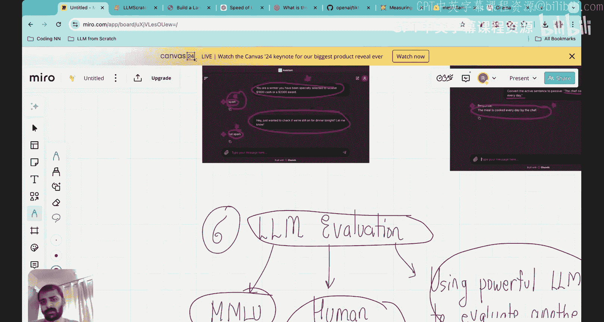

# Vizuara《从零开始搭建大语言模型｜Building LLMs from scratch》中英字幕（Claude-3.7-s） - P41：-43-Build LLMs from scratch 20 minutes summary.zh_en - GPT中英字幕课程资源 - BV1qG8HzUE2D

🎼Yeah。Hello everyone， welcome to this video in theBuild Large languagengu models from Sctch series。

This is a conclusion video in which Ill try to quickly summarize what all we have completed in this lecture series so far。

You may be into two categories of students the first is who has followed this entire series and who is watching this video congratulations you have made it this far you are now you are now one of the few students in the whole world I would say who knows how to build an entire large language model completely from scratch if you have stumbled upon this video and if you don't know about the rest of the playlist I highly encourage you to go through all of the videos。

To develop a very firm understanding of large language models。

 I started this lecture series with the goal of teaching you how to be a fundamental researcher or a fundamental engineering machine learning。

 the main。Thing which you should really focus on is to understand the nuts and bowls of how things work instead of running fancy large language model applications。

 we should focus our attention to how large language models are really built we should understand the nuts and bowls of large language models and that has been the whole focus of this series the videos have been long but they have been very satisfying as I've seen from interactions with many students who have watched。

The videos。When I started this lecture series， I took a lot of inspiration from this book build a large language model by Sebastian Rashka。

 so thank you Sebastian。And this really helped me construct the courses or construct the entire lecture series Here is the code file which we have run throughout this entire or throughout this entire lecture series as you can see the code has become pretty long but every single thing has been explained in a lot of detail in the videos which we have seen throughout this course Ive explained every single code block to you and we do not assume anything in this lecture series everything is covered in depth from scratch。

I have shared this code file with all of the students who have been watching。

And I hope that once you have access to this code file。

 you are able to run and construct the entire large language model on your own。

Here is the workflow of everything which we covered in this series first we started with stage number one then we sequentially moved to stage number two and then we move to stage number three。

 just like to build a house we first need to lay the foundation in stage number one which laid the foundation for building the large language model we looked at data preparation and sampling then we looked at the attention mechanism which is the engine behind which behind which are。

Using which large language models derive their power。And finally。

 we looked at the large language model architecture in stage one。

 how different blocks are arranged together to construct the large language model。

Once stage1 is finished then we move to stage number two which is essentially pretrain in pretrain we looked at how to implement the loss function for the large language model。

 how to do a backward pass and how to train more than100 million or the billion parameters which are typically involved in the LLM。

We also saw how to load pretrained weights from large language models such as Open air GP2 and that accelerates the pretraining process and then in stage number3 we saw that pretraining is not enough to make sure that the LLM performs well on specific tasks such as classification or making our own personalized chatbot we learned about fine tuning we completed two handson projects fully from scratch we made an LLM classifier which can distinguish between spam versus no spam emails and we also built our own personal assistant which can follow instructions These were incredibly rewarding experiences and we displayed and understood everything from the very basics。

Now what I'll do is that I'll take you through individual steps and key components of what all we have covered in this journey so far if you have watched the lecture series this will serve as a good recap for you and you can also use it as a quick revision before you go for interviews。

And if youre。If you have not watched the previous lecture videos， this will serve as a good。

Video for you to see what all we will be covering in this lecture series。

So the first step of a large building a large language model is to implement the data preprocessing pipeline。

The data preprocessing pipeline for an LLM is much different than a regression model or a classification model when you have input texts in a large language model the goal is to predict the next token right so the first thing what you do is that you have to convert this input text into tokens and then you have to convert the tokens into token IDs。

After this， the next step is to convert these tokenides into the higher dimensional vector space so that the semantic meaning of different tokens is captured。

When you project the tokens into higher dimensional vector space， then you have to add。

The positional embeddings to these token embeddings so the projections of token ides into higher dimensional vector spaces。

 as has been shown here are called as token embeddings。

 you have to add positional embedding vectors to the token embedding vectors the reason we add positional embeddings is because along with converting tokens into vector representations the positions。

At which individual tokens show up is also very important when predicting the next token when you add token embeddings to positional embeddings。

 it results into something which is called as input embeddings Now these input embeddings are。

The output which we expect from the data preprocessing pipeline。

 the whole goal of the data preprocessing pipeline is to take the input text from the huge number of documents。

 the training data which we are feeding to the large language model and to convert all of those documents into sentences then into tokens then into token IDs。

 then into token embeddings， then add positional embeddings and convert it into input embeddings。

 to give you a sense of the token embedding dimension in GPT2， the embedding dimension is of 768。

Right so that is the first thing the data preprocessing pipeline after this we move to understand the attention mechanism attention mechanism is the driving engine which gives LLM its power so the main idea of attention is that。

When you look at vector embeddings you just look at semantic meaning of one token right you do not look at the relationship of one token with all the other tokens。

 however when you are predicting the next token context is very important you need to know how one token relates to all the other tokens when you look at one token how much importance should you give to other tokens and that importance is also called as attention。

So the whole goal of the attention mechanism is to convert the input vectors to convert the input embedding vectors which look like this into something which is called as the context vectors so at the end of the attention and the attention mechanism is implemented the input vectors are converted into context vectors so you see the input embedding vector for journey and here is the context vector for journey context vectors are much richer than input embedding vectors because they also contain information about how journey let's say relates to all the other tokens in the sentence。

And to go from the input embedding vectors to the context vectors there is a huge sequential flow which we need to understand。

 we first multiply the inputs with the trainable query key and the value mates which give us the queries keys and the value matrix。

 we multiply queries with the keys transpose which gives us the attention score。

 then we scale the attention score with square root of the keys dimension， we add dropout。

 we implement causal attention which means that we add a mask to all of those tokens。

which are not involved in the next token prediction task and then we add a softmax layer so after implementing the scaling plus dropout plus softmax we convert the attention scores into attention weights the attention weights are then multiplied with the values and then we get the context vector matrix now this is only for one attention head when we consider large language model there are multiple attention heads which are acting the reason we have multiple attention head is to capture multiple dependencies and long range dependencies within a large paragraph so when you combine the context vector mats from multiple attention heads you get this ultimate final context vector matrix that is the output when the input embedding matrix passes through the attention head。

So the whole revolution which happened with respect to large language models is because of this workflow which I am sharing on the screen right now。

 taking the input embedding matrix and converting it into this context vector matrix that is the key。

After you understood the attention mechanism， then we move to the LLL architecture。 Now。

 remember that I' am going a bit faster because this is a recap。 This is a summary。

 If you want to understand each and every element， I highly encourage you to go to that specific lecture and watch that entire video again。

Now the next step after understanding attention is to look at the LLM architecture。

 so this is the bird's eye view of how the LLM architecture looks like and actually let me take another figure which I think is a better representation。

Of the LLL architecture， so I'm just taking a screenshot。Of this figure here。

 And I'm going to move it。Above， so if you look at。RightSo if you look at this。This architecture。

This gives us a。A bird's eye view of what actually goes on when you look at a large language model。

 So first， as I mentioned， you have inputs。Yeah， first， as I mentioned。

 you have inputs those are converted into bunch of tokens。

 Then the tokens are converted into vector embeddings。 We add position embeddings。

 and that uses input embeddings。 The input embeddings are then passed into this block into this。

Yeah so token embedding layer， positional embedding layer and then we have a dropout layer。

 and then we have these input embeddings which are then passed into this blue block。

 which is the transformer block the transformer block is where all the magic happens So you might be thinking okay now where does attention fit within the transformer block within the transformer block there is another module which is called as the attention module So the attention mechanism which we learned about earlier and the key query value。

 all of these things are actually happening inside this mask multiard attention module So within the transformer block there is a normalization layer multiard attention dropout layer these are shortcut connection。

 then other normalization layer a feed for neural network。

 another dropout layer where more shortcut connection and then we come out of the transformer block After coming out of the transformer block there is a layer normalization layer and a final neural network which converts the transformer outputs into something which is called as the logic spor。

The logicit tensor is then used to predict the next token given a given given an input a sequence。

Now， when you look at a GP2， let's say there are 12 such transformer blocks which are arranged together for larger LLMs。

 even multiple more transformer blocks are arranged together and within these transformer blocks there is multi head attention So within every transformer blocks there can be 2 or there can be 24 attention heads so there are multiple transformer blocks and within each transformer blocks there are multiple attention heads the terminology is a bit complex but once you get a visual feel of this architecture it's actually quite easy to code it sequentially So once you understood this architecture what we did in the lecture series is that we coded every single thing with respect to this architecture completely from scratch so you can search。

Feed forward here。 And here is the part three of the architecture。 So， in fact。

 we went sequentially with respect to all the parts。 we first covered layer normalization。

 Then we covered。The feed for neural network， then we covered the shortcut connections。

 then we covered the coding attention layers， so everything is covered in coding as well along with this whiteboard approach。

So once you figure out this LLM architecture you will have a bird's view of what exactly happens with the input sequence。

 how it goes through the transformer， how it comes out of the transform transformer we have the logicit ssor and that is then used to predict the next token so this is my LLM prediction now this next token which is predicted by my LLM is used to calculate the loss function。

Between the LLM output and the true result。After we get the loss function。

 the next step is to run the LLM pre training loop， which means that once we have。

Understood how to do the forward pass， which means that how to have an input sentence or how to have an input sequence。

 get the output from the LLM and get the loss based on the next token and this loss。

 by the way is the crossenttropy loss between the next token prediction which we have and the actual next token once we know how to get the loss then we have to do a backproag which means that then we have to take the partial derivative of the loss with respect to all of the parameters in the LLM architecture So here I've just mentioned the training loop first you calculate the loss on the entire batch。

 then you do the backward pass which means that you calculate the partial derivative of the loss with respect to all of the trainable weights So here you might be thinking what all are the different trainable weights So there are trainable weights in the token embedding positional embedding because we don't know the so when I say transform it into a vector space we don't know the ideal transformation so we need to figure out those parameters we need to figure out the positional embedding parameters we need to have we need to figure out the scale and shift parameter。

In the layer normalization。We need to train the query key and the value trainable weight mes these parameters in the mass multi head attention module then the second layer normalization layer also has trainable parameters the feed forward network also has trainable parameters and the final output layer and the final layer also have trainnable parameters and remember that we have 12 such transformable blocks so that's why all of these parameters when you add up it leads to more than a million or more than even a billion parameters which we need to train so we need to find the gradient for all of these parameters and then we need to do a gradient update by something like Wi plus1 is equal to Wi minus alpha times the partial gradient of loss with respect to the weights this is just a vanillaular gradient descent which I'm showing you usually we implement some more sophisticated schemes like a or a weight weight。

Once you do this pretraining loop， you will actually get loss function as a loss as a function of the epochs and this we have done on our own laptop。

 on our own system， but on a very small data set。Keep in mind that the pretraining which is needed for actual LLMs like GPT2 GPT3。

 GPT4 etc， they are done on huge amounts of data with millions of news articles with millions of blogs。

 books etc and that pretraining costs more than $1 million also so it's impossible for us to pretrain an actual full blown large language models on our laptop。

 but once you go through the lecture videos which I am showing you you can run the pretraining look for a small dataset and that gives you an entire feel of how GPT is constructed。

What we did after this is that we took our architecture， we took our LLM architecture。

 and we loaded three train weights from GT2。And then we actually predicted the next token based on the input input sentence。

 this was the first fundamental result which we achieved in this lecture series。

After the pretraining is completed then we move to LLM fine tuning we learned about two types of fine tuning classification fine tuning in which we built an email classification LLM so when you have given an email the LLM can classify whether it's spam or not a spam and then we also built an instruction fine tuned LLM fully from scratch so you have to give a bunch of instructions inputs and outputs and train the LLM to do a good job on instructions so let's say the instruction is convert the active sentence to passive the active sentences the chef cooks the meal every day the passive sentences the meal is cooked every day by the chef and we train this fully from scratch whatever I'm showing you right now has been implemented。

Based on the architecture which we have developed in code， we have not used it from anywhere else。

And then finally we learned about LLM evaluation， we learned about three types of evaluation。

 the first is MMmLU。Wch is based on this paper measuring massive multitask language understanding what they show in this paper here is that basically we have 57 tests which we can use to evaluate the LLM performance that's one type of evaluation The second type is using humans to compare and rate LLMs and the third type is using a powerful large language model to evaluate another LLM So this is the approach which we followed so we used a tool called o Lama to access a Lama 3 LLm especially we use this Lama。

8 billion parameter Lama 38B instruct model which is already fine to and it has 8 billion parameters so it is super powerful and what we did with this larger LLM is that if the true output is this and if the model response is this we ask the LLM to compare the output with the model response and to give an evaluation score and this is the evaluation score given by the LLM。

So based on the model response and the actual response it assigns a score out of 100。

 so that is the third evaluation tactic which we learned about。

This is the entire details of what all we implemented in this course we implemented an next word or next token prediction LLM from scratch we implemented an email classification fine tuned LLM and we implemented an instruction fine tuned LLM once you complete this lecture series I am sure that you will understand the nuts and bolts of building a large language model and you will be a much stronger machine learning and LLM engineer if you have completed this series and if you are watching this lecture now I highly encourage you as next steps to dive into fundamental research you have this code file rate start making changes start exploring small language models。

Why what's the need for large language models， can we just have three transformer blocks。

 you can now start making all these edits to the code because the code is in building blocks format right you can change hyperparameters。

 explore the effect of different optimizers， explore the effect of different learning rates。

 different number of transformer blocks， explore the effect of different evaluation strategies。

 it's an area of active research。Try to dive into research and that's the best way to stay at the cutting edge and contribute to innovative and impactful LLM research I hope all of you enjoyed this lecture series my whole goal for everyone who is learning through these lectures is to train you to become fundamental LLM and machine learning engineers who can contribute to innovative research and not just deploy LLM APS Thank you so much everyone and I look forward to seeing you in the next lecture。

。

