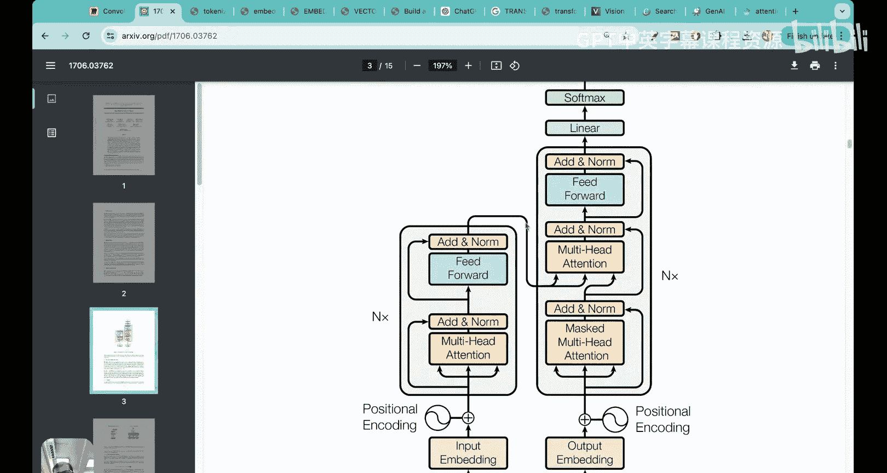
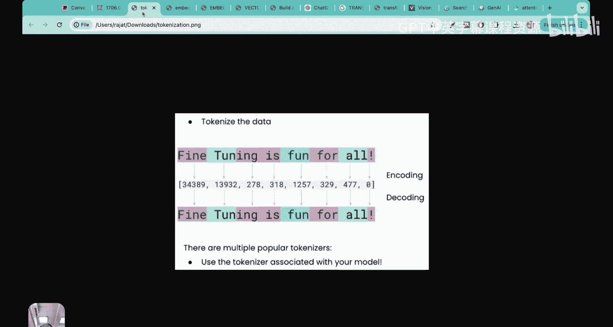
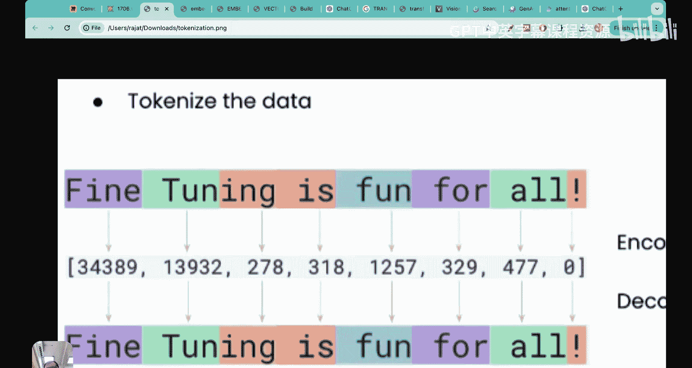
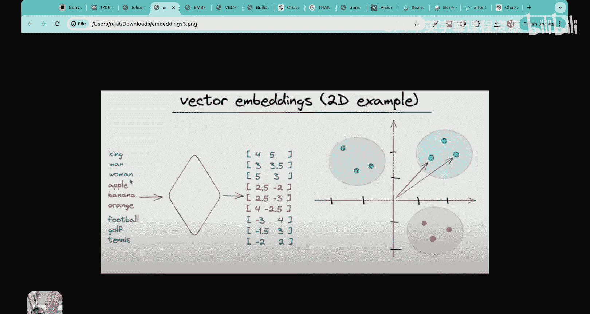
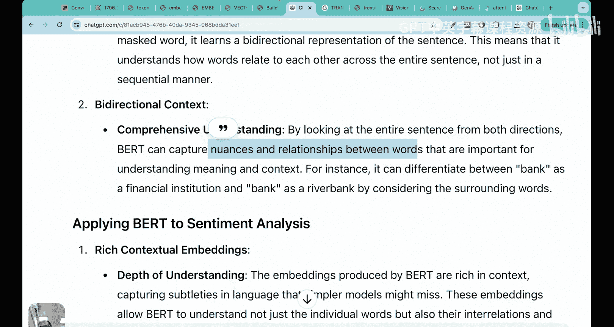
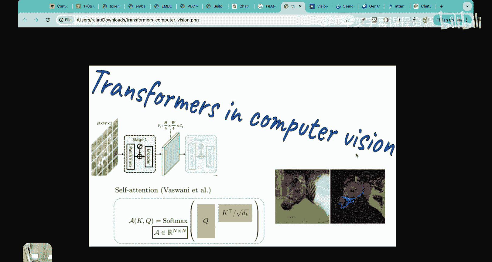
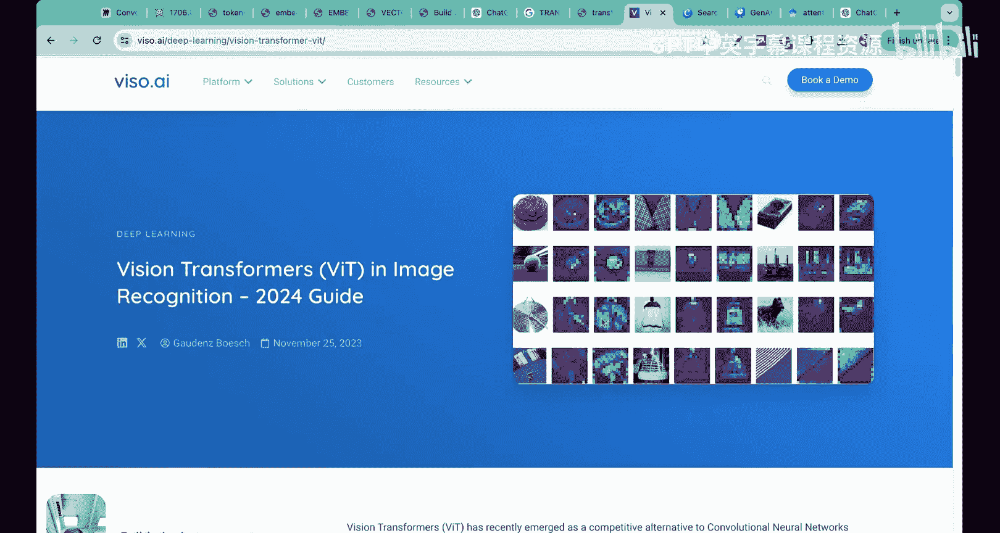
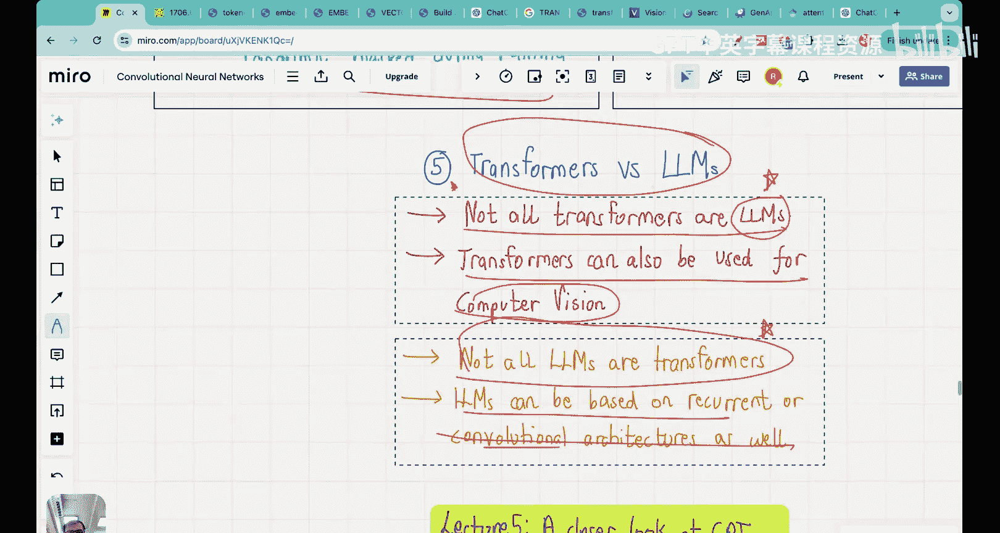

# Vizuara《从零开始搭建大语言模型｜Building LLMs from scratch》中英字幕（Claude-3.7-s） - P4：-04-Lecture 4_ What are transformers_.zh_en - GPT中英字幕课程资源 - BV1qG8HzUE2D

🎼Yeah。Hello everyone， welcome to the lecturec four in this building large language models from Scratch series。

In the previous lecture， we took a look at the differences between the two stages of。

Building an LLM and the two stages were pre training and fine tu。

So pre training involves training on a large diverse data set and fine tuning is basically refinement。

By training on a narrower dataset set specific to a particular task or a particular domain。

If you have not seen the previous lecture I highly encourage you to go through the previous lecture so that there will be a good flow between these different lectures if you are watching today's lecture for the first time no problem at all welcome to this series and I've designed this lecture so that it's independently accessible and understandable。

So let's get started today， I'm very excited because today's topic is regarding introduction。

Or rather a basic introduction to transformers in today's topic。

 we are not going to go into the mathematical details or even the coding details of transformers。

 but we are just going to introduce the flavor of this concept。What does it really mean。

 what it did for large language models， what is the history of transformers in the context of GPT？

Is there any similarity or differences between LLMs and transformers when people say LLMs and transformers。

 they usually use these terms interchangeably？When should we use these terminologies interchangeably。

 are there any similarities or differences between them。

 we are going to learn about all of these aspects， We are also going to look at the schematic of how transformer generally work and in doing so。

 well understand the basics of a few terminologies like embedding。Tokenization， etc cetera。

 so let's get started with today's lecture。So， the secret sauce behind large language models and the secret sauce behind why LLMs are so popular is this world called as transformers。

Most of the modern large language models rely on this architecture。

 which is called as transformer architecture。So what is a transformer architecture essentially its a deep neural later architecture which was introduced in a paper which was released in 2017。

This paper is called as At is all you need and if you go and search about this paper on Google Scholar right now so let me do that just quickly so if I go here to Google Scholar and type attention is all you need。

Let us check the number of citations which is which it has it has more than 100。

000 citations in just six to seven years。That's incredible right。

 It's because this paper LED to so many breakthroughs which happen later， the GP architecture。

 which is the foundational stone or foundational building block of chat GP originated from this paper。

 The GP architecture is not exactly the same as the transformer architecture proposed in this paper。

 but it is heavily based on that。 So it's very important for us to understand what this paper really did and what our transformers。

So I've opened this paper here so that you can see it title attention is all you need so you might be thinking what is attention and it is actually a technical term which is related to how attention is used in our daily life also well also be touching upon this briefly today and well be understanding intuition behind attention。

So if you look at this paper it's a 15 page paper and this is the transformer architecture which I'm talking aboutEssential it's a neural network or architecture and there are so many things to unpack and explain here which we won't be doing today well be doing at subsequent lectures because every aspect of this architecture will need a separate lecture it's that detail today we are just going to look at an overview。

So its a 15 page paper and to go through this paper and to really understand this paper it will at least need 10 to 15 lectures and this lecture can serve as an introduction so it' is very important for you all to understand this lecture clearly。

First thing which I want to explain is that when this paper was proposed。

It was actually proposed for translation tasks， which means converting one language into another language X completion。

 which is the predominant role of GPT was not even in consideration here。

They were mostly looking at English to French and English to German translations。

 and they proposed a mechanism， which did。Huge amount of advancements on these tasks。

 the transformer mechanism they proposed LED to big advancement in these tasks。 Later。

 it was discovered that。Using an architecture derived from this transformer architecture。

 we can do so many other things。So that is the first thing to note。

And that is that the original transformer， which was developed。

 it was developed for machine translation tasks， especially it was developed to translate English texts into German and French。

Okay， now we are going to look at。A schematic of the transformer architecture。

 So this schematic is fairly detailed， like you can see。 and we have actually。

呃。Don a tone down version of the schematic and I have borrowed this schematic from the book buildinging LLms from scratch by Sebastian。

 one of the best books on large language models。 So let us look at this schematic first of all by zooming out。

 So this is a simplified transformer architecture。 First I want to show you that there are eight steps over here you can see this orange step number one。

 step number two， step number three， step number4，5，6，7 and 8。

 So if you understand these eight steps as an intuition。

 you would have understood the intuition of that transformer architecture。

 So let's start going through it from step by step and as we saw one of the main purposes of the original transformer architecture was to convert English to German。

 So this is the example which we have taken here。 let's say。The in let's look at step number one。

 so this is the input text which is to be translated and as we can all see this input text is right now in the English language right。

Great。And the transformer is designed so that it will at the end of eight steps。

 it will convert it into German。But there are a number of things which happened before that lets go to step number two in step number two the input text is basically taken and preprosed。

What preprocessing means is that there is a process which is called as tokenization。Tokenization。

And what tokenization basically means is that we have huge sentences right which might be let's say we have input data from billions of data sets as we saw in the previous lecture such transferers are usually trained on huge amounts of data and let's say the input data is in the form of documents and documents have sentences right so the entire sentence cannot be fed into the model the sentence needs to be broken down into simpler words or tokens this process is called as the process of tokenization。

So I have a simple schematic here。

So for now for simplicity you can imagine that one word is one token， this is not usually the case。

 one word is generally not equal to one token but for understanding this class you can think of tokenizing as breaking down the sentence into individual words。

So let's say this is the sentence fine tuning is fun for all。

Tokenizing basically means breaking this down into individual words like F T TU and ING is fun for all and then assigning an ID a unique number to each of these words so basically we have taken the huge amount of data brokenken it down into tokens or individual words and assigned an ID or a number to this to each token this is called as the process of tokenization and so let's say if you have English data from red posts or from Wikipedia you break it down into words and you collect individual sub wordss。

From each sentence in the data set。This is what usually happens in the preprocessing step。

Then the next step after the preprocessing step number three is encoder。

 this is one of the most important building blocks of the transformer architecture and what this encoder does is that the input text which is preprocessed。

 let's say the tokens are passed to the encoder and what actually happens in the encoder is something called as vector embedding。

So what the encoder actually does is it implements a process which is called as vector embedding。

So up till now we have seen that every sentence is broken down into individual words。

And those worlds。Are converted into numerical IDs right but the main problem is that we need to encode the semantic meaning between the words also right so lets say for example if you take the word dog and puppy with this method which I have shown you right now with tokenization random Is will be assigned to dog and puppy but we need to encode the information somewhere that dog and puppy are actually related to each other。

So can we somehow represent the input data， can we somehow represent the tokens in a way which captures the semantic meaning between the worlds？

And that process is called as Victor embedding。

What is done usually in vector embeddings is that words are taken and they are converted into vectorized representations so this figure actually illustrates you very simply lets say these are the words King man。

 woman， apple， banana， orange， football， golf and tennis。

What is done in vector embedding is that so this is a two dimensional vector embedding。

 I'm showing in a two dimensional vector embedding。 each of these words are converted into vectors。

 and the way these vectors are formed is that。 So king， man and woman。

 they they are terms which are related to each other， right， Apple， banana and orange are related。

 all of them are fruits。 football， gold fentans are related， all of them are sports。

 So when you convert these words into individual vectors。 If you see on the right hand side。

 look at king man and woman。They are more closer together， right， as vectors。

If you look at the green circle here， which is football， gold and tennis。

 they are more closer together。 If you look at the red circle here， which is apple。

 banana and orange， all of them are fruits， which are closer together。

 So converting these words into such kind of vector format。Is called as vector embedding。

 and this is a difficult task。 We cannot randomly put vectors right。

 because there have so apple and banana have to be closer to each other。

 All fruits need to be closer to each other then let's say banana and king。

So there is usually a detailed procedure for this and neural networks are trained even for this step that is called as vector embedding step。

So that is the main purpose of the encoder the main purpose of the encoder is actually to take in the input text from the preprocessing maybe the tokens and to convert those tokens into vector embeddings so if you see in step number four we have generated vector embeddings。

So in the lefthand side of the transformer architecture。

 the final goal is to generate vector embeddings， which means that let's say if we have millions of data in English language we canert them into tokens we canert them into vectors and that is done in a giant dimension space not just in two dimension space it is done in maybe 500000 huge number of dimension space which we cannot even imagine。

 but the way it is done is such that semantic meaning is captured between the world。

That is how the embedding vectors should be returned。Here is another。

Example which visually shows you how the embedding is done lets say if you have text right now from documents that text is converted into IDs and that those tokenized IDs are converted into vector format like this this is a three dimensional vectorized representation so we can visualize this。

And another nice visualization is this where we take in the where we take in the。Data。

 put it into the embedding model and then vectorized embeddings are the result of this。

So that is the first step of the transformer architecture so you can view it as a left side and right side in the left side in these four steps we take the input sentences and the final goal is to convert them into these vector embeddings so that semantic meaning is captured between the words。

Okay， now what do we do with these embeddings， we feed these embeddings to the right hand side。

So look at this arrow here。 this， these embeddings are fed to what is called as the decoder。

 So let's come to the right hand side of things。 So step number 5， right， This is the。

German translation which our model will be doing and remember the model completes one world at a time right so this is an example is the input and up till now let's say the model is translated this to a D S time。

So this is not complete translation because the translation of example is not yet included right so this can be called as the partial output text。

Remember this is available to the model because the model only generates one output word at a time。

 so by the time we reach the fourth output word which is the translation of example we would have the translated words for this is an end so this is available to the model this is one of the key features of transformer and even the GPT architecture one output word is produced at one time。

So the model has partial output text which is task as I。

These words are available to the model and even this this kind of text which is available is converted into the tokenization。

 the tokenized ideas which we saw this is the preprocessing step and then this is fed to the decoder。

The job of the decoder is basically to do the final translation now remember along with this partial input text the decoder also receives the vector embeddings so the decoder has received the vector embeddings from the left hand side of things。

And now the task of the decoder is basically。It has received the vector embeddings。

 it has received the partial text and it has to predict what the next tour is going to be based on this information。

And then we go to the output layer slowly， we go to the output layer。

 and then finally you will see that。The final translation for example is completed over here and this is called as bysp I don't know to pronounce it my German is not that good and I have not even learned German in the first place but here you can see this is the German translation for example which the decoder has produced so step number seven is for the decoder is to generate the translated text one over at a time and then step number8 is that we get the final output。

And this is how the decoder actually translates the input into the output one word at a time that is very important。

Now you might be thinking how does the decoder translate it into the output。

 remember it is like a neural network and we are training the neural network so initially it will make mistakes of course but there will be a loss function and then we will eventually train the transformer to be better and better and better。

So think of this as a neural network so let me show you the actual schematic of the transformer what we have seen right now is a simplified architecture。

 but if you see the actual schematic of the transformer you'll see that there are feed for layers which means there are weights and parameters which need to be optimized so that the decoder predicts the German world correctly。

It' is very similar to training a neural network right so these are actually the eight steps which are very much important in the transformer so let me actually go through these eight steps in the simplified transformer architecture again the first step is to have the input text which is to be translated this is an example。

The second step is to。Three process all the sentences by breaking them down into tokens and then assigning a token ID to each token。

The third step is basically to pass these tokenides into the encoder and then convert these tokenides into an embedding or a vector embedding this means that words are projected into high dimensional vector space and the way these words are projected is such that the semantic relationship or the semantic meaning between the words is captured very clearly。

Now this vector embedding is fed as an input to the decoder， but along with this。

 the decoder also receives the partial output text。

Remember the decoder is decoding the English to German one word at a time。

 so for decoding this is an example it already has the decoded answer for this is an thus S9 and now it wants to translate English to German for example so it receives this partial output text it receives the vector embedding and then it is trained to predict the next output world which is by sp。

W is the German for example。 And this is how English is translated into German in a transformer。

 So this is a very， very simplified explanation of how transformer works。

 We have not even covered attention near， You might be thinking why is this paper title attention is all you need and there is a very specific reason for it。

 I just want you to not get intimidated or afraid by the transformer。

 and that's why I'm showing you the simplified form right now。 at the simplest form。

 you can think of a transformer as a neural network and you' are optimizing parameters in a neural network。

 It's as simple as that。 What many students do is that they try to understand this architecture directly。

And then that leads to many issues because it's actually fairly complicated and then they develop a fear for this subject。

I wanted to avoid that so I started with this simplified transformer architecture。Okay。

 I hope you have understood until this point I encourage you all to maybe pauseer and think about what you have learned。

Now let's go to the next。Part of the lecture。The transformer architecture predominantly consists of two main blocks。

 the first is the encodeder block and the second is the decoder block and we saw both of these here you see the encoder was over here and the decoder was over here。

O， the main purpose of the encoder is to convert the input text into embedding vectors great and the main purpose of the decoder is to generate the output text from the embedding vectors and from the partial output which it has received。

So encodeder and decoder are the two key blocks of a transformer architecture remember the GPT architecture is actually different than the transformer because that came later and it does not have the decoder it does sorry it does not have the encodeder it only has the decoder but we will come to that later right now remember that transformers have both encoder and decoder。

No。One key part of the transformer architecture is this thing this thing called as safe attention mechanism。

So let's actually Google or let's actually control if attention here and see how many times it shows up 97 times。

And let's see how they have defined attention actually。Okay。

 attention mechanisms have become an integral part of sequence modeling。

 allowing modeling of dependencies without regard to their distance in the input or output sequences。

 remember this so they。Attention mechanism allows you to model the dependencies between different worlds without regards to how close apart or how far apart the world are。

That is one key thing to remember。And then self attention is an attention mechanism relating different positions of a single sequence in order to compute a representation of the sequence this is a bit difficult to understand so let me actually explain to you the way I understood it on the whiteboard。

What basically selfat mechanism does is that our attention is that it allows the model to weigh the importance of different words and tokens relative to each other so let's say you have two sentences right and let's say the first sentence is Harry Potter is on station or platform number something and then Harry Potter wants to board the train and then third sentence forward sentence when you are on the fourth sentence to predict the next word in the fourth sentence the context is very important right so you need to know what the text was in the sentence number one sentence number two and sentence number three as well。

Only then you will be able to really understand the fourth sentence and predict the next word in the fourth sentence。

This is the meaning of long range dependencies。Which means that if I'm predicting the next word in the fourth sentence。

 I need to know the importance of previous words， I need to know how much attention should I give to the previous words。

 which word which has come previously should receive more attention。

 Maybe Harry should receive more attention， maybe platform or train should receive more attention。

The self attention mechanism allows you to capture long range dependencies so that the model can look even far behind and even to sentences closer to the current one to identify the next world to identify the next world。

So the self attention mechanism allows the model to weigh the importance of different worlds or tokens relative to each other that is very important so basically if you are to predict the next world the self attention mechanism maintains this attention score which basically tells you which world should be given more attention when you predict the next world and this is a key part of the intuition for all of you to think about。

So， let us actually。Look at this architecture and look at the part where attention comes in see multi head attention。

 mask， multi head attention。There are these blocks， which are called as attention blocks。

So these attention blocks make sure you capture long range dependencies in the sentences。

That's why this paper is actually called attention is all you need because of the self attention mechanism。

And the intuition behind attention which these folks introduced。

 so as I mentioned they calculated an attention score which basically it's a matrix and it tells you which words should be given more importance in the relative or in relation to other words。

For now， just understand this intuition so that later when we come to the mathematics and coding of it。

 I just want you to be comfortable with this notion and I want you to appreciate how beautiful this is because you as a human we keep context into our mind pretty naturally when you are reading a story we remember what was written on the previous page。

But for a model to do that， it's very difficult。A self attention mechanism actually allows the model to do that。

 it allows the model to capture long range dependencies so that it makess the next order prediction accurately in chat GPPT when you write an input。

GP actually gives attention to every sentence right and then it predicts what the next word could be it doesn't just look at the。

Sentence before the current one， it looks at all sentences because maybe previous words are more important。

This is possible through the self attention mechanism。

So thats the second key concept which I wanted to introduce。

And in the last part of the lecture we are going to look at the later variations of the transformer architecture。

 so the transformer architecture of this paper rather came out in 2017 right the GPT models came out after that and there is another set of models called as Bt which also came out as later variations of the transformer architecture so there are two later variations which I want to discuss the first is called as B its called as bi or its full form is bidirectional encoder representations from transformers。

No need to understand the meaning but that is just what Bt means maybe you would have heard this terminology but did not know them full form the full form is bidirectional encoder representations from transformers and the second is GPT models of course all of us have heard of chat GPT but the full form of GPT is generative preprint transformers。

Pretrained because it's a pre traineded or a foundational model。

 which we saw in the previous lecture， so now you should start understanding these terminologies。

Now you must be thinking what is the difference between BRT and GPT models there is a big difference basically the way bird operates is that it predicts hidden words in a given sentence so lets say you have a sentence it will mask some words randomly and it will try to predict those mask or hidden words。

That sort bur us what does GP do as we have all seen， it generates a new word。So。

 there is a pretty big difference between how bird works and how GPT works lets see a schematic so this is how birth actually works lets say we have a sentence This is an dash or question mark of how LLM。

Dash perform。 So let's say as input， we have this text， which is incomplete。

So BRT receives inputs where words are randomly masked during training and mask means that let's say we do not know these words right and then this is the input text we do the same preprocessing steps as we saw about converting them into token IDs then we pass it to the encoder do the embedding same thing like what we saw before and then the main output is that we fill the missing words so BRT model realizes that the missing words are example and can so then the final sentence is this is an example of how LLM can perform This is how bird words。

How GPT actually works is something completely different。

 so let's say the input we GPT receives is this is an example of LLM can dash。

So we just have to predict the next world， we receive incomplete text and we have to predict the next world。

So then the way GPT works is that it does the preprocesing like we saw converts world to token9es。

 then there is a decoder model， there is not an encoder model。

So the decoder then predicts the last world or the world which you do not know。

Perform so then the output is this is an example of how LLM can perform。So in GPT models。

 learn to generate one world at a time。Now this leads to big differences because if you see the GP model is left to right right。

 all the left information is there， we are only predicting the right most information what is not known whereas in word random words can be masked。

So the model has to pay attention to different parts of the sentence and that's why birth actually does very well in sentiment analysis so you have。

I have a text which actually compares or answers why is bird so good when we do sentiment analysis so the reason B is called bidirectally so you will see that the name is bidirectional encoder representations right because it looks at the sentence from both directions whereas in GPT we just look at the sentence from left to right but B looks at the sentence from both directions because even the first world might be missing so it has to look from the left side as well as the right side。

And by looking at the entire sentence from both directions。

 birth can capture the nuances and relationships between worlds that are important for understanding meaning and context。

For instance， birthRT model can differentiate between bank as a financial institution and bank as a river bank by looking at the surrounding world。

So that is why bird can actually understand the nuances and relationships between different world in a sentence since it looks at the sentence from both sides。

 that's why birth is very commonly used in sentiment analysis even GPT can be used in sentiment analysis but the specialty of bird is sentiment analysis。

Okay so that is the difference between birth and GPT no one talks too much about birth these days all the hype is about GT Chad GT because it produces one word at a time。

 it can complete missing text also it can also do sentiment analysis but I just wanted to explain I just wanted to explain these differences to you so that you are aware of what birth means what GPT means one thing to notice that both of these have the word transformers in them because they have originated from the transformer architecture。

Which we just consider， but as you saw the GPT model does not have an encoder。

 they only have a decoder。That's one key thing which I wanted to demonstrate here。

Whereas the birthRT model only has the encoder， so remember these differences between B and GP。Great。

😊，And now one thing which I would like to cover before we end the lecture is that what is the difference between Transformer and LLM？

So are they the same thing when we say LLMs， can we also say transformers？

So the key thing to note is that not all transformers are LLMs。

Transformers can also be used for other tasks like computer vision。

 So one thing which I would like to show you here is this thing。

So transformers are not only used for language tasks they are also used for vision tasks such as image recognition。

 image classification etc Here is a website which I have pulled out this these are called as vision transformers VIT and they can be used for various applications so here see the wt transformer is being used to detect a pothole on the road。

Then there are a number of other important applications such as it can be used to classify between tumors as malignin and abinin just from the images。

 and a number of people have discussed the similarities and differences between convolutional neural network and VID。

So VIT achieves remarkable results compared to CNNs while obtaining substantially fewer。

Computal resources for pre training。In comparison to CNN vision transformers show a generally weaker bias。

 so basically you think of only convolutional neural networks when you think of image classification right。

 but vision transformers are a new method which is also gaining a lot of popularity and they can be used for image classification tasks。

So remember when you think of transformers。Don't think of transformers only in the context of large language models or text generation transformers can also be used for a computer vision。

 so remember not all transformers are alien。So what about LLMs are all LLMs transformers so that is also not true not all LLMs are also transformers LLMs can be based on the recurrent or convolutional architectures as well this is one very important point to remember I had made a presentation sometime back and this image has been taken from stat Que channel so before even transformers came into the picture here you can see in 1980 recurrent neural networks were introduced in 1997 long shorter memory networks were introduced both of them could to sequence modeling tasks and both of them could do text completion tasks。

So they also can be called as language models。So， remember that。All LLMs are not transformers。

LLMs can also be recurrent neural networks or long short term memory networks to give you a quick introduction what RNNs actually do is that RNNs maintain this kind of a feedback loop。

So that is why we can incorporate memory into account。LSTM， on the other hand。

 incorporates two separate paths， One path about short term memories and one path about long term memories。

 That's why they are called long， short term。Memory networks。

 so one path is for long term memories and one path is for short term memories。

So basically we have one green line， let's say which is shown here that represents long- term memory。

 one line which shows the short term memory and then basically using both we can make predictions of what comes next so even recurrent neural networks and long short term memory networks and even some convolutional architectures can also be large language models。

So as we end I just want you to remember that not all transformers are LLMs。

 this is very important to keep in mind and not all LLMs are transformers also。

So don't use the termstransers and LLMs interchangeably they are actually very different things but not many students or not many people really understand the similarities or the differences between them One purpose of these set of lectures is for you to understand everything from basics the way it is supposed to be that way you also be much more confident when you transition your career or if you're sitting for an LLM interview and if you don't know the difference between transformers or LLMs these lectures can clarify those similarities and differences for you I'm going to go into a lot of detail in lectures like what we did right now and not assume anything so I've written a number of things on the whiteboard so that you can understand。

Let us do a quick recap of what all we learned。First we saw that most modern LLMs rely on the transformer architecture。

 which was proposed in the 2017 paper， it is basically a deep neural network architecture。

 the paper which proposed the transformer architecture is called as attention is all you need。

And the original transformer was developed for machine translation for translating English tasks or English texts into German and French。

We saw a simplified transformer architecture which are eight steps we take an input example。

 preprocess it by converting words or sentences into words and token ids。

 then we pass it into the encodeder which converts these tokens into vector embeddings the vector embeddings are fed to the decoder along with the vector embeddings the decoder also receives partial output text and it generates the translated sentence one world at a time。

This is the simplified transformer architecture， and we saw that the transformer architecture consists of an encoder and a decor。

However， later we saw that GPT models do not have an encoder， they only have a deco。

In the middle we had a small discussion on selfat mechanism which is really the heart of why transformers work so well and why the paper which I showed you earlier is called attention is all you need Seat allows the model to weigh the importance of different worlds relative to each other and it enables the model to capture long range dependencies so when we are predicting the next world from a given sentence we can look at all the context in the past and weigh the importance of which world matters more for predicting the next world。

You can think of also self attention as parallel attention to different parts of a paragraph or different sentences。

We will look into this later it's going to be one of the key aspects。呃。

It's going to be one of the key aspects of our course as we move forward。

Then we saw the later variations of transformer architecture in particular we looked at two variations first is B which is bidirectional encoder representations and then we saw GPT so there is a difference between these right B predicts hidden words in a sentence or it predicts missing words which are also called masked towards words so basically what this does is that B pays attention to a sentence from left side as well as from the right side because any word can be masked。

That's why it's called bidirectional encoder and it does not have the decoder architecture it just has the encoder architecture since Bt looks at a sentence from both the。

 both the directions it can capture the meanings of different worlds and how they relate to each other very well and that's why bird models are used for sentiment analysis a lot。

GPT， on the other hand， just。Gets the data and then it predicts the next word so it it's a left to right model basically it has data from the left hand side and then it has to predict what comess on the right or whats the next word。

So GP receives incomplete text and learns to generate one word at a time。

And main thing to remember is that GPT does not have an encoder， it only has decoder。

Great and then in the last part of the lecture we saw the difference between transformers versus LLMs so remember not all transformers are LLMs transformers can also be used for computer vision tasks like image classification image segmentation etc。

 similarly not all LLMs are transformers。Before transformers came recurrent neural networks and long short term memory networks and even convolutional architectures were used for text completion so that's why LLMs can be based on recurrent or convolutional architectures as well so do not use these terms transformers and LLMs interchangeably though many people do it understand the similarities and differences between the two。

That brings us to the end of this lecture， we covered a lot of we five points in today's lecture and I encourage you to be proactive in the comments section。

 ask questions， ask doubts。

Also make notes about these architectures as you are learning。

 that's really one of the best ways to learn about this material。as always。

 I try to show everything on a whiteboard， lets try to explain as clearly as possible so that nothing is left out and I show a lot of examples also in this process。

Thanks a lot everyone， I hope you are enjoying in this series and look forward to seeing you in the next lecture。

。