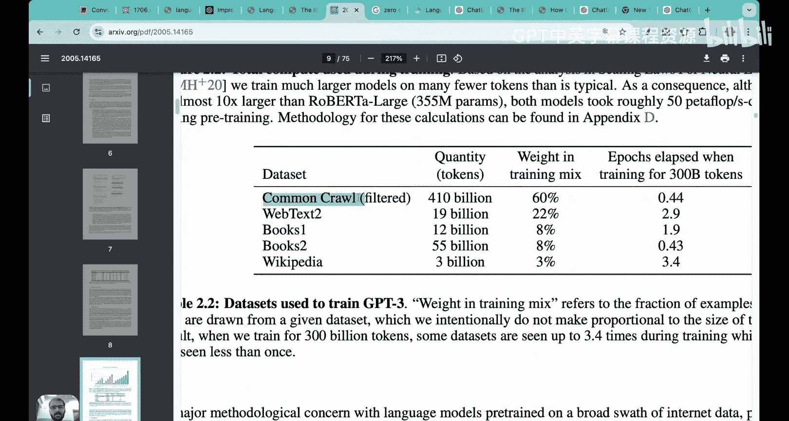
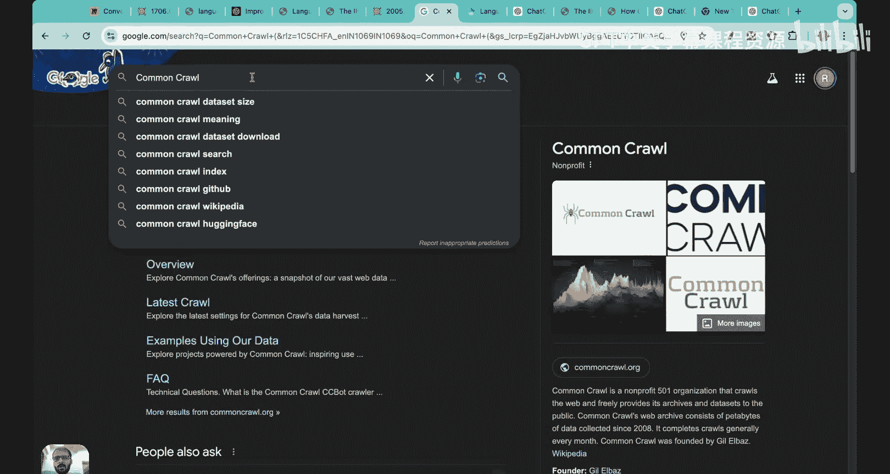
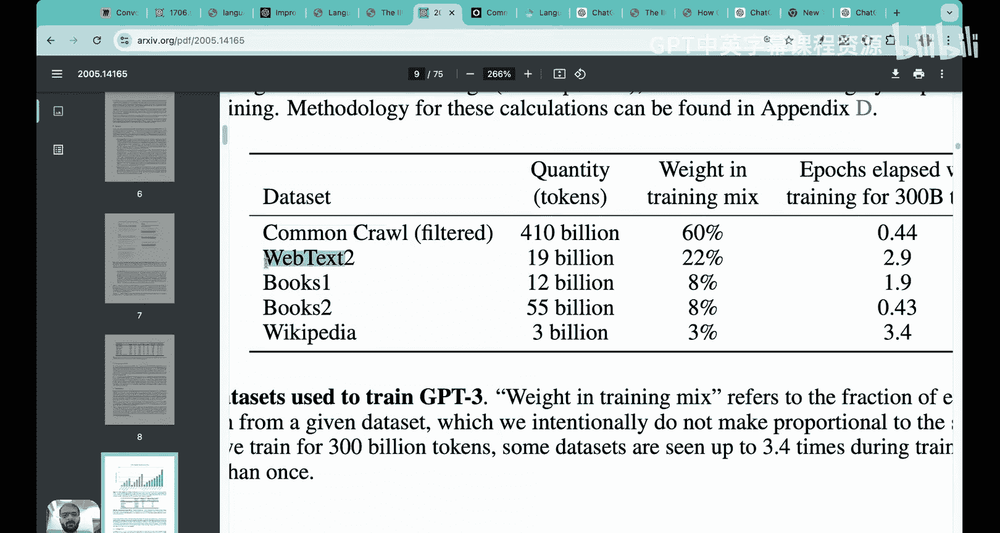
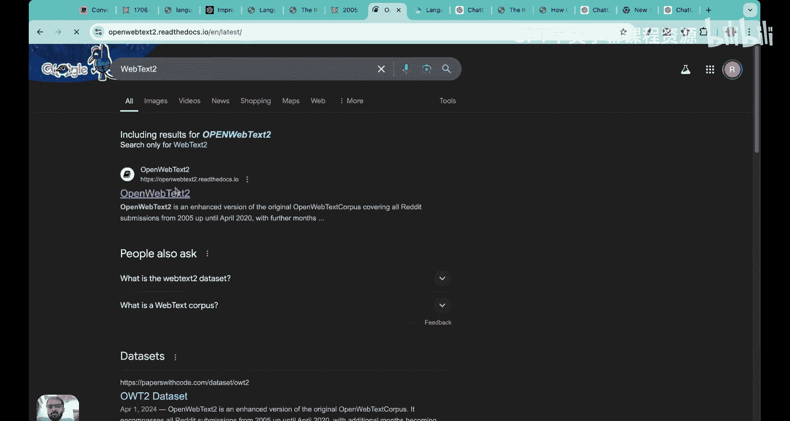
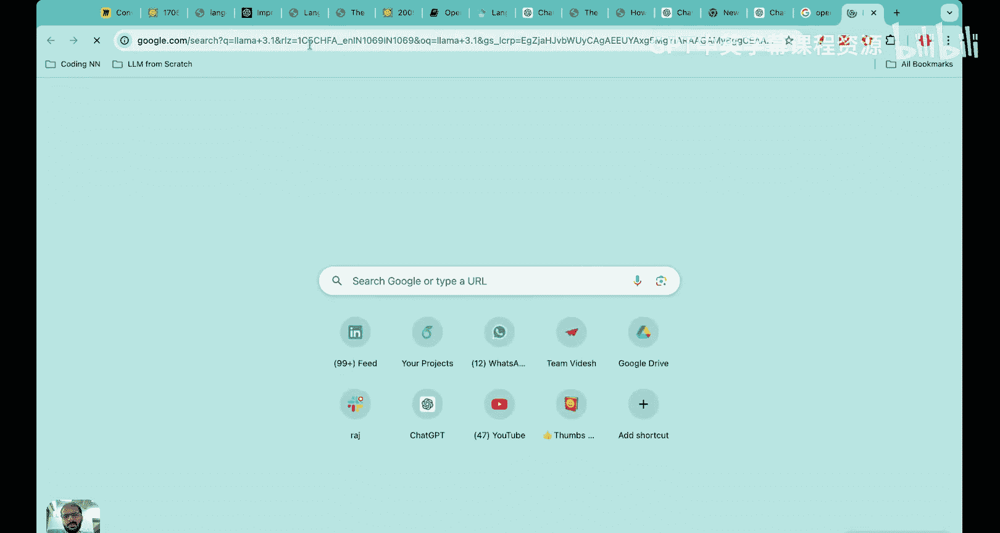
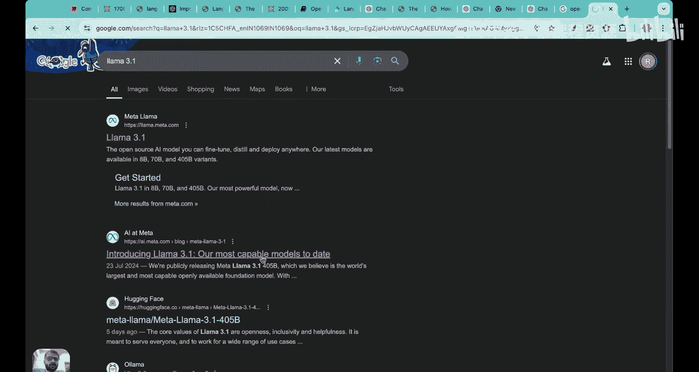
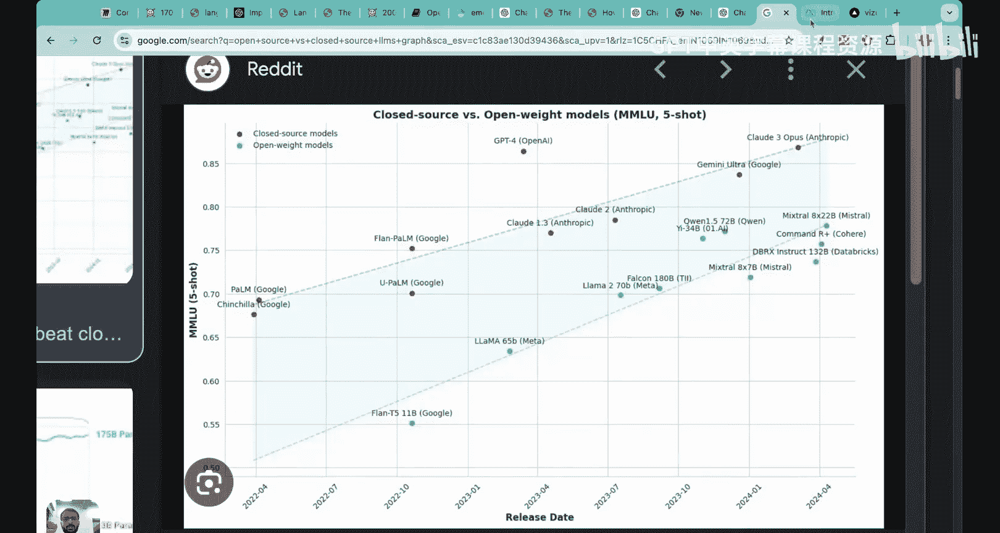
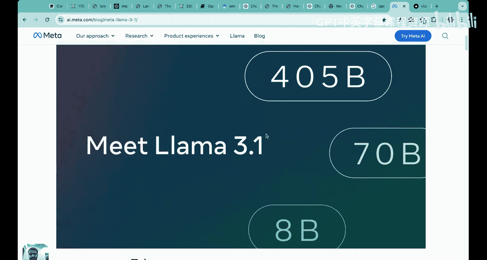
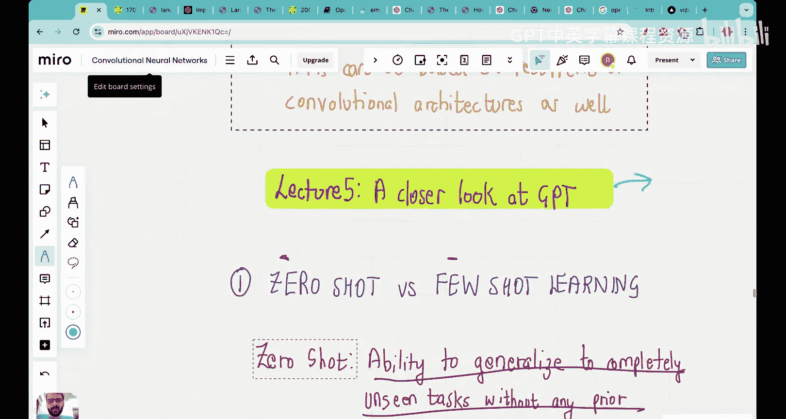

# Vizuara《从零开始搭建大语言模型｜Building LLMs from scratch》中英字幕（Claude-3.7-s） - P5：-05-Lecture 5_ How does GPT-3 really work_.zh_en - GPT中英字幕课程资源 - BV1qG8HzUE2D

🎼Yeah。Hello everyone， welcome to this lecture in theBuild Lar languageage models from Sctch series。

This is the lecture5 and today we are going to look in detail at GPT or generative retrained transformer。

 we are going to see how the versions of GPT evolved。How the different papers on GPT evolved。

 what's the progression from transformers to GPT to GPT2 to GPT3 and finally to GPT4。

 where we are at right now。In the previous lectures， we have looked at。Transformers。

 we looked at a simplified architecture for transformer and we also saw the difference between B and GPT model we saw what's the meaning of an encoder or what's the meaning of a decoder etc。

If you have not seen the previous lecture I would highly encourage you to go through that。

 if not its totally fine the way I've designed this lecture is such that it is self contained and you will understand all the concepts which I am explaining in this lecture。

So one of the key concepts which we are also going to look at today is zero short versus few short learning。

 but before coming to that， let me first take you through the progression。

Of research papers from transformers to G to G 2， and then finally to G 3 and then G 4。 So let's。

Deep diveer bit into history。 The first paper， which was released， which really started。

The work on GPT is transformers This paper was released in 2017 and this paper was titledAttention is all you need。

 The major breakthrough of this paper is introducing the self attention mechanism where you capture the long range dependencies in a sentence。

 allowing allowing you to do a much better job at predicting the next word in a sentence。

It represented a significant advancement compared to recurrent neural networks and long short term memory networks Transers which were introduced in this paper really changed everything the original transformer architecture looked something like this。

 it had an encoder and it had a decoder。But GPT architecture。

 which is generative pretrain transformer， which came after this paper did not have an encoder。

 the GPT architecture which was developed only as a decoder。

So this was the paper which came out after the Transformers's paper and it introduced the concept of generative pretraining we are going to look at this concept a bit more in detail today but the main idea of this concept is unsupervised learning basically what they basically say is that natural language processing。

As such。Up till this point had been mostly supervised learning。So， they were saying that。

Label data for learning is scarces， which means it is not easily available。

 making it challenging for train models to perform adequately We demonstrate that large or we demonstrate that large gains on these tasks can be realized by generative pretraining of a language model on a diverse corpus of unlabeled text。

 so two words are important here generative pretraining and unlabeled text。

 we already saw pretraining in the previous lecture。

What is done here is that the text switches used is not labeled。

So let's say you have given a sentence right and you use that sentence itself as the training data and the next word prediction which is in that sentence itself as the testing data so everything is selfcon and you don't need to provide labels we'll see this idea more in detail but this was the paper which was published in I think this paper was published in 2018 which was the first paper on generative pretraining。

 they took this transformer architecture， they modified it a bit， they removed the encoder block。

And they said that if it trained a language model on a huge amount of data set to just predict the next word in an unsupervised learning manner。

 it could really improve language understanding。And they call the training phases generative pretrain。

 why generative because we are generating the next word。

Open AI also released a blog about this on June 11， 2018。

 improving language understandinging with unsupervised learning。So， that mean。

Their main claim was that we obtained state of the art results on language tasks with a scalable system。

Our approach is a combination of two ideas， transformers and unsupervised pre training。

 just keep this in mind， so they used the transformer architecture which we saw in the 2017 paper and they also used unsupervised pre training which means labels were not given to the training data。

The labels were taken from the sentences itself， we do not need to prelabel the data。

So of course this was 2018 and no one， in fact， no one paid that much attention as it is relevant in the commercial sphere today for researchers。

 this was a big deal and this paper also has a huge number of citations today but in the commercial space students。

 teachers， professors who did not work in large language models had not heard about this because it was still at the research phase it had not entered the commercial domain。

Then what happened is that in 2019 just the next year came one more paper。

 which is called as language models are unsupered multitaskcular learners so what they basically did is they just。

Took more amount of data than was used in the earlier paper。

 and they also used a generative pretrain network。And you can see that they actually showed four types of generative printerter networks。

 they showed a smaller model， a slightly larger model and the largest model which they used had 1542。

 which is000 or 1 billion parameters almost。So here you can see I have just shown a pictorial representation here。

 this was the GP2 GPT2 architecture which was introduced in this paper。

 GPT2 generative print transformer2。And here you can see that they released four things GT2 small。

 GPT2 medium， GPT2 large and GPT2 extra large。This was the first time when a paper was published in which a large language model was so large。

 In fact，1 billion parameters were used in GPT2 extra large and it led to very， very good results。

At that time， Open AI was already working on more complex and more advanced G models。

 But when this paper was released， in fact， even this has a very good number of citations if you。

If you just go to Google Scholar and search this right now。

 you will see that this has around more than 10，000 plus citations。

 so this was the GPT2 paper which had around the largest model in GPT2 really had around 1000 million or 1 billion parameters。

Then in 2020 came the real boss， which was GPT3。GP3 had 1 75 billion parameters， let me show you。

Where they actually mentioned about ya？So they also released the number of origins of GPT3， small。

 medium， large， extra large。A origin with 2。7 billion parameter， a origin with 6。7 billion parameter。

 but there is one specific origin which was released which are 175 billion parameters， which was G3。

And when people started exploring this model， they could really see that it's amazing。

 it could do so many things， although it was just trained to predict the next world it can do number of other things like translation。

 sentiment analysis， answering questions。Answering multiple choice questions， emotional recognition。

 it can do so many things。😊，And this was a huge model， 175 billion bar。

 people had not seen language models of this size。Then two years after this came GT 3。5。

 which became commercially viral， everyone started using it and saw how good it was。And right now。

 I'm using Chad G4。 So if you。See here I'm using chatd GP 40， So G 4 is where we are right now。

 but you just see this gradual transformation， which has happened from 2017 to 2024 in a space of seven years we have gone from this original transformers paper we have gone then to the G paper in 2018 2019 came G 2。

This 2019 came G2 then in 2020 came G3 which really changed everything， then came G 3。

5 and then finally we are at GP4 This is the whole transformation from transformers to GP GP2 GP3 GP 3。

5 and then G4。Many people don't know the difference between transformers and GPT。

 GT essentially borrows from the transformer architecture。

 but it's a bit different in that it does not have really the encoder block。

So I just wanted to start out this lecture by giving you this historical perspective of how the generative prett transformer has evolved。

The next thing which I want to cover today is the difference between zero short and few short learning。

Zero short is basically the ability to generalize to completely unseen tasks without any prior specific examples。

And few short is basically learning from a minimum number of examples。

 which the user provides as input。Good， so let me actually directly go to the G P T3 paper。

 This was the G P3 paper。 and they have wonderfulful illustrations of。😊。

0ero short and few short learning。 Usually people think research papers are hard to read。

 but they have some very nice examples which really clarify the concept。So in zero short learning。

The model credits the answer given only a description， no other assistance or no other support；

 for example， the prompt can be that hey you have to translate English to French and take the word cheese and translate it into French。

If the model is able to do that， that' is an example of a zero short learning because we have not provided any supporting examples to the model。

Great， then there is also one short learning which means that the model sees in addition to the task description。

 the model also sees a single example of the task， So for example look at this at tell the model that look C o translates like this to French。

Use this as a supporting guide or like a hint， if you may， and translate cheese into French。

So this is one short learning where the model sees a single example of the task。

And then there is few short learning where the model basically sees a few examples of this task。

 so for example， in few short learning we say that sea o translates to this peppermint translates to this and giraffe translates to this use these as the supporting examples and then translate English to French。

And then translate cheese， so this is called as few short learning。

So I hope you understood the difference between zero short one shot and few short zero short is basically you provide no supporting examples to the model you just tell it to do that particular task such as language translation and it does it for you in one shot the model sees a single example of the task。

And in few short， the model sees a few examples of this task。

These beautiful examples are provided right in the GPT paper itself。

 so you no need to look anywhere further。So let's see what is the claim of these authors。

So what they were saying was that we train GPT3 an autoregressive language model well see in a moment what this means with 175 billion parameters。

 10 times more than any previous language model and test its performance in a few short setting。

So let's see what the results are。GP 3。Provides or achieves a strong performance on translation。

 question answering。As well as several tasks that require on the fly reasoning or domain adaptation。

 such as unscrambling words using a novel word in a sentence or performing three digit arithmetic。

So this paper basically implied that GPPT3 was a few short learner。

 which means that if it is given certain examples。It can do that task very well。

 although it is trained only for the next prediction。

 what this paper claimed was that GPT3 is a few short learner。

 which means that if you wanted to do a language translation task you just need to give it a few examples let's say if you want GPT3 to do a language translation task you just give it a few other examples of how that example is translated into another language and then GPT3 will do that task for you so that claimed that GPT3 is a few short learner。

You will encounter zero short versus few short at a number of different in a number of different books。

 articles and blogs， so I just wanted to make sure it's clear for you So then your question would be okay if G3 is a few short learner what about G4 which I'm using right now I it a zero short learner or is it a few short learner Because it seems that I don't need to give it examples right it just does many things on its own So let me ask GP4 itself are you a zero。

Short。Learner， or are you a。Few short letters。Let's see the answer。

 So G4 says that Im a few short learner。 This means I can understand and perform tasks better with a few examples while I can handle many tasks with without prior examples。

 which is zero short learning。 providing examples help me generate more accurate responses。

 So this is a very smart answer because G4 is saying that it does amazingly well at few short learning。

 which means that if you provide it with some examples， it does a better job。

 but it can even do zero short learning So this is very important for all of you to know。

 when you are interacting with G rate， if you provide some examples of the output。

 which you are looking at or how you want the output to be G4 will do an amazing job。

 of course it has zero short capabilities Also， but the few short capabilities are much more than zero short capabilities。

 Let me ask it。😊，Do you。Also， have。0ero， short。Capabbilities。

So when I ask this question to GP for it says that yes， I also have zero short capabilities。

 this means that I can perform tasks and answer questions without needing any prior examples or specific context。

So this is very important I would say GPT4 is both a zero short learner as well as a few short learner but to get a more accurate responses as GPT4 says itself you need to probably provide it few examples to get better responses so in that sense it is a better few short learner。

Even when the authors release this paper， they say confidently that GPPT3 is a few short learner。

But it can also do zero short learning it just that its responses may not be as accurate。Awesome。

 so this is really the difference between zero short learning and few short learning and you need to keep this in mind because when you think about large language models this distinction is generally very very important I think when we go to GP5 or GP6 even we might get really better at zero short learning we are already there but it can be better。

So here I have just shown a few examples of zero short versus few short learning so that this concept becomes even more clear。

 so lets say the input is translate English to French。For a zero short learning， we will just give。

The input which you want to translate like breakfast， and then it's translated here。

For few short learning， as I already showed to you before。

 we give it few examples like let's say here we want to。

Unscramble the words or make the words into correct spelling。

 let's say that's the task to do this task。 can we can give some examples。

 So let's say this is a wrong spelling and the correct spelling is good。

 This is wrong spelling the correct spelling issues So we give G or the LLM these two examples and then we tell it that based on these two examples now translate this into a correct word and then it translates it correctly as phone So this is an example of few short learning because as you see we do provide true supporting examples so that the LLM。

😊，You can actually make a better translation。Okay， so zero short learning is basically a completing task without any example。

And a few short learning is completing the task with a few examples。Okay。

 now let's go to the next section， which is utilizing large data sets。

We also looked at this in the previous lecture， but I just want to reiterate this based on this paper。

 so let's look at the data set we GP3 have used。 we already saw that the model was 175 billion parameters right like see this。

But lets see the data on which the model is traineded on let' us look at this data。

So the data set is the common crawl data， Let's go to。

Internet and search common crawl so you can see that this is the common crawl data set。

And let me click on this right now and it maintains basically a free open repository of web crawl data that can be used by anyone。

It has over 250 billion pages spanning 17 years and it is free and open corpus since 2007， great。

So GPT3 uses 410 billion tokens from the common crawl data。

 and this is the majority of the data it consists of 60% of the entire data set。What is one token？

So one token can be basically you can think of it as a subset of the data set so for the sake of this lecture。

 just assume one token is equal to one world， there are more complex procedures for converting sentences into tokens thats called tokenization。

 but just assume for now just to develop your intuition that one token is equal to one world so that will give you an idea of this quantity so there are 410 billion words。

W have been used as a data set from common crawl， then GPT3 also utilize data from web text 2。

Let's go and search a bit about web textex 2 so this is also an enhanced version of the original web textex corpus so this covers all the Reddit submissions from 2005 to 2020 and I think the minimum number of port here should be three or something but basically open web textex data consists of a huge amount of Reddit posts。

And how you so basically GPT3 uses 19 billion words from this web text to data。

 which constitutes 22% of the data。The remaining I would say 18 to 19% of the data comes from books and it comes from Wikipedia。

 so this is the whole data on which GPT3 is traineded on the total number of tokens on which it is traineded on is 310 300 billion tokens although if you add up these tokens they are more than 300 billion but maybe GPT3 took a different mix of the data set。

 but overall they took 300 billion world as the training data to generate the GPT3 model。

Think of that for a while， 300 billion tokens。That's huge number of tokens that's huge amount of data。

 and it would need a huge amount of compute power and also cost。

So that' is an important point to remember training the GPT3 is not easy。

 pretrain rather I should while pretraining is not easy。

 you need a huge amount of computer power and you need huge amount of data。

So as I mentioned to you before， a token is a unit of a text which the model reads。

This is a good definition to think of token is a unit of a text which the model reads for now you can just think of when token is equal to a word we will cover this in the tokenization part in the subsequent lectures。

We already looked at the GP3 main paper， which is titled languageguage Model are few short learners and this paper came out in the year 2020。

One more key thing to keep in mind is that the total pretrain cost for GPT3 is $4。

6 million keep this in mind this is extremely important you have a huge amount of data right and you need compute power to run your model on the data you need access to GPUs and that's expensive。

But imagine this cost， the total3 training cost for GPT3 is 4。6 million。

Now you must be thinking what exactly happens in this free training。

 why does it cost this much what exactly are we training here so let me go that into a bit more detail for that。

But before that realize that the pre trained models are also called as the base models or foundational models。

 which can be used later for field duty。 So when you look at the generative。

Pretraining paper they also mention about fine tuning so they say that we do pretrain first and then fine tuning this means that let's say if you are a banking company or an airline company or an educational company which wants to use GP3 but you also want the output to be specific to your data set。

Then you need to find tune the model further on labeled data which belongs to your organization that process is called fine tuneD。

That needs less amount of data than the amount of data needed in pretrain。

 but fine tuning is very important as you go into production level settings。

 so if you' are an educational company who is building multiple choice questions let's say you can of course use GPT3 or GPT4 but if you want more robust。

 more reliable outcomes you need to fine tune it on a labeled data set which may your company has collected for the past five to 10 years。

Okay， now remember that many pre trained LLNs are available as open source models。

And can be used as general purpose tools to write extracted edit text。

 which was not part of the training data。 So even GP3 and g4 you can。

You can use it yourself as a student GT3 and GP4 can be used and it's good you don't need to find tu for this purpose。

 let's say if you want to get some information or if you want your PDF to be analyzed。

 you can use GT3 and G4 as well there is one distinction which I want to point out and that's between open source and closed source language models。

So let me show you that。So look at the year on the x axis is so 2022。

On this red curve is the closed source model， so G4 is a closed source model。

 which means that the parameters and the weights really are not known too much。

 you can just use the end output like this interface which I have right now but there are many open source models which were released during that time it just that their performance was not as good as the closed source models such as GPT So in the y axis you have MMmlu you can think of it as a performance right now so you can see the green line which is open source performance was much lesser and now as we are actually entering August the performance of the open source models in August 24 is actually comparable to close source models So Lama 3。

1 was released recently。And。The Lama 3。1 LLM is an open source model。

 but its one of the most powerful open source models which was released by Meta。

 It has 405 billion parameters and its performance is a bit better， I think than GP4。

 so the gap between open source and closed source LLM is closing。

That being said， for students， you can still continue interacting with GPT4 and GPT3 that serves very well for you。

 you don't need to think about fine tuning and LLM or accessing its weights or parameters。Great。Now。

 I want to talk a bit about。So the GPT for architecture。

 so up now we have looked at the total three training cost for GPT3。

 then we saw three training versus fine tunening and then we saw the open source versus closed source ecosystem。

Now let's come to the point number three which is GPPT architecture。

 we have already seen this in the previous lecture。

 the GPT architecture essentially consists of only a decoder block。

 so let me show you this to refresh your understanding so this is how the GPPT architecture looks like it only consists of the decoder block as I've shown here。

Whereas the original transformer consists of encodeder as well as decoder。So you。

The GPT3 is a scaled up version of the original transformer model。

 which was implemented on a larger data set。So GP3 is also scaled the version of the model which was implemented in the 2018 paper。

 So after the Transers paper there was this paper as I showed which introduced generative pretrain G3 is a scale up version of this paper as I already mentioned it has around。

呃。175 billion parameters so I think we are aware of this so we can move to the next point now comes the very important task of autoregress Why is GP models called as autoregressive models and why do they come under the category of unsupervised learning so let's look at that a bit further the main part which I want to mention here is that GP models are simply trained on next word prediction tasks which means that let's say you have the lion roomss in the and you want to predict the next word then you predict that it is going to be jungle。

This is all what GPT models are trained for， so let me show you how the training process actually looks like。

Okay so I think this plot sums setup better so let's say you give multiple examples right so the first input which you give to GP is second law of robotics colon this is the input based on this input it has to predict the next world thats the output and then it predicts a in the next round the input will be second law of thermodynamic colon u so see the output of the previous label is now the input here and then again it has to predict the next word so then it must be robot and then the input is second law of robotics colon or robot that is the input and the output it has to predict the next word and then it predicts must then the next input will be second law of robotics colon or robot must。

Basically you see what we are doing here at every stage of this training process。

 the sentence is broken up into input and output the input consists of let's say three words or four words。

 but the output is always one word。Now you see we don't give any labels here what happens is that the sentence itself breaks its break is broken into two parts。

 the first half and the second half the second half is where we have to predict the next world。

That's why it is called as unsupervised learning because we do not give labels the sentence itself consists of the labels because the label is the next word。

呃O so呃。GPT is trained on next word predictions。One awesome thing is that although it is only trained on predicting the next world。

 they can still do a wide range of other tasks like translation， spelling correction， etc but。

For the training itself， GP architectures are only trained to predict the next word in the sequence and this takes a huge amount of compute power。

 the $4。6 million which I showed you is needed for this because imagine you have those amounts of data which I showed you before let me show you them again So let's say if you have these these many amounts of words 410 billion words so there might be around 40 billion sentences right then each of the sentence will need to be broken up let's say the sentence is。

Of 10 words， okay， each of these sentences will then need it to be broken up and then into input pair and the output。

And then in the output you have to predict the next world。

 it takes a huge amount of time right because you will need to do this for the billions of sentences in the data that's why it takes a huge amount of compute power for this training procedure。

And how is it trained so basically initially it will predict wrong outputs。

 but then we have the correct output。Which we know what should be the next word from the sentence itself。

 so then the error will be computed based on the predicted output and the difference between the corrected output and then similar to the back prop done in neural networks。

 the weights of the transformer or the GPT architecture will adapt so that the next word is predicted correctly。

So please keep in mind that that is why it is an example of self supervised learning。

Because let's say you have a sentence right， what is done is that in the sentence itself we areiding we are dividing it into training。

And we are dedicated to testing。 So this is the true we know the next world， this is the next world。

 and we know its true value。 What we do is that using this as the input。

Well try to predict we will try to predict the next year。

So then well have something which is called as the predicted world。

And then we will train the neural network or train the GPT architecture to minimize the difference between these two and update the wavess。

So these four these 175 billion parameters which you see over here are just the weights of the neural network。

Which we are training to predict the next word。So that's why it's called as unsupervised because the label for the next world we do not have to externally label the data set。

 it already is labeled in a way because we know the true value of the next world。So。

 to put it in another words， we don' not collect labels for the training data but use the structure of the data itself to make the labels so next word in a sentence is used as the label。

And that's why it is spoiled as the autoregressive model。

Why is it called autoregress if there is one more reason for this The previous previous output is used as the input for the future prediction。

 So let's say let me go over this part again， the previous output is used as the input So let's say the first sentence is second law of robotics The output of this is a right Thiser becomes an input to the next sentence So now the input is second law of robotics caller and then the next word prediction is robot then this robot becomes an input to the next sentence。

That's why the model is also called auto regressive model。

 So two things are very important for you to remember here。 The first thing is that G models are。

The pre training part rather， I would， I should say the pre training part of GPT models。

Is unsupervised。Why is it unsupervised because we use the structure of the data itself to create the labels the next world in the sentence is used as the label and the second thing which is very important is that these are auto。

These are autoregressive models。Wwhichhich means that the previous outputs are used as the inputs for future predictions like I showed you earlier here。

 so it is very important to note these key things when you pretrain the GPT so in pretrain you predict the next work you break you use the structure of the sentence itself to have training data and labels and then you do the training you train the neural network。

Which is the GPT architecture。And then you optimize the parameters， the 175 billion parameters。Now。

 can you think why it takes so much compute time for three training because1 75 billion parameters have to be optimized？

So that the next word in all sentences is predicted correctly。Okay。

 now as I have mentioned to you before compared to the original transformer architecture。

 the GPP architecture is actually simpler The GP architecture only has the decoder block。

 it does not have the encoder block So again， let me show you this just for reference the original transformer architecture looks like this If you see it has the encodeder block as well as the decoder block right。

But now if you see the GPT architecture。Here the input text is only passed to the decoder。

 see it does not have the encoder， so in a sense the GPT is a more simplified architecture that way。

But also， the number of。Building blocks used are huge in the G There is no encoder。

 but to give you an idea in the original transformer we are6 encoder decor blocks in the G3 architecture on the other hand we have 96 transformer layers and 175 parameters。

 keep this in mind， we have 96。Transformer layers。 So if you see this。

 if you think of this as one transformer layer。If you see this as one transformer layer。

 this there are 96 such transformer layers like this that is why there are 175 billion parameters。

Now I want to also show you the visual I want to show you more visually how the next word prediction happens we already saw your how we have input and the output。

 but I've also written it on a whiteboard so that you have a much more clearer idea so let's say so the way GPT works is that there are different iteration there is iteration number one there is iteration number two and there is iteration number three let's zoom into iteration number one to see what's going on so in iteration number one we first have only one word does the input this。

It it goes through preprocessing， which is converting it into token IDs。

 then it goes to the decoder block。Then it goes through the output layer and we predict the next road which is is。

So then now the output is this is so it predicted the next word and now this entire this is。

Now serves as an input for the second deterration。So now we go into iteration2 where this is is an input so is was an output of the first iteration but now it is included in the input of the next iteration and then the same steps happen we do the token ID preprocessing then it goes through the decoder block and then we predict the next rule this is an。

That is the output from the iteration to the next row which is predicted as n。

And now this output from iteration too is now going as the input to the iteration number three。

 So the input to the iteration number three is this is an。

You see why it is called an autoregressive model the output from the previous iteration which is n is forming the input of the next iteration so the next iteration is called is this is n and then again it goes through the same three processing steps and then there is an output layer and then the final output is this is an example so the next word which has been predicted is example and then similarly these iterations will actually keep on continuing。

This is how the GPT architecture works in each iteration we predict the next word and then the prediction actually informs the input of the next iteration。

 so that's why it' is unsupervised and autoregressive。

So this schematic of the GPT architecture and as you can see that it only has the decoder。

 there is no encoder if you look at iteration 1，2 and 3 I did not mention an encoder block here right because encoder block is not present。

In the GPPT architecture schematic， only the decoder block is present。Okay。

 now one last thing which I want to cover in this lecture is something called as emergent behavior。

So what is emergent behavior I've already touched upon this earlier in this lecture and in the previous lectures but remember that GPT is trained only for the next word prediction right GPT is trained only for the next word prediction but it' is actually quite awesome and amazing that even though GPT is only trained to predict the next word it can perform so many other tasks such as language translation so let me go to GPT for right now and con。

Breakfast。Into play。So G4 is not trained to do language translation tasks。

 it is trained to predict the next world， but while the training or while the threetrain happens it also develops other advantages it develops other capabilities and this is called as emergent behavior due to these other capabilities although it was not trained to do the translation tasks GP4 can also do the translation tasks which I have mentioned here see you can see one more thing which I want to show you is this。

MCQ generator， so as such when GPT was trained it was not trained to do MCQ generation right。

 but look at this if I want the GPT to provide me three to four multiple choice questions。

So I will just click on generate right now。And you will see MCQ questions have been generated on gravity。

Now， technically， GPT was not trained really to generate these questions on gravity。

 but it developed these properties or it developed these capabilities。On its own。

 while the pre training was happening to predict the next world。

And thats why this is called as emergent behavior actually so many awesome things can be done because of this emergent behavior although GP is just trained to predict the next word it can do it can answer text questions。

 generate worksheets， summarize a text create lesson plan， create report cards。

 generate a PPT great essays there are so many wonderful things which GPT can do and in fact this was also mentioned in one of the blogs。

Of open AI， where they say that。We noticed so this this mentioned in their blog we noticed that we can use the underlying language model to begin to perform tasks without ever training on them this is amazing right。

 for example performance on tasks like picking the right answer to multiple choice question steadily increases as the steadily increases as the underlying language model improves。

This is a clear example of emergent behavior。So basically the formal definition of immersion behavior is the ability of a model to perform tasks that the model wasn't explicitly trained to perform。

Just keep this in mind and that was very surprising to researchers also because it was only trained to do the next tasks and how can it develop these many capabilities and I think this still remains an open question that how can emergent behavior is developed by charge GPPT so let me actually go to Google Schar and search about emergent behavior。

I'm sure that I。Many papers on this， so here you can see I searched emergent behavior and there are all of these papers which came up。

This is an area of active research such as exploring emergesnt behavior in LLMs。

And I'm sure there is a lot of scope for making more contributions here。

 so if any of you are considering looking for research topics。

 emergent behavior might be a great topic to start your researcher。

This actually brings us to the end of this lecture we covered several things in today's lecture so let me do a quick recap of what all we have covered so initially before looking at zero short and few short learning we started with the history。

We saw that the first paper which was introduced in 27 things is attention is all you need it incorporated the transformer architecture then came generative retraining GT the architecture is a bit different than transformer it uses only decoder no encodeder。

And then after generative pretrain was developed as a method。

 it shows two main things first is that its unsupervised。

 second it's autoregressive and unlabeled data， which means it does not need labeled data for pre training。

🎼Then came GPT2 one year later in 2019， and in fact there were four models of GPT2 which were released by OpenaiI。

 the first one had1 on7 million parameters， the second had 345。

 the third had 762 and the fourth one had about a billion parameters。

But then came the big beast in 2020 that was really GPT3 and this paper said that language models are few short learners。

 which means that if GPT3 is actually provided some amount of supplementary data。

 it can do amazing few short tasks。And this model used 175 billion parameters。

 which was the largest anyone had ever ever seen up till that point。

After looking at this history we looked at the difference between zero short and few short learning in particular we saw that in zero short learning you don't need to provide any example the model can really perform the task without example and in few short learning you can give a few supplementary examples。

So when this GPT3 paper was released the authors claimed that this was a few short model。

 they did not say zero short learner in the title because although it can do zero short learning。

 it's just much better at few short learning and we actually explore this ourselves we ask GPT4 are you zero short learner or are you a few short learner and the GPT4 said that I'm a few short learner。

 it also said that it can also do zero short learning but it is just more accurate at few short learning。

Okay that' is important to keep in mind then we saw that GPT3 utilizes a huge huge amount of data。

 it uses around 300 billion tokens in total， so just writing it down 300 billion tokens in total which is about 300 billion words approximately a token is a unit of text which the model reads it is not usually just one world but for now you can think of one token as one word。

And then we saw that training pretraining GP3 costs $4。

6 million Why does it cost this much because we have to predict the next word in a sentence using this architecture。

 so sentences are broken down into training data and testing data it's auto aggressivegressive so one word of the sentence is used for testing or the next word and the remaining is used for training and this has to be done for all the sentences in the billion billions of data files which we have。

That's why it takes 4。6 million to train because there are 175 billion parameters in GPPT3。

remember to optimize the weights for those many， it would need a huge amount of computer power access to GPUs。

 etc。That's why training process is hard so this schematic also shows the GPT architecture remember it only has the decoder it works in each it works in iterations and the output of one iteration is fed as an input to the next iteration that makes it autoregressive and in each iteration the sentence itself is used to make the label which is the next word prediction that's why it's an unsupervised learning exercise pretraining we also show that after pretrain there is usually one more step which is fine tuning which is basically training on a much narrower and specific data to improve the performance usually needed in production level tasks。

We also briefly looked at the gap between the open source and the closed source LLMs really closing with the introduction of Lama 3。

1 which absolutely amazing performance and it somewhat beats GPT4， it has 405 billion parameters。

And towards the end， the last concept which we learned about today is that of emergent behavior so emergent behavior is the ability of the model to perform tasks that the model wasn't explicitly trained to perform so for example tasks such as MCCQ worksheet generator MCCQ generator lesson plan generator proofread essay grade translation it's just the model are just trained to do the next work prediction rate then how come it can do so many other awesome tasks that's called emergent behavior and it it's actually a topic of active research So if anyone is looking to do research paper work on LLMs which I really encourage all of you emergent behavior might be a great topic。

In the next lecture， we'll look at stages of building an LLM and then we'll start coding directly from the data preprocessing。

So thank you so much everyone for sticking with me until this point we have got five lectures so far and in all of them I have tried to make them as detailed as possible and as much as from basics approach as possible。

Let me know in the YouTube comment section if you have any doubts or any questions。

 thank you so much everyone and I look forward to seeing you in the next video。

