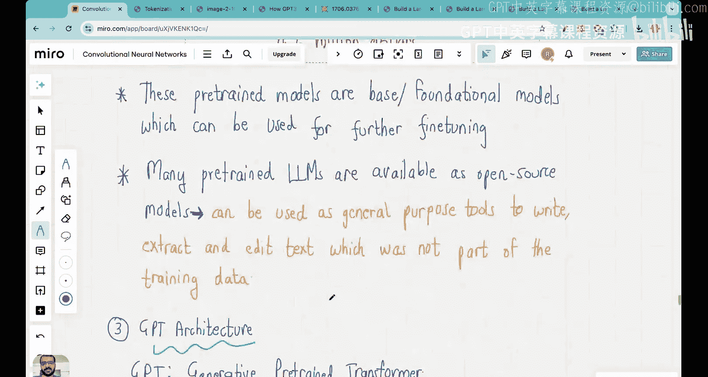
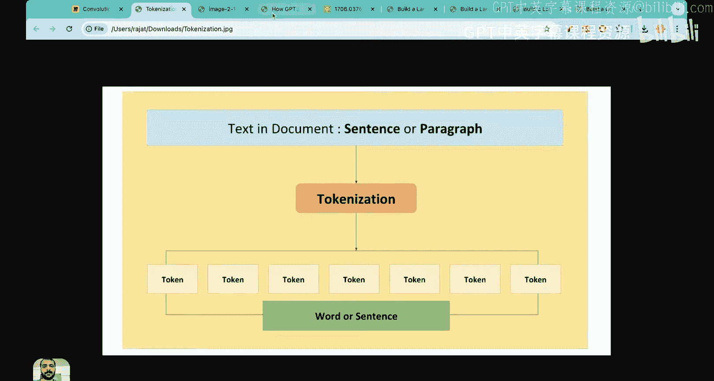
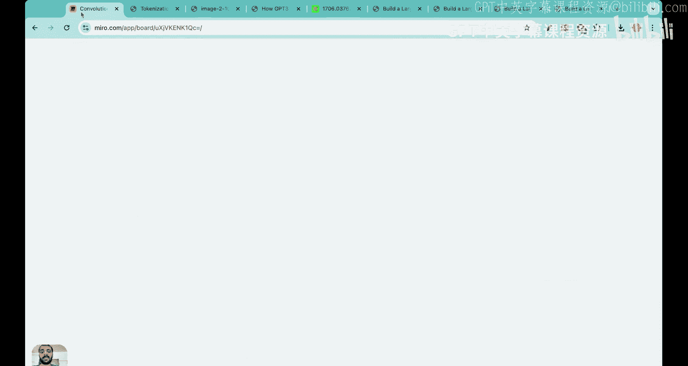
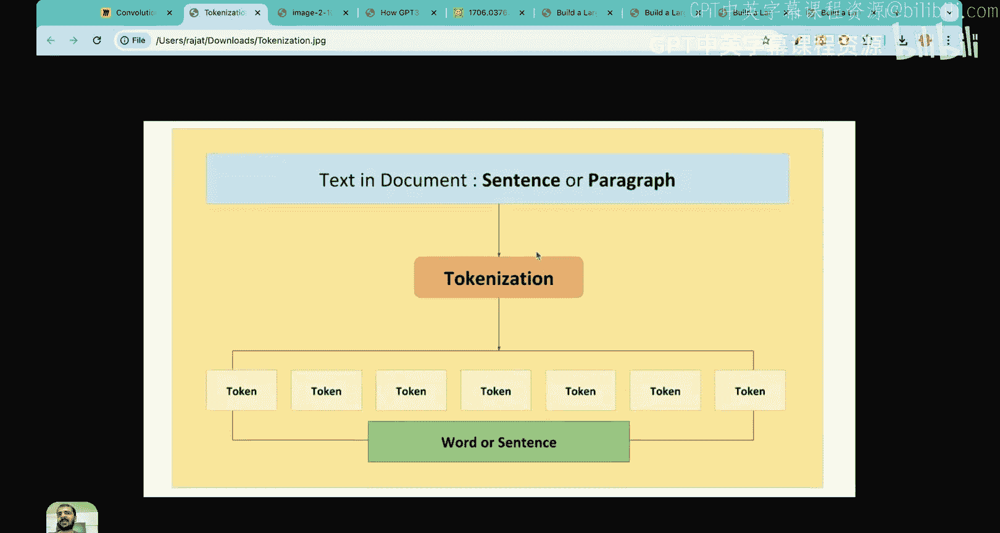
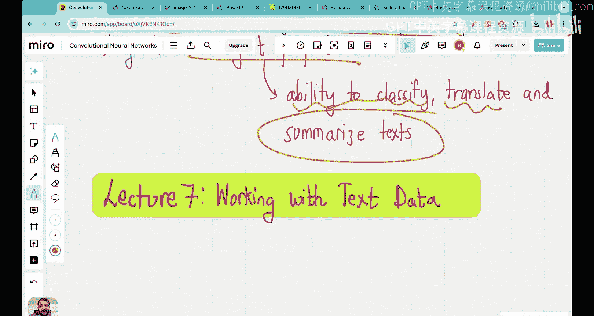

# Vizuara《从零开始搭建大语言模型｜Building LLMs from scratch》中英字幕（Claude-3.7-s） - P6：-06-Lecture 6_ Stages of building an LLM from Scratch.zh_en - GPT中英字幕课程资源 - BV1qG8HzUE2D

🎼Yeah。Hello， everyone。Welcome to this lecture in theBuilding La language models from Sctch series。

We have covered five lectures up now。And in the previous lecture。

 we looked at the GPT3 architecture in a lot of detail we also saw the progression from GPT to GPT2 to GPT3 and finally to G 4。

We saw that the total three training cost for GPT3 is around 4。6 million， which is insanely high。

And up till now， we have also looked at the data set which was used for pre training GPT3 and we have seen this several times until now。

In the previous lecture we learned about the differences between zero short versus few short learning as well。

So if you have not been through the previous lectures。

 we have already covered five lectures in this series and all of them have actually received a very good response。

From YouTube and I've received a number of comments saying that they have really helped people。

 so I encourage you to go through those videos。In today's lecture we are going to be discussing about what we will exactly cover in the playlist in these five lectures we have looked at some of the theory modules。

 some of the intuition modules behind attention behind selfat， prediction of next world。

 zero short versus few short learning basics of the transformer architecture。

 data sets used for LLM pretraining difference between pretrain and fine tuning etc。But now。

From the next lecture on words， we are going to start。

With the hands on aspects of actually building an LLM。

 so I wanted to utilize this particular lecture to give you a roadmap of what all we will be doing in this series and what all stages which we will be covering during this playlist。

So， that is the title of today's lecture stages of building a large language model towards the end of this lecture。

 we will also do a recap of what all we have learned until now。

 so let us get started with today's lecture。Okay， so we will break this playlist into three stages。

 stage one， stage two and stage three， remember before we get started that this material which Im showing is heavily borrowed from the book building a large language model from scratch which is written by Sebastian Rashka。

So I am very grateful to the author for writing this book。

 which is allowing me to make this playlist。

Okay， so we'll be dividing the playlist into three stages， stage1 stage two and stage number three。

 unfortunately all of the playlists currently which are available on YouTube only go through some of these stages and that too they do not cover these stages in detail。

My plan is to devote a number of lectures to each stage。

In this playlist so that you get a very detailed understanding of how the nuts and bowls really work。

So in stage one， we are going to be looking at essentially building a large language model。

And we are going to look at the building blocks which are necessary。

 so before we go to train the large language model。

 we need to do the data preprocessing and sampling in a very specific manner。

 we need to understand the attention mechanism and we will need to understand the LLM architecture So in the stage1 we are going to focus on these three things understanding how the data is collected from different data sets。

 how the data is processed， how the data is sampled。

 number one then we will go to attention mechanism。

 how to code out the attention mechanism completely from scratch in Python。

 what is meant by key query value， what is the attention score， what is positional encoding。

 what is vector embedding， all of this will be covered in this stage we will also be looking at the LLL architecture。

Such as how to stack different layers on top of each other。

 where should the attention head go all of these things。Essentially， the mean。

Understanding or the main part of this stage will be to understand the basic mechanism。

Behind a large language model。So what exactly we will cover in data preparation and sampling first we will see to toization if you are given sentences how to break them down into individual tokens。

As we have seen earlier， a token can be thought of as a unit of a sentence。

 but there is a particular way of doing tokenization we will cover that。

Then we will cover vector embedding essentially after we do to organization。

 every word needs to be transformed into a very high dimensional vector space so that the semantic meaning。

Between words is captured， as you can see here， we want apple。

 banana and orange to be closer together， which are seen in this red circle over here。

 We want king men and women to be closer together， which is shown in the blue circle and we want sports such as football gold ftains to be closer together as shown in the green these are just representative examples what I want to explain is that before we give the data set for training we need to encode every world so that。

The semantic meaning between the words are captured so words which mean similar things a lie closer together so we will learn about vector embeddings in a lot of detail here we will also learn about positional encoding the order in which the word appears in a sentence is also very important and we need to give that information to the pretraining model。

After learning about tokenization vector embeddings we will learn about how to construct batches of the data。

 so if we have a huge amount of data set how to give the data in batches to GPT or to the large language model which we are going to build。

So we will be looking at the next world prediction task so we will be given a bunch of words and then predicting the next word so we will also see the meaning of context how many words should be taken for training to predict the next output we will see about that and how to basically feed the data in different sets of batches so that the computation becomes much more efficient。

So we will be implementing a data batching sequence before giving all of the data set into the large language model for pre training。

After this the second point as I mentioned here is the attention mechanism so here is the attention mechanism for the transformer model we will first understand what is meant by every single thing here what is meant by multiha attention。

 what is meant by mask multiha attention， what is meant by positional encoding input emdding output embedding all of these things and then we will build our own LLM architecture。

So these are the two things attention mechanism and LLM architecture after we cover all of these aspects we are essentially ready with stage one of this playlist and then we can move to the stage two stage two of this series is essentially going to be pretraining which is after we have assembled all the data after we have constructed the large language model architecture which we are going to use we are going to write down a code which trains the large language model on the underlying data set that is also called as pretraining so the outcome of stage two is to build a foundational model on unlabeled data。

Now I'll just show schematic from the book which we will be following so this is how the training dataset will look like will break it down into epochs and we will compute the gradient of the loss in each epoch and we will update the parameters towardsward the end will generate sample text for visual inspection This is what will happen exactly in the training procedure of the large language model and then we will also do model evaluation and loading pretrain weights so let me show you the schematic for that so we' will do text generation evaluation training and evaluation losses then we'll write the LLM training function which I showed you and then we will do one more thing we will implement functions to save and load the large language model weights to use or continue training the LLM later so there is no point in training the LLM from scratch every single time right weight saving and loading essentially saves you a ton of computational cost and memory。

And then at the end of this we also load pretrained weights from open AI into our large language model。

 so openAI has already made some of the weights available their pretrained weights so we be loading pretrained weights from openaiI into our LLM model this is all what we will be covering in the stage two which is essentially training loop plus training loop plus model evaluation plus loading pretrained weights to build our foundational model so the main goal of stage two as as I told you is pretraining and LLM on unlabeled data。

Great， but we will not stop here after this we move to stage number three and the main goal of stage number three is fine tuning the large language model so if we want to build specific applications。

 we will do fine tuning in this playlist you are going to build two applications which you are mentioned in the book I showed you at the start one is building a classifier and one is building your own personal assistant So here are some schematics to show so if you want to let you have got a lot of emails right and if you want to use your LLm to classify spam or no spam for example you are a winner you have been specially selected to receive thousand dollars cash now this should be classified as spam whereas hey just wanted to check if you are still on for dinner tonight let me know this will be not spam So we will build a large language model this application which classifies between spam and no spam and we cannot just use the pretrain or foundational model for this because we need to train with label data to the pretrained model we need。

To give some more data and tell it that hey， this is usually spam and this is not spam can you use the foundational model plus this additional specific label data set which I have given to build。

A fine tune LLM application for email classification。

 so this is what we will be building as the first application。

 the second application which we will be building is a type of a chatbot which basically answers queries so there is an instruction there is an input and there is an output and will will be building this chatbot after fine tuning the large language model。

So if you want to be a very serious LLM engineer， all the stages are equally important many students what they are doing right now is that they just look at stage number three。

And they either use L chain， let's say。They use land chain。 They use tools like O laama。

And they directly deploy applications， but they do not understand whats going on in stage one and stage 2 at all。

 So this leaves you also a bit underconfident and insecure about whether I really know the nuts and bowls。

 whether I really know the details。My plan is to go over every single thing without skipping even a single concept in stage1。

 stage two and stage number3。So this is the plan which you will be following in this playlist and I hope you are excited for this because at the end of this really my vision for this playlist is to make it the most detailed LLM playlist which many people can refer not just students but working professionals startup founders managers etc and then you can once this playlist is built over I think two to three months later you can。

referfer to whichever part you are more interested in so people who are following this in the early stages of this journey it's awesome because I'll reply to all the comments in the chat section。

And we build this journey together。I want to end this lecture by providing a recap of what all we have learned so far。

This is very this is going to be very important because from the next lecture we are going to start a bit of the hands on approach。

Okay， so number one， large language models have really transformed the field of natural language processing。

 they have led to advancements in generating understanding and translating human language this is very important。

So the field of NLP before you needed to train a separate algorithm for each specific task but large language models are pretty generic if you train an LLM for predicting the next world it turns out that it develops emergent properties which means it's not only good at predicting the next world but also at things like multiple choice questions text summarization then emotion classification language translation etc it's useful for a wide range of tasks and that has led to its predominance as an amazing tool in a variety of fields。

Secondly， all modern large language models are trained in two main steps first we pretrain on an unlabeled data。

 this is called as a foundational model and for this very large data sets are needed typically billions of words。

And it costs a lot as we saw training pretraining GPT3 costs 4。

6 million so you need access to huge amount of data。

 compute power and money to pretrain such a foundational model now if you are actually going to implement an LLM application production level so let's say if you are an educational company building multiple choice questions。

And you think that the answers provided by the pretraining or foundational model are not very good and they are a bit generic。

 you can provide your own specific data and you can label the dataset saying that these are the right answers and I want you to further train on this refined dataset。

To build a better model， this is called fine tuning。Usually airline companies， restaurants， banks。

 educational companies when they deploy LLMs into production level they fine tune the pretrained LLM nobody deploys the pretrain one directly you fine tune the LLM on your specific smaller label dataset this is very important see for pretraining the data which you have is unlabeled。

It's autoregressive so the sentence structure itself is used for creating the labels as we are just predicting the next world。

 but when we fine tune we have a label data set such as remember the spam versus no spam example which I showed you that is a label data set we give labels like hey this is spam this is not spam this is a good answer this is not a good answer and this fine tuning step is generally needed for building production ready LLM applications。

The important thing to remember is that fine tuned LLM can outperform only pretrained LLM on specific tasks so let's say you take two cases right in one case you only have pretrained LLMs and in second case you have pretrained plus fine tuned LLMs so it turns out that pretrained plus fine tune does a much better job at certain specific tasks than just using pretrained。

For students who just want to interact for getting their doubts solved or for getting assistance in summarization。

 helping in writing a research paper， etc， GPT4 perplexity or such API tools or such interfaces which are available or perfectly fine。

 but if you were to build a specific application on your data， take it to production level。

 you definitely need fine tuning。Okay， now one more key thing is that the secret sauce behind large language models is this transformer architecture。

So the key idea behind transformer architecture is the attention mechanism just to show you how the transformer architecture looks like it looks like this and the main thing behind the transformer architecture which really makes it so powerful。

Are these attention blocks？Well see what they mean so no need to worry about this right now。

But in a nutshell attention mechanism gives the LLM selective access to the whole input sequence when generating output one over at a time。

 basically attention mechanism allows the LLM to。Understand the importance of worlds and not just the world in the current sentence。

 but in the previous sentences which have come long before also。

Because context is important in predicting the next word。

 the current sentence is not the only one which matters attention mechanism allows the L to give access to the entire context and select or give weighttage to which words are important in predicting the next world。

This is a key idea which and will spend a lot of time on this idea。

Remember that the original transformer had only the encoder plus decoder so it had both of these things it had the encoder as well as it had the decoder but generative pretrain transformer only has the decoder it did it does not have the encoder so Transer and GP is not the same Transer paper came in 2017 it had encodeder plus decoder generative pretrain transformer came one year later 2018 and that only had the decoder architecture so even G4 right now it only has decoder no encodeder so 2018 came G the first generative pretrain transformer architecture 2019 came G2 2020 came G3 which had 175 billion parameters and that really changed the game because no one had seen a model this large before and then now we are at GP4 stage。

One last point which is very important is that LLMs are only trained for predicting the next world right。

 but very surprisingly they develop emergent properties。

 which means that although they are only trained to predict the next world。

 they show some amazing properties like ability to classify text。

 translate text from one language into another language and even summarize texts。

So they were not trained for these tasks but they developed these properties and that was an awesome thing to realize the pretrain stage worked so well that LLMs develop all of these wonderful other properties which makes them so impactful for a wide range of tasks currently。

Okay so this brings us to the end of the recap which we have covered up till now。

 if you have not seen the previous lectures I really encourage you to go through them because these lectures have really set the stage for us to now dive into stage one so from the next lecture we'll start going into stage one and we'll start seeing the first aspect which is data preparation and sampling。

So the next lecture title will be working with text data and we'll be looking at the data sets。

 how to load a data， how to count the number of characters， how to break the data into tokens。

 and I'll start sharing Jupyter notebooks from next time on all so that we can apparently begin coding。

So thanks everyone， I hope you are liking these lectures so lecture 1 to6 we kind of like an introductory lecture to give you a feel of the entire series and so that you understand concepts at a fundamental level from lecture 7 will be diving deep into code and will be starting into stage one。

So I follow this approach of writing on a headboard and also coding。

So that you understand the details plus the code at the same time because I believe theory plus practical implementation both are important and that is one of the philosophies of this lecture series so do let me know in the comments how you are finding this teaching style because I will take feedback from that and we can build this series together three to four months later this can be an amazing and awesome series and I will rely on your feedback to build this thanks a lot everyone and I look forward to seeing you in the next lecture。

。