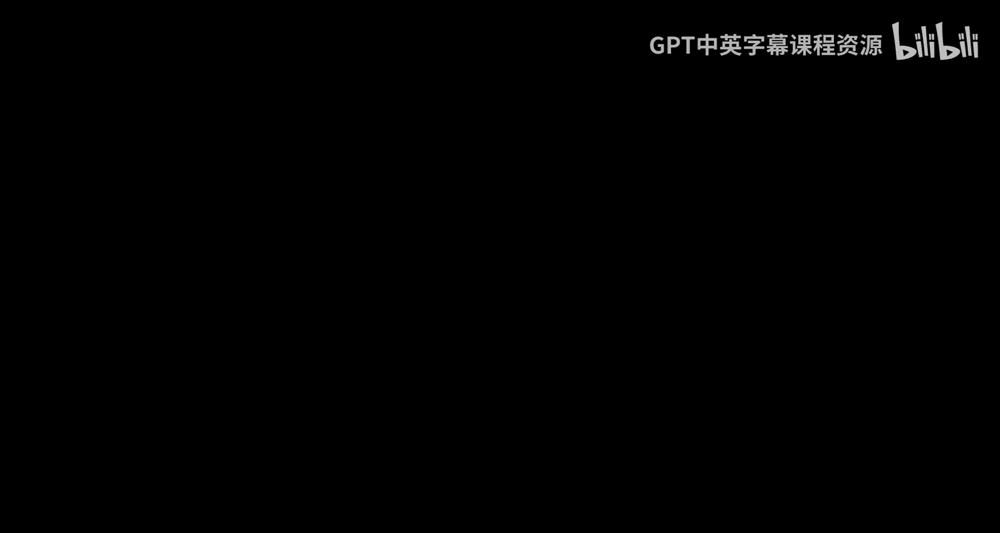
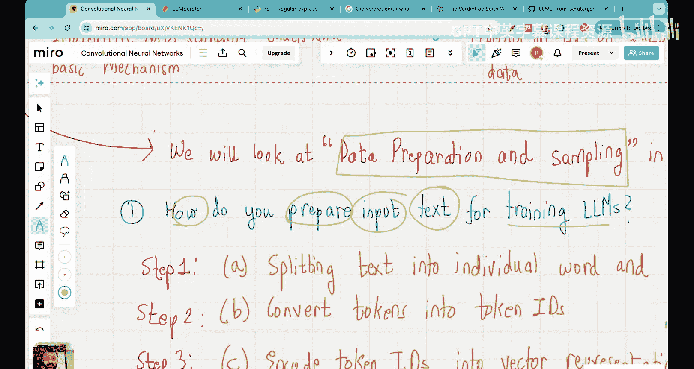
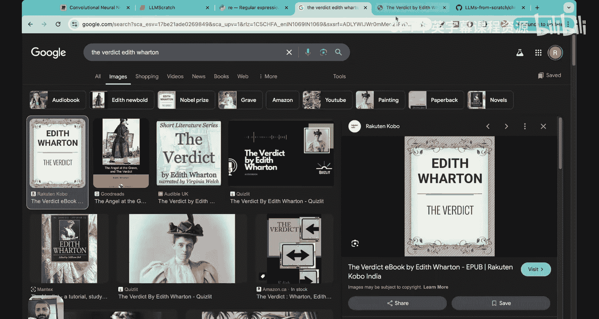
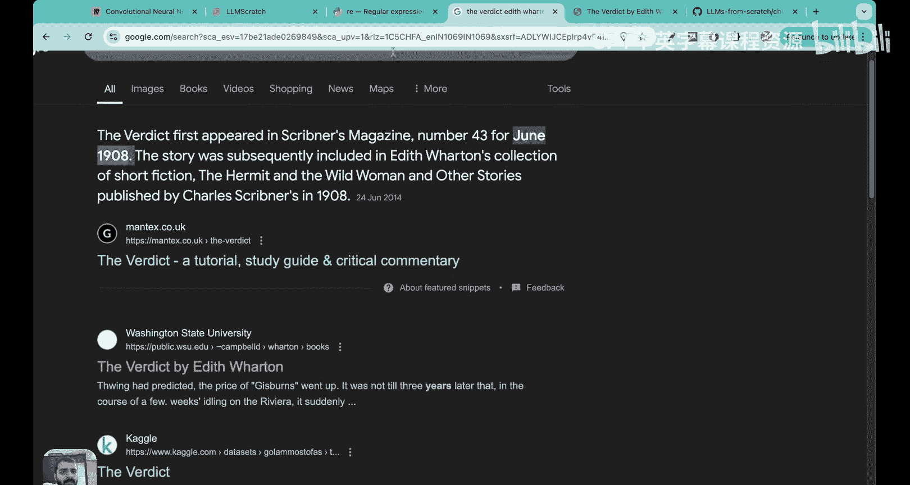
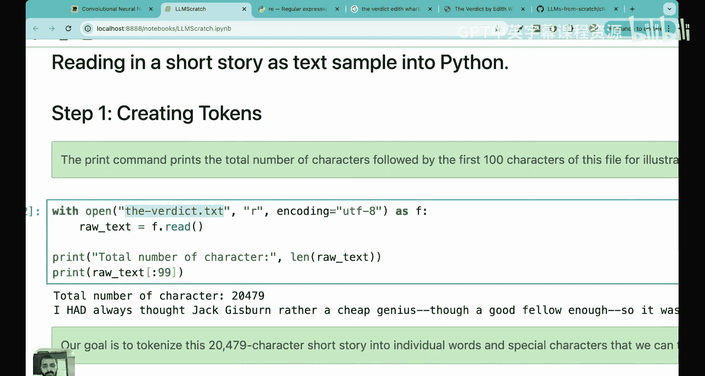
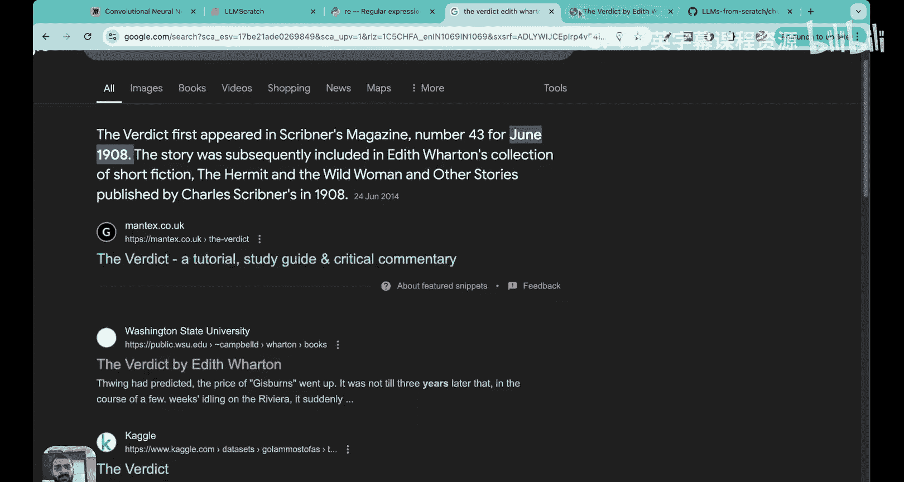
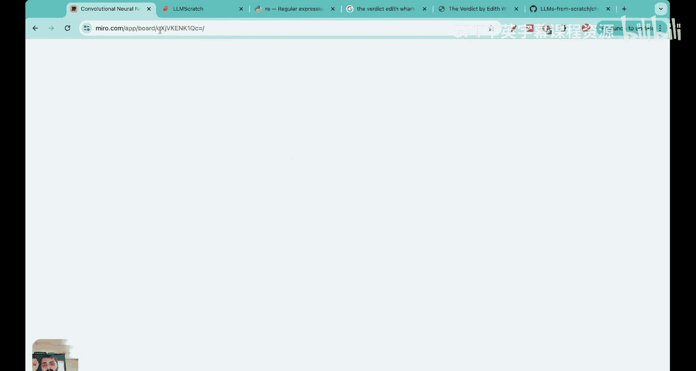
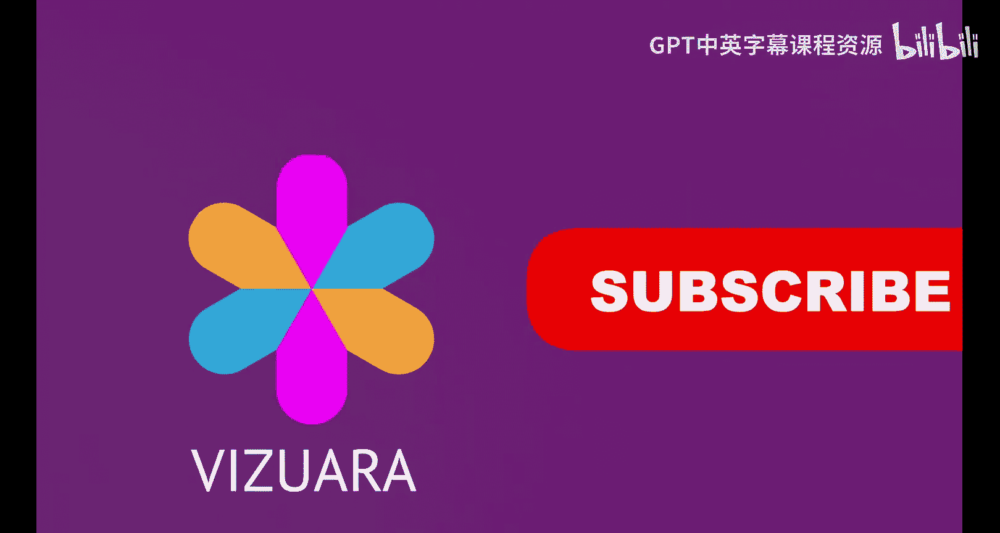

# Vizuara《从零开始搭建大语言模型｜Building LLMs from scratch》中英字幕（Claude-3.7-s） - P7：-07-Lecture 7_ Code an LLM Tokenizer from Scratch in Python.zh_en - GPT中英字幕课程资源 - BV1qG8HzUE2D

🎼Yeah。Hello everyone， welcome to this lecture in theBuild La language models from Sctch series。

My name is Dr。 Raj Danandeker and I'll be your instructor for this lecture。Today。

 we are going to cover a very important topic， which is called as dokenization。Basically。

 when we build large language models。The data needs to be pre processed in a certain manner before it is used for pre training。

And in this data preprocessing pipeline， the first step is tokenization。At its really basic form。

 tokenization is just the process of breaking down a sentence into individual wordss。

But it is a bit more detailed than that the way it is used to actually build large language models in today's lecture。

We are going to understand everything there is to know about tokenization。

 and we will build a tokenizer fully from scratch。 We will also build an encoder and decor from scratch and we quote it out in Python。

So today will be a hands on session if you have a laptop in front of you that' is great so that you can follow along in Google Collab or Jupiter notebook or VS code to implement the code along with me so let's get started with today's lecture。

Building a large language model usually proceeds in three stages。

 especially if you want to build it from scratch in stage1 we have to understand the nuances or basic mechanism of building an LLM and that includes data preparation。

 attention mechanism and understanding the LLM architecture。

Stage2 involves pre training and building the foundational model， so that involves the training loop。

 model evaluation and loading pretrain weights and stage 3 involves fine tuning。Training on smaller。

 very specific data sets to build applications which are actually useful to you such as a classifier or a personal assistant。

In this lecture， we are going to look at the first aspect of stage1。

 which is data preparation and data preparation and sampling。

So tokenization comes under the category of data preparation andse。

And that is what we are going to cover in today's lecture you can think of this as the first building block for building a large language model。

So let's get started with today's lecture。So the main question which we are going to answer today is how exactly do you。

Prepare input text for training large language models。At the heart of it。

 LLMs are just neural networks， right， so you need data。The parameters of the LLM are optimized。

 and then we have some output。The question is that this data， which comes in as the input。

 what form should it take， how should we prepare the input text。We have a huge number of documents。

 right， which the LLM is trained on。 we have seen that in previous lectures。

 the LLM is usually trained on billions of documents。

But do we feed the document directly as the input text？

Do we feed the sentences of the document as the input text， no。

 it turns out we have to tokenize the document and then feed individual tokens。

There is one more step after this which is called as vector embedding。

 but we will have a separate lecture for that today we are only going to look at tokenization。

So the process of tokenization can be broadly broken down into three steps。

This is the key takeaway which you should learn from today's lecture。

 the first step is that you have to initially split the text into individual world and subort tokens。

That is step number one。 Imagine you have huge amount of text。

 You break it down into individual words。 That is the first step of tokenization。

 The second step of tokenization is convertting these tokens into token ids。

And the third step is basically encode these token IDs into vector representation。

 we are not going to look at step number three in today's lecture because it comes also under vector embedding but essentially we are going to look at step1 and step number two so let me repeat step1 and step two step1 is basically imagine you have a big document which is let's say your training on Harry Potter books you take this books you divide it into sentences and then you split the text into individual world and subvert tokens and then you convert these tokens into token IDs。

That's the。Two major steps involved in tokenization， which we are going to look in today's lecture。

So I just want to show you a visual for how。The input text is given to the large language model。

 so let's say this is an input text right this is an example。

Remember the first step of tokenization we break this into individual worlds so the first word is this the second word is is the third word is n and the fourth word is example。

 so this is the tokenized text and this is my step number one right now step number two is we need to convert each of these individual tokens into token IDs so this is the token ID14013 token  ID2201 token  ID3 which is 302 and token  ID4 which is 1134。

So every world or every token rather has a token ID associated with it。

 I have currently given these numbers randomly but you need to assign a token ID for each world and then the next step after getting these token IDs is to convert these token IDs into something called token embeddings or vector embeddings。

And then these vector embeddings are then fed as input data to the GPT。Or the LLM brother。

So even before coming to the training stage， we need to do these many steps of preprocessing and today we are essentially going to look at step number one and step number two。

I hope you have understood the two main steps which we are going to look at in today's lecture。

So let us start by looking at step number one initially。

 which is tokenizing the text or breaking down the text into individual words。

And you definitely do need to understand the nuances which are involved in this。

 and that's why I'm going to take you through the entire coding process in Python。

We could have just used a pre builtil tokenizer， but then you won't understand the nuances involved in tokenizing。

And just to give out a shout out or rather credits to Sebastian Rashka for。

Hosting this code publicly and I'll be heavily borrowing from this code。

So let's get started for the purposes of the demonstration today we are going to use a specific data set。

 we are going to use this book called the verdict which has been written by Edith Vortle。

So let's look at a few screenshots or let's look at a few data about this book。

 So if you search the verdict by edit Wton， you will at image of this book which looks like this year of publishing。

Let's look at the year when this book was published so this was I think published in 1908 so almost 12130 years back and it's available for free free to download I'll give you the link to download this book it's also available in this repository by Sebastian you can just click on this download and then download this book so we are going to look at this book and assume that this is the only training data which we have for the purposes of today's lecture but whatever I show you today can be really applied to any book or even a huge number of books。

I encourage you later after this lecture to try out some different book which is available for free online。

 such as the Harry Potter book or whichever interests you and apply the same code over there。Okay。

 so this is the data which we are going to look at and then what we have to do is basically download and this data set in Python。

So let me show you how to do that， So now we are moving into Jupiter coding。

Please comment out in the comment section if the code is visible to you if I have zoomed in enough or if I should follow some different time。

Okay， so the first step as I mentioned， we are going to look at two steps today creating tokens and then converting these tokens into token IDds。

The first step is creating tokens right so what we are going to do here is that we are going to download the verdictic dot Txt file。

 we are going to open it in Python and we are going to read it。

And we are going to print the total number of characters。

 So I'm just showing this when you download it， it looks this much it's not that big。

And in fact， it's even available over here。So I have downloaded this book right now and in Python you can use this open command。

 so with open the word it doc text and then R means we are reading this。

And then raw text is that variable where we are storing whatever content Python has read from this book。

 so this raw text variable is going to be very important for us because we will also refer to it later basically raw text is just the entire text which we are reading。

And then what we are doing here is that we are counting the total number of characters in this rawt text。

 So what Im doing in this part of the code is that I am printing out the total number of characters and then length rawt text right So here you see。

The print command towards the end raw text colon 99 what does this do this print command prints the total number of characters so here so there are two print commands right the first print commands essentially prints the total number of characters and the second print command essentially prints the first1 hundred characters of this file for illustration purposes。

So let's run both of these print commands right now Ive already run this before but let me click on this run icon again so okay the result of this first print command is this the total number of characters are 2047920479 and the result of the second print command is basically we printing the first100 characters of this file right so the first hundred0 characters are I had always thought Jack giizbon etc。

So this is the these are the first00 characters， so this indicates that Python has been able to successfully read the text which we have downloaded and thats an awesome sign great now let's move further our goal in this lecture is to tokenize all of the characters which are in this book in this text in this short story into individual worlds that we can later turn into embeddings for LLM training remember。

Embbeddings is the last step so before you come to training the LLM there is this thing called embedding so the goal in this lecture is to do the tokenization and the token IDs for the entire text which we have read for all of these characters for the 20。

0479 characters of this short story the goal is to convert them into tokens and token IDs。

So one note which has been added over here is that note that it's common to process millions of articles and hundreds of thousands of books。

 which is a huge amount of memory when actually working with LLMs。

 this is very important to note when you actually work with LLMs。

 you don't just download one book as I showed to you right now we actually work with millions and thousands of books。

which are a huge amount of data to be stored on your computer， however。

 for educational purposes it's sufficient to work with smaller tech samples like a single book and thats why we are using a single book in today's code to demonstrate the idea to you。

Okay， so the next question is how can we best split this text to obtain a list of tokens so I encourage you to pause here right now and let's say I give you this problem that you have read this text Now your goal is to split this text into individual tokens right How would you do this Which Python library would you use？

So let me reveal the answer， the Python library， which we will be using for this is called as regular expression RE。

So this module provides regular expression matching operations。And lets see how basically this works。

 we have to import R and then what we can do is that we can use this library to split to split any given text。

嗯。Based on the white spaces in that text or any other characters in that text。

 and I'll explain what this actually means。🤧Okay， so。Yeah。Yeah。Okay。

 so let's say you have a text which looks like this hello world。

 this is a test right and you want to split and you want to split this into individual tokens。

What I am going to do here is that from this library I am going to use this function R dot split right and then there is this R and then the symbolic slash s what this basically does is that this slash s means that we split wherever white spaces are encountered right？

So let me tell you what is meant by white spaces， so let's look at this world。

 let's look at this sentence。You see， there is a white space over here。

 There is a white space over here。 There is a white space over here。Y any year。So。

 wherever there is a white space， what this command will do is that it will split the text into individual tokens and where the split will be wherever the white space is there so it will scan this sentence from left to right。

Now here it encounters the white space so it will split split here。

 then again it will move forward here it encounters the white space so it will split here。

 So let's go from left to right So until hello and comma it has not encountered a white white space right so hello and comma is one token。

And then it encounters a height space。 so it splits。

 So then it outputs the height space here When you print out the result。

Then it again goes on scanning and year until world and full stop there is no white space so it prints out world and full stop then after this point there is a white space right see this so then it prints this out then it again keeps on scanning from left to right so till this and comma there is no white space so it prints out this and comma。

Then it prints out another white space over here， so it keeps on scanning from left to right and then splits wherever white space is encountered。

RightThat is the advantage of using re dot split。And then this character indicates where you want to split so here Ive indicated that you split wherever you see a white space。

 right？So the result of this is a list of individual worlds， white spaces and punctuation characters。

 so see white spaces are also the results of this。Now what we want to do is we want to also split commas and periods so here you see the comma is included as part of the world itself where the full stop is included as part of the world but we want to have comma and full stop also a separate tokens how do we do that it' is pretty simple in the Rri dot split command you also include comma and you also include the full stop。

Along with this slash S command and then when you print the result you will see that along with white spaces so white spaces are of course printed out because we are splitting on white spaces also。

 but comma is now a separate token full stop is now a separate token which was not the case before hello and comma were one token but now you will see hello。

And kara are separate tokens awesome， so now we have split based on commara and full stops also。

Correct now the main another remaining issue is that our list still includes white space characters right see these the white space characters are still counted as tokens。

We can even remove these redant redundant characters safely so here what we are doing is that。

You first scan the result scan each item in the result so we are looping over each item in the result so this is the result right so we are going over each of the individual items in this result and if item dot script is equal to true then only we return that item so if it's a white space then item dot script will actually be false so white spaces will not be returned whenever there is actually a full world full world like hello or comma or world or this or full stop。

Then only item dot script will return true and those words will be written in this result。

So using this statement loop over item in the result and then find out item dot script。

 so for white spaces item do script will anyway be false。

So that will not be returned so in this one line of command we can actually get rid of white spaces completely from the sentence and now when we print out the result we will have the tokens says hello comma world full stop this comma is a test and full stop we won't have white spaces。

So one more consideration which I would like to mention over here is that removing white spaces or not。

 this is an important question to actually discuss。Because when you develop a simple tokenizer。

 whether we should encode height spaces or as separate characters or just remove them depends on our application and its requirements。

 so what are the advantages of removing white spaces removing white spaces reduces the memory and computing requirements which is great。

However， keeping white spaces can be useful if we train models that are sensitive to the exact structure of the text。

 right？For example， Python code is sensitive to indentation and spacing。

 so if Python code is used as the data for training and a large language model it makes sense to keep the white spaces right because the white spaces have some meaning in the case of Python code as the training dataset。

In this case， we are going to until now we are going to remove the white spaces just for simplicity so that we have memory advantages。

 but remember that it' is not obvious to always remove white spaces。As has been mentioned。Over here。

 if you have Python code as training data， white spaces are important because indentation matters。

So several things need to be considered when you're building an actual LLM。

 whether you should remove white spaces or whether you should not remove white spaces。

That's great So the tokenization scheme which we devised above were swell on simple sample text so we can modify it a bit further because we also want to have question marks quotation marks and double dashes as separate characters or separate tokens currently only full stop and comma are separate tokens right but we also want question marks quotation marks。

 double dashes etc ceter separate tokens so let's look at this document against see there are these double dashes then I'm sure there are question marks somewhere there are question marks there are exclamation marks in this document we all want them as separate tokens right and we need to include that in our tokenization command。

And the way we do this is pretty simple again we use this RAri dot split and along with comma and along with fullstock we add all of these other special characters like colon semicolon question mark underscore exclamation quotation marks。

 bracket etc and we say that whenever these characters are encountered also do a split on these characters so that they are considered as individual tokens right？

So now when you take the sample text hello comma world is this dash dash a text。

 all of these will be sample tokens this dash dash will also be a separate token the question mark will also be a separate token because we have included that in our split command。

And again， we will strip the white spaces like the same command for item for item in the result if item dot script。

 remember this was the command we used to filter out the white spaces or to remove the white spaces。

Awesome， so now these two lines of code are our tokenization scheme。

 so this is the two lines of code in which we have built the tokenizer in this first line of code we take a sentence and we split the sentence wherever there is a white space wherever there is a comma full stop colon and semicolon question mark underscore exclamation quotation mark or bracket we split it and then in the second sentence we just remove the white spaces。

And then we print out the result。It's as simple as that this is the simple tokenization scheme for building a large language models a different tokenization scheme is used but we'll come to that in the next lecture it's called byte pair andcoding。

😊，But for now， I just wanted to give you a sense of what all nuances need to be considered for building a tokenizer like this。

Now you see we have tested these two sentences which are our tokenizer scheme for a sample sentence right now what we can do is apply these same two statements on the entire raw text。

So we had the raw text right defined before， let me go to that。So see this was the raw text。

 which was basically the book which we had read Now well use these two statements to essentially convert the entire。

R text into individual tokens， so what we will do is that we will split the entire raw text based on these tokens which we had seen before。

And then we will store it in a variable which is called as pre processed。

So pre preprocessed is essentially a list of all the tokens and then in the second statement exactly same to what we saw before we'll split or we'll get rid of the height spaces awesome right so now let us print the length of the preprocessed so we have 4690 tokens in the original book so if you go to this book the simplest way to think about this is this will be one token height will be one token this inverted commas will be one token these two double dashes will be one token so this entire thing is broken down into individual words or tokens which are 4690 in number。

And here we have just printed out the first 30 of these tokens and you see I had always thought they are individual tokens and dash dash comma they are also counted as tokens earlier because we have mentioned that in this split。

 where all do we want the split to happen？Awesome， so we have now got our basic tokenizer working and we have applied it to the entire short story。

 which we are considering considering as the input data great。Now。

 we have to come to the second step。 So we have now finished the。We have now finished the first step。

 which is tokenizing the entire short story。And now we will come to the next step。

 which is converting tokens into token ids。 Now， what is very important is that Python。

Who works with numbers right so even if you look at these individual tokens which we have obtained right now these are not numbers。

 they are still words， we need to convert them into token IDs so that they are numerical representations。

So let's see how to do that。So we have the complete training data set here for illustration I have just taken a sentence and until now we have converted this sentence into individual tokens now what we will do is that well take the tokens and convert them into token IDs and then there is a very specific way of doing this first we build something which is called as vocabulary vocabulary is just all the list of our tokens but it sorted in an alphabetical manner。

So if the if our data set or the tokens are the quick brown fox jumps over the lazy dog。

 if this is the training data set。The vocabulary is the list of tokens in alphabetical order。

 so brown comes first， then dog， then f， then jumps， then lazy， then over。

 then quick and then the this is my vocabulary for this training data set。

Eventually we' have billions of data sets， billions of files so then the vocabulary will be huge but I'm just showing a simple representation here for how vocabulary is constructed vocabulary is just a list of tokens which is sorted in alphabetical manner and then what we do is that each unique token is mapped to a unique integer which is called as the token ID so it's as simple as that you map these tokens in alphabetical order and then to each token you assign a number so since they are arranged in alphabetical order brown will be0 so you start from zero since it's Python。

Dog will be one。 Foxox will be two。 Jus will be3。 lazy will be4 Over will be 5。 Quick will be 6。

 and the will be 7。So the vocabulary always contains unique tokens remember。

 although though appears two times in the vocabulary it only comes once。

 so we make a list of these unique tokens and we assign token IDs to all of these。

And it's important to arrange the vocabulary in alphabetical order so that assigning token IDs becomes very easy。

So the process of assigning token ID is actually very simple each unit just remember that each unique token is mapped to a unique integer。

 which is called as the token ID， right？So now let's see how this is implemented in Python。

So in the previous section we tokenized edit to Oren short story and assigned it to a Python variable called preprocessed。

 so remember pre processcesed is the final list which contains all the tokenized words these words。

Now what we'll do is now we'll create a list of all unique tokens and sort them alphabetically to determine the vocabulary size。

 exactly what I had mentioned over here。So what we are doing is that we are taking preprocessed。

 we are converting it into a set and we are going to sort it into a set so this will sort it in alphabetical order and then we are just going to print the vocabulary size so we can see that the vocabulary size is 1130 right remember the vocabulary only consists of unique words so the vocabulary size is less than the number of tokens which are there。

So now what we can do is after determining that the vocabulary size is 1130 via the above code。

We create the vocabulary itself so when I say you create the vocabulary remember that a vocabulary is not just these tokens but every token needs to be assigned to a token ID a vocabulary is a is like a dictionary of tokens and associated token IDs so now we have to create that dictionary right and so it's very simple you just all words consists of all the unique words in the vocabulary right in alphabetical order what you do is that you just。

You take all these tokens and assign an integer value to all these words that's it。

 which means the token which comes first that will be 0， the token which comes second。

 its integer will be one and it will proceed like that。

Let me print this out for you to show you so our tokens are also exclamation marks comms etcter right so by default they are assigned the first priority so they will be 01。

2，3，4，5，6 and here you see everything is arranged in alphabetical order so a will be 11 a H will be 12 among will be 13 and will be 14 R will be 15 A Rt will be 16 as will be 17 at will be 18 etc ce Now all of these exclamation all of these I would say。

Where is。Are used because this was written in 1908 this ART is not used as an exclamation typically now but this book is written in 1908 so it shows up right so this is the vocabulary which we have and we have printed the first 50 items of this vocabulary so it looks like a dictionary pretty much and remember that every element in this dictionary which is a token has a token ID now associated with it thats it vocabulary is as simple as that and the simplified code for this for every token assign an intessure。

And how do you get the integer into tokens you just enumerate all worlds so this enumerate command in Python what it does is that it takes all the worlds and then it assigns an integer to each word in alphabetical order。

So that way， Python is actually awesome and you can write。Very complex things in one line of code。

 actually。So this is how you create the vocabulary and this is how you assign token IDs to every individual token。

 right？So as we can see based on the output about the dictionary contains individual tokens which are associated with unique integer labels。

 exactly what we saw here， the vocabulary which is a dictionary consists of individual tokens assigned to a unique integer label。

 which are token IDs。Now， one more thing which I want to tell you is that currently we converted the words or tokens into token IDs。

 right， you can think of this process as encoding。Now， later we will also need a decoder。

 which means that from the token ID， you need to convert the token ID back to the world because when the LLM gives the output that will be numerical form now you need to convert it in word form。

 so you also need a mapping from the token ID to the token the vocabulary is a dictionary which gives you a mapping from the token to the token ID but we need a reverse mapping which is called as a decoder。

So， this is what I have mentioned here later when we want to create the output of an LLM from numbers back into text。

 we also need a way to turn token IDs back into text。And for this。

 we create an inverse version of the vocabulary that maps token IDs back to the corresponding text tokens and we will see how to do that。

For now what we are going to do is we have understood enough about tokenization that we are going to implement a complete tokenizer class in Python this class will have two methods it will have an encode method and it will have a decode method let me show you what it actually means so this tokenizer class which we are going to implement in Python it will have two methods the first will be the encode code method。

And the second will be the decocode method。In the encode method。

 what will happen is that sample text will be converted into tokens and then tokens will be assigned token IDs based on the vocabulary exactly what we saw like over here。

In the Decode method， exactly reverse things would happen so in the decocode method we start with token IDs。

 we convert it into individual tokens and then we get back the sample text。

So I hope you understand the difference between the encode method and the deco method here because this is the exact same difference which will show up in the encoder and decoder block of the transformer architecture。

 or rather this this is a good way to understand that intuition in the encode in the encode block what we do is we take sample text we convert it into tokens and then we convert it into token IDs that feeds as the training data to the LLM but when the LLM gives its output in the form of token IDs we need to convert it back to tokens and then back to the sample text so that we know what the output is in terms of sentences。

So that's why when we implement the tokenizer class。

 we need an encode method and also the decocode method。

So the encode method will take text as an input and give token IDs as output。

 the decocode method will take IDs token ID as input and will give text as an output。

Now let us see how to actually create this simple tokenazizer class in Python first。

 so there are if you see three methods， the init method which is called by default when an instance of this class is created。

And let us look at the arguments of the init method text vocabular so when you create an instance of this tokenizer class you have to pass in the vocabulary right and remember the vocabulary is nothing but a mapping from tokens to token IDs right So then after this instance is created SPR to inte string to integer will just be the vocabulary because the vocabulary is already a mapping from string to integer or tokens to integer and then the integer to string is basically reverse so what you do is that you take the string and integer in the vocabulary and then for every integer you mention which token it is so for S you can think of as the token and for I you can think of as token ID So what we do in this int to string variable is that。

So we take the token and we take the token ID in the vocabulary and then we just flip it then we say that for this token ID this is the particular token remember this into spring will be needed for the decoder method when we have the token IDs and we want to convert it back to tokens。

So in the end code method the exact same preprocessing steps will happen as we have seen before for tokenization what will do if some random text is given to us we will take that text we will split it will split it based on the comma based on the full stop based on the colon based on semico etc into individual tokens and then we will get rid of the white spaces what we are seen before and then these will be individual tokens right so up till now we are at this part where we have converted the sample text into individual tokens and then we will convert these into token IDs so that the last step earlier after you get the individual tokens in this list called pre-processed what you have to do is that you have to use this STR to inter dictionary which is basically just the vocabulary。

And then you have to assign a token ID for each token。So remember。

 the STR2 int is basically just converting tokens to tokenideidees using the vocabulary which is passed into this tokenizer class。

So you will just take the tokens， you will take the tokens which are in this pre process list and you will convert them into token IDs that is the encoder method。

 that's it。In the decoder method what you are actually doing is that you are using this reverse dictionary which is integer to string which is basically token ID to token and then you are converting the token IDs into individual tokens that is the first thing so lets see the deco method you first convert the token IDs into individual tokens and then what you do is you join these individual tokens together so this join is used。

So first， you convert the token id is into tokens and then you join。The individual tokens together。

 That's it。And then here what we are doing is we are going to replace spaces before the punctuations。

 so an example here would be， let's say if the tokens。Let's say in the decoder。

 if the tokens are the fox chased。And question and full stop operate now if these are the tokens and if we convert it into sample text by using the join method。

 the final answer will be the the the fox chase。And full stop。 Now。

 see the problem here is that there is a space between the。

There is a space here between the full strap and the chad， so we need to get rid of this space。

So then the final answer would be the f。Jezed。And full stop and this is the same for question mark。

 etc。So in this second sentence here。What we are actually doing is that we are getting rid of all the spaces before the punctuation so that it becomes a complete sentence。

So this is the decoder method， it is actually very simple we are just going to use the encode method to convert。

Sample text into token IDs and we are going to use the decocode method to convert token IDs back into sample text。

And for that we needed to write two methods the encode method and the decocode method。

 so remember this tokenizer class takes the vocabulary already as an input that so we already have the mapping from tokens to tokens because that is inherently present in the vocabulary。

We just need to construct the reverse mapping from the token Is back to the tokens and then use that in the decoder method。

 that's it。And to convert the text into tokens， we use the same RA dot split and item dot script。

 which we had seen earlier in today's lecture。So this is essentially the tokenizer class which we have created。

 awesome。Now let's move to the next step so what we can do is that now we can instantiate a tokenizer object from this class right and tokenizer passage from the short story which we have downloaded to test it out in practice。

So here you see I'm creating an instance of this class Ive passed the vocabulary as an input what is this vocabulary this vocabulary is basically the vocabulary of tokens and token ids which we have converted our input text so this is our input text and we have converted this into tokens and assigned a token id to each this is my vocabulary now what I'm doing is Im actually。

Creating an instance of the。Yeah， I'm creating an instance of the simple tokenizer version 1 class。

 which we have defined over here。By passing in this vocabulary as an input right。

 and this is then defined as tokenizer， great。And so the text which I am going to pass in now is this it is the last he painted。

 you know， Mrus Guburn said with pardonable pride， this is the text。

And now I am going to test out this encode， so remember this encode text in the text as an input so you need a text right to convert into IDds so what the encode method will do always remember the schematic。

Always remember the schematic， the encode method will convert the text into token IDs。

So this is the text and then we apply the method tokenizer do encode and text。

 so what when you print the IDs you will see these IDs of the text which means that our encoder has successfully converted this text into token IDs that is exactly what we wanted right？

So the code above prints the token IDs next let's see if we can turn these token IDs back into text。

 so now what we will be doing is we will be using tokenizer dodecode and use these IDs。So tokenizer。

decode N ids。And pass IDs as an input， remember tokenizer or decode takes the IDs as an input。

So Ill pass these IDs which we have printed over here and lets see whether it records this text so the text which is record is it is the last he painted you know Mrs Guber said with pardonable Pri amazingaz right because it is exactly the same text which we had given to the encoder and now it has been decoded by the decoder。

So based on this output above， we can see that the decocode method successfully converted the token  IDs back into the original text。

 which is exactly what we wanted。Wwhich means the encoder and decoder are workinging right so so far so good we have implemented a tokenizer which is capable of tokenizing and detokenizing text based on a snippet from the training set so this sentence which we gave to the encoder was from the training set so we knew that the worlds will be in the vocabulary but what if the sentence which is given is not present in the vocabulary so we have a vocabulary here which is 11。

30 the size of the vocabulary is 1130 right what if I give a sentence to encode which is not present in the vocabulary so let's try this let's say the text is hello do you like T now hello is probably not there in this。

Hello is not there in this short story。 So let me search。 hello， It's not there。

 Let's see if P is there。T is actually T is there， but hello is not there。

So hello will not be there in the vocabulary right so now let let me see how whats my answer here because now I have asked the tokenizer to encode something which is not present in the vocabulary Okay so if I run this you see you get an error here because hello it does not know what to do with this world hello because it is not present in the vocabulary。

So the problem is that the word hello was not used in the verdictic short story。

 and hence it is not contained in the vocabulary。Now this actually highlights the need to consider large and diverse training data sets to extend the vocabulary when working with LLMs。

 we do not want this problem right if our training dataset is small and if some user gives a new word to chat GPT which it does not even know we want we don't want an error thats why a huge number of dataset is used for training large language models。

In fact， LLMs like Chad GPT use a very special thing。

 they use something which is called a special context tokens to deal with words which might not be present in the vocabulary so that an error message is not shown such as this。

And we will come to that in the next section， but here I just want to illustrate that the reason for having a large and diverse training dataset is because we we want many words to be present in our vocabulary it does not make sense to have a smaller and shorter vocabulary because what if the user gives a new word which is not present in the vocabulary we don't want that there is a way to deal with this by using something called special context tokens so let's look at this in the next section Now let us have a look at the last section in today's lecture which is dealing with special context tokens。

These content are not usually covered in other lectures， but they are very important。

 especially since we are going to be building LLMs from scratch。

 we also want to understand how real life LLMs work and special context tokens play an important role。

So until now we have implemented a simple tokenizer right and applied it to a passage from the training set。

But the main question we encountered before is that if there is a word in the text。

 which is not there in the vocabulary， how do we encode this world？

So we will be implementing some things which are called as special context tokens。

What we will do is that we will modify that organizer to handle unknown words。

And we will implement a Python class， which is called a simple tokenizer version2。

So we have already implemented simple token asizer version 1。

 but here it did not have the provision to handle the unknown tokens。So in this version， too。

 we will also。Implement。The simple tokenizer version2 to have the provision to handle the unknown tokens in particular we will be learning about two main tokens the first is this this token which is unknown。

For an unknown word and the second token is for end of text。So let me again go back to this。

White bowl over here and write a bit about why we are exactly using these ss。

So let's take a sentence， which is the fox。Chaase the dog。

Lets say this is my sentence right now and I have tokenized it into the fox chase the dog and here's the vocabulary。

 so its arranged in alphabetical order and there are token IDs。Right now to this existing vocabulary。

 we are going to add two more tokens。 The first is the U K。

 which is unknown and we assign a token ID and then we will also have end of text and then we will assign it a token ID These two are the last two。

Tokens in the vocabulary， so the token ids corresponding to these two will be the largest。

So what will happen is that let's say if some new sentence or some new word is given。

 so let's say the fox chase the dog。Quickly， if that is the world。

All these other words like the fox chase the dog will be converted into tokenidees but for quickly it will have a token id of 783。

 which is the token id of unknown and why because quickly was not in the vocabulary a vocabulary only consisted of chad dog fox and the so quickly is an unknown word and so it will received a token id which we have reserved for unknown words。

And then you might be asking， what about this end of text？

So end of text is something which is a bit different。

When we are working with multiple text sources we typically add end of text token between the text。

 so let us look at four text sources here， this is the text source one。

 let's say it comes from one book， let's say this is the text source two let's say it comes from another news article text source 3 which comes from an encyclopedia and text source 4。

 let's say which comes from an interview。Let's say these are our training sets usually all of these are not just collected into one giant document or all of these sentences are not just stacked up together we usually after after this initial text is fed as an input we have this end of text token which means that the first text has ended and now the second text has started after the second text ends then we again have this end of text token then the third text starts and after the third text ends then we again have the end of text token and then the fourth text starts。

So the end of text token is basically added between the texts。

So essentially the end of text tokens act as markers signaling the star or end of a particular segment。

This leads to more effective processing and understanding by the LLM It' is very important to add these end of text tokens because then LLM treats the initial so let's the end of text there is before the end of text which is text source one and after the end of text which is text source2 if end of text was not there the LLM would have mixed all of this together right but end of text tokens allows the LLM to process the data and understand the data in a much better manner and in fact when GPT was trained the end of text tokens were used between different text sources this is very important to note and only students who try to understand tokenization in detail know about such specifics。

So these are the two tokens which we will be considering in this section。

 the first is the unknown token and the second is the end of text token。So let us read a bit here。

 we can modify the tokenizer to use an unknown token if it encounters a word that is not part of the vocabulary great。

 furthermore we also add a token between unrelated text which is the end of text token。So。

 for example， when training G like LLm on in multiple independent documents。

 it is common to insert a token before each document or a book。

That follows a previous text source basically this is exactly the end of text token which has been written over here。

I'll be sharing this notebook with all of you so no need to worry if you miss certain portion or want to revise certain portion again。

Now， what we will be doing， as I mentioned over here， is that well be modifying the vocabulary。

 we will be augmenting the vocabulary。And how will we modify or augment augment the vocabulary We will include special tokens We will include two special tokens。

 the unknown and the end of text token and we will add these to the list of all the unique words that we created in the vocabulary in the previous section so let's look at this preprocessed So remember pre processcessed is the vocabulary or。

So P process was our list。And then later we converted this into a vocabulary which was stored in vocab right and remember the size of the vocab is 1130 and now we are going to add two more tokens so the size will be 11。

32。So let us again start with preprocessed， we will sort this and then we will add two tokens。

 we will add the end of text token and then we will add the unknown token and that is done by using the Python command which is called extend so what this does is that it just add two more additional entries to the list the sorted list in this case and then again we will write the same command which we read earlier right we first enumerate all the tokens in the preprocessed list and then for each token we assign an integer。

And this enummererate will make sure that the tokens are anyways arranged in alphabetical order。

 and then for each of these token we assign an integer which is the token ID that's how we create the vocabulary。

Now if you print out the length of the vocabulary you will see that the length of the vocabulary is 11。

32 and if you remember without adding these two tokens the length of the vocabulary was 1130 so now the length has increased by 2 that is great right。

That makes sense because two more tokens have been added， so the vocabulary is extended， great。

So based on the output of the print statement about the new vocabulary sizes I should mention here actually 11。

3，2。So this should be 1132 and in the previous section it was 1130 and let me run this。Yeah。

 so based on the output of the print statement about the new vocabulary size is 1132 and the vocabulary size in the previous section was 1130 good。

So what we'll do as an additional quick check well also print the last five entries of the updated vocabulary。

So if you print out the last five entries in the updated vocabulary you will see let's look at the last two entries。

 these are the end of text and the unknown so the end of text has a token idea of 1130 and the unknown has a token idea of 113 was awesome so now the vocabulary is updated and now what we will be doing is that we will be extending the simple tokenizer class。

This is the version too basically many things will remain the same this initialization will remain the same。

 it will initialize two dictionaries， the spring to integer dictionary which is the vocabulary itself which converts the tokens into token IDs and the integer to string dictionary which has token IDs and then a spring mapped to each token ID。

This encode now let's look at this encode the first two sentences are very similar to what we saw before we split on the comma full stop colon semicolon question mark underscore explanation quotation and a bracket and then we remove the height spaces using item dot script but we add one more thing what we add is that if the item or if the particular entry is not present in the vocabulary。

The token which is assigned to that entry is unknown。

 so lets say you are scanning the text right and if you come across a word in the text which is not in the vocabulary so if the item is not present in this spring to integer vocabulary which is the vocabulary which we have passed。

Then it is it should be the unknown token， we replace that with the unknown token。

And then we convert all of these tokens to tokenidees so in this step what will happen is that all the words in the input text which are not in the vocabulary will be replaced by the unknown token and then in this step that is the main encoder step where the tokens are converted into tokenidees。

In the decoder part everything will almost stay exactly the same。

 nothing changes we first convert the token IDs back into tokens and then we join them together and before the punctuations there are spaces so we get rid of these spaces and then we return the decoder text。

So this is the change in this tokenizer， simple tokenizer version2， the only change is adding this。

 so if some world is not known you encode it with unknown and then assign the corresponding ID to it so if something is unknown。

 the ID will be 1131。Great now let's actually try some things。 Okay。

 let's say the first text source which we have is hello。

 Do you like tea The second text source which we have is in the sun terraces of the palace。

 These are two text sources。 Now what we will be doing is we will construct a text which joins these two and we will add an end of text at the end of the first text source why are we doing this because we saw that this is usually how it is done in practice in GT etc。

 If you provide one text source and if you have another text source you don't just join them together you split them with this end of text token。

So this is what we are exactly doing we are now constructing a text which will field as an input to the encoder。

 right？But we add this end of text so。The text which will essentially feed to the encoder is hello Do you like the end of text in the sunlit terraces of the palace This is the text which we are feeding to the encoder and now we are asking the encoder to encode these into token ids so lets look at this sentence in detail this word hello is not present in our vocabulary so if if we pass it into this tokenizer it will hit this this statement where the word is not present in the vocabulary so it will replace it with the unknown token and this end of text again end of text is actually present in the vocabulary because we have added it right now so the token ID corresponding to end of text will be 1130 and the token ID corresponding to hello will be 1131 right so let's check if this is actually true so I'll now run tokenizer dot encode text。

And see the token ID for hello is 1131 This is exactly what we had expected right because hello is not present in the main vocabulary so it's actually an unknown word so it's token ID should be 1131 awesome and then for end of text let's see the token ID this is the token I for end of text the token id is 1130 so now there is no error which is coming here earlier when we pass this hello do you like T there is an error which we are getting that hello is not present in the vocabulary。

But now this error is not coming because we have taken care of it。

 We have added the unknown token in the vocabulary。And so now the tokenizer encodes the text。

In a correct manner that's awesome。 So now what we will be doing is that well be actually using the Decode function now and we'll pass the encoded text which are the token ids。

 these Is into the tokenizer dot decocode。So lets see what the tokenizer decos so when these are passed into the decoder the decoder is unknown do you like T end of text in the sunlit terraces of the unknown so actually there are two unknown texture hello is an unknown and P is also an unknown so the tokenoids for both of these are1131 so when you decode these id you will get unknown do you like T so which because hello is not known。

Then end of text and then in the sun terraces of the unknown， so here again unknown means the palace。

 which was not in the vocabulary。So the encodeder and decoder are working perfectly and we are able to handle the unknown words now we are able to handle the unknown words actually quite effectively because we replace them with the unknown token and the end of text is also being captured pretty effectively so when we actually make the text itself we have to add end of text before we pass it to the encoder and subsequently to the decoder。

So based on comparing the detokenized text with the original input text。

 we know that the training set。Which is the verdictic book did not actually contain the words hello and the palace。

Because both of them are replaced by this unknown token here。

 so we will not get errors this way once we take into account the special context tokens， awesome。

So let me just add a last note about the special context token so up till now we have discussed tokenization as an essential step in processing text as input to the LLMs however along with these special tokens there are some other tokens which also researchers consider so this is the beginning of a sequence so B token so we saw the end of text right some researchers also consider BOS。

So this token marks the start of a text。It signifies to the LLM where a piece of context begins。

Or whereas piece of content begins right then the second token is EOS which is end of sequence right so this token is positioned at the end of a text and especially useful over a concatenating multiple unrelated text it is similar to end of text。

Then the third token which is important is the padding token。

 so when training LLMs with batch sizes larger than one the batch might contain texts of wearing lens so to ensure that all the texts in different batches have the same length。

The shorter texts are extended or padded using the pad token up to the length of the longest text in the batch so imagine the different text is being put in batches to the LLM for parallel processing we look at this in detail so no need to worry about this right now but just remember that for efficient computing LLM parallel processes the batches so each batch contains text which have different sizes the shortest text are augmented with this pad token to match their length with the largest text and now we know how to add these special tokens right we just augment the vocabulary with these tokens and whenever we pass text to the encoder we may add things like beginning of sequence end of text the pad token etc。

So we only saw the unknown and the end of text special context tokens。

 but there are three other BOS beginning of sequence and EOS end of sequence and PAD。

 which is padding。Now here I want you to note that the tokenizer which is used for GPT models does not need any of these tokens mentioned about but it only uses the end of text token for simplicity so GPT3 GT4 when they are trained they don't use B padding they don't even use the unknown token they only use the end of text token for simplicity and this Ive also shown over here so the end of text which is used is exactly how it is used in GPT training as well。

Okay， and the last sentence is that the tokenizer used for GPT models also does not use an unknown token for out of vocabulary words。

Then you might be thinking， how does GPT deal with unknown tokens， right？

So there is something called this the byte pair encoding tokenizer which GPT models actually use which breaks down world into subward units so currently what we have done is each world is essentially one token right and each punctuation mark each colon semicolon is one token。

But what actually GPT does for tokenization， it uses something called Bte pair encoding or BE tokenizer and that automatically deals with unknown tokens because in that tokenizer。

 one word is not essentially one token， but even the wordss are broken down into sub wordss to generate individual tokens。

We will come to this in the next lecture， but I wanted to show this lecture specifically for showing you。

How you can do your own tokenization from scratch I could have directly showed you byte pair encoding with GPT users but then that you would not have appreciated if you were to tokenize yourself how would you do it from scratch Of course we will look at the byte pair encoder tokenizer in a lot of detail in the next lecture to understand how GPT actually tokenizes but I wanted to give you this intuitive field so that you don't think tokenization is a hard process。

I'll be sharing this code file with all of you so that you can run this and I actually highly encourage you to run this for a different book or a different TXT file so that you get the hang of it and you become better and better and better at this。

Just before concluding the lecture I want to go through a quick revision of what all we have learned in today's lecture。

 so in today's lecture we essentially looked at this data preparation and sampling stage in building large language models from scratch in particular we took a look at tokenization。

And the question is that how do you prepare input text for training LLMs and we saw that this is divided into two steps in step1。

 we split the text into individual wordss so you have a essay or a book or a huge number of books。

 you split that text into individual wordss and then you convert these tokens into token IDs。Now。

 when GPT actually uses tokenizers， it doesn't use individual wordss as tokens。

 it even does subors and well look at that in the next lecture。

So if you look at how LLMs are actually trained， you take the input text， you tokenize it into words。

 you convert these words into token IDs， and then the later step is we have to convert these token IDs also into vector representations which we will come to later。

 but in today's lecture we mostly look at step1 which is tokenizing and step two which is converting tokens into token IDs。

Right so initially what we did is we downloaded and loadeded the data in Python。

 we tokenized the entire data using Python's regular expression library and we used RE dot split。

 we first used it used it at whiteSps and then we added colon semicoons question marks。

 dash dash character etc。Because we wanted to split all of those punctuations and even if you search the dash dash in this text you will see dash dash appear so many times。

 so you only wanted to split that into individual tokens。Awesome。

 so this is what we did and then what we did is we maintained a vocabulary we converted these tokens into token ids so we saw that what a vocabulary is that is it is simply a dictionary。

And it's a mapping from the tokens into the token ID。

 so the tokens are arranged alphabetically and then each token is mapped to a token ID as you can see over here。

So each unique token is mapped to a unique integer called token ID and why are these token IDs necessary because you will see that these token IDs are then converted into token embeddings which are fed as input to the GPT。

great now then after that we implemented a tokenizer class in Python so that whenever we create a vocabulary。

 we can create an instance of this tokenizer class。

But we did not just define the L code method in this class， we defined one more method。

 which is the decocode method。So what the encode method did is that whenever sample text is provided it converted it into tokens and then converted these tokens into token IDs great but the decocode method did exactly opposite it it took the token IDs as an input it converted the token IDs into tokenized text and then it recur the sample text from the tokenized text。

 why is the decoder important because the GPT output is also in token IDs so you need to convert it back to the sample text to make sense of what the output is。

So the tokenizer class， which we defined had two methods， the encode method， and the decocode method。

Finally， we saw a problem that if some word is passed to the encoder。

 which is not present in the vocabulary， then the encoder throws up an error。To avoid this。

 we need to add special context or special text tokens to the vocabulary。

And once such special text token is unknown so if some word is encountered which is not known we add the unknown token the second special context text token which is also used in GPT is end of text so whenever there are multiple text sources when we feed the text to the encoder we can separate them with the end of text tokens we later saw that many researchers used other special tokens also like beginning of sequence end of sequence padding etc。

Actually， when GPT was trained， it only used the end of text token to distinguish between the different text sources。

Awesome， so then we then we saw that with these special tokens。

 even if you are given a new sentence whose words are not known。

 such as thequilier which is not known， it is just replaced by the token ID for the unknown token no error is shown up。

Now we saw that GT did not actually use the unknown token。

 so let me take you to the end of this book。end of this notebook so GPT models did not use the unknown token then you might be thinking then how did GPT models deal with words which are not known。

 they deal with words which are not known by using something called byte pair encoding in byte pair in byte pair encoding every word is not a token words themselves are broken down into sub wordss。

And then these sub worlds are token。 So let's say you have a world which is。Which is cheese， right？

In the vocabulary which we have developed this chasd itself is one token。

 but in byte pair encoding it might be possible that this chasd itself is broken down into three sub tokens。

C h。AS， this is just for example， but this is what I mean by subwar tokens。

So subword tokens means breaking down one word itself into sub wordss and then using these subword wordss as the tokens。

So GPT models use a byte pair encoding tokenizer which breaks downwards into subward units and we are going to cover that in a lot of detail in the next lecture。

So thank you so much everyone for sticking with me for this lecture and it's been a long lecture I think it's more than one hour but I think it is worth it I've not seen this much of a detailed treatment on tokenization in any of the lectures Many of the lectures are to lectures which means they just give you the basics but then don't show you things like end of text dealing with unknown words padding then pipe pair encodecoing or some things which are actually used in LLMs and that is what I wanted to cover so my lecture style will be a mix of whiteboard writing on whiteboard and also showing you code here in Jupyter notebook I'll be sharing this code file with everyone so you can run this code and I highly encourage you to run this code on your own Thank you so much everyone and I look forward to seeing you in the next lecture。

。