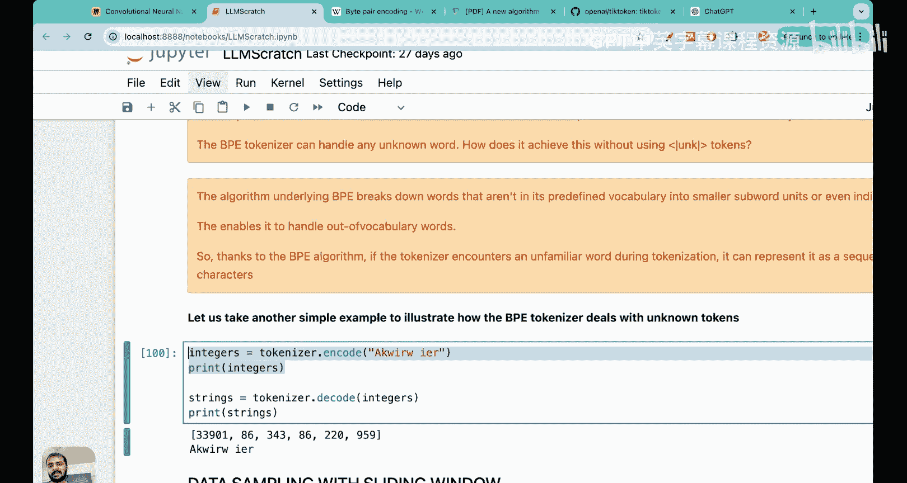

# Vizuara《从零开始搭建大语言模型｜Building LLMs from scratch》中英字幕（Claude-3.7-s） - P8：-08-Lecture 8_ The GPT Tokenizer_ Byte Pair Encoding.zh_en - GPT中英字幕课程资源 - BV1qG8HzUE2D

🎼Yeah。Hello everyone， welcome to this lecture in the large language models from Scratch series。Today。

 we are going to learn about a very important topic， which is called as Bte pair encoding。

In many lectures or even video content， which you see on large language models。

When tokenization is covered， the concept of bitete pair encoding is rarely explained。However。

Behind modern algorithms such as GPT2， GPT3， etc， the tokenizer which these modern LLMs use is usually bitete pair encoding。

So you really need to understand what this means and how how this encoding is done for modern large language models。

So let's get started with today's lecture。 first， let me take you to the。Google Collab notebook。

Until now if you have followed the previous lecture what we did in the previous lecture is that we implemented a simple tokenization scheme。

 if you remember what we covered in the previous lecture let me just take you quickly through that in the previous lecture what we did was we basically took sentences we converted them into tokens and then we converted this into vocabulary so then every word of the token was arranged in an ascending order and then ID or a numerical ID or a token ID was assigned to each token。

So your every world was a unique token， along with special characters like comma， fulltop。

 exclamation mark， etc。Now in today's lecture we are going to cover a much more sophisticated tokenizing tokenization scheme。

 why sophisticated I'll come to that in a moment， but just remember that today we are going to learn about the Bte pair encoding or BE tokenizer。

This BPp tokenizer， which we are going to cover today。

 was used to train large language models such as GPT2， GPT3 and the original model used in Cha GT。

If you have not seen the previous lecture on tokenization。

 I highly encourage you to watch that so that this lecture will become very clear to you because in the previous lecture we implemented our own tokenizer completely from scratch and today we are going to learn about a bit more advanced concept and this scheme this BPE scheme is used in all modern LLMs and so it's very important for us to learn。

So let me take you to the whiteboard right now and explain the concept of bitete pair tokenizer and why do we even need it in the first place？

So if you look at the tokenization algorithms， there are essentially three types of tokenization algorithms。

 the first is the world based tokenizer。The second type is the suburd based tokenizer。

 and the third type is the character based tokenizer。

Let me walk you through these step by step in the world based tokenizer。

 What we usually do is every world in the sentence is usually when token。 The tokenizer。

 which we saw in the previous lecture， such as， for example， in this example， the。

The fox chased the dog， the tokens where the fox chased the dog， so every word was one token right。

 so that's why it's an example of world based tokenizer。

Here I am taking one more example to illustrate this concept to you if the sentence is my hobby is playing cricket and if the tokens are individual words it such as my then hobby that is then playing and then cricket。

That is a world based tokenizer， awesome。Now， can you think of the problems associated with the world based tokenizer？

First。The main problem is what do you do with worlds which are not present in the vocabulary so let's say if you have huge amount of training data and you will break it down into sentences right and then you will break down the sentences into individual words and then you will assign a token ID to each of these worlds but when the user is interacting with the LLM let's say and the user inputs a word which was not present in the vocabulary these wordss are also called as out of vocabulary words so you can think of as preparing for an exam but in the exam a question is asked which is completely different from what you have prepared for。

In world based tokenization schemes， it's very difficult to know what do we do with out of vocabulary words because consider this case itself my hobby is playing cricket。

 let's save the data set for small and only one sentence if a new word is given such as football。

And that is not present in this data set。Then usually these tokenization schemes run into an error this is a very simplified example I have constructed。

 but this problem shows up when you do world based tokenization a lot。

Usually it's very difficult to deal with out of vocabulary or OOV words if they are not present in the vocabulary and what do I mean by vocabulary。

 vocabulary is just a dictionary with a collection of tokens arranged in ascending order and every token corresponds to a token ID。

Great， now another problem with this world based localization scheme is that。

Let's say boy and boys are two words in the vocabulary， each of them will have different tokens。

 maybe the token ids for both of them will be far apart based on where they appear they might be similar also。

 but the problem is that。These words are very similar right and when we do this tokenization this similarity is not captured so boys if you think of the word boys the root word is boy。

So ideally both of these words are very similar to each other。

 but with this tokenization they are treated as separate words。And that similarity is not captured。

These are the main problems with world based toization。

Now let us look at the other end of the spectrum which is character based tokenization this is also a very popular tokenization scheme where what do we do is that if the sentence is again my hobby is playing cricket instead of having individual worlds as tokens in this kind of character based tokenization。

Individual characters are considered as tokens so for example here let's look at which characters are there M is the first character Y is the second character I' am ignoring white spaces for now。

So h is the third character O is the fourth character， etc cetera。

 So then the vocabulary or the tokens would contain M。Y， H， O， B， etc cetera。

These are the tokens instead of having individual words。Now。

 can you think of what will be the vocabulary size in this case？

Just think about this for a moment if you are not able to answer this just pause and。Okay。

 so this will actually lead to a very small vocabulary because every language has a fixed number of characters if you look at the English language it has 256 characters on the other end if you look at the total words in the English language it has about 170。

000 to 200，000 words。呃。But what is one of the advantages of the character based organization is that it has a very small vocabulary size。

Which means that。Either so if you look at the English language there are fixed number of characters right there are 256 characters so we will never have the out of vocabulary problem because lets say any new sentence is given by the user you can always break it down into characters even if you don't know the words in that sentence its fine you break it down into characters and it will be either of the 256 characters which are already present in your vocabulary or dictionary。

So the out of vocabulary problem will not come into the picture。

And it solves one more problem if you look at the world based localization right。

 as I told you English language is about 170，000 to 200，000 words。

So if you really want to include everything in the vocabulary。

 you need a vocabulary size which is huge and that is one big problem in world based organization。

This problem is completely solved in the character based toization because the vocabulary is based on characters and the vocabulary length is pretty small。

But then you might think oh this sounds amazing right it literally solves all of the problem it solves out of vocabulary problem its also computationally and memory efficient because the vocabulary size is very small and then that is great then what's the issue there are some problems with character based toization and the first major problem is that the meaning which is associated with words is completely lost。

Essentially the advantage of dealing with language models is that words have meanings right so different words and different sentences might be related to each other Boy and boys have a common meaning this is completely lost since you are breaking it down into individual characters。

That's one of the first biggest problem with character level tokenization。

 The second problem is that the tokenized sequence is much longer than the initial raw text。 So。

 for example， if there is a word in the。Let's say there is a word in the text which is dinosaur。

Now in world based tokenization this will be treated as one single token right。

 but in character based tokenization what will happen is that every single character a DN O S A UR will be treated as separate tokens so in character based tokenization the word dinosaur will be actually broken down or split into eight tokens。

And that is another major problem the tokenized sequence is much longer than the initial round text。

Now so as we can see the world based tokenization has its advantages and disadvantages。

 the disadvantages is that we don't know what to do with out of vocabulary words and the vocabulary size is pretty large the advantage is that of course the world every world is a token so。

The tokeni sequence length will be small like dinosaur。

 it will be just one token so when you tokenize the paragraph it's very small because every word will be one token unlike character based tokenization where the tokeni sequence is much longer than the initial text that's the disadvantage of character sequence character tokenization the advantages of character tokenization is that they have very small vocabulary because every language is fixed number of characters and we solve we completely solved out of vocabulary problem。

And both of these approaches have a disadvantage that the meaning between words is not captured boy and boys have a common root right。

 that root kept is not captured tokenization and modernization both have the eyesization which is common。

 this meaning is completely lost。So now， so what do we do。

 then we turn to another tokenization algorithm， which is called as the subward based tokenization。

And the byte pair encoding which we are going to see is an example of subworld based tokenization algorithm the subworl based tokenization is kind of like a best of both world worlds and lets see how it why it is the best of both worlds。

So the first thing to remember about subboor based tokenization is it does capture some root words which come in many other world。

 so boy and boys， it will treat boy as a common root world。And let's see how it does that okay。

 so in subor based organization， there are essentially two rules。

The first rule of this tokenization is that when you get the data set， you do not， do not split。

Frequently used word into smaller sub wordss So if there are some words which are coming frequently you should retain those words as it is right so then it retains this from the word tokenization。

Then the rule， too is that if there are some words which are very rare。

Whi are not occurring too many times then you split these worlds into smaller meaningful subors。

 this is extremely important。This second part basically says that if there are some words which are rare not appearing too many times you can go on splitting it further。

 you can even go down to the character level so you can see why it is a mix between word tokenizer and character tokenizer the first rule implies that if the words are occurring many times you retain it as a word so this is taken this is a feature taken from the word tokenizer the second rule implies that if the word is rare。

You can go on splitting it into further subwords and if needed you can drop down to the character level we don't always drop down to the character level we even stay in the middle。

 but this is a feature from the character level because we are breaking down the word further。

So to give you an example， if the word boy is appearing multiple times in the data it should not be split further that is from rule number one。

 so then boys retain as a token， but boys if the word boys is encounter that should be split into boy and it should be split into S。

Because boys might not be appearing too many times and again， boys also derives from the world boy。

So we should divide this world boys into smaller， meaningful suburs。

 so boys is divided into by and S。And this is the main essence of subward tokenization words are sometimes broken down into smaller elements and why smaller elements because those smaller elements appear very frequently so for example y is boys broken down into Y and S because y appears more frequently and S is also another token which appears very frequently。

This is what is basically done in a sub tokenization scheme at a very high level。

So let me explain some advantages of subwor tokenization。

 the subwor splitting helps the model learn that different world with the same root world such as for example。

 token tokens and tokenizing。All of these three words essentially have the same root toward right token。

So subur splitting helps the model understand that these different words essentially have the same root world and they are similar in meaning。

 This meaning is lost in world based tokenization and even character based tokenization that is number one the second advantage of。

Subur tokenization is that it also helps the model learn that let's say tokenization and modernization are made up of different route towards token tokenize and modernize。

 but have the same suffixization。and are used in same syntactic situations so basically it derives these patterns like tokenization and modernization maybe Zation Z AtiO is a is a subbo token in this tokenization and then token and then modern under tokens so then it learns that this isization is a common suffix which appears in both of these worlds all of these are advantages of breaking down one world into subors this is what is major done in subur tokenization。

So why are we learning about subur tokenization and what's the relation between Bte pair encoding and subur tokenization well the main relation is that Bte pair encoding or BE is a subur tokenization algorithm this is very important and that's why we are learning about BPE and that's why modern LLMs like GPT2 and GPT3 employ Bte pair encoding。

So let us look at the bit of a history of the BPP algorithm and then we will see how it is implemented in practice。

So the bite pair algorithm was actually introduced in 1994。And it does a very simple thing。

 it is basically a data compression algorithm。And what is done is that we we scan the data and then most common pair of consecutive bytes。

 so let me actually use a different color here。This sentence is very important most common pair of consecutive bytes of data is replaced with a byte that does not occur in data so we identify a pair of consecutive bytes which occur the most so we find these pairs which occur the most frequently and then we replace them with a byte which does not exist in the data and we keep on doing this iteratively I'll show an example for this so don't worry if you don't understand this explanation I want to quickly show you the paper so this is the paper which was published in 1994 a new algorithm for data compression which introduced byte pair tokenizer or byte pair encoder rather at that time it was not known that this will be so useful for modern large language models but it is quite useful。

Okay， so now let us see a practical demonstration of this algorithm so I've taken this example from Wikipedia because I think it is an awesome illustration。

 So let's say we have this original data right and the original data looks like this A A A B D A A A B A C okay and now in byte pair encoding we are going to compress this data right and let us see what do we do we first identify the most common pair of consecutive bytes So let's see let us see the pair which occurs the most So if you scan this sequence from left to right you will see that the byte pair Aa occurs the most right you might say Aaa also occurs the most but that's not a byte pair because that is three characters the byte pair Aa occurs the most it occurs here it occurs here it occurs here and it occurs here so it occurs four times really so what we will do next is that we have identified the byte pair which occurs the most we replace this byte pair。

With a byte that does not exist in the data。So， what we will do is that we will replace it with Z and y Z because just z does not occur in the data。

 you can use any variable here。So then we will take these AA and wherever Aa shows up will replace it by Z so then this first AA will be z so then this new sequence will be z A B D then again Z to replace this Aa so then will be Z and then A B A C so then we have A B A C so remember what has happened here is that this AA which I am highlighting right now in circle that has been replaced by Z and this AA has been replaced by Z so now we have a compressed data correct。

Very good， So now let us move next。Next what we do is we keep on repeating this sequencely now we again look at this sequence and find the next common byte pair so we can see that aB is occurring once and aB is occurring twice so it is repeating two times and which is the most frequent byte pair so we will replace aB by y so this aB will be replaced by y and this aB will be replaced by y y y because its a byte which does not occur anywhere in the data。

So then this AB will be replaced by y as you can see here and here also the AB will be replaced by y so then my new compress data will be z y Dz Y a great this is a compress data compared to the original data and this is exactly how the byte pair algorithm works Now we do this record do this again and again right so now let us look at the byte pair so your AC is the only byte pair which is left all others are special tokens but AC only appears once so we we don't need to encode it this process of replacing common byte pairs with another variable is called encoding thats where the word encoder comes from。

So we will not encode this further because it only appears once if AC were appearing twice then we would have encoded it with another variable so this compression actually stops here you can go one more layer deeper by further replacing this head I with another variable which is let's say W。

So then it will be W D WAC and then you will stop so you will compress it further like this so you see the original data has been compressed to this right to this compressed version using the byte pair algorithm so the algorithm itself is pretty simple you scan the data from left to right you identify the byte pairs which occurs the most and then you replace them with a byte which does not exist in the data and you do this iteratively until you reach a stage where no byte pair occurs more than once that's it that is the simple byte pair encoding algorithm。

Now you might think okay what has that got to do with large language models right。

 I understand this algorithm and I understand how it compresses a given data sequence but what has that got to do with large language models well it turns out that the we slightly tweak the byte pair encoding algorithm and use this to convert our entire sentence into subwors which will be very useful for us and Ill show you exactly how I am going to do that。

So the byte pair encoding for LLM ensures that the most common worlds in the vocabulary are represented as a single token。

 remember rule number one。And rare words are broken down into two or more subur tokens this is exactly the same rules which we had looked at the rule number one and rule number two so rule number one is that most commonly used words should not be split and second is that rare words should be split into meaningful suburs now lets see how how it is related to the byte pair encoding algorithm which we saw and we will be looking at a practical example for this demonstration。

Okay， I will use a color which is a bit different from the green one here so that there will be a good contrast so let me use the orange color。

Okay， so for the practical example， we are going to look at a vocabulary or rather I should say we are going to look at the data set of words。

Which is also called as data corpus， which is this。 So we have these words in our data set old。Older。

Finest and lowest， right？Lets say we have these words in the data set right now and I am going to show you how we are going to use the byte pair en codinging algorithm to break this down into tokens。

And you will also see why this is a subor tokenization scheme so first of all。

 if we are to use a word based tokenization then this will have four tokens old older finest and lowest that's it。

Similarly， if we were to use the character level tokenization。

 then the tokens will be individual characters like O， O will be one token。

 then L will be another token， then D will be another token etc。So。

 this is how the world based toization and the character based tokenization will work。

 but right now we are going to see the subwor based toization using the Bte pair algorithm。

Before we proceed further we will need to do a prepro step and this is actually done even when we train large language models and when we are using these tokens so basically when you look at these different tokens。

There should be some ending right so for example， when this old token appears we should have another end token so that we know that this world has ended over here。

 so I am going to augment every token here with this additional end token which is called slash w。

So whenever the algorithm model of the model comes across slash W。

 we know that this world ends over here。So I am going to replace the tokens in my dataset with adding a W slash w at the end like the older becomes old slashw older becomes older slash W finest becomes finest slash W and lowest becomes lowest slash W。

Now remember here that if we use the world based tokenization there is no meaning which is captured so the fact that old is the common root between old and older is not captured number one ESP is the common route between finest and lowest that' is not captured so world based tokenization character based tokenization has so many problems because they don't capture these meanings or root words。

And towards the end of this section， we will see how subbo based toization using the byte pair encoding algorithm actually captures these root towards。

Like old。Like ESP， etc cetera，So let's get started with the individual steps the first step is basically to split all these words into their characters。

And then make a frequency table so what we are going to do is that we are going to take all these words old older finest and lowest so old appears seven times in the dataset older appears three times in the dataset these are the frequencies finest appears nine times in the dataset and lowest essentially appears four times in the dataset so what we are going to do right now is we are going to split these words into individual characters so then here is the table which Ive made remember slash w is also there。

So old。So all words have slash w right and totally how many words do we have 7 plus 3。

10 plus 919 plus 4 23 and since all words have slash w at the end of it slash w comes 23 times Similarlyly we see that o comes 14 times。

L comes 14 times B comes 10 times E comes 16 times etc。

 and we make this frequency table list so here you can see that we have 12 tokens and if we did we use character level tokenization our tokenization would end here because all these characters would be individual tokens。

Now what we will do similar to if you remember the byte pair encoding algorithm。

 we looked at the most frequent pairing right so let me take you back to this yeah。

 we looked at AA because Aa appeared the most so we looked at that byte pair which occurred the most。

This is exactly what we will be doing here for the we will be looking for the most frequent pairing in the data。

And then what we will do is that this is the modification compared to the original algorithm when we look for the most frequent pairing we will merge them。

 we will merge the most frequent pairing and then perform the same iteration again and again and again。

So let me show you how this is done so in the iteration one as I mentioned we start with the finding the most frequent pairing right so so you the way to do it is look at the first character which appears the most so E is that character which appears 16 times right so if you want to look at the pairing which appears most it most probably starts with E so it turns out if you look at these words E and S is the pairing which appears the most number of times so E and S here appears nine times in finest and E and S appears four times in lowest so E and S is that pairing which appears 13 number of times right。

So most common byte pair starting with E is ENS so what we will now be doing is that we will be going through the data set again and well be merging these two tokens ENS so now ES will be one token and that's why it's called subwor ES will be one token so now let me show you my token table again everything else is the same up till token number 12 but look at this token number 3 which has been added in token number 30 we have added one more token which is ES。

Because its the most frequent pairing and ES appears 13 times。

 but remember when we add Es we have to subtract something from E and we have to subtract from S because now E has been included so we subtract 13 from the E count so now the number of time only E appears is3 the number of time only S appears is0 this is very interesting to know so the number of time only S appears is 0 so S it seems always appears with E so Es is a subor see this we would not have discovered if we just did character level to organization or word level it seems that E and S always so S only comes with E in this data set we have already obtained our first insight。

So now this is my this is my new token library and this is my additional token and now we are going to actually continuously keep on doing this process。

To find。Frequency or to find tokens which appear the most number of times so in the previous iteration we saw that E and S was the byte pair right which occurred most number of times ENS it appeared 13 times but now ES is a separate token for us so now using that token we see that ESP is again a byte pair because ES is one token and p is another token so ES and T becomes a byte pair in the second iteration and ESP appears 9 plus 3 which is again 13 times。

So now in the next iteration what we will be doing essentially is that let me show you iteration number two in the iteration number two will merge the tokens E and T because they have appeared 13 times in the data see we are doing the same thing what we did in the earlier byte pair encoding for that character so let me just showed you show you here remember here what we did after AA so AA was done right and then we merge this and then we looked at the second sequence which appeared the most which is AB。

That is actually very similar to what we are doing here E appears the most so we created one more token for E then we looked at another byte pair which is appearing the most and that is ESN T so now what we will be doing is that we will merge eN T into one token。

And so EST comes to be 13 times and will then subtract 13 from the previous token ES so now only ESS appears0 times and ESP appears 13 times see we have constructed a new token EST so now remember what I said earlier the previous world level tokens and the character level tokens could not identify that ESP is a common route between finestest and lowest but with our byte pair encoding algorithm we have already created a new token for EST so this algorithm is already identified that ESP is a common root world。

Great， so up till now we have done iteration number three and we see that okay I think yeah up till now we have done I think two iterations and now up till now we have merged E S and T into one common token awesome。

Now， let us take a look at this slash W token。Now we can see that EP and slash W basically appears 13 times again it is the same thing over here。

 so ESP always comes with slashw now EST is one token so EST and slash W forms a byte pair and this byte pair again occurs 9 plus 4 which is 13 times which is much more than any other byte pair in these words。

So we will combine ESTN slash w into one more token。

 so in the third iteration we are going to combine ESTN slash w into one more token。

 so now this becomes our world。Do you understand why we combined slash W with one more token if we could have just left it at EST right。

 but if we left it at EST then essentially there would have been no difference between words like estimate and highest。

So estimate and highest both have EST， but the worlds in our dataset are highest and lowest so EST is the ending sequence in all of our words in our data and we need to encode that information that it is an ending sequence so EST slash W allows us to encode this information so now the tokenizer knows that whenever EST comes it is always followed by slash W which means the world ends after EST so now our algorithm or the tokenizer can differentiate between estimate and highest because in estimate EST does not end with a slash W。

So now if you look at the tokens which we have earlier we had all these 12 tokens but now we created ES then we merged it to EST and finally we created this EST slash W so now these two tokens are actually not needed ES and EST。

So now let us look at another other byte pair which occurs a lot。

 so it turns out that O and L is another a byte pair which occurs 10 times because it is present in old and older。

So what we will do is that we create one more will merge these2 and create one more token for O and L it appears 10 times and we will subtract that count 10 from the O and L so o individually or with some other character appears 14 times so we subtract 10 because now we have created one more token for OL which appears 10 times similarly L appears 14 times overall and we subtract 10 from it because L comes with O 10 times right。

And now what we do is that O is one token， so now we see that O and D has appeared 10 times。

 so this byte pair has appeared 10 times so we merge this byte pair so then OD now becomes another token which appears 10 times So you see the meaning which our byte pair encoder has captured we have constructed one token which is OLD we have another token which is ESD slash W。

These tokens are sub wordss， so they are neither full words nor characters， they are sub words。

 but they encode the root representation So OLD is one token and this actually tells us that OLD is the root word which comes in old。

It which comes in old as well as older and our Bp algorithm has actually captured that perfectly That's awesome right。

 all these roots were not captured by just the world。😊。

World or the world encoder word tokenizer and character level tokenizer。Now。

 you might be seeing here that these F I and N appear nine times。

It's fine that they appear nine times， but we just have one word with these characters。

So if you look at our data set again， let's see where F I and in appear。 So the words are。Fineest。

 so all of these words actually only appear in finestist。 So it's no。

 it does not make sense to merge them into when。One token because that token does not the frequency of that token appearing in other words is not too much why did we merge EST into one token because it appears in multiple wordss why did we emerge OLD in one token because it appears in multiple words。

So see the rule of subur tokenization the first rule is that that word which occurs multiple times you keep it as it is old so we kept old as it is right it is a separate token but that word which is not used too many times like older it needs to be split into old and then E and then R are separate tokens similarly in finest EST is one token F and N are separate tokens in lowest EST is one token and L O and W are separate tokens。

And this helps us to retain the root towards in sub tokenization。

I hope you are I hope you have understood this concept now what we can do is that this ET and OLD are final tokens which we constructed by merging now let us actually remove all of those tokens whose frequency0 so we can remove S we can remove so let me mark them with a different color。

So S has a frequency of0 T has a frequency of 0 E E T has frequency of 0 O has a frequency of0 so let's remove this So then our final table looks like these these are the final tokens in our subward tokenizer which is obtained using the byte pair encoding algorithm How did we obtain these tokens we just looked at byte pairs which occurred the most then we merged them into one and then we repeated this process until we obtained。

Until we reached a stage where enough number of tokens have been created or until we reach a stage where our iterations have stopped。

 and this is the final tokenized。Final tokens which will be using for next steps of the large language model training which are vector embedding etc cetera。

 This is how the sub tokenizer works and this is exactly how byte pair encoder which is a sub tokenizer it works for。

Training models like GPT2 or GPT3， very few people have this understanding。

 but I hope this lecture has intuitive made it clear for you how the Bte pair toizer actually works。

So now this list of 11 tokens will serve as our vocabulary why is it called subur tokenizer because these are subwors right ESD is not a full world neither it is a character it is a subwor but it is the root of manver OLD is also the root of manvers。

Now you must be thinking when do we stop this merging when do we stop these iterations so you have to specify stopping criteria usually if you look at GPT2 or GPT3 you run this byte pair coding algorithm on a huge number of tokens right so the stopping criteria can be if the token count becomes a certain number then you stop or just the number of iterations can be the stopping count。

So I in this lecture I am not covering the stopping criteria in too much detail。

 but I just want to give you an intuition of how the stopping criteria can actually be formulated or computed it is based on the token count or the number of iterations。

To give you an example or to mention one more advantage of byte pair encoding here you can see that we it is actually better than world level encoding right because lets say if you have two boy and boys。

Both won't be separate tokens in this just boy will be a token。

 so by it pair encoder also reduces the number of tokens which we have compared to word encoding。

 let's see。And that usually helps so in GPT2 or GPT3 when it was trained I think it used about 50。

000 more than around 57，000 tokens， I think when when byte pair encoding was done。

For GPT2 or GPT3 so byte pair encoding solves the out of vocabulary problem why does it solve the out of vocabulary problem because we also have subbos now and some of it might even be characters so character level tokenization solves out of vocabulary problem right and byte pair encoding or subur encoding retains some properties from it so you can see some token consider error characters which is good but it also solves the problem of the word level encoding and one of the major problem is that root meanings are not captured but now they are captured over here。

And it also solves the problem of the world level encoding being just a huge bunch of numbers here that is not the problem because we break it down into characters and suburs so the total length of the vocabulary is also shorter than if you would have just considered world level embedding。

So subur embedding solves it it solves the out of vocabulary problem。

 it also gives us a vocabulary size which is manageable。

And it also retains the root towards meaning such as EST and OLD。Awesome。

 right and thats why because of all these advantages。

 this is the byte pair encoding algorithm is used for tokenization in GPT2 and GPT3。

Now let me return back to the code， I could have just taken you through the code today。

 but then you would not have understood how the byte pair algorithm actually works。

Now implementing BP from scratch is relatively complicated。

 so we will be using a Python open source library called T token so if you I'll share the link of this library in the chat so this is a library which is essentially a byte pair encoder it's a byte pair encoder which is used for open air model so open air themselves used tick tickk token for tokenizing the sentences from the data you can see that it has about 11。

000 stars and about 784s so its a pretty popular repository。Okay。

 so now we are going to implement the byte pair encoder in Python and I'm going to show you this implementation in a hands on demonstration。

The first thing to do is install tickk token because this is well be using the byte pair encoder from tickk token and here you can see that it takes it takes some time to install this。

For me when I first installed it it took about one minute but now it's a bit faster so requirements are already satisfied and you'll see that it will get installed now in sometimes see it's already installed so now Ive installed tickk token and let me just print out the version of tickk token which I am using here。

So you can see that the origin of tickk token is 0。6， which is good enough。

Now what we have to do is that we once the tickk token is installed we can instantiate the byte pair encoding tokenizer from tickk token so the way to do this is just use tickk token dot get encoding GP2 and we store it in this object called tokenizer so now tokenizer essentially has is that is similar to the simple tokenizer version 2 class or version1 class which we defined in Python in the last lecture remember we defined this。

Simple tokenizer version 1 class and we define the simple tokenizer version 2 class here。

 which also includes special tokens。So now in just one line of code we have essentially defined this tokenizer which is something similar。

 but now it will it is initiated an instance is created through this tick token library。

 so this is a byte pair tokenizer。And similar to the tokenizer class which we had created if you see。

 every tokenizer class has an encode method and a decocode method。

 what the encode method does is basically it uses that tokenizer and it converts words into token IDs what the decocode method does is that it decos those token IDs back into individual words。

So let's see how this。A tokenizer actually works so this is the byte pair encoding tokenizer from G2 and let's give it some text and try to encode anticode right and I'm testing this tokens because I've given it a complex sentence see So the first part of the sentence is hello do you like T then we have given one more thing which is got end of text which means that new text is starting here this is the end of text is usually done to separate entire documents but here I'm just using it to illustrate and in fact G2 actively uses end of text so just to give a demonstration to you when GP2 when G2 or GP3 is trained on large amounts of data sets here is how the datas are loaded So see。

What GPT2 does is that when it has data from different text sources。

 it usually shows when a particular text has ended and when the other text has started so end of text is actually a part of the GPT2 vocabulary itself。

So I have given this end of text and then the second sentences in the sunlit terraces of some unknown place now look at this if we are using a world level tokenizer。

 this this will lead to the out of vocabulary problem because this world cannot be in the vocabulary of a world level tokenizer。

And that is the advantage of byte pair encoding in byte pair encoding。

 we have characters as tokens and we even have sub wordss as tokens。

 so definitely this will be encoded because might be some character can encode it so some unknown and place might be sub wordss which are individual tokens。

 they can also be used to encode this。So byte pair encoder will take care of this this entire word which usually does not exist as a single world so let us test this actually and I run this right now and let us see the different tokens so see hello do you like t all of these have been converted into token ids I want you to take a look at this50256 token so this is the token id of end of text and this is also the vocabulary size of the tokenization scheme used in G2 or g3 so if we were to use a world levelve tokenizer English language is about 170000 to 200000 words so the vocabulary size would have been this much but now that we have used the。

Bte pair tokenizer or byte pair encoding the vocabulary size is reduced by around1 third from 150。

000 and with the vocabulary of around 50，000 subwardors。

We are able to get the amazing performance from G2 G 3 or G 4， I think has much higher level of。😊。

A tokens， but even GPT 2 has good enough performance and it has 50，0256 tokens， awesome。

And here you can see that I did not get an error because some unknown place was not encoded the tokenizer is able to encode random words like these which also look wrong and here you can see these are the encodings for this sub some unknown place so the end of text is this in the sunlight terraces of some unknown place so I think some unknown place is broken down into sub wordss three or four sub wordss and then it's tokenized by GP2。

So this is how subvert tokenization can handle out of vocabulary。

Awesome so the code prints these IDs which we just saw and now what we can do is we can convert the token IDs back into text using the decocode method remember every tokenizer has encode method as well as decode method so we can do tokenizer do decocode and put all of these integers。

And here you see it decodes exactly the same sentence what we gave to it so the decoded sentence is hello do you like T the end of text in the sunlit terraces of some unknown place exactly similar to the text which it are which we are given which means that the encoder and decoder is working very well and the byte pair encoding has its advantages of dealing with out of vocabulary so here we see two advantages of byte pair encoding first is that it reduces the vocabulary length second is that it knows how to deal with unknown text awesome。

So we can make two noteworthy observations based on the token IDs and the decoded text first as I already mentioned the end of text token is assigned to only relatively large token ID which is 50256。

That is the last token in the BP tokenizer used for GP2。

 so in fact the BP tokenizer which was used to train models like GPT2 GT3 and the original model used in chat GT has a total vocabulary size of 50257 keep this in mind now you know what this means。

And end of text is the largest token ID， and it's also the last token in the vocabulary。

The second thing to note which I already mentioned is that the BPp tokenizer encodes and des unknown words such as some unknown place correctly。

The BPA tokenizer can handle any unknown world and how does it achieve this without mention so we did not give special tokens for unknown worlds。

 right？How did it achieve this and this this is because of how the tokenization was done and because of how the BP tokenizer actually goes down to the level of let me show this the BP tokenizer goes down to the level of characters and subwords that's why it is able to deal with unknown text so the algorithm underlying BP breaks down words that aren't in its predefined vocabulary to smaller subword units or even individual characters this is exactly what we saw over here。

And this enables it to handle out of vocabulary words， so thanks to the BPP algorithm。

 if the tokenizer encounters an unfamiliar word during tokenization。

 it can represent it as a sequence of sub word tokens or characters。

That is the advantage of BP tokener and that's why we are having this lecture in the first place。

Great。😊，Now let us actually take one last example to illustrate how the BPp token aser deals with unknown tokens right so let's say we have this sentence akW I R W IER completely random words which do not make any make any sense but if you pass these random words to the tick token G2 encoder byte per encoder you will see that it does not show an error in fact it even encodes these so akw I R W IE is encoded as these tokens because it is broken down into sub wordss maybe E is a commonly occurring subor in all the vocabulary which we have so then the token for this is25959 maybe ak is a commonly occurring subor maybe w is just a simple character maybe Ir is a commonly occurring subor maybe I is just a character so you can see。

This what I underneath the hood what this tor must have done is that it must have broken this down into words and subwors based on what is present in the vocabulary and then to each of this world to each of this subword。

Or character it would have assigned a token ID so the tokenizer would have scanned this from left to right and broken it down into characters or sub wordss and then assigned each character or subver a unique token ID that' is how the encoding works and if you decode the integers you get back exactly the same sentence which you started with。

And the reason I covered this lecture in so much detail is because in the previous lecture we saw how to do tokenization from scratch and today we saw what is byte pair encoding and how you can install tick token and implement your own byte pair encoder or tokenizer which GPT2 is using and we saw how it handles unknown words。

 how it captures the root meaning and how the vocabulary sizes about 50，000。

This brings us to the end of today's lecture in the next lecture we'll be looking at data sampling。

 batch sizes， context length， etc before we feed。The em or before we feed that organizers into the world embedding。

 So in our progression of learning right now， let me show you。

One plot so that I can illustrate up till where we have covered until now。 So if you look at。

If you look at yeah， if you look at this schematic right here。

Yeah if you look at this schematic right here until now we have looked at how to tokenize an input text and how to convert it into tokenites and we saw implementing our own tokenizer in the previous lecture and using a byte pair encoder in this lecture we still have to see token embeddings so we'll get to this point and before that we will also see a bit about data sampling context length and batch sizes。

This brings us to the end of this lecture Thank you so much everyone。

 I really wanted to have a good mix of whiteboard writing and whiteboard understanding which we did a lot in today's lecture so if you see our whiteboard notes we did a number of iterations of the BP encoder at explain it to you intuitively I hope you understood this please mention in the chat if something is unclear and I'll be happy to explain it in the comment section and then we also saw how to code the by pair encoder using。

The tickk token library in Python so now what I encourage you all to do is take some unknown sentences and try using the this tickk token library and the byte pair encoder and try to just see what are the results。

If you if you encounter any error for any sentence if the tokenizer is not able to encode。

 it will be awesome and I'll highlight that comment in the next video。Thank you so much everyone。

 and I look forward to seeing you in the next lecture。

。