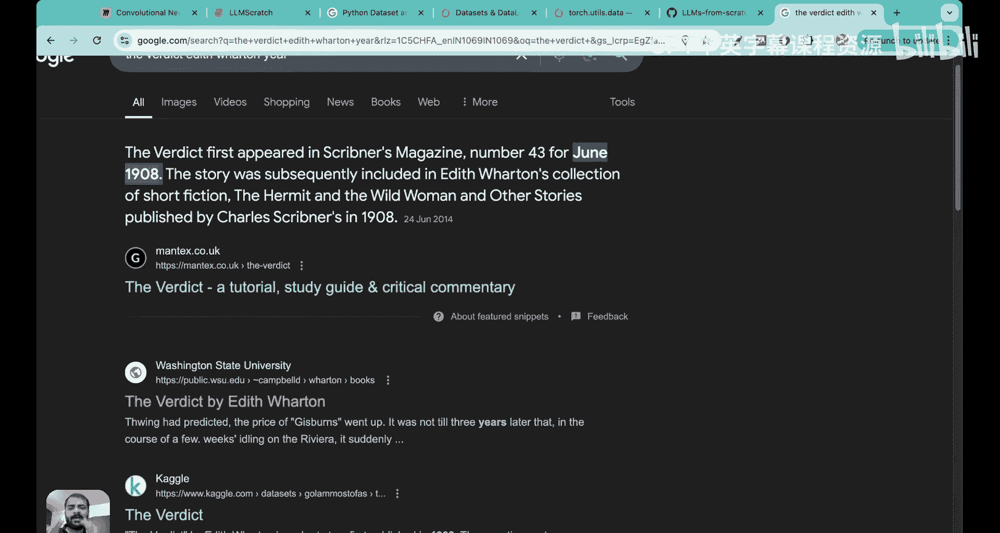
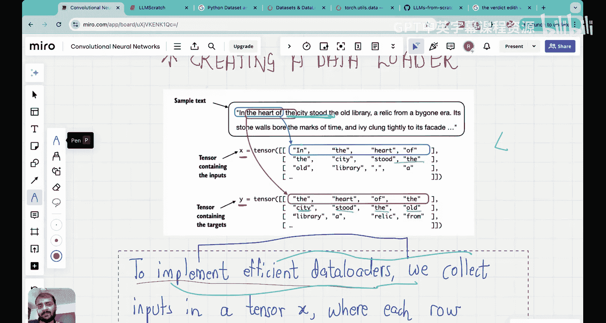

# Vizuara《从零开始搭建大语言模型｜Building LLMs from scratch》中英字幕（Claude-3.7-s） - P9：-09-Lecture 9_ Creating Input-Target data pairs using Python DataLoader.zh_en - GPT中英字幕课程资源 - BV1qG8HzUE2D

🎼Yeah。Hello everyone， welcome to this lecture in theBuild La language models from Sctch series。

In the previous lecture， we took a look at Bte pair encoding。

And we saw that how byte pair encoding algorithm can be used for something which is called as subworl tokenization。

 so we saw the difference between world based subwor based and character based tokenization。

 and we looked in detail how GPT models such as GPT2。

3 and 4 use the byte pair encoding algorithm for tokenization。

If you have not seen the video for the previous lecture again I would highly encourage you to go through this so that you will follow along pretty well in this lecture if you are coming to this playlist for the first time welcome and we follow a very specific style in this playlist where we do a mix of writing on the whiteboard plus showing you everything from scratch in the Jupyter notebook code editor so that the theoretical understanding is also strong and the coding background is also strong。

Up till now we have looked at tokenization which is needed for large language models。

 so if you think of the whole process we are currently at the data preprocessing stage before the data is given for the LLM training in the preprocessing the first step is tokenization then we come to something called vector embeddings we have not seen vector embeddings yet。

And then after that， we feed these vector embedding to the。Training or for the training process。

Before we come to vector embeddings there is one very important lecture which we need to cover and that is the topic of today's lecture creating input target pairs essentially input output pairs if you look at other machine learning tasks such as classification regression its usually usually very clear right what is the input and whats the output if you want to distinguish between cats and dogs from images the images of cats and the images of dogs will be input。

And whether it's a cat or whether it's a dog will be the output。

If you consider a regression problem on the other hand。

 lets say if you want to predict the price of a house beds based on its area。

 the area of the houses is the input and the price is the output so creating the input output pairs or the input target pairs is pretty easy for large language models we use a specific technique for creating these pairs and it's very important to devote a separate lecture for you to understand this so let's get started with today's lecture。

As I mentioned before now， only one last step is remaining before we move to creating vector embeddings。

 which will then be fed to training the large language model and then last and then that last step is essentially creating the input target pairs。

So first， when I say input target pairs， what do I mean and what do input target pairs looks like。

 So lets say。This is my sentence， right， which is the text sample LLMs learn to predict one word at a time。

So， the。Blocks， which are marked in blue， will be the input to the LLM and the block which are marked in red will be the target or the output which the LLMs have to learn。

And why are there these different rows so these are different iterations let us look at the first iteration in the first iteration the input is LLM and the based on this input the output LLM has to learn the output which is the learn so the next word is always the output。

Whatever comes after the prediction is masked or it is not shown to the LLn。

 This is what happens in iteration number one。Now let us look at iteration number two。

 so learnn which was the output or the target in the first iteration now is a part of the input so in the second iteration LLMs learnn that is the input and2 is the target that is the target pair that is the second iteration。

In the third iteration2， which was the output of the previous iteration now becomes the input。

 so LLMs learn2 is the input in the third iteration and predict is the output。

I hope you have started understanding the pattern now in every iteration。

 there is only the next word， which is the output and whatever comes before that is the input。

 These are the input target pairs。That is very important to remember so here also you will see that LLMs learn to predict is the input and one is the output so at every stage of the iteration process。

LLMs have input， which is the spark of the sentence up till the word which needs to be predicted and the world which needs to be predicted that is essentially the output。

This this figure which I am saying is just for illustration purposes and today's lecture we learn something about context length which means how many words are given as the input the output length is always when when word will be predicted。

 but we can essentially choose the input context length。Now in every iteration。

The worlds which are after the target are essentially masked so the LLMs cannot access the worlds which are past the target。

 so there are two things to remember here， the first thing to remember is that within the sentence itself we break down the sentence into input and the target。

 which is the next world。Then in the second thing to remember is that in subsequent iterations。

 whatever was the output in the previous iteration then becomes the input。So。

 this is a autoregressive model， why autoregressive because the output of the first iteration becomes an input of the next iteration like let' us look at these two iterations。

In in this iteration let me show it with a different color so that it becomes easy in this iteration one the result one was an output right but see in this iteration one is now a part of the input and then the next word is the output so it is called an autoregressive and it is also called self supervised learning。

Or you can think of it as unsupervised learning itself because we are not labeling the input and the output。

 the sentence structure itself。Is used to predict or is used to determine what is the input and the output we do not have to do any special labeling so in cats and dos we have to manually label this is a cat this is a dog right for the image classification but here to create the input target pairs we don't have to say that look this label this as the input label this as the output we just write a simple code which utilizes the sentence structure itself and breaks down the sentence into input and the output so this is also an example of unsupervised learning and it is also called autoregressive I hope you have understood these two concepts。

So in pre training we always do unsupervised learning because the sentence structure is exploited to create input output pairs or input target pairs。

So I hope you have understood how the input target pairs look like and we are going to create this in today's lecture in Python。

If you understand up till this it is actually pretty easy to code it out in Python。

 but I I feel that students don't really understand this part intuitively and and hence they find the coding part of it a bit difficult。

Okay， now I want to mention a few things which which just serve as a summary of what all I explained up till now。

 the first thing is what we are essentially doing here is that we are given a text sample and based on the text sample we are extracting input blocks。

That serve as the input to the LLM correct and the LLM prediction task during the training is to predict the next word that follows the input block so。

 for example， if you are looking at this input block the LLM task is to predict the output or the next word based on this input。

And that's what the LLM is traineded for。And the last point to remember is that during the training process。

 we will mask out all the wordss that are past the target。

So in every iteration the target is the target all right like in this iteration time or let me take on earlier iteration in this iteration2 is the target so when we are doing this iteration the LLM does not see anything which comes after two so this part is essentially masked。

And well see how to implement all of these features in code。

Okay so until now I just wanted to explain what is the purpose and what is the aim of today's lecture and now we are going to code the input target pairs in Python so I hope you are ready for this coding so let's get started with coding。

Great， so this coding section Ive titled C input target pairs as always I'll be sharing this Jupiter notebook code also with you along with the video so that you can run the code and check whether you have understood the concept or not yourself。

So in this section we are going to implement a data loader that fetches the input target pairs using a sliding window approach so there are two parts of this sentence which might be confusing to you。

What is data loader that's part number one and what is the sliding window approach thats part number two don't worry I'll explain to you both of these in a lot of detail。

To get started what we will initially do is that we take the whole the verdictic short story so remember our data set for this entire coding journey for this entire playlist is this short story the verdict let me show you how it actually looks like。

So this is the short story called the verdict， this is the data set which we have been using I think this was published in so let me check the verdict。

Edit Wton， it was published in 1908 and we are using this as the data set。

It's a toy data， but its important because whatever we learn right now。

 it scales exactly the same way for larger data sets as well。

So we are going to use this dataset set and remember in the last lecture we looked at the byte pair encoding tokenizer。

 we are going to encode this entire text using the byte pair encoding tokenizer it is a subbo tokenizer so the tokens can be characters the token can be words the tokens can be sub wordss as well so you if you are not familiar with the byte pair encoder please look at the previous lecture which we have covered。

Great， so we have defined the tokenizer already which is the byte pair encoder tokenizer and what we will be first doing is we will read the entire data set and store it in a variable called raw text and then we will encode the entire raw text remember what an encoder does is takes this text and converts it into token IDs。

And let us actually run this right now so I ran this right now and you will see that Ive printed out the length of the encoded text which means its 5145 that means the vocabulary size which we have is 5145 what does a vocabulary mean well we covered this in the previous lecture but let me show it to you again a vocabulary essentially looks something like this。

Of。Yeah， so this is how。Let me go to the yeah this is how a vocabulary looks like essentially well have different tokens and to every token a token ID will be attached so vocabulary is essentially a dictionary which maps the tokens into token IDs remember since we are using the byte pair encoder the tokens won't be words but they can be subs or characters also。

So essentially what this size 5145 conveys is that our vocabulary the for this text。

Which we have as the data set has the length of 5145。

 which means we have 5145 tokens and corresponding token IDs great。

So I have just written this in blue executing the code above will return 5145 that is the total number of tokens in the training set after applying the byte pair encoding tokenizer great。

So what I am going to demonstrate right now to you is just I' am going to look at the first。呃。

So what I'm going to do is I'm going to remove the first 50 tokens for the from the data set just so that the demonstration becomes a bit better after you remove the initial 50 tokens it results in a slightly more interesting text passage you can keep the entire tokens as well just to make the lecture more interesting what I'm going to do here is that the encoded。

Tokens were in ENC or encoded underscorecor text， so I'm going to define one more variable call called encoded underscorecorl sample。

 which just removes the first 50 tokens from the data set great。Now。

 first what I want you all to do is I want you to pause here for a moment and think about this question yourself。

Think about the question that let's say you are given this data set right now and you you I hope you understood this input output target pairs which I mentioned what is the simplest thing which comes to your mind how can you convert this data set into such kind of input output target pairs。

What will you need to make this conversion， Can you think about it a bit。

Think about the simplest way， don't think about complex algorithms， anything like that。

 what is the simplest thing which comes to your mind？

You can pause the video here for some time because if you answer it。

 it will really improve your understanding。So let me reveal the answer now。

One of the easiest and most intuitive ways to create the input target pairs for the next word prediction task is to create two variables x and y。

Where x contains the input tokens and y contains the targets。

 which are essentially the input shifted by 1。So let me explain to you how this logic works。Okay。

 so what do we exactly need here， Let's say if。Let's say if my input is1，2，3， and 4。

Lets say if my input is this I want my output array， lets say if this is my input array x。

 I want my output array to be looking something like2，3，4 and 5。

So what I have done here exactly is that。If one is the input。2 should be the output。

 It's very similar here。 if LLM is the input， learn should be the output， correct。

If1 and2 is the input， then three should be the output， which means that if LLM sur is the input。

 then two should be the output。If1，2，3。A the input， which means that if LLms learn to is the input。

 then the output should be 4， which means that predict should be the output。And then finally， if 1，2。

3，4 if all of these four words are the input， then five should be the output。

 which means that if LLms learn to predict is the input， then the output should be equal to 1。

This is what I actually want to create and how do I determine the size of this why why did I take the input size x to be 4 and the output size to be 4 so basically that is called as the context size the context size is how many words do you want to give as input for the model to be making its prediction so here the context size is equal to4 right so if we give up to four words the model will be able to predict the next rule。

That is what the context size actually means， So we want to create input output areas like this。

 so let me show you how those can be created for this data set of the verdictt which we have seen okay so first we have to determine the context size as I told you the context size determines how many tokens are included in the input so let me explain the context size a bit more here Currently we are choosing context size of four you can choose anything which you want and you can play around with this code when I share it with you so the context size of four means that the model is trained to look at a sequence of four words or tokens。

To predict the next word in the sequence， so the input x is the first four tokens， lets say 1，2，3。

4 and the target y is the next four tokens， which is2，3，4，5。

So that is meant by a context size so the input if the input is 123，4 the output is 23。

45 what does it mean if the input is1 the output will be2 if the input is 12 the output will be3 if the input is 1。

23 the output will be4 if the input is1，2，3，4 the output will be 5 but the input cannot be 123。

45 because then the context size would be exceeded to think of it intuitively the context size is basically how many words the model should pay attention at one time to predict the next word。

So let us now take a simple thing so we have this encoded sample which contains the token IDs of the encoded data set。

What I will first do is that I will first take the four elements which are the first four elements that is my x which is the input and then I just shift this x matrix x array by 1 and then that will be my y which is the output so lets print out x so the IDs which are associated with the first four encoded samples。

R 2，94，9，2，0，2，2，4，1， and2，87。And then the IDs which are associated with y which is the output is 4920。

2241，287 and 257 what does this mean if the input ID is 290 then the output will be 4920 if the input is 290 and 4920 the output is 2241。

If the input is 294920 and 2241， the output will be 287 and if the input is 2949202241 and 287。

 the output will be 257。This is how the input output pairs are actually constructed。

So what we can do now is that processing the inputs along with the targets。

And remember the targets are just the input shifted by one position we can then create the next word prediction tasks as follows so what I just explained to you I have written this in code so I have created two variables here called context and desired。

And I am looping in so the context size is4 so this loop will go from 1 to 5 so in the when i is equal to 1 which is the first iteration the context will be just the first token  id0 which is 290 and the desired will be the next token  id0 which is 4920。

Awesome， when I is equal to2， then the context will be the first two tokens， which is 29 and 4。

920 and the desired will be the next token， which is 2，2，41。If I is equal to3。

Then the context would be the first three token IDds which are 29。

4920 and 2241 and the output will be or the desired will be the next token which is 287 and if I is equal to4 then the context will be the first four tokens IDs and the desired will be the next which is 257。

So everything on the left of the arrower refers to the input the large language model would receive。

And the token ID on the right hand side of the arrow represents the target token ID。

 which the LLM is supposed to predict。So when we constructed these input output pairs。

 this is what it actually means。There are four prediction tasks here。

 it's not one prediction task so when I created this input output pair of x and y and even here when I showed you the input output pair of x and y it's not just one prediction tasks but there are four prediction tasks which are happening here and these are the four prediction tasks because the context size was four if the context size was8 there would have been eight prediction tasks in each input output pair so when you look at input output pairs usually regression and classification problem one input output pair corresponds to one prediction task image of a dog needs to be classified as whether it's a cat or a dog but in the case of LLMs one input output pair corresponds to the number of prediction tasks as set by the context size。

That is very important。Now what I am going to do is that I am going to take the simple the same code。

 but I am going to decode it into text。So that you can get a feel of what is exactly happening here so here you can see I've taken the same code but I am printing the decoded context and I am printing the decoded desired value。

So， if and is the input established is the output， if and established is the input himself is the output。

 if and established himself is the output the next word which is in is the output and if and established himself in is the input then the next word a that is the output。

Now this is exactly what we started the lecture with right you remember we started the lecture with this。

And now what we have done is that through code， we have just created a very simple input output pairs x and y。

 and we have seen how these pairs can be used to create the input and the output。Awesome， right？

So this is just the first step of what we need to be doing what we have done so far is we have created the input output pairs that we can turn into use for the LLM training so later we are going to do LLM training and so we have created input output pairs now but we need to create them in a much more structured manner we need to create them for the entire data not just that later we will do parallel processing so if we have multiple CPUs and we need to do parallel computing we need to do computing in batches。

So we are going to do this in a very structured manner and for that what we are going to be doing is we are going to use something called as a data loader。

So now there is only one more task which is remaining before we can look at the vector embeddings in the next lecture and that is implementing an efficient data loader。

That iterates over the input data set and returns the inputs and targets as pi tor tensors。

So currently we have got the input output areas right， but they are not tensors。

 why do we need tensors because all the optimization procedures which come later we are going to use pytorch and Piytorch works with tensors。

So， we need input tensors and we need output tensors。

 no need to worry if you don't know what a tensor is you can just think of it as a two dimensional array for now or a multidimensional array。

 no need to worry about this this will not stop you from understanding this lecture。

So our goal is this we want to implement a data loader which creates two tensors and input tensor which contains the text that the LLM sees and a target tensor that include the targets for the LLMs to predict that's it Basically we have to create something exactly like what I showed you in the code before but we need to create it in a tensor format and we need to do it in a much structured manner so thats why we are going to use something called as data set and data loader so these are data sets and data loaders which are in Python and here you can just see some examples which have been done for some classification data sets but essentially data sets and data loaders enable you to load or process the data in a much more efficient and compact manner as well see right now。

Awesome， so now what we are going to do in the next step is we are going to implement a data loader。

And for the efficient data loader implementation， we will use the Pytor in built。

Data set and data loader classes， so these are the data set and data loader classes link which I have shown right now。

 I also attach the link in the video description。Before going into the code further I just want to show you what we expect the data loader to do so that you have a visual understanding I have seen that until you get a visual understanding the code becomes very difficult to really master but if you know what you want to implement it really very easy so in this section what are we doing we are implementing a data loader that fetches the input output target pairs using the sliding window approach lets see what this means so here。

So， what we are going to do is that let us look at this sample text in the heart of the city stood the old library。

 a relic from a bygone era， lets say this is the kind of sentence and we want to create input output pairs and we are going to create input output pairs with a context size of4 okay。

So let's say if the input is in the heart of。Let's say the input is in the heart of the output tensor will be shifted by one right。

 as we already saw。 So the output will be the heart of the。Correct。

 so the first input pair is in the heart of and the first output is the heart of the now in this input output pair there will be four prediction tasks。

 The first is that if the input is in the prediction should be the。If the input is in the。

 the prediction should be hard。Let me switch to a different color。If the input is in the heart。

 the prediction should be of and if the input is in the heart of the prediction should be the。So。

 first of all， we have an x which is the input tensor and y which is the output tensor now let us see what the rows of every tensor are representing。

So we collect the inputs in a tensor x。So we collect the inputs in a tensor x where each row represents one input context。

So let' us look at the tensor x if you see each row each row of this is one input context in the heart of the city stood the so each row represents one input context so the first input output pair will be in the heart of and the first output will be the heart of the the second input will be the city stood the and the second output will be city stood the old so basically what I earlier in this lecture I showed you one input output pair when we look at tensors if you look at each row each row of the x tensor is an input each row of the y tensor is the corresponding output。

So the 50th row of the x tensor and the 50th row of the Y tensor will be the 50th input output pair。

And in each input output pair there are four prediction tasks here as I as I told you because the context size is equal to 4 so essentially we are doing the same thing what we did in the earlier part of the lecture。

 but we just take the entire text。We put it in tensors in the rows of the tensor so we split the text into four words so the first four words are the first row the second four words are the second row and if you look at the output tensor it just the input tensor shifted by 1 that' is it if you look at each row of the output tensor it just the input tensor row shifted by 1。

So the second tensor of Y the second tensor of Y contains the corresponding prediction targets next row which are created by shifting the input by one position this is very important for everyone who is watching this lecture to understand it is all we are doing is next to prediction task so let me again explain this so that I really want this concept to be understood because it is the heart of everything which we are going to do but let us look at the second row。

In the second row there will be four prediction tasks。

 the first prediction task is when the input is the the output is city when the input is the city。

 the output is stood， when the input is the city stood the output is the and when the input is the city stood the the output is the old。

The output is old。So， basically。Each input output pair corresponds to one prediction task and corresponds to four prediction tasks。

 and we are just predicting the next world， that's it。

It's as simple as that and that is exactly all we are actually doing in the code also。

So now I'm returning back to the code and this what I showed you here right now on the whiteboard。

Creating such kind of input tensor and output tensor is exactly what we are going to do in the code。

 so if you if you have understood this the code will be much easier to understand。

So we are going to implement a data loader which creates these input and the output tensors。

And this will be done in four steps， the first is tokenizing the entire text。

Because we are going to deal with token IDs right now I am showing you words over here。

 but actually we deal with token IDs so we need the encoded text。

Then we will use a sliding window and now do you understand why is it called sliding window？

Because look at this blue， look at the blue window and the red window here。

 so the blue is the input and then you slide it by one row slide it by one word and that is the output so each input and output pair is just sliding so you slide the input and then you get the output pair。

And then finally， what we will be doing is that we will return the total number of rows in the data and we will return a single row from the data set I'll show what this means。

So here we are going to define a class。And this class is going to take a data set。

Now for this what we are doing is from Torage dot U we are importing data and data loader。

 the data loader will come in later right now we have our goal is to define the data and the data cannot just be a bunch of tokens。

 we need to make sure the data is in input output pairs。

So what do we do here first we see what are the arguments which are taken when we create an instance of this class so when we create an instance of this class we basically need to specify four things we need to specify all the text file which we have so this is the data set the PXD file then we need to specify the tokenizer so here we are using the byte to pair tokenizer then we need to specify the max length the max length is the context size。

Here we are going to use a context size or context length of 4 and then there is something called a stride。

 so what stride means we will come come to that in a moment。

 but right now just know that there are four arguments which this class actually takes。Now。

 what we will be doing is that we will be creating two arrays， the first is called input IDs。

 the second is called target IDs what we will be doing is that in input IDs。We are。 So here you see。

 we are going to。loop over the entire data set， so when i is equal to 1 the input ID the input chunk will have token ids which are from 0 to 4。

And the target will be token ids from 1 to 5 which is just shifted by 1 and then you append this to the input ID is tensor and the target ID is tensor so when i is equal to 1 what will be appended is the first row of the input and the first row of the output。

So let me actually rub。erase this a bit。Okay so in the code we saw the iterations right so when i is equal to 1 the first row will be appended to the input tensor and the first row will be appended to the output tensor。

So if you see the input ID is the input tensor and this input chunk is being appended。

 that is the first row。Now， when I is equal to1， we slide over to the next， so if i is equal to1。

 we we look at the next chunk。So the first chunk will be。

In the heart of in the heart of the second chunk here is the city stood the that the third chunk。

 the fourth chunk is old library U， so we are going to divide the entire data set into chunks like this and then we are going to append that to the input tensor and just we are going to slide the chunk by one and then that we are going to append to the output tensor this is how we are creating the input and the output tensors。

And then we are going to loop。Till we reach the end of the data。

 so length of data minus the max length。Yhy minus max length because the last thing will include the context size and so we don't have to spill over the data set。

Essentially， if you are finding this section a bit hard to understand。

 just remember that all we are doing here is that we have a data set。

We are chunking the data set so we are first we have the input chunk。

And then we have the output chunk actually， I think， let me explain this。

Using a hands on example over here。 So let's take this this example itself which Ive written here right now what we are essentially doing here is that we are first going to have an input chunk so to implement efficient data loaders that's my first input chunk then what I am going to do then I'm going to shift it by right shift it to the right by one and then I have my output chunk So the output chunk is implement efficient data loaders we。

So that is my first input output chunk so the input chunk will be the first pro of the tensor。

 the output chunk will be the second row of my tensor， and then I'll slide。

So the way Ill slide will depend on my stride。 So if my stride is equal to。

Lets say one it means that my next input will be implement efficient data loaders and my next output will be sorry my next input will be implement efficient data loaders we and my next output would be efficient data loaders we collect。

So each time the output is just the input shifted by1 and stride determines how much we slide so in the example which we took here if you see the the first input is in the heart of but the second input is the city stood the so the first input is in the heart of the second is the city stood the which means that the stride is also equal to4 so the first input was this and then we moved and then the because the stride was4 the second was the second input was the city stood the if the stride was equal to1 the next input would have been the heart of the city。

But that is not the second input here， which means we have used a sp stride of 4 in this example。

That's why we also need the stride because we need to know how much slide will to create the next input output batchge I hope you have understood this part this is a bit of a tricky portion so please ask in the comment section if something is unclear over here。

So until this part we have created the input output tensor but now we have to define a method which is called as get item what this method does is that based on the index which we provide it just returns the that particular row of the input and that particular row of the output so if the index is equal to 0 this will return the first row of the input tensor and the first row of the output tensor。

Why is this method get item needed because when we create a data loader？

The data loader will look at this method and then only it will create the input output pairs so if you look at the data loader what it needs the data set in this map style or the iterable style right now we are using a map style data set which means we need to have this get item what the get item will do is that it will actually tell。

It will tell the。Data loader what kind of input and target should we have so here we are clearly saying that if it is based on the index。

 if the index is 50 the input will be the 50th row of the input tensor。

 the target will be the 50th row of the output tensor。

So this gate item is finally what the data loader will be using。Now。

 let me recap what all we have learned so far。So this GPT data origin class we have just implemented is based on the Pytor data class。

 it defines how individual rows are fetched from the data each row consists of a number of token IDs。

Assigned to an input chunk tensor， this basically means that each row the length of the number of tokens in each row is equal to the context length。

 so here if you see the number of tokens in each row in the heart of four tokens because the context size is4 the target chunk tensor contains the corresponding targets。

So as I've mentioned over here， I'll actually upload the links to this data set data loader and also maybe。

A small tutorial， so that。You know， this thing becomes a bit more clearer。

 and I think you should have a stronger understanding of。

This data set and data loader portion because many people just keep over this completely。

Now what we will be doing since our data is ready and this format is ready we will feed the data set into the data loader so this is where the data loader comes into the picture。

And what we will be doing is we will be doing the four things we will initialize the tokenizer。

 create the data set why because this data set needs this class needs four attributes the text。

 the tokenizer， the max length and the stride。Then what we will be doing is that we will put drop last equal to2 because if the last batch its shorter than the batch size。

It is dropped to prevent lost spikes during training you don't need to know about this too much。

 but just remember that when we do batch processing if the last batch is shorter than the specified batch size。

It is important to prevent lost spikes during the training process。asome。

So now we define this function called create data loader。

 this is very important because this is the one this function will implement the batch processing。

 the parallel processing which we will need。And that is governed by the batch size。

 but more than that， what this function will do is that it will actually create。

It will help us create the input output。Data pairs from the data set which we defined earlier。

Awesome so let's see the argument which this function takes it of course takes the text field which is the data set which we have then it takes the batch size which is how many batches how many CPU processes we want to run parallelly if you don't specify anything this will be by default for so if the number of threads on our CPU or four or eight you can run those many processes parallelly。

Max length is basically equal to the context length， so we here I showed you a context length of4。

But when GPT2 or GPT3， those high level LLM models are designed。

 they usually implement a context length of 256， which means they are so strong that the model can look at 256 words and predict the next word during training。

Then stride is 128， so sp as I mentioned is when we create input output batches。

 how much we need to skip before we create the next batch。

A number of workers is also the number of CPU threads which we can run simultaneously。Awesome。

 so the first thing which we do is define the tokenizer and here we are using the tick token which is the byte pair encoder used by GP and then we create the data set so you see we are creating an instance of this GPT dataset we class which we defined over here。

And here we provide the input text the tokenizer is this thick token which is the byte pair encoding the max length is 256 and the sp is 128 awesome so an instance of the GPT data1 is created and we are calling it data set this data set is then feed or loaded into the data loader look at this data loader method it takes the data as an attribute basically what is happening in this step is that this data loader we just check this get item method in this in this class and then it will return the input output pair is basically based on what is mentioned in the get item。

That is exactly how it's going to work。And then we just return the data load。

 which are the input output pairs， that's it， which is happening over here。

So essentially in this part， what we did was we implemented a data set which is a method or rather I would say it's a library。

Python and then what we are going to do is that we also implemented the data loader so the data was initially implemented and we created a class called GPT data V1 an instance of this class was created and then it was fed to the data loader method what this method essentially did was it access the get item and then essentially what it is going to do is just going to create those input output tensors which we have defined in the GPT data v1 class why did we do this data loader because it will really help us to do parallel processing and it can also analyze multiple batches at one time so here I want to explain the difference between batch size and number of workers so there is a difference between batch size and the number of workers batch size is basically the number of batches the model processes at once before updating its parameters。

So to make sure that the model updates its parameters quickly。

 the data is usually chunked into batches so that after analyzing four batches in this case the model will update its parameters rather than going through the entire data N workers is different it is basically for parallel processing on different threads of your CPU。

And data loader enables us to do all this if we did not do this。

 then defining the batch size in the workers would be very challenging。Now what we are going to do。

 we are going to test the data loader with a batch size of one and a context size of four。

This will develop an intuition of how the data we class and the create a data loader function work together so if you found the previous part of it challenging to understand please try to focus on this part where we are going to show the hands on implementation of the data class and the create data loader function。

So first， what we do here we just read the text。And then we are going to create a data loader and convert the data loader into Python iterator to fetch the next entry in the data center。

 let me show you what this means so here what we are doing is we are going to create the data loader but with a batch size of one and a context size of four。

Then what we are going to do， we are going to iterate through the data loader and we are going to print the first batch and I want to show you what this batch looks like so I'm just going to print this and here you see this is the printed answer。

So what the first batch basically gave me is the input tensor and the output tensor that is it。

 So this is the input tensor and when you shift it by1 you get the output tensor that is it。

Essentially， we did all this to get this input output pair， which we had already seen before。

 So if you look at the input output pair， it's very similar to。

The input output pair which we had looked at the beginning of this lecture。

 so if you remember at the beginning of this lecture we had looked at this input output pair 12。

34 and then 2345 right what we have essentially obtained right now is exactly similar but through the data loader。

So it's much more structured and here we can specify a lot more parameters like batch size。

 maximum length stride。So here， the pride is equal to one。 we can even show you the。Effect of stride。

 so let me actually show you the figure to explain what actually changing the stride really looks like。

So here is the figure for explaining the stride in some detail here。Okay。

 so if you look at this figure。Okay so let' us look at this figure the first part of this figure shows the input stride of1 and the second part of this figure shows the input stride of4 so if you look at the first figure the first input of batch the input of batch1 is in the heart of and the input of batch2 is the heart of the so see there is just a stride of one ear between batches between inputs of different batches but if you look at the second figure the input of batch1 is in the heart of which is this and then you stride by 41 to3 and 4 the next input will be the c through the sea。

So typically a more stride means that you you move over the data in a faster manner and so lesser computations will be there。

That's what you specify when you mention the stride。

 so here stride is equal to one minimum which means that will be doing something very similar to。

What is mentioned in this。Example， which I'm highlighting with the star right now。Awesome。

 so here is how we create the input and output batches。

So what I want to mention here is that the first batch variable contains two tensors。

 the first tensor stores the input token IDs these。

 and the second ten tensor stores the target token IDs which are these。

And since the max length is set to4， each of the two tensors contain four tokenides that is also very。

 very important to remember。Note that an input size of 4 is relatively small or the context size。

 it is common to train LLM with input sizes or context sizes of at least 256。

Now you can also see the second batch， see the second batch is 3672885 and this is the output of the second batch so the second batch input is this the second batch output is this。

So if you compare the first with the second batch， we can see that the second batch tokenideidees are just shifted with one position see this is the first batch input tokenidees。

 this is the second batch input tokenidees now can you think what would be the stride in this case based on the explanation which I provided to you。

The stride will be equal to1 because if you look at the first input batch and the second input batch。

 it just shifted by 1。嗯。So， the stride setting dictates the number of position the input shift across batches。

 emulating a sliding window approach， that is why it is called as the sliding window approach。

Bch sizes of one such as we have sampled from the data loader so far are used for illustration purposes。

If you have previous experience with deep learning。

 you may know that small batch sizes require less memory but lead to more noisy model updatess。

Just like in regular deep learning the batch size is a trade off and hyperparameter to experiment training elementss So as I mentioned the batch size is number of data the model has to process before updating its parameters So if the batch size is very small the parameter updates will be very quick but the updates will be noisy if the batch size is very large the model will be going through the entire data set。

Before。Or the model will be going through the large batch before making the update。

 so the update will not be as noisy but it will take a lot of time so you need to make sure this hyperparameter is set correctly。

Before we move on and end this lecture， the last thing which I want to show you is the effect of batch size。

So let's actually take a brief look at that。Essentially what happens when the batch size is more than one so with a batch size here you see I'm creating a data loader with a batch size equal to 8。

And then I am running this so see the input tensor and the output tensor and here I am also increasing the sp to4 so if you look at the first input and the second input you will see that there is not an overlap because the stride is equal to 4。

And here the batch size is equal to 8， so see the input has essentially eight。

Input tensor has8 inputs， which means the batch size is equal to 8 and the output tensor will also have 8 rows because the batch size is equal to 8。

 so the model will essentially process this batch before making the parameter updates。嗯。Okay。

 so now here you can see， as I mentioned， we have increased the strip to4。

 this is to utilize the data set fully。We don't skip a single world but also avoid overlap between batches since more overlap could lead to increased overfitting so that is an advantage of having a more stride so here you see in these two examples if you look at the second if you look at the second example over here the stride is equal to4 so there is no overlap between the input batch1 and the input batch2 which might be good for overfitting per which might be good to prevent overfitting whereas if you look look over here。

The stride is just equal to1， so the input batch1 and 2 have a lot of overlap that might lead to overfitting which is not great for training。

This actually brings us to the end of today's lecture where we covered a number of things。First。

 we covered what does it mean to。Break down the text into input target pairs。

Input target pairs are definitely needed for training of LLM and we started with this example this example right here on the screen。

Okay， me just take you to that。 Yeah， so we started with。

Yeah so we started with this example to illustratively explain what the input target pair looks like。

 so the target pair is just the input which is shifted by1 then we saw how to convert this into x and Y pairs。

So if the input is 1，2，34 the output is 2，3，45 here the context size is 4 which means that if one is the input the output should be 2 if 1 and2 is the input the output should be 3 if 1。

2，3 is the input the output should be 4 if1，2，3，4 is the input the output should be 5。

So in one input target pair， there are four computations or four predictions because the context size is four。

The rest of the lecture was devoted to creating input target pairs like these。

 but in a structured manner for that what we actually did was we used something which is called as data loader and then we paired the data loader with the data set。

 So first we created。This GPT data v1 class we created a data set and then we fed that data set into the data loader what this data loader essentially did is is just it created this input output pairs but in a very structured manner。

Why structured because we can define many things， we can define things like stride， batch size。

 number of workers， etc。So there are essentially three things which are very important for you to remember and let me take this example by rubbing some things of the screen So the first thing to remember is the stride so stride basically dictates。

Here yeah so this this schematic here shows the difference between stride so if you see the top top level schematic here this shows a stride of1 which means that the input of batch1 and batch2 will just be differing by one world so there is a lot of overlap which might lead to overlapfitting what people usually do is that they keep the stride length equal to the context length so that you don't even miss any word but there is not an overlap between different input batches。

That is the meaning of stride。 The second thing is the。

A batchge size So what the batch size lets you do is it tells the model how many batches of data you want to process at once before making the parameter updates。

So towards the end of this lecture， we showed an example where the batch size was equal to 8。

Which means that all these eight input output pairs will be processed before making the parameter updates and the last parameter which you did not explore too much is actually a number of workers。

What this means is that you can exploit the parallel computing facilities in your own computer because all of us have multiple threads on our computer so you can make sure the computing happens on parallel threads by specifying number of workers。

So what the data loader essentially does is that ultimately we can extract input output pairs through the first batch。

 second batchge， etc， in the data loader， and then this now will be converted into vector embeddings。

 which then we will feed into our model training。The next section or the next lecture is going to be a token embedding or vector embedding I know everyone that today's lecture was a bit more complex especially because of the data and data loader but this part is very rarely covered by anyone and I really wanted to make sure I cover it in a lot of detail Thank you so much everyone I hope you are enjoying and understanding these lectures I am deliberately making them a bit long so that everything is covered from scratch thanks everyone and I look forward to seeing you in the next lecture。

。