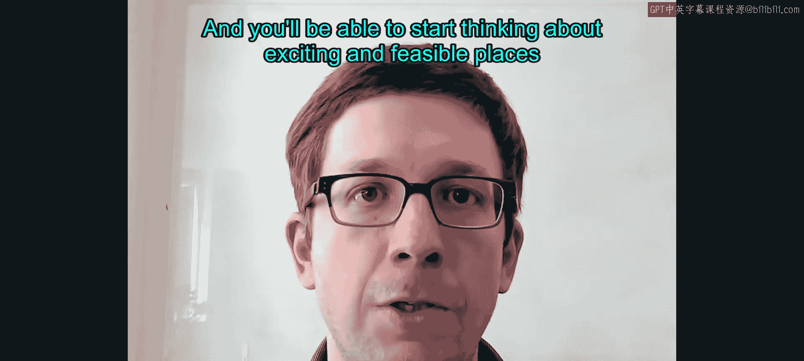

# databricks《大语言模型：从生产到应用｜Large Language Models： Application through Production》 - P10：-10-LLM Module 1 - Applications with LLMs _ 1.1 Introduction.zh_en - GPT中英字幕课程资源 - BV1nS411K7Af

Welcome to our first module applications with LLMs so this models got to start off with a joke about how all CEOs are asking their employees to start using LLMs as soon as possible and certainly as a CT I've had this experience with my boss but the great thing about LLMs is that you actually can get started very quickly on many applications with minimal effort and then you can improve from there so we're going to talk a little bit about some of the common applications things you can get out of the box and how to think about know which applications are doable with LLMs and in what fashion and one of the first things that we will cover in the module is that there are a lot of standard natural language processing tasks where you can find really great pretrained LLMs often open source that do that task well and there are welldefined processes for you improving them for your application so in this model we're going to cover some of the most common LLM applications we're going to cover hugging。

As a programming framework for working with LLMs and also a way to get to a lot of open source models and pumped engineering as a basic way to begin getting a more general LLM to do other things and we'll start by covering some common tasks like sumization or classified reviews or answering questions and start discussing some of the other applications of LLMs as well the other thing we're going to begin covering is how there are tradeoffs in different ways of using an LLM the effort involved and the quality and performance you get out of that because you need to start thinking about these as you plan an application So hopefully at the end of this module you'll understand some of the common task that LLMs are already very good for and the kinds of things that you can get them to do with a little bit of engineering with a lot of engineering with sophisticated data collection and maybe some things that you just can't get them to do at all and you'll be able to start thinking about。

You know， exciting and feasible places to apply them in your applications。

