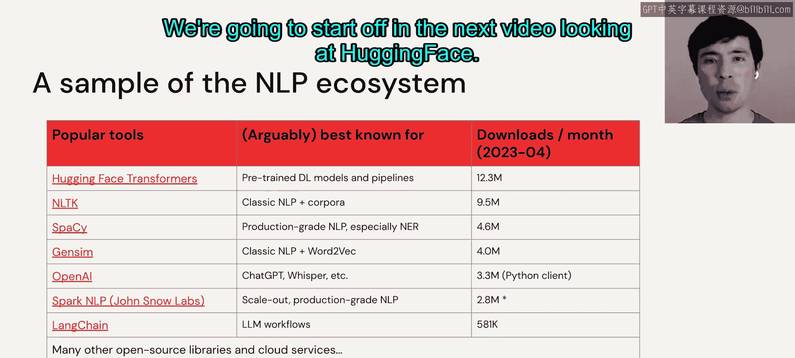

# databricks《大语言模型：从生产到应用｜Large Language Models： Application through Production》 - P11：-11-LLM Module 1 - Applications with LLMs _ 1.2 Module Overview.zh_en - GPT中英字幕课程资源 - BV1nS411K7Af

Welcome to Mod 1， Appplications with LLMs。Our learning objectives are going to be all about getting started quickly。

By the end of this module， you will understand the breadth of applications which pre traineded LLMs may solve。

You'll download and interact with LLMs using Huinfase APIs， datas， pipelines， tokens and models。

 you'll understand how to find a good model for your application quickly。

 such as via Hugging Fase Subub。You understand the importance of and how to get started with prompt engineering。

As Matttee mentioned， a lot of CEOs or CTOs have recently said things like， start using LLM's ASAP。

The rest of us， of course， are like， so what can I power with an LLM and how can I do it？

Given a business problem。Our take is going to be first figure out what standard NOP task it maps to。

 given that task， what models are applicable。Looking at that chart on the right。

 we can see in this snapshot from the Huging F Hub in April of 2023。

 there are thousands of models for these common NOP tests。

The bad thing is there are thousands of models and we have to pick。

We're going to spend a fair amount of time this module talking about how to do that。

To make things concrete， we'll use a run example of generating summaries for a newest feed。😊。

Given text articles， long pieces of text， a standard and OP task is to summarize these into smaller pieces of text。

 and for this application that gives little summaries which can show up in the news app and users can scroll through。

Before we get down to do that。Quick note on just a sample of the tools in the big NLP ecosystem。

At the top is Huging F， which we already mentioned。

Its Transformers library and the hub associated with it is probably best known for having a bunch of pretrain。

 deep learning based MLLP models and pipelines。Huggging F offers a lot more as well。

There are also a number of very popular libraries out there still doing classical NLP。

 not LLM or deep learning based。There are some very famous proprietary ones like around Open AI。

 and then there are also some newcomers such as LangChain， which don't offer models per se。

 but rather workflows or chains around models， more on those later in the course。

We're going to start off in the next video looking at Huging face。

