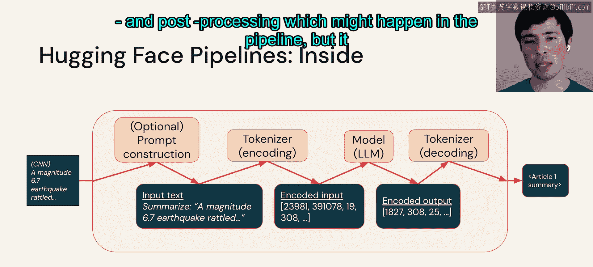
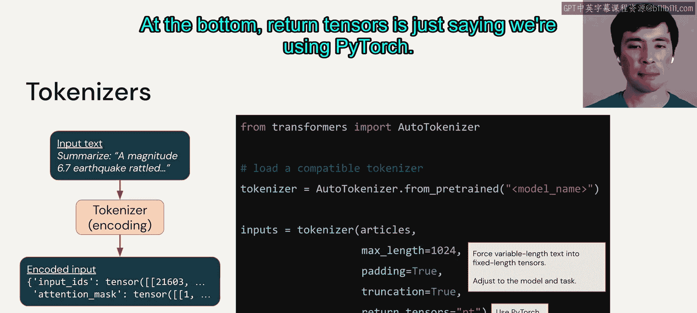
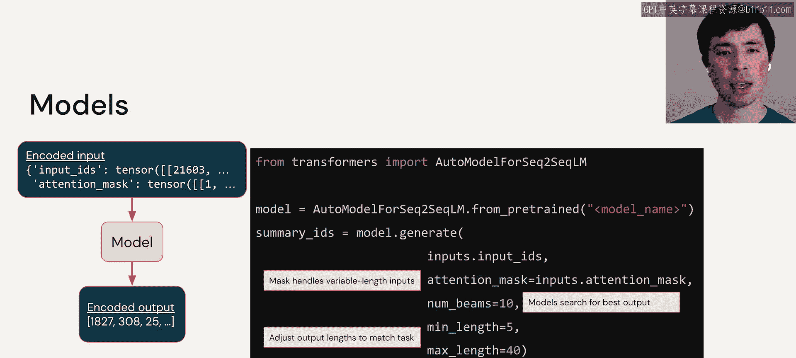
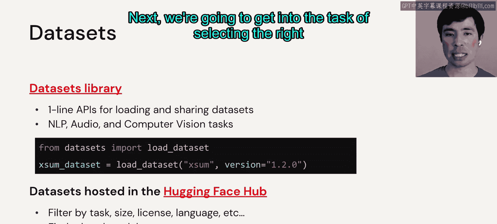

# databricks《大语言模型：从生产到应用｜Large Language Models： Application through Production》 - P12：-12-LLM Module 1 - Applications with LLMs _ 1.3 Hugging Face.zh_en - GPT中英字幕课程资源 - BV1nS411K7Af

Let's take a look at Hugingface， the Gitthub of large language models。

Hookgging Face is a company and also a community of open source ML projects， most famous for NLP。

Its hub hosts， models， data sets， and spaces for demos and code these are easy to download。

Under different licenses， there are also a number of libraries it provides。

The Datas library provides ways to download data from the hub。

Transformers makes it easy to work with pipelines， tokenizers， models， these core components of NLP。

 and to download pretrain ones from the hub。Then evaluate is what it sounds like。On the right。

 you can see that the popularity of transformers has really been rocking up in the last couple of years based on stack overflow questions。

I'd argue that the reason is Huging face offers very simple APIs， but under the hood。

 they have a ton of power because they're using deep learning libraries like PyTtororch。

 TensorFlow and jacks。Let's take a look at transformers first。What does the pipeline look like？

Here we're back to our summarization problem， article on the left。

 summary on the right and the LLM in the middle。Uing transformers can simply import the pipeline class。

 say I want a default summarization pipeline and throw my article at it， and I'm done。Under the hood。

 it's picking a default LLM for me， configuring it。And trying to do the right thing。In general。

 though we'd want to configure it further ourselves， so let's open up the pipeline。

 here are common components it might have。That raw input might go through something called prompt construction。

We'll talk more about prompts a little later in the module， for now， just know that some LLMs。

 not all， require further instructions beyond the raw user input。For summarization。

 it might be as simple as prepending， summarize colon to that article。

That'll then go through a tokenizer which wont code the text as numbers。

 which is what or model the LLM will expect。The model outputs an encoded summary and the tokenizer。

 the same tokenizer dedes that summary。Yes。I'll also note that this slide glosses over a bit。

 potential pre and post processing which might happen in the pipeline。

But， it gives the key components。Looking at the tokenizer a little bit more closely。

 we can see that in the bottom left。It outputs that encoded data as inbu IDs。

 which is the actual encoded text， and then in this attention mask。

 we're not going to talk much about attention in this course， Suffice to say for no， it is metadata。

Describing the text， which is output as input IDs， and you need to pass it along to the model which expects this metadata。

On the right， you can see us using this auto tokenizer class。

This is one of multiple auto classes that Transformers offers。

 which sort of does the right thing when you give it the name of a model or tokenizer that you want to load。

Given that tokenizer， we can pass in the articles。And then here's an example of some configurations you might specify。

Max length， whether or not to pad， whether or not to truncate the input。

These are all around forcing variable length and put text into fixed length tensors。

 which the LOM will expect。You're going to adjust these based on the model you pick and also the task。

At the bottom， return tensors is just saying we're using bytch。

Next comes the model， we're going to pass in the input IDs and attention mask and get encoded output。

On the right you can see us using another one of these auto classes this time for sequence to sequence language models。

We won't go into a ton of detail about the different classes of language models here。

But this is essentially saying a variable length the sequence of text like article。😊。

Being transformed into a variable length sequence of text， like our summary。Give it the model name。

 it loads the right model for us， and then we can pass in In IDs attention mask here I'll note that a little more detail about the metadata。

This is where your call at the tokenizer， we were specifying some parameters in variable length inputs。

This is the metadata that will help the model handle those variable lengths。

Next come a few inference and output parameters， nu beams。

 which we'll explore more when we get to coding。Its saying I want to do beamM search to generate the output text。

 there are a number of ways do to inferences and this is one of them。

And then men in Max length are saying， I want between five and 40 tokens in my output summary。

This is going to be adjusted， of course， to your requirements for the task。

That's enough bell transformers， so let's say a word about datas。

The library offers one line APIs for loading and and data sets we'll talk about NLP。

 but there's also audio and vision。The low data set API not only lets you specify the data set name。

 but also a version number that can be valuable for maintainability of code。

These data sets are hosted in ourgainfaceace Hub， and that lets you and the UI filter by things like task。

 size， license， language and so forth。And also find related models， which can be very useful。

This has been a whirlwind tour of the hugging F， libraries and tools next we're going to get into the task of selecting the right model。

