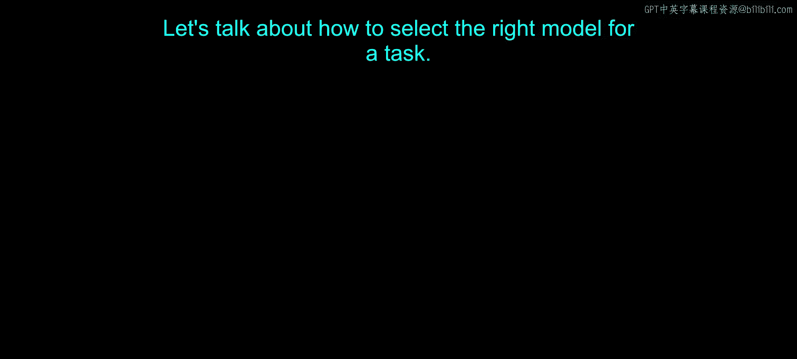
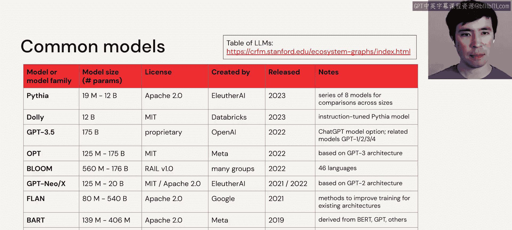

# databricks《大语言模型：从生产到应用｜Large Language Models： Application through Production》 - P13：-13-LLM Module 1 - Applications with LLMs _ 1.4 Model Selection.zh_en - GPT中英字幕课程资源 - BV1nS411K7Af

Let's talk about how to select the right model for a task。

Looking back at our summarization application。I'll first note that。

 you know we talk about these broad tasks， summarization， translation， whatever。

 but there are details， for example， with summarization。

 something you may encounter later on when we get to coding is do you want to do extractive summarization where you select representative representative pieces of text from the original or abstractstructive where you're generating new text？

Beyond that， once you figure out the details， how do you go about searching for it and if you look at Huging F upub。

When I last looked to had 176，000 something models。

 I filtered by summarization that gave me about  a00 models， and then what should I do。

 maybe you sort by popularity， maybe， but let's consider needs first。

There are a lot of potential requirements and needs and a lot of techniques to filter by them。

Let's look at some easy choices first。First， filtering by task in the upper left， license language。

 these kinds of hard constraints can be pretty easy and pretty useful， for example。

 if you need a commercially permissive license。That can be a pretty clear God。In the bottom left。

 this isn't filtering within the UI which currently doesn't support it。

 but you can look up how large these models are， either in files and versions to get a ballpark idea of maybe the number of gigabytes the pythwar representation takes。

 or if the model is well documented， the number of parameters it has。

That can be important if you need to limit hardware requirements for cost or latency or whatever。

In that right， you can see on the UI been stored by popularity and updates Pity matters of course。

 because people vote with their feet on what are good models。Updates matter。

 especially if you are looking at a very old model。

 might not even load properly with the latest transformer of library。

If you want more details about what is in these updates to models。

 can be useful to check the GettRe history， well documented models we document that。Now。

 getting into some more ambiguous ways of figuring out the right model but still important ways。

 I want to talk about model variants， examples， and data。On the left。

 I'm recommending to pick good variants of models for your task， here's what I mean。

When a famous model， say T5 has shown an image here is published。

 it's often published with different sizes， base， a smaller version， a larger version。

 maybe an even larger version。Here I'd say start prototyping with the smallest one just to get moving quickly。

 keep costs low， you can always move to a bigger version which will presumably be more powerful。

Also look for find youvaris of base models。So we'll talk more about fine tuning later in the course。

 but basically if a model you pick has been defined fine tuned on a data set or task very similar to yours。

 it may perform better。En up for right。I'm recommending that you search not just for models。

 but also for examples in datasets。You know this can be for many reasons。

 but I would say one of the top ones is that honestly not all models are well documented。

 so a good example of usage will tell you not only what parameters you may want to tweak or whatever。

It can also help you avoid needing to know about model architectures。

 you don't need to be an LLM expert in order to pick a good model。

 especially if you can find where someone has already shown it to be good for your task。

Next S is the model a generalist good at everything。

 or was it finetd to be great at a specific task relatedly which data sets were used for pretraining and or fine tuning？

Fine tune models in general are going to be smaller and or perform better if they match the task that you are doing。

Ultimately though， it's about your data and users， so define KPIs and metrics。

 test on your data and users， and we're going to talk more about evaluation later in the course。

So those are some general tips on selecting a model。The other part of selecting a model， I think。

 is recognizing famous good ones。Here is a short list。

 small subset of the many models or model families out there。In the upper right。

 there's a larger table of LLMs， which you also might want to check out。

I'm not going to talk through this whole list， but I want to point out a few things first a lot of these quote modelsel are actually more model families。

Maybe ranging from millions of parameters to billions of parameters and also a lot of them have been fine tuned to be more specific。

 so for example I would call the first row Pythia sort of a family of base models not necessarily meant to be used out of the box they could be。

But perhaps more commonly used as base models further fine tuned into， for example。

 the second line Dolly， which is a fine tuned version of one of the Pythia models for instruction following。

I'll also note that these models vary a lot in size。

 that you'll notice that some famous ones like maybe GPT 3。5。

Aren't actually as large as some of the less famous， larger ones？So size does matter with LLMs。

 larger models tend being more powerful， maybe you be able to handle more types of tasks。

 but it's not everything， so for example， with the GPT family。

 a lot of effort was put into techniques like the famous reinforcement learning with human feedback。

These alignment techniques to sort of give users what they're really looking for。

Other things which are really important， of course， are model architecture。

 what data sets were used for pre training and and they fine tuning。

And these can cause major differences between these models。That said。

 a lot of these foundation models really are interrelated， you know。

 sharing or selecting from sort of a shared family of techniques or pre traininging data sets。

Now we've covered some techniques for picking models。

 we've talked about some common model names so that you'll recognize them。In the next video。

 we're going to turn to looking at common NLP tasks。

