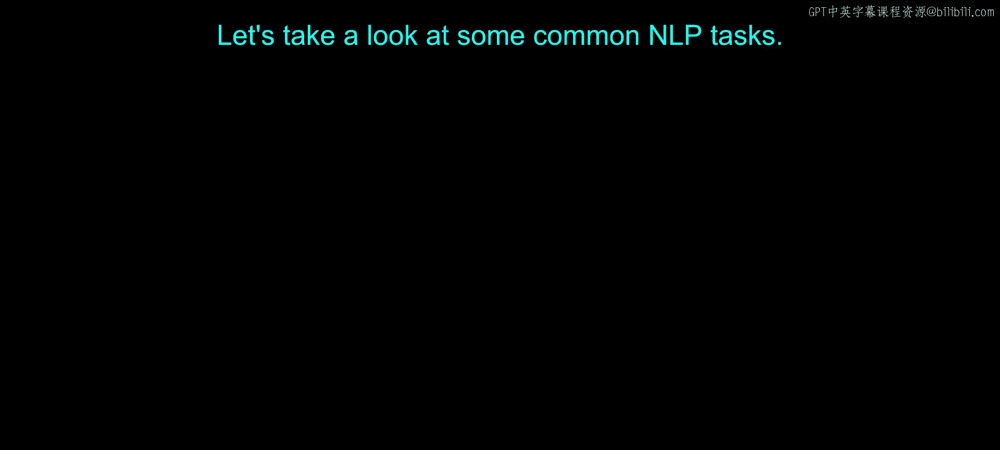
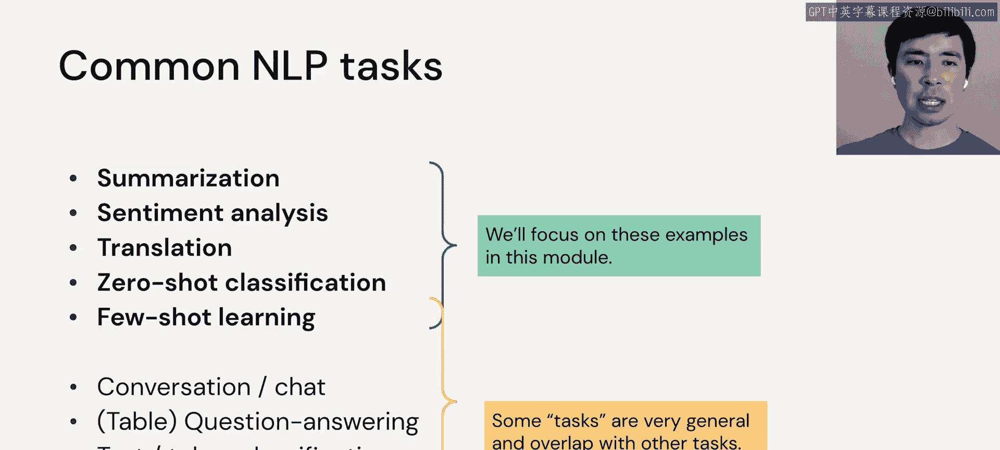
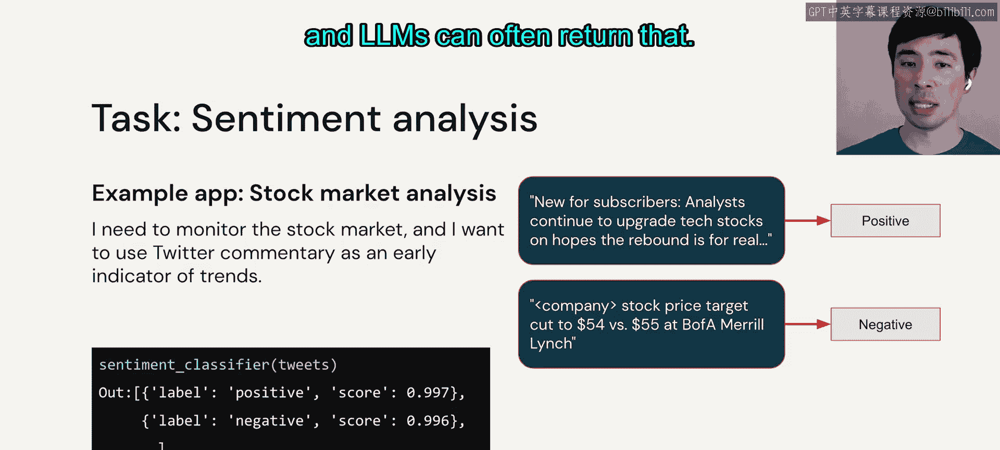
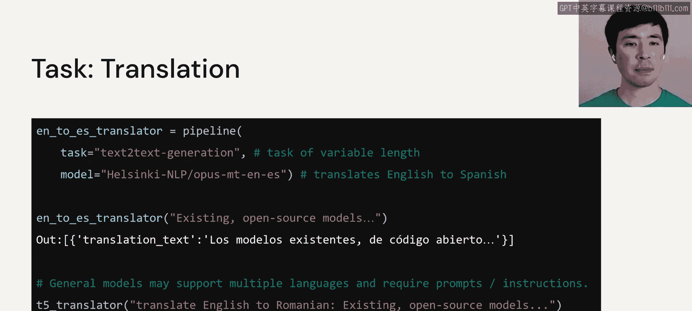
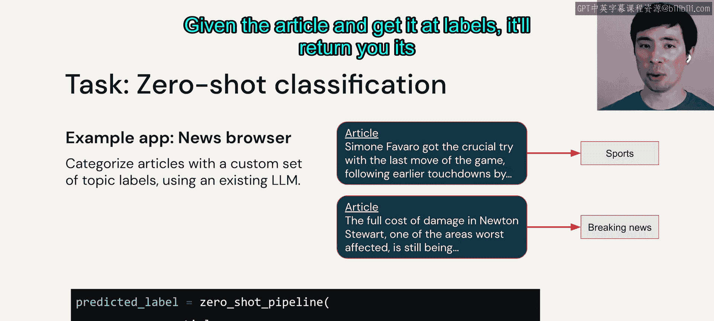
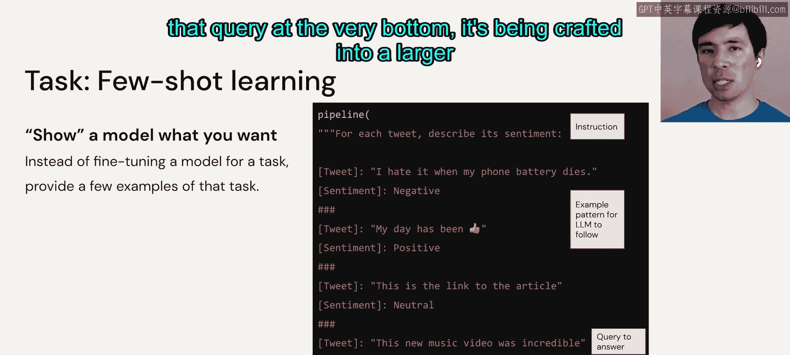
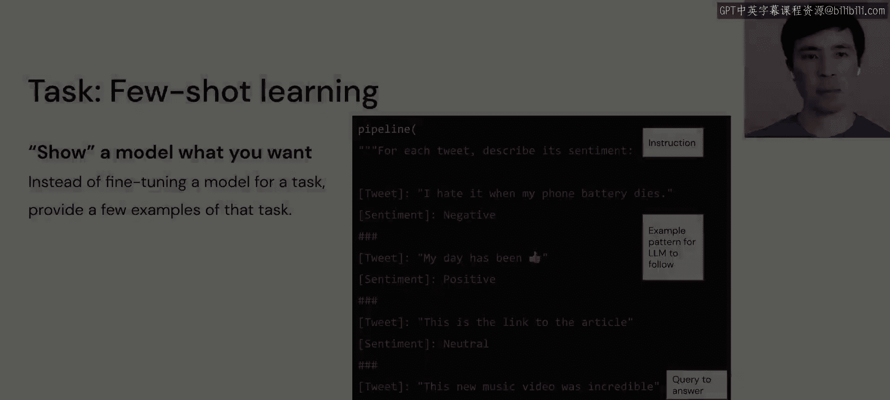

# databricks《大语言模型：从生产到应用｜Large Language Models： Application through Production》 - P14：-14-LLM Module 1 - Applications with LLMs _ 1.5 NLP Tasks.zh_en - GPT中英字幕课程资源 - BV1nS411K7Af

Let's take a look at some common NLP tasks。Here's a short list。

 we're not going to talk about all of them in this module， we'll talk about the ones in bold。

I'll also note that some of these quote， tasks are very general and overlap with others。

 but these terms are important to know because you'll see them in literature on that gameface hub and so forth。

A good example is the bottommost one， text generation， this can subsume almost any other task。

Some of the summarization models we'll use actually are labeled as text generation because they do a bunch of things。

 including text generation。

We already talked about summarization， so let's talk about sentiment analysis。

An example application using this might be say， I monitor the stock market and I want to use Twitter commentary as an early indicator of trends。

Given a tweed， is it positive， is it negative， maybe neutral， about whatever stock it's discussing。

You can see in the bottom left that in addition to a label like positive or negative。

 it might want maybe a confidence score， and LLMs can often return that。

The next task I'll mention is translation。Here it's what it sounds like。

 but there are a couple things which are useful to point out。

Some LLMs are fine tuned to go from one language to another specific language， for example。

 the model in the upper left is going from English to Spanish and that's it。

Also note that sometimes you can specify the NLP quote task as a more general one like text to text generation。

 that's what we're doing with this model here。In the bottom left， the T5 translator model。

 is a fairly general model。And there， since it is general， can do multiple things beyond translation。

 we actually give it an instruction， translate English to Romanian， and then give that user input。

The next task we'll look at is zero child classification。

A good example of this might be say I have a news browser and given news articles。

 I want to categorize sports， breaking news， politics， and so on。

Now I don't want to retrain a new model every time I change my categories。

 I want to use an existing model。And LLMs actually let you do this unlike classical machine learning。

 and LLM sort of already knows the language and so when you add or change labels。

 it already knows what those labels mean， so it can potentially do that classification without being retrained。

😊，The bottom left， you can see how a pipeline would do this。

 given the article and again it it labels， it will return you its prediction。

Really useful task。The next one， few shot learning is very general。

 and I'd almost call it a technique rather than a task。In this example。

 you show the model what you want through examples。

So instead of fine tuning a model for a specific task， we provide a few examples of doing that task。

Nick OLM， which is powerful enough， can often sort of learn on the fly。What you want to do？

So on the right， you can see。We're doing sentiment analysis。

 but using a model which is not designed for sentiment analysis。Our instruction is for each tweet。

 determine the sentiment， we give some examples， here's a tweet， here's a sentiment， a couple more。

 and then a query which is a new tweet give me the sentiment。

This is a technique which you'd use when there is no fine tune model available for your task and you don't have enough label training data to train or fine tune one。

But you can write out a few examples。This uses text generation models which must be quite general to understand and follow these instructions。

 but it's a really powerful technique。We're starting to see here where the user input。

 which might be that query at the very bottom， is being crafted into a larger prompt。

 so we're going to take a look at prompts in the next video。

