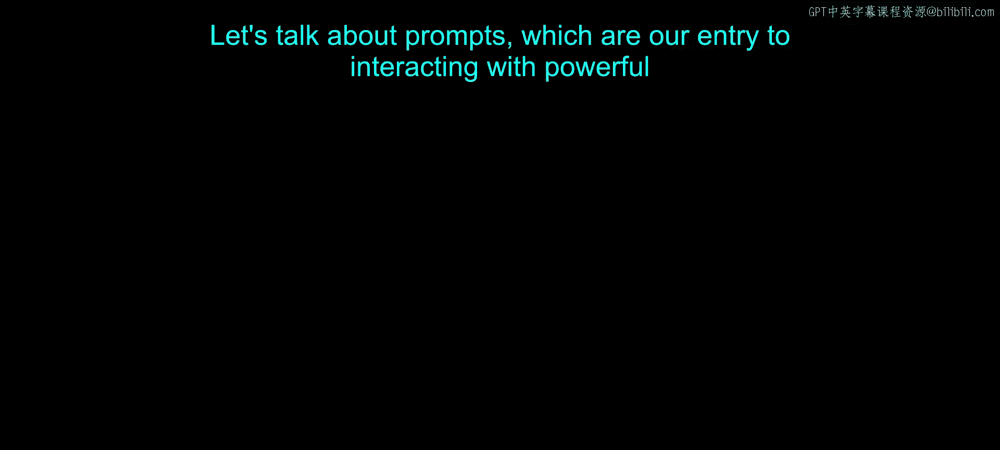
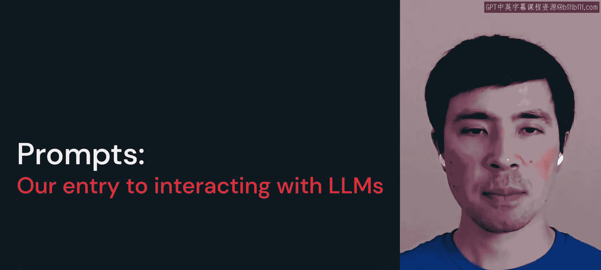
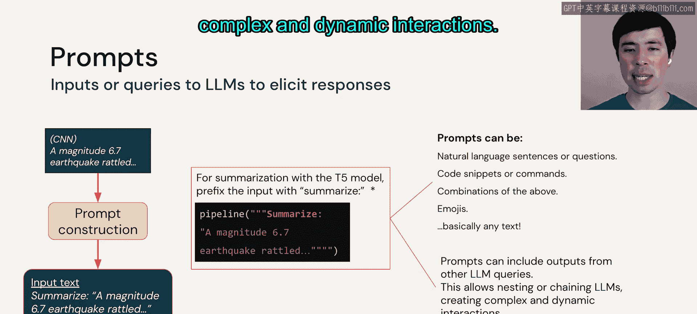
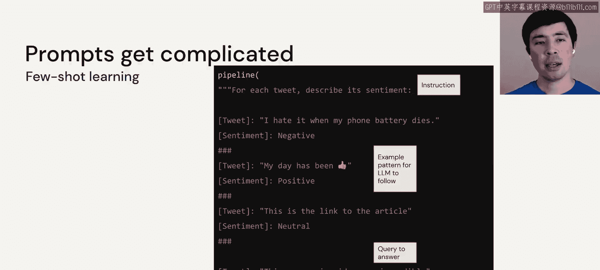
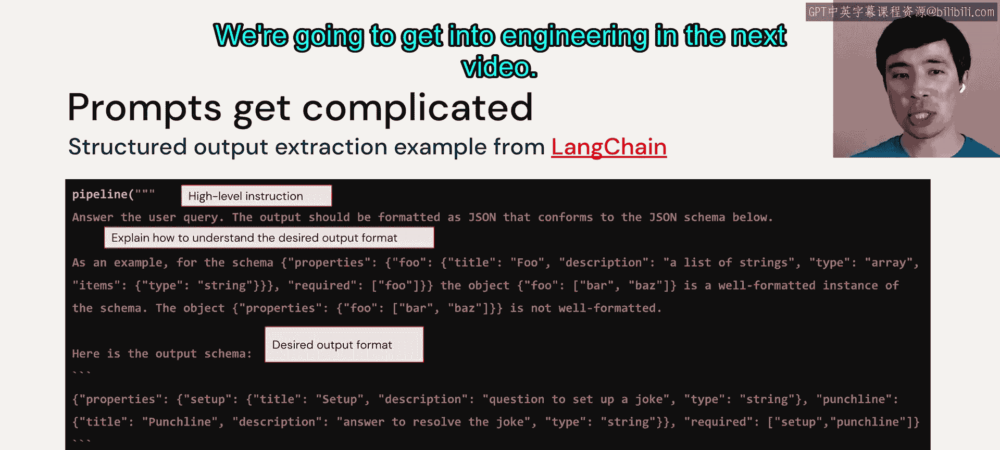

# databricks《大语言模型：从生产到应用｜Large Language Models： Application through Production》 - P15：-15-LLM Module 1 - Applications with LLMs _ 1.6 Prompts.zh_en - GPT中英字幕课程资源 - BV1nS411K7Af

Let's talk about prompts， which are art intrigued to interacting with powerful LLMs。

Promps often appear in the context of what are called instruction following LLMs。

To explain what these are， let's compare them with foundation models on the left。

Foundation models are pretrained on these very general text generation tasks。

 like given the text in blue， predict the next token in the sequence and the next and the next or fill in missing tokens in a sequence。

Instruction following models on the other hand are tuned to follow almost arbitrary instructions or prompts。

 so still very general， but somehow a bit more specific。

Some examples might be give me three ideas for cookie flavors， the LLM returns a numbered list。

Write a short story about some stuff。And it returns a short story。然。These are toy examples。

 of course， but prompt engineering actually gets pretty serious and we've seen some examples already。

😊，In general， prompts can be thought of as inputs or queries to LLMs to elicit responses。

 emphasis on eicit because you really are trying to tease out the right behavior from these otherwise black box models。

We saw an example with our summarization problem。The T5 model expects a prefix summarize colon appended to that article。

 and we saw this in the code， that's all it expects。

 but's enough to tell the model what you want it to do。Now more generally。

 these prompts can be natural language sentences or questions， code， combinations of the above。

 emojis， pretty much in text。They can also include outputs from other LLM queries。

 that's very powerful because it allows nesting or chaining LLMs making these complex and dynamic interactions。

We'll talk more about that， later in the course。We saw a more complicated example with few shot learning。

 where a prompt had an instruction。A number of examples to sort of teach the LLM what we wanted in the actual query。

It gets even more so Li chain generated this structured output extraction example for me where。

It has a number of parts at the top of very high level instruction， you know， answer the user query。

 should fit this format， an explanation example of how to understand the desired output format specification of that output schema。

 and then the final instruction， tell me a joke。😊，Now this prompt is not a joke。

 even though it looks ridiculous。This actually works with some models and it outputs a structured format which can then be fed into downstream data pipelines。

This is just a nice example of how powerful these prompts and prompt engineering can be。

We're going to get into engineering in the next video。

