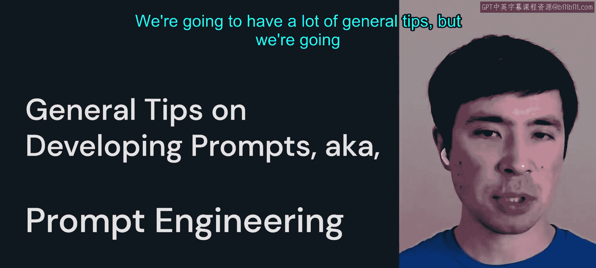
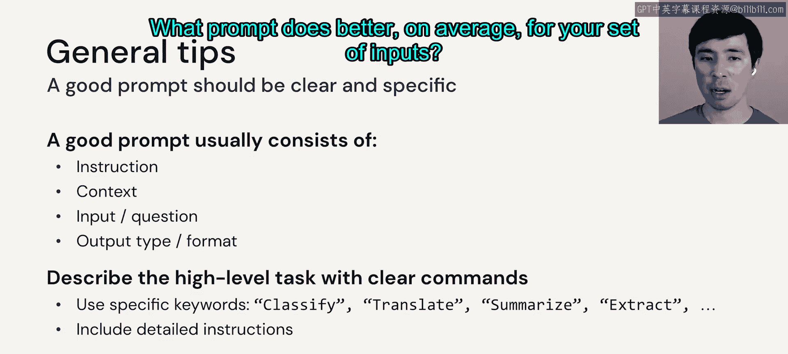
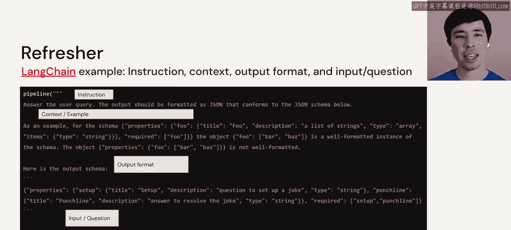
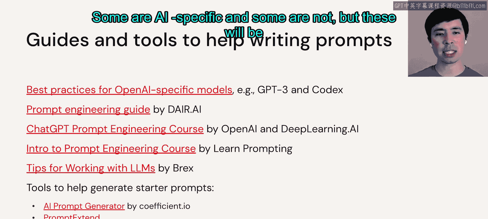
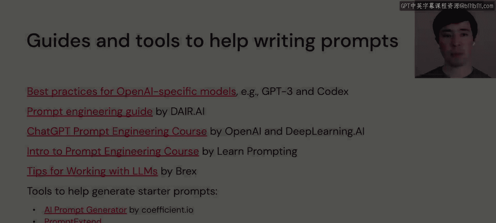

# databricks《大语言模型：从生产到应用｜Large Language Models： Application through Production》 - P16：-16-LLM Module 1 - Applications with LLMs _ 1.7 Prompt Engineering.zh_en - GPT中英字幕课程资源 - BV1nS411K7Af

Let's talk about prompt engineering。We're going to have a lot of general tips。

 but we're going to start off with a caveviat that prompt engineering is model specific。

So prompt will guide a model to complete the task in the way you wanted。

 but different models may require different prompts and a lot of guidelines you'll see out there are specific to well one of the most popular services。

 chatGT and its underlying openAI models， they may not work for nonChat GPT models。

 but a lot of the techniques do carry over， even if the specific text of the prompts do not。

Different use cases may require different prompts， and so iterative development is key。

 hence engineering。Let's start with some general tips around how a good prompt needs to be clear and specific。

Just like when you ask a human to do something you need to be clear and specific。

 that helps with LLMs as well。A good prompt often consists of an instruction。

 some context or background information， an input or question， output type or format。

You should describe the high level task with clear commands that may mean in specific keywords like classify。

 translate， so on。Or including detailed instructions， and finally。

 this is engineering so test different variations of the prompt across different samples。

 use a data driven approach here， what prompt us better on average for your set of inputs。

Just a refresher， we saw this example in the last video of L chain giving。

A prompt with different components， a very clear instruction。Context or an example。

A specification of the output format and then the actual user query input， tell me a joke。

There are also techniques for helping the model to reach a better answer to serve like think better。

First you can ask the model not to make things up you've probably heard of the term hallucination where models will sometimes just sp nonsense or falses things。

 but you can tell the model not to， and that can help you can also ask the model not to assume or probe for sensitive information and finally this last one is very powerful ask the model not to rush to a solution。

 but instead take more time to think using what's called chain of thought reasoning。Things like。

 explain how you would solve this problem or do this step by step。That often leads to better results。

Promp formatting can also be important。Use diiters to distinguish between the instruction and the context。

Also， use them to distinguish between the user input if this is a user facing application and the prompt that you add around it。

Ask the model to return structured output and provide a correct example。On the right。

 you can see where a user facing application allows users to input part of a prompt。

 but then we wrap it with a larger prompt。And there in this example， if you can read it。

 the user is trying to override our instruction， this is called prompt injection and prompt formatting can help avoid this。

This starts to get into the idea of hacking prompts。

 which is exploiting LOM vulnerabilities by manipulating inputs。

But good prompts can help reduce this。On the upper left， here's prompt injection。

 which we just saw where。You'rere basically trying to get the LLM to ignore the real instruction。

 which the application wants it to follow， instead override it with a user input instruction。

In the bottom left is prompt leaking where we're extracting sensitive information from a model here is a public example of extracting the secret code name of Microsoft being search。

😊，On the right， an example of jailbreaking where you're bypa passing a moderation rule。

Here it's asking how to do something illegal and the model first says， I can't tell you。

And then some rephrasing and the model actually answers the user question。This。

 like any computer security thing， is sort of a constant battle between the people developing these applications and the people trying to break them。

This example on the right actually doesn't work anymore because it has been fixed。

 and this is something you might need to think about in your applications as well。

There are techniques for reducing prompt tacking。You can post， process or filter。

So use another model to clean the output or tell the model to remove all offensive words from the output。

You can repeat instructions or sandwich instructions at the end。

This can help LLM pay attention to what you really wanted to do。

You can enclose user input with random strings or tags that makes it easier for the model to distinguish what the user input is versus your instructions。

If all else fails， it can help to select a different model or restrict prompt length here are some guides and tools to help with writing prompts。

 some are AI specific and some are not， but these will be great resources as you dive into the lab。

