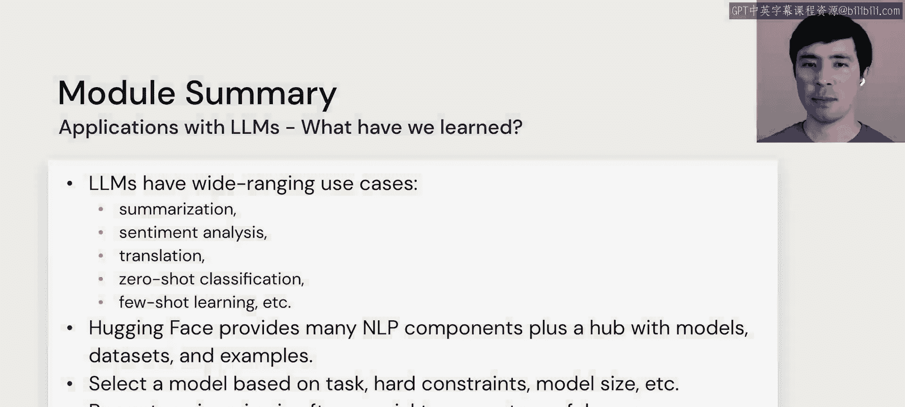

# databricks《大语言模型：从生产到应用｜Large Language Models： Application through Production》 - P17：-17-LLM Module 1 - Applications with LLMs _ 1.8 Summary.zh_en - GPT中英字幕课程资源 - BV1nS411K7Af

So here's the module summary， what have we learned about simple applications with LLMs？

While LOMs have a ton of wide ranging use cases and we talked about a few of these tasks in detail。

 we'll see them when we get to coding as well。HggingFace provides many NLP components。

 plus a hub with downloadable models， data sets， and examples。

 very powerful tools to get started quickly。In order to select a model。Think about your task。

 think about hard constraints， soft constraints， model size， and so on。

 we gave a number of tips here， but it's really up to you to figure out what's important for your application。

Then finally， prompt engineering is crucial for generating useful responses from these very powerful models。

There are a lot of techniques and tips out there。And it's partly art and partly engineering。

