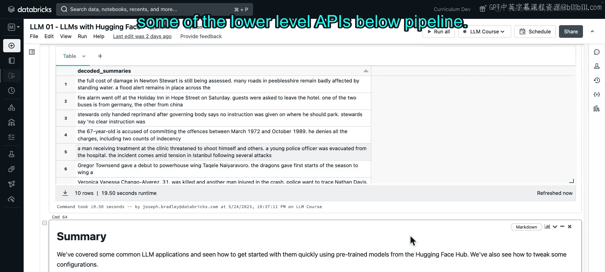

# databricks《大语言模型：从生产到应用｜Large Language Models： Application through Production》 - P18：-18-LLM Module 1 - Applications with LLMs _ 1.9 Notebook Demo.zh_en - GPT中英字幕课程资源 - BV1nS411K7Af

Let's get into LLMs with Huging F In this notebook we're going to take a quick tour of top applications using LLlums These five here will also focus on existing open source models used out of the box for this we'll use Huging F hubub and the models it hosts we'll also do some simple prompt engineering。

And then at the end， we'll look at Huging Face APIs in a bit more detail to talk about configuring these pipelines。

To get started， I am going to install one library required by one of our translation models and run classroom setup。

I'll speed through this part of the video let's look at common LLM applications the goal is to get started quickly。

 but do note along the way the data sets， models and APIs we use because they'll be useful to you in the future。

First， let's import low data set and Pi are two workhorses for this section。

The first task we'll look through is summarization。

 which takes two forms as we talked about in the slides extractive and abstractive。

 we're going to do the latter abstractive here。For every time we talk about a task。

 we're going to give some background reading and some information about the data and the model。

For this section， we're going to use the XM data set providing a set of BBC articles and summaries the model we'll use as a variant of T5 in particular the small variant which has 60 million parameters。

T5 is a model out of Google supporting a number of tasks， summarization， translation， and more。

 and we're going to use it for two tasks in this notebook。Now， the XM data set。

 which will'll load is loaded using that version number。But then also。

 we're specifying a cache directory， we're going to do this a lot because we've pre downloaded some data and models for you and where possible we tell Huging faceace。

 use that pre downloaded information。When we print out the representation of something。

From low data set。It's generally a data died with several data sets within it。 This case， train。

 validation and test。We're only going to use a small subset of this data。

We're going to use the document and summary columns， the article。

 and the quote  Ground truth summaryum， but remember how ground truth is very subjective in this task and many other LLM applications。

We can display a sample of our data。Here the document。 and then the summary。

We'll next load our pipeline and there is some explanation of what we're loading here。

 but I'll talk through based on the code。General， who we load a hug and face pipeline will specify a task that helps tell Hugging faceace how to handle the model。

 which you tell it to load。You can specify optional inference parameters like the length of the summary that you want to generate。

 whether or not to truncate long articles， which is helpful so that this won't fail or give warnings when the article is too long。

And then again， we've pre downloaded the model。We can pass it a single article or a batch of articles when we pass it the single article you can see the summary that output。

 it's not the prettiest summary perhaps， but it actually if you compare it with the article。

 does do a decent job of representing key information。

You may also see warnings about using generation configuration files。

 which is a newer recommendation from HugingFace and we're keeping it simple just by specifying configurations like this in the notebook。

 but consider the generation file and follow this URL for more information as you move towards production。

You also probably in production end up using somewhat lower level APIs， which we'll cover later。

Applying this to a batch of articles， this is。Running it on the sample of 10 articles。

 which we've limited the sample to。We've got a results data frame back。

 and then we're going to join that with the original quick groundund truth summaries for comparison。

And you can later compare these side by side to get a sense of how good the model was。

Our next task is going to be sentiment analysis。Sentment analysis is a text classification task。

 estimating whether a piece of text is positive， negative， or some other label。Background reading。

 for the data， we're going to use a set of poem segments。And it comes with labels， negative。

 positive， no impact or mixed。The model we're going to use is a fine tuned version of the bird。

Bert is a famous foundation model， but the fine tune version that we're using is a very specific version。

 fine tune for actually this boom data set。And so， you know。

 I'll readily admit that this fine tune model， which I'm viewing on the hugging face hub here。

Is essentially cheating， having been。To non this data set。

 but it gives a very clear picture of how if you find a model which has been fine tuned on something's similar to what you want to do。

 very beneficial。We're going to load our data set。Can see that。 It includes。

Small segments from poems and then labels， the labels are numbers zero through three。But later。

 we'll convert these to the text labels for better comparisons with our predictions and the ground truth。

Loading that sentiment classifier pipeline， the task is going to be text classification。

 this is a more generic task， but you can tell it is applicable here where we want to classify the text into0。

1，2 or three labels。And then we could call this on our pieces of poetry。

Here we're joining it with ground truth data。Changing label and decase to text labels and display them you can see of course this model which was fine tuned on this data does very well Later on。

 you'd be interesting on your own time to play around with using the same model but on pieces of verse which you write yourself。

Our next task is translation。Translation models may be designed for specific pairs of languages。

 or they may support more than two languages， we're going to look at both。For data。

 we're going to just do some hard coded sentences， but I will note there are translation data sets on Huging F proper。

The models we'll look at are first， a very specific model， English to Spanish。

 and then again our favorite T5 small model。Which is also applicable in addition to summarization。

 which we sell about to translation。So first。We'reloading a translation pipeline。

Using that English to Spanish model， and then we'll just give it。

A sentence in English and out Spanish。Fine tune models like this can end up being very useful when they fit your task because they're very specific and end up doing quite well。

For T5， recall that T5 is a more general model， here we're saying the task is general text to text generation。

ItIt doesn't know yet that we want to do translation， therefore when we call it， we need to tell it。

 that's what we want to do， translate in this case。

 English to French and out comes French or English to Romanian and out comes Romanian。

Our next task is zero shot classification。Also sometimes called zero shot learning。

Here the idea as you recall from the lecture is take a piece of text。

 classify it into one of a few categories or labels。

 but we've never explicitly trained the model to predict those specific categories。

Here's some background reading for data， we just picked a few articles from next sum data set。

And the model is a fine tuneed version of the Albertera Foundation model。

It's been fine tuned specifically to be useful on tasks like zero shot classification。

And so we can load it。As a zero shot classification task。Get it the model。

And then to call this model， we wrapped it in this categorized article function。

And that just means like we don't have to rewrite our candidate labels each time。

 which are going to classify articles as politics， finance， etc。And then we print the results nicely。

So let's just call it on this article， which， as you can see， is about sports。

And that zero shot pipeline， indeed predicts that the most likely label is sports by a good margin。

We'll then pass it in this article about damage from water and flooding and storms。

 and here the pipeline believes that it is breaking news。

 I do believe that is the most applicable label， but note that this is a somewhat more generic label than some of these others and the model's confidence is not as high here。

Our final task is few shot learning。Recall that that's where you give the model instruction。

 a few query response examples of how to follow that， and then a new query。

There's some good background reading and we're not looking at specific task here， per se。

 we're actually going to do sentiment analysis and then a few other toy tasks。

Because fu shot learning is really more of a technique than a task， it's applicable to other tasks。

For data， we just hand coded some examples and then the model we'll use is this GPT and Neo 1。

3 billion I'm going to start loading it because it will take a little bit its largest model we're using in this notebook and the reason is that fu shot learning in general requires a larger。

 more powerful model because it's a very general kind of instruction following task。

The hugging and F task that we'll specify for this is general text generation and for most of these tasks。

 we're going to say only generate 10 new tokens， please。Now this GP Ne model and this is just the 1。

3 billion parameter version of it is created by Luther AI。

 there's more details on GitHub and in the research paper。

 and I will note that if you get serious about a few shot learning。

 certainly consider their upgraded model GP NeoX， and or other models for instruction following or text generation。

 which are more general， larger and more powerful。But we're keeping it pretty small for the sake of this demo and notebook。

As this is load， I'm going to explain what we do next， which is。In these prompts below。

 we want to separate examples with a special token， this pound pound pound。

And we're going to use the same token to encourage the LLM to end its output after answering the query。

So we specify it as the end of sequence token like this。After this pipeline loads。

 we're going to extract its stokkenizer and then encode this three pound symbol。

We extract the ID and that our in of sequence token ID。Whenever we call this View shot pipeline。

 we give it our prompt， and then we also specify use this as an end of sequence token ID。

And this is a toy example we're starting with， which is not have the separator within it。

 but you'll see our Asusian later on。So this model did load。

 but it took a little bit on the small instant size。😊，And we can then call it with it。

A very simple prompt notice that in this prompt we give instruction and then we don't give any examples。

The point being that。The answer without any examples is terrible。This is not a sentiment。

 it is a random statement。If we add one example， what happens。

 so here we're giving an example tweet and saying the sentiment is neutral。Here。

 the model returns neutral。That's not right， the music video was incredible。

 but the model does seem to maybe have a better idea of what we want。

We're next going to give one example for each sentiment negative， positive and neutral。

 and then our query。And indeed， now the model may understand us。

 it says that the sentiment is positive， which is correct。This is a handpicked example。

 but it's a nice example of how。As you give the model more examples。

 it's likeliier to understand you。A great example of prompt engineering。Just for fun。

 let's show a few more examples。Here we're asking for drink pairs。

 and our query is what should I drink with a scone？

This model actually doesn't do very well with the drink variant。

Here it says you should drink Coke with a scone， maybe for some people。

 but it's not the stereotypical answer。Here's a few shot pipeline asking。

 give a word of how someone's feeling in this case confused。

Suggest a description but don't use the original word in it。Here。

 it actually did pretty well this time， feeling a little off， unsure of where you are。

Sometimes it gives a good answer， and sometimes it gives a bad answer。

And then the final pipeline we'll show is generate a book summary from a title。

 These are actually titles and descriptions taken off of Wikipedia。

And the query is about the book Blue Mars。The model of course doesn't know what Blue Mars is。

 it's an actual book， but it is going to attempt to generate a description。

 which is at most 50 tokens long。And if you look at the description。😊。

It's actually pretty reasonable。So that was barely beginning to touch on prompt engineering。

 really focusing on that few shot learning technique。

There are some resources linked here and then also of course。

 in the slides as well Next we're going to get into Huging face APIs。

We first want to talk about searching and sampling an inference。

 and then the loaders for tokenizers and models， the lower APIs S pipelineline。

We're going to use this Xome sample data set of documents or articles and summaries from before。

We referred a little bit in the slides to inference search and sampling let's talk about that in more detail。

 so you may see parameters like nummbs do sample and so forth specified and these are inference configurations。

OLMs work by predicting or generating the next token and the next and the next and so on。

The goal is to generate high probability sequence overall。

 but it doesn't know the probability of that sequence as it generates them somewhat myopically。

 and so you can think of this as a somewhat myopic search through this really big space。😊。

To do this search， there are basically two main methods， either search or sampling。

The basic search is greedy search， which is the default， picking the single next most likely token。

BeMse extends this and makes it a little less greedy by searching down several sequence paths。

 and this is specified via the nu parameter nubeams。

Sampline makes us a bit more stochastic where we say given the tokens generated so far。

 we have a probability distribution over the next tokens， so why not sample from it？Yes。

Top K and top P sampling are techniques to limit sampling to the most likely tokens， and the extreme。

 of course， this just gets back to greedy search。But top K says limit it to the K most likely tokens and top P saysL it to the most likely tokens up to probability mass P between0 and1。

You can toggle between search and sampling and via the parameter do sample。

And I definitely recommend checking out this blog post。

 which has a lot more information on search and sampling。

Let's just run through a few examples of using this with summarization。😊。

Note that not all of these answers are going to differ even as we vary in parameters。

 and that's okay， that's expected in some situations。First is greedy search。

 the next is beamM search where we have 10 beams， we actually get the same answer。

 but note that it did take longer， and in some cases we might have gotten a better answer。

 in other words， a more likely sequence。Alternatively。

 we can set do sample equals true to do sampling。Here we're actually getting a slightly different answer。

 Hard to say， which is better。And this did sampling and so it's more stoastic if we run it again。

We actually see a different answer。Here we're doing sampling but we're saying let's do top K。

 in other words， every time you pick the next token limited to a top K most like top 10 most likely tokens。

 then top P sampling as well。These are all useful parameters and I think that as you pick them for your task。

 keep in mind is task and data specific， so you may need to do some tuning and engineering to figure out what's best。

Okay。That covers the main methods for inference。The next section talks about loaders for tokenizers and models so we've worked a lot with pipeline already now we're moving on to models and tokenizers。

 the idea being these are lower level abstractstructions permitting a bit more control over the broader pipeline。

Yeah。We'll follow this pattern， given input articles， tokenize thumb。

 apply the model in that tokenized data， and decode the summaries into human readable text。

We're going to start by using these auto classes。These basically are given a pretrained model name and quote。

 " do the right thing in terms of loading them into the right class， subclass of tokenizer and model。

So here we're using an our T5 small model from above。With auto tokenizer。

 where you call from pretrain， give it the model name。

 and of course we've already downloaded it for you。Ditto for the model itself。

 except this time we're using this auto model for sequence to sequence LMs。Let's load that。

 And here now， instead of pipeline， we have a separate tokenizer and model。Now。

 this is a general tokenizer and model。 And so since。

We haven't got told a hugging face that this is a summarization pipeline。

We need to know that T5 actually expects a prefix， summarize colon。

 so we're actually going to prepen that to each article as a prompt。Let's do that。

 You can see it's preended to each article， and now we can tokenize those articles。

 specify potential configurations like。The max length of article we want to handle to truncate the article if it's too long to pad it if it's too short and to use pytorch tensors。

Here， as we mentioned in the slides， the input ID are the articles themselves。

The attention mask says。This。As it says to the model。For this article。

 ignore this latter part of the article because it is just padding with zeros。For this article。

 we actually probably truncated it because we are using the entire encoded article。

You don't need to know much more about attention mask than that for our purposes here。

Then we call model generaterate， Pass and IDs， attention mask， and some inference parameters。N beams。

 we're doing a simple beamM search， and then we want a summary between zero and 40 tokens long。

We can print those out and those are actually of course going to be encoded still and so in the next line we'll ignore the encoding since we can't read it the next line we're going to do batch deco using that tokenizer and know that we do say skip special tokens so that it doesn't print out special tokens like。

I don't know the end of sequence token。We displayed these and there are summaries again。

 so you can see how we were able to specify some more arguments or parameters for inference and tokenization and so forth by breaking that pipeline apart into the separate tokenizer and model we also could have inserted our own custom pre or post processing logic。

Now we were using auto classes above， I do want to mention that for specific model architectures。

 Huing Face offers tokenizers and models specific to those architectures， in this case， T5。

This is the same workflow we just saw above with auto models。

Except that we're using these architecture specific classes。

The auto models kind of handled this for us， but this is just to show that you can break these further down into lower level APIs。

I'm not going to talk through all the configurations because I believe I've kept them the same。

But note that。Sometimes model architecture classes like this might have configurations offered beyond what an auto class would offer。

 that's one reason why you might go a bit lower in the API。

And make use of some of these lower level classes Here are summaries again。

So we just saw a bunch of common LM applications， how to get started quickly。

 how to tweak inference configurations， and how to use some of the lower level APIs below pipeline。😊。

