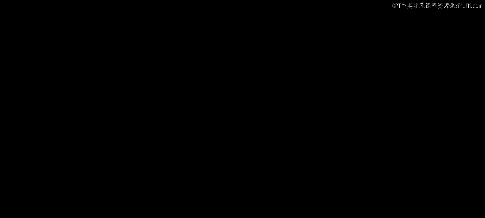
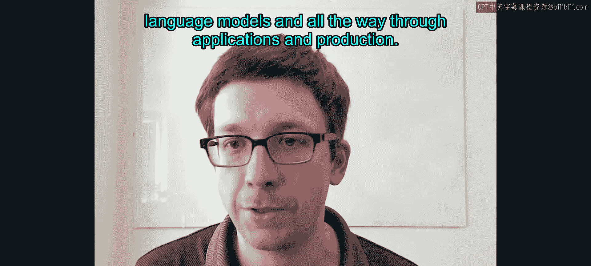
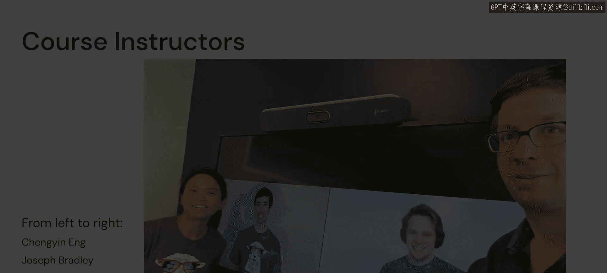
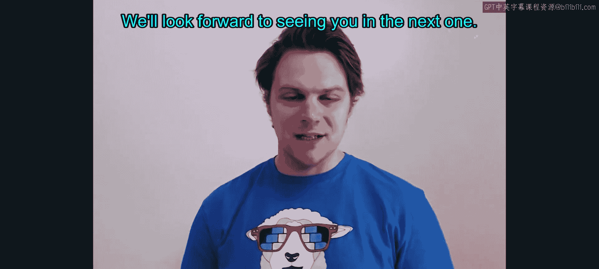
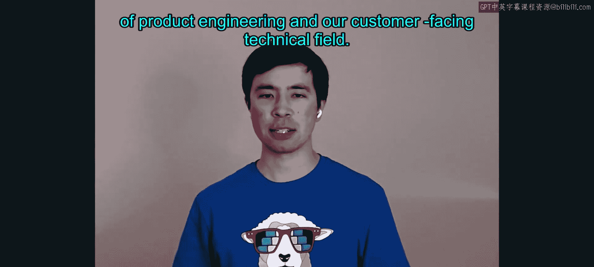
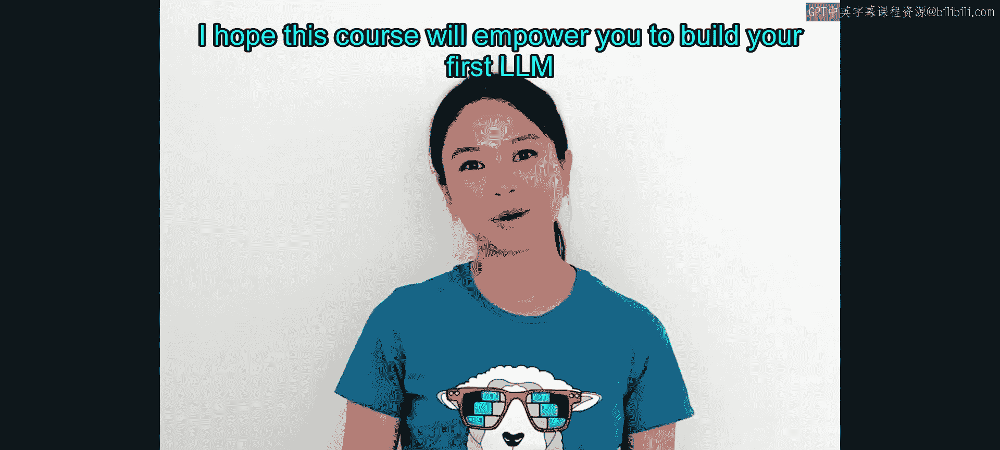

# databricks《大语言模型：从生产到应用｜Large Language Models： Application through Production》 - P1：-01-LLM Module 0 - Introduction _ 0.1 Welcome.zh_en - GPT中英字幕课程资源 - BV1nS411K7Af

Welcome to our course on large language models everyone， I'm Mattteza Haria。

 I'm a cofounder and chief technologist at Databricks as well as an associate professor of computer science at Stanford where I've been working with large language models retrieval and other tools in the system and we're really excited to bring you this course on using large language models and all the way through applications and production I'm joined by three other really fantastic instructors for this course。

Hi everyone welcome to this fantastic course my name is Sam Raymond I'm one of your co instructorors and a senior data scientist here at Databricks Pri to joining Databricks I spent about 10 years in research in AI starting with my PhD at MIT and focusing on areas like physics informed machine learning My latest research looked at how we can predict carbon sequestration using agricultural data and AI I hope you enjoy this course We' look forward to seeing you in the next one。

😊。

Hi I'm Joseph Bradley， a lead product specialist at Databricks I got into ML during my PhD at Carnegie Mellon followed by some research at UC Berkeley then in 2014 I joined Databricks as a second ML engineer initially I worked on ML and Apache Spark as a committer and PMC member then the next few years I helped to build out our ML product and platform in the most recent few years I've been working at the juncture of product and engineering and our customer facing technical field。

Hello I'm Chen Eng I'm a senior data scientist at Databs I've been in a field of machine learning for over six years my journey in natural language processing started in grad school at University of Massachusetts Amherst one of the hardest computer assignments that I had to do was to implement a base transformer from scratch until this day I still remember the late nights that I pulled and how I went to sleep dreaming about Sesame streets because of Elmo and B。

Since then I've developed and taught a field classes in NLP at Datas。

 I also help customers implement and design the architectures for NLP solutions I hope this course will empower you to build your first LLM application and beyond。

