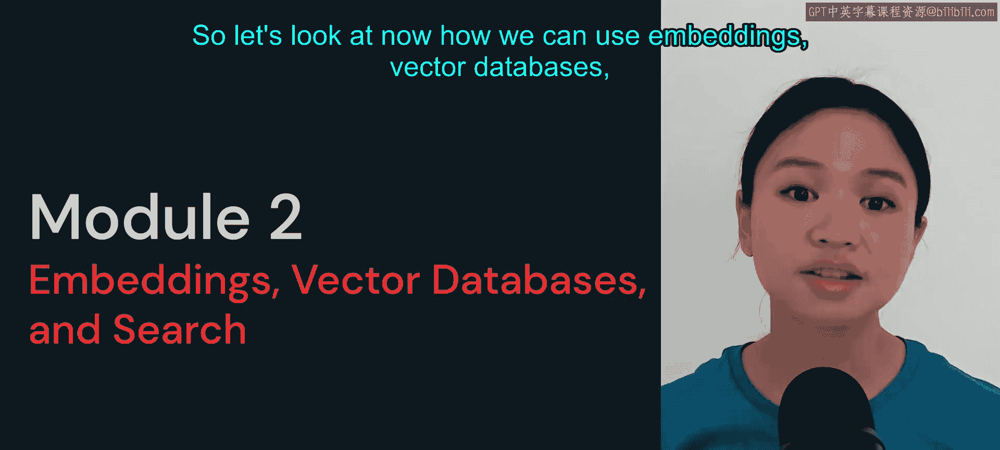
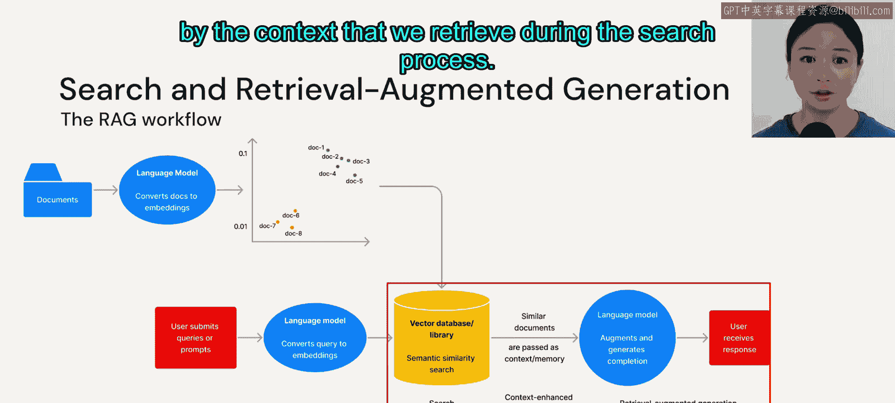

# databricks《大语言模型：从生产到应用｜Large Language Models： Application through Production》 - P20：-20-LLM Module 2 - 2.2 Module Overview.zh_en - GPT中英字幕课程资源 - BV1nS411K7Af

You just heard from Ote that large language models are reasoning engines and the goal for this LLMs is to process the information and then return that to users as meaningful outputs。

 so let's look at now how we can use embeddings， vector databases and search to help us build question answering systems。

By the end of this module you will be able to understand the different vector search strategies and how to evaluate search results。

 you will also understand when to actually use vector databases versus vector libraries or vector plugins and we'll wrap up this module by discussing the best practices for when you use the solutions and how to improve your search performance and retrieval performance。

There are a couple of ways for language models to learn knowledge the first way that we have seen for years in the field of NLP is to either train a model from scratch or fine tuning an existing model so this means that we're updating a model ways during the training process we will talk more about fine tuning two module later so stay tuned for that。

The second way， which is relatively new and is very tightly connected to prompt engineering。

Wwhich is to pass knowledge as model inputs， I will use knowledge and context interchangeably throughout this module so just know that knowledge and context here really means the same thing and we are going to ask a language model to incorporate the context in the input by passing in the context in the prompts。

So in this module we'll cover， how do we actually find this relevant knowledge to begin with and how do we actually incorporate embedding vectors and vector databases in question answering systems？

Let's first understand why do we even pass context to these language models As I mentioned。

 fine tuning is another way for models to learn knowledge。

 it is also usually better suited for when you have specialized tasks so imagine that now you are studying for an exam two weeks away you might forget about the needtigd details but you probably would have internalized the details a bit better。

On the other hand， passing contacts to the model is like when you were taking an exam with open notes。

 so it'll help you to be more precise because you have the facts right at hand to reference。

The downside though， is that there is a context length limitation for Open AI's GT 3。5 model。

 it allows up to 4，000 tokens， which is approximately five pages of text。

It is really not very long considering most documents out there or even just take the example of employee handbook can be easily over five pages。

 so a really common workaround is to pass in document summaries but maybe also spliting documents into chunks and that is another strategy that we're talking about later on in this module too。

The latest model by Anthropic called Cloud can accommodate up to 100，000 tokens for context。

 it is in preview as of mid May 2023 and with ability to pass in longer context。

 it probably goes without saying that each API call comes with a higher cost and the model will also need longer time to process longer context as well。

So many researchers believe that by increasing the context length alone doesn't actually help the model it retain information between sessions。

 and unlike human brains， it treats every single piece of information in the context as equally important。

 so we will likely need new model architectures to actually solve context problems。

You saw this slide before in a primer， the whole reason we are talking about vector search is because we convert our context or knowledge into embedding vectors first before we can do any similarity search。

 we're also seeing increasing popularity of vector databases if 2021 was the year of graph databases 2023 is probably the year of vector databases but why is that？

Because vector databases is useful not only for text use cases。

 it's useful for other types of unstructured data as well。

 including for your imaging data and also for your audio data as well we convert this images or audio files into embedding vectors we can persist them in a vector database and I retrieve them for a variety of tasks so in this slide you can see that the tasks really range a really wide realm going from object detection to product search to translation question answering to music transcription and to even identifying machinery malfunction。

Let's go through a few more example use cases on vector databases。

 so with vector search we can calculate the similarity between the vectors。

 this is incredibly helpful to build knowledge based Q&A systems and it also gives us the ability to find duplicate kit items as well。

We also see that in the industry people use vector search and V databases to build recommendation engines。

 so here is an example blog post published by Spotify that talks about how they actually use vector databases to help them build a recommendation engine for podcast episodes based on user queries。

And lastly， we can also use vector databases or vector search in general to find anomalies and detect security threats。

Now that we have surveyed the landscape of why vector search and vector databases can be useful。

 let's go over the workflow of how you actually implement a Q&A system。

A knowledge based question answering system typically conceive of two components。

 search and also retrieval。 But to begin with a question answering system also assumes that you have some knowledge base that you can work from。

 which is。The red box in this diagram over here。So we first have to convert our knowledge base of documents into embedding vectors and then we store this embedding vectors into a vector index。

 either through a vector library or a vector database。

A vector index is simply a data structure that facilitates the vector search process。

 and we'll talk a little bit more about vector index later on too。

And we'll also discuss the difference between a vector library and also a vector database。

 but for now you can think of all this vector storage solution as a vector store。

So now that you have all these documents stored away as embedding vector in a database or a library。

The next thing that you can do is finally， we can ask users to submit queries against them。

Any user queries that we type in natural language will also have to be converted into embedding vectors by a language model。

After that， we can now search through that vector index that contains our document embedding vectors and then return the text that is relevant to our user queries。

 so this step where we determine which documents are relevant or similar to user queries is the search component in this workflow。

Lastly。After we have retrieved all the relevant documents。

 we can call this documents as context or knowledge we will then pass in this context in a prompt to the language model。

 so it means that our language model now will receive a query that is augmented by the context and eventually generates a text output that incorporates the context。

So this entire workflow is called a search and retrieval augmented generation workflow because the output generated by the language model is augmented by the context that we retrieved during the search process。

