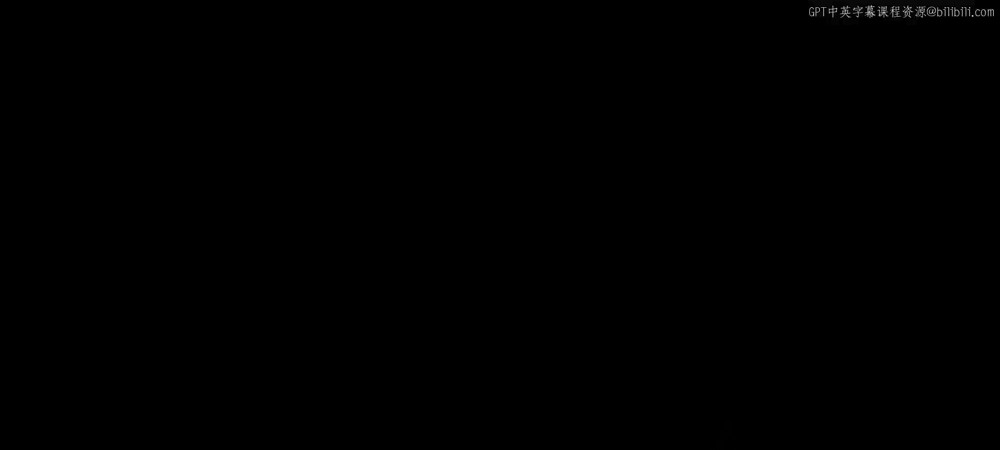
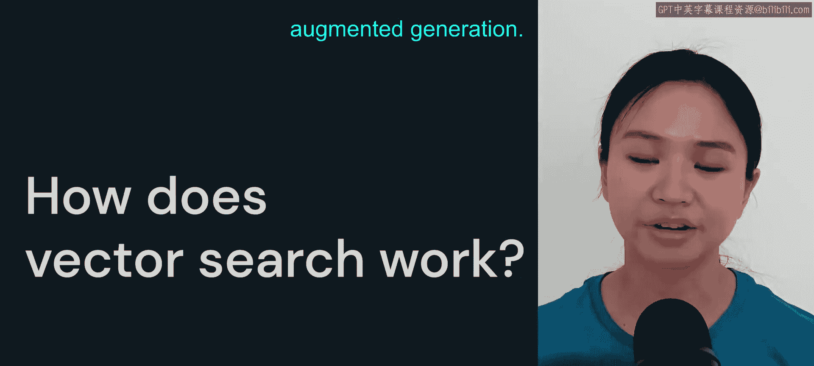
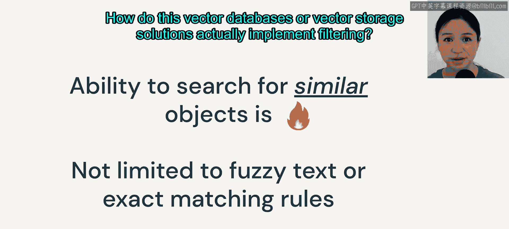

# databricks《大语言模型：从生产到应用｜Large Language Models： Application through Production》 - P21：-21-LLM Module 2 - 2.3 How does Vector Search work.zh_en - GPT中英字幕课程资源 - BV1nS411K7Af

We just talk about the high level workflow of search and retrieval augmented generation。

 let's now talk about vector search。

In vector search， there are two main strategies， exact search and approximate search。

As the name implies， exact search means that you are using a brute force method to find your nearest neighbors。

 there's no room or very little room for error， and this is exactly what the conventional K&N does。

Generally with A&N approximate nearest neighbor search。

 you are finding less accurate nearest neighbors， but you are gaining in speed so here is a list of common indexing algorithms we can call them indexing algorithms because the output of these algorithms is a data structure called vector index so as we mentioned in the earlier segment a vector index helps you to hold all the necessary information to conduct an efficient vector search。

Among all of these algorithms， we see that they can either spend from using tray based methods。

 clustering to hashing。And we'll cover two of them， Ps and HNSW。

 which are two of the most popular algorithms implemented by vector stores。But first。

 let's talk about how do we actually determine if two vectors are similar？

The answer is using distance or similarity metrics。

 and this is probably not a very foreign concept to a lot of you。For distance metrics。

 we commonly see L1。Manhattan Disance or L2 Euclidean distance。

 Euclidean distance is often the more popular choice。

So as you can tell when the distance metric gets higher， then the less similar the vector will be。

On the flip side， we can also measure similarity between vectors by using cosine similarity measure。

When you have a highest similar metric means that you have more similar factors。

It's also worth calling out that when you use either of this L2 distance or cosine similarity on normalized embeddings。

 then they produce functionally equivalent。Ranking distances for your vectors。

If you' are interested in that， feel free to search for mathematicalmatic proof online。

Dense embedding vectors usually take up a lot of space。

 a common method to reduce the memory usage is to compress the vectors using product quantization abbreviated as PQ。

This fancy method called PQ， what it really just essentially reduces the number of bys。

 and quantization refers to how we represent the vector using a smaller set of vector。

So very nively speaking， quantization means that you can either round down or round up a number。

But in the context of Neir's neighbor search。We start with the original big vector and then we split the big vector into segments of sub vectors。

 and each sub vector is then quantized independently and then map to the nearestcentroid。

So say that the first sub vectors is closest to the first centroid， so centroid1。

 then we will replace the vector value with a value of one。

So now you can start to see how we can actually reduce number of bytes instead of storing many floats we are storing a single integer value。

We'll now move on to talking a little bit more about the vector indexing algorithms PI stands for Facebook AI similar search。

It's a clustering algorithm that computes output Euclidean distance between the queryrry vectors and all the other points。

And as you can imagine， the computation time will only increase as you have more and more vectors。

So to optimize the search process， Phis makes use of something called voronoid cells what this does is that instead of computing the distance between every single vector that you have in the storage and the qua vector。

 Phis actually computes the distance between the quarry vector and the centroid first。

Once it identifies the closest centroid to a qua vector。

 then it will find all the other vector similar to that quarry vector that exists in the same vonoid cells。

This works very well for dense vector， but not so much for sparse factor。

The other common algorithm implemented is HNSW， which stands for hierarchical navigable small worlds。

 it also uses Euclidean distance as a metric， but instead of clustering it proximity graph based approach。

There are a lot of maybe gry details over here， but we'll focus on the main structure components that make up HNSW。

The first is what we call as a linked list or a skip list。

 so on the left image you will see that as we go from layer 0 to layer 3 we skip more and more intermediate node or vertices。

We are looking for the nearest neighbor by traversing from left to right and if we overshot we will move down to the next to the previous layer。

 but what if there are just way too many node needing us to build many layers The answer is to introduce hierarchy so let's look at the top right image we begin at the predefined entry point and then we traverse through the graph to find the local minimum where the vector actually is the closest to the query vector。

Now we just went through the vector search strategy and I want to emphasize that the ability to search for similar vectors。

It's actually not a small feat because it opens up the possibility of our due cases by a ton we are no longer limited to writing code that is constrained by exact matching groups in fact。

 when we write exact matches we are using future statements and as we all know SQL filter statements are often not very flexible。

So that's what we're going to cover next。How do these vector databases or vector storage solutions actually implement filtering？

