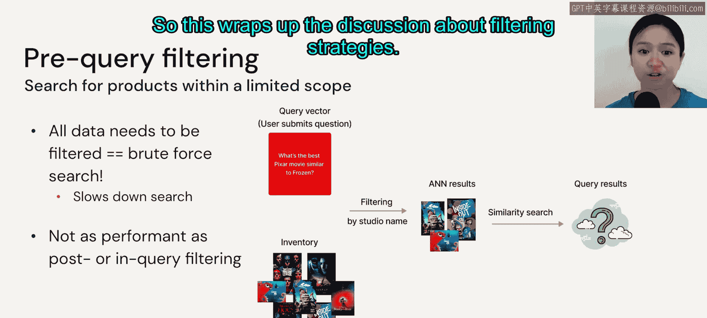
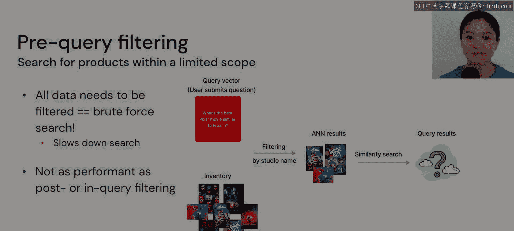

# databricks《大语言模型：从生产到应用｜Large Language Models： Application through Production》 - P22：-22-LLM Module 2 - Embeddings, Vector Databases, and Search _ 2.4 Filtering - GPT中英字幕课程资源 - BV1nS411K7Af

Let's now talk about filtering。As I mentioned before。

 adding filtering function in vector databases is actually quite hard and different vector databases also implement this differently as well。

 there are largely three categories of filtering strategies you can either do filtering post queryry。

 inquiry or pre queryry， but there are also vector databases which implement their own proprietary filtering algorithms grounded in one of these as well。

So take an example of this quarry， I can start by searching for only shoes。

 which gives me the broader selection choices possible。

 and then I can make my quaries more and more precise by adding adjectives like black black shoes in the quarry。

But maybe I finally decide I want to buy only Nike shoes。

So we can view this brand Nike as a brand specific callout in the metadata， and in fact。

 for many online retail websites， we can indeed filter by this metadata， for example， by brands。

 by styles， by price and etc。So a question for you is。

 would you implement the brand filter prior to the query？

What if you don't actually have any Nike shoes in your store。

 should you then return no shoes in your results？Let's go through an nuances of each filter hearinging type in the following slides。

The first is post query filtering。Say that now you are trying to find the best Pixar movie that's similar to frozenzen。

After we identify the top K nearest neighbors order results。

 we can then apply the Pixar Studio filter the upside here is that we get to leverage the speed of A&N but the downside is that a number of results is highly unpredictable and maybe there's no such movie that meet your requirements。

The second type of filtering is inquiry This is quite interesting because the algorithm does both A andN and filtering at the same time for instance。

 when you search the movie again that is similar to frozen but produced by Pixar all the movie data will have to be converted into vectors but in the meantime the studio information is also stored in a system as a scalar field。

 so during search both vector similarity and metadata information would need to be computed。

This can put a rather high demand on the system memory because it needs to load both the vector data and the scalar data for filtering and vector search。

So perhaps when you shop online and when you have used a lot of filters at once。

 you might realize that when you add more filters， the website sometimes may take more time to return to the results。

 so if the memory of the system is limited as you increase the number of filters。

 you might actually hit out of memory issues abbreviated as OOM in this slide。

But this approach is actually quite suitable for row based data because in a row storage format。

 you need to read in all columns in a row at once as opposed to for column storage format that allows you to read in subset of columns of data at a time。

The last type is preQu filtering， this limits similar research within a certain scope。

 what vectors can I actually even consider you know after I apply the filter？

The downside of this approach is that it doesn't leverage the speed of ANN and all data will have to be filtered in a brute forest manner。

 so this is often not as performant as the post queryry method or the inquiry filtering method because the other two methods could easily leverage the speed of ANN。

So this wraps up the discussion about filtering strategies in the next segment we'll talk a little bit more about vector stores。

