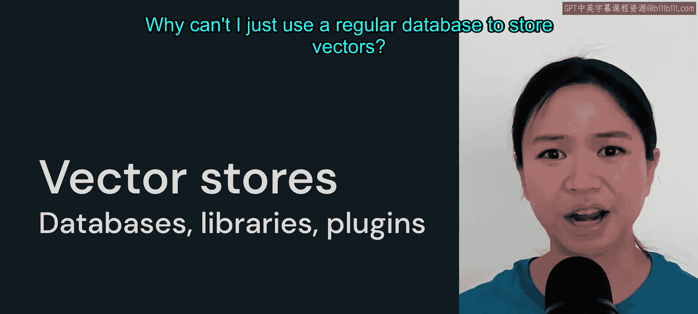
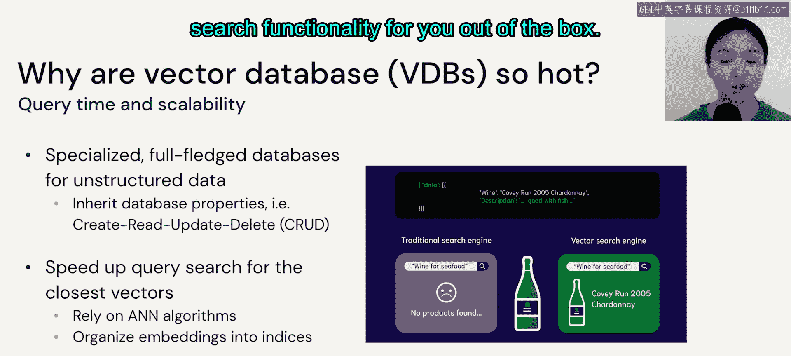
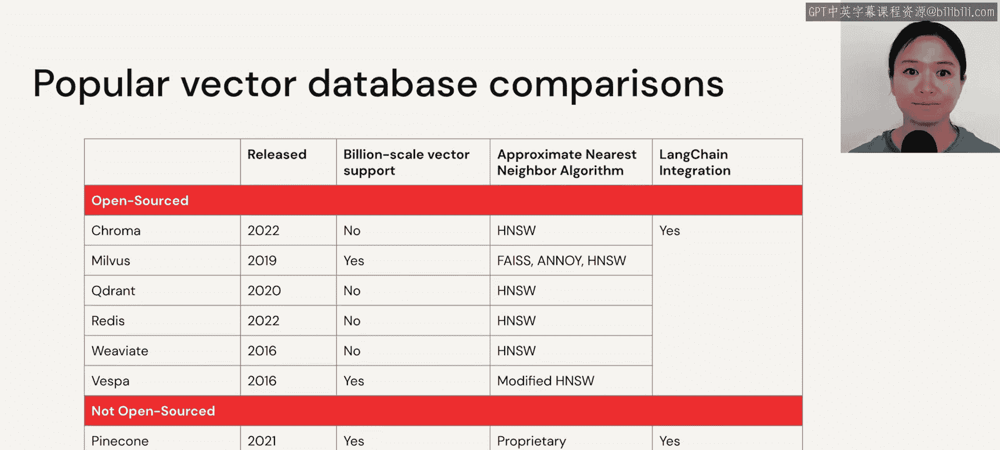

# databricks《大语言模型：从生产到应用｜Large Language Models： Application through Production》 - P23：-23-LLM Module 2 - 2.5 Vector Stores.zh_en - GPT中英字幕课程资源 - BV1nS411K7Af

We are now onto the more practical aspect of how we interface with these vectors The answer is using vector store loosely speaking when I talk about vector store it can include the vector databases。

 the libraries and also plugins on top of their existing regular databases but why do I care about vector stores Why can I just use a regular database to store vectors？

Vctor stores aren't actually too different from regular databases。

 specifically a vector database is actually just like a regular database。

 it inherits full flash database properties like CRUD which stands for Sc， read， update and delete。

But a vector database is specialized to store unstructured data as vectors。

 and in fact the differentiating capability of vector stores is providing search as a service。

 you don't have to implement your own search algorithm。

 vector stores provide search functionality for you out of the box。

But what about vector libraries or plugins？Let's talk about libraries first。

 so vector libraries do create vector indexes for you， and as we mentioned a few segments ago。

 a vector index is a data structure that helps you to conduct efficient vector search。

So if you don't want to integrate with a new database system。

 it's actually completely fine to use a vector library that creates these vector indexes for you。

Typically a vector index can contain three different components。

 the first is an optional preprocessing step that users typically implement on their own where you may want to normalize your embeddings or reduce the embedding dimensions The primary step is where an indexing algorithm is actually involved For example we talk about files and we talk about H NSSW。

And the last optional post processing step is where you may actually want to further quantize or hash your vectors to optimize for search speed。

So a vector library like Ps is often sufficient for small aesthetic data。

All vector libraries do not have database properties。

 so it means that you wouldn't come to expect a vector library to have vector database properties like the CRUD support data replication or being able to store the data on disk or you probably just have to wait for the full import to complete before you can query and it means that it also means that every single time you make changes to the data。

 the vector index will have to completely rebuild from scratch so whether you or not you use a vector database or a vector library really comes down to how often does your data change and whether you need the full flash database properties that comes with vector database or not。

On the other hand， there are also existing relational databases or search systems that provide you vector search plugins。

 they typically have fewer metrics or A&N choices， but I won't be surprised if we will see a lot more vector search support for this plugins even in the coming months。

So now let's talk a little bit more about vector databases or not。So let's start by。

Remembering that whether or not you use a vector database。

 it doesn't affect the speed of your ANN under the hood， the decision comes down to three mains。

Do you have that much data， typically youll only see the need for having a vector database when you have millions or billions of records。

And how fast do you actually need the query time to be， your serving time your latency？And lastly。

 as I mentioned earlier， do you actually need the fullf database properties so if your data is mostly static and you don't expect to update your data all that much。

 then not using a vector database is often a fine start in that case you can often just start by using a vector library。

But if your data changes quickly， it can be much cheaper to offline compute the embedding first and then store it up in a vector database for on demandmand query later this way you can also avoid using an online model to dynamically compute the embeddings。

And of course， unsurprisingly， the cons for adding a vector database to your architecture means that you are going to pay for an additional service and you do have one more system to learn。

 integrate， and maintain。If you are interested in exploring vector databases。

 I've provided some startuper comparisons across the popular choices and note that the information here may evolve over time。

Lastly， we'll wrap up with some best practices。