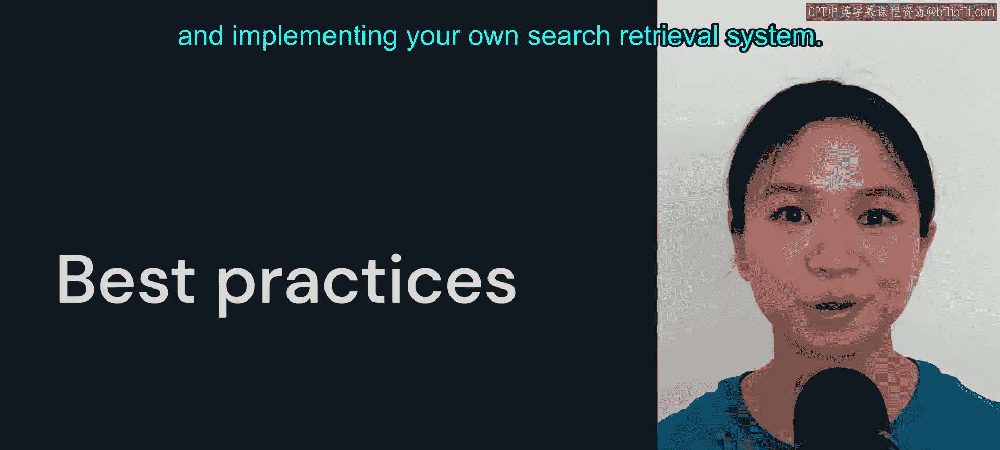
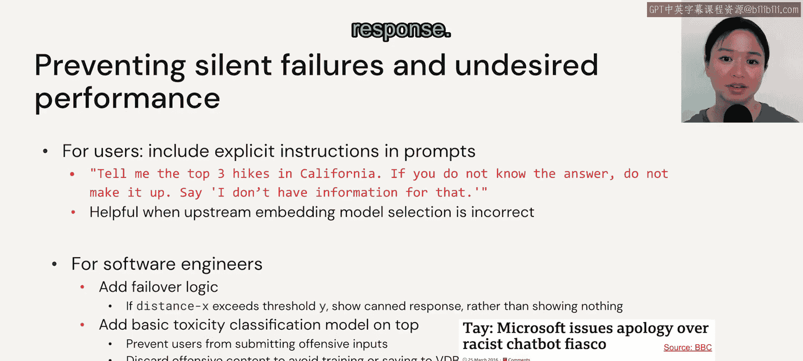

# databricks《大语言模型：从生产到应用｜Large Language Models： Application through Production》 - P24：-24-LLM Module 2 - 2.6 Best Practices.zh_en - GPT中英字幕课程资源 - BV1nS411K7Af

Let's conclude this module with some best practices around using vector stores and implementing your own search retrieval system。

This is probably the biggest elephant in the room whether or not you should always use a vector store。

 and many of you probably have been storeoring your data or your unstructured data， in fact。

 in a regular database and it's probably working well so far so if that's you you don't have to feel like you have to scramble to suddenly include a vector database in your architecture。

In the context of LRMs， whether or not you need a vector store。

 whether it is a vector database or a library or a plugin on top of your relational database。

 it all comes down to， do you need context augmentation？So vector stores extend LOMs with knowledge。

And you can provide relevant vector lookup and therefore extend the context。

So this can be really helpful to help with fact recall as we mentioned。

 and it can also help with the concept called hallucination。

 which is an LM problem that we dive into in module 5。But generally speaking。

There are use cases that probably do not need context augmentation to help effect recall。

 for example， sumization。Your text classification use cases， including sentimentalizes。

And translation， for these use cases， you probably should feel safe enough to not use vector store。

How do you improve retrieval performance then to allow users to get better responses？

At a very high level there are two different strategies。

 one is regarding your embedding model selection， and a second it has to do with how you store your documents。

Let's start with embeddings tip one， you should absolutely choose your embedding model wisely a proxy question that you can ask yourself is。

Is your embedding model currently？Train on the similar data as yours if the answer is yes。

 then good news， you can keep using the embedding model。But if the answer is no。

 then you have two options over here first is to look into using another pre trend embedding model。

Or the second is to either train your own embeddings or fine tune your embeddings based on your data set。

The lateral approach over here has been around in the field of NLP for years。

 it is a very established approach and we used to talk about ferium bird and em beddings all the time before the hype of chat GPT or chatbot surface。

Tip two， make sure that your embedding space actually captures all of your data。

 including your user queries as well。For example， if your data is about movies and you ask something about medicine。

 then the search retrieval system would definitely have a bad performance。

So just always make sure the documents in your vector database actually contain relevant information to your queries。

So similarly， use similar models to index your documents and your queries if you want them to have the same embedding space and the same embedding space is really important if you want relevant results to be returned。

Now on to document storage strategy。I'm going to preface all of this with a caveat that how to best store your documents is still not very well defined。

 but I'll share some points for your consideration。When it comes to document storage。

 we have two choices， one is either to store a document as a whole document or we can store a single document by chunk。

 it means that we are splitting a document up into multiple chunks so each chunk could be a paragraph could be a section or could really just be anything that you arbitrarily define it means that one document can produce many vectors。

And your chunking strategy may determine how relevant is the chunk that's returned to the queryrry itself。

But you also need to think about how much context or chunks can you actually fit in within the models token limit do you need to pass this output to the next LOM？

So passing outputs to another LOM is something that we haven't touched upon in this module。

 but we'll talk about it in module three。So as an example， if you were to have four documents with 2。

000 tokens in total， it could be that each chunk has roughly 500 tokens that would be to split the document evenly。

But know that chunking strategy is highly used case specific in machine learning。

 we talk about how developing a model is usually an iterative process。

 and you should absolutely also treat chunking strategy as in the same way as well。

 experiment with different sizes and different approaches。

How long is your document is your document with single sentence or many， many sentences。

 if a chunk is only one sentence， then your embeddings will only focus on specific meaning for that particular sentence。

But if your chunk actually captures multiple paragraphs。

 then your embeddings would capture broader theme of your text。You can split by headers。

 you can split by sections， you can split by paragraphs。

But you should also consider the user behaviors as well。

 Can you anticipate how long the user queries will be if you have longer queries。

 then there is a higher chance for the query embeddings to be aligned better with the chance their returns。

 but if you have shorter queries， then they tend to be more precise and maybe。

Having a shorter chunk would actually make sense。So as I mentioned。

 chunking best practices are not very well defined。

 but here are some existing resources on this topic that you can read about in your own time。

Now say that I choose the wrong embedding model and my chunking strategy was not good Can we actually add some guardrails to prevent silent failures or undesired performance？

So for users。It will be helpful for you to actually include explicit instructions in the prompts as we discuss in module1。

 where you can tell the model not to make things up if it doesn't know the answer。

 so this can help you to actually know where the model limitation is rather than relying on unreliable outputs。

But for software engineers， there are a few things that you can consider first is to maybe add a fillover logic。

 like if the distance X exists threshold， then maybe you have to show a generic list of responses rather showing nothing so going back to the Nike example if there are no Nike shoes return。

 then probably you can show a generic list of most popular shoes that users can buy。

In terms of toxicity or discrimination or exclusion。

 you can also add a basic toxicity classification model on top to prevent users from actually submitting offensive inputs。

In 2016， there is this chatbot release by Microsoft called Tay that actually became a really racist chatbot because users start submitting racist remarks。

 so by having some guardrael model on top will help prevent a chatbot from functioning differently as you expect。

And you can also choose to discard all the offensive content to avoid retraining or fine tuning on this offensive content。

And， lastly。You should also can think about configuring your vector database to actually time out if a query takes too long to return a response。

 maybe this indicates that there are actually no similar vectors found。

