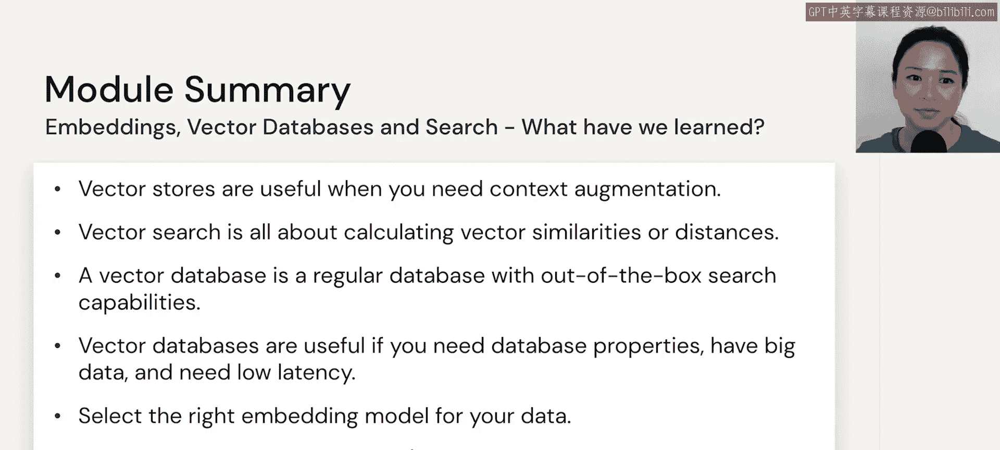

# databricks《大语言模型：从生产到应用｜Large Language Models： Application through Production》 - P25：-25-LLM Module 2 - 2.7 Summary.zh_en - GPT中英字幕课程资源 - BV1nS411K7Af

In this module we have talked a lot about embeddings vector search and also vector databases。

 let's now do a quick recap。Vor stores can include vector databases， vector libraries。

 and also search plugins on top of relational databases。

 they are only useful when you need context augmentation and not all text use cases need that。

When we talk about vector search it' all about calculating vector similarities and distances。

If you're trying to decide whether or not to use a database for vectors。

 just think of a vector database as a regular database with all of the bot search capability。

They are only useful when you need database properties， have big data。

 or if you have very stringent serving latency requirements。

For a good knowledge based search retriever system to work well。

 you need to select the right embedding model for your data。

 and you will probably need to iterate upon documents spliting or chunking strategy。

So that wraps up the lecture portion of this module is now to look at some code together。

