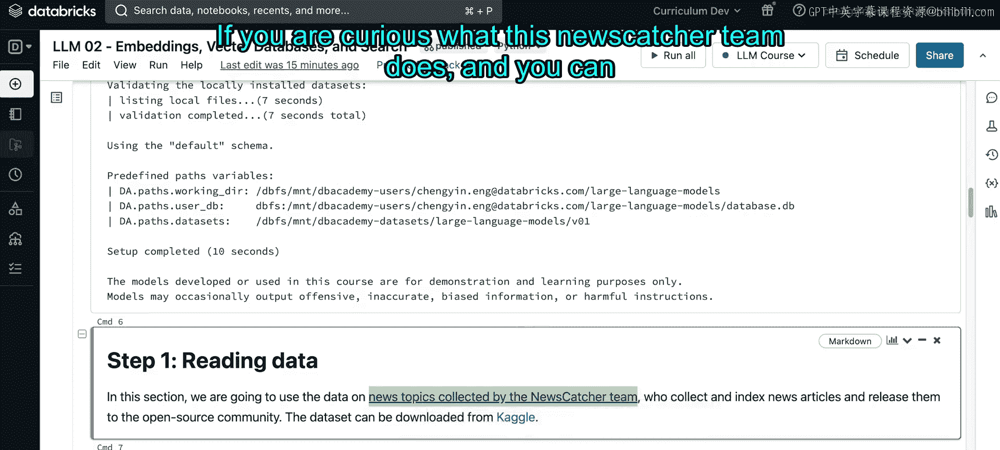
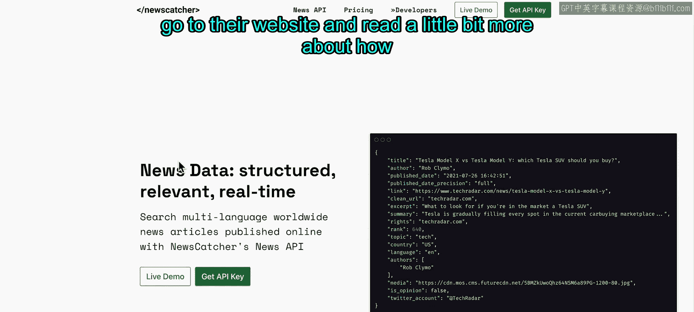
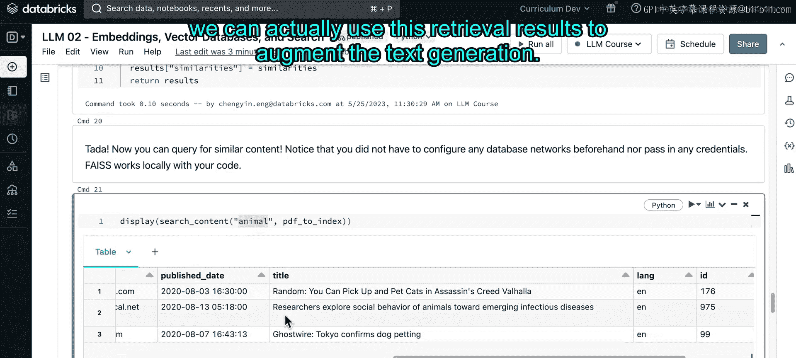

# databricks《大语言模型：从生产到应用｜Large Language Models： Application through Production》 - P26：-26-LLM Module 2 -  2.8.1 Notebook Demo Part 1.zh_en - GPT中英字幕课程资源 - BV1nS411K7Af

In this LM02 notebook， we'll be looking at how we can convert text into embedding vectors。

 save these vectors into a database， and then conduct search on top。

There are two different vector store solutions that we'll be exploring in this notebook。

 the first is Spice which is a vector library， and second is Chroma DB and open source Ve database。

By now you should be pretty familiar with this search and retrieval workflow that consists of two different components。

 the first is the search step and a second is the retrieval augmented generation step。

And both of those steps are contingent upon having some knowledge space to start from。

Without further ado， let's look at the code， we are going to first install a few dependencies for your notebook to run successfully throughout so go ahead and run your CMD3 and CMD5 I'm using the keyboard shortcut shift enter to run each of this cell over here。

And you may also notice that they take a little bit of time to set up。

 so feel free to pause this video and return to this when you are ready。

Now I can see that my classroom setup cell has finished running。

 we can go ahead and proceed with the rest of the notebook。First。

 we'll start by looking at the data that we will be using。 It is this data set called news。

Topics collected by the newsketer team， if you are curious what this newskeer team does。

 you can go to their website and read a little bit more about how they actually scrape the data。

Now let's look at what the data set actually looks like。So notice that we are reading from da。path。

 dataet if this cell does return you any error due to this path。

 just know that you can easily fix it by going to the classroom setup cell over here and run it。

 which。Instant shapes all of the environment variables that starts with the DA。

So in this result over here， we can see that this data consists of over 8，000 rows。

 and each row over here tells us a little bit more about each news article。

 ranging from the topic of the news， where it's scriptd from， when was it published。

 the title of the news article， the language， and also the ID for each news article。

So this ID over here will come in handy later on as we。Convert this。

Each of the rows over here into a single vector， so we will also call this as a vector ID later on as well。

Now let's look at FI， so we mentioned in the lecture that PI is a vector library and it's a library that conducts approximate nearest neighbor search。

As a quick recap， approximate nearest neighbor search is often preferable to brutefor search because it allows you to find the right balance between the recall tradeoff。

 the latency， the throughput， and also the time to find the top key nearest neighbors as well。

FI has a pretty good documentation page on their Github repo。

 so I highly recommend you checking it out if you want to learn more about FIS， if you scroll over。

All the way to the top， you will recognize that on the right hand side of this page over here。

 there are lots of sections that contains information on how to get started， how to use lower memory。

 how to run this on GPUs， the different metrics， and also the different indexing algorithms that F has implemented。

There is also a best practice guide published by PI as well under the same GitHub report。

Now let's briefly look at the overall overall workflow of FIS so you can see that the workflow is color coded into different components。

 the first is when we actually encode the data or the documents into embedding vectors。

 so you will see that for each text document that you have。

 we pass it through an encoder which vectorizes your text which means that it's converting your text into embedding vectors and then store it in FIS。

Remember that Fi is a vector library and it stores every document or the data that you have into a vector index。

So the vector index， don't confuse it with a vector ID that will be mentioned above over here where each document can have its own ID。

 so vector index that we're referring to over here is a data structure that holds all metadata that allows you to conduct efficient vector search。

AndF stores all of this index in memory， or you can also call it on GM。So later on。

 you will realize that with FiS， it's really lightweight and easy to use。

 you actually don't need to pass in any database configuration because there's no database involved。

So the second component of this workflow is after you have the data stored in the vector index。

 the users can now pass in their search queries and similarly the search queries will also be passed into an encoder that vectorize their queries into a vector and then we can apply some search algorithm on top to return us the relevant results。

 so this is what F does under the hood when we call F。

Now let's look at the following cell CMD 10 over here we be using a library called sentence transformformer sentence transformer is a Python framework for state of the art。

 sentence text and even image embeddings。We'll only be using the first thousand rows of the new data set to speed up the rest of the notebook execution。

What this function does is to simply convert。The input text into a data structure that's accepted by sentence transformformer。

 which is known as an input example。If you are curious what the five trend examples look like。

 we can easily take a look now and then now we are going to just look at what。

Train examples look like， which is a list of input examples。

The next step is to vectorize text into embedding vectors。 So this is actually where。

We are going to call encoder to transform all of our text into embedding vectors。

 so you can see that we are using the model， this particular model from sentence transformer。

 we're caching this model to a cache borderr and then we're applying an encoder on top。

Of the documents to transform this text into vectors。

And now we are going to check the dimension of the vectors over here。

So you can see that we expected there will be 10，000。

 sorry100 rows altogether because we are only looking at the top thousand news articles and then each vector has 384 dimension as the embedding vector。

So now let's look at the third step over here， this is actually where bulk of the work is actually happening。

 so you see that finally we are passing these vectors to PI where PI actually does the indexing for us。

So let's look at this line by line， so you can see that from this data set that we have over here。

 we're actually collecting all of the vector IDs into an array。

And the vector IDs refer to the ID that corresponds to each news article， so you will realize that。

This pandas index that we are getting。We are using that as the ID column。And then all of the IDs。

Is now stored in an array。 So this in I D index over here is an array that has。All of the vector IDs。

And the next thing that we will do is to actually normalize these vectors。

But why do we actually normalize these vectors so generally whether you normalize embedding vectors or not doesn't really matter because the magnitude of each embedding really doesn't make a difference。

 but just know that when you normalize these vectors it doesn't really change the ranking of the results。

 but in this context we can normalize it to unit length so that the dot product that will go into a little bit more later on will be equal to a cosine similarity。

Now let's look at the followinging line over here， Line 12 contains two API that can look quite foreign to you。

 so just know that when you see index over here， it really just refers to the P index which is the vector index that stores the data structure that contains on the metadata to help you search for vectors。

So let's look at this first API call over here first and within this API call you will see that we are passing in the dimension of our embedding vector and this index theory that we are using is called flat IP so let's look at IP first what does IP actually stand for so IP stands for inner product。

Which means that by calling this API， we're actually maximizing the inner product between the query and also between and the items retrieved。

The reason why it is called flat is because PI is actually storing all the vectors without any compression。

 so it means that the storage size is the same as that of the original data set。

 but there are also other indexing algorithms implemented a ice that actually has vector compression。

 but when you see flat you should know that this indicates no vector compression is involved。

And in fact， index flat IP is quite a common choice for as a baseline algorithm to evaluate vector search results because there is no vector compression。

 then we can compare easily the results of search to another indexing algorithm that actually has vector compression。

So as a quick recap， that fires as many， many indexing algorithms and each index subclass over here implements its own indexing structure。

And in this case， we're using an inner product algorithm where we don't have any vector compression involved。

You will also notice that in this index flat IP。It doesn't require any parameters like。

Whether you want to include product quantization or to customize your business metrics。

 because this is pretty self explanatory that we are using in a product over here as the metric。

And there's no training involved in this index flat IP。Now。

 before I go into talking about what index ID map actually does。

 let's first motivate why by looking at what what results we will get by just running the code up to the point of index flat IP。

So I'm going to copy this code up here。Put it in a different cell。

And I'm actually also going to grab this。Line over here。And I name it as index。Ft。

And you will see that this。Run just fine， it runs successfully。

 now I actually have my index structure that holds all the metadata between the vectors。

And now I'm also going to reuse this line。And I'll explain a little bit more what this line actually does later on。

So you will see that the error that we're getting over here says that this particular type of index doesn't actually have this function or method implement the call add with IDs So what add with IDs does it just means that we are copying the index structure over here to the internal storage of the index and there is absolutely no processing involved the vectors but you can notice that this takes in two different arguments the first is the actual vectors themselves and the second is the array of vector IDs that we actually collected in the beginning where you see line5 over here where all this is is the array of vector IDs corresponding to each。

Document or the news article that we have in the data。

So this brings us to the reason why we actually need this intermediate API called index ID map。

So index ID map is merely a function to maintain a mapping between your vectors and also your vector Is。

 So this means that。Now that we're able to provide the mapping between the ID and also the corresponding vector。

We actually don't have to use sequential indexes， so if we were to remove any vectors。

 the vector IDs actually wouldn't be shifted。So now let's run this out。

And you will see that by having this index ID map， indeed our code is running just fine without any errors。

So now we have just implemented the workflow。Of。Converting our data into data vectors and then saving all of this。

In a vector index， facilitated by fi。Now let's look at the following component。

 which is search notice that in line two and line three over here。

 we're also passing our queries to the encoder and normalize the embedding vectors as well。

 so just know that it's very important for you to apply the same preprocessing steps to both。

Your documents and also your queries。So this is important to make sure that the embedding space generator is the same for both。

 and then you will actually get relevant results later。And the following lines over here is just。

Implementing functions to help you search for the top K nearest neighbors。

 So let's go ahead and run this cell。And now， finally。

We can actually pass in any text that we want to search for and then return the relevant documents so you can see that here we can verify。

The types of documents that are being returned， and indeed。

We are seeing news articles related to animals such as about cats。

 about animals and infectious diseases， and about dog petting。So so far。

 what we have done is simply retrieving relevant context to our queries。

 but we haven't used a language model to help us generate any new output or new text。

In the next section， we are going to take this one step further。

And incorporate a language model together with Cha Db and look at how we can actually use this retrieval results to augment the tax generation。

