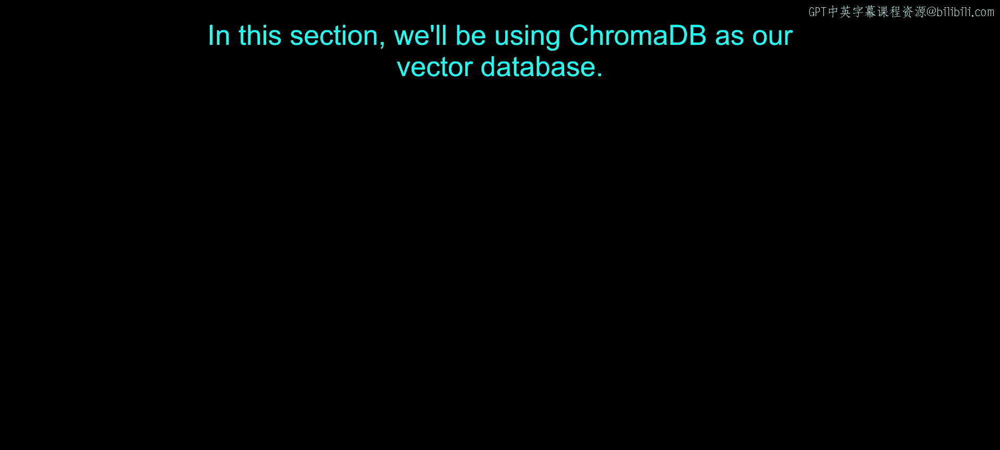
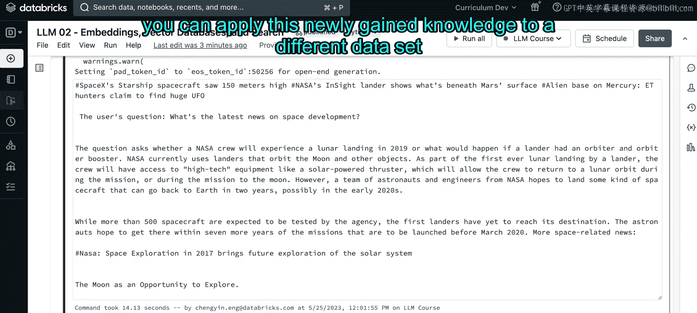

# databricks《大语言模型：从生产到应用｜Large Language Models： Application through Production》 - P27：-27-LLM Module 2 - 2.8.2 Notebook Demo Part 2.zh_en - GPT中英字幕课程资源 - BV1nS411K7Af

In this section， we'll be using Chroma DB as our vector database。Let's go ahead。

 run this very first so。You will notice that without me passing in any additional settings。

It tells us that it is using this Ch client without any data persistence。

 it means that all the data will be transient or it will be ephemerural this makes it really easy to prototype any scripts because you don't have to worry about where you want to persist your data。

But say that if you do have a use case in mind and you do want to process the data。

 the what you can do easily is to pass in additional settings arguments over here and specify your user directory where the data should be stored。

So now by passing these additional settings， you are making Cha persistent so you can reuse the collection that you create and add more documents to it later。

 we'll define what collection means later。So now this cell will allow us to load our data automatically when you start the Car and then save it automatically when you close it because we have passed in the directory where we should process the data。

Let's talk about what collection actually means， so collection in Chma is akin to a vector index that stores a set of your documents。

Formerly defined by Chroma， collections are where you will store your embeddings， your documents。

 or any of the additional metadata。So over here in the next cell。

 we are going to define what collection name we'll be using。

 and since our data set is about news articles， we are going to name it my news。

And also just know that Cha uses collection names in URLls。

 so any of the restrictions in URLls also apply here so you can read more about。

The different rules in terms of collection names in their documentation。

So here we are going to first check that the collection hasn't existed before， if it has existed。

 then we'll delete it first and then we'll create a new collection。

If you are interested in additional arguments that you can pass into create collection。

 you can also consult the documentation， but one of the optional argument that you can provide is actually the distance method so you can customize the distance metrics that Cha uses under the hood。

Next， we're going to actually add data to our collection。So just as a query refresher。

 we look at what the data set actually looks like， so you can see it's about news and。The titles。

 the language， and the topic， and also when it is published。

In this cell over here we are going to add the documents to this collection and as I mentioned earlier。

 Qma is really easy to use because you can easily store it can actually help you handle how to store your text and how to tokenize and generate embeddings and indexing automatically so here we're not passing any custom model and we are relying on a default model that is used by Chma under the hood。

So you will see that in this API call over here， we're supplying the documents。

 which is the this data that we have， the PDF subset data。

 and we're also going to name our topic as a metaada。

We're also going to pass in the IDs for each of the news articles over here。

So now that if you want to supply your own embeddings。

 you can actually easily do that by just adding an additional argument over here and then add your own embeddings here too if you don't want to use the underlying embedding model used by Chroma。

So the reason why we use metadata over here is that you will see that we can actually use some future statements on top of all the metadata that we have provided to each document that we have added to the collection。

So let's go ahead and run this cell over here to formally add all of the documents in the data set to this particular collection。

Now that we have added our data to the collection， we can now query for any relevant documents on particular topics that we're interested in。

For example， if I'm interested in any articles of our space。

 I'm going to put in my query test over here。And then I'm going to define how many nearest neighbors I would actually like to see in the results。

So here I'm seeing auto vector IDs。Corresponding to each document or each news article in the data。

And then I can also see that this is the actual text in a document where we read something about NASA or retail space and the mission to find life on Mars and so on。

 so we know that indeed，ChromaDb is working for us。

 is finding relevant documents about space and is returning us the top 10 results。

And we can also see that in the metadata， the topics of these news articles range from technology and science。

 which is not surprising。And you will also see the distance metric in the result as well。

So let's now see what database properties does ChmaDB actually allow us to add on top of a regular vector index。

 so we mention in the slides that filtering statements is actually not as easy to implement as you would imagine and a lot of different databases can implement it differently and notably a lot of vector libraries will not actually have the capability of doing filtering。

So here is one capability that ChmaDB has， which is to filtering。

 so you will see that when we actually do query tags in addition to just applyinging the topic itself。

 the space， query， and also the nearest neighbors，I can also additionally pass in a future statement where we specify the topic should be science。

 so we should not be seeing any more results if it's from the technology topic。

So let's try if this works。So now you will see that indeed。

 all of our results are coming from the topic of science。

Another bonus capability that's enabled by vector databases is how we can use CRUD。

 which stands for create， read， update and delete， and again that is something that is not supported by a vector library because vector libraries do not have full Fged database properties。

So here let's look at some examples of how we can update the data in the collection。For instance。

 we can delete a specific vector ID which corresponds to a specific document from the collection directly。

And then we can check that in， in fact， this collection。Within this collection。

 document ID where ID0 indeed no longer exists after we have deleted it。

We can also easily update a specific data point as well。Know that here we are seeing ID2。

 getting ID2 and we know that existing topic is science。

 but maybe this initial data record is actually wrong and I would like to update it to the technology。

And to check， I'm going to rerun this cell。And verify that indeed。

 my metadata now is showing technology。So up to here， we have pretty much demonstrated。

How we can use vector database to conduct search for us and finally we're going to take it one last step further to actually provide this context into our queries。

 so this is where we actually will be using a language model to help us generate new text based on the context that we have passed in。

Were going to be using an open source model from Transformers， which is GPT2 over here。

 but you are also welcome to use other libraries such as open AI as well。

 and if so you do need to get an open AI token and then pay based on the number of tokens that you have passed。

So here we're going to be using a pipeline called tax generation。

So a lot of this code you should have seen in the previous module as well。And finally。

 you get to start to experiment with your first prompt engineering and prompt engineering is really the art of developing prompts。

 there's no one right answer to how you should write PR。

 so feel free to experiment with how we write prompts in the later cells as well。

So here I'm going to ask a question about space and the question is what is the latest news on space development and you will notice that in my context I'm actually passing in all of the results。

Relevant results that I' searched。From the previous step。And in my prom template。

 I'm starting with a very basic prom template which tells the model。

 what is the relevant context and what is the user's question。And then I'm going to pass this in。

To the tax generation model。And you will see that now the language model is working hard behind the scene to give us a response。

To the answer， to answer what is the latest news on space development？

So you will see that you prints the relevant context that we have supplied。

 and then what is the user question？And then it generates some new responses based on the text that we have provided about the news on space development。

Congratulations， you have just completed the implementation of your first search and retrieval augmented generation system。

 so you can see that it is pretty easy to get started and perhaps the most time consuming portion of this approach over here is to figuring out what prompts you should actually provide。

To for you to get the best results。Now I invite you to turn over to the lab notebook where you can apply this newly gained knowledge to a different data set altogether。

