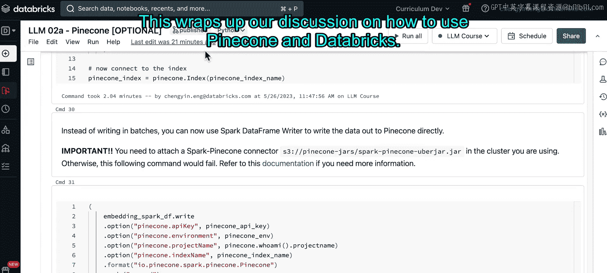

# databricks《大语言模型：从生产到应用｜Large Language Models： Application through Production》 - P28：-28-LLM Module 2 - 2.9 Notebook Demo Pinecone - GPT中英字幕课程资源 - BV1nS411K7Af

In this LM02A notebook， were going to be using a cloud based vector database called PineCon。

It has a freight here that we can gain access to， which is what we'll be doing shortly。

 it's a cloud based database solution that offers us a lot of simplicity and scalable similarity search。

Before we get going， make sure that you have a couple of dependencies installed。

 the first is the P con kyen and the second is a spark connector jar file。

You will need to attach this jar file onto your datab cluster if you need more directions。

 feel free to consult the documentation linked here and also pause this video if you need some time。

If not you can go ahead and install the PCon client and also run a classroom setup script。And again。

 feel free to pause this video and come back once you are ready with your classroom environment once the classroom setup script is done。

 we can now proceed to set up our pine con。Freed ti account。 so you can go to their homep page。

Click on the top right corner over here to sign up for a free account。

And then once you are in the console， you will be able to navigate to this API key section where you can copy two different values first the environment value。

 second is your API key。Copy both of those values and put them in the cell below。

 where it says fill in。For me， I'm going to grab my P con credentials from Databak's Secret Sccope。

And then。Initiate the client with pineco。Next we are going to read in the data frame that we'll be using for this notebook。

 which is the same data that you have seen in the lecture about news articles。

For PCone we need to generate the embedding first before we can save it out to Pinecone indexex。

 and there are two ways of doing it we'll go through both of them。

 the first is using Pannda's data frame， which is when we apply a single node embedding model and then write the data out to Pcone in batches。

That process can also be called as absurd。The second method is to stick to a spark data frame as we have originally。

 but use Pdas API。Through Pandas UTFs to help us apply the embedding model on batches of data。

So let's go through the first method。We are going to be using a subset of the data frame to speed up the rest for notebook execution。

If you have used PCon before， you will need to delete the existing index before you can create a new PCon index because the PCon free tier only allows for one index。

And just like a lecture in the book， we'll be using a sentence transformer library。

And I will cache it to a folder。CMD 18 here contains the command to delete the index if it has already existed before。

Next， we can finally create a P con index。In this creation step， we will specify the index name。

Which is what we have specified above。And then we're also going to specify the embedding dimension here we're getting embedding dimension from the model itself。

We can also optionally choose to specify the similarity metric as well。

Here we'll stick to cosine similarity。And then we can finally establish a connection to the Pinecom index。

This is a step that might take up to three minutes。

 so if you see this running command for a long time， don't worry you're not stuck。

Now let's look at the following cell， once the index has been created。

 we can finally write data out to the Pine cone index。

Here you can see that since we are using app panda data frame。

 we are going to loop through batches of。Data on records in the panaceator frame itself。

And you will find that this workflow is not too different from the lecture notebook where we first create a list of the IDs for each of the news articles。

 and we also provide the metadata for each news article。

Follow by generating embeddings for the articles that we have， and then finally insert them。

To P con index。Indeed， you will see that we have a00 vectors in total in the PCon index because we only have provided P con 1000 records to write out。

So now that all the vectors are available we can query the index directly。

 you will see that I am writing a query about fish and the same process also follows on my query as well where the query is first converted into a vector and then it can be submitted to P cone to retrieve any relevant context and here we're only looking at the top three nearest neighbors。

And indeed， we're seeing relevant results being returned to fish。

 such as news about massive fish kill about sharks and the earthworm gym。

 so this could indicate that all of the thousand articles that we have。

 there are just not that many news articles about fish after all。

The second method is to stick to using a Spark data frame。

 but use Panndas UDF to process the data frame and convert the text into vectors and then lastly write it out directly to highchooling using Spark。

So Panda's UDF is a type of vectorized UDF that allows you to apply a function on batch of data at a time。

If you're interested in reading more about Panda's UDF。

 I invite you to check out the documentation that I've linked in this markdownsell。Generally。

It is a very efficient way of using。Spark because you are able to preserve your panda syntax within your pandas UDF。

 but allow Spark to distribute the function across the entire data frame。For instance。

 in this cell here， we are using app pandas UDF where we load a model。

And then for each batch of the data that we have sent to a Spar。

 it is going to convert the text into embedding vector。In this following cell， we are going to。

Pass our Pda UDF function to the sparkk data frame as you can see over here。

 this is the panda UDF function that we have defined and then we have also supplied the name of the column that needs transformation and then we are renaming this column to vector。

We're additionally constructing two new columns that is expected by Pcon。

 namely namespace and also metadata in a namespace column we are going to put in the type of a transformer that we have passed in and in metadata we are going to supply the topic information。

Now that we have the data frame available， we can inspect the results so we see there are four different columns。

 ID， embedding vectors， the namespace column and lastly the metadata column。

Now we are going to repeat the same step that we have done before in method one to delete the existing index and recreate the index if you remember from before。

 this is a step that can take up to three minutes。After you have successfully connected to PCon indexex。

 we can now proceed with writing data out to PCon Inex here we are using the Spark data frame writerer method so you can see that we are no longer observing the data in batches。

 rather we're passing in the entire Spark data frame。

You will also need to supply the credentials to connect to Pycon as well。

 so go ahead and run the cell。Also know that this is very important for you where you actually have a spark P con connector if you don't have it ready in the cluster。

Then this cell would fail。This drops up our discussion on how to use Pcon and datas。

