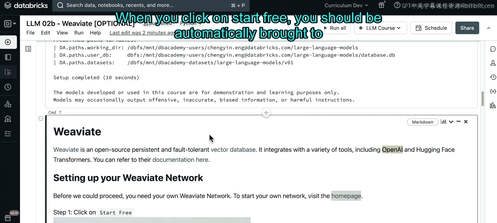
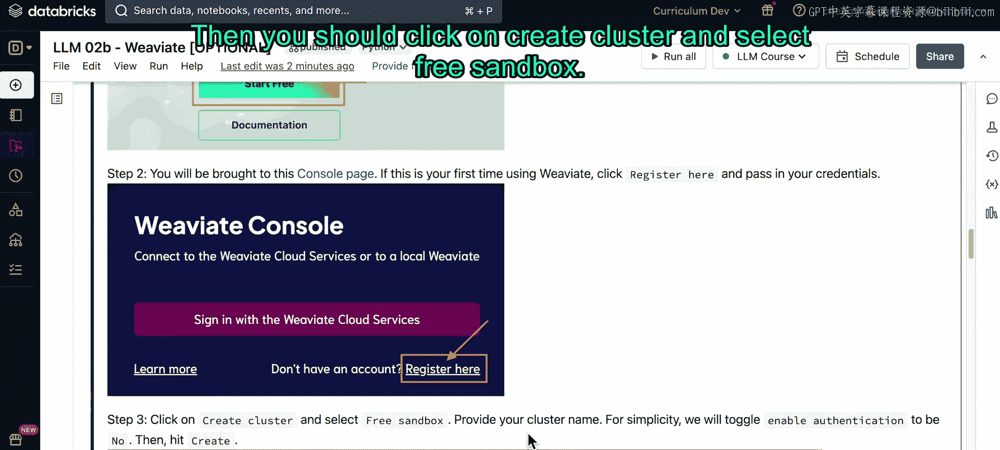
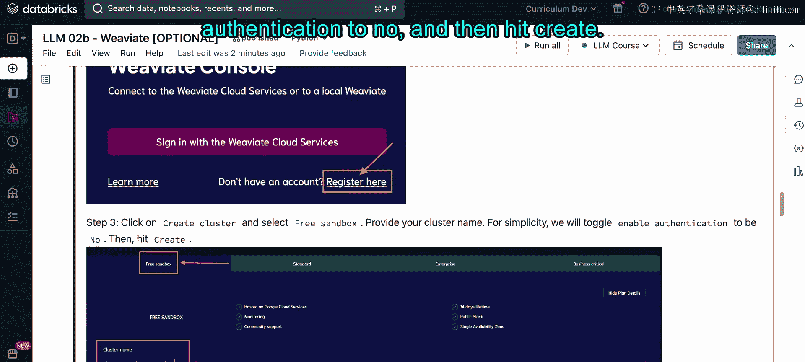
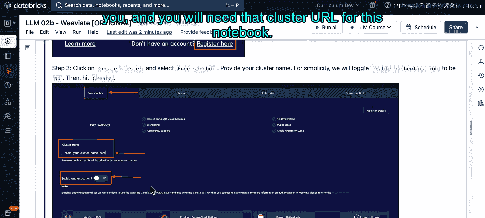
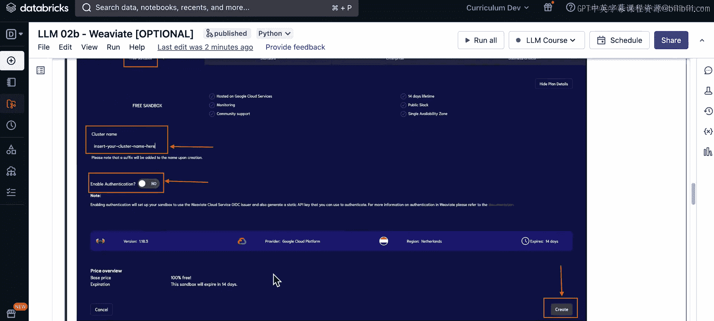
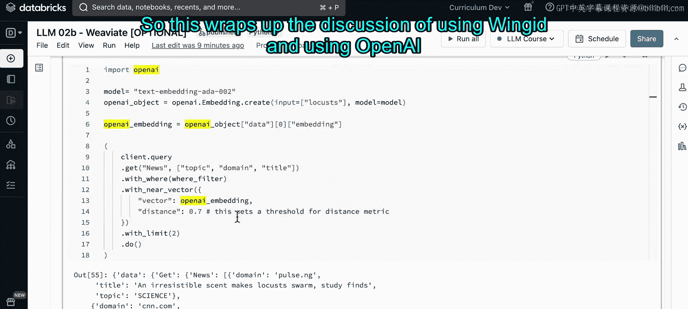

# databricks《大语言模型：从生产到应用｜Large Language Models： Application through Production》 - P29：-29-LLM Module 2 - 2.10 Notebook Demo Weaviate - GPT中英字幕课程资源 - BV1nS411K7Af

In this LM02B notebook， we are going to be using Reviat as our open source vector database ReVat also has an enterprise offering hosted by Zs。

Vi it provides lots of customization options such as to incorporate product quantization or not。

For this notebook to run end to end， you will need to have Wivia Kaya installed and also their sparkark connector jar file。

So in the following cells， we are going to set up our environment by running the P install statement and also by running our classroom setup script。

Please also remember to install this sparkar connector J file and upload your database cluster in your meantime。

Feel free to pause this video and return to this once you are ready。

Now that this customer setup script has finished running。

 we can go ahead and set up alleviate network。First of all， you will need to visit our homepage。

And then click on start free。When you click on Start free。

 you should be automatically brought to this console page。

Where you can click on register here if you have not used media yet before。

Then you should click on createre cluster and select free sendbox。

Provide your own cluster name and for simplicity， just toggle this enabled authentication to know。

And then， he'd create。Once you hit create， Vvit will automatically instant shape a cluster URL for you。

 and you will need that cluster URL for this notebook。

In this notebook we'll also be using embeddings from open AI as well。

 so you will need a token from Open AI if you haven't used Open AI before。

 go ahead and follow these steps in a notebook， create an account and generate an open AI API key。

Open AI doesn't have a free option， but it does give you $5 for free。

 so once you have exhausted a $5 credit， you will be asked to add your payment method and you will be charged based on per token usage。

So it is very important that you keep this open AI API key to yourself because if others have access to your open AI API key。

 they will also be able to charge their usage to your account。

So go ahead and take some minutes to set up both Vvi and Open AI and then copy the respective API keys and the network URLs in the following cell where it says filled in。

For me， I'm going to get my open API API key and the Wevit network URL directly from my Datab Seet School。

Then I can instant shape my reiate client。By also specifying my open AI API key in the additional header argument。

In this notebook， we'll be using the same data set as in a lecture in notebook。

On news topics that is collected by the newskeer team。

 and we are going to store this data set in the Wivit database。 So to do that。

 we actually have to first define a schema I this。In wevi it means that we are going to provide more information about the data that we are going to save in the vector index。

By default， ReVA expects you to capitalize the class name。

 which is why we are capitalizing our news over here。And then in the class object itself。

 we're going to pass in the class name， the description about the data set。

 and then what columns are we actually ingesting， or are we actually saving out to the vector index。

 followed by what text vectorizer model we are going to use in the indexing algorithm。

So go ahead and run this cell。If you have news before， created before。

 we are going to delete it and I recreate it。And if you're curious what the schema actually looks like。

 you can go ahead and run this cell and then check what is actually withinee our class object。

So unsurprisingly， we are seeing T to Web open AI model in here。

 which is the addda model as our vectorizer。Because we have specified soul in our。

Class object up here。Then we can finally write our data out to。

Rvi it so you can see that here is where we're actually using the spark connector jar file。

 so if you don't， if you have not downloaded that file and upload to your databs cluster。

 this cell will definitely fail， you will also need to have valid URLs for ViviA network and a valid open AI API key。

You might already saw this in a documentation of Weviat， the Wvit network will expire after 14 days。

 so if you do revisit this notebook after 14 days， you will need to specify and create a new Wevit network again。

So to check that the data is indeed populated， you have two ways of doing so。

 the first is to copy paste this URL into your browser and then replace this with your own cluster URL。

 the Wviate cluster URL， or you can run this following cell。And then check if this is indeed not now。

 So here I definitely see lots of different topics for each news article over here。

So I can verify that my data has been written out to wea it successfully。

So the next component in the workflow is to actually do a query search。Now in my query search。

 I can first optionally specify a where filter where I actually pass in filtering statement。

So here I am only interested in any topics that is equal to science。

And I'm also going to pass in a query。About locust。

So you will see that we are using this Near text with Neartex API over here to return to us the top two nearest neighbors that has relevant information to Locus。

Alternatively， you can also choose to supply los in a form of embedding。

That is what we are going to do in the next cell。So rather than using with nearar text。

 we'll be using with nearar vector。And in this case， we'll be using exactly the same model。

 which is the E model by open AI， and then rather than supplying locust directly into my query。

 I'm actually going to first convert my locus text into an embedding vector and then pass the embedding vector for locust directly into my query。

 so you will see that my widthme vector over here contains the embedding for locust。

I can also optionally specify the distance metric as well。If you do see this error。

 feel free to just run it again。Because there might be a connection problem with open AI。

So here you will see that we are getting exactly the same results。

 which is not surprising because we are using exactly the same embedding model provided by Open AI。

And were just。Differ， we are just differing in how we actually supply our query。

 So in this cell over here， we're supplying a vector in a cell above， we are supplying the locus。

 the text， which is also using the same text vectorizer under the hood。

 because that's where we specify in our。Class object over here。

So this wraps up the discussion of using media and using open AI for the first time。

