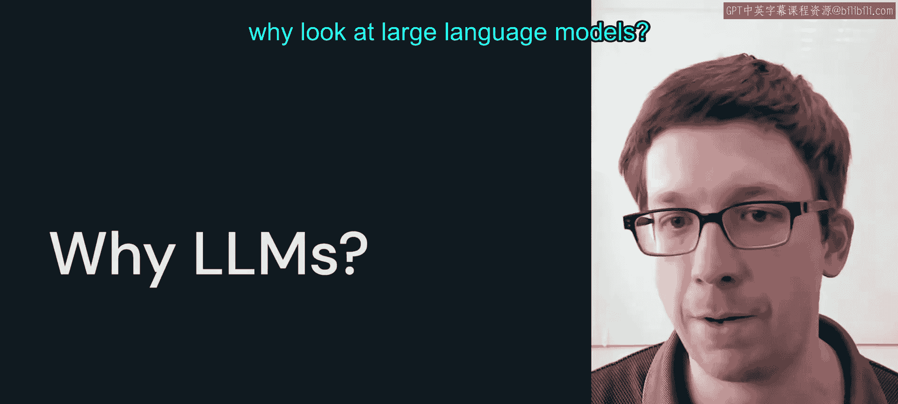
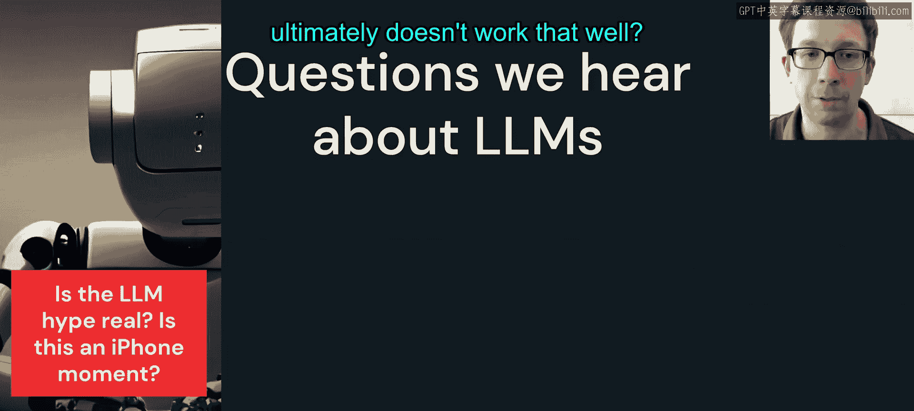
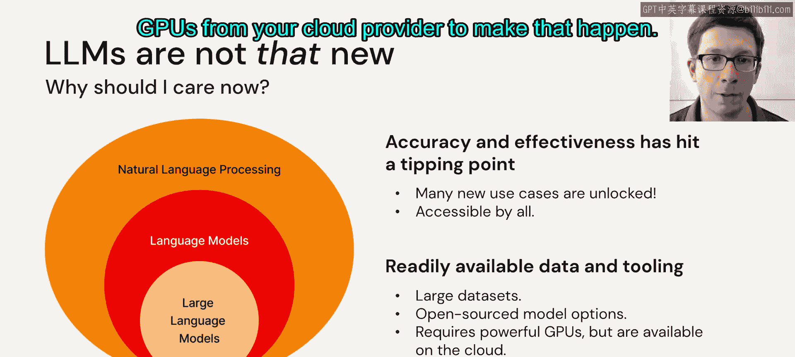
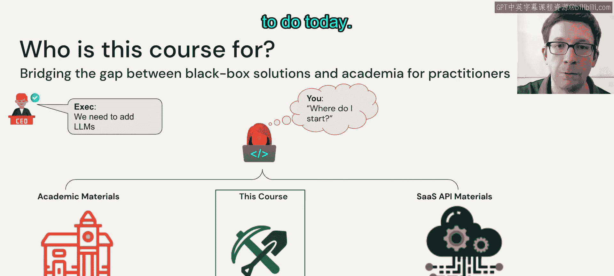
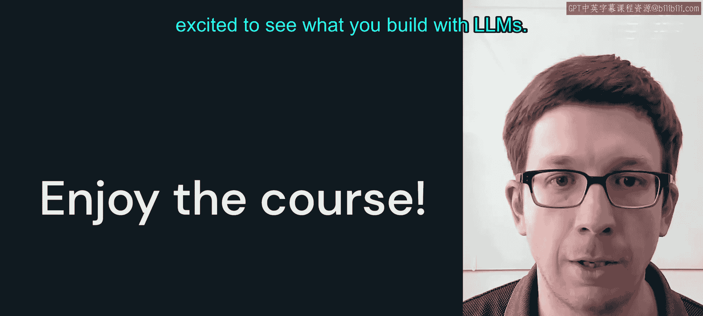

# databricks《大语言模型：从生产到应用｜Large Language Models： Application through Production》 - P2：-02-LLM Module 0 - Introduction _ 0.2 Why LLMs.zh_en - GPT中英字幕课程资源 - BV1nS411K7Af

So the first thing I want to talk about is why LLMs why look at large language models we often hear a lot of questions about LLMs is the hype on them wheel。

 is this an iPhone moment for the industry or is it sort of a hype moment where everyone gets excited about a technology that ultimately doesn't work that well are LLMs a threat or an opportunity and different areas of business in different areas of software and development？

How do you use LLMs to gain a strong competitive advantage in whatever industry you're in？

And finally， how do you quickly apply LLMs to your own data so we're going to talk about all of these really quickly starting with the first one and you know we believe a lot of people believe that LLMs are quite a bit more than hype they are revolutionizing every industry that involves some form of human computer interaction and some kind of like language data or interfaces or in general working with language here are some examples of just like recent stories about the impact of LLMs so Cze is one company that sites shares drop significantly because it found out that users were using chat GPD to answer questions instead of using its service so it's had an impact there they have to think about how to adapt their business and sort of this age of LLMs many companies are building brand new products using LLMs for example you。

com is a startup that does，Search but really is focused on a search assistant that can look at personalized results for you。

 look at the content of those pages and give you high quality complex results and cited sources。

 it's only really possible using LLMs and even existing machine learning tools like GiHub Copit are becoming much more powerful with the latest generation of LLMs GiHub Copit is this code a system that helps you autocomplete code essentially but now it can also do things like fix your code by looking at errors。

 generate tests and so on， all new functionalities thanks to more powerful language models。

At the same time， LLMs are not that new as a fundamental technology。

 they've existed for years even in the current form with deep learning with models such as BRT that were out there so why should you care about them now and really the story here is that the quality of these models has gotten in significantly better as you've gained experience with them。

 so at the beginning people would train language models and we'll talk about this in detail。

 you could train a model on a bunch of text and then you have to customize it a bunch together get to do a specific use case like for example looking at product views and figuring out whether they're positive or negative or figuring out what aspect of the product they're about so even though you had this underlying technology you had to do a lot of handcoing data collection。

 machine learning to actually turn。into a useful application and as we've gotten better at building and tuning LLMs we've managed to make LLMs that you can just give instructions to in natural language that can now do a lot of tasks。

 useful task with very little human effort to set them up so it's really kind of a combination of two things that are enabling all these powerful applications even though the machine learning part of this has been the same for a while the first is that accuracy and effectiveness have hit the tipping point where first of all many use cases are now possible thanks to the accuracy but also importantly it's accessible to everyone thanks to the ability to instruct them a natural language and also increasingly there's been more and more high quality data and tooling available you know a few years ago if you wanted to build something using LLMs you had to call the web and collect clean data sets and do all kinds of stuff on scratch。

You can find a lot of great open data sets that have been collected。

 you can find entire open source models that are very high quality in particular use cases。

 and of course sometimes you do want to do a lot of computation。

 but you can get a lot of great commercial services like GPUs from your cloud provider to make that happen。

So what is an LLM specifically well it's a large language model large of course is in the eye of the beholder。

 but it's one of these things where it's increasingly called large simply because it's larger than the ones that people try to use before and essentially one of the main ways that it's larger is that it's also trained on very large amounts of data so what exactly is a language model though that maybe the more important question。

 a language model is a statistical model that tries to predict words in text in some kind of language。

 so the way to set this up is basically a statistical problem you have a collection of text and you say hey if I show you some words like say the beginning of a sentence but not the end。

 can you predict what the missing words are and this is sort of a prediction problem this is the kind of thing that we've been doing in machine learning and statistics。

For a long time there are lots of ways to try to fit a model to the data to predict these words。

 but it turns out that in the past few years we've developed ways of doing it that can get better and better accuracy especially as you feed in more data and disability ultimately gives you models that learn useful things about the world or can be used to sort of qua interesting information about the world。

 so just to give you a sense of the scale that these operate on you know a typical person might read a few hundred books in their lifetime like say 700 books on average。

 that's a lot of books it takes a long time， but it's not much compared to what we feed into a large language model today a large language model one book is about 80。

000 words which when encoded into the form that a language model takes is a hundred10000 tokens。

 a token is sort of a piece of a word。Talk a lot about them later so but your typical model like say Chad GPD is often trained on trillions of tokens today。

 which means tens of millions of books if you do the math so that's a lot more books than a person would ever look like and if you have a way of turning these into into a useful statistical model you often end up with something that can can be applied to real world tests so just as a very simple example of how you can use this language modeling ability to capture knowledge about the world imagine that I wrote the sentence avocados are and then I left a blank space and I ask the model can you predict which word is more likely in there if I have a good statistical model of language I can use it to learn some things about avocados For example if I wasn't sure what color avocados are I can try putting in a bunch of different colorss and asking you you how likely is it that it's that answer and the model will say it's much more likely that。

The word after blank is green avocados are green versuss avocados are blue so in some sense the model learns something about the color of avocados even though it doesn't really know what an avocado is it just knows about the probabil of words you likewise you can figure out avocados are delicious avocados are probably not intelligent you know all kinds of things like that and if you take this ability to to the extreme use it in more complicated ways you can get these models that will do things like generate text with specific properties like generate a song about sunset in Santa Monica or classify data you can ask it is this a good or bad review and it will do that and these are all based on sort of the knowledge about the world and about reasoning that it gleaned from seeing a large amount of text。

So what does that mean for you as a developer and user。

 well LLMs can automate many tasks that previously required a person to do them in detail that usually involve imperciize language or knowledge about the world that's kind of hard to codeify and put into a computer and these can help both accelerate innovation and build new features。

 new interfaces to software， and just increase ROI and efficiency of a business。

 so just some of the examples of things you can do with it。

 you can speed up software development because a lot of software is code。

 it's in a language and you can get these assistance that are good at specific parts of it。

 you can democratize AI itself， many users can now use LLMs by just talking to them and asking them to do things instead of doing a heavy duty machine learning project。

 you can open up these rich use cases like assistance， analyzing。Documents for business。

 all you know， all kinds of things like that， generating ad copy and stuff like that。 And of course。

 you can reduce development costs of applications and you can reduce monotonous tasks that people have to do get the easy stuff to a model and get people to focus on the hard stuff。

 So we're just beginning to scratch， you know， the use cases。

 you'll see a much more throughout the course。Now unfortunately with LLMs there's no perfect or magic bullet models so once you get past the you know the idea of like what could I use this for and try to actually use it in an application the right model will depend a lot on the requirements for your application and there'll be a lot of trade off required and potentially quite a bit of custom development so here are some of the factors you want to take into account when thinking about an application using LLMs the first one is the model's quality know what kind of quality can I get from it can I find a model that I can use out there that's high quality or do I have a way to improve it myself or do I need to sort of wrap the LLM around in a bigger application that uses this unreliable component to do something reliable at the end。

So that's an important piece the second one is the serving cost this depends a lot on what you're trying to do for example if and this is the cost of just running the model and getting a prediction for example if your application is like reading a couple of documents per day and extracting some information from them it's okay if it costs you know a dollar $10 whatever for the LLM to process one document it's totally fine if your application is placing you know ads on a web page that are customized to each user or as they click through the site for your store you know selecting recommendations for them you can't afford to spend you know many dollars each time someone looks at a page you need to serve you millions maybe hundreds of millions of instances of this per day at a moderate cost so you'll really optimize for cost。

Serving latency is another important factor again， if you're doing some offline analysis it's okay if it takes minutes for your application on。

 but if you're doing something in an interactive webage。

 you know it'd better run in a few milliseconds to get high quality application。

And then the final one that can be tricky and is important to think about is customizability if you have an important application。

 you're going to want to keep improving its quality over time。

 debugging it when something goes on and generally sort of making it better and customizing it so you need to think about indifferent solutions。

 what Knobs do I have to control you know how well this is doing to monitor it to make it better。

 you know to prevent certain kinds of bad behavior that I don't want it to have and so on。

 so this is an important thing to think about as you design your LLM application。

So who is this course for in this course you know we want to really make it useful for practitioners and bridge the gap between two things that you can find out there today in other courses so one of them is just black box solutions like a thirdpart LLM as a service API that you can call where the tutorial is really easy just as okay just put in your text here and call this function and you'll get a result back but it's really hard to then take this and customize it。

 put it into a bigger application and make sure you can get the best quality。

 the best performance and so on because it's basically one model for everyone so that's on the one hand and then on the other hand there's the first principles of how LLMs work。

 how machine learning works how to think about building a pipeline that's reliable that you often find in academic courses and theory and algorithms and so on。

To build this practicalcle course that's in between so that when your boss asks you。

 can you do something with LLMs in my application and you really care about making it work well and getting it right and so on。

 you have the tools to build your own application using existing components out there and we find it and make it really great over time and we hope this gives you a sense of both some of the research and academic foundations of the space。

 but also some of the engineering things you can do to reliably create high qualityality application to the best of our knowledge of what we know how to do today。

So that's a little overview of the course， we hope you enjoy it。

 we had a lot of fun putting it together and we're very excited to see what you build with LLMs。

