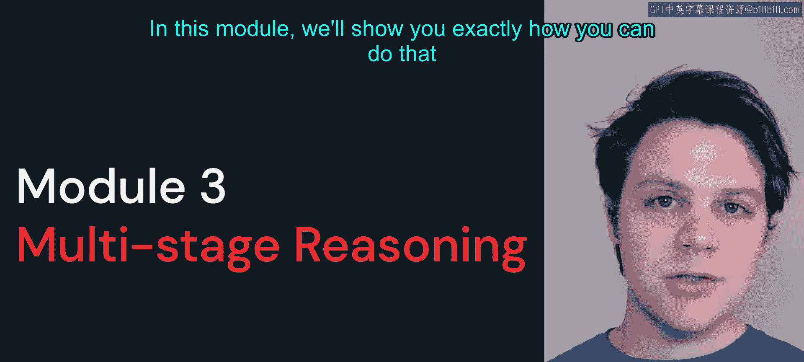
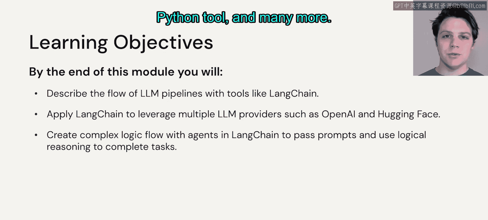
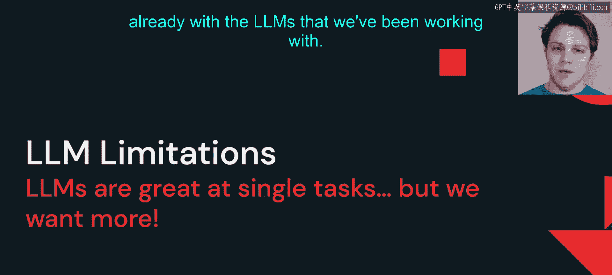
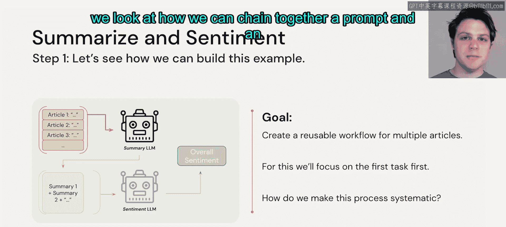

# databricks《大语言模型：从生产到应用｜Large Language Models： Application through Production》 - P31：-31-LLM Module 3 - Multi-stage Reasoning _ 3.2 Module Overview.zh_en - GPT中英字幕课程资源 - BV1nS411K7Af

Welcome to moduleule 3。In the last two modules， we saw how we can download large language models from places like Huging F to solve various tasks in NLP。

 and we also saw how we can convert our data to vector format and perform vector type searches using vector databases。

You might be wondering then how can we combine these two features together to really enhance the applications that I can build as a developer in this module。

 we'll show you exactly how you can do that with the various tools that are available。😊。

By the end of the module， you'll be able to describe the flow of LLM pipelines with tools like La chain。

 You'll use La chain to build。Peplans that involve。LLMs from various providers。

 including Open AI and Huging face， and then will build really complex logical flow patterns using agents that leverage LLMs as the centralized brain and different tools that they can use to solve the tasks that they're given。

These tools might be web searching， might be coding environments like a Python tool and many more。

As we get started into this， I want you to take a moment to think about some of the limitations that we've actually seen already with the LLMs that we've been working with。

😊。

If you think about what we saw in Mo 1， LLMs are fantastic at solving traditional NOP tasks。

 we might give it a summarization task and it performs that fantastically。

 we might ask it to translate some text and it does that almost flawlessly。Zero shot classification。

 it does， depending on how well the model has been trained for。

 All of these different things LLms are fantastic at。 However。

 most workflows that we think about involve more than just this simple input and output response。😊。

Typically， if we're building an application， the LLM will just be one part of the entire workflow of this end to end application that we're designing。

😊，So we need to think about how we can link together LLMs and other pieces of our code so that they work seamlessly together and that if we need to maybe swap in add one LLM for another。

 it doesn't break the entire end to end system。The goal of the multis stageage reasoning module that we're talking about now is to show you how these tools can be built up。

So that it's modularized in the sense that you could take out an LLM and put a different one in。

Let's consider an example where we wanted to summarize and get the sentiment of a particular article。

 which is not an outlandish or a ridiculous task。😊。

If we think about how he might approach this with just one Live language model。

 we could give it a bunch of different articles， ask it to summarize it， and then get the sentiment。

That's quite a few tasks for it to deal with in one go。

A better strategy might be to take one article at a time。

 pass it through a sumization large language model。

 and then the output of that summary could then be given to a sentiment analysis large language model。

Now we could think that conceptually we have all the tools we need to do this。

 but how do we actually do this in a programmatic fashion？

If we think about the issues of having one large language model do all of this。

 we've run into all kinds of issues with needing a very large very large LLM to be able to both summarize and perform sentiment analysis as that's quite a complicated task to do in one go。

 and we also need to worry about the fact that if we're giving all of the articles to the LLM in our prompt。

Will very quickly overwhelm the input sequence length that the LLM is built for。

So what we need to do is break up every article into a single article。Pass them through one by one。

Collect the output of our summary LLM。And give those summaries as the input to the sentiment LLM that we're going to create。

This framework then becomes a reusable tool so that we can keep passing it in new articles and it can generate piece by piece。

 the different steps。Of this application。So let's focus on that first task。

 instead of passing all of the articles in as a giant prompt， we're going to pass them in one by one。

So we want to make sure that we have a systematic way to。

Abstract out each article so that we can input them almost as a variable。

This is what we're going to cover in the next video when we look at how we can chain together a prompt and an LLM。

😊。

